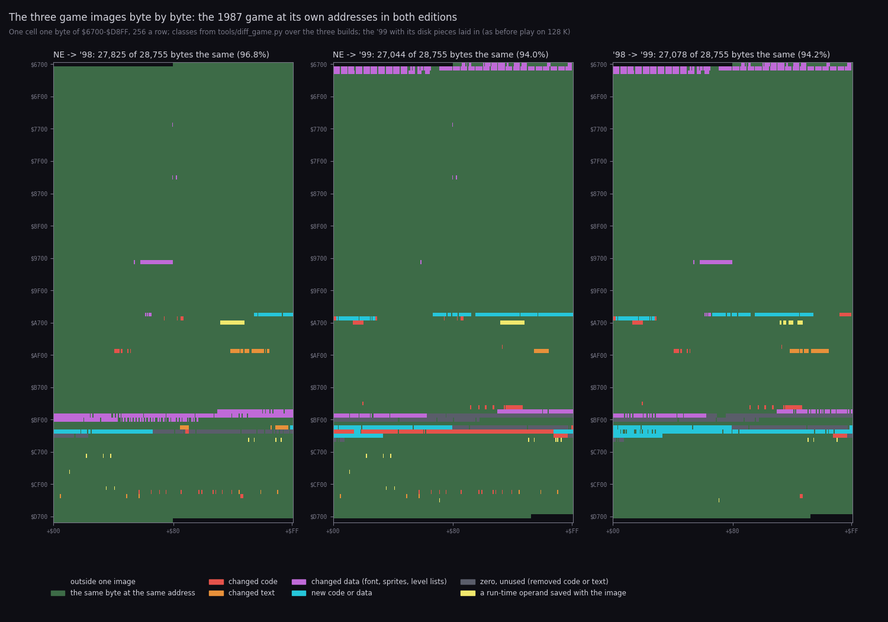
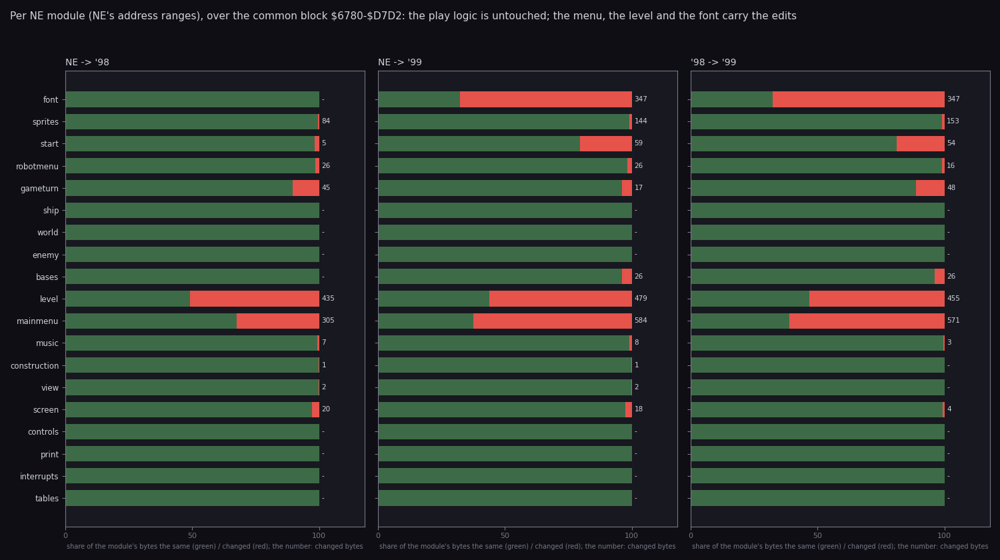
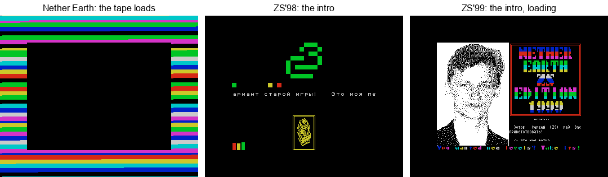
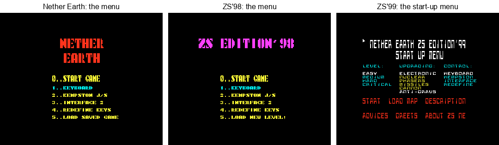
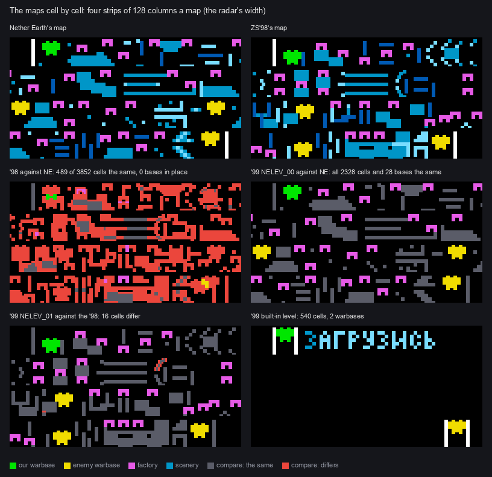
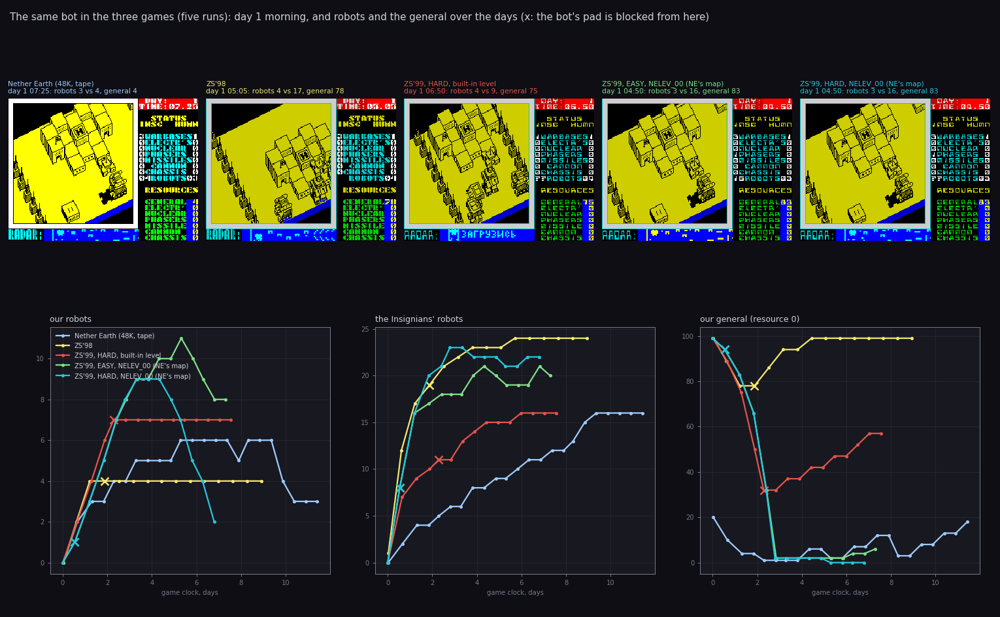
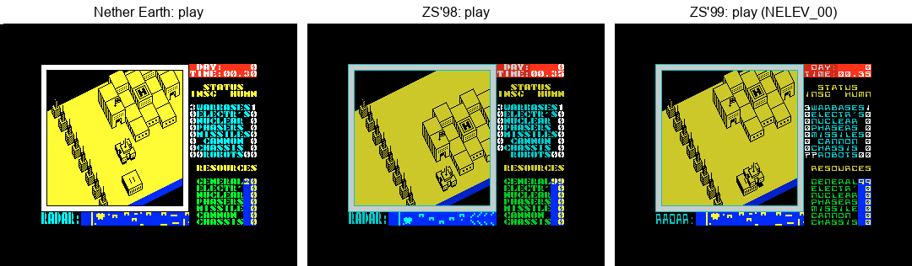
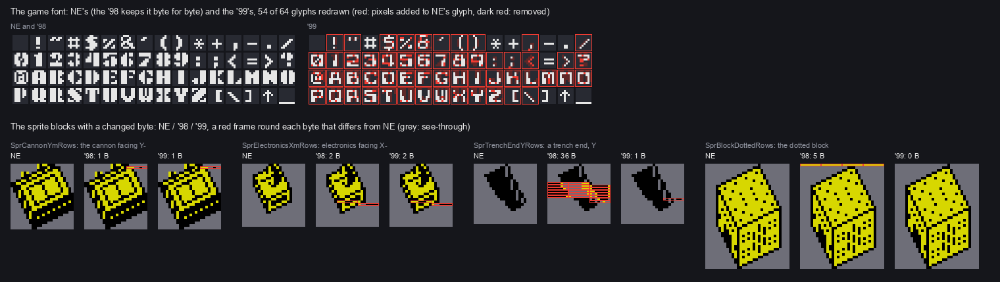

# 13. Differences from Nether Earth

What the two ZS Editions changed in Nether Earth, why, and what the player gets from it. Each point is backed by the
code, the bytes and the recordings. The '98 and the '99 are each compared with Nether Earth, and then with each other.

## 13.0 The three games and the verdict

- **NE** is Nether Earth (Argus Press Software, 1987), a 48K tape game. Its case is
  [`../nether-earth`](../../nether-earth/README.md); a path after "NE" is in that case.
- **'98** is ZS Edition'98 (`NEZSED98.SCL`, 23.12.1998), and **'99** is ZS Edition'99 (`NEZSED.SCL`, 30.01.1999).
  Both are this case, Pentagon 128 with TR-DOS. Their paths are relative to this case.

The short answer:

- Both editions keep NE's game at NE's addresses, `$6780-$D7D2`. They are patches of the 1987 image, not rewrites:
  - 96.8 % of those 28 755 bytes are the same in the '98;
  - 94.0 % are the same in the '99 as it stands in play (13.1).
- Robots, movement, combat, path finding, the ship, the view, the radar, the clock and the effects are NE's code
  byte for byte in both. So are the enemy commander's choices and all of NE's bugs (13.9).
- **The '98** is NE with a new map, a harder enemy and a TR-DOS start:
  - an intro with an AY tune;
  - a new map, the same 28 bases in other places;
  - the enemy gets 99 of every resource every midnight and an upgrade of every robot it owns, and its robot count is
    hidden;
  - a warbase pays the player 8 general a day instead of 5, and the player starts with 99 general instead of 20;
  - the save is cut, and the load became LOAD NEW LEVEL, which crashes;
  - the play screen lost its BRIGHT.
- **The '99** keeps all that and moves it from fixed patches into choices:
  - a start-up menu with four levels, written into the game as code patches before each start (13.5);
  - the upgrade's parts the player's choice;
  - LOAD MAP of twelve map files, whose last 13 bytes are written into the game's operands (13.7);
  - a new font, four texts, and a photo intro with a Sound Tracker tune.
  - The built-in level is a sign that says "load up". The tape save, the tape load and NE's main menu are gone.
- **The author's claims settle like this** (13.13):
  - "even on EASY an order of magnitude harder than the original" holds for the enemy's numbers. The same bot on
    NE's own map (`NELEV_00`) meets 16 enemy robots on the morning of day 1 on EASY, against 4 in NE.
  - "some subroutines were rewritten from scratch" does not hold for the game. Of NE's 563 entries, 501 are the
    same bytes in the '99. The new code is the menu, the disk pieces and two routines of 28 and 14 bytes.

How it was compared:

- All three reverses are complete, and all three rebuild their originals byte for byte from source. This case's
  annotations use NE's names wherever the code is NE's.
- The game images were compared entry by entry and instruction by instruction with `tools/diff_game.py`, and byte by
  byte with `tools/fig_diff_memmap.py`. For the '99 the disk pieces that stage 3 lays over the block on 128 K are
  included, as they stand in play (13.14).
- The maps were compared cell by cell through each image's own `BuildMap` list operands (`tools/fig_diff_maps.py`).
- One bot played all three games: NE's bot (NE `tools/bot.py`) through NE `work/deep`, this case's
  `work/stage2/game98/deep`, `work/zsB/deep` and `work/zsB/deep-map0`. One new recording was made for this
  document: the '99 on EASY with `NELEV_00`, `work/diff/deep-easy-map0` (13.8).

Witnesses:

- "NE line N" is a line of NE `build/game.lst`. "'98 line N" is a line of `build/game98/game98.lst`, and "'99 line N"
  a line of `build/game99/game.lst`.
- The recordings are named as in [the recordings table](README.md#recordings).
- An NE frame is 69 888 T (19.97 ms); a Pentagon frame is 71 680 T (20.48 ms) ([terms](README.md#terms)).
- The figures are in `docs/img/diff/` and `docs/img/compare/`. Every command is run from this case's root.

## The differences at a glance

| What | NE | '98 | '99 | Why | For the player | |
| --- | --- | --- | --- | --- | --- | --- |
| game image | `$5B00-$FCE8` from tape | NE's `$6780-$D87F`, not packed | NE's `$6780-$D7D2`, LZ-packed, 4 disk pieces laid over it | the editions patch NE in place | the same game underneath | [13.1](#131-the-game-images-byte-by-byte) |
| bytes the same as NE | | 27 825 of 28 755 (96.8 %) | 27 044 (94.0 %) in play | patches, not rewrites | | [13.1](#131-the-game-images-byte-by-byte) |
| medium | tape, 265 s of signal | one BASIC file on TR-DOS | 18 files: packed blocks, texts, maps | the 1998 Russian scene's standard | seconds instead of minutes | [13.2](#132-the-disk-and-the-load) |
| memory | 48K, full | 48K + the intro over the free top | 128K: the menu in page 1, the texts in page 3 | the menu and texts need room | the '99 runs on 128K only | [13.3](#133-the-memory) |
| before play | NE's menu, beeper tune | an AY intro, then NE's menu ("ZS EDITION'98") | photo intro, System checking, a silent start-up menu | the author's additions | more to see; LEVEL, UPGRADING, LOAD MAP | [13.4](#134-the-start-up-and-the-menus) |
| difficulty | none | one fixed setting | EASY, MEDIUM, HARD, CRITICAL, written as code | "boring to play the same level hundreds of times" | a choice | [13.5](#135-the-difficulty-levels-as-code-patches) |
| the enemy's start | 20 general | 99 of all 7 | 99 of all 7 on every level | "the enemy's money is simply unlimited" | many more enemy robots from the first hour | [13.6](#136-the-enemy-resources-production-and-the-upgrade) |
| the enemy's income | 5 a warbase, 2 a factory | refilled to 99 at midnight | EASY: NE's; MEDIUM+: refilled before every robot; HARD+: no income | the levels | it never runs short above EASY | [13.6](#136-the-enemy-resources-production-and-the-upgrade) |
| the enemy's upgrade | none | every robot each midnight: anti-grav + electronics | HARD, CRITICAL; parts the player's or all (CRITICAL) | "the enemy can upgrade its ALREADY BUILT robots" | enemy robots grow under way | [13.6](#136-the-enemy-resources-production-and-the-upgrade) |
| the player's income | 20 general, 5 a warbase | 99, 8 a warbase | 99 (the map's), 5 a warbase | "you are given a little more money" | a fast start | [13.6](#136-the-enemy-resources-production-and-the-upgrade) |
| the enemy's robot count | shown | blank | EASY shown, MEDIUM+ `??` | "it is more interesting that way" | the panel hides it | [13.6](#136-the-enemy-resources-production-and-the-upgrade) |
| map | NE's | new, 489 of 3 852 cells NE's, no base in place | built-in: 540 cells, 2 warbases; 12 files, `NELEV_00` = NE's | "the main reason for making the Edition" | new wars; the built-in level is unplayable | [13.7](#137-maps-load-map-and-load-new-level) |
| capture points | 28, fixed | 28 | the map's count, 2 on the built-in level | written by LOAD MAP | a capture bug off 28 | [13.9](#139-bugs-kept-new-and-fixed) |
| save / load | tape, two blocks | save key redraws; LOAD NEW LEVEL crashes | none | "for lack of memory" | no saved games | [13.4](#134-the-start-up-and-the-menus) |
| NE's bugs | NE 10.12 | all kept, same bytes | all kept; the menu tune's is never run | NE's logic is untouched | the same quirks | [13.9](#139-bugs-kept-new-and-fixed) |
| new bugs | | the upgrade's height, free slots, LOAD NEW LEVEL | the same two, the capture index, warbases 4+, UPGRADING below HARD, LOAD MAP lines, the 48K reset, the TR-DOS-item hang | the patches | some maps and levels act wrong | [13.9](#139-bugs-kept-new-and-fixed) |
| sound | beeper effects, beeper menu tune | + PT3 intro tune | + Sound Tracker intro tune; the menu silent, the beeper tune never called | 128K AY | the same effects in play | [13.10](#1310-sound) |
| texts | English | 3 strings changed | WonText changed; 4 long texts on the disk | the author's additions | English captions kept | [13.11](#1311-texts) |
| play screen | BRIGHT attributes | BRIGHT removed, cyan frame | the same | not said | darker yellow, cyan frame | [13.12](#1312-rendering-the-play-screen-the-font-and-the-sprites) |
| font | NE's | NE's | 54 of 64 glyphs redrawn | not said | squarer letters, a slashed zero | [13.12](#1312-rendering-the-play-screen-the-font-and-the-sprites) |
| sprites | 89 blocks | 4 blocks touched (44 bytes) | 3 blocks touched (4 bytes) | small redraws | nearly the same look | [13.12](#1312-rendering-the-play-screen-the-font-and-the-sprites) |

## 13.1 The game images byte by byte



How to read it:

- **Three panels**: NE against the '98, NE against the '99, and the '98 against the '99. In each, one cell is one
  byte of `$6700-$D8FF`, 256 bytes a row.
- **The colours** come from `tools/diff_game.py`'s entries of both sides:
  - green: the same byte;
  - red: changed code;
  - orange: changed text;
  - violet: changed data (the font, the sprites, the level lists);
  - cyan: new code or data;
  - grey: zero bytes the newer side leaves unused;
  - yellow: an operand the code writes while it runs, saved in the image as it was;
  - black: outside one of the images.
- **The '99 side** is the game block with the four disk pieces laid in. This is the memory of play on 128 K
  (`r99` frame 6450).
- **The title** of each panel gives the bytes the same over the block all three hold, `$6780-$D7D2`.
- **The point**: almost all of every panel is green. The changes sit in a few bands:
  - the font (the '99 only);
  - `$A56A-$A62E`, NE's spare bytes under `Start`;
  - the level lists `$BDA9-$BF9B`;
  - the main menu and the tape code `$C100-$C333`;
  - a few bytes of the turn, the panel and the play screen.
- Drawn by `python3 tools/fig_diff_memmap.py`, which also prints the counts and every changed region with both sides'
  entry names (and writes them to `work/diff/bytes.json`).

| Pair | Same | % | Differ | Code | Text | Data | New | Free | Run-time |
| --- | ---: | ---: | ---: | ---: | ---: | ---: | ---: | ---: | ---: |
| NE -> '98 | 27 825 | 96.77 | 930 | 33 | 66 | 479 | 146 | 170 | 36 |
| NE -> '99, the block as on disk | 27 154 | 94.43 | 1 601 | | | | | | |
| NE -> '99, in play | 27 044 | 94.05 | 1 711 | 300 | 22 | 524 | 383 | 444 | 38 |
| '98 -> '99, in play | 27 078 | 94.17 | 1 677 | 84 | 37 | 546 | 555 | 435 | 20 |

The '99 in play differs from its disk block by the four pieces stage 3 copies in (`paging128` `$A56A`, `diskread`
`$A598`, `menu128` `$C100`, `diskmap` `$C1FD`; [3.3](03-build-and-load.md#33-the-99-load)). The level patches of
13.5 come on top of that at START. The table counts the EASY state, which is the block's own bytes.



How to read it:

- **One bar per NE module**, in NE's address order. The ranges are NE's for all three pairs: both editions keep NE's
  addresses.
- **Green / red**: the share of the module's bytes that are the same / changed. **The number**: the bytes changed.
- **The point**:
  - Nine modules are untouched in every pair: ship, world, enemy, controls, print, interrupts, tables, and in effect
    view and construction (their 1-2 bytes are run-time operands, 13.1.2).
  - The changes are the level (435 / 479 bytes), the main menu (305 / 584) and in the '99 the font (347).
- Drawn by `python3 tools/fig_diff_memmap.py` (the same run).

### 13.1.1 The entries

`tools/diff_game.py` cuts each image into the `.ann` entries of its own annotation and pairs them by address, by
name and by bytes (13.14.1). The counts:

| Pair | Entries | Same | Changed | Only the first | Only the second | Run-time only |
| --- | --- | ---: | ---: | ---: | ---: | ---: |
| NE / '98 | 563 / 553 | 520 | 28 | 7 | 5 | 8 |
| NE / '99 | 563 / 552 | 501 | 28 | 24 | 23 | 10 |
| '98 / '99 | 553 / 552 | 506 | 23 | 22 | 23 | 2 |

"Run-time only" counts NE's variables past the image, which the editions keep as `@equ` too.

The changed regions of NE -> '98, as `fig_diff_memmap.py` prints them (gaps under 16 bytes merged, leftovers left
out):

| Region | Bytes | NE | '98 | Section |
| --- | ---: | --- | --- | --- |
| `$767F`, `$837F-$8383`, `$9856-$987F`, `$A562-$A568` | 44 | `SprCannonYmRows`, `SprElectronicsXmRows`, `SprTrenchEndYRows`, `SprBlockDottedRows` | the same, redrawn | 13.12 |
| `$A5D6-$A5FF` | 40 | `SpriteSpare` (zeros) | `UpgradeEnemyRobots`, `FillEnemyResources` | 13.6 |
| `$A676-$A68A` | 5 | `NewGameSetup` | ShipY 14, general 99, `CALL FillEnemyResources` | 13.6 |
| `$AE41-$AE52` | 10 | `DailyProduction`, `ProduceSide` | the enemy's production replaced; x 8 a warbase | 13.6 |
| `$AEBD-$AEE6` | 35 | `WonText` | "WELL DONE! WAIT FOR / NEW LEVELS FROM ZS!" | 13.11 |
| `$BDAF-$BF9A` | 435 | the level lists | another map | 13.7 |
| `$C187-$C190` | 10 | `MenuMoreText` | "5..LOAD NEW LEVEL!" | 13.4 |
| `$C1E8-$C324` | 295 | `TitleText`, the tape load and save | "ZS EDITION'98", `LoadNewLevel`, `SaveGame` = `RET`, spare | 13.4 |
| `$D15B-$D25B` | 15 | `DrawPlayScreen`, `PlayScreenText`, `StatusPanelText` | BRIGHT removed | 13.12 |
| `$D2C8-$D2CA` | 3 | `PrintInsgCounts` | 3 `NOP`s: the count blank | 13.6 |

NE -> '99 adds these and drops some of the above:

| Region | Bytes | NE | '99 | Section |
| --- | ---: | --- | --- | --- |
| `$6789-$6966` | 347 | `Font` | a new font | 13.12 |
| `$A56A-$A62E` | 183 | `SpriteSpare`, `Start` | `PagedText`, `SetPage`, `DiskRead` (pieces), the two difficulty routines, `Start` = `CALL $C100` + `StartGame` | 13.4, 13.5 |
| `$A715-$A71F` | 11 | `PlayLoop`'s save key | `JP PlayLoop`, 8 `NOP`s | 13.4 |
| `$ADB4`, `$BB1F` | 2 | `LD B,$1C` in `GameTurnEnd`, `CountBases` | `LD B,$02`: the capture points, written by LOAD MAP | 13.7 |
| `$BC92-$BCC9` | 25 | `BuildMap` | list operands, a loop over the enemy's warbases | 13.7 |
| `$BDAF-$BF9B` | 479 | the level lists | the built-in level (187 bytes) and `LevelSpare` (312) | 13.7 |
| `$C100-$C334` | 554 | the main menu, the tape load and save | `menu128` and `diskmap` (pieces), `MainMenuSpare` | 13.4, 13.7 |
| `$C3EB-$C40B` | 30 | `ReadAbortKey`, `ReadSaveKey` | the SAVE key gone from REDEFINE | 13.4 |

The '99 keeps NE's `DailyProduction`, `PrintInsgCounts` and the `$B87E` load in its block: they are EASY. The menu
writes MEDIUM, HARD and CRITICAL over them at START (13.5).

### 13.1.2 Bytes that are not changes

36 bytes in the '98 and 38 in the '99 differ only because the game writes them while it runs, and each image was saved from memory at some
moment. The code that writes them is the same in all three:

| Entry | Bytes | What writes it |
| --- | --- | --- |
| `OrderLine` `$A7B2` | 26 | the robot menu's text buffer |
| `LeadStep`, `BassStep` operands `$C4D0`, `$C4D6`, `$C4EF`, `$C4F3` | 2-3 | the menu tune ([9.1](09-sound.md#91-what-sounds-where)) |
| `TitleColourCycle` operands `$C823`, `$C835`, `$C83D` | 3 | the menu's title colour cycle |
| `MenuResourcePos` `$CC11` | 1 | the construction menu |
| `FillViewCorner` `$D038`, `$D041` | 2 | the view's corner fill |
| `Random` `$D371` ('99) | 1 | the random generator's index |

The '98 image also carries 128 zero bytes `$D800-$D87F` past the others' end, the head of `RadarOwn`, which its
BASIC loader reads with the game.

## 13.2 The disk and the load

| | NE | '98 | '99 |
| --- | --- | --- | --- |
| medium | tape: BASIC, the loader N1, one 48 361-byte block | `NEZSED98.SCL`: one BASIC file `NEZSEd.B`, 157 sectors | `NEZSED.SCL`: `NEZSEd99.B` (133 sectors of packed blocks), 5 texts, 12 maps |
| the game on the medium | `$4000-$FCE8`, raw | `$6780-$D87F`, raw (113 sectors) | `$6780-$D7D2`, backward LZ: 17 206 bytes for 28 755 |
| reader | N1, a copy of LD-BYTES | the REM loader `$5D40`, TR-DOS `#3D13` by sector number | a BASIC reader, then every block reads the next by sector number |
| before play | nothing | the intro with its PT3 tune (`$C000-$E9FF`) | stage 2 (intro), the pictures, the music, stage 3 (System checking), the patches, the menu, the texts |
| to the menu | 12 660 frames (252.8 s) from the tape's start | `RUN` to the intro 145 frames (3.0 s); the key to the menu 297 frames (6.1 s) | the autostart to the intro 125 frames (2.6 s); SPACE to the start-up menu 1 351 frames (27.7 s) |
| witness | NE [3.3](../../nether-earth/docs/03-build-and-load.md#33-the-load-step-by-step), `play` | `r98`, [3.2](03-build-and-load.md#32-the-98-load) | `r99`, [3.3](03-build-and-load.md#33-the-99-load) |



How to read it:

- **Three panels**, real frames of the recordings: NE's `ne-play` frame 5000 (the tape still loading), `r98` frame
  3000 (the '98 intro) and `r99` frame 1002 (the '99 intro).
- **The point**: NE shows its loading screen for four minutes. The editions show an intro of their own while the
  disk is quiet, and both intros wait for a key.
- Drawn by `python3 tools/fig_compare.py --port-base 17000` (an instance of its own, muted, stopped at the end).

What it means for the player:

- The '98 is NE's image read raw from disk, so its play starts about nine seconds after `RUN`, not four and a half
  minutes after the tape starts.
- The '99's 27.7 s after SPACE hold the intro's exit, System checking (a memory test over several paging schemes,
  [3.6](03-build-and-load.md#36-machines-and-the-rom)) and the reads of the game, the patches, the menu and the
  texts. The '98 has none of that before its menu.
- The '99's own claims about the medium do not hold: "48Kb (though 128Kb is better)" and "a tape recorder (the
  program will work out by itself what it has to work with)" ([NEabout](texts/NEabout.md)).
  - On a 48K with Beta 128 it resets (`r99-48`, frames 5647-5664).
  - The tape set of the patches block is never selected (13.13).

## 13.3 The memory

The game image is the one fixed thing ([2.2](02-architecture.md#22-the-memory-map)). Around it:

| Range | NE | '98 | '99 |
| --- | --- | --- | --- |
| `$4000-$677F` | the screen and the view buffer | the same | the same |
| `$6780-$697F` | `Font` | NE's font | a new font |
| `$A56A-$A5FF` | `SpriteSpare`, 150 zero bytes | `$A5D6-$A5FF`: `UpgradeEnemyRobots`, `FillEnemyResources`; the rest zeros | `PagedText` `$A56A`, `SetPage` `$A58A`, `DiskRead` `$A598`, `DiskRomCall` `$A5D1` (pieces), then the two routines |
| `$A600-$A62C` | `Start`, `CALL MainMenu` at `$A62A` | NE's | `CALL $C100` (the menu), then NE's `Start` moved down 3 bytes as `StartGame` `$A603` |
| `$BDA9-$BF9B` | the level lists | another map, the same layout | the built-in level, 187 bytes, then 312 spare bytes that LOAD MAP fills |
| `$C100-$C333` | the main menu, the tape load and save | NE's menu, `LoadNewLevel`, `SaveGame` = `RET`, 183 spare bytes | `menu128` (the door to the start-up menu) and `diskmap` (LOAD MAP), pieces; 126 spare bytes |
| `$C4A7-$C848` | `MenuMusic`, its tracks, `TitleColourCycle` | the same, called | the same, never called |
| `$D800-$FFFF` | radar, robots, map, variables, IM 2, buildings | the same | the same |
| `$C000-$FFFF` before play | | the '98 intro and its PT3 tune | the Sound Tracker tune; page 1: the start-up menu; page 3: the four texts |

- Both editions keep the IM 2 jump at NE's `$FDFD` and its table at `$FE00`. This matters for NE's aim bug (13.9).
- The '99 keeps the start-up menu in page 1 and copies it to `$D800` on each entry. This takes `$D800-$E7FF`, the
  radar and the robots' room, so the menu can only run between games
  ([4.2](04-game-loop.md#42-entering-the-start-up-menu-99)). This is why the '99 needs 128K.
- The author's reason for no save: "Too little memory! All the 48K of memory is taken in this game! Not a single
  free byte! I had to do extra loads and give up saving states" ([NEZSEd99](texts/NEZSEd99.md)). The diff confirms
  the shortage the patches had to live with:
  - the new code fits NE's 150 spare bytes under `Start`, and the space the tape code left;
  - the '99's LOAD MAP code is a piece copied over NE's menu at run time.

## 13.4 The start-up and the menus



How to read it:

- **Three panels**: NE's menu (`ne-play` 12750), the '98 menu (`r98` 4703), and the '99 start-up menu (`r99` 3002).
- **The point**:
  - The '98 is NE's menu with a new title and a new item 5.
  - The '99 replaces it with a menu of its own: LEVEL, UPGRADING, CONTROL, START, LOAD MAP, REDEFINE and the four
    texts.
- Drawn by `python3 tools/fig_compare.py`.

| | NE | '98 | '99 |
| --- | --- | --- | --- |
| title | "NETHER EARTH" | "ZS EDITION'98" (`TitleText` `$C1E6`) | none in the game; the start-up menu's own title |
| menu code | `MainMenu` `$C100`, keys 0-5 | NE's | `$C100` is `MenuTable128`; `Start` calls it first and the start-up menu returns to `StartGame` `$A603` |
| key 5 | LOAD SAVED GAME (tape) | LOAD NEW LEVEL! (crashes) | LOAD MAP in the start-up menu |
| save key in play | `Input` bit 5: `CALL SaveGame` | `SaveGame` is `RET`: the key only redraws the play screen | no save key: `PlayLoop` `$A715` `JP PlayLoop`, 8 `NOP`s |
| REDEFINE | 8 keys, the last SAVE | 8 keys | 7 keys; `ReadAbortKey` writes ENTER into the SAVE record |
| menu music | the beeper tune | the beeper tune | none: the start-up menu is silent |
| loaded game | `NewGameSetup` `$A62D` skips on NZ | the same | 2 `NOP`s: every game is new |

The '99's `PlayLoop` against NE's, from `python3 tools/diff_game.py --pair NE:Z99 --show PlayLoop --context 1`:

```
NE line 2332  A712 C2 00 A6  JP NZ,Start      | '99 line 1579  A712 C2 00 A6  JP NZ,Start
NE line 2333  A715 CB 6F     BIT 5,A          |
NE line 2334  A717 CA 9A A6  JP Z,PlayLoop    |
NE line 2335  A71A CD 8D C2  CALL SaveGame    |
NE line 2336  A71D C3 8E A6  JP EnterPlay     | '99 line 1580  A715 C3 9A A6  JP PlayLoop
                                              | '99 line 1584  A718 00 x 8    DEFB 0 (SaveCallRemoved)
```

The '99's `Start` against NE's (`--show Start`): one `CALL` added in front, the menu call at the end dropped. NE's
16 instructions in between are the same bytes, 3 bytes lower:

```
                                              | '99 line 1383  A600 CD 00 C1  CALL $C100   (the start-up menu)
NE line 2145  A600 F3        DI               | '99 line 1394  A603 F3        DI           (StartGame)
  ... the IM 2 table, the seed: the same 42 bytes ...
NE line 2170  A62A CD 00 C1  CALL MainMenu    |
```

Why, in the author's words:

- On saving: "At first the game was to save its state, but I had to give that up for lack of memory (and anyway any
  level can be finished in a couple of hours at most)" ([NEabout](texts/NEabout.md)).
- On the other saving edition: "Eternity Industry changed nothing in the game except saving / loading the game state
  (which in my view is needless anyway, since the standard game is finished in 11 days!)"
  ([NEZSEd99](texts/NEZSEd99.md)).
- On the menu: "Because of the changes, the start menu had to change too."

For the player:

- No saved games in either edition. In the '98 the SAVE key does nothing but redraw the screen. In the '99 there is
  no key, and REDEFINE asks for seven.
- In the '98, key 5 resets the machine (13.9).

## 13.5 The difficulty levels as code patches

NE has no level setting ([NE 1.11](../../nether-earth/docs/01-game-design.md#111-winning-and-losing): "There is no
score, no time limit and no difficulty setting"). The '98 has one fixed set of patches. The '99's start-up menu
writes one of four sets into the game at START. The game holds no level variable and tests none
([10.3](10-gameplay-logic.md#103-the-difficulty-levels)).

The '99's `StartGame` `$DA8E` (`build/menu99/menu.lst`), which copies the EASY bytes first, then the bytes of each
level up to the chosen one:

```
DA8E 21 E6 DA   LD HL,LevelPatches     ; EASY: the game's own bytes back
DA91 11 7E B8   LD DE,$B87E            ;   3 bytes: the enemy's build
DA97 ED B0      LDIR
DA99 11 C8 D2   LD DE,$D2C8            ;   6 bytes: the enemy's robot count
DA9F ED B0      LDIR
DAA1 11 41 AE   LD DE,$AE41            ;   9 bytes: the enemy's production
DAA7 ED B0      LDIR
DAA9 3A 80 D9   LD A,(LevelLd+1)
DAAC FE 01      CP $01 / ... RET Z     ; EASY ends here
DAB1 21 F8 DA   LD HL,PatchSpawn99     ; MEDIUM+: CALL $A5F2 at $B87E, NOP CALL PrintInline "??" at $D2C8
  ...           CP $02 / RET Z
DACC 11 41 AE   LD DE,$AE41            ; HARD+: 6 NOPs, CALL $A5D6 at $AE41
  ...           CP $03 / RET Z
DADC 3E FC      LD A,$FC               ; CRITICAL: $A5E7 = $FC, $A5E5 = 0
```

The four levels and the '98 against NE, at the three patched places:

| | `$B87E`: the enemy builds a robot | `$D2C8`: the panel | `$AE41`: midnight | `$A5E5` / `$A5E7` |
| --- | --- | --- | --- | --- |
| NE | `LD HL,$FD4A`: pays from its resources | `CALL PrintNumber2Zero`: the count | `LD HL,$FD4A`, `LD DE,$FD42`, `CALL ProduceSide`: the enemy is paid | not there |
| '98 | NE's | 3 `NOP`s: nothing | 3 `NOP`s, `CALL UpgradeEnemyRobots`, `CALL FillEnemyResources` | `$78` / `$84` |
| '99 EASY | NE's | NE's | NE's | `$78` / `$84` (unused) |
| '99 MEDIUM | `CALL FillEnemyResources`: 99 of each before every robot | `NOP`, `CALL PrintInline`, `??` | NE's | the same (unused) |
| '99 HARD | the same | the same | 6 `NOP`s, `CALL UpgradeEnemyRobots`: no income | UPGRADING's choice |
| '99 CRITICAL | the same | the same | the same | 0 / `$FC`: every part |

- The `$B87E` patch works because `FillEnemyResources` ends with `LD HL,EnemyResources`: its `CALL` stands in for
  NE's `LD HL,$FD4A` and leaves HL as NE's code expects. The '98's version (`LDIR`) does not return HL, and the '98
  calls it only at midnight.
- The '98's fixed setting is close to the '99's HARD with one difference. The '98 refills the enemy once a day
  instead of before each robot, and keeps the count blank instead of `??`.
- On every '99 level `NewGameSetup` calls `FillEnemyResources` once. So even EASY starts the enemy at 99 of all
  seven resources (13.6).

Why: "LEVEL. Now you can choose the difficulty. This became possible after I added a couple of interesting
subroutines" ([NEabout](texts/NEabout.md)). The "couple of subroutines" are the two at `$A5D6` and `$A5F2`. The
levels themselves are which of their calls the menu writes where.

For the player:

- On EASY the enemy plays NE's economy, but from a rich start.
- From MEDIUM up it never runs short, and its count is hidden.
- From HARD up it gets no income but upgrades its robots.
- CRITICAL makes every enemy robot carry every part (`r-critical`: 13 enemy robots by day 3, all `$FC`;
  [1.6](01-game-design.md#16-difficulty-and-upgrades-99)).

## 13.6 The enemy: resources, production and the upgrade

### 13.6.1 The start of a game

`NewGameSetup`, NE against the '98 (`python3 tools/diff_game.py --pair NE:Z98 --show NewGameSetup --context 1`). The
'99 is the same here:

```
NE line 2218  A675 3E 0A     LD A,$0A               | '98 line 1457  A675 3E 0E     LD A,$0E      ; ShipY 14
NE line 2225  A683 3E 14     LD A,$14               | '98 line 1464  A683 3E 63     LD A,$63      ; 99
NE line 2226  A685 32 22 FD  LD (Resources),A       | '98 line 1465  A685 32 22 FD  LD (Resources),A
NE line 2227  A688 32 4A FD  LD (EnemyResources),A  | '98 line 1467  A688 CD F2 A5  CALL FillEnemyResources
NE line 2228  A68B CD 6F BC  CALL BuildMap          | '98 line 1469  A68B CD 6F BC  CALL BuildMap
```

| | Our general | Our other resources | The enemy's general | The enemy's other six |
| --- | ---: | ---: | ---: | ---: |
| NE | 20 | 0 | 20 | 0 |
| '98 | 99 | 0 | 99 | 99 each |
| '99, every level | 99 (the map's byte `$A684`) | 0 | 99 | 99 each |

The ship starts at row 14 instead of 10 in both editions: one byte, `$A676`.

### 13.6.2 Production

`DailyProduction` and `ProduceSide`, NE against the '98 (`--pair NE:Z98 --show DailyProduction`, `--show
ProduceSide`):

```
NE line 3485  AE41 21 4A FD  LD HL,EnemyResources   | '98 line 2750  AE41 00         NOP x 3
NE line 3486  AE44 11 42 FD  LD DE,EnemyBuildings   | '98 line 2753  AE44 CD D6 A5   CALL UpgradeEnemyRobots
NE line 3487  AE47 CD 4E AE  CALL ProduceSide       | '98 line 2755  AE47 CD F2 A5   CALL FillEnemyResources

NE line 3501  AE4F 4F        LD C,A                 |
NE line 3502  AE50 87        ADD A,A                | '98 line 2770  AE4F 87         ADD A,A
NE line 3503  AE51 87        ADD A,A                | '98 line 2771  AE50 87         ADD A,A
NE line 3504  AE52 81        ADD A,C                | '98 line 2772  AE51 87         ADD A,A
                                                    | '98 line 2773  AE52 00         NOP
```

| | General a warbase a day | A factory's resource a day | The enemy at midnight |
| --- | ---: | ---: | --- |
| NE | 5 (x 4 + x 1) | 2 | paid like the player |
| '98 | 8 (x 8) | 2 | not paid: upgraded, then refilled to 99 |
| '99 EASY, MEDIUM | 5 | 2 | paid like the player |
| '99 HARD, CRITICAL | 5 | 2 | not paid: upgraded |

### 13.6.3 The two new routines

`UpgradeEnemyRobots` `$A5D6` is the same 28 bytes in both editions: for each of the 24 enemy records,
`+$07` = (`+$07` AND `[$A5E5]`) OR `[$A5E7]` ([10.4](10-gameplay-logic.md#104-the-enemys-upgrade)).
`FillEnemyResources` `$A5F2` was rewritten for the '99 (`--pair Z98:Z99 --show FillEnemyResources`):

```
'98 line 1337  A5F2 01 07 00  LD BC,$0007            |
'98 line 1338  A5F5 21 4A FD  LD HL,EnemyResources   | '99 line 1330  A5F2 21 4A FD  LD HL,EnemyResources
'98 line 1339  A5F8 11 4B FD  LD DE,EnemyResources+1 | '99 line 1331  A5F5 06 08     LD B,$08
'98 line 1340  A5FB 36 63     LD (HL),$63            | '99 line 1333  A5F7 36 63     LD (HL),$63
'98 line 1341  A5FD ED B0     LDIR                   | '99 line 1334  A5F9 23        INC HL
                                                     | '99 line 1335  A5FA 10 FB     DJNZ FillEnemyResource
                                                     | '99 line 1336  A5FC 21 4A FD  LD HL,EnemyResources
'98 line 1342  A5FF C9        RET                    | '99 line 1337  A5FF C9        RET
```

Both write 99 into the eight bytes `$FD4A-$FD51`. The '99 form ends with HL = `$FD4A`, so that it can replace
`LD HL,$FD4A` at `$B87E` (13.5).

### 13.6.4 The hidden count

`PrintInsgCounts` `$D2C1` prints the enemy's robot count after its other counts. The '98 clears the `CALL
PrintNumber2Zero` to 3 `NOP`s, so the field stays blank. The '99 on MEDIUM and up prints `??` instead (13.5). The
samebot figure of 13.8 shows all three panels: NE "4", the '98 blank, the '99 HARD `??` and the '99 EASY "16".

Why, in the author's words ([scroller98](texts/scroller98.md)): "Second, you will never know how many robots the
enemy has (it is more interesting that way). Third, you are given a little more money. That is because the enemy's
money is simply unlimited!!! The enemy can also upgrade its ALREADY BUILT robots (for difficulty)." The '99's
description adds: "In my Edition the enemy depends on the number of captured factories and bases only on EASY"
([NEdescri](texts/NEdescri.md)). The code agrees with all four sentences, with the '99's levels as 13.5 lists them.

## 13.7 Maps, LOAD MAP and LOAD NEW LEVEL



How to read it:

- **Each map** is `BuildMap`'s 512 x 16 cells as four strips of 128 columns (the radar's width).
  - Our warbase is green, the enemy's warbases yellow, factories magenta, scenery blue.
- **A compare panel** paints the cells two maps share grey and the cells that differ red. The bases keep their
  colours when they match.
- **The six panels**:
  - NE's map;
  - the '98's map;
  - the '98 against NE: almost all red, no base in place;
  - `NELEV_00` against NE: all grey, every base in place;
  - `NELEV_01` against the '98: 16 red cells;
  - the '99's built-in level, the word ЗАГРУЗИСЬ ("load up") in walls between two fenced warbases.
- **The lists** are read where each image's `BuildMap` points: the operands `$BC8A`, `$BC92`, `$BCA2`, `$BCAA`, or
  a NELEV file's tail at `$1F4`. The shape table `$BF9C-$C08C` is the same in all three images (the tool checks).
- Drawn by `python3 tools/fig_diff_maps.py`, which also prints the counts below.

| Map | Cells | The same as NE's | The same as the '98's | Bases | Warbases | Bases at NE's places | At the '98's |
| --- | ---: | ---: | ---: | ---: | ---: | ---: | ---: |
| NE | 2 328 | all | 489 of 3 852 | 28 | 4 | 28 | 0 |
| '98 | 2 436 | 489 of 3 852 | all | 28 | 4 | 0 | 28 |
| '99 built-in | 540 | 134 of 2 627 | 45 of 2 811 | 2 | 2 | 0 | 0 |
| `NELEV_00` | 2 328 | all 2 328 | 489 of 3 852 | 28 | 4 | 28 | 0 |
| `NELEV_01` | 2 436 | 487 of 3 852 | 2 427 of 2 443 | 28 | 4 | 0 | 28 |
| `NELEV_02`-`NELEV_11` | 1 114-3 272 | 152-544 | 110-576 | 27-28 | 3-16 | 0 | 0 |

- **`NELEV_00` is NE's map**, cell for cell and base for base. Its tail gives 28 points, 3 enemy warbases and 99
  general.
- **`NELEV_01` is the '98's map**. Four records of `SceneryWest` sit one column further right than in the '98
  (`(17, 210, 4)` against `(17, 209, 4)` and three more). `SceneryEast` holds the same records in another order,
  which changes the height of 2 cells where two blocks overlap.
- **The '98's map** keeps NE's counts (28 bases, 4 warbases), but every base is moved and most walls are new. The
  author: "The map is made so that the enemy gets into your territory more easily than you into his"
  ([scroller98](texts/scroller98.md)). 1.11 measured the enemy's half: 336 trench and 598 rock cells against 204
  and 436 in ours ([1.11](01-game-design.md#111-the-authors-claims-against-the-code)).
- **The other ten maps** are new, and five of them have more than four warbases (`NELEV_05` 6, `06` 5, `07` 7, `10`
  5, `11` 16).

### 13.7.1 What LOAD MAP changes in the code

NE's `BuildMap` has the four list addresses, the first factory record and three `GiveWarbase` calls as constants.
The '99 makes each an operand that a map's 13-byte tail overwrites ([3.5](03-build-and-load.md#35-the-maps-nelev_xxn-and-load-map)).
From `python3 tools/diff_game.py --pair NE:Z99 --show BuildMap --context 1`:

```
NE line 6680  BC91 21 79 BE  LD HL,SceneryEast   | '99 line 5900  BC91 21 4F BE  LD HL,SceneryEast   (operand $BC92)
NE line 6683  BC99 FD 21 84 FD LD IY,Factories   | '99 line 5904  BC99 FD 21 7A FD LD IY,Warbases+10 (operand $BC9B)
NE line 6686  BCA1 21 46 BF  LD HL,BaseListWest  | '99 line 5907  BCA1 21 5C BE  LD HL,BaseListWest  (operand $BCA2)
NE line 6689  BCA9 21 6E BF  LD HL,BaseListEast  | '99 line 5911  BCA9 21 60 BE  LD HL,BaseListEast  (operand $BCAA)
NE line 6695  BCB6 3E 01     LD A,$01            | '99 line 5918  BCB6 06 01     LD B,$01   (operand $BCB7: enemy warbases)
NE line 6696  BCB8 47        LD B,A              | '99 line 5921  BCB8 C5        PUSH BC
NE line 6697  BCB9 CD 86 BB  CALL GiveWarbase    | '99 line 5922  BCB9 78        LD A,B
NE line 6698  BCBC 3E 02     LD A,$02            |
NE line 6699  BCBE 06 01     LD B,$01            | '99 line 5923  BCBA 06 01     LD B,$01
NE line 6700  BCC0 CD 86 BB  CALL GiveWarbase    | '99 line 5924  BCBC CD 86 BB  CALL GiveWarbase
NE line 6701  BCC3 3E 03     LD A,$03            | '99 line 5925  BCBF C1        POP BC
NE line 6702  BCC5 06 01     LD B,$01            | '99 line 5926  BCC0 10 F6     DJNZ BuildMapEnemyBase
NE line 6703  BCC7 CD 86 BB  CALL GiveWarbase    | '99 line 5927  BCC2 00        NOP x 8
```

The two capture-point counts became operands too (`--show GameTurnEnd`, `--show CountBases`):

```
NE line 3393  ADB3 06 1C     LD B,$1C            | '99 line 2646  ADB3 06 02     LD B,$02     (operand $ADB4)
```

`CountBases` `$BB1E` is the same. The built-in level sets both to 2. Every map file but `NELEV_08` (27) sets 28, as
NE has. The capture index still assumes 28, which is the bug of 13.9.

### 13.7.2 The '98's LOAD NEW LEVEL

The '98's key 5 runs the second half of a map loader without the read: 62 `NOP`s at `$C1FD-$C23A` where the disk
call would be, then `LoadLevelCopy` `$C23B`. That copies 500 bytes from `$DD00`, which holds the intro's scroller
text, over the level, and START GAME then builds a map from ROM addresses and resets the machine (`x98`, `key5menu`;
[3.5](03-build-and-load.md#the-98s-load-new-level)). The '99's `diskmap` piece is the finished version: a catalogue
read, a list of the `N` files, the read to `$F000` and `DiskApplyLevel` `$C2EB`. The '98's won-game text points to
it: "WELL DONE! WAIT FOR / NEW LEVELS FROM ZS!".

Why: "LOAD MAP. Loading new maps. At first all the changes were meant to be in this area ONLY, since it is the main
reason for making the Edition" ([NEabout](texts/NEabout.md)). "The main aim was the map, and how to change it so that
the game still worked. After many failed attempts (about a month without success), I finally cracked the map"
([NEZSEd99](texts/NEZSEd99.md)).

For the player:

- The '98: one new map in place of NE's.
- The '99: NE's map, the '98's and ten new ones. The built-in level is not meant to be played: two fenced boxes,
  where robots cannot leave their own ([10.9](10-gameplay-logic.md#109-design-notes)).

## 13.8 One bot in the three games



How to read it:

- **Top row**: each run's screen at the bot's first log line of day 1, the nearest moment of the game clock the logs
  share.
  - NE: day 1 07:25.
  - The '98: day 1 05:05.
  - The '99 built-in: day 1 06:50.
  - The '99 `NELEV_00`, EASY and HARD: both day 1 04:50.
  The panels show how each edition prints the enemy count: NE "4", the '98 blank, HARD `??`, EASY "16".
- **Bottom row**, against the game clock in days: our robots, the enemy's robots, and our general resource. A cross
  marks the first time the bot found its pad blocked.
- **The runs**:
  - NE `work/deep`, 48K;
  - `work/stage2/game98/deep`;
  - `work/zsB/deep` (HARD, the built-in level);
  - `work/diff/deep-easy-map0` (EASY, `NELEV_00`, made for this document);
  - `work/zsB/deep-map0` (HARD, `NELEV_00`).
  All are the same bot (NE `tools/bot.py`). It builds the same plan of robots in the same order and flies home
  between them. The '99 runs drive the start-up menu first (`tools/zsB_play99.py menu`; the EASY run through
  `work/diff/play99_ports.py`, which only keeps the instance's ports inside 17040-17045).
- Drawn by `python3 tools/fig_diff_samebot.py` from the runs' `play.log` and `screens/`; no emulator.

| Run | Day 1 morning: ours vs theirs | The enemy at its peak | Our general at day 1 | Last log line |
| --- | --- | --- | ---: | --- |
| NE | 3 vs 4 | 16 on day 9 | 4 | day 11, 3 vs 16 |
| '98 | 4 vs 17 | 24 on day 5 | 78 | day 8, 4 vs 24 (pad blocked from frame 4 932) |
| '99 HARD, built-in | 4 vs 9 | 16 on day 5 | 75 | day 7, 7 vs 16 (pad blocked from frame 8 912 for good) |
| '99 EASY, `NELEV_00` | 3 vs 16 | 21 on day 4 | 83 | day 7, 8 vs 20 |
| '99 HARD, `NELEV_00` | 3 vs 16 | 23 on day 2 | 83 | day 6, 2 vs 22 |

What it shows:

- **The same map**: NE against the '99's `NELEV_00`. NE's enemy builds slowly, because it pays for every part from
  its 20 general and its income. In the '99 the enemy starts with 99 of everything and has 16 robots before the first
  morning, on EASY as on HARD.
- **EASY against HARD on the same map**:
  - The enemy's numbers are alike: it builds at the pace `EnemyCommander` picks free slots, and its first 99s last
    that long.
  - The difference comes later. On EASY the enemy's resources run down and its robots stay as built; our side
    reaches 11 robots and holds 8 on day 7. On HARD its robots are upgraded every midnight, and our side falls to 2.
- **The player's 99 general** (bottom right) buys the first seven robots in the editions. NE's 20 buy three.
- **The '98** runs out of room for us: the pad is blocked from frame 4 932. The enemy, refilled each midnight,
  reaches 24, the most of any run.

## 13.9 Bugs: kept, new and fixed

### 13.9.1 NE's bugs: all kept

NE's [10.12](../../nether-earth/docs/10-gameplay-logic.md#1012-bugs) lists seven bugs. Every one sits in bytes that
are the same at the same address in both editions (13.1; none of the addresses below falls in a changed region):

| Bug | NE | '98 | '99 | Witness here |
| --- | --- | --- | --- | --- |
| A full robot table makes `PlayLoop` write into enemy slot 24 | `ConstructionMenu`, `$A6F3` | the same | the same | known only from the code: no run reached 24 robots of ours |
| One wrong aim after a new building target | `SteerByOrder` `$B2B8` reads `$FDFD` / `$FDFE` | the same: the IM 2 jump is still at `$FDFD` | the same | known only from the code ([10.8](10-gameplay-logic.md#108-bugs-and-quirks-checked-in-both-releases)) |
| A tens digit past 9 | `PrintTensUnits` `$D407` | the same | the same | unreachable: resources stop at 99 |
| A refused chassis swap leaves the old chassis refunded | `ConstructionMenuLoop` `$CA0F` | the same | the same | known only from the code |
| The menu tune keeps a voice off after a restart | `MenuMusic` `$C4A7` | the same, called | the same, never called | known only from the code ([9.7](09-sound.md#97-the-98-menu-tune)) |
| A count of 10 or more prints `:` | `PrintDigitColumn` `$D2E3` | the same | the same | unreachable |
| A destroyed base comes back alive when captured | `SetBaseOwner` `$BBB9` | the same | the same | known only from the code: no base was destroyed in either deep run |

The one difference for NE's aim bug is in ANE, which moved the IM 2 jump. Here both editions read NE's `JP` and
`Handler`, so the wrong first aim is NE's own ("stands or blows up", NE 10.12).

The author's own bug warning, impassable places left when fire is held in COMBAT MODE
([NEdescri](texts/NEdescri.md)), describes NE's code if it is real, since that code is unchanged. Neither case
traced it ([1.11](01-game-design.md#111-the-authors-claims-against-the-code)).

### 13.9.2 New in the editions

| Bug | Where | '98 | '99 | Witness |
| --- | --- | --- | --- | --- |
| The capture index is 28 - B | `CaptureLoop` `$ADF1-$ADF3` with the count operand `$ADB4` (NE: a constant 28) | right: 28 points | the built-in level (2 points): a capture goes to record 26 or 27, a phantom factory and a stray radar flag at `$D8FE`. `NELEV_08` (27): shifted by one | `work/zsB/deep`, `GiveFactory` at frame 9938 ([10.5](10-gameplay-logic.md#105-capture-and-the-capture-index-bug)) |
| A warbase of index 4 or more is handed over as a factory | `CaptureLoop` `$ADF4` (`CP $04`), NE's code, new maps | no such warbase | `NELEV_05`, `06`, `07`, `10`, `11`: no pad is built for a captured warbase | known only from the code |
| The upgrade leaves the height | `UpgradeEnemyRobots` `$A5D6` | every midnight | HARD, CRITICAL | `work/zsB/deep`: slot 24 `$5C` -> `$DC`, height 27 against 34 ([10.4](10-gameplay-logic.md#104-the-enemys-upgrade)) |
| The upgrade writes free slots | `UpgradeEnemyRobots` | yes | yes | `work/zsB/deep` at frame 30 000 ([7.2](07-objects.md#72-robots)) |
| UPGRADING does nothing below HARD | the start-up menu writes the parts, but only the `$AE41` patch calls the upgrade | no menu | EASY, MEDIUM | known only from the code |
| LOAD NEW LEVEL! crashes | `$C1FD-$C23A` `NOP`s, `LoadLevelCopy` `$C23B` | yes | replaced by LOAD MAP | `x98`, `key5menu` (13.7.2) |
| LOAD MAP names past the 64th print on the wrong lines | `$C263` | no LOAD MAP | yes | known only from the code: the disk holds 12 |
| A 48K machine resets | the one-page route `$62B4` | runs on 48K | the texts land over the game | `r99-48`, frames 5647-5664 |
| The Pentagon menu's TR-DOS item hangs the intro | the intro | no | yes | `x99p` ([3.6](03-build-and-load.md#the-hang-from-the-pentagon-128-menus-tr-dos-item)) |
| The built-in level's pad is blocked for good | NE's `CheckWarbasePad` `$A6C8`, the new fenced box | no | our robots cannot leave the box, one stands on the door | `work/zsB/deep` from frame 7 920 ([10.7](10-gameplay-logic.md#107-the-blocked-pad)) |

### 13.9.3 Fixed

None. No NE bug sits in a changed byte, and no changed byte touches the logic of one. The editions changed what the
enemy gets, not how anything behaves.

## 13.10 Sound

| | NE | '98 | '99 |
| --- | --- | --- | --- |
| intro | none | AY: Pro Tracker 3 player and "COOL WINTER" (`$C000-$D88E`) | AY: Sound Tracker player and its tune (`$C000-$CCFF`) |
| menu | the beeper tune `MenuMusic` `$C4A7` | the same code and tracks | none: the start-up menu has no `OUT` and no `Beep` |
| play | `SoundEffect` `$D5C4` from `PlayInterrupt`, `Beep` `$CCAC` | the same bytes | the same bytes |

- The menu tune's code and tracks `$C4A7-$C8BF` are NE's code in both editions. The 7 ('98) and 8 ('99) bytes that
  differ from NE are operands that the tune and the title colour cycle write as they run (13.1.2). The '98 calls the tune from NE's menu; the '99 keeps it and never
  calls it ([9.1](09-sound.md#91-what-sounds-where)).
- `PlayInterrupt`, `SoundEffect`, `Beep` and the shot code are the same bytes in all three, so play sounds the same.
- Neither edition touches the AY in play. The '99 intro mutes the AY before the game loads.

For the player: new music before the game, NE's menu tune in the '98 only, NE's effects in play.

## 13.11 Texts

The strings of the game images that changed (`PrintInline` codes as `<xx>`):

| String | NE | '98 | '99 |
| --- | --- | --- | --- |
| `TitleText` `$C1E6` | NETHER / EARTH | ZS EDITION'98 | gone with NE's menu |
| `MenuMoreText` `$C159` | 5..LOAD SAVED GAME | 5..LOAD NEW LEVEL! | gone |
| `WonText` `$AEB7` | INSIGNIANS DESTROYED / YOU HAVE WON ! | WELL DONE! WAIT FOR / NEW LEVELS FROM ZS! | INSIGNIANS DESTROYED / CONGRATULATIONS! |
| `LostText` | YOU HAVE NO BASES LEFT / BETTER LUCK NEXT TIME! | the same | the same |
| `PlayScreenText`, `StatusPanelText` | colour codes `$57`, `$45`, `$46`, `$44` | `$17`, `$05`, `$06`, `$04`: BRIGHT off, the words the same | the same as the '98 |

- Every word of play stays English. The author says why: "I left the whole interface in its native language, since
  I took the English version of Nether Earth as the base. True, there was a translated version, but the translation
  is so clumsy!!!" ([NEabout](texts/NEabout.md)), and in the '98: "First, what will strike the eye: the English
  captions! Yes. I took the original version as the base" ([scroller98](texts/scroller98.md)).
- The new text is outside the game image:
  - the '98 intro scroller;
  - the '99 intro scroller;
  - the '99's four ZX Word documents in page 3 (about, the description, greets, advice), with the readme on the
    disk.
  All are in [texts/](texts/README.md) with English translations ([8.1](08-hud-and-text.md#81-the-long-texts)).

## 13.12 Rendering: the play screen, the font and the sprites



How to read it:

- **Three panels**: NE in play (`ne-play` 12900), the '98 (`r98` 5000), and the '99 on `NELEV_00` (`r99` 6150).
- **The point**: the same layout, the same view and panel. The editions' play area is a darker yellow with a cyan
  frame, because BRIGHT is gone. The '99's letters are its own font.
- Drawn by `python3 tools/fig_compare.py`.

`DrawPlayScreen`, NE against the '98, the same in the '99 (`--pair NE:Z98 --show DrawPlayScreen --context 0`):

```
NE line 10483  D15A 36 78  LD (HL),$78   | '98 line 9778  D15A 36 3D  LD (HL),$3D   ; x 4: frame, bright white paper -> cyan ink, white paper
NE line 10505  D187 36 70  LD (HL),$70   | '98 line 9801  D187 36 30  LD (HL),$30   ; the view's paper, bright yellow -> yellow
NE line 10517  D19A 36 71  LD (HL),$71   | '98 line 9813  D19A 36 31  LD (HL),$31   ; x 2
NE line 10526  D1A9 36 41  LD (HL),$41   | '98 line 9822  D1A9 36 01  LD (HL),$01   ; x 4: bright blue -> blue
```

Eleven attribute operands, and the six colour codes of the panel's strings (13.11). Every BRIGHT bit of the play
screen's fixed parts is cleared. The texts do not say why.



How to read it:

- **Top**: the game font `$6780`, 64 glyphs of 8 x 8, codes `$20-$5F`.
  - On the left NE's, which the '98 keeps byte for byte.
  - On the right the '99's: a red frame marks a redrawn glyph, red pixels are added to NE's glyph, dark red ones
    removed.
- **Bottom**: the four sprite blocks that differ from NE in either edition, NE / '98 / '99. Each block is drawn as
  `DrawSprite` lays it over a grey background. A red frame marks each byte that differs from NE.
- Drawn by `python3 tools/fig_diff_gfx.py`.

| | '98 | '99 |
| --- | --- | --- |
| font | NE's 512 bytes | 347 of 512 bytes, 54 of 64 glyphs redrawn: wider, squarer, a slashed zero ([8.3](08-hud-and-text.md#83-the-fonts)) |
| `SprCannonYmRows` `$767F` | 1 byte | the same byte |
| `SprElectronicsXmRows` `$837F`, `$8383` | 2 bytes | the same 2 bytes |
| `SprTrenchEndYRows` `$9856-$987F` | 36 bytes: rows 8-15 redrawn | 1 byte, `$985D` |
| `SprBlockDottedRows` `$A562-$A568` | 5 bytes: the top line paints paper | NE's |

- The '99 has the '98's bytes in the cannon and the electronics, a byte of its own in the trench end (`$985D`:
  NE `$50`, '98 `$4E`, '99 `$56`), and NE's dotted block. So it was not made from the '98's image alone.
- The other 85 sprite blocks are NE's bytes in both. So are the view's painter, the projection and the radar.

For the player: the same pictures. The play screen is darker without BRIGHT, and in the '99 the letters are new.

## 13.13 The author's claims, resolved

[1.11](01-game-design.md#111-the-authors-claims-against-the-code) left two claims to this comparison, and NE's case
settles some others:

| Claim | Where | Verdict | The comparison |
| --- | --- | --- | --- |
| "even on EASY the game is an order of magnitude harder than the original" | [NEZSEd99](texts/NEZSEd99.md) | true for the enemy's numbers | On NE's own map the same bot meets 16 enemy robots by day 1 04:50 on EASY. NE's enemy has 4 at 07:25 and reaches 16 only on day 9. The cause is the start: 99 of all seven resources for the enemy against NE's 20 general (13.6.1). The player gets 99 general too, so our robots are many as well (8 on EASY on day 7 against NE's 3). |
| "some subroutines were rewritten from scratch, so bugs are possible" | [NEZSEd99](texts/NEZSEd99.md) | false for the game | 501 of NE's 563 entries are the same bytes, and no routine of play was rewritten. What went is NE's menu and tape code; what stayed is patched in place: `BuildMap`'s constants made operands, `Start` moved 3 bytes, `PlayLoop`'s save cut, 3-9-byte level patches. The new code is outside NE's routines: the start-up menu (page 1), the disk pieces, and `UpgradeEnemyRobots` and `FillEnemyResources` (42 bytes). The bugs did come: 13.9.2. |
| "the enemy depends on the number of captured factories and bases only on EASY" | [NEdescri](texts/NEdescri.md) | true | EASY keeps NE's `ProduceSide` for the enemy and NE's build at `$B87E`. MEDIUM and up refill before each robot (13.5). |
| "you are given a little more money" | [scroller98](texts/scroller98.md) | true, and not a little | 99 general at the start against NE's 20, and in the '98 8 a warbase against 5 (13.6) |
| "you will never know how many robots the enemy has" | [scroller98](texts/scroller98.md) | true | the '98 blanks `PrintInsgCounts`, the '99 prints `??` from MEDIUM (13.6.4) |
| "Eternity Industry changed nothing in the game except saving / loading" | [NEZSEd99](texts/NEZSEd99.md) | outside this case | ANE's case: [ANE 13](../../advanced-nether-earth/docs/13-differences-from-nether-earth.md) finds the logic NE's and the changes in the shell, the language, the music and the save |
| "It is still finished in under 11 days (by the in-game clock)" of NE | [NEabout](texts/NEabout.md) | not tested | no run here played a game to its end |

## 13.14 Method and tools

### 13.14.1 The game code: `diff_game.py`

`tools/diff_game.py` is ANE's tool of the same name (`../advanced-nether-earth/tools/diff_game.py`), copied and
adapted for three images:

- **NE**: `../nether-earth/build/game.bin` at `$5B00`, `build/game.lst`, `src/game/game.ann`.
- **'98**: `build/game98/game98-6780.bin` at `$6780`, `build/game98/game98.lst`, `src/game98/game.ann`.
- **'99**: `build/game99/game-6780.bin` at `$6780`, `build/game99/game.lst`, `src/game99/game.ann`.
  - The four disk pieces of `build/game99/patches-d800.bin` are laid over the block at their run addresses.
  - Their entries come from `src/patches99/patches.ann` (the `# @piece` sections `diskread`, `diskmap`,
    `paging128`, `menu128`) and their instructions from `build/game99/patches.lst`. The block's own entries in
    those ranges are dropped.

It cuts each image into the `.ann` entries; an entry ends at the next entry or `@equ`. It pairs the entries by the
same address (kind matching, sizes within 1:4), then by the same name, then by the same bytes, then by overlap of
leftover code. Paired entries are compared instruction by instruction. A 16-bit operand that is a label on both sides
is masked; `~` marks it relocated, `>` retargeted. Marks in `--show`: ` ` the same, `*` changed, `-` the first side
only, `+` the second only.

```
python3 tools/diff_game.py --pair NE:Z98 --summary --tsv work/diff/entries-NE-Z98.tsv
python3 tools/diff_game.py --pair NE:Z99 --summary --tsv work/diff/entries-NE-Z99.tsv
python3 tools/diff_game.py --pair Z98:Z99 --summary --tsv work/diff/entries-Z98-Z99.tsv
python3 tools/diff_game.py --pair NE:Z99 --show BuildMap --context 1
```

The code-vs-code snippets in this document are its `--show` output, cut to the lines named.

### 13.14.2 The bytes, the maps and the runs

- `tools/fig_diff_memmap.py` classes every byte of `$6700-$D8FF` per pair from `diff_game.py`'s entries (13.1),
  prints the counts and regions, and writes `work/diff/bytes.json`.
- `tools/fig_diff_maps.py` builds each map from the lists at the image's own `BuildMap` operands with
  `tools/zs_level.py`'s `cells` (blocks 2 x 2, shapes from the shape table) and compares cell by cell (13.7).
- `tools/fig_diff_samebot.py` reads the five runs' `play.log` and screens (13.8). The one new run was made with
  `tools/zsB_play99.py` through `work/diff/play99_ports.py`, on ports 17040-17045, muted, the instance stopped at
  the end:

  ```
  python3 work/diff/play99_ports.py menu --work work/diff/menu-easy-map0 --level 1 --map 0 --port-base 17040
  python3 work/diff/play99_ports.py deep --start work/diff/menu-easy-map0/play.szx \
      --work work/diff/deep-easy-map0 --frames 24500 --port-base 17040
  ```

  Its menu log shows the EASY bytes in place at START: `$B87E` = `21 4A FD`, `$AE41` = `21 4A FD 11 42 FD CD 4E AE`,
  capture points 28.

### 13.14.3 The figures

| Figure | Section | Command |
| --- | --- | --- |
| `diff/memmap-diff.png`, `diff/modules-diff.png` | 13.1 | `python3 tools/fig_diff_memmap.py` |
| `compare/loading.png`, `compare/menu.png`, `compare/play.png` | 13.2, 13.4, 13.12 | `python3 tools/fig_compare.py --port-base 17000` (starts its own instance) |
| `diff/maps-diff.png` | 13.7 | `python3 tools/fig_diff_maps.py` |
| `diff/samebot.png` | 13.8 | `python3 tools/fig_diff_samebot.py` |
| `diff/gfx-diff.png` | 13.12 | `python3 tools/fig_diff_gfx.py` |

All but `fig_compare.py` read the builds and the recordings only; none of them starts an emulator.
