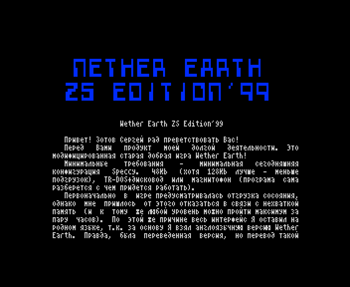

# NEabout.W

The text of the '99 start-up menu's ABOUT ZS NE page: a ZX Word document in CP866, 3 763 bytes (catalogue
length), 15 sectors.

*The ABOUT ZS NE page as the start-up menu shows it (`r99` 5152).*

The build input is [`src/res/text/NEabout.txt`](../../src/res/text/NEabout.txt) (`tools/build_texts.sh` writes it
back byte for byte); on the disk it is the second file, and the 128 K loader reads it into page 3 at `$C000`
([README](README.md)). Below, the lines the author justified to 64 columns are joined into paragraphs and the double
spaces of the justification are single; the spelling is the author's (`преветствовать`, `сосояния`, `програма`).

## The original

### Nether Earth ZS Edition'99

Привет! Зотов Сергей рад преветствовать Вас!

Перед Вами продукт моей долгой деятельности. Это модифицированная старая добрая игра Nether Earth!

Минимальные требования - минимальная сегодняшняя конфигурация Speccy. 48Kb (хотя 128Kb лучше - меньше подгрузок),
TR-DOS+дисковод или магнитофон (програма сама разберется с чем придется работать).

Первоначально в игре предусматривалась отгрузка сосояния, однако мне пришлось от этого отказаться в связи с
нехваткой память (и к тому же любой уровень можно пройти максимум за пару часов). По этой же причине весь интерфейс
Я оставил на родном языке, т.к. за основу Я взял англоязычную версию Nether Earth. Правда, была переведенная версия,
но перевод такой корявый!!! Доработки игры Я пока не прекращаю и обещаю, что выйдет хотя бы еще одна версия моего
Edition (или, по крайней мере, дополнительные уровни), поэтому свои пожелания, замечания, а также об отловленных
глюках можете сообщать мне по телефону в Самаре 58-86-08 или писать на e-mail: crazyzs@hotmail.com. Все постараюсь
учесть.

### Почему появилось ZS Edition?

Для ее появления появления было несколько причин.

Во-первых, достаточно скучно играть сотни раз в один и тот же уровень. На одной и той же карте, на одном уровне
сложности, с одной и той же стратегией. А игра-то классная!

Во-вторых, хотелось сделать что-то стоящее, что бы хоть кому-то понравилось (что достаточно сложно в наше время).

В-третьих, Я увидел "Nether Earth. Адская Земля." производства Eternity Industry. Какое оформление!!! А ядро
программы не изменилось (за исключением загрузки/выгрузки), и еще музыку отрубить нельзя! Они просто РАЗДУЛИ
программу до 128Kb и все. Она также проходится за 11 не полных дней (по внутренним часам). Зачем было этим вообще
заниматься?

### Что нового?

Нового предостаточно.

LEVEL. Теперь можно выбирать уровень сложности. Это стало возможным после добавления мной парочки интересных
подпрограмок. Я думаю Вы сами поймете по ходу игры.

UPGRADE. Дополнительно усложнить себе жизнь можно, заставив вражеских роботов модифицироваться каждый день по Вашему
желанию (на всех уровнях кроме CRITICAL - здесь придется смириться с моими установками :) ). Суть модернизации -
каждый день все вражеские роботы достраиваются до установленной Вами МИНИМАЛЬНОЙ конфигурации. Это довольно
интересно происходит.

LOAD MAP. Подгрузка новых карт. В начале все изменения были задуманы ТОЛЬКО в этой области, т.к. это главная
причина создания Edition. Практически в любой момент Вы можете подгрузить новый уровень-карту (из основного меню,
которое, как Вы наверно заметили, также изменилось).

В связи с тем, что Я увидел "Адскую Землю", Я был просто обязан добавить в игру различные описания, потому что
Eternity Industry похоже брала их с потолка!!! (Но предыстория у них классная. Хотя откуда они ее, опять же,
взяли?).

DESCRIPTION. Описание игры (перевод с английского в моем исполнении) 1987 года. Оно не устарело, т.к. смысл игры не
изменился, а изменились ее параметры.

ADVICES. Советы бывалых игроков. Если хотите увидеть здесь свое имя свяжитесь со мной ранее указаными способами.

GREETS. По-моему, тут все ясно. :)))

ABOUT. То, что Вы сейчас читаете.

Желаю приятно провести время!

ZS, 29.01.1999

## English translation

### Nether Earth ZS Edition'99

Hi! Sergey Zotov is glad to greet you!

Before you is the product of my long work. It is the good old game Nether Earth, modified!

Minimum requirements: today's minimum Speccy configuration. 48Kb (though 128Kb is better: fewer loads), TR-DOS and
a disk drive, or a tape recorder (the program will work out by itself what it has to work with).

At first the game was to save its state, but I had to give that up for lack of memory (and anyway any level can be
finished in a couple of hours at most). For the same reason I left the whole interface in its native language, since
I took the English version of Nether Earth as the base. True, there was a translated version, but the translation
is so clumsy!!! I am not stopping work on the game and promise that at least one more version of my Edition will
come out (or at least extra levels), so you can send me your wishes and remarks, and tell me about the bugs you
caught, by phone in Samara 58-86-08 or by e-mail: crazyzs@hotmail.com. I will try to take everything into account.

### Why did ZS Edition appear?

There were several reasons for it to appear.

First, it is rather boring to play the same level hundreds of times. On the same map, at the same difficulty, with
the same strategy. And the game is great!

Second, I wanted to make something worthwhile that at least somebody would like (which is rather hard nowadays).

Third, I saw "Nether Earth. Адская Земля." ("Hell Earth") made by Eternity Industry. What a presentation!!! But the
program's core has not changed (apart from saving / loading), and you cannot even switch the music off! They simply
BLEW the program up to 128Kb, that is all. It is still finished in under 11 days (by the in-game clock). Why bother
at all?

### What is new?

Plenty.

LEVEL. Now you can choose the difficulty. This became possible after I added a couple of interesting subroutines. I
think you will see for yourself as you play.

UPGRADE. You can make your life harder still by making the enemy robots upgrade every day, as you wish (on every
level except CRITICAL: there you will have to put up with my settings :) ). The point of the upgrade: every day all
enemy robots are built up to the MINIMUM configuration you set. It happens in a rather interesting way.

LOAD MAP. Loading new maps. At first all the changes were meant to be in this area ONLY, since it is the main reason
for making the Edition. You can load a new level-map at almost any moment (from the main menu, which, as you have
probably noticed, has changed too).

Since I saw "Hell Earth", I simply had to add various descriptions to the game, because Eternity Industry seem to
have taken theirs out of thin air!!! (But their back story is great. Though where did they take it from, again?)

DESCRIPTION. The 1987 description of the game (translated from English by me). It has not aged, since the meaning of
the game has not changed, only its parameters.

ADVICES. Advice from seasoned players. If you want to see your name here, contact me in the ways given above.

GREETS. I think this one is clear. :)))

ABOUT. What you are reading now.

Have a good time!

ZS, 29.01.1999
