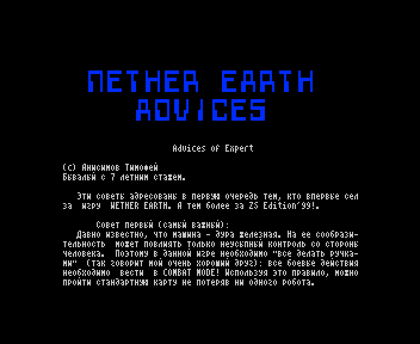

# NEadvice.W

The text of the '99 start-up menu's ADVICES page: "Advices of Expert" by Timofey Anisimov, ten tips and a tactic,
with one insertion by Sergey Zotov; a ZX Word document in CP866, 5 572 bytes (catalogue length), 22 sectors.

*The ADVICES page as the start-up menu shows it (`r99` 4552).*

The build input is [`src/res/text/NEadvice.txt`](../../src/res/text/NEadvice.txt); in page 3 it starts at `$E700`
([README](README.md)). The lines justified to 64 columns are joined into paragraphs, the words the author broke with a
hyphen at a line end (`сообрази-тельность`) are whole again; the spelling is the author's (`PHASORS`, `сдесь`,
`черезвычайно`). The curly-bracketed sentence in tip 10 is Zotov's.

## The original

### Advices of Expert

(c) Анисимов Тимофей 
Бывалый с 7 летним стажем.

Эти советы адресованы в первую очередь тем, кто впервые сел за игру NETHER EARTH. А тем более за ZS Edition'99!.

**Совет первый (самый важный):** Давно известно, что машина - дура железная. На ее сообразительность может повлиять
только неусыпный контроль со стороны человека. Поэтому в данной игре необходимо "все делать ручками" (так говорит
мой очень хороший друг): все боевые действия необходимо вести в COMBAT MODE! Используя это правило, можно пройти
стандартную карту не потеряв ни одного робота.

**2.** Даже если вы уверены, что вашим роботам "хватит мозгов" на выполнение задания в автоматическом режиме,
немного лишнего ума им не повредит. Не жадничайте и выпускайте роботов с ELECTRONICS. Они хоть чуть-чуть начинают
соображать, хотя все равно поражают своей способностью искать самый длинный и трудный путь и могут заблудиться в
"трех соснах".

**3.** Не забывайте время от времени контролировать своих бойцов. Даже оснащенные ELECTRONICS, они не отличают стену
от ямы и могут скапливаясь у непробиваемых препятствий и, стреляя во врагов, надолго там застревать (пока вы сами
не разберетесь), образовывать заторы, непроходимые места и даже могут стрелять своим же в спину!

**4.** Необязательно самому захватывать все заводы - главная ваша цель это вражеские базы, а заводы пусть
захватывают слабые и дешевые роботы. Если же поставить, им PHASORS или MISSILES вместо CANNON, то в критической
ситуации они смогут постоять за себя.

**5.** Своим кораблем (или "головой") можно заблокировать в узком месте вражеских роботов, дав свом роботам время на
освоение свободной территории. "Голова" хороша еще и тем, что во многих случаях помогает направить своего робота на
путь истинный не прибегая к прямому управлению - достаточно только преградить ему неверную дорогу.

**6.** "Не все мертвое, что мертвое"! Eсли робота, которым вы управляли в COMBAT MODE, убили, то он начинает мигать
"в предсмертных муках". Не надо торопиться покидать его - при небольшой сноровке можно до его разрушения сделать еще
пару-тройку выстрелов и отомстить обидчику.

**7.** Чтобы предупредить образование "непроходимых" мест следует избегать крупномасштабных боевых действий на
участках, ограниченных постройками. Эти места лучше проходить в ручном режиме и по возможности быстрее.

**8.** Если "непроходимых" мест стало через чур много, не стоит тратить время попусту - начните игру сначала.

**9.** С умом пользуйтесь препятствиями. Спрятавшись за ними можно избежать нападения со всех сторон и по одному
расстрелять врагов.

**10.** КАК ЖЕ ПРОЙТИ УРОВЕНЬ, если ничего не получается??? Выберете уровень сложности попроще. Некоторые карты
черезвычайно сложны даже на самом легком уровне. {Это верно! Некоторыe карты Я проходил только на EASY}

Можно воспользоваться следующей тактикой:

С началом игры бросьте внимательный взгляд на радар и оцените карту.

Если на карте видна сплошная стена, то придется воспользоваться NUCLEAR-BOMB: первого робота-камикадзе выпускаете с
ней. Если стена далеко, то робота лучше всего выпустить на ANTI-GRAVS.

Затем выпускаете боевой отряд "навороченных" роботов, с приказом SEARCH&DESTROY ENEMY ROBOTS. После этого, если еще
есть средства, можно выпустить группу боевых роботов, которых следует нацелить на захват нейтральных заводов
(перепрограммировать их никогда не поздно).

Теперь пора брать управление в свои руки - летите вперед. Взрывайте робота-камикадзе около препятствия. При этом
следует соблюдать особую осторожность, чтобы ненароком не повредить своих подходящих роботов.

Затем берете на себя управление роботом, максимально продвинувшимся вперед и, обходя все преграды, рветесь на нем
до первого вражеского робота.

Тактика боевых действий проста: скрывшись за непробиваемым препятствием ждете, пока он сам не подойдет к вам, и
затем расстреливаете его, не тратя ни секунды (дабы он не успел вам ответить); или идете на врага в лоб и, не доходя
до него расстояния примерно равного ширине карты, открываете стрельбу (на этом расстоянии вражеский робот по вам еще
не стреляет; его не видно на игровом экране, поэтому необходимо ориентироваться по радару); или же подойдя к врагу
так, чтобы не оказаться на линии его огня разворачиваетесь на 90 градусов в его сторону (важно развернуться заранее
\- не доходя до врага 1-3 шага) и добиваете робота сбоку.

В любом случае стрелять лучше всего PHASORS.

При потере своего робота берите следующего. И вообще, три-четыре робота позади вас составляют необходимый резерв; к
тому же при случае они поддержат ваши действия огнем, а то и вырвутся вперед.

Помните: ваша цель - вражеские базы. Подход к ним на сложных уровнях труден, но возможен: сдесь все зависит от вашей
реакции и умения использовать каждую секунду для продвижения к ней. При этом особое внимание необходимо обращать на
вновь выпускаемых вражеских роботов: порой они возникают из базы в самый последний момент и наносят сокрушительный
удар.

Последнюю вражескую базу проще всего взорвать, вплотную приблизившись к ней, на роботе с NUCLEAR-BOMB.

УДАЧНОЙ ИГРЫ!!!

## English translation

### Advices of Expert

(c) Timofey Anisimov 
A seasoned player of 7 years.

These tips are meant first of all for those who sit down to NETHER EARTH for the first time. And the more so to ZS
Edition'99!

**Tip one (the most important):** It has long been known that a machine is an iron fool. Only the unsleeping control
of a human can help its wits. So in this game you must "do everything with your own hands" (as a very good friend of
mine says): fight every battle in COMBAT MODE! Following this rule, you can finish the standard map without losing a
single robot.

**2.** Even if you are sure your robots "have brains enough" to carry out a task by themselves, a little extra sense
will not hurt them. Do not be stingy: send out robots with ELECTRONICS. They begin to think at least a little, though
they still amaze you with their gift for finding the longest and hardest path, and they can get lost "among three
pines" (in plain sight).

**3.** Do not forget to check your fighters now and then. Even with ELECTRONICS they do not tell a wall from a pit:
they can pile up at obstacles they cannot break and, firing at enemies, get stuck there for a long time (until you
sort it out yourself), make jams and impassable places, and even shoot their own side in the back!

**4.** You need not capture every factory yourself: your main aim is the enemy bases; let weak, cheap robots capture
the factories. And if you give them PHASORS or MISSILES instead of CANNON, they can stand up for themselves when it
gets critical.

**5.** With your ship (or "head") you can block enemy robots in a narrow place, giving your robots time to take the
free ground. The "head" is good also because in many cases it helps put your own robot on the right path without
direct control: it is enough to block its wrong way.

**6.** "Not all that is dead is dead"! If the robot you were driving in COMBAT MODE is killed, it starts to blink "in
its death throes". Do not hurry to leave it: with a little skill you can fire two or three more shots before it
breaks up, and take revenge on the one who did it.

**7.** To prevent "impassable" places, avoid big battles in areas bounded by buildings. Pass these places by hand,
and as fast as you can.

**8.** If there are far too many "impassable" places, do not waste your time: start the game again.

**9.** Use obstacles wisely. Hiding behind them you avoid attack from all sides and can shoot the enemies one by one.

**10.** HOW, THEN, TO FINISH A LEVEL if nothing works??? Choose an easier difficulty. Some maps are extremely hard
even on the easiest level. {This is true! Some maps I finished only on EASY}

You can use the following tactic:

At the start of the game take a careful look at the radar and judge the map.

If the map shows a solid wall, you will have to use a NUCLEAR-BOMB: the first robot you send out, a kamikaze, carries
it. If the wall is far away, the robot is best sent out on ANTI-GRAVS.

Then send out a combat squad of "loaded" robots ordered to SEARCH&DESTROY ENEMY ROBOTS. After that, if you still have
the means, you can send out a group of fighting robots aimed at capturing the neutral factories (it is never too late
to reprogram them).

Now it is time to take control yourself: fly ahead. Blow up the kamikaze robot next to the obstacle. Take special
care here not to damage your own robots coming up behind by accident.

Then take control of the robot that has got furthest ahead and, going round every obstacle, rush on it to the first
enemy robot.

The combat tactic is simple: hide behind an unbreakable obstacle, wait until the enemy comes to you, then shoot it
without losing a second (so that it has no time to answer); or go at the enemy head-on and, stopping at a distance of
about the width of the map, open fire (at that distance the enemy robot does not fire at you yet; it is not seen on
the play screen, so you have to steer by the radar); or approach the enemy so as not to be on its line of fire, turn
90 degrees towards it (it is important to turn in advance, 1-3 steps before the enemy) and finish the robot off from
the side.

In any case PHASORS are the best to fire.

When you lose your robot, take the next one. In general, three or four robots behind you make a needed reserve;
besides, when the chance comes, they back you up with their fire or even break through ahead.

Remember: your aim is the enemy bases. On hard levels getting to them is hard but possible: here everything depends
on your reactions and on using every second to get closer. Watch especially the newly built enemy robots: sometimes
they come out of the base at the very last moment and strike a crushing blow.

The last enemy base is easiest to blow up by driving right up to it on a robot with a NUCLEAR-BOMB.

HAVE A GOOD GAME!!!
