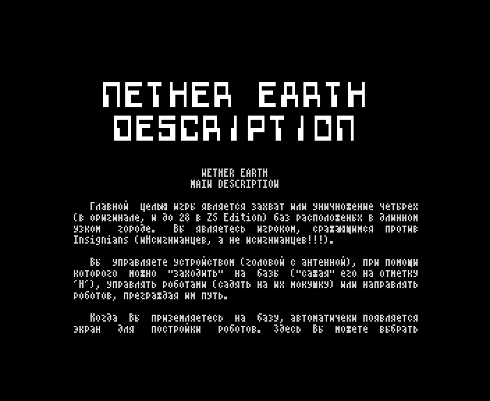

# NEdescri.W

The text of the '99 start-up menu's DESCRIPTION page: the 1987 Nether Earth instructions translated by Sergey Zotov,
with his notes and a bug warning; a ZX Word document in CP866, 5 469 bytes (catalogue length), 22 sectors.

*The DESCRIPTION page as the start-up menu shows it (`r99` 4152).*

The build input is [`src/res/text/NEdescri.txt`](../../src/res/text/NEdescri.txt); in page 3 it starts at `$CF00`
([README](README.md)). The lines justified to 64 columns are joined into paragraphs; the author's TAB-centred
headings are headings here; the spelling is the author's (`уничножение`, `мокушку`, `упомануть`). The 163 bytes after
the text in its last sector hold the end of an earlier save, dated 26.01.1999
([`src/res/text/README.md`](../../src/res/text/README.md)).

## The original

### NETHER EARTH: MAIN DESCRIPTION

Главной целью игры является захват или уничножение четырех (в оригинале, и до 28 в ZS Edition) баз расположеных в
длинном узком городе. Вы являетесь игроком, сражающимся против Insignians (иНсигнианцев, а не исигнианцев!!!).

Вы управляете устройством (головой с антенной), при помощи которого можно "заходить" на базы ("сажая" его на
отметку 'H'), управлять роботами (садять на их мокушку) или направлять роботов, преграждая им путь.

Когда Вы приземляетесь на базу, автоматичеки появляется экран для постройки роботов. Здесь Вы можете выбрать
комплектующие робота, в соответствии с наличностью. Вы должны выбрать шасси и хотя бы один вид оружия.

Из шасси bipods самые медленные, а hover (вероятно anti-grav) наиболее быстрые. Из вооружения слабейшее - cannon,
затем идут missiles и наконец pulsar (phasers). Ядерная бомба уничтожает робота, несущего ее, а так же окружающих
его роботов и здания (однако на самом деле роботы уничтожаются в квадрате 4 на 4 мили, а здания только те, с
которыми ядерный робот соприкасался). Электроника поднимает сообразительность робота (но как я понял она влияет
только на ведение боя, а на обхождение препятствий никак не влияет).

Количество наличных средств зависит от того, сколько у Вас захваченых заводов, которые производят комплектующие
(какие именно можно узнать по изображению над входом). Вы должны захватить как можно больше заводов для более
быстрого производства роботов. О принадлежности завода можно судить по флажку слева или справа от входа. Если
слева, то завод Ваш, если справа - компьютера.

Когда Вы укомплектовали робота выберите Start Robot, иначе Вы просто покините базу. Затем Вы вернетесь на основной
экран, напротив базы будет робот, которого Вы построили (если построили). Теперь можно его запрограмировать или
взять его под прямое управление.

Когда Вы приземлитесь на робота, перед Вами появится меню:

- DIRECT CONTROL: Позволяет управлять роботом, но не стрелять. Для выхода - нажмите "огонь".
- GIVE ORDERS: Позволяет дать приказ роботу, который он будет выполнять пока не будет уничтожен или пока Вы не
  измените его. Менять приказ можно в любое время. Можно отдать следующие приказы:
  - Stop and defend: Робот будет стоять, пока не приблизится вражеский робот.
  - Advance/retreat ?? miles: Робот будет двигаться в заданом направлении на определенное расстояние. Для его
    задание используются клавиши "вверх"/"вниз".
  - Search and destroy: Робот будет искать и уничтожать вражеских роботов или опеделенные здания.
  - Search and capture: Робот будет искать и захватывать заданные объекты.
- COMBAT MODE: Этот пункт позволяет пользоваться оружием робота (тем более, что оно не кончается), а также управлять
  движением робота, как в первом пункте меню.
- LEAVE ROBOT: Позволяет отделиться от робота.

#### CHEATS

Самый быстрый путь выиграть следующий: строите одного мощного робота на hover drive+cannon+missiles+pulsar Затем,
как можно быстрее двигаетесь, избегая боев с вражескими роботами, если это возможно, до следующей базы.
Уничтожаете роботов поблизости от нее. Строите несколько роботов для защиты базы (с приказом об уничтожении врагов)
и нескольких для захвата заводов. Затем на самой первой базе строите несколько слабых роботов для захвата заводов
между базами. Таким образом Вы сможете контролировать большинство заводов (и ресурсов). И теперь можно неспеша
развиваться, потому что Вы фактически контролируете игру. Только уничтожайте вражеских роботов с ядерными бомбами.
Теперь нужно захватить или уничтожить третью базу. Это существенно замедлит выпуск роботов врага с последней базы.
Теперь можно играться с врагом как кошка с мышкой.

\------------------------ перевод с английского Зотова Сергея -

### NETHER EARTH ZS EDITION'99

В моем Edition враг зависит от количества захваченых заводов и баз только на EASY.

В этом описании забыли упомануть о том, что от количества вооружения прямопропорционально зависит защита робота.
Например, cannon+шасси убивается с одного выстрела phaser'a, а electronics+nuclear+phasers+missiles+ anti-grav с
шести!

Дальность стрельбы у всех видов вооружения одинакова около двух экранов (15-18 миль).

### ВНИМАНИЕ ГЛЮК!

Вы наверно замечали, что при ведении активных военных действий, появляются участки по которым нельзя пройти. Это не
связано с количеством убитых на одном месте роботов. Программа написана идеально, и при самостоятельной работе не
возникает сбоев. Но как только Вы в COMBAT MODE начинаете уничтожать врагов, тут то и появляются эти непроходимые
места. Дело в том, что когда Вы стреляете и слегка передерживаете "огонь" программа "замирает" и ждет пока Вы его
отпустите. Если этим выстрелом уничтожается робот, то очень велика вероятность появления непроходимого места. Это
зависит от того на сколько Вы задержали "огонь". Так что действуйте быстрее.

Желаю удачи в военных действиях.

ZS, 29.01.1999

## English translation

### NETHER EARTH: MAIN DESCRIPTION

The main aim of the game is to capture or destroy the four (in the original; up to 28 in ZS Edition) bases that lie
in a long narrow city. You are the player fighting against the Insignians (iNsignians, not isignians!!!).

You control a device (a head with an antenna) with which you can "enter" bases (by "landing" it on the mark 'H'),
control robots (by landing on their top) or steer robots by blocking their way.

When you land on a base, the robot construction screen appears automatically. Here you can choose the robot's
components according to your resources. You must choose a chassis and at least one kind of weapon.

Of the chassis, bipods are the slowest and hover (probably anti-grav) the fastest. Of the weapons the weakest is the
cannon, then come missiles and finally the pulsar (phasers). The nuclear bomb destroys the robot carrying it, and
also the robots and buildings around it (though in fact robots are destroyed in a square of 4 by 4 miles, and
buildings only those the nuclear robot touched). Electronics raise the robot's intelligence (but as I understood it,
they affect only combat and do nothing for getting round obstacles).

Your resources depend on how many factories you have captured; the factories produce the components (which ones you
can tell by the picture over the entrance). You must capture as many factories as you can to build robots faster. A
factory's owner is shown by the flag left or right of the entrance: on the left, the factory is yours; on the right,
the computer's.

When the robot is equipped, choose Start Robot; otherwise you simply leave the base. Then you return to the main
screen, and in front of the base stands the robot you built (if you built one). Now you can program it or take it
under direct control.

When you land on a robot, a menu appears:

- DIRECT CONTROL: lets you drive the robot, but not fire. To leave, press "fire".
- GIVE ORDERS: lets you give the robot an order, which it carries out until it is destroyed or you change it. The
  order can be changed at any time. The orders are:
  - Stop and defend: the robot stands until an enemy robot comes near.
  - Advance/retreat ?? miles: the robot moves in the given direction for a set distance. The distance is set with the
    "up" / "down" keys.
  - Search and destroy: the robot searches for and destroys enemy robots or chosen buildings.
  - Search and capture: the robot searches for and captures the chosen objects.
- COMBAT MODE: this item lets you use the robot's weapons (the more so as they never run out) and drive the robot as
  in the first item.
- LEAVE ROBOT: lets you get off the robot.

#### CHEATS

The fastest way to win is this: build one strong robot on hover drive + cannon + missiles + pulsar. Then move as fast
as you can to the next base, avoiding fights with enemy robots where possible. Destroy the robots near it. Build a
few robots to defend the base (ordered to destroy enemies) and a few to capture factories. Then build a few weak
robots at the very first base to capture the factories between the bases. This way you control most of the
factories (and resources). Now you can develop at leisure, because you are in fact in control of the game. Only
destroy the enemy robots carrying nuclear bombs. Now capture or destroy the third base. That slows the enemy's output
of robots from the last base a lot. Now you can play with the enemy like a cat with a mouse.

\------------------------ translated from English by Sergey Zotov -

### NETHER EARTH ZS EDITION'99

In my Edition the enemy depends on the number of captured factories and bases only on EASY.

This description forgot to mention that a robot's protection is directly proportional to its armament. For
example, cannon + chassis is killed by one phaser shot, and electronics + nuclear + phasers + missiles + anti-grav by
six!

The firing range of all weapons is the same, about two screens (15-18 miles).

### ATTENTION, A BUG!

You have probably noticed that in heavy fighting places appear that cannot be passed. This has nothing to do with the
number of robots killed in one place. The program is written perfectly and does not fail when left to itself. But as
soon as you start destroying enemies in COMBAT MODE, these impassable places appear. The thing is that when you fire
and hold "fire" a little too long, the program "freezes" and waits until you let it go. If that shot destroys a
robot, an impassable place is very likely to appear. It depends on how long you held "fire". So act faster.

Good luck in the fighting.

ZS, 29.01.1999
