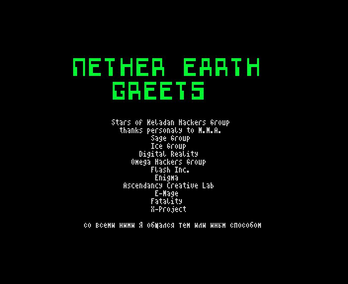

# NEgreets.W

The text of the '99 start-up menu's GREETS page: a centred list of groups and one Russian line; a ZX Word document
in CP866, 313 bytes (catalogue length), 2 sectors.



*The GREETS page as the start-up menu shows it (`r99` 4852).*

The build input is [`src/res/text/NEgreets.txt`](../../src/res/text/NEgreets.txt); in page 3 it starts at `$E500`
([README](README.md)). The author centres every line with TABs; the list is kept as he laid it out.

## The original

```text
                Stars of Keladan Hackers Group
                  thanks personaly to M.M.A.
                          Sage Group
                          Ice Group
                       Digital Reality
                     Omega Hackers Group
                          Flash Inc.
                           Enigma
                   Ascendancy Creative Lab
                           E-Mage
                          Fatality
                          X-Project

         со всеми ними Я общался тем или иным способом
```

## English translation

The names are in English already; "personaly" is the author's spelling. The last line:

> со всеми ними Я общался тем или иным способом: "I have been in touch with all of them one way or another."
