# The '99 maps: `NELEV_00.N` .. `NELEV_11.N` and the built-in level

The sources of the twelve LOAD MAP files on the '99 disk and of the level the '99 game block holds itself. Each map
is a text here (`NELEV_xx.txt`, `builtin.txt`); `tools/zs_level.py build` turns them into the 512-byte files
(`build/maps/NELEV_xx.N`) and the built-in level's bytes (`builtin.bin`, the game block's `$BDA9-$BF9B`), and
`tools/build_game99.sh` checks every file byte for byte against the disk. `png/` holds a radar-like preview of each
(`tools/zs_level.py preview`).

## What a map file holds

A map file is a level only, not a saved game. LOAD MAP (`DiskApplyLevel` `$C2EB`, src/patches99/diskmap.asm; the
tape version `TapeApplyLevel` `$C248`) reads its two sectors to `$F000`, copies the first `$1F3` (499) bytes over the
game's level area `$BDA9-$BF9B` and writes the 13 tail bytes into instruction operands of the game:

| Offset | Size | Written to | What it is |
| --- | --- | --- | --- |
| `$000-$1F2` | 499 | `$BDA9-$BF9B` | BuildMap's four lists, one after the other, then zeros: SceneryWest, SceneryEast (tile or shape, x, y; 0 ends), BaseListWest, BaseListEast (type, x, y; `$FF` ends) |
| `$1F3` | 1 | `$ADB4`, `$BB1F` | the capture points: warbases + factories, at most 28 (the capture tick `$ADB3`, CountBuildings `$BB1E`) |
| `$1F4` | 2 | `$BC8A` | the address of SceneryWest (always `$BDA9`) |
| `$1F6` | 2 | `$BC92` | the address of SceneryEast |
| `$1F8` | 2 | `$BCA2` | the address of BaseListWest |
| `$1FA` | 2 | `$BCAA` | the address of BaseListEast |
| `$1FC` | 2 | `$BC9B` | the first factory's record in the base table: `$FD70` + 5 x the warbases (a pointer, not a state) |
| `$1FE` | 1 | `$BCB7`; + 1 to `$B3E6`, `$B817` | the enemy's warbases (all the warbases but the player's) |
| `$1FF` | 1 | `$A684` | the player's general resource at the start of a game (99, `$63`, in every file) |

Nothing else: no robots, no day or time, no other resource, no ship position, no owner of a factory (BuildMap makes
warbase 0 the player's, the other warbases the enemy's, every factory neutral). StartGame's NewGameSetup (`$A62D`)
clears the robots, the variables `$FD04-$FDFC`, the building table and the shots for every game; the enemy gets 99 of
each resource, the player the general resource of `$A684` and 0 of the others. The tail stays in the game until the
next LOAD MAP, so a later START plays the same map. Every tail field but the last is derived from the lists: the text
writes them as `auto` (`points`, `lists`, `factories`, `enemy`); `general` is the one free value.

## The maps

| Map | Scenery W + E | Warbases | Factories by type 1-6 | Capture points | Notes |
| --- | --- | --- | --- | --- | --- |
| `NELEV_00` | 69 + 68 | 4 | 4 3 4 4 4 5 | 28 | Nether Earth's own level: the same base records, the scenery in another order |
| `NELEV_01` | 66 + 68 | 4 | 4 2 5 4 4 5 | 28 | |
| `NELEV_02` | 69 + 68 | 4 | 5 3 3 3 4 6 | 28 | |
| `NELEV_03` | 69 + 67 | 4 | 3 2 3 5 5 6 | 28 | |
| `NELEV_04` | 58 + 69 | 4 | 3 8 5 1 3 4 | 28 | |
| `NELEV_05` | 81 + 56 | 6 | 3 3 4 3 3 6 | 28 | warbases 4-5 behave as factories (below) |
| `NELEV_06` | 48 + 63 | 5 | 2 3 5 2 3 8 | 28 | the player's warbase at (128,10); warbase 4 as a factory |
| `NELEV_07` | 57 + 68 | 7 | 3 3 4 3 3 5 | 28 | warbases 4-6 as factories |
| `NELEV_08` | 59 + 2 | 3 | 0 0 24 0 0 0 | 27 | every base in the west list; 27 points: the capture index is off by one |
| `NELEV_09` | 57 + 43 | 4 | 3 1 4 3 3 10 | 28 | the player's warbase at (30,8) |
| `NELEV_10` | 56 + 81 | 5 | 2 3 5 3 3 7 | 28 | the player's warbase at (244,10); warbase 4 as a factory |
| `NELEV_11` | 38 + 40 | 16 | 2 2 2 1 1 4 | 28 | warbases 4-15 as factories |
| built-in | 55 + 4 | 2 | none | 2 | the word ЗАГРУЗИСЬ ("load yourself") in walls: a prompt to use LOAD MAP |

Factory types: 1 electronics, 2 nuclear, 3 phasers, 4 missiles, 5 cannon, 6 chassis.

Two limits of the game code show on these maps (src/game99/game.ann, GameTurnEnd and BuildMap):

- The capture tick (`$ADF1`) takes a record's index as 28 - the loop counter, which is right only when the count
  is 28. With fewer points (`NELEV_08`, the built-in level) each capture lands on another record: on the built-in
  level a capture of the enemy's warbase works on the empty record 27 and the enemy keeps its warbase.
- Nether Earth's fixed split of the 28 records into 4 warbases and 24 factories stays in the capture tick (`$ADF4`),
  the nuclear blast (`$B9AE`, `$B9E5`, `$B9EC`, `$B9F4`) and the target table (`$B3D5`): a warbase past the fourth
  is captured and destroyed as a factory (owner set, no pad: the player cannot build there).

## Previews

Each preview is the map's 512 x 16 cells in four strips of 128 columns (the radar's width): ground dark blue, flat
tiles blue, low blocks cyan, high blocks light blue, posts white; the player's warbase green, the enemy's yellow,
factories magenta.

| | |
| --- | --- |
| `NELEV_00` 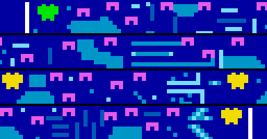 | `NELEV_01` 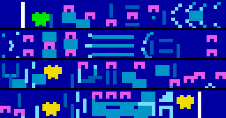 |
| `NELEV_02` 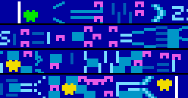 | `NELEV_03` 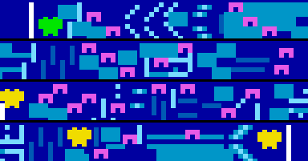 |
| `NELEV_04` 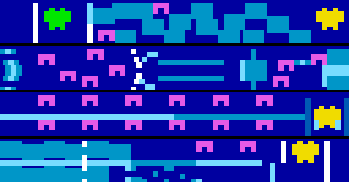 | `NELEV_05`  |
| `NELEV_06` 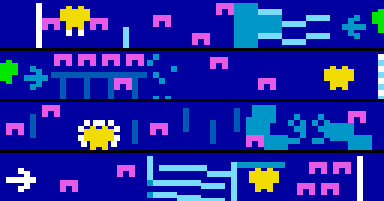 | `NELEV_07` 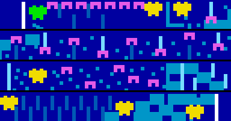 |
| `NELEV_08` 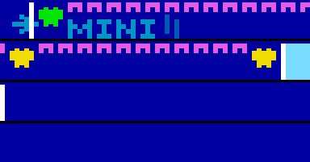 | `NELEV_09` 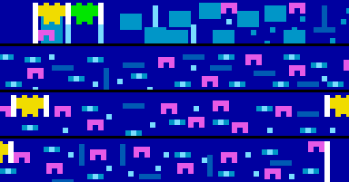 |
| `NELEV_10`  | `NELEV_11` 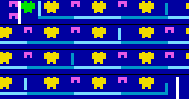 |
| built-in 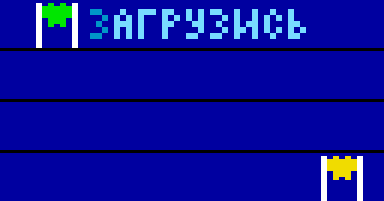 | |

## The text format

`tools/zs_level.py`'s doc string has it in full: four sections `scenery SceneryWest`, `scenery SceneryEast`,
`bases BaseListWest`, `bases BaseListEast` (`block TILE x y`, `shape N x y`, `warbase x y`, `factory T x y`, `end`;
x 0-511), then for a NELEV file a `tail` section (`points`, `lists`, `factories`, `enemy`: `auto` or a value;
`general N`). A new map needs only the lists and `general`; the build fills the rest.
