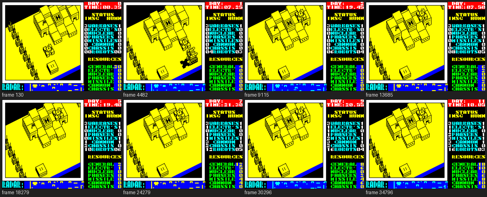
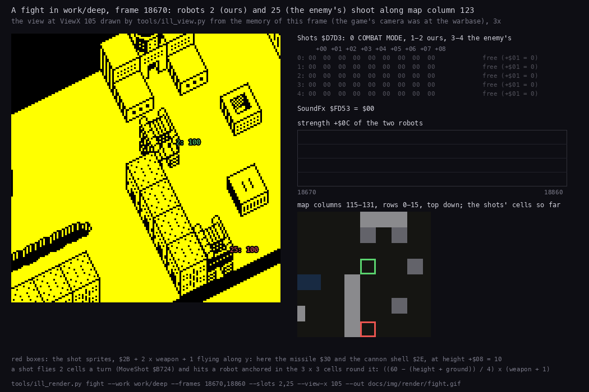
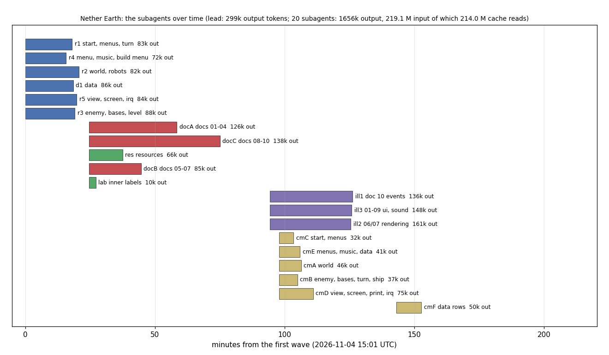

# Nether Earth: walkthrough

How the reverse was done, step by step, and which unreal-ng call answered each question. Terms:
[docs/README.md](docs/README.md). Recipes: `../../recipes/`.

Every recording is named with its load (ROM speed or the fast LD-BYTES trap) beside every frame number.

## 0. The medium

Seven tapes on the shelf (WDC14Tb-3 `Consoles/ZX Spectrum/Games/Nether Earth`, the ZX-Uno card's TOSEC set). The
TOSEC one named "(Argus Press Software)" turned out to be a crack: its BASIC is a REM with "CRACKED BY BILL
GILBERT'87" and the game is one 42240-byte block (`kit/tapblocks.py list`). The World of Spectrum TZX
(`NETHEART.TZX` in `NetherEarth_ZXt.zip`) and the Mind Games España TAP are the same five standard blocks byte for
byte: that is the master, `orig/NETHER.TZX` and `orig/NETHER.TAP`.

```text
  0  header Program "N.EARTH" length 381 LINE 0 vars 381
  1  381 bytes   the BASIC: a line whose length word says 65535 (LIST shows nothing), LOAD "" CODE 64730, RANDOMIZE USR 64730
  2  header Bytes "N1" length 180 start 63800 ($F938), loaded at 64730 ($FCDA) instead
  3  180 bytes   N1 at $FCDA-$FD8D: a relocated ROM LD-BYTES, its edge routines at $FD69 / $FD6D
  4  48361 bytes the game, headerless: $4000-$FCE8, the screen included; entry $A600 (pushed as N1's return)
total 264.7 s at ROM speed (13258 48K frames)
```

The other copies (Leshij, AGAS, Mihal Soft, VS'93, Ziberov Oleg, Nikiforov, Voronin/Prokofiev, the Presto
compilation, the HGFX/esxDOS port) are Russian rereleases and ports: none is the original.

## 1. One recording from power-on

**Used:** `re_session.py capture --record-load` at ROM speed (no LD-BYTES trap), 48K, a Kempston card.

The first capture played seeded random keys after the load and picked "5..LOAD SAVED GAME": "LOADING ERROR!" and a
"PRESS RECORD AND PLAY" save prompt filled the run, so the recording was dropped (`work/load`, kept for the load
alone). The second (`work/play`, 16514 frames: the load to frame 12660, the menu, 3673 frames of play from frame 12841) plays
`tests/inputs/kempston-play.txt`: 2 (Kempston), 0 (start), then seeded moves and fire. It reaches the game: the
ship flies round the base, the clock runs into day 1 (`work/play/screens.png`). The play is shallow (no robot
built, no fight): the bot of section 6.2 plays the deep one.

`re_session.py stages` on the first recording:

| Stage | Entry | Frame | What |
| --- | --- | --- | --- |
| 0 | `$FCDA` | 253 | N1, entered by the BASIC's USR 64730 (written by the ROM's LD-BYTES `$0802`: loaded at `$FCDA`, not at the header's `$F938`) |
| 1 | `$A600` | 12660 | the game, entered by N1's RET to the pushed `$A600` after the 48361-byte block; the block's last 15 bytes (`$FCDA-$FCE8`) land over N1's own start, code that has already run (its store is `$FD3B`, past them) |

**Interrupts** (`re_session.py interrupts`, `explain`): the start-up `$A600` fills the IM 2 table `$FE00-$FF00`
with `$FD` and puts `JP` at `$FDFD`; the handler is whatever that jump names. `$D59C` while the start-up runs (37
entries), `$C4FD` in the menu (144), `$D566` in play (3672: one a frame). The ROM `$0038` (171) runs only during the
load. `re_session.py stages` lists `$FDFD`, `$D59C`, `$C199`, `$D566` as stages: they are those handler swaps and the
menu, not new code (no block arrives after the load: every write the stages name is N1's store `$FD3B`).

## 2. Static pass over the medium

**The block's screen part.** The game block starts at `$4000`, so its first 6912 bytes load into the screen: noise,
with zero attributes, black on black, while the tape plays. An access trace of the start-up (`analysis trace`,
frames 12660-12900, 1.8 M instructions) shows every one of those bytes written first, by the screen clear at
`$D0C5` / `$D0C7`, and never read before: they are dead. They are not random either: `$4000-$5AFF` is the game's
own `$C350-$DE4F`, byte for byte (a mastering leftover: the save started 6912 bytes early, or the screen held a copy
of the code). The source keeps them as that copy: `tools/build.sh` prefixes the assembled `$5B00-$FCE8` with its own
`$C350-$DE4F`, nothing is typed twice.

**The first cut.** `kit/mkgame.py` on `case.json` (`lo` `$5B00`, the `work/game` build of the play recording from
frame 12661): 10378 code bytes (5954 instructions, 3117 of them ran), 254 entries, assembled identical to the image.
`src/basic.asm` and `src/loader.asm` are written by hand from the blocks; `tools/build.sh` gives `orig/NETHER.TAP`
byte for byte.

## 3. The stages and the packers

There is no packer. The tape's last block is the game as it runs, `$4000-$FCE8`, stored plainly;
`re_session.py stages` (section 1) finds two stages, N1 at `$FCDA` and the game at `$A600`, and every byte the game reads was written
by N1's store `$FD3B` or by the game itself. N1 is the ROM's LD-BYTES moved to RAM with three changes (it loads a
headerless block of a fixed length, it paints the border a random colour on each edge with `LD A,R`, and it returns to
`$A600`, pushed before the load, also on a bad checksum or BREAK); `src/loader.asm` says it line by line and
[3.4](docs/03-build-and-load.md) sets it beside the ROM.

A full load at signal speed with the LD-BYTES and turbo traps off takes 1014 frames for blocks 0-3 (ill3, section
6.10): the `play` recording's 253 frames were a fast load of those blocks, only N1's block went at signal speed.

## 4. The medium from source

`tools/build.sh` writes all five blocks and compares the TAP with `orig/NETHER.TAP` byte for byte:

- **The BASIC** (`src/basic.asm`): one line, number 0, whose length word says 65535, so LIST shows nothing. Its
  numbers are written as the ROM stores them (digits, `$0E`, the 5-byte form) by a macro; the INK 7 / PAPER 7 pairs
  that hide a listing are a second macro; the REM carries "(c)1986 APS" and "(c) Argus Press Software".
- **N1** (`src/loader.asm`) at `$FCDA`; its header keeps the start the BASIC does not use, `$F938`.
- **The game** (`src/game/game.asm` and its 22 modules, `src/res/`): assembled to `$5B00-$FCE8`; the block's first
  6912 bytes are the image's own `$C350-$DE4F` (section 2), prefixed by a one-line Python step.
- **The TAP** by `kit/tap.py` (`basic:N.EARTH:0`, `code:N1:63800`, headerless `data`).

The game's source is generated: `kit/mkgame.py` reads `src/game/game.ann`, the image and the recordings' L1 builds
(`case.json` `read_builds`: `game` and `deep`) and writes the modules; it fails unless they assemble to the image.
Every phase below ended with that check and `tools/build.sh` from a clean `build/`.

## 5. Tool gaps found and fixed

| Gap | Fix | Where |
| --- | --- | --- |
| No instruction-level trace of a window of a recording: the screen part's "written before read" proof, the routine animations, the beam timelines need every access with its T-state | `analysis trace`: the CPU access trace of a window, on a shared TTD replay helper | unreal-ng `d21527620` (master) |
| A TAP of a headerless block could not be written; a module named `game` included itself | `kit/tap.py` `data:-:-`; mkgame refuses `@module game` | `3683ebf` |
| Variables past the loaded image (`$FD00-$FF01`) stayed numbers in the source | `@equ $ADDR Name [N]`: an EQU and every operand in its range by name | `913165b` |
| Which bytes follow the stick: no tool | `kit/input_vars.py`: memory sampled with `memory_at`, scored against the input script per axis | `913165b` |
| Strings after `CALL PrintInline` were walked as code | `@inline $ADDR`: the walk stops after a call to it | `b0fb6bb` |
| A memory span past the image crashed `kit/refdocs.py` | the span names the work space | `6a05c0b` |
| One flat source file | `@module NAME ; title` and `@about` paragraphs: one file a module, each with a header | `6a59f0b` |
| No comments on data lines | a `game.ann` line inside a data entry cuts its rows there: comment and label on that line | `6ea2cb2` |
| MCP on port base + 200 = 10000 met another instance's ZRCP server | `tools/bot.py` defaults to base 9310; every agent got its own base | this case |

## 6. The game

### 6.1 Controls and the ship, from the recording

**Used:** `kit/input_vars.py` on `work/play` (memory sampled every 4 frames with TTD `memory_at`, scored against
`tests/inputs/kempston-play.txt`), then `explain` on the writers.

The byte that follows the stick bit for bit is `Input` (`$FD0C`: bit 0 right, 1 left, 2 down, 3 up, 4 fire, 5 save,
6 abort, 7 pause); the bytes that move with right / left and down / up are the ship's X and Y and the view's column.
Their writer is `MoveShip` (`$AF11`), its reader `ReadControls` (`$D38A`) and the key table `KeyTable` (`$D3CC`).
The names went into `game.ann` as `@equ` (section 5), the first of the 43 variables past the image.

### 6.2 The bot

Random play never builds a robot, so the menus, the robot AI and the fights stay out of every
recording. `tools/bot.py` plays from the menu snapshot (`work/play/start.szx`) on a Kempston stick and decides
only from memory, so the same run replays the same game:

- **Selecting the stick and starting.** Key `2` picks Kempston, key `0` starts.
- **Building a robot.** The ship flies to the pad of its own warbase (`Buildings` type 0, (22,5)) and sinks to
  altitude 15. `ConstructionMenu` opens; the bot reads the open menu from `Handler` = `StartInterrupt`.
  - It moves `MenuCursor` and sets `MenuParts` part by part. Each press is held until the byte changes: a move is
    followed by a 10-frame pause, and a short press inside it is lost.
  - It chooses START ROBOT (column 1) and leaves with fire held. Without the climb the ship sinks to 15 again and
    the menu reopens.
- **Giving an order.** The ship follows the new robot (`$DA00` record: `+$00` the map cell) and sinks onto its top
  (`+$09` + `+$0D`). There `RobotMenu` opens; the bot reads the open menu from the record's `+$0A` = 1.
  - `ListMenu` lists highlight an item with attribute `$4E` every 3 rows from the attribute of item 0. Down moves to
    the next item, fire chooses.
  - GIVE ORDERS, then SEARCH & CAPTURE or SEARCH & DESTROY, then the target. The order lands in `+$0B`: 0 stop,
    1 advance, 2 retreat, 3-5 destroy robots / factories / warbases, 6-8 capture neutral factories / enemy
    factories / enemy warbases.
  - Destroying a factory or a warbase needs nuclear (`+$07` bit 6). Without a target the order falls back to 0
    (robot 2 below).
- **The plan.** The bot goes round `PLAN`: two cheap capturers, then fighters, then capturers of enemy factories.
  A robot is built when `Resources` pays for it: each part takes its own resource first, the general one for the
  rest (`PartCosts`).

### 6.3 The deep recording

`bot.py play --record --frames 36000 --work work/deep`, on port base 9310. Base + 200 =
10000 is the usual ZRCP port: an earlier run on base 9800 collided there with another instance's ZRCP server on
127.0.0.1. The recording covers 36046 frames, 11 game days. The L1 build gives 190 routines and 274 million
instructions; `session.ttd` is 59 MB.

`work/deep/play.log`:

- Seven robots were built: `$09` bipod + cannon twice, `$1A` tracks + cannon + missiles, `$89` with electronics,
  `$19` bipod + cannon + missiles, `$B2` tracks + missiles + phasers + electronics, and `$BC` in slot 2, freed by a
  death.
- Each robot was given its order: capture neutral factories twice, destroy robots three times, capture enemy
  factories twice.
- Factories of four kinds were captured: from day 4 on, electronics, missiles, cannon and phasers grow every
  morning.
- Robots died in fights: our count goes 6, 5, 6, 4, 3. The enemy ends with 16 robots.
- The general resource grows by 5 a day.

ConstructionMenu installs its handler before it resets MenuCursor and MenuParts. `land_on_warbase` therefore waits
for the reset cursor (2, 0, 0) before it chooses parts; a part chosen earlier is lost.



### 6.4 Strings after a CALL

`PrintInline` (`$D42D`) prints the bytes after its CALL:

| Byte | Meaning |
| --- | --- |
| 0 | the end |
| 1 Y X | a position |
| 2 A | an attribute |
| 3 | the next line |
| 4 N | a setting |
| anything else | a character |

The static walk read the strings that no recording printed as code (`LD BC,$1704`...). mkgame now takes
`@inline $D42D`: no walk goes past such a call. With `work/deep` among the read builds, all 41 strings are data.
The code was 8913 bytes (4833 instructions, 4259 of them ran), down from 9611. The tape still builds byte for byte.

### 6.5 Every routine and data block: six readers in parallel

**Used:** the L1 builds of `game` and `deep` (routines, calls, value flow), `explain`, `memory_at` / `seek` on the deep
recording, own instances for experiments (each agent its own port base, the deep instance read-only).

The image was cut into five address regions and the data (`$5B00-$A5FF`, `$D6A8-$FCE8`), one agent each, all
reading the same brief (`work/ann/BRIEF.md`): name every entry, describe it from the code and the recordings, write
the evidence in `work/ann/r1.md` ... `r5.md`, `d1.md`, the annotations in a fragment. 19-21 minutes each, six at
once (section 8). The lead merged the fragments into `game.ann` (`bc2f26c`):

- 562 entries, every routine and data block named and described; 13 blocks of code no recording ran turned from
  data into code (`c` entries seed the walk);
- 287 old `sub_` / `l_` / `data_` names in comments replaced by the names;
- the work space `$FD00-$FF01` as `@equ` (renamed where an EQU met a label: `ClimbTurns`, `SoundFx`, ...);
- `@isub` for the constants the bytes cannot tell from addresses (`LD BC,-100` at `$D401`, `LD DE,-$0804` in the
  nuclear blast, `LD DE,Font-$100` in the printers: `77679e1`).

The regions found the game's own bugs (docs [10.12](docs/10-gameplay-logic.md)): a full player side builds into
enemy slot 24, a building target pointer ends past its table, values over 99 print as "D0", the rejected chassis.

### 6.6 Inner labels and the distance menu

One agent named the 111 branch targets still called `l_XXXX` from the code around them (`work/ann/lab.ann`,
`0c13374`). It also showed `$AAA7` as a block of data inside the distance menu: the `PrintInline` string after the
CALL at `$AAA4` and then code, `DistanceShow` at `$AAAD`, which no recording ran. Two entries split it.

### 6.7 Resources

**Used:** the image and the L1 builds of three recordings (no byte of a resource is written in play).

`tools/res_formats.py` (`a001819`) turns the font, the 89 sprite blocks (mask and graphics in a 4-colour PNG: the
fourth colour keeps the 3 bytes where a graphics bit lies outside the mask), the view edges, the map scenery and
shapes (`map/level.txt`), the menu tune (`music/menu.txt`) and the order names into editable files and back; `check`
proves each source gives its bytes. 219 `@res` lines make the source INCBIN them. `src/res/README.md` lists each file
with its address and format.

### 6.8 The documents, first pass

Three authors wrote docs 01-04, 05-07 and 08-10 at once from `game.ann`, the region notes and the recordings, with
44 figures (`6a05c0b`); `kit/refdocs.py` generated 11 and 12. They recorded two more runs on their own instances:
`work/docB/rec` (the menus) and `work/docC/fight` (19829 frames, the deep game replayed frame for frame up to the
first shot: the same `FireShot` at frame 18679). Found on the way: N1 does not check the flag byte, the view copy is
not synchronised with the beam and tears (frame 20012, line 110), five places modify their own operands, and the menu
tune loses its bass for 24 frames after a restart.

### 6.9 The repository for publishing

The cases moved to `games/`, unreal-ng became a submodule (the kit finds its analysis scripts there), the `.gitignore`
covers C / C++, Python and sjasmplus output on every platform, and the README and LICENSE (CC BY-NC-SA 4.0) say the
games stay their holders' (`bd7b2d0`). Both tapes were built again from a clean tree: identical.

### 6.10 Modules and a comment on every instruction

The owner read `src/game` as a monolith. `game.ann` now cuts the image into 22 modules by subsystem (`6a59f0b`,
[2.6](docs/02-architecture.md)); mkgame writes one file a module with a header (`@module` title, `@about`
paragraphs). Five agents then commented their modules (`work/ann/BRIEF3.md`, `merge_cm.py`): 3751 new instruction
comments, 9 wrong ones corrected (two in the key redefinition: `E/2`, not `E/8`; the shot's sound), 89 routine
descriptions rewritten, 22 module headers (`209d25d`). No instruction is left without a comment.

### 6.11 Figures from experiments

Three agents illustrated the documents (`863124f`, `3bda633`, `1d9637d`), 87 figures in all, every one from a
recording or an experiment on an own instance, with the command in its caption:

- **Rendering** (06, 07): `tools/ill_view.py` is `DrawView` in Python, identical to the game's view buffer on a traced
  call, on 40 views of `deep` and 18 with a deferred robot; it draws the view sprite by sprite, the projection over a
  real frame, the draw order, the mask blit, every chassis with every weapon, the radar blink, the tear, a fight and
  the robots over 11 days.
- **Events** (10): fights with the shots' paths, the shot records, the 3 x 3 hit test, every one of the 20 hits of
  `deep` on the damage formula, the death blink and the wreck, COMBAT MODE driven by hand, the commander's 22 robots,
  the nuclear blast and its 9 x 9 map, both ends of the game (by POKE on a clone).
- **Menus, panel, sound** (01-05, 08, 09): a tour recording (`work/ill3/tour`, 8253 frames) for every menu, the tape
  loading at signal speed, the panel over a day and a half, every effect's waveform and spectrogram from the port
  trace, the menu tune measured voice by voice.



The experiments changed the documents where the code reading was wrong:

| Claim | Experiment | Result |
| --- | --- | --- |
| A destroyed base cannot be captured | POKE a robot onto the door of a factory the blast destroyed, run 144 turns | captured: owner `$40`, type 0, counted as a warbase, +5 general at midnight (a bug, 10.12) |
| The nuclear flash lasts about 3.3 s | frames counted | 216 frames, 4.3 s |
| The menu tune's voices do not detune | per-voice pulse timing from the port trace | one voice 125.7 T a period unit, both together 129.4-130.8 T: half a tone apart |
| The drums hiss | 2112 OUTs of 22 drum hits | silent: `DrumHissLoop` never moves HL, one ROM byte (`$23`, EAR / MIC 0) 96 times |
| A second chassis is refused | driven in the construction menu | it replaces the first and refunds its cost |
| Redefining keeps the key codes | redefine, read `KeyTable` | SYMBOL SHIFT is stored as `$0E`; the image has `$82` |

### 6.12 Comments on data lines

mkgame put comments on instructions only. A `game.ann` line inside a data entry now cuts its rows there, so the
comment lands on that `DEFB` / `DEFW` / `DEFM` line and a name becomes a label (`6ea2cb2`). One agent commented the
data rows that mean something: the keys, the sprite ids, the height and cost tables, the step delays, the robot and
shot slots, the map rows: 659 comments (`work/ann/cm-cmF.ann`). It also found four descriptions the
bytes contradict (shot record 0 is the COMBAT MODE shot; `ViewBuffer` is not zero in the image; a menu text has
three new lines; a key prompt has two spaces), corrected; and the map's last entry ran past the image to `$FFFF`:
mkgame now ends the control file at the image's end.

## 7. Review

What stands proved and what does not:

- **Byte for byte.** `tools/build.sh` builds `orig/NETHER.TAP` from source after every phase of section 6; each
  commit says so.
- **Read, not run.** 4220 of the 4922 instructions ran in some recording; the other 702 are described from the code
  (doc 12 gives every routine its run count, or says no recording reached it). Among them: `SaveGame` and
  `LoadGameBlocks` (no recording saved or loaded a game, doc 03) and `GameOverWait` (doc 04).
- **Reached only by POKE.** Both ends of the game (a warbase count poked to 0 on a clone of the deep instance), the
  nuclear bomb (robot 0's parts poked in a replay of `deep`), the recapture of a destroyed base (a robot poked onto
  its door). Each one ran the game's own code from there; none of them came from play.
- **Not tested.** Whether a recaptured destroyed base offers the construction menu (10.12: it has no pad, so
  probably not).
- **Inferences.** A comment that says "probably" is a reading of the code with no run behind it.

## 8. Cost

### 8.1 Time and tokens

Measured from the session's transcripts (`tools/case_tokens.py`: the usage of every model call, the lead and each
agent), from the case's first request (2026-11-03 21:22 local) to the last commit. The lead's row includes about an hour of unrelated unreal-ng work at the start
(about 30 k output tokens); the agents' rows are this case only.

| | Calls | Output tokens | Input tokens (of them read from cache) |
| --- | --- | --- | --- |
| Lead | 486 | 300 k | 73.75 M (72.78 M) |
| 20 agents | 1647 | 1.66 M | 219.11 M (214.00 M) |
| All | 2133 | 1.96 M | 292.86 M (286.79 M) |

Time:

- **Wall clock of work:** about 1.5 h on the first evening (21:22-22:49: the tape, the loader, the first
  recordings, sections 0-2) and 4.2 h the next morning (08:22-12:35: everything from section 3 on), 5.7 h in all.
- **The lead's own work** (gaps of over 15 minutes left out): about 4 h. The bot and the deep recording were the
  lead's, before the first agent.
- **Agents:** 6.3 agent-hours in 20 agents, up to 8 at once, in five waves:

| Wave | Agents | Minutes each | Output tokens each | Section |
| --- | --- | --- | --- | --- |
| Regions | r1-r5, d1 | 16-21 | 72-88 k | 6.5 |
| Documents, resources, labels | docA, docB, docC, res, lab | 3-50 | 10-138 k | 6.6-6.8 |
| Figures | ill1, ill2, ill3 | 31-32 | 137-161 k | 6.11 |
| Comments | cmA-cmE | 6-13 | 32-75 k | 6.10 |
| Data rows | cmF | 10 | 50 k | 6.12 |



```
python3 tools/case_tokens.py ~/.claude/projects/<project>/<session> 2026-11-04T02:22:00Z 2026-11-06T00:00:00Z work/cost/tokens.json
python3 tools/case_cost.py work/cost/tokens.json docs/img/case-cost.png
```

Of the input, 98 % was read from the prompt cache: an agent reads the same brief, `game.ann` and its notes many times.
The output, 1.96 M tokens, is what was written: the 22 modules' comments and descriptions, 12 documents
(7277 lines), 21 tools (8309 lines of Python), the figures' scripts and the agents' notes.

What came out: a source of 22 modules (11245 lines) that builds the tape byte for byte, every instruction and every
entry commented; 121 resource files (219 entries) with their formats; 12 documents; 89 figures (23 MB), each from a recording or
an experiment, with the command that made it; 555 MB of recordings and work files in `work/`.

### 8.2 Without unreal-ng: an estimate

Nothing below was measured; it is a reasoned estimate from what each step of section 6 used.

What unreal-ng gave the case, step by step:

- **TTD recordings** (record, replay frame for frame, `memory_at` / `seek` at any frame and t-state): the code / data
  split from what ran (6.4, 6.5), the input variables (6.1), every value over time (the panel over a day and a half,
  robots over 11 days), the fight replayed to the frame of the first shot (6.8).
- **The analysis trace and `explain`**: who wrote a byte and when (the screen part of block 1, the view's writers,
  the damage on each hit).
- **Own instances over MCP / WebAPI**: the bot (6.2) and every experiment of 6.11, on clones of a recording, in
  parallel, without a window.
- **Port traces with t-states**: the sound effects and the tune measured, the tape loading at signal speed.
- **The beam**: the tear at line 110 needs the screen as the beam left it, not the end of the frame.

Three ways to do it without:

| | A: static only | B: own Z80 harness | C: a person with a classic emulator |
| --- | --- | --- | --- |
| Tools | SkoolKit, sjasmplus, the image | a Z80 core, 48K memory and ULA, tape, Kempston, written for the case | a debugger emulator, a disassembler, an editor |
| Byte-for-byte source | yes | yes | yes |
| Code / data split | by walking branches: inline strings and 13 code blocks first wrong (6.4, 6.5) | from a run, after the harness | from a debugger's coverage, by hand |
| Input variables, values over time | guessed from the code | after a recorder and a `memory_at` are written too | watches and pokes, frame by frame |
| Experiments of 6.11 | none: the six claims stay wrong | possible | possible, slow |
| Figures (89) | about 15 (font, sprites, map, memory map, record layouts, tables) | most, except the beam (tear) and the measured sound unless the core is cycle-exact | all, as hand-made screenshots and drawings |
| Time | similar to this case, worse result | plus 1-3 days for the harness and its checks | weeks: 4900 instructions, 560 entries, 12 documents |
| Tokens | about the same | about 2-3 times (the harness, its debugging, a TTD of its own) | none |

Why the figures need a machine:

- About 15 of the 89 are static: the font, the sprites, the map, the memory map, record layouts, tables, the
  keyboard map. They can be drawn from the image alone.
- About 70 come from recordings and experiments. Each fight GIF is the game's own frames, read from the deep
  recording. The view sprite by sprite is `DrawView` redone in Python and checked against the game's buffer on 40
  views; without recordings there is nothing to check it against. The panel and robot movies need 11 game days of
  memory. The hits on the damage formula need all 20 hits of the deep game. The sound figures need the port trace
  with t-states. The recapture needs a clone to poke.
- Without a recorder these 70 are either impossible (A), or they need a harness that is itself a small emulator and
  has to be proved correct first (B), or they take a person days of screenshots and hand-drawn diagrams (C).

The largest difference is in what is true, not in tokens. Six claims read from the code were wrong (the table in
6.11) and were caught only because an instance could run the case. With A they would stand in the documents.

