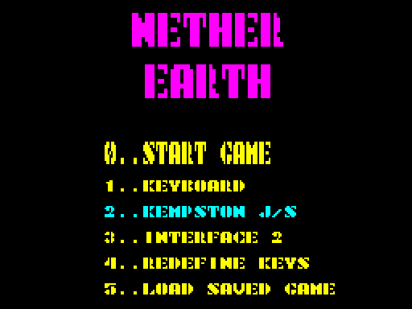
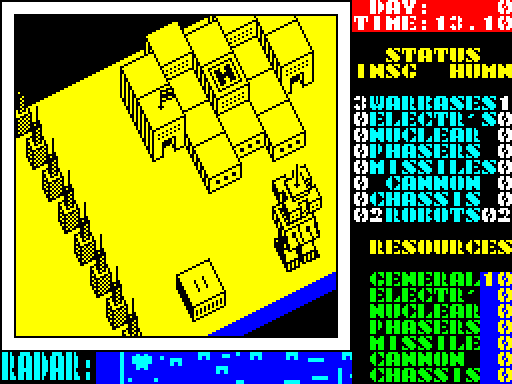
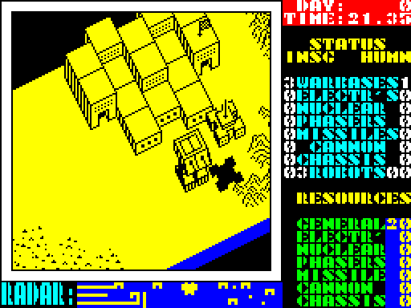
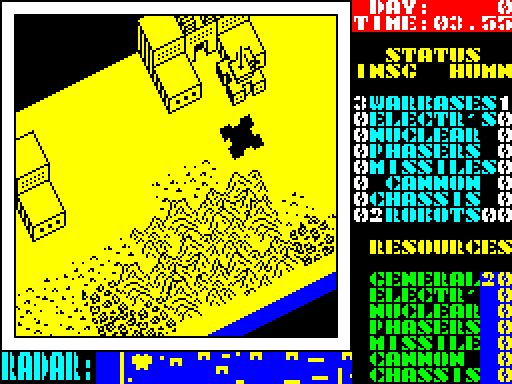
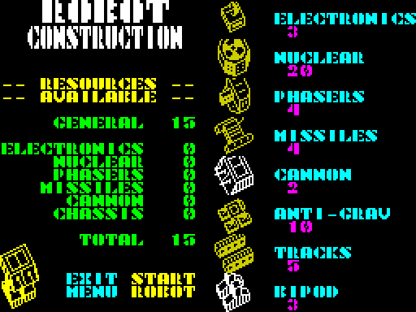
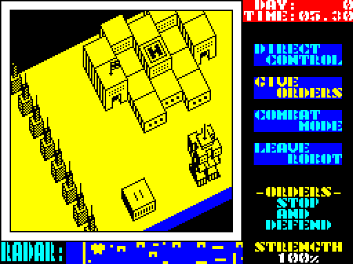
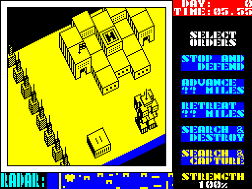

# 1. Game design

This document covers Nether Earth as a player meets it: the screen, the controls, the ship, the bases, building
robots, giving them orders, fighting, capturing, the daily production, and how a game is won or lost. Every rule
here comes from the technical documents (docs 4-10), which show where it lives in the code and how the recordings
saw it. Each section links its source.

The recordings this rests on ([Terms](README.md#terms)):

- `play`: the tape loaded from power-on (blocks 0-3 fast, N1's block at signal speed,
  [3.3](03-build-and-load.md#33-the-load-step-by-step)), then 3 673 frames of seeded random play on a Kempston
  stick (`tests/inputs/kempston-play.txt`), 16 514 frames in all;
- `deep`: the bot (`tools/bot.py`) playing from the menu snapshot of `play` for 36 046 frames, 11 game days. It
  built seven robots, gave orders, captured factories and fought (WALKTHROUGH 6);
- the region agents' experiments on their own instances (`work/ann/r1.md` - `r5.md`): the distance and combat menus,
  direct control, the nuclear blast and the two game ends. No recording reached any of these.

## 1.1 The game in one paragraph

**Nether Earth**, Argus Press Software 1986, for the ZX Spectrum 48K. The copyright notice is only in the tape's
BASIC REM: "(c)1986 APS" and "(c) Argus Press Software" ([3.2](03-build-and-load.md#32-the-basic-block-1)). The
game's own text names no author ([8](08-hud-and-text.md)).

The player flies a ship over an isometric strip of land 512 cells long and 16 wide. Two sides own bases on it:

- the humans, **HUMN** on the status panel, are the player. They hold one warbase at the west end;
- the **Insignians**, **INSG**, are the computer. They hold three warbases further east.

The player does not fight: robots do. The ship lands on its own warbase's pad to build a robot from parts, paid for
with resources. It lands on a robot to give it an order: advance, retreat, destroy or capture.

There are 24 factories, all neutral at the start. Each produces one resource every day for the side that holds it;
warbases produce the general resource. A robot that stands on a base's door for 144 game turns captures the base.
The game is won when the Insignians have no warbase left, and lost when the player has none
([10](10-gameplay-logic.md)).

## 1.2 The screen

`DrawPlayScreen` `$D0CA` draws one fixed frame with four live areas
([6.8](06-rendering.md#68-the-play-screen-and-the-panel)):

| Area | Where | What it shows |
| --- | --- | --- |
| **View** | the white frame, characters (1,1)-(20,20) | the 32 x 16 map cells round the ship, isometric, yellow; redrawn every game turn from the view buffer `$5B00` ([6](06-rendering.md)) |
| **Clock** | top right, red | DAY (five digits) and TIME (hours.minutes); `GameTurnEnd` `$AD90` prints it every turn |
| **Status panel** | right, rows 2-21 | each side's buildings by kind (INSG left, HUMN right), each side's robots, then the player's seven resources; a robot menu takes its place while the menu is open |
| **Radar** | bottom, "RADAR:" | 128 map columns, one pixel a cell: walls and blocks, our robots in cyan, the enemy's in yellow, blinking on alternate frames ([6.7](06-rendering.md#67-the-radar)) |

The view follows the ship. It moves one column when the ship reaches view column 13 or 22 (`MoveShip` `$AF11`). The
radar window jumps 64 columns when the ship nears its edge (`ScrollRadar` `$AFE6`).

## 1.3 Controls

The main menu `$C100` ([5.2](05-controls.md#52-the-main-menu-and-the-redefine-screen)):

| Key | Option |
| --- | --- |
| 0 | START GAME |
| 1 | KEYBOARD (the redefinable keys) |
| 2 | KEMPSTON J/S |
| 3 | INTERFACE 2 |
| 4 | REDEFINE KEYS: UP, DOWN, LEFT, RIGHT, FIRE, PAUSE, ABORT, SAVE |
| 5 | LOAD SAVED GAME (from tape) |

The current device is printed in cyan. The menu tune plays until a number key is pressed (`MenuMusic` `$C4A7`,
[9](09-sound.md)).

The eight controls fill one byte, `Input` `$FD0C`, once a game turn (`ReadControls` `$D38A`). A joystick adds its
directions and fire to the keys; the other three controls are keys with every device. The default keys
(`KeyTable` `$D3CC`):

| `Input` bit | Control | Default key | In play |
| --- | --- | --- | --- |
| 0 / 1 / 2 / 3 | right / left / down / up | P / O / A / Q | move the ship one cell a turn |
| 4 | fire | SYMBOL SHIFT | climb 2 a turn; in a menu, choose |
| 5 | save | 5 | save the game to tape, then play on |
| 6 | abort | I | back to the main menu at once, with no question |
| 7 | pause | 1 | the game stops until another control is pressed (`WaitKey` `$D37C`) |

The keys are described in full in [5.3](05-controls.md#53-in-play-the-ship-and-the-game-keys).

## 1.4 The ship

The ship is the player's only presence on the map. It has no weapon, and no shot hits it: a shot hits only robots
([7.4](07-objects.md#74-shots)).

- **Position**: column `$0E`-`$1F5`, row 1-15 (`ShipX` `$FD0E`, `ShipY` `$FD0D`). `CheckShipMove` `$B052` refuses
  a move that would put the ship lower than what stands there.
- **Height** (`Altitude` `$FD10`). Fire raises it 2 a turn, up to `$30`. Without fire it sinks 1 a turn, down to the
  highest top under it.
- **Climbing by itself.** After a new game the ship climbs by itself for 3 turns, after every menu for 5
  (`ClimbTurns` `$FD30`). So it does not drop straight back onto the pad or the robot.
- **Landing** is how the player acts ([4.3](04-game-loop.md#43-the-turn)):
  - sinking exactly onto the top of one of our robots opens the robot menu;
  - sinking onto our warbase's pad (height 15) with its door free opens the construction menu.

## 1.5 Bases

`BuildMap` `$BC6F` builds the map at every new game from the level lists ([7.5](07-objects.md#75-the-map)). The
scenery, the walls and the 28 bases are always in the same places.

| Base | Count | At the start | Gives its side |
| --- | --- | --- | --- |
| **Warbase** | 4: ours at (22,9); the enemy's at (261,8), (369,8), (494,8) | 1 HUMN, 3 INSG | 5 general resource a day; a place to build robots |
| **Factory** | 24, four of each kind: electronics, nuclear, phasers, missiles, cannon, chassis | all neutral | 2 of its own resource a day |

**Capturing.** A base is captured by a robot that stands on its door cell (the gap in its wall) for 144 game turns
in a row, about 29 s. The robot's side takes the base whatever the robot's order was (`GameTurnEnd` `$ADAF`).

- A captured base gets its new side's flag.
- A warbase the player captures also gets a pad: a second place to build
  ([7.6](07-objects.md#76-buildings-and-capture-points)).
- Only a robot with a nuclear bomb can destroy a base (1.8).

In `deep` there were 17 captures, by both sides. From day 4 on, the player's electronics, missiles, cannon and
phasers grew every morning (`work/ann/r1.md`, WALKTHROUGH 6).

## 1.6 Building a robot

`ConstructionMenu` `$C849` takes the whole screen and stops the game: the clock does not run while it is open
([5.4](05-controls.md#54-the-construction-menu)). A robot is a chassis and up to three weapons, with electronics as
an option:

| Part | Kind | Cost (`PartCosts` `$CAF0`) | Paid first from | Height (`PartHeights` `$D7B4`) |
| --- | --- | --- | --- | --- |
| bipod | chassis | 3 | chassis | 11 |
| tracks | chassis | 5 | chassis | 7 |
| anti-grav | chassis | 10 | chassis | 8 |
| cannon | weapon | 2 | cannon | 6 |
| missiles | weapon | 4 | missiles | 6 |
| phasers | weapon | 4 | phasers | 7 |
| nuclear | weapon | 20 | nuclear | 7 |
| electronics | extra | 3 | electronics | 7 |

- **Paying.** A part is paid from its own resource first. What that resource lacks comes from the general resource.
  If the general resource cannot pay the rest, the part is refused with a low beep.
- **Choosing.** A robot has exactly one chassis and at most three of the four weapons. START ROBOT needs a chassis
  and a weapon.
- **Taking back.** A part chosen again is taken back and refunded.
- **The chassis** sets the speed, by the ground under the robot: anti-grav 3-4 turns a step, tracks 4-7, bipod 6-9.
  It also sets which terrain the robot can cross: a bipod only the low types, anti-grav the most
  ([7.3](07-objects.md#73-a-robots-step)).
- **Electronics** lengthen the robot's sight ahead from 10 to 12 cells. Each of its shots also flies one step
  further ([7.4](07-objects.md#74-shots)).
- **The new robot** appears at the warbase's door, at strength 100 %, with the order STOP AND DEFEND.

At the start each side has 20 general resource and nothing else (`NewGameSetup` `$A62D`). That pays for a bipod
with a cannon (5) four times.

## 1.7 The robot menu and orders

`RobotMenu` `$A720` replaces the status panel. The game runs on while it is open, and the robot under the ship
stands still ([5.5](05-controls.md#55-the-robot-menu-and-its-submenus)):

| Item | What it does |
| --- | --- |
| DIRECT CONTROL | the controls drive the robot and the ship rides on it; fire gives the robot back |
| GIVE ORDERS | one of the orders below |
| COMBAT MODE | fire one of the robot's weapons, or drop its nuclear bomb |
| LEAVE ROBOT | the ship climbs away; the robot carries out its order |

The orders are kept in the record's `+$0B` (`SteerByOrder` `$B222`):

| Order | Menu | The robot |
| --- | --- | --- |
| 0 | STOP AND DEFEND | stands; still looks, turns and fires at an enemy in sight (`RobotStep` `$B154`) |
| 1 / 2 | ADVANCE / RETREAT ?? MILES (0-50 by 5) | goes east / west that far, then stops |
| 3 | SEARCH & DESTROY ENEMY ROBOTS | hunts the nearest enemy robot by column |
| 4 / 5 | SEARCH & DESTROY FACTORYS / WARBASES | goes to the nearest enemy factory / warbase and drops its bomb there; needs the nuclear part |
| 6 / 7 / 8 | SEARCH & CAPTURE NEUTRAL FACTORYS / ENEMY FACTORYS / ENEMY WARBASES | goes to the nearest base of that kind that no robot of ours is already after, and stands on its door |

`SetOrder` `$ABC8` falls back to order 0 for an order with no target, and for a destroy order without the bomb.

## 1.8 Fighting

Robots fight on their own ([7.3](07-objects.md#73-a-robots-step)). Each turn a robot looks along its lanes:

- an enemy ahead: the robot fires a random choice of its weapons, and the strongest weapon chosen fires;
- an enemy to the side: the robot turns toward it.

Shots ([7.4](07-objects.md#74-shots)):

- Five shots can fly at once (`Shots` `$D7D3`): one for the player's COMBAT MODE, two for each side's robots.
- A shot flies 2 cells a turn, for 5 steps (missiles 7).
- A hit takes ((60 - top) / 4) x (weapon + 1) percent: cannon x 2, missiles x 3, phasers x 4. A tall robot on high
  ground takes less.
- Shots hit friends too.
- At 0 % the robot blinks for four turns and leaves a wreck.

**The nuclear bomb** (`$B99F`):

- it destroys the base in reach;
- it kills every robot in a 9 x 9 area, of both sides, and the bomber itself;
- a flash and a rumble last about 3.3 s.

The region agents verified the bomb on an own instance (`work/ann/r3.md`). No recording built a nuclear robot.

In `deep`, fights cost the player robots: its count went 6, 5, 6, 4, 3. The enemy ended with 16 (WALKTHROUGH 6).

## 1.9 The enemy

The Insignians play by the same rules, with their own resources (`EnemyResources` `$FD4A`) and no ship
([10](10-gameplay-logic.md)). Once a game turn, `EnemyCommander` `$B7F4` looks at one random slot of its 24:

- **an empty slot**: it tries to build a robot of random parts at one of its warbases. The more robots it has, the
  more weapons the robot needs. It built 22 robots in `deep`;
- **a live robot**: now and then it gives the robot an order. A robot with the bomb gets a destroy order, the others
  a capture order. When no target is left, the order is destroy robots.

## 1.10 Time and production

A game turn is 5 minutes of game time and at least 10 frames (`GameTurn` `$AD62`,
[4.5](04-game-loop.md#45-time)). An hour is 12 turns; a day is 288 turns, about 58 s. At 24:00 `DailyProduction`
`$AE38` pays both sides:

- general += 5 for each warbase held;
- each other resource += 2 for each factory of its kind held;
- no resource goes above 99 (`AddCapped` `$AE62`).

The panel shows the player's resources only, two digits each.

## 1.11 Winning and losing

`CheckGameEnd` `$AE6B` checks every turn ([4.4](04-game-loop.md#44-the-end-of-a-game)):

| Condition | Message |
| --- | --- |
| the enemy has no warbase (`EnemyBuildings` `$FD42` = 0) | INSIGNIANS DESTROYED / YOU HAVE WON ! |
| otherwise, the player has none (`PlayerBuildings` `$FD3A` = 0) | YOU HAVE NO BASES LEFT / BETTER LUCK NEXT TIME! |

Then a buzz and a wait of 2 s. A control press then goes back to the main menu.

- There is no score, no time limit and no difficulty setting: the game lasts until one side has no warbase.
- A warbase is lost only by capture or by a bomb.
- Both ends were verified by poking the counts (`work/ann/r1.md`). No recording played a game to its end.

## 1.12 Saving and loading

The save key writes the whole game state to tape as two headerless blocks. LOAD SAVED GAME reads them back, and play
goes on from there ([3.6](03-build-and-load.md#36-the-saved-game)). A bad tape prints LOADING ERROR! and goes back to
the start.

## 1.13 Design notes

- **Indirect control.** The player never fights. The whole interface is landing and three menus; the ship is a
  cursor with a height.
- **One fixed map.** The level is the same in every game. The variety comes from the random enemy. Its seed is
  fixed at start-up (`RandomSeed` `$FD00`) and stepped every turn, so a game played the same way goes the same way:
  the bot's `deep` run replays exactly (WALKTHROUGH 6).
- **Positions, not kills.** Resources come only from holding bases, so captures decide the game, not kills. In `deep`
  the enemy out-built the player 16 robots to 3, and the player still held a warbase after 11 days: the game did not
  end.
- **The world does not wait for orders.** The robot menu runs game turns while it waits
  ([4.2](04-game-loop.md#42-the-states)). Only the construction menu and the pause stop the clock.
