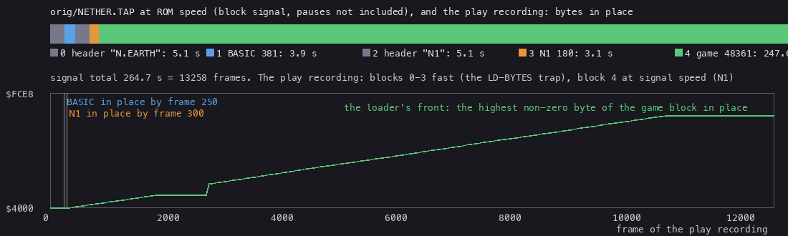
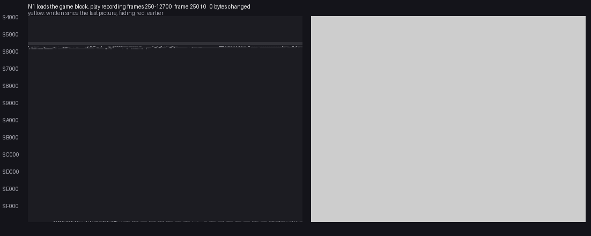
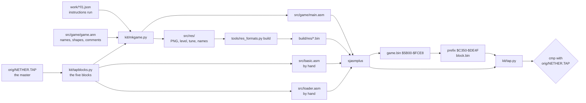

# 3. Build and load

This document covers two things: how the game gets from tape into memory, and how the source tree makes the same tape
again. The tape is simple: a hidden BASIC line, a 180-byte loader called N1, and the whole game as one headerless
block. The game block includes the screen. There is no packer and no protection beyond the hidden line.

The recordings it rests on ([Terms](README.md#terms)):

- `play`: power-on with the master tape, 16 514 frames (WALKTHROUGH 1). The load figures below are TTD reads of this
  recording;
- `load`: the first recording of the same load. Its play after the load is useless (a LOADING ERROR! from random keys),
  so it is kept for the load alone;
- the start-up access trace of `play`, frames 12660-12900 (WALKTHROUGH 2): what reads and writes the block's screen
  part.

## 3.1 The tape

Seven tapes were found (WALKTHROUGH 0). The World of Spectrum TZX and the Mind Games España TAP hold the same five
standard blocks byte for byte: that is the master, `orig/NETHER.TZX` and `orig/NETHER.TAP`. The TOSEC copy named
"(Argus Press Software)" is a crack, with "CRACKED BY BILL GILBERT'87" in its BASIC and the game as one 42 240-byte
block. The others are Russian rereleases and ports.

`python3 ../../kit/tapblocks.py list orig/NETHER.TAP`:

| Block | Kind | Name | Bytes | Loads at | Plays for (ROM speed) |
| --- | --- | --- | ---: | --- | ---: |
| 0 | header | Program `N.EARTH`, LINE 0 | 17 (+2) | | 5.1 s |
| 1 | BASIC | | 381 (+2) | PROG (`$5CCB`) | 3.9 s |
| 2 | header | Bytes `N1`, start 63800 (`$F938`) | 17 (+2) | | 5.1 s |
| 3 | CODE | N1, the loader | 180 (+2) | `$FCDA` (LOAD "" CODE 64730) | 3.1 s |
| 4 | data, no header | the game | 48 361 (+2) | `$4000-$FCE8`, by N1 | 247.6 s |

- Every block uses the ROM's standard encoding (flag byte, data, XOR checksum) with flag `$FF` on data.
- The play times come from the bit counts, pauses not included: 264.7 s, 13 258 frames of signal in all.
- The BASIC header says 381 for both the length and the program length: the BASIC has no variables.
- N1's header holds 63 800 (`$F938`) as its start. The BASIC loads it with an explicit address, 64 730 (`$FCDA`), so
  the header's address is never used.



The figure is drawn by `python3 tools/load_stages.py` on the `play` recording, sampling TTD `memory_at` every 50
frames:

- the top bar is the tape at signal speed;
- the curve is the front of the game block in memory, the highest address where the image's bytes stand
  (`$4000` up);
- the marks are the moments each piece was first seen in place.

## 3.2 The BASIC (block 1)

One line, number 0, whose length word says 65 535 (`src/basic.asm`):

```text
0 CLEAR 65535: POKE 23624,0: INK 0: PAPER 0: CLS: PRINT AT 20,0;: POKE 23659,0:
  LOAD "" CODE 64730: RANDOMIZE USR 64730: REM (c)1986 APS ... (c) Argus Press Software
```

- **The length word.** LIST stops at the line and shows nothing. The program still runs, because the ROM finds the
  next statement by the colons, not by the length.
- **The colour codes.** The line also holds INK 7 / PAPER 7 pairs (`$10 $07`, `$11 $07`) between the tokens, so a
  listing that gets past the length shows white on white.
- **The REM** holds the only copyright notice on the tape: "(c)1986 APS" white on white, then "(c) Argus Press
  Software" in blue between red bars.
- **`POKE 23624,0`** (BORDCR) makes the border and the lower screen black.
- **`POKE 23659,0`** (DF_SZ) takes the lower screen's two lines away, so the ROM prints no "Bytes: N1" over the
  screen.
- **`CLEAR 65535`** sets RAMTOP to the top of memory. N1 sets its own SP and the game sets SP = 0, so BASIC's
  stack is never used again.

## 3.3 The load, step by step

| Step | `play` frame | Who | What |
| --- | --- | --- | --- |
| 1 | 0-250 | ROM | blocks 0-1: the BASIC at PROG `$5CCB`, in place by frame 250 |
| 2 | to 253 | ROM | blocks 2-3: N1 at `$FCDA`; `RANDOMIZE USR 64730` enters it at frame 253 (WALKTHROUGH 1) |
| 3 | 253-360 | N1 | the silence check and the pilot of block 4 |
| 4 | 370-12660 | N1 | 48 361 bytes from `$4000` up, at signal speed, `DI` throughout |
| 5 | 12660 | N1 | the last 15 bytes land on `$FCDA-$FCE8`, N1's own first instructions, which have already run |
| 6 | 12660 | N1 → game | `RET` to `$A600`, pushed at N1's start: `Start` |

The witnesses are TTD `memory_at` (`tools/load_stages.py`) and `re_session.py stages`. The first bytes of the game
were in place by frame 370 at a 10-frame step and by 400 at a 50-frame step. Read every frame, `$FCDA-$FCE8` holds
the block's tail from the start of frame 12661.

**Blocks 0-3 loaded fast, block 4 at signal speed.** The header and the BASIC alone take 9 s of signal, 450 frames,
yet the BASIC was in place by frame 250, and N1 ran at 253 after another 8.2 s of signal.

- Blocks 0-3 go through the ROM's LD-BYTES. Their arrival in a few frames fits the emulator's fast-load trap, which
  is hooked on the ROM routine.
- N1 is a copy of LD-BYTES in RAM, so no trap catches it: 12 407 frames, 248.1 s, against 247.6 s of block 4's signal
  plus the pilot and the silence check.
- WALKTHROUGH 1 records the capture as "ROM speed, no LD-BYTES trap". The timings contradict this for blocks 0-3.
  The trap as the cause is an inference, not checked in the emulator's settings of that capture.

The interrupts agree: the ROM's IM 1 handler `$0038` ran 171 times, all before frame 253. None ran while N1 loaded.



The animation is `python3 ../../kit/memanim.py` on `play` with
`--from 250 --to 12700 --step 8736000 --from-address 4000 --screen`: 101 pictures, one every 125 frames. The block
fills `$4000` upward:

- the screen part first, as noise (the code copy below) on black attributes;
- then the font, the sprites, the code;
- the tail last, `$D7D3-$FCE8`, mostly zeros.

## 3.4 The game block and its screen part

The block is `$4000-$FCE8` exactly as the game runs it: there is nothing to unpack, relocate or decrypt. Its parts
are those of the image column of [2.2](02-architecture.md#22-the-memory-map).

**The screen part is a code copy.** The first 6 912 bytes load into the screen. The attributes are zero, so the
bitmap is black on black while the tape plays, and only the border stripes show. These bytes are not random:
`$4000-$5AFF` equals the game's own `$C350-$DE4F` byte for byte (WALKTHROUGH 2). This is a leftover of the
mastering: the save began 6 912 bytes early, or the screen held a copy of the code.

The start-up access trace (`analysis trace`, frames 12660-12900, 1.8 M instructions) shows two things:

- every byte of `$4000-$5AFF` is written first, by `ClearScreen` `$D0B9` (its `LDIR` at `ClearScreenFill`
  `$D0C7`), inside `MainMenu`;
- no byte of it is read before that.

The part is dead. The source does not type it twice: `tools/build.sh` prefixes the assembled image with its own
`$C350-$DE4F` (3.7).

**The tail overwrites the loader.** The block ends at `$FCE8`. Its last 15 bytes, zeros, land on N1's first 15 bytes
`$FCDA-$FCE8`. Those bytes are the set-up code, which has already run. N1's store instruction is at `$FD3B`, past
them, so the load finishes safely.

## 3.5 N1, the loader (block 3, `$FCDA`)

N1 is the ROM's LD-BYTES (`$0556`) moved into RAM, with the same edge timing to the T-state. The constants `$16`,
`$415`, `$9C`, `$C6`, `$C9`, `$D4`, `$B0`, `$B2` and `$CB` are the ROM's (`src/loader.asm`). It differs from the ROM
in five places:

| Place | ROM (`$0556-$05E2`) | N1 |
| --- | --- | --- |
| set-up | IX, DE, A from the caller; pushes SA/LD-RET `$053F` | `LD SP,$FFE0`; IX = `$4000`, DE = `$BCE9` (48 361), A = `$FF`; pushes `$A600` |
| border on an edge | `LD A,C` / `AND $07` / `OR $08`: red / cyan, then blue / yellow | `LD A,R` / `AND $07` / `OR $08` (`LdEdge1` `$FD6D` on): a random colour each edge |
| the flag byte | `XOR L` / `RET NZ` at `$05B5`: a wrong flag fails | `XOR L` with no `RET NZ` (`LdFlag`): any flag is accepted |
| verify | `JR NC,LD-VERIFY` | gone: N1 always loads |
| the end | `RET` to SA/LD-RET, which enables interrupts and tests BREAK | `RET` to `$A600`, with interrupts still off; carry (the checksum) is not looked at |

- The ROM side of the table was checked against the 48K ROM: `$05B3` holds `CB 11 AD C0` (`RL C` / `XOR L` /
  `RET NZ`).
- A bad checksum, a BREAK or a timeout ends in the same `RET`: the game starts on whatever has loaded.
- `Start` begins with `DI` and sets SP = 0 (2.3), so N1's `SP = $FFE0` and its stack are dropped.

**Where things are.** The edge routines are at `$FD69` (`LdEdge2`) and `$FD6D` (`LdEdge1`). The byte store
`LD (IX+$00),L` is at `$FD3B`; every byte of the game passes through it, so `re_session.py stages` names it as the
writer of the whole block (WALKTHROUGH 1).

## 3.6 The saved game

The SAVE key in play (`Input` bit 5) and option 5 of the main menu write and read one format
(`SaveGame` `$C28D`, `LoadGameBlocks` `$C21E`). No recording ran either one; the code was read with the ROM's entry
points.

**Saving** (`SaveGame` `$C28D`, `SaveGameBlocks` `$C2C9`):

1. `Handler` = `StartInterrupt`: the clock and the radar stop.
2. Print "PRESS RECORD AND PLAY / THEN ANY KEY" at row 22 and wait for a key (`WaitAnyKey` `$C325`).
3. Set `RadarDirty` `$FD52` = 1, so the loaded game rebuilds its radar.
4. Stage `Shots` (`$D7D3`, 45 bytes) and `Buildings` (`$FF01`, 168 bytes) at `$D92B-$D9FF`, the tail of the radar's
   second picture. Now `$D92B-$FDFB` is the whole game state in one piece:

   | Range | Contents |
   | --- | --- |
   | `$D92B-$D9FF` | the shots and the buildings, staged |
   | `$DA00-$DCFF` | the robots |
   | `$DD00-$FCFF` | the map |
   | `$FD00-$FDFB` | the variables and the capture points |

5. Sum the `$24D1` (9 425) bytes into a 16-bit word, a plain byte sum (`SaveChecksum` `$C30F`), and keep it at
   `$5B00`.
6. Save two headerless blocks through the ROM's SA-BYTES past its pilot choice (`$04D0`), with HL = `$0900`, a pilot
   shorter than the ROM's `$0C98` for data. Both use flag `$00`:

   | Block | Bytes | From |
   | --- | ---: | --- |
   | the sum | 2 | `$5B00` |
   | the game | 9 425 | `$D92B` |

7. `EnterPlay` redraws the play screen and play goes on.

**Loading** (`LoadGameBlocks` `$C21E`, from the main menu's key 5):

1. Make the border red.
2. Read the same two blocks through LD-BYTES entered at `$0562`, past its border set-up and its push of SA/LD-RET.
   The game does its own `INC D` / `EX AF,AF'` / `DEC D` / `DI`.
3. Compare the sum.
   - **Good**: copy the staged shots and buildings back, then `EI` and return NZ. `Start` skips `NewGameSetup` and
     goes to `EnterPlay` (2.3).
   - **Bad**: print LOADING ERROR!, beep, wait for a key and `JP Start` (`LoadError` `$C282`).

**What the format leaves out.** It does not save the key table or the device choice. Because the block holds the
whole map, a loaded game also keeps every wreck and destroyed base. The tape errors of LD-BYTES are not looked at:
only the sum decides.

## 3.7 The source build

```bash
tools/build.sh [path/to/sjasmplus]        # build/NETHER.TAP, compared with orig/NETHER.TAP byte for byte
```

| Block | Source | Made by | State |
| --- | --- | --- | --- |
| 0, 1 BASIC | `src/basic.asm`: the line as tokens, the numbers in the ROM's 5-byte form, the hidden colour codes | sjasmplus | **identical** (381 bytes) |
| 2, 3 N1 | `src/loader.asm` at `$FCDA`, the header's start 63 800 | sjasmplus | **identical** (180 bytes) |
| 4 game | `src/game/game.asm` → `main.asm` (the image `$5B00-$FCE8`), `src/res/` (its resources); the screen part = the image's own `$C350-$DE4F` | sjasmplus, a Python one-liner in `build.sh` | **identical** (48 361 bytes) |
| headers, TAP | `../../kit/tap.py`: `basic:N.EARTH:0`, `code:N1:63800`, `data:-:-` (headerless) | | **identical** |

The last build in this tree, `build/NETHER.TAP` (2026-11-04 10:39), equals `orig/NETHER.TAP` (`cmp`, 48 976 bytes).
sjasmplus is not installed on the host where this document was written, so the build was not run again for it.



The pieces of the game's source:

- **The game, `src/game`.**
  - `game.asm` holds the `@equ` variables past the image as `EQU`s and includes `main.asm`, which saves `game.bin`.
  - `main.asm` is generated, not edited: `kit/mkgame.py` writes it from `src/game/game.ann` and the recordings.
  - Code is every instruction start the recordings ran, widened by a walk along the branches no recording took.
    `@inline $D42D` stops the walk at the strings after `CALL PrintInline` (WALKTHROUGH 6).
  - 8 913 bytes are code: 4 833 instructions, 4 259 of which ran. Data is everything else, shaped by `game.ann`.
  - `game.ann` holds 257 routines, 303 data entries and 43 `@equ` variables, every one named and described.
- **Resources, `src/res`.**
  - 219 entries of `game.ann` carry `@res`: the font, the 89 sprite blocks, the view's edge patterns, the level, the
    menu tune and the order names.
  - Each is kept as an editable source: PNG, `map/level.txt`, `music/menu.txt`, `text/order-names.txt`.
  - `tools/res_formats.py build` turns them back into the original bytes under `build/res`, and sjasmplus
    `INCBIN`s them from there. An edited picture or note therefore goes straight into the tape, and the compare
    shows it.
  - [src/res/README.md](../src/res/README.md) lists every file with its address, size and format.
- **The screen part.** It is not in any source file. `build.sh` cuts `$C350-$DE4F` out of the assembled image and
  puts it in front (3.4).
- **N1's header.** The header's start 63 800 is kept as on the master, though the BASIC never uses it.

```bash
tools/build.sh                                   # res_formats build, sjasmplus x3, tap.py, cmp
python3 tools/res_formats.py check               # the editable sources round trip byte for byte
python3 ../../kit/tapblocks.py list orig/NETHER.TAP # the table of 3.1
python3 tools/load_stages.py --help              # the figure of 3.1 (needs work/play open in unreal-ng)
```

## 3.8 Design notes

- **No packer.** The block is the memory image as it runs, so the load takes over four minutes at the ROM's speed.
  The tape carries the 9 494 bytes of work space at `$D7D3-$FCE8` as zeros, and the 6 912-byte screen part as a
  dead copy of code (3.4).
- **Little concealment.** The BASIC line is hidden from LIST, and the game block has no header. The loader itself
  is the ROM's routine with random stripes, and it accepts any flag byte.
- **The saved game is the world.** The variables were laid out so that one contiguous range, with two small tables
  staged into a spare corner, is the whole state.
