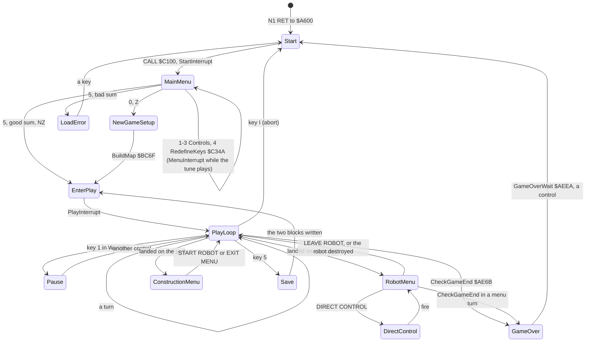
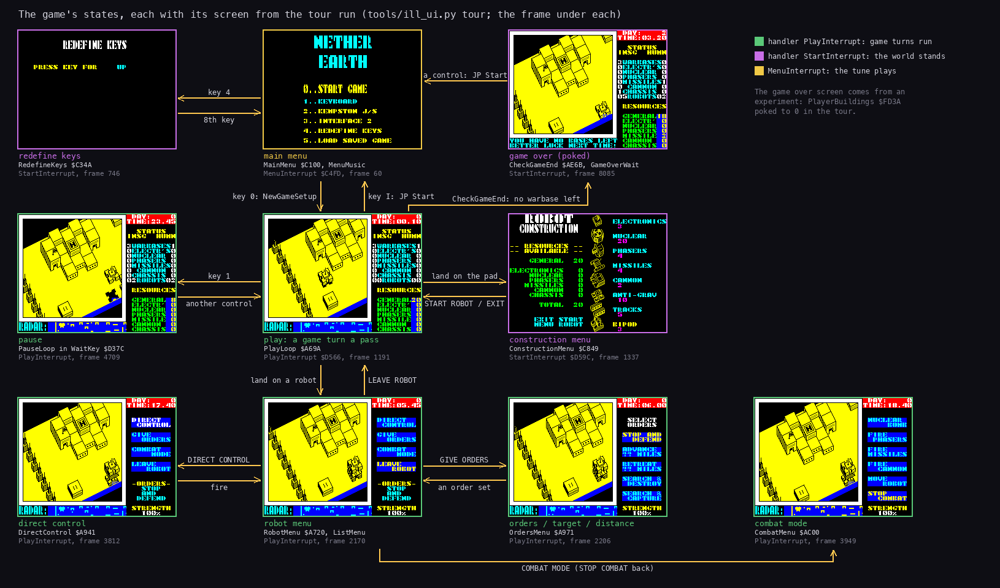
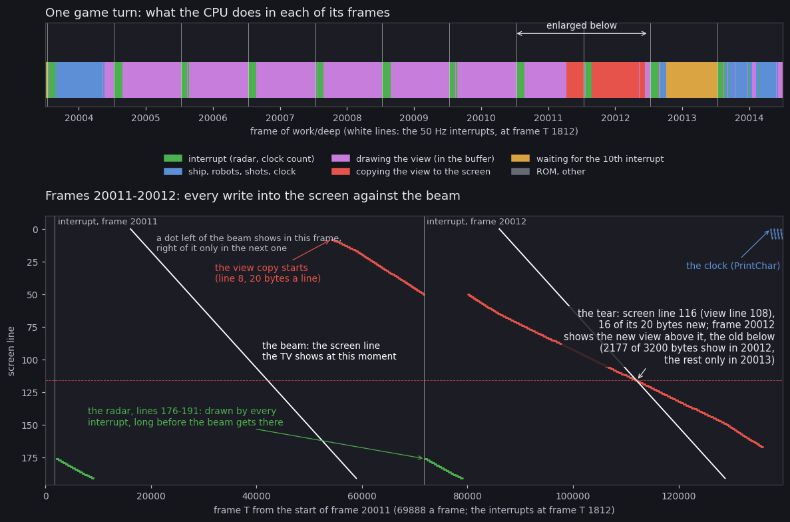

# 4. Game loop

This document covers the game's state machine: the start-up, the main menu, a new or loaded game, the play loop with
its two menus, and the end of a game. It also covers the order of work inside a game turn and how a turn lines up
with the frames and the beam. The whole machine is a chain of fall-throughs and jumps from `Start` `$A600`, and every
exit leads back to `Start` with `JP`.

The recordings it rests on ([Terms](README.md#terms)):

- `deep` (the bot's game, 36 046 frames from the menu snapshot, WALKTHROUGH 6). In it:
  - the game starts at frame 130;
  - the first construction menu is open from frame 290 to about 410;
  - the first robot menu is open from 850 to about 1010;
  - L1 counts 3 332 passes of `PlayLoop` and 3 414 game turns;
- an access trace of `deep`, frames 20000-20026 (`work/docA/deep`, `analysis trace` on its own instance): the two
  turns of 4.5, read with `tools/turn_profile.py` and `../../kit/beam_timeline.py`;
- `play` for the start-up and the menu (frames 12660 on).

## 4.1 The state machine





The same machine with the real screens. How to read the figure:

- **A box** is a state: its screen as the tour saw it, its name, the code that runs it and the tour frame.
- **An arrow** is a transition, labelled with the key or the event that takes it.
- **The frame colour** is the interrupt handler installed (`Handler` `$FDFE`, read at that frame):
  - green `PlayInterrupt` `$D566`: the clock, the radar and the robots run;
  - violet `StartInterrupt` `$D59C` (`EI; RET`): the world stands (the construction menu, the redefine screen, the
    game-over wait);
  - yellow `MenuInterrupt` `$C4FD`: the tune.
- **The point**: play is the hub. The robot menu and its submenus keep `PlayInterrupt`: the war goes on under them
  ([5.5](05-controls.md#55-the-robot-menu-and-its-submenus)).
- **The game-over screen** is an experiment: the tour poked `PlayerBuildings` `$FD3A` to 0 at frame 8015, so
  `CheckGameEnd` `$AE6B` found no warbase of ours.

`python3 tools/ill_ui.py states` draws it from the tour's saved screens (`work/ill3/tour`).

## 4.2 The states

| State | Code | Handler (2.4) | Game turns | Ends |
| --- | --- | --- | --- | --- |
| start-up | `Start` `$A600` | `StartInterrupt` `$D59C` | no | falls into `CALL MainMenu` |
| main menu | `MainMenu` `$C100`, `MainMenuKeys` `$C192` | `MenuInterrupt` `$C4FD` while the tune plays, else `StartInterrupt` | no | key 0 (Z) or a good load (NZ) |
| redefine keys | `RedefineKeys` `$C34A` | `StartInterrupt` | no | the eighth key, back to the menu |
| load error | `LoadError` `$C282` | `StartInterrupt` | no | a key, `JP Start` |
| new game | `NewGameSetup` `$A62D` | `StartInterrupt` | no | falls into `EnterPlay` |
| enter play | `EnterPlay` `$A68E` | sets `PlayInterrupt` `$D566` | no | falls into `PlayLoop` |
| play | `PlayLoop` `$A69A` | `PlayInterrupt` | one a pass | the keys I and 5, the game's end |
| pause | `PauseLoop` in `WaitKey` `$D37C` | `PlayInterrupt` | no | a control other than pause |
| robot menu | `RobotMenu` `$A720`, `ListMenu` `$ACD7` | `PlayInterrupt` | one a pass of `ListMenu` | LEAVE ROBOT; the robot's `+$01` = 0 |
| direct control | `DirectControl` `$A941` | `PlayInterrupt` | one a pass | fire, or the robot destroyed |
| construction menu | `ConstructionMenu` `$C849` | `StartInterrupt` | no | START ROBOT, EXIT MENU |
| save | `SaveGame` `$C28D` | `StartInterrupt` | no | `JP EnterPlay` |
| game over | `GameStop` `$AF00`, `GameOverWait` `$AEEA` | `StartInterrupt` | no | a control, `JP Start` |

**Notes on the states.**

- **Start-up.** `Start` runs again for every new game: after an abort, a game's end or a load error. It rebuilds
  the IM 2 table and resets the seed every time, so every game from the menu starts from the same random state
  ([2.3](02-architecture.md#23-the-stages-from-tape-to-play)).
- **New game** (`NewGameSetup` `$A62D`). It clears the 48 robot records, the variables `$FD04-$FDFC`, the buildings
  and the shots. It puts the ship at column 17, row 10, altitude 0, climbing for 3 turns. It gives each side 20
  general resource, and `BuildMap` lays out the level.
- **A loaded game** goes from the menu straight to `EnterPlay` with the loaded state
  ([3.6](03-build-and-load.md#36-the-saved-game)).
- **The menus run turns, or not.** The robot menu and direct control run whole game turns of their own: `WorldTurn`,
  `DrawView`, `MenuRadarTick` `$B048`, `GameTurn`, `ShowStrength` `$A81D`. They leave out only `MoveShip` and the
  landing checks. The world goes on and the clock runs: In `deep`, 83 of the 3 414 turns ran inside the robot menu (`ListMenu` → `GameTurn`). The other 3 331 ran in `PlayLoop`: its 3 332nd pass was cut off by the end of the recording after `DrawView`.
  The construction menu installs `StartInterrupt` and waits in its own loop: no turn, no frame count and no radar
  until it closes ([5.4](05-controls.md#54-the-construction-menu)).
- **Pause** (`WaitKey` `$D37C`). While key 1 is held, `WaitKey` loops on `ReadControls` until a control other than
  pause is pressed with key 1 released. The play interrupt keeps running: the radar blinks and `TurnFrames` counts
  on. So the turn after a pause does not wait at `TurnPace`, unless the 8-bit count happened to wrap below 10
  (read from the code; not seen in a recording).
- **Abort** (key I) is `JP Start` from `CheckGameKeys` `$A70D`, with no question asked; the game is lost.

## 4.3 The turn

One pass of `PlayLoop` `$A69A` is one game turn ([2.5](02-architecture.md#25-the-main-loop)). The phases of the turn
traced in `deep` (frame 20004 T 10 414 to frame 20014 T 10 412: 698 878 T, 10.00 frames, 78 147 instructions):

| Step | Code | Work | T | Share | Starts at (frame, T) |
| --- | --- | --- | ---: | ---: | --- |
| 1 | `CALL WaitKey` `$A69A` | read `Input`; the pause | 754 | 0.1 % | 20004, 10414 |
| 2 | `CALL MoveShip` `$A69D` | the ship, the view column, the radar window, the ship's map bit | 1 131 | 0.2 % | |
| 3 | `CALL WorldTurn` `$A6A0` | the enemy commander, 48 robot slots, 5 shots ([7.1](07-objects.md#71-the-world-turn)) | 49 381 | 7.1 % | |
| 4a | `DrawView` → `DrawViewBackground` `$CFD7` | clear the view buffer, paint the corners | 43 427 | 6.2 % | |
| 4b | `DrawView` → `DrawMapObjects` `$CCC6` | the 32 x 16 cells back to front, the sprites ([6.4](06-rendering.md#64-the-draw-order)) | 379 569 | 54.3 % | 20005, 43636 |
| 4c | `DrawView` → `JP CopyViewToScreen` `$D071` | the buffer to the screen, 20 x 20 characters | 73 525 | 10.5 % | 20011, 54139 |
| 5 | `CALL GameTurn` `$A6A6` | random step, clock, production, game end, captures | 13 754 | 2.0 % | |
| 6 | `TurnPace` `$AE1D` | wait for `TurnFrames` ≥ 10, clear it | 53 385 | 7.6 % | 20013, 18396 |
| 7 | `CALL ShipCell` `$A6A9` and on | the landing checks, then the keys I and 5 | 148 | 0.0 % | |
| | `$FDFD` | the interrupts that land in the turn, 10 of them | 83 770 | 12.0 % | each frame |

The table comes from `python3 tools/turn_profile.py` on the trace `20000_0-20026_0.uatr`; 4.5 shows the same turn
on a time line ([the figure](#45-time)). The next turn, frames 20014-20024, is the same within 0.1 %: the cost hardly
depends on what is in view. An interrupt is
counted from its `$FDFD` entry until SP rises above the interrupted frame.

**The landing checks** (`$A6A9`-`$A70C`), after the turn's work:

- **Under the ship, map bit 6**: if not set, go straight to the keys.
- **A robot** (`FindRobot` `$CDD8`):
  - an enemy's slot (24-47): nothing;
  - one of ours, when `Altitude` = its `+$09` + `+$0D` exactly: `RobotMenu`.
- **A building** (`FindBuilding` `$CDF5`) of type 0, our warbase's pad, when `Altitude` = 15 and the door cell 4 rows
  below, the cell under it and its two neighbours are free of bit 6: `ConstructionMenu`.
  - On its return, `PlayLoop` gives the new record its starting state: `+$05` 4, `+$06` 5, `+$0B` 0, `+$0C` 100,
    `+$0F` 1.
  - It then recounts the robots and reprints the panel.
- **Bug** (verified, `work/ann/r1.md`). With all 24 of our slots in use, `ConstructionMenu` returns at once with
  IY = `$DB80`, the first enemy slot. `PlayLoop` then writes that starting state into the enemy's robot: on the own
  instance an enemy robot poked to 32 % was back at 100 %. This repeats every turn the ship rests on the pad
  ([5.4](05-controls.md#54-the-construction-menu)).
- **The keys** (`CheckGameKeys` `$A70D`): `Input` bit 6 is `JP Start`; bit 5 is `SaveGame`, then `JP EnterPlay`;
  otherwise `JP PlayLoop`.

**Inside `GameTurn` `$AD62` / `GameTurnEnd` `$AD90`:**

1. `Random` `$D358`: one step of the generator a turn, so the enemy's choices depend on the turn count.
2. The clock + 5 minutes. At 60 minutes an hour, at 24 hours a day and `DailyProduction` `$AE38`.
3. The clock printed at (0,27): the day as five digits, then hours.minutes.
4. `CheckGameEnd` `$AE6B` (4.4).
5. The 28 capture points ([7.6](07-objects.md#76-buildings-and-capture-points)): each door with bit 6 counts up,
   each empty one is reset; at 144 the base goes to the side of the robot standing there. In `deep`, 17 captures
   (`GiveFactory` `$BB61` ×17). After any capture, `CountBases` `$BB09` and the panel.
6. `TurnPace` `$AE1D` (4.5).

## 4.4 The end of a game

`CheckGameEnd` `$AE6B` runs in every turn, including the turns inside the robot menu:

1. `EnemyBuildings` `$FD42`, the enemy's warbases, = 0: `GameWon` `$AEB1` prints " INSIGNIANS DESTROYED / YOU HAVE
   WON !".
2. Otherwise `PlayerBuildings` `$FD3A` = 0: "YOU HAVE NO BASES LEFT / BETTER LUCK NEXT TIME!".

Both messages print at (22,0) in attribute `$45`, after `GameStop` `$AF00`. `GameStop` gives the panel back to the
status (`PanelBusy` `$FD39` = 0) and installs `StartInterrupt`: the radar freezes and the frame count stops.
`GameOverWait` `$AEEA` follows:

1. a buzz (`Beep` `$FA`);
2. 100 `HALT`s, 2 s;
3. `WaitRelease` `$AD57`;
4. a wait for a control: the chosen keys or stick, not any key;
5. `JP Start`.

The stack is not unwound: `Start` sets SP = 0. Both ends were reached by poking the warbase counts on an own instance
(`work/ann/r1.md`). No recording played a game to its end, and `GameOverWait` is code that no recording ran
(`game.ann`).

## 4.5 Time

**The pace.** `PlayInterrupt` adds 1 to `TurnFrames` `$FD34` every frame. The end of a turn waits until it reaches
10, then clears it:

```text
$AE1D  LD A,(TurnFrames)   ; TurnPace
       CP $0A
       JR C,$AE1D          ; fewer than 10 frames since the last clear: wait
       XOR A
       LD (TurnFrames),A
       RET
```

So a turn is at least 10 frames, 200 ms: 5 turns a second, 12 turns a game hour, 288 a game day (57.6 s).

- **The work fits.** The work of a turn takes about 8.3 frames. In the traced turn, the work ended in frame 20013
  at frame T 18 396; the wait then spun for 53 385 T, three quarters of a frame, until the tenth interrupt of the turn.
- **Turns are 10 frames almost always.** `deep` averages 36 046 / 3 414 = 10.6 frames a turn. The excess comes from
  the frames no turn runs in: the construction menus (the first one was open for about 120 frames), and the start before frame 130.
- **The clear drops leftover frames.** A turn whose work ran past 10 frames does not carry the extra frames into the
  next turn, because the clear sets the count to 0.

**The beam.** The turn is not synchronised with the beam. Its start drifts with the work, and only the interrupt
gives it a phase: the wait ends just after an interrupt, so a turn starts at about frame T 10 260, 8 450 T after the
interrupt.

T here is the frame T: the T-state in the emulator's frame, as unreal-ng's access trace stores it. Frame T 0 is not
the interrupt: on the 48K the INT rises at frame T 1812 and the first paper pixel comes 14 340 T later, at frame
T 16 152 (unreal-ng `ApplyModelTimingDefaults`, `intstart` 1811).



How to read the figure:

- **The top strip** is one turn of `deep`, frames 20004-20014, one colour for each phase:
  - the interrupt near the start of every frame, at frame T 1812 (green; the white lines);
  - the ship, robots, shots and clock (blue, frame 20004);
  - drawing the view in the buffer (purple, about seven frames);
  - copying it to the screen (red, about a frame);
  - waiting for the tenth interrupt (yellow);
  - from frame 20014, the next turn.
- **The lower panel** enlarges the copy's two frames, 20011 and 20012:
  - across: the frame T from the start of frame 20011 (69 888 a frame); the thin vertical lines are the interrupts,
    at frame T 1812;
  - down: the screen line;
  - each dot: one byte written into the screen.
- **The white diagonals** are the beam: the line the TV shows at that moment, one diagonal a frame. A byte written
  left of the diagonal shows in that frame; one written right of it waits for the beam's next pass.
- **The red slope** is the copy, 20 bytes a line. It starts at line 8 late in frame 20011 and pauses for the
  interrupt. In 20012 it is slower than the beam and crosses it at line 116:
  - lines 8-115 were written before the beam passed and show the new view;
  - line 116 is split: 16 of its 20 bytes are new;
  - lines 117-167 were written after the beam passed: for that frame they still show the old view;
  - in all, 2177 of the 3200 bytes show in frame 20012, the other 1023 only in 20013.
  - That is the tear.
- **The green steps** at lines 176-191 are the radar, redrawn by every interrupt at the start of the frame, long
  before the beam reaches the bottom: it never tears.
- **The blue marks** at the top right are the clock's digits.

```
python3 ../../kit/beam_timeline.py --work work/docA/deep --window 20004:0-20015:0 --listing work/mkgame/game.lst \
    --frames 11 --out work/figs/beam-raw.png        # traces the window once into work/docA/deep/traces
python3 tools/fig_beam_turn.py --trace work/docA/deep/traces/20004_0-20015_0.uatr --listing work/mkgame/game.lst \
    --copy-frame 20011 --out docs/img/beam-turn.png
```

The writers to the screen in the 11 frames, by loop. "Ahead" counts a write made before the beam reached its line
in the same frame; a copy byte written behind the beam late in 20011 still shows in 20012, so these columns are not
the 2177 above:

| Loop | Writes | Ahead of the beam | Behind the beam | What |
| --- | ---: | ---: | ---: | --- |
| `CopyLineLoop` (`CopyViewToScreen` `$D071`) | 3 200 | 1 420 | 1 780 | the 160 x 160 view, 20 bytes a line |
| `RadarLineLoop` (`ShowRadar` `$D59E`) | 2 816 | 2 816 | 0 | the radar picture, lines 176-191, at the start of every interrupt |
| `FillAttrLoop` (`FillAttr16` `$D5BD`) | 352 | 352 | 0 | the radar's attributes |
| `GlyphLineLoop` (`PrintChar` `$D4B1`) | 90 | 54 | 36 | the clock |

What this shows:

- **The radar never tears.** The interrupt draws it at the top of the frame, long before the beam reaches screen
  line 176.
- **The view copy does tear.** It takes about 1.05 frames, starting wherever the drawing ended (here frame 20011,
  frame T 54 139), and it overtakes the beam: in frame 20012 the beam crosses it at screen line 116. Above that line
  the screen shows the new view, below it the old one, for one frame.
- **The tear is at a different place every turn.** The copy's start depends on how long the drawing took, and the
  game makes no attempt to start it at the interrupt.

The screen mixes two views only while the copy runs, about one frame in ten.

## 4.6 Design notes

- **A frame budget by counting, not by syncing.** The interrupt only counts. The loop draws as fast as it can and
  then waits for the count, which keeps the speed constant whatever the view holds. The price is the tear in 4.5.
- **Menus that keep the world running.** The robot menu calls the same turn routines as `PlayLoop`, minus the ship.
  Giving orders costs no game time, but the world moves while the player reads.
- **One way out.** Abort, game over and a bad load all `JP Start`. `Start` resets the stack, the interrupt table
  and the seed, so no state needs unwinding.
