# 5. Controls

One reader, one byte. `ReadControls` (`$D38A`) turns the eight redefinable keys and the joystick the menu chose
into `Input` (`$FD0C`); the ship, the robot under direct control and every menu read only that byte. The menus are
no separate screens with their own input: they are loops that call `WaitKey`, move a highlight by attributes and
run a game turn between presses, so the war goes on while the player chooses.

Evidence:

- the code of `src/game/*.asm` (the routines named below);
- `work/deep`: the bot's 36046-frame game from the menu snapshot `work/play/start.szx` (no tape load in it; the
  snapshot was taken after the ROM-speed load of `work/play`), Kempston stick (WALKTHROUGH 6). L1 counts and TTD
  `memory_at`;
- `work/docB/rec`: the same bot, 3034 frames from the same snapshot, recorded on an own instance:
  `tools/bot.py play --record --frames 3000 --work work/docB/rec --port-base 24600`. The menu screenshots,
  `kit/screen_shot.py --work work/docB/rec --out-dir docs/img menu-main=5 menu-orders=900 menu-target=950
  menu-robot=1000 menu-construction=1500`;
- the region agents' experiments on own instances (`work/ann/r1.md`, `r3.md`, `r4.md`): the redefine screen,
  DIRECT CONTROL, ADVANCE 10 MILES, COMBAT MODE, both game ends.
- the tour: one scripted, recorded session on an own instance from `work/play/start.szx` that drives every menu
  of this chapter (redefine, construction, orders, distance, combat, direct control), the screen sampled every 2
  frames, events and frames in `work/ill3/tour/events.json`: `python3 tools/ill_ui.py tour --port-base 29300`, the
  pictures `python3 tools/ill_ui.py draw-tour`. The animated figures below come from it.

## 5.1 Devices

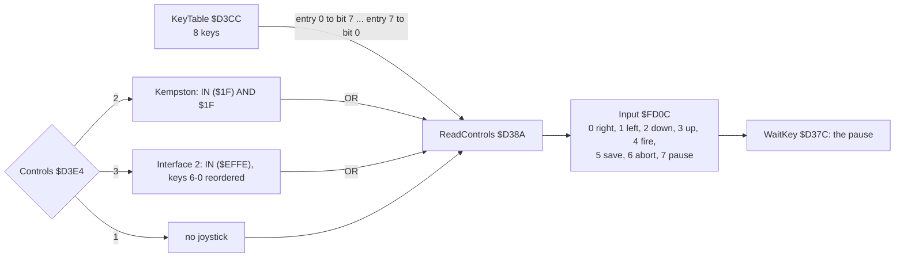

| Device (`Controls` `$D3E4`) | Ports | What it gives |
| --- | --- | --- |
| 1 keyboard (the value in the image) | the half rows of `KeyTable` | all eight bits |
| 2 Kempston (`$D3AB`) | `$1F`, bits 0-4 | right, left, down, up, fire, already in `Input`'s order; bits 5-7 are masked off |
| 3 Interface 2 (`$D3B2`) | `$EFFE`, keys 6, 7, 8, 9, 0 | 6 left, 7 right, 8 down, 9 up, 0 fire: the row is inverted and its five bits shuffled into the Kempston order |

The keys are read whatever the device: the joystick bits are ORed into the key bits (`InputDone` `$D3C7`), so
`Input`'s low five bits are the Kempston layout and the three game keys sit on top. Interface 2 means its port 1 (the
keys 6-0); the keys 1-5 of the second port are not read as a joystick, and key 1 is the default pause key.

**`KeyTable`** `$D3CC`: eight records of 3 bytes (the port's high byte, the bit mask, the key's code for the
redefine screen), the end byte `$01`, then `Controls`. `ReadControls` starts with C = 1 and rotates each key into C
with `RL C`; after the eighth key the 1 falls into the carry and ends the loop, so entry 0 ends in bit 7:

| Entry | Bytes | Key | `Input` bit | Meaning |
| --- | --- | --- | --- | --- |
| 0 | `F7 01 31` | 1 | 7 | pause |
| 1 | `DF 04 49` | I | 6 | abandon the game |
| 2 | `F7 10 35` | 5 | 5 | save the game to tape |
| 3 | `7F 02 82` | SYMBOL SHIFT | 4 | fire |
| 4 | `FB 01 51` | Q | 3 | up |
| 5 | `FD 01 41` | A | 2 | down |
| 6 | `DF 02 4F` | O | 1 | left |
| 7 | `DF 01 50` | P | 0 | right |

A key is `LD A,(HL)` / `IN A,($FE)` / `AND (HL)`: the high byte selects the half row through the address bus.
`ReadControls` ran 9814 times in `work/deep`: once a turn of play or of a menu loop, and in the waits.

**`WaitKey`** `$D37C`, the only caller of `ReadControls`: when bit 7 (pause) is set it loops in `PauseLoop` `$D381`
until another control is pressed with the pause key up (`JR Z` on nothing, `JP M` on pause still held), then falls
into `ReadControls` once more, so the control that ended the pause is this turn's input. Meanwhile the play
interrupt runs on (the radar blinks, a sound effect plays out, [6.7](06-rendering.md#67-the-radar)); the clock and
the robots stand still, because `GameTurn` and `WorldTurn` are not called.

## 5.2 The main menu and the redefine screen

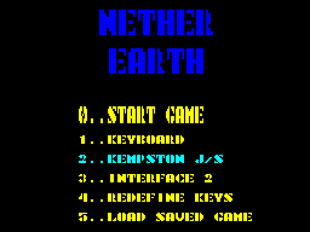

`MainMenu` `$C100` does not use `KeyTable`. It waits for all keys up, plays the menu music until a number key
(`MenuMusic` `$C4A7`, [9](09-sound.md)), then reads the key with the ROM's KEY-SCAN `$028E` and the ROM key table
`$0205`:

| Key | Code | Effect |
| --- | --- | --- |
| 0 | `MenuStart` `$C1D1` | Z: a new game (`Start` goes on into `NewGameSetup` `$A62D`) |
| 1, 2, 3 | `MenuSetControls` `$C1DD` | `Controls` = 1 keyboard, 2 Kempston, 3 Interface 2; the options redrawn, the chosen one highlighted (`ControlsOptionAttr` `$C336`) |
| 4 | `RedefineKeys` `$C34A` | the redefine screen, then the whole menu again |
| 5 | `LoadGame` `$C1FD` | a saved game from tape; NZ, and `Start` skips the new-game set-up |
| others | | ignored |

The bot presses 2, then 0 (`tools/bot.py play`).

**Redefine keys** (`RedefineKeysBody` `$C36A`, `DefineKey` `$C427`). The 24 bytes of `KeyTable` are cleared first
(the LDIR at `$C37D`). The prompts come in the order UP, DOWN, LEFT, RIGHT, FIRE, PAUSE, ABORT, SAVE: each is
`PrintKeyPrompt` `$C40C` ("PRESS KEY FOR ", then the caller's inline name: `@inline $C40C`). `DefineKey` waits on
KEY-SCAN, turns the key value E into a record (mask `$20` rotated right `E / 8 + 1` times, port `$FF` shifted right
`(E AND 7) + 1` times), refuses a code already in the table (`KeyTakenLoop` `$C444`: "taken" means defined earlier
in this pass) and prints SYM SH, ENTER, CAPS SH, SPACE or the character. After the eighth key it waits for all keys
up and counts BC through 65536 values (`RedefineKeysPause` `$C405`, about 0.56 s). Measured on an own instance (r4
experiment 1, keys Q, Q, A, O, P, SPACE, ENTER, CAPS SHIFT, SYMBOL SHIFT): `KeyTable` = `BF 01 0D  FE 01 E3  7F 02 0E
7F 01 20  FB 01 51  FD 01 41  DF 02 4F  DF 01 50`; the second Q was refused.

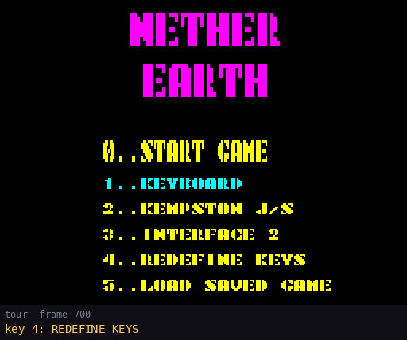

The tour presses key 4 at frame 700 and answers the eight prompts with the default keys Q, A, O, P, SYMBOL SHIFT,
1, I, 5, one every 40 frames; after the eighth the menu comes back (frame 1066). `KeyTable` read back afterwards
(`memory_at`) is the image's table byte for byte except one: SYMBOL SHIFT now has the print code `$0E`, where the
image holds `$82`. The code is only what the redefine screen prints (the port and mask are the same), so the keys
work alike; the image's table was not made by this routine.

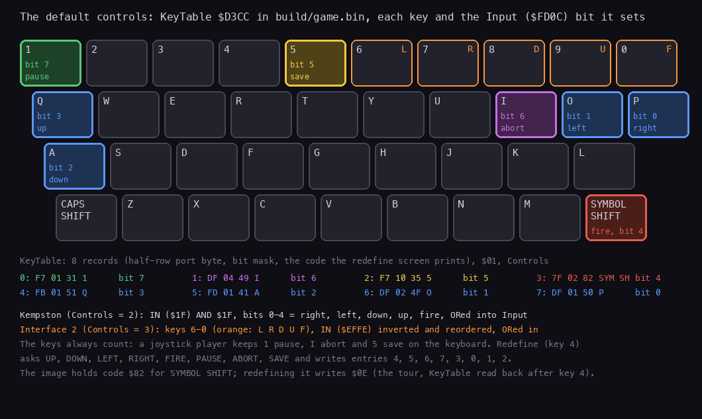

Each key of `KeyTable` (`$D3CC`, `build/game.bin`) coloured by the `Input` bit it sets, with the 8 records and the
Interface 2 keys 6-0 that `ReadControls` adds when `Controls` = 3. `python3 tools/ill_ui.py keys`.

## 5.3 In play: the ship and the game keys

`PlayLoop` `$A69A` calls `WaitKey` once a turn; `MoveShip` `$AF11` reads `Input`:

| `Input` | The ship | Code |
| --- | --- | --- |
| right / left (not both) | X + 1 / X - 1 within columns `$0E`-`$1F5`; refused by `CheckShipMove` `$B052` where the ship would stand lower than the tops there | `MoveShipX` `$AF25` |
| down / up (not both) | Y + 1 / Y - 1 within rows 1-15, refused the same way | `MoveShipY` `$AF77` |
| fire | Altitude + 2 a turn up to `$30` | `ClimbByFire` `$AFAE` |
| no fire | Altitude - 1 a turn, not below the highest top under the 2 x 2 footprint | `Sink` `$AFC3` |
| up or down held | the forced climb `ClimbTurns` `$FD30` counts down twice as fast | `$AF1B` |

While `ClimbTurns` is not 0 the ship climbs whatever fire says: 3 turns at a new game, 5 after a menu, so it does not
sink straight back onto the pad or the robot. The view follows (`FollowView` `$AF57`): at view column 13 the view
moves one column left, at 22 one column right, so the ship stays between them. Every move is one cell a turn: the
turn of at least 10 frames ([4](04-game-loop.md)) is the ship's speed too.

After the turn's work `PlayLoop` looks at the cell under the ship (`ShipCell` `$CCA0`, map bit 6):

| Under the ship | Condition | Opens |
| --- | --- | --- |
| a robot of ours (`FindRobot` `$CDD8`, slot 0-23) | Altitude = `+$09` + `+$0D`, the robot's top, exactly | `RobotMenu` `$A720` |
| building type 0, our warbase's pad (`FindBuilding` `$CDF5`) | Altitude = 15, and the door cell 4 rows below, the cell under it and its two neighbours free of bit 6 | `ConstructionMenu` `$C849` |

Then the game keys (`CheckGameKeys` `$A70D`): `Input` bit 6 (I) is `JP Start`, the main menu at once with no
question; bit 5 (5) is `SaveGame` `$C28D`, then `EnterPlay` redraws the play screen. The pause is `WaitKey`'s (5.1).

## 5.4 The construction menu

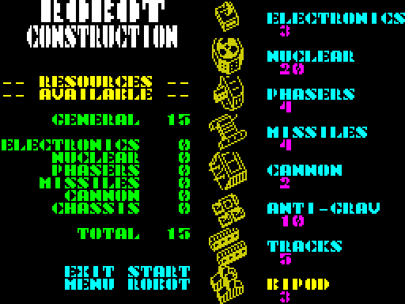

`ConstructionMenu` `$C849` needs a free slot among our 24; with none it returns at once (and the caller then writes
into enemy slot 24, a bug: [7.2](07-objects.md#72-robots)). It installs `StartInterrupt` (EI; RET), so the clock,
the radar and the robots stand still while it is open. The cursor is `MenuCursor` `$FD1F` = (column, part row), the
parts chosen `MenuParts` `$FD21`; the spending happens on a copy, `MenuResources` `$FD29`:

| `Input` in `ConstructionMenuLoop` `$CA0F` | Effect |
| --- | --- |
| right / left | column + 1 / - 1: 0 EXIT MENU, 1 START ROBOT, 2 the parts |
| up / down, in column 2 only | part row + 1 / - 1: 0 bipod at the bottom ... 7 electronics at the top |
| fire, column 2 | toggle the part: take it back (refund), or choose and pay (`PartCosts` `$CAF0`: its own resource first, the general one for the rest; one chassis of three, at most three of the four weapons) |
| fire, column 1 | START ROBOT (`StartRobot` `$CB52`): needs a chassis and a weapon; the robot appears at (ShipX, ShipY + 4) |
| fire, column 0 | EXIT MENU |

Every press ends in `MenuPause` `$CB4A`, 10 HALTs; a press that falls inside that pause is lost. The bot therefore
holds each press until the byte it should change has changed (`Game.hold_until`), and before choosing parts it
waits for the cursor (2, 0, 0): `ConstructionMenu` installs its handler before it resets `MenuCursor` and
`MenuParts`, so a part chosen earlier is lost (WALKTHROUGH 6). The sounds (`Beep` `$CCAC`): a move `$14`, accepted
`$64`, refused or taken back `$78`. The parts, their costs and the robot they make: [7.2](07-objects.md#72-robots).

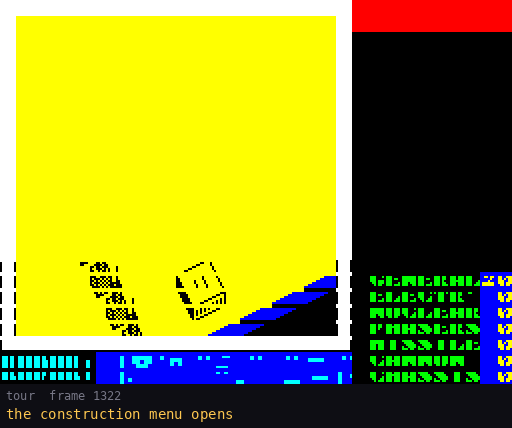

The tour's build, from `PartToggle` `$CA2A` as it ran (the caption under each picture is the bot's action): BIPOD
paid 3 of the 20 general (`Resources` `$FD22` at frame 1320); TRACKS **replaces** the bipod, refunding it (a second chassis is a swap, not a
refusal, `$CA3B`-`$CA56`); CANNON paid 2; NUCLEAR refused, 20 is more than the 13 left (beep `$78`); MISSILES paid 4,
then taken back (refund, beep `$78`); START ROBOT at frame 1554: the build chirp, the menu closes, and at frame
1626 the robot (tracks + cannon) stands at the warbase door. The preview on the left is redrawn at every toggle.

## 5.5 The robot menu and its submenus

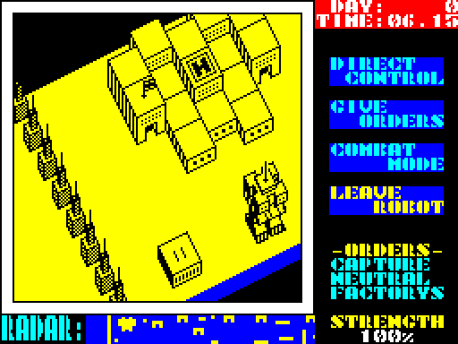

`RobotMenu` `$A720` sets the record's `+$0A` = 1 (the robot stops: `UpdateRobot` skips it), `PanelBusy` `$FD39` = 1
(the status panel stays off the menu) and `MenuCursor` = 4, then draws four items in the right panel and the
current order under -ORDERS-. Every list is `ListMenu` `$ACD7`:

- HL = the attribute address of item 0; an item every 3 character rows (`$60` bytes), 2 rows x 8 cells;
- E = the items + 1; A = the item highlighted first;
- normal `$4D`, highlighted `$4E`, chosen `$4F` (`PaintMenuItem` `$AD3C`);
- down / up move one item with the click `$14`; fire paints the item `$4F`, beeps `$64` and returns its number;
- between presses one game turn runs (`WorldTurn`, `DrawView`, `MenuRadarTick`, `GameTurn`, `ShowStrength`): the
  world goes on while the menu waits;
- a destroyed robot (`+$01` = 0, `ListMenuLoop` `$ACE2`) drops `ListMenu`'s return address and closes the whole
  menu.

 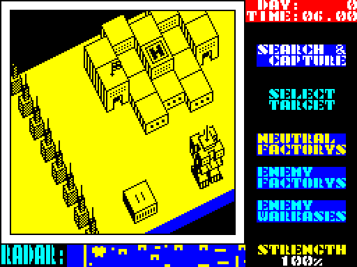

| Menu (attribute of item 0) | Items | Result |
| --- | --- | --- |
| robot menu (`$5837`) | 1 DIRECT CONTROL, 2 GIVE ORDERS, 3 COMBAT MODE, 4 LEAVE ROBOT | |
| GIVE ORDERS (`$5897`) | 1 STOP AND DEFEND, 2 ADVANCE ?? MILES, 3 RETREAT ?? MILES, 4 SEARCH & DESTROY, 5 SEARCH & CAPTURE | order `+$0B` 0, the distance menu, or the target menu |
| target (`$5937`) | destroy: ENEMY ROBOTS, FACTORYS, WARBASES; capture: NEUTRAL FACTORYS, ENEMY FACTORYS, ENEMY WARBASES | `+$0B` 3-5 / 6-8 (`SetOrder` `$ABC8`) |
| distance (`DistanceSelect` `$AA6E`) | up + 5 miles, down - 5, 0-50 (`CP $33`) | fire: `+$0E` = miles x 2; 0 miles makes the order 0 |
| COMBAT MODE (`$5837`) | 1 NUCLEAR BOMB, 2 FIRE PHASERS, 3 FIRE MISSILES, 4 FIRE CANNON, 5 MOVE ROBOT, 6 STOP COMBAT | the bomb (`NuclearBlast` `$B99F`), a shot in record 0 `$D7D3`, direct control, back |
| LEAVE ROBOT (`LeaveRobot` `$A801`) | | `+$06` = 0, `+$0A` = 0, `ClimbTurns` = 5, the status panel back |

`SetOrder` refuses DESTROY FACTORYS / WARBASES (orders 4, 5) without the nuclear part (`+$07` bit 6): the order
becomes 0. It then searches the nearest target: found, `+$0E` is its index; none, the order falls back to 0. A
missing weapon or a busy record 0 in COMBAT MODE gives a low buzz. Verified by r1 on an own instance: ADVANCE with
up x3, down x1, fire left `+$0B` = 1, `+$0E` = `$14` and "ADVANCE 10 MILES" on the panel; FIRE CANNON filled shot
record 0 with the robot's facing.

**Direct control** (`DirectControl` `$A941`): `+$0A` = 2, `+$05` = 0. Each robot step `RobotDirectControl` `$B450`
reads `Input`: a direction turns or moves the robot one cell (a turn costs the step, as for the AI), and `MoveShip`
is called so the ship rides on the robot's top. Fire ends it (`+$0A` = 1, back to the menu).

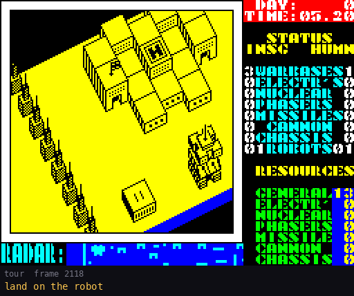

The ship lands on the new robot (frame 2118) and `RobotMenu` replaces the status panel. GIVE ORDERS, SEARCH &
CAPTURE, then NEUTRAL FACTORYS sets order 6 (`SetOrder`); LEAVE ROBOT with fire held lets the ship climb away, and
from frame 2452 the robot sets off for the nearest neutral factory. Each list is `ListMenu`: the highlight is the
attribute `$4E` moving, the chosen item `$4F`.

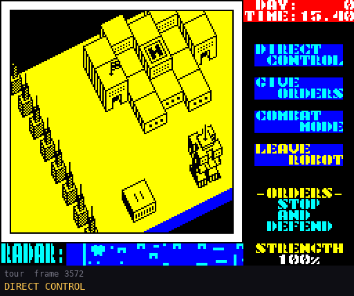

A second robot, under DIRECT CONTROL from frame 3571. Each direction first turns the robot (one step lost), then
moves it one cell a step; the ship and the view follow. Fire at frame 3882 gives the robot menu back.

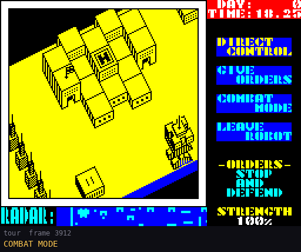

COMBAT MODE replaces the four items by six. FIRE CANNON is chosen at frame 3949; shot record 0 (`$D7D3`) is still empty at
3960 and filled at 3990 (`memory_at`: column `$1B`, row 15, direction 1, 5 steps, weapon 1). The shot flies along
the robot's facing two columns a step (`$1B` to `$23` in 4 steps) and ends at frame 4038: `+$01` = 0 at 4040 and
`SoundFx` = `$FE`, the `$FC` of `ShotGone` already incremented twice (range spent, nothing hit). STOP COMBAT returns to the robot menu.

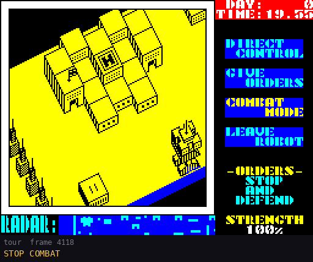

`DistanceSelect` `$AA6E` takes one press a turn: up adds 5 miles, down takes 5, the number printed at character
(13,23). Five ups and one down give 20 MILES; fire sets the order ADVANCE: robot record 1 at frame 4400 has `+$0B` = 1 and `+$0E` = `$28` = 40 (miles x 2) and the panel
shows "ADVANCE 20 MILES" under -ORDERS-.

The distance and combat menus did not run in `work/deep` (the bot gives only search orders); r1 ran them on own
instances, and the tour recording (`work/ill3/tour/session.ttd`) now has both, with the pictures above.

## 5.6 Driving the menus from a script

`tools/bot.py` decides from memory alone and steers with the Kempston stick (`joystick_input` press / release) and
two keys:

| Step | It reads | It holds |
| --- | --- | --- |
| select and start | | key 2, then key 0 |
| reach the pad | `ShipX`, `ShipY`, `Altitude` (`$FD0D-$FD10`) | the direction toward it, fire below altitude 40 |
| the construction menu is open | `Handler` `$FDFE` = `StartInterrupt` `$D59C`, then `MenuCursor` = (2, 0, 0) | nothing: the ship sinks to 15 |
| a part | `MenuCursor` column and row, then `MenuParts` | right / left, up / down, then fire, each until its byte changes |
| START ROBOT | `Handler` back to `PlayInterrupt` `$D566` | right to column 1, fire |
| the robot menu is open | the robot's `+$0A` = 1 after sinking onto `+$09` + `+$0D` | the direction to the robot's cell |
| a list item | the attribute `$4E` at item 0's attribute + `$60` x k | down / up until the highlight moves, then fire |
| leave | | LEAVE ROBOT with fire held, so the ship climbs at once |

`Game.build` and `Game.order` are the procedure, `PLAN` the robots it builds. Each press must outlast the 10-frame
`MenuPause` (5.4), and `ListMenu` begins with `WaitRelease`: the press that opened a list counts only once released.

## 5.7 Design notes

- **One byte for every input.** Ship, robot, menus and the end screens read `Input`; another device would be one
  branch in `ReadControls`.
- **Keys always count.** A joystick player keeps pause, abandon and save on the keyboard, because the stick is ORed
  in, not chosen instead.
- **Menus inside the game turn.** The robot menus run a game turn between presses, so the robots fight on while the
  player gives orders; only the construction menu stops the world.
- **Abandon is one key.** I ends the game at once, with no confirmation.
