# 6. Rendering

The isometric view is redrawn from nothing every game turn. `DrawView` (`$CCBD`) clears a 160 x 160 pixel buffer,
paints the corners outside the map, walks the 32 x 16 visible map cells back to front along diagonals drawing each
block, building, robot and the ship as masked sprites, and copies the buffer to the screen. Nothing scrolls and
nothing is erased: the turn of about 10 frames is set by this redraw, which takes 8.3 frames on average.

Evidence:

- the code of `src/game/*.asm` (the view in `view.asm`, `viewbuffer.asm`, `sprites.asm`, the radar in
  `interrupts.asm`, the tables in `tables.asm`);
- `work/deep` (the bot's 36046-frame game from the menu snapshot `work/play/start.szx`, Kempston; WALKTHROUGH 6):
  L1 counts and T-states (`work/deep/l1.json`: 2 519 182 516 T-states, 3423 view draws);
- `work/docB/rec` (the same bot, 3034 frames from the same snapshot, on an own instance:
  `tools/bot.py play --record --frames 3000 --work work/docB/rec --port-base 24600`): the access traces of the
  figures. The view drawn at frames 1995-2003 shows the warbase, two of our robots (slot 0 bipod + cannon, slot 1 the
  same), the ship's shadow and the edge fence;
- `work/deep/start.bin`, the image at the start of the deep recording: the sprites and tables;
- `tools/ill_view.py`, `DrawView` in Python, and `tools/ill_render.py`, which draws the figures of this chapter and of
  [7](07-objects.md) from the recordings (TTD `memory_at`, read only; access traces). `ill_view.py` was checked byte
  for byte against the game: the buffer of the `work/docB/rec` call below, 40 views of `work/deep` spread over the
  game (`ill_render.py verify --work work/deep --views 60`, 0 bytes differ) and the 18 views with a deferred robot
  (6.4). Where a figure shows a view the game's camera never showed (a fight away from the ship, a view drawn without
  deferral) it is `ill_view.py` on the memory of that frame, and the caption says so.

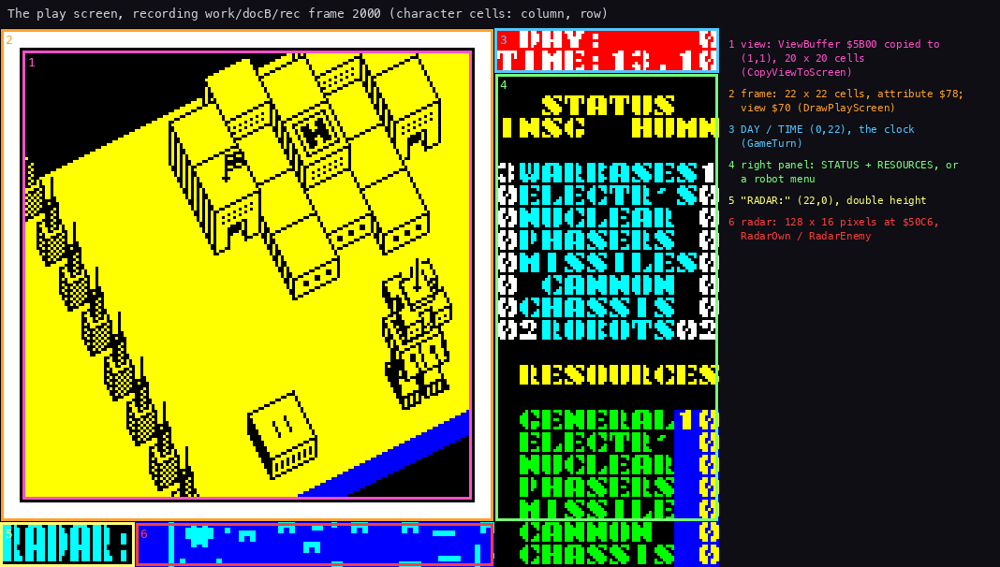

The figure is `tools/doc_figures.py areas --work work/docB/rec --frame 2000 --out docs/img/screen-areas.png`.

## 6.1 One view, as it is drawn

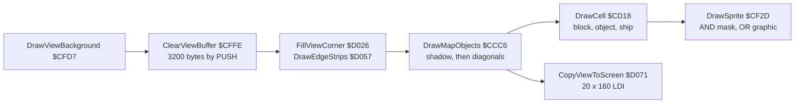

| Routine | T-states a call (`work/deep`) | Share of all T-states | Calls |
| --- | --- | --- | --- |
| `DrawView` `$CCBD`, all of it | 578 127 (8.27 frames of 69 888) | 78.6 % | 3423 |
| `DrawViewBackground` `$CFD7` (clear + corners + edges) | 51 617 | 7.0 % | 3424 |
| `ClearViewBuffer` `$CFFE` | 27 225 | 3.7 % | 3460 |
| `DrawMapObjects` `$CCC6` (inclusive) | 441 836 | 60.0 % | 3423 |
| `DrawSprite` `$CF2D` (inclusive / its own) | 9 707 / 8 378 | 45.0 % / 38.8 % | 116 709, 34 a view |
| `CopyViewToScreen` `$D071` | 74 889 | 10.2 % | 3422 |
| `ShowRadar` `$D59E`, every frame from the interrupt | 8 134 | 11.2 % | 34 645 |

One call in `work/docB/rec` runs from 1995:21923 to 2003:60028: 597 209 T-states, 68 515 instructions. In order:

- the PUSH clear sweeps the buffer from the bottom up;
- the corner and the edge strips appear;
- the shadow;
- the blocks and buildings, diagonal by diagonal from the far corner to the near one;
- the robots over them;
- last the copy to the screen, which only reads the buffer.

[12](12-routine-reference.md#drawview-ccbd) has the call as a routine animation (memory map, buffer and listing).

The same call, one picture a sprite (41 pictures): the buffer after each `DrawSprite`, the sprite's box in red, and on
the right the 32 x 16 map cells of the view projected as the sprites are, the cells walked so far lit and the current
one red. The walk crosses the map along diagonals from the far corner; blocks of a 2 x 2 group draw once, at the
anchor; the robots come where the walk reaches their cells.

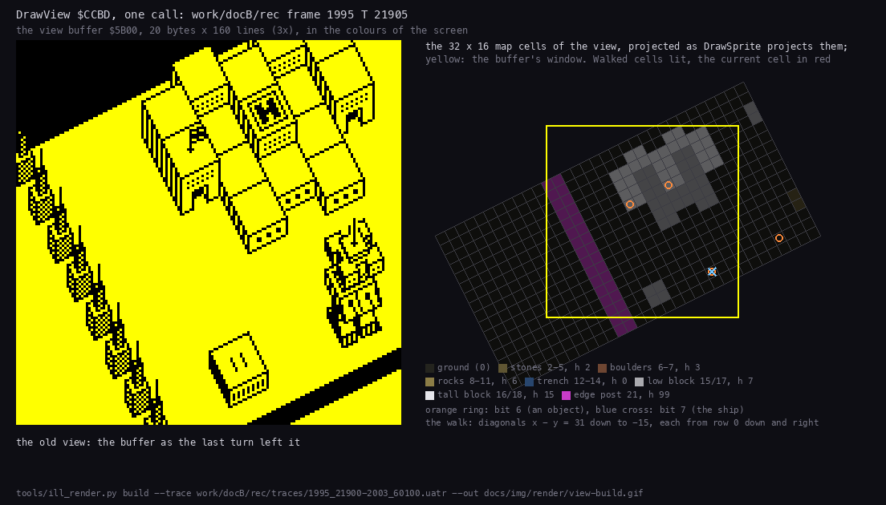

`tools/ill_render.py build --trace work/docB/rec/traces/1995_21900-2003_60100.uatr --out
docs/img/render/view-build.gif`: each picture is the buffer of the trace at the moment that `DrawSprite` returned.

Who drew each byte of the buffer in that call:

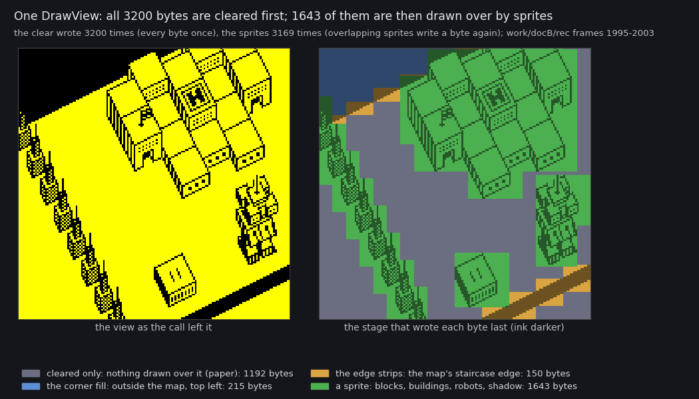

How to read the figure:

- **Left:** the buffer as the call left it, in the screen's colours (black ink on yellow paper).
- **Right:** the same pixels, each byte coloured by the stage that wrote it last; ink pixels are the darker shade.
- **Grey:** the clear only. Nothing was drawn there, so it stays paper.
- **Blue:** the corner fill, the far corner outside the map (`$FF`, all ink).
- **Orange:** the edge strips, the staircase edge of the map.
- **Green:** a sprite: blocks, buildings, robots, the shadow.

The counts:

- The clear writes all 3200 bytes, each once; 1192 stay as it left them.
- Sprites write 3169 times and are the last writer of 1643 bytes: overlapping sprites write a byte again.
- The corner fill is the last writer of 215 bytes (240 writes), the edge strips of 150 (208 writes).

```
python3 tools/fig_view_writers.py --trace work/docB/rec/traces/1995_21900-2003_60100.uatr \
    --listing work/mkgame/game.lst --out docs/img/writers-view.png
```

## 6.2 The view buffer `$5B00-$677F`

`ViewBuffer`: 160 lines of 20 bytes, top line first, a plain bitmap (bit 7 = the left pixel, 1 = ink). It lies
where the BASIC system variables would be; the font follows at `$6780`.

- **Clear** (`ClearViewBuffer` `$CFFE`): `SavedSP` `$FD08` = SP, SP = `$6780`, then `ClearPushLoop` `$D00A` pushes
  HL = 0 eight times a pass, 198 passes (3168 bytes), and an LDIR clears the last 32 bytes.
- **Corners** (`FillViewCorner` `$D026`): the top left corner is outside the map: five bands of 8 lines filled with
  `$FF` over 10, 8, 6, 4, 2 bytes (the counts are self-modified operands at `$D038` / `$D041`). `DrawEdgeStrips`
  `$D057` then lays the staircase edge `ViewEdgeA` `$D6A8` (`FFFF FFFC FFF0 FFC0 FF00 FC00 F000 C000`, 2 pixels a
  line) 6 times down and left from line 0, byte 10, 3 times from line 136, byte 18, and `ViewEdgeB` `$D6B8`, the
  same with the ink on the right, 4 times from line 128, byte 18: the far edge of the map and its near right
  corner.
- **Copy** (`CopyViewToScreen` `$D071`): 20 unrolled LDI a line from `$4021` (character row 1, column 1), the screen
  address stepped by hand, 160 lines: 74 889 T-states, more than a frame. There is no HALT before it: it starts when
  the drawing ends (in the call above at 2002:46058, mid-frame), so the beam may show the old view above and the new
  one below for one frame (below).

The same bytes serve the construction menu's robot preview (`ShowRobotDesign` `$CC1F` draws at `$6168` and copies 4
bytes x 72 lines to `$48E0`), the nuclear flash (the view's attributes saved at `$5B00-$5C8F`) and the tape save
(the checksum word at `$5B00`, [3](03-build-and-load.md)).

**Tearing.** The copy writes a line every 468 T-states (20 `LDI` and the address stepping), the beam shows one every
224: the copy runs at half the beam's speed, so the beam can only catch it from behind. A 48K frame shows the paper
from T 14336; the view's line 0 is screen line 8.

- A copy that starts in the last ~23 400 T-states of a frame or the first ~15 600 is overtaken in the next frame.
  The lines the copy already wrote show the new view, the rest the old.
- A copy that starts between those stays ahead of the beam to the end, and the frame is whole.

In `work/deep` the copy at 25081:66907 started 2981 T-states before the frame's end. The beam overtakes it in frame
25082 at view line 87 (screen line 95):

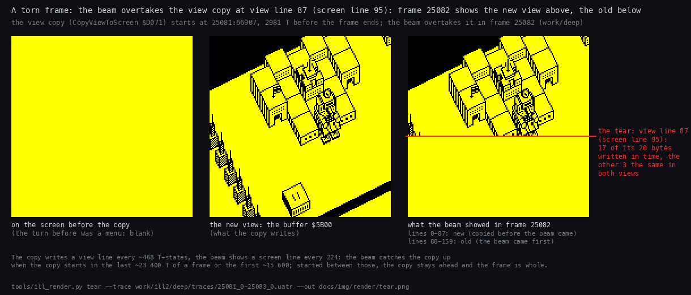

How to read the figure:

- **The three pictures** are the view area of the screen (character rows 1-20, columns 1-20), twice the size.
- **Left:** the screen before the copy. The turn before it was a menu's, so it is blank and the tear is plain to see.
- **Middle:** the new view in the buffer `$5B00`, what the copy writes.
- **Right:** what the beam showed in frame 25082. For each byte, the value in memory at the moment the beam fetched
  it (T 14336 + 224 x screen line + 4 x column), from the trace's write cycles.
- **The red line** is the tear. In view line 87 the copy wrote 17 of the 20 bytes before the beam came. The other 3
  are blank in both views, so the picture changes from view line 88 down.

In play the old and the new view differ by at most one column, and the tear is a small step.

The beam against the copy's writes, in the same two frames:

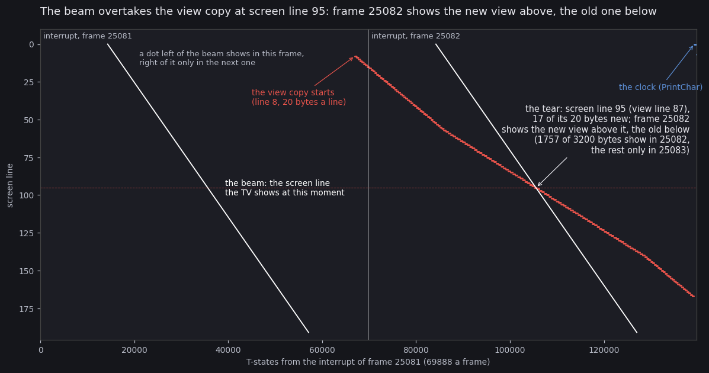

How to read the figure:

- **Across:** T-states from the interrupt of frame 25081; the thin vertical line is the interrupt of 25082.
- **Down:** the screen line, 0 at the top.
- **The white diagonals** are the beam: the line the TV shows at that moment, one diagonal a frame. A byte written
  left of a diagonal shows in that frame; one written right of it waits for the next pass.
- **The red slope** is the copy, one dot a byte written, 20 a line. It starts at screen line 8 near the end of 25081.
  It is slower than the beam (a flatter slope), so in 25082 the beam crosses it at screen line 95: the
  tear of the figure above.
- **The blue marks** at the top right are the clock, printed after the copy.

Of the 3200 bytes, 1757 were written before the beam fetched them in 25082 and show there. The other 1443 show only
in 25083. The two figures agree: screen line 95 is view line 87.

```
python3 tools/ill_render.py tear --trace work/ill2/deep/traces/25081_0-25083_0.uatr --out docs/img/render/tear.png
python3 tools/fig_beam_turn.py --trace work/ill2/deep/traces/25081_0-25083_0.uatr --listing work/mkgame/game.lst \
    --copy-frame 25081 --copy-only --out docs/img/render/tear-beam.png \
    --title 'The beam overtakes the view copy at screen line 95: frame 25082 shows the new view above, the old one below'
```

The trace is the access trace of frames 25081:0-25083:0 of `work/deep`. Neither figure needs an emulator.

## 6.3 The projection

`DrawSprite` `$CF2D` takes A = the sprite (bits 0-5), E = the view column 0-31, D = the map row 0-15, and the height
h in its own operand `$CF3F` (`DrawSprite+$12`, written by every caller). With the column counted in half bytes:

    L = 2E + D - 24                (half-byte column; pixel x = 4L = 8E + 4D - 96)
    H = 8D + 100 - 4E - h          (the buffer line of the sprite's BOTTOM line)

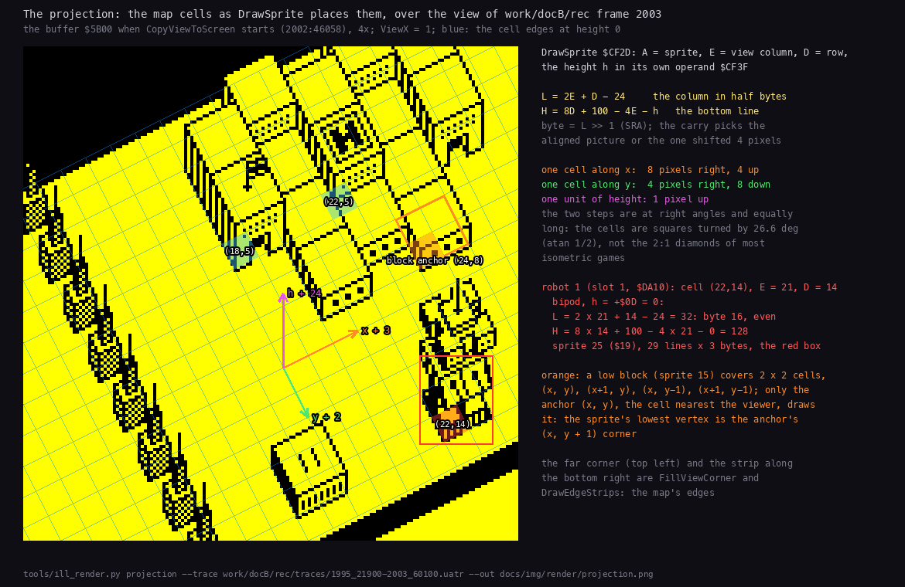

`tools/ill_render.py projection --trace work/docB/rec/traces/1995_21900-2003_60100.uatr --out
docs/img/render/projection.png`: the buffer as the copy starts, with the cell edges at height 0 laid over it from the
formulas. A step along the map's x moves the picture 8 pixels right and 4 up; a step along y 4 right and 8 down; a
unit of height 1 pixel up. The cells are squares turned by 26.6 degrees, not the 2:1 diamonds of most isometric
games. A ground point (u, v) of the view is at pixel (8u + 4v - 92, 8v - 4u + 92); a 2 x 2 block covers (x, y-1) to
(x+1, y) and its sprite's lowest vertex is the anchor's (x, y+1) corner (checked on the outline of sprite 15). The
cell (E, D) = (12, 0) lands on pixel x 0, line 52: the far corner of the view is up and to the left, the map's south
edge runs from the lower left to the right. Columns are half bytes, so a
sprite lands either on a byte boundary or 4 pixels into a byte: `SRA L` gives the byte and the carry picks one of
two pictures of every sprite, the aligned one or one shifted right by 4 pixels (6.5). No sprite is shifted at run
time.

**Clipping**, all in the same routine: a byte column past 19 or a bottom line at `$E2` and below draws nothing; a
bottom line in `$A0`-`$E1` skips the sprite's rows below the buffer (`ClipBottomLoop`); a negative column skips the
left pairs of every row (the count in the operand `$CFAF`, `ClipLeft` `$CF77`); a sprite past column 19 starts each
row earlier so it leaves out its last pairs (`ClipRight` `$CF85`); drawing upward stops above `$5B00`. The map's own
far edge and the corner fills hide what sticks out to the upper left.

The view is a window of 32 of the map's 512 columns ([7.5](07-objects.md#75-the-map)), `ViewX` `$FD0A` its left
column. The whole map, as the game built it:

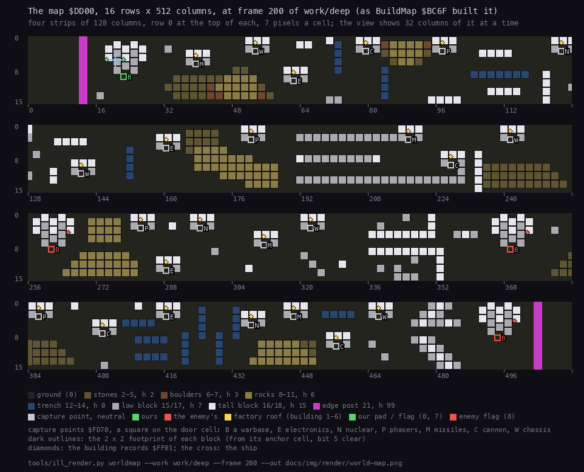

`tools/ill_render.py worldmap --work work/deep --frame 200 --out docs/img/render/world-map.png`: the cell types, the
2 x 2 block footprints, the capture points and building records; our warbase at column 22 at the far left, the
enemy's three at 261, 369 and 494.

## 6.4 The draw order

`DrawMapObjects` `$CCC6`:

1. `ShipDrawPos` `$FD11` = 0 (no deferred ship), then the ship's shadow: sprite 1 at height 0 at view column
   ShipX - ViewX, row ShipY. The shadow is drawn first, so everything covers it.
2. The diagonals x - y = 31 down to -15 (`DiagonalLoop` `$CCF3`), each from row 0 (or its first column) down and
   right, one row and one column a step, to row 15 or column 31. Cells with x < 0 and empty cells (byte 0) are
   skipped; every other cell goes to `DrawCell` `$CD18` with HL = the cell, D = row, E = view column. A later
   diagonal is nearer the viewer, and so is a later cell on a diagonal.

`DrawCell` reads the cell byte ([7.5](07-objects.md#75-the-map)):

| Bit | Draws |
| --- | --- |
| 0-4 (type), bit 5 clear | the block: sprite = type, at height 0 |
| 5 | nothing: the other three cells of a 2 x 2 block (only the anchor cell draws) |
| 6 | `DrawCellObject` `$CE12`: the robot (`FindRobot`), else the building (`FindBuilding`), else a shot whose `+$00/+$01` is this cell |
| 7 | the ship, or the ship deferred to this cell |

**Deferral.** A sprite is taller and wider than its cell, so a block drawn later beside a robot would paint over its
upper body. `DrawMover` `$CE68` therefore looks at the blocks that can overlap (`FindLatestBlock` `$CD96`: (x-1, y+1),
(x, y+1), (x-1, y), (x+1, y+1); (x+1, y) is passed over) and picks the one drawn last (`KeepLaterCell` `$CDBF`:
A = (yHL - yDE) + (xDE - xHL), later when A > 0, or A = 0 and xHL > xDE: the diagonal order of the walk). If that is
not the robot's own cell, the robot is postponed (`MoverDefer` `$CE76`):

- bit 6 is set on the later cell, and the record's draw cell `+$00/+$01` is pointed at it;
- when the walk reaches that cell, `DrawCellObject` finds the robot there by `+$00/+$01`; `+$00/+$01` goes back to
  the real cell (from `+$02-$04`), bit 6 is cleared, and the view column and row are walked back to the real cell's;
- the robot is drawn there, over the block.

The ship does the same with bit 7 and `ShipDrawPos` (`ShipDefer` `$CD6F`), and also looks at the neighbouring
objects ((x-1, y-1), (x-1, y), (x-1, y+1), (x, y+1), (x+1, y+1), `CheckObjectNeighbour` `$CD90`) and the blocks
around them, because it flies above robots and buildings. By the L1 branch counts of `work/deep` (r5) the ship was
deferred in 2828 of the 3423 view draws, robots in 18 of 1467. A deferral is undone within the same draw: in
`work/deep` sampled every frame from 18000 to 20000, 32 887 live robot records all had `+$00/+$01` equal to the cell
of `+$02-$04`.

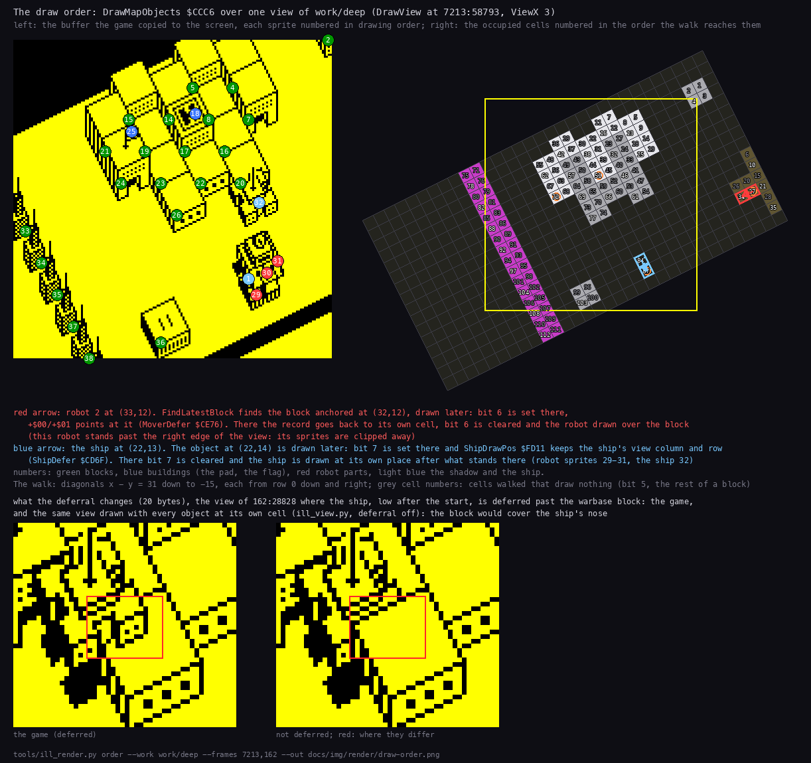

`tools/ill_render.py order --work work/deep --frames 7213,162 --out docs/img/render/draw-order.png`. Top: the view of
`DrawView` at 7213:58793, each sprite numbered in drawing order, and the cells numbered in the order the walk reaches
them. This draw defers both kinds of mover: robot 2 at (33, 12) to the block anchored at (32, 12), and the ship at
(22, 13) to the object at (22, 14). Bottom: the view of 162:28828 as the game drew it, and the same memory drawn by
`ill_view.py` with the deferral off: without it the warbase block would cover the ship's nose (20 bytes differ).

How visible a deferral is, by `ill_view.py` drawn both ways (`work/ill2/scan_defer.py`, `scan_defer2.py`): the 18
robot deferrals of `work/deep` (r5's count) are all in the views of frames 7133-7303, a robot at the right edge of
the view (robot 2 at view column 30 in the view above): its sprites are clipped away, and none of the 18 changed a
pixel. Of about 1140 sampled
views with the ship deferred only 2 (frames 162 and 192, the ship low over the warbase after the start) change the
picture; high up, the ship is above the blocks anyway.

## 6.5 Sprites

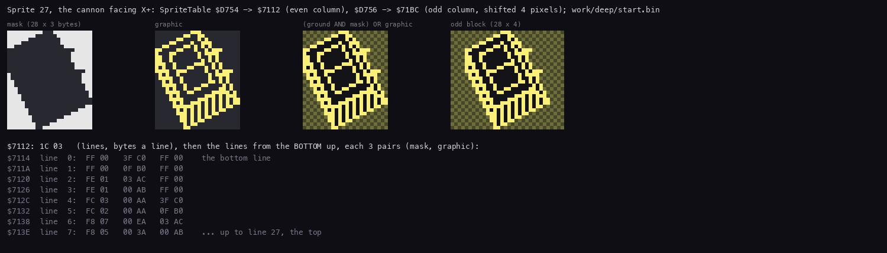

`tools/doc_figures.py sprite --image work/deep/start.bin --out docs/img/sprite-format.png`.

**The format.** Byte 0 the lines, byte 1 the width in bytes, then the lines from the **bottom** up, each a run of
(mask, graphic) pairs. A byte of the buffer becomes `(byte AND mask) OR graphic` (`SpriteByteLoop` `$CFBB`); after a
line the destination goes 20 bytes up (`ADD A,$EC` on E). The mask keeps the ground around the outline and clears
the inside, so a sprite hides what is behind it without a separate erase.

One sprite blitted, part by part: robot 1's bipod and cannon at frame 2000 of `work/docB/rec`. The mask's clear bits
make a hole of the robot's outline in what is there, the graphic's set bits ink into it:

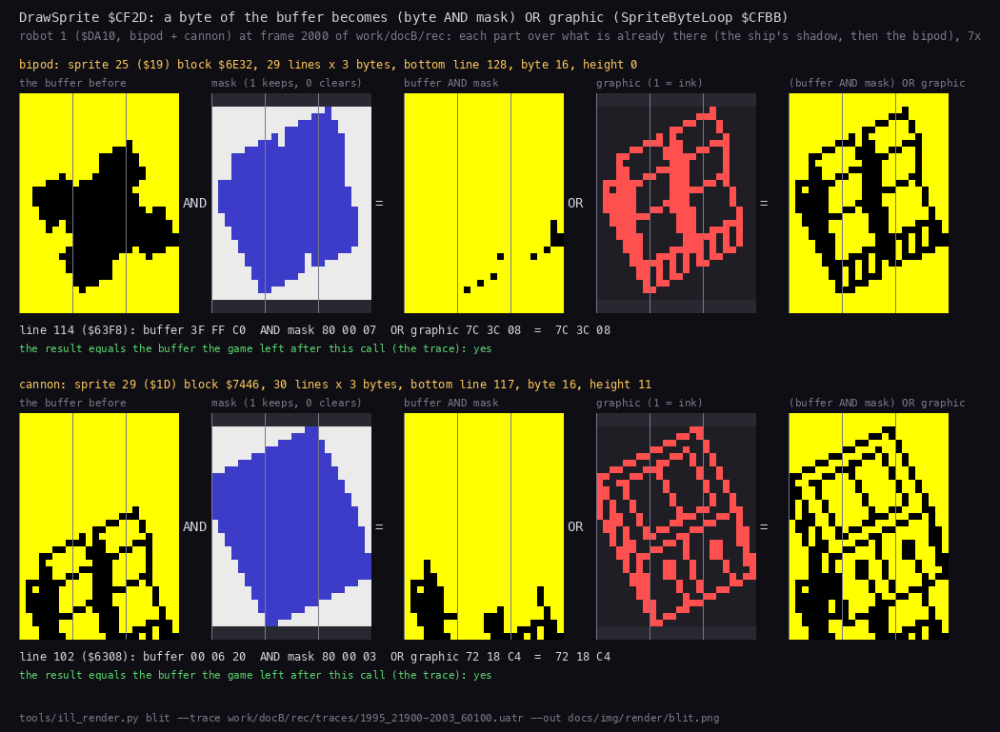

`tools/ill_render.py blit --trace work/docB/rec/traces/1995_21900-2003_60100.uatr --out docs/img/render/blit.png`;
the buffer before each call comes from the trace, and the composed result was compared with the buffer the trace has
after the call: equal for both parts.

**`SpriteTable`** `$D6E8`: 51 sprites of two words, the aligned picture and the one for an odd half-byte column
(index = 2 x id + parity, `TableWord` `$D348`). Where both are one picture the odd one is the even one shifted right
by 4 pixels and one byte wider (d1: checked row by row). For map blocks the column parity equals the row parity (x
is doubled in L), and five block types use the two words for two different pictures (trenches along y or x, the
door / window blocks, the grid / dotted blocks).

| Ids | What | Drawn by |
| --- | --- | --- |
| 0, 1 | the ship, its shadow | `DrawCell` at Altitude; `DrawMapObjects` at 0 |
| 2-18, 21 | map blocks: the cell type is the sprite id (stones, boulders, rocks, trench parts, low and tall blocks, the door and grid blocks, the edge post) | `DrawCell` |
| 19, 20 | unused (both point at the ship) | |
| 22-41 (`$16`-`$29`) | robot parts, `$16` + `PartSpriteTable` (6.6) | `DrawRobotPart` `$CEFD` |
| 42, 43 | the player's and the enemy's flag (building types 7, 8) | `DrawCellObject` |
| 44 | the sign on our warbase's pad (building type 0) | `DrawCellObject` |
| 45-50 | shots: `$2B` + 2 x weapon + (flying along y): cannon shell, missile, phaser beam | `DrawMoverSprite` `$CEC3` |

Buildings take their sprite and height from `BuildingSprites` `$CE56` / `BuildingHeights` `$CE5F` by type: the pad
`$2C` at `$13`; a factory shows the part it makes on its roof (types 1-6: electronics `$28`, nuclear `$25`, phasers
`$23`, missiles `$20`, cannon `$1D`, chassis `$17`) at `$0F`; flags `$2A` / `$2B` at `$1A`. The sprite blocks
themselves (89 blocks, `$6980-$A569`) are listed with their sizes in d1 (`work/ann/d1.md`) and extracted to `src/res/gfx/sprites/` (`src/res/README.md`). In the
recordings no shot was drawn on the screen: no fight happened inside the game's view. Drawn by `ill_view.py` with the
view moved to a fight of `work/deep` ([7.4](07-objects.md#74-shots)), the shots are sprites `$2E` (a cannon shell
flying along y) and `$30` (a missile along y) at height 10, as the table says.

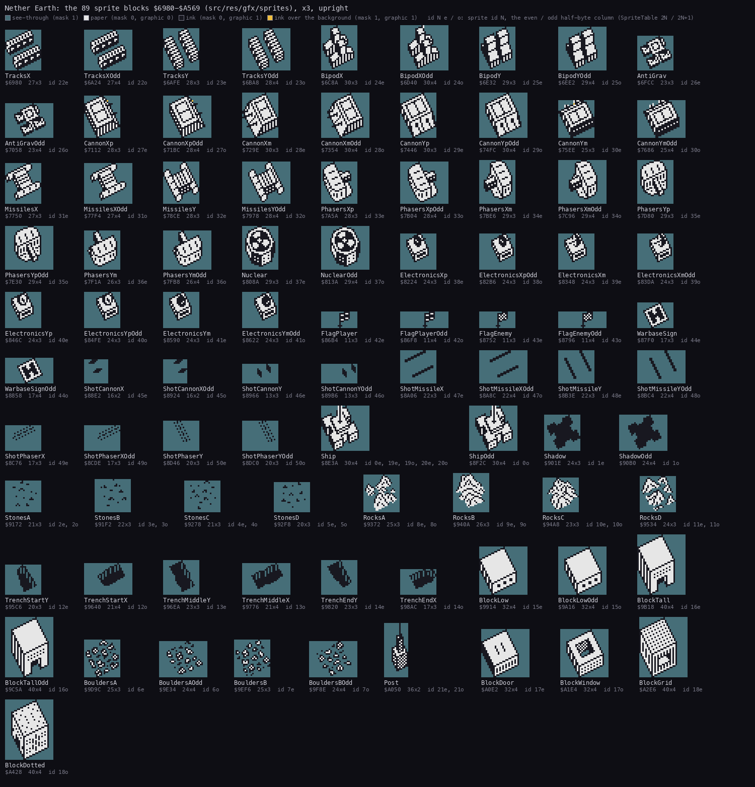

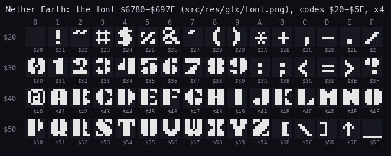

## 6.6 Robots: parts stacked

`DrawRobot` `$CEE8` draws the parts of `+$07` from bit 0 up, starting at height `+$0D` (the ground under the robot;
0 in the construction menu's preview). For each part present `DrawRobotPart` picks the sprite
`$16 + PartSpriteTable[4 x part + direction]` (`$D6C8`; direction = the number of the lowest set bit of the facing `+$08`:
0 right, 1 left, 2 down, 3 up), draws it, and adds `PartHeights[part]` (`$D7B4`) to the height. So the chassis is at
the bottom, the weapons on top of it in bit order, electronics last, and a robot's height `+$09` is the sum of its
parts:

| Part (bit) | Sprites r, l, d, u | Height |
| --- | --- | --- |
| 0 bipod | `$18 $18 $19 $19` | 11 |
| 1 tracks | `$16 $16 $17 $17` | 7 |
| 2 anti-grav | `$1A` | 8 |
| 3 cannon | `$1B $1C $1D $1E` | 6 |
| 4 missiles | `$1F $1F $20 $20` | 6 |
| 5 phasers | `$21 $22 $23 $24` | 7 |
| 6 nuclear | `$25` | 7 |
| 7 electronics | `$26 $27 $28 $29` | 7 |

One call, robot slot 1 (`$DA10`, bipod + cannon, parts `$09`) at frame 2000 of `work/docB/rec`, 2490 instructions in
19 187 T-states: the bipod, then the cannon 11 lines higher (the animation is in
[12](12-routine-reference.md#drawrobot-cee8); 6.5 shows the same two parts blitted byte by byte).

Every chassis with every weapon, facing down, as `DrawRobot` stacks them, and one robot in its four facings:

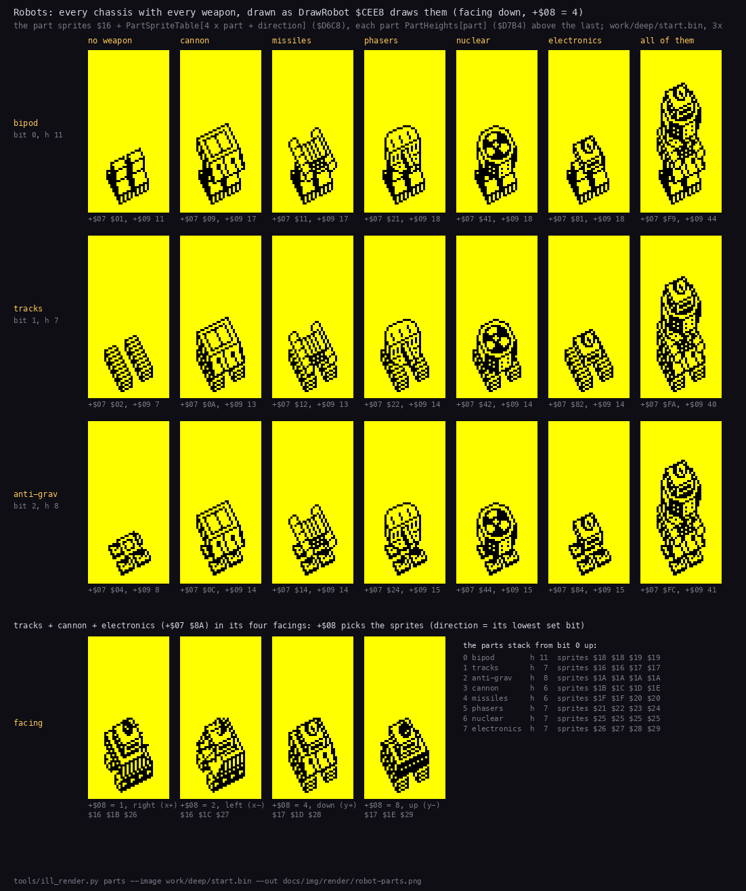

`tools/ill_render.py parts --image work/deep/start.bin --out docs/img/render/robot-parts.png`: the sprites and
`PartSpriteTable` / `PartHeights` of the image, each part blitted (mask, then graphic) `PartHeights` higher than the
one below.

## 6.7 The radar

Two pictures of 16 lines x 16 bytes, one pixel a map cell: `RadarOwn` `$D800` and `RadarEnemy` `$D900`, for a window
of 128 map columns from `RadarColumn` `$FD1C` (= `RadarLeft` `$FD1B` x 8).

- **Built** (`BuildRadar` `$D5F8`): a pixel is set where the cell type is `$0F` or more (blocks, walls, the fence);
  `$D800` is copied to `$D900`; then every live robot's 2 x 2 dot is XORed into its side's picture (`+$0A` bit 7:
  `$D800` ours, `$D900` the enemy's; `ToggleRadarDot` `$D65A`). The robot under direct control (`+$0A` = 2) is left
  out: the ship's own blip stands for it. `RefreshRadar` `$B029` calls it when `RadarDirty` `$FD52` is set: once in
  `work/deep`, at the start (the window never moved: the ship stayed near our warbase).
- **Kept up**: `PlaceRobot` `$CC7C` XORs a robot's dot at its new place after the robot code XORed the old one away;
  the ship's blip is XORed into `$D800` by `BlinkShipDot` `$B036` on turns when `RadarBlink` `$FD1E` is odd, so it
  shows every other turn.
- **The window** moves 64 columns when ShipX / 8 - `RadarLeft` is below 2 or 14 and more (`ScrollRadar` `$AFE6`).
- **Shown** every frame by the interrupt: `PlayInterrupt` `$D566` toggles `RadarPhase` `$FD1A` and calls `ShowRadar`
  `$D59E` with `$D800` and attribute `$4D` (bright cyan on blue) or `$D900` and `$4E` (bright yellow on blue): 16
  LDIR of 16 bytes to `$50C6` (character row 22, column 6), then 32 attributes.

The terrain is in both pictures and only changes colour; our robots exist only in the cyan picture and the enemy's
only in the yellow one, so each side's dots blink at 25 Hz in its own colour.

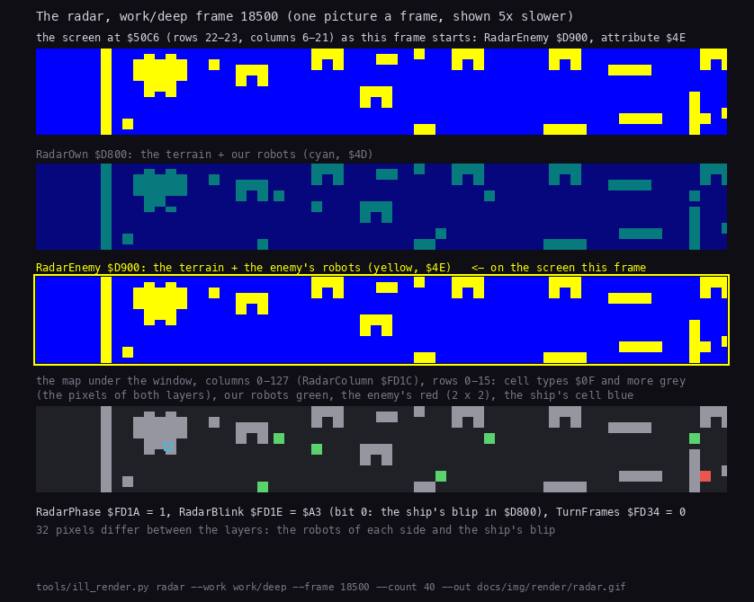

`tools/ill_render.py radar --work work/deep --frame 18500 --count 40 --out docs/img/render/radar.gif`: 40 frames, each
the radar area of the screen, the two pictures `$D800` / `$D900` with the one on the screen this frame outlined, and
the map under the window. The two pictures differ in 32 pixels: the robots of each side and the ship's blip. The
radar costs 8 134 T-states every
frame, 11.2 % of all the time in `work/deep`, more than the copy of the view.

## 6.8 The play screen and the panel

`DrawPlayScreen` `$D0CA` (at `EnterPlay` and after every menu that took the screen): clears the screen, draws the
view once, then the frame: double lines along the top and bottom (`$4000`, `$4701`, `$50A1`, `$57A0`), corners, the
sides `$81` down 162 lines at columns 0 and 21; attributes `$07` everywhere, `$78` on the frame, `$70` (bright, black
on yellow) on the 20 x 20 view cells, `$41` / `$71` on the near right corner past the map's south edge (the blue
area). Then the texts: " DAY:" / "TIME:" at (0, 22) in `$57`, "RADAR:" double height at (22, 0) in `$45`
([8](08-hud-and-text.md)).

The right panel (columns 22-31, rows 2-21) holds the status (counts per side: `ShowStatusPanel` `$D1E5`,
`UpdateStatusPanel` `$D293`) and the resources, or a robot menu while `PanelBusy` is 1. Its contents and the print
routines are in [8](08-hud-and-text.md). The construction menu takes the whole screen and draws its part pictures
straight to the screen with `DrawMaskedUp` `$D315` (the same sprite format, at most 24 lines).

## 6.9 Design notes

- **Redraw, don't scroll.** A full redraw a turn makes the depth order trivial (the walk) and the scrolling free:
  moving the view one column is only `ViewX` + 1. It costs 79 % of the CPU and fixes the game's pace at one turn per
  10 frames.
- **Pre-shifted pictures.** Two pictures a sprite double the sprite data (89 blocks, 15 338 bytes) and buy a blit with no shifts: the inner loop
  is `LD A,(DE)` / `AND (HL)` / `OR (HL)` / `LD (DE),A`.
- **Deferral instead of sorting.** Objects are not sorted; a robot or the ship that a later block would cover is
  simply moved, for one draw, to that block's cell in the walk.
- **Two radar pictures instead of colour.** The 16 x 16 attribute cells could not colour single robots; showing the
  sides in alternate frames with two attributes gives each side its colour at no cost but the flicker.
