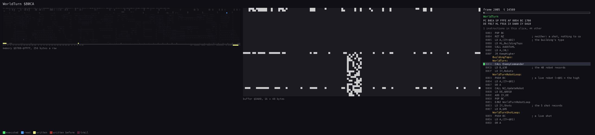
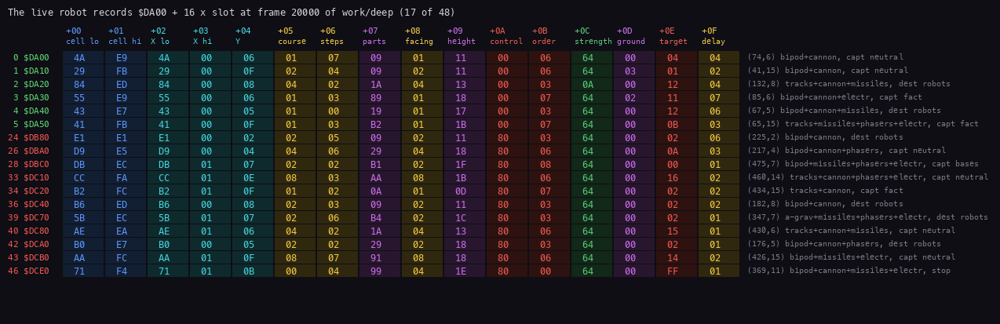
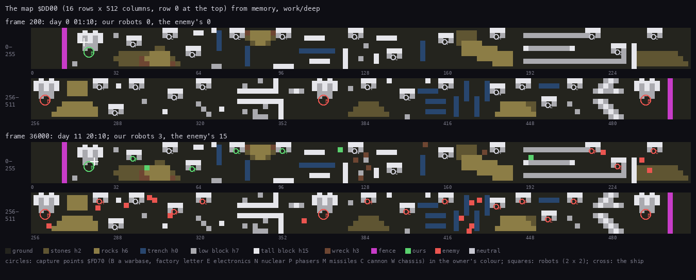
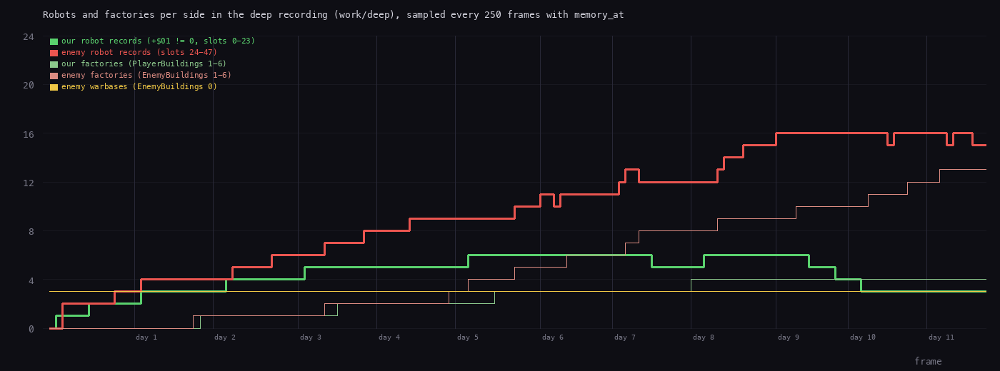

# 7. Objects

The world is four tables and a map. 48 robot records of 16 bytes (`$DA00`, 24 a side), 5 shot records of 9 bytes
(`$D7D3`), 56 building records of 3 bytes (`$FF01`) and 28 capture points of 5 bytes (`$FD70`) all point into the
map `$DD00`, 16 rows of 512 cells, whose cell bytes carry the terrain and two marks: bit 6 "an object is here",
bit 7 "the ship is here". Movers find each other through the map, never through a list: a robot looking ahead reads
cells, a shot hits whatever anchor it lands next to, a capture point counts while its door cell has bit 6.

Evidence:

- the code of `src/game/main.asm`;
- `work/deep` (the bot's 36046-frame game from the menu snapshot `work/play/start.szx`, Kempston; WALKTHROUGH 6):
  L1 counts, and TTD `memory_at` read-only on its live instance: the records every 250 frames over the whole game,
  and every frame from 18000 to 20000 (the field checks of 7.2);
- `work/docB/rec` (the same bot, 3034 frames, own instance: `tools/bot.py play --record --frames 3000 --work
  work/docB/rec --port-base 24600`): the access trace of one world turn;
- the region agents' experiments (`work/ann/r1.md` - `r3.md`): direct control, the pad bug, the nuclear blast.

## 7.1 The world turn

`WorldTurn` `$B0CA`, once a game turn (from `PlayLoop` and from every robot menu loop, 3415 calls in `work/deep`):

1. `EnemyCommander` `$B7F4`: one random enemy slot is built or re-planned ([10](10-gameplay-logic.md)).
2. The 48 robot records in slot order, each with `+$01` not 0, through `UpdateRobot` `$B0FA`.
3. The 5 shot records through `UpdateShot` `$B70D`.

A robot does not act every turn: its `+$0F` counts turns down to its next step (7.3). One call at frame 2005 of
`work/docB/rec`, 31 000 T-states, four robots stepping. The right panel is the robot records `$DA00-$DCFF` drawn as
a bitmap, one record a line of 128 pixels (16 bytes), slot 0 at the top: the written fields light up.

`kit/routine_anim.py --work work/docB/rec --window 2005:14180-2005:45290 --listing build/game.lst --view
buffer:DA00:16x48 --pc B0CA-B7F3 --range D700-FFFF --pictures 80 --out docs/img/routines/WorldTurn.gif`.

## 7.2 Robots

`Robots` `$DA00`, slots 0-23 the player's; `EnemyRobots` `$DB80`, slots 24-47 the computer's. A slot is free when
`+$01` = 0; the side is the slot range and, for the code that only has the record, `+$0A` bit 7.

| Offset | Name | Meaning | Written by |
| --- | --- | --- | --- |
| `+$00/+$01` | cell | the map cell of the anchor (bit 6 set there); for one draw it may point at a later cell (deferral, [6.4](06-rendering.md#64-the-draw-order)); `+$01` = 0: a free slot | `PlaceRobot` `$CC7C`, `DrawMover` |
| `+$02/+$03` | X | the anchor's column, 0-511 | `PlaceRobot` |
| `+$04` | Y | the anchor's row, 0-15 | `PlaceRobot` |
| `+$05` | course | the direction of the current course, one `Input` bit (1 right, 2 left, 4 down, 8 up), 0 standing | `RobotStep`; 4 at birth, 0 by DIRECT CONTROL |
| `+$06` | steps | steps left on the course: 3-6 random, \|dx\| - 1 near a target, `$FF` "stay facing down"; a step takes 1, a turn gives it back | `RobotStep`, `TurnOrStep` `$B471`; 5 at birth (3 the enemy's), 0 by LEAVE ROBOT |
| `+$07` | parts | bit 0 bipod, 1 tracks, 2 anti-grav, 3 cannon, 4 missiles, 5 phasers, 6 nuclear, 7 electronics | `StartRobot`, `EnemyCommander` |
| `+$08` | facing | the direction it faces, one `Input` bit; picks the part sprites and the shot's direction | `TurnOrStep`; 4 at birth |
| `+$09` | height | the sum of `PartHeights` `$D7B4` over its parts (bipod + cannon 17) | `ShowRobotDesign` `$CC1F`, `EnemyCommander` |
| `+$0A` | control | 0 the AI, 1 the player sits on it (frozen), 2 direct control, `$80` the enemy's | the menus, `EnemyCommander` |
| `+$0B` | order | 0 stop, 1 advance, 2 retreat, 3-5 destroy robots / factories / warbases, 6-8 capture neutral factories / enemy factories / enemy warbases | menus, `SteerByOrder`, `StepPosition` |
| `+$0C` | strength | 100 (`$64`) at birth, minus the damage; at 0 or below on a hit `$FC`, then + 1 a turn: dying; 0: removed | `MoveShot`, `UpdateRobot` |
| `+$0D` | ground | the highest ground under its 2 x 2 footprint; the parts are drawn from here | `TurnOrStep` |
| `+$0E` | target | orders 1-2: columns left (miles x 2); order 3: the opponent's slot in its side; 4-8: the building's index in its table; `$FF` none | menus, `SteerByOrder`, `StepPosition` |
| `+$0F` | delay | turns to the next step, from `StepDelays` | `SetStepDelay` `$B5F3`; 1 at birth |

`tools/doc_figures.py records --work work/deep --frame 20000 --out docs/img/robot-records.png`: 6 of ours, 11 of the
enemy's. Every record has `+$01` = `$E0`-`$FB` (rows 1-15 of the map, `$DD00` + `$200` x Y), `+$0C` = `$64` except
slot 3 at `$0A` (10 %, after hits), `+$0B` the bot's orders 3, 6, 7 and the enemy's 0, 3, 6, 7, 8.

**`+$05`, `+$06`, `+$08`, `+$0F` checked over time.** `memory_at` of `$DA00-$DCFF` at every frame from 18000 to 19999
of `work/deep` (2000 samples, 32 887 live records). Slot 0 (bipod + cannon, ground 0, order 6) from frame 18000:

| Frame | Y | `+$05` | `+$06` | `+$08` | `+$0F` | What happened |
| --- | --- | --- | --- | --- | --- | --- |
| 18000 | 11 | 8 | 5 | 2 | 1 | facing left, course up |
| 18010 | 11 | 8 | 5 | 8 | 6 | its step was a turn: facing up, the steps kept, delay 6 again |
| 18070 | 10 | 8 | 4 | 8 | 6 | a step up: Y - 1, steps - 1 |
| 18130 / 18190 / 18250 / 18310 | 9 / 8 / 7 / 6 | 8 | 3 / 2 / 1 / 0 | 8 | 6 | a step every 6 turns (60 frames) |
| 18370 | 6 | 1 | 6 | 1 | 6 | the course spent: a new course right, 6 steps; turned to it |

- `+$0F` counts down once a turn (every 10 frames here) and is reloaded at each step with `StepDelays` `$B61D` by the
  chassis and the ground: slot 0 (bipod, ground 0) 6, slot 1 (bipod, ground `+$0D` = 3) 8, slots 2 and 25 (tracks,
  ground 0) 4, as the table says (7.3). Values seen: 1-8, and 0 in 24 samples taken inside a turn.
- `+$06` falls by one a step and not on a turn; a new course sets 3-6 (and the turn toward it adds one: 7 was seen
  1681 times); `$FF` once.
- `+$05` is one of 0, 1, 2, 4, 8 and equals `+$08` in 28 429 of the 32 887 samples: the robot faces its course
  except while it turns toward a new one or stands (0).
- `+$00/+$01` equalled the cell of `+$02-$04` in all samples (a deferral lasts only inside a draw).

**Footprint.** A robot covers 2 x 2 cells, (X, Y), (X+1, Y), (X, Y-1), (X+1, Y-1), but only the anchor (X, Y) gets
bit 6. The probes that test a move therefore look for anchors one cell around the cells they would enter
(`FreeDirections` `$B513`, the table in r2).

**Birth.** Ours: `StartRobot` places the robot at (ShipX, ShipY + 4), the door of the warbase whose pad the ship
sits on, with `+$0A` = 0, `+$07` = `MenuParts` (`StartRobot` `$CB52`); the menu's preview already set `+$08` = 4
(`$C9E7`) and `+$09` (`ShowRobotDesign` `$CC1F`); `PlayLoop` then sets `+$05` = 4, `+$06` = 5, `+$0B` = 0, `+$0C` =
100, `+$0F` = 1 (`$A6F3`-`$A703`). At `work/deep` frame 360, still inside the menu, slot 0 =
`16 EF 16 00 09 00 00 09 04 11`: cell `$EF16`, (22, 9), parts `$09`, facing 4, height 17, `+$05` / `+$06` not yet written. The enemy's: `EnemyCommander` on a free enemy slot at one of its warbases'
doors (`$B8E1` sets `+$08` = 4; `+$0A` `$80`, `+$06` 3 and `+$0E` `$FF` are from r3, not re-checked here).

**The pad bug** (r1, verified on an own instance): with all 24 of our slots in use `ConstructionMenu` returns at once
with IY = `$DB80`, enemy slot 24, and `PlayLoop` writes the birth values there: an enemy robot poked to strength
`$20` was back at 100 after the ship sank onto the pad, and this repeats every turn the ship sits there.

## 7.3 A robot's step

`UpdateRobot` `$B0FA`:

1. `+$0C` = 0: removed (`RobotDestroyed` `$B116`): bit 6 off; a wreck block (type 6 or 7, height 3) is laid when the
   four footprint cells are bare; the radar dot erased, the slot freed (`+$01` = 0), the counts and the panel redone.
2. `+$0C` negative: dying, + 1 a turn; bit 6 on the cell toggles with the value, so the robot blinks for four turns.
3. `+$0A` = 1: nothing (the player is on it).
4. Otherwise `Side` `$FD51` = `+$0A` bit 7, `+$0F` - 1; at 0, `RobotStep` `$B154`: off the map (bit 6 and the radar
   dot removed), then under direct control `Input` decides, else the AI: an opponent seen ahead is fired at if a
   shot record of the side is free (the robot stands that step), an opponent to the side is turned to, otherwise the
   course goes on while `+$06` lasts and the way is free, or `SteerByOrder` `$B222` picks a new one.
5. `TurnOrStep` `$B471`: a turn of at most 90 degrees costs the step; a step moves one cell and sets `+$0D`.
   `SetStepDelay` reloads `+$0F`; `PlaceRobot` puts the robot back (cell, bit 6, radar dot).

| `StepDelays` `$B61D`, turns a step | bipod | tracks | anti-grav |
| --- | --- | --- | --- |
| ground 0 | 6 | 4 | 3 |
| ground 1-3 | 8 | 6 | 3 |
| ground 4 and more | 9 | 7 | 4 |

Sight (`SpotEnemies` `$B626`, `ScanLane` `$B66E`): 8 cells in each direction, 10 ahead (12 with electronics), three
lanes wide; the first object on a lane ends it, so buildings and friends give cover. Steering by order, the passable
terrain per chassis and the enemy's planning are the rules of [10](10-gameplay-logic.md).

## 7.4 Shots

`Shots` `$D7D3`, 5 records of 9 bytes: record 0 the player's COMBAT MODE shot, 1-2 our robots', 3-4 the enemy's
(`FindFreeShot` `$B6B8`). Free when `+$01` = 0; a freed record keeps its other bytes.

| Offset | Meaning |
| --- | --- |
| `+$00/+$01` | the map cell (bit 6 set while it flies); `+$01` = 0 free |
| `+$02/+$03`, `+$04` | column, row |
| `+$05` | direction, the shooter's facing (1, 2, 4, 8) |
| `+$06` | steps left: 5, missiles 7, + 1 with electronics |
| `+$07` | weapon: 1 cannon, 2 missiles, 3 phasers |
| `+$08` | the flight height `$0A`: ground that high stops it |

A step is 2 cells, one a turn, the first at once (`FireShot` `$B6D6`). `MoveShot` `$B724` ends a shot out of steps,
off rows 0-15 or over ground of height 10 and more; otherwise it looks at the 3 x 3 cells around it: a live robot of
either side anchored there takes `((60 - (+$09 + +$0D)) / 4) x (weapon + 1)`, a tall robot on high ground less.
Recorded in `work/deep` (r2): an enemy missile into our slot 2 (height 19): 100, 70, 40; our cannon into slot 25:
100, 80, 60, 40. At frame 20000 records 1 and 3 hold the stale bytes of two finished shots
(`... 7F 00 7F 00 0E 04 04 01 0A`, a cannon shot that flew down; `... 7F 00 7F 00 0A 08 06 02 0A`, a missile).
`SoundFx` `$FD53` gets 1 on firing, `$FC` a miss, `$FA` a hit, `$C8` a robot destroyed ([9](09-sound.md)).

## 7.5 The map

`Map` `$DD00-$FCFF`: 16 rows of 512 cells, cell (x, y) at `$DD00` + `$200` x y + x; the bytes past the image
(`$FCE9` on) are cleared and built like the rest. Built at every new game by `BuildMap` `$BC6F` from the scenery
lists `$BDA9` / `$BE79`, the base lists `$BF46` / `$BF6E` and the shapes of `ShapeTable` `$BF9C` (r3).

| Bits | Meaning |
| --- | --- |
| 0-4 | the block type: the sprite id and the height (`TerrainHeights` `$D7BC`: 0, 0, 2 x4, 3 x2, 6 x4, 0 x3, 7, 15, 7, 15, 0, 0, 99) |
| 5 | not the anchor of its 2 x 2 block (`PutBlock` `$BD91` writes the anchor plain and the other three cells with bit 5) |
| 6 | an object's anchor: a robot, a building, a flying shot, or (inside a draw) a deferred robot |
| 7 | the ship's cell (`PutShipOnMap` `$B024` / `LiftShipFromMap` `$B01D`), or the ship deferred inside a draw |

`tools/doc_figures.py map --work work/deep --frames 200,36000 --out docs/img/map-owners.png`, each cell coloured by
its type class, the capture points by owner, the robots as 2 x 2 squares by side, the ship as a cross. At frame 200
every factory is neutral, ours is the warbase at (22, 9), the enemy's at (261, 8), (369, 8), (494, 8). At frame 36000
we hold 4 factories (missiles (39, 6), electronics (62, 10), cannon (79, 3), phasers (97, 3)), the enemy 13; its
robots stand round the factories of the east half.

## 7.6 Buildings and capture points

**Capture points**: `Warbases` `$FD70` (4) and `Factories` `$FD84` (24), 5 bytes each; the code addresses them from
the owner byte (`$FD73`, `$FD87`), index x 5.

| Offset | Meaning |
| --- | --- |
| `+0/+1` | X of the door cell |
| `+2` | Y of the door cell |
| `+3` | bits 0-2 type (0 warbase, 1 electronics, 2 nuclear, 3 phasers, 4 missiles, 5 cannon, 6 chassis), bit 5 the enemy's, bit 6 ours, `$80` destroyed by a nuclear blast |
| `+4` | turns a robot has stood on the door |

The capture tick is in `GameTurnEnd` `$AD90` (`CaptureLoop` `$ADB7`): for each point, bit 6 on the door cell adds
one to `+4`, an empty door resets it; at 144 (`$90`) the robot there (`FindRobot`) gives the point to its side
(`GiveWarbase` `$BB86` / `GiveFactory` `$BB61`), whatever its order. Then `CountBases` `$BB09` recounts
`PlayerBuildings` `$FD3A` / `EnemyBuildings` `$FD42` (7 counts each, warbases first). In `work/deep` sampled every 250
frames the owner bytes changed 17 times (4 to us, 13 to the enemy), the highest count seen was 143, and no `+3` had
bit 7 (no robot was nuclear).

**Buildings** `$FF01`: 56 records of 3 bytes, the map cell (2 bytes, high byte 0 = free) and a type: 0 the pad of a
warbase of ours, 1-6 a factory's roof (its product shown, [6.5](06-rendering.md#65-sprites)), 7 our flag, 8 the
enemy's. They are what `DrawCellObject` draws and what `FindBuilding` finds under the ship (the pad opens the
construction menu). `AddBuilding` `$BC43` takes the first free record, `RemoveBuilding` `$BC5D` frees one. A factory
gets its flag 2 columns left (ours) or right (the enemy's) of the roof; a warbase of ours gets a pad and a flag, the
enemy's only a flag. At frame 250 of `work/deep` 29 records are in use (24 roofs, our pad and flag, 3 enemy flags), at
frame 36000 46; the 17 more match the 17 captures (one flag each, the record by record match not checked).

## 7.7 Over the whole game

`tools/doc_figures.py robots --work work/deep --step 250 --out docs/img/robots-over-time.png`: the live records per
side (`+$01` not 0) and the building counts, from `memory_at` every 250 frames. We peak at 6 robots, the enemy at 16
(24 slots each); the enemy builds faster because it has three warbases (5 general resources a day each) and the
factories it captures. At frame 36000: 3 against 15 robots, 4 against 13 factories, the enemy's three warbases all
standing.

## 7.8 Design notes

- **The map is the index.** Every mover has a record, but every question "what is there" goes through the cell's bit
  6 and a search of the records by cell address (`FindRobot`, `FindBuilding`, the shot search): 48 + 56 + 5 compares
  at most, no spatial lists to keep.
- **One anchor a 2 x 2 object.** Marking only the anchor keeps placing and removing to one cell, at the price of
  probes that look one cell further.
- **Slots fixed by side.** 24 a side, so the enemy can never crowd the player out of records, and a record's side is
  known from its address.
