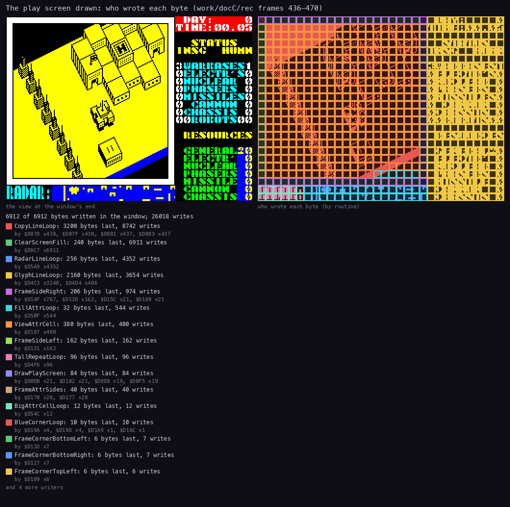

# 8. HUD and text

All text goes through one routine. `PrintInline` (`$D42D`) prints the bytes that follow its `CALL`. Positions,
attributes and sizes are control codes inside the string, so no print call takes arguments. One font of 64 glyphs
serves everything, from the panel numbers to the triple-size title. Besides the view, the play screen has three
fixed areas:

- the clock at the top right;
- the status panel under it, which the robot menus borrow;
- the radar in the two bottom rows.

Evidence:

- the code of `src/game/main.asm` (the routines named below) and the built image `build/game.bin`, which
  `tools/text_figs.py` reads for the font and the strings;
- `work/docC/rec`: recorded on an own instance from the menu snapshot `work/play/start.szx`.
  - 400 frames on the main menu, then the bot of `tools/bot.py play --record --frames 9000`: 9415 frames.
  - `DrawPlayScreen` first runs in its frame 437 and `GameTurn` in frame 461.
  - Its L1 counts are the fourth count in 8.3.
- `work/deep`: the bot's 36046-frame game from the same snapshot (L1 counts; the instance was only read);
- `work/play` (the load and the first minutes of play, 16514 frames) and `work/game` (its play window from frame
  12661): L1 counts for the title and the first panel;
- the region agents' experiments on own instances (`work/ann/r1.md`, `r3.md`, `r4.md`): the redefine screen, the
  game ends, and the construction menu with poked resources.

## 8.1 The print routine `$D42D`

`PrintInline` works in the alternate registers (`EXX`). It pops the return address, reads one byte, and pushes the
address back one byte further on; this repeats until a 0. The return then lands on the instruction after the
string, so each string sits inline in the routine that prints it. `PrintControl` (`$D43C`) takes each byte:

| Byte | Operands | Effect | Stored in |
| --- | --- | --- | --- |
| 0 | | the end: `EXX`, return past the string | |
| 1 | Y X | the print position: row Y, column X (`SetPrintPos` `$D493` makes the screen and attribute addresses) | `$FD31`/`$FD32`, `$FD04`, `$FD14` |
| 2 | A | the attribute of the next characters | `$FD13` |
| 3 | | the next row, the same column (`PrintNewline` `$D470`) | `$FD32` |
| 4 | N | the size: high nibble the height in rows, low nibble the width in bytes; 0 is normal | `$FD16`, `$FD17` |
| other | | a character: `PrintChar` (`$D4B1`) when the width is 0, else `PrintBigChar` (`$D4DA`) | |

The control handlers read their operands two stack levels up (`POP DE; POP HL` at `$D457`, `$D461`, `$D47C`).
`PrintInline`'s own `CALL PrintControl` left a return address on top; the string pointer is under it.

Three other kinds of call end in it or lean on it:

- `PrintKeyPrompt` (`$C40C`) prints "PRESS KEY FOR " and ends in `JP PrintInline`. The key names after its eight
  calls in `RedefineKeys` (`$C34A`) are therefore strings too.
- The names of keys without a glyph follow the same pattern. Each check is `CP code`, `JR NZ,next`,
  `CALL PrintInline`, then the name, then a `RET` (`$C46B`-`$C479` for SYM SH). `PrintInline` returns onto that
  `RET`.
- `PrintCharKeep` (`$D427`) is `PrintChar` inside `EXX`, for the number printers (8.6).

### Normal and big characters

`PrintChar` copies the 8 lines of glyph `$6680 + 8 × code` down the character cell (`GlyphLineLoop` `$D4C2`). It puts
the attribute into the attribute cell and advances both addresses by one. In the panel figure below this routine
makes 3654 writes: 3248 glyph lines at `$D4C3` and 406 attributes at `$D4D4`.

`PrintBigChar` scales the same glyph:

| Width (low nibble) | Pixels | Lines | Used by |
| --- | --- | --- | --- |
| 1 (size `$21`) | the glyph as it is | each line repeated height times (`TallRepeatLoop` `$D4F5`) | RADAR:, the main menu options, PRESS PLAY ON TAPE, REDEFINE KEYS, CONSTRUCTION |
| 2 (sizes `$22`, `$32`) | each bit doubled into 16 pixels (`WideBitLoop` `$D511`) | the same repeat (`WideRepeatLoop` `$D522`) | ROBOT and LOADING ERROR! (`$22`); NETHER / EARTH (`$32`, three rows high) |

Then `BigCharAttrs` (`$D532`) fills a block of width × height attributes and advances the print address by the
width. A width above 2 would draw the doubled glyph but advance further; no string uses one. The code `4 $00`
turns big characters off again. Strings that may follow a big one start with it: the clock's `$AD88`, the
construction menu's `$C8BE` after its title, and the panel's `$D29B`.

## 8.2 The font

`python3 tools/text_figs.py font docs/img/hud-font.png`.

- The 64 glyphs (512 bytes) sit at `$6780`, right after the view buffer.
- The codes are ASCII `$20`-`$5F`, so there are no lower-case letters.
- The face is a heavy stencil, 7 pixels wide with a gap column.

Codes whose glyph is not the ASCII one:

| Code | ASCII | Glyph |
| --- | --- | --- |
| `$22` | `"` | a wave like "~" (bytes `00 36 6C ...`); no string uses it |
| `$40` | `@` | the copyright sign (no string in the game image uses it) |
| `$5B`-`$5E` | `[ \ ] ^` | `[`, `\`, `]`, an up arrow |
| `$5F` | `_` | one line at the bottom (`00 .. 00 FF`) |

The strings fit the font: "FACTORYS", "ELECTR'S", "INSG" (Insignians, the enemy) and "HUMN" are all upper case.

## 8.3 Every string

`python3 tools/text_figs.py strings` lists every string after a `CALL PrintInline` or `CALL PrintKeyPrompt` in the
image.

- Positions are (row, column) in the 24 × 32 cells; size `$21` is tall, `$22` and `$32` double width.
- "Runs" gives how often the `CALL` ran in `work/play` / `work/game` / `work/deep` / `work/docC/rec` (L1
  instruction counts).
- "exp" marks a string that ran only in the region agents' experiments, never in a recording.

| Address | Text | Where | Runs |
| --- | --- | --- | --- |
| `$A738` | DIRECT CONTROL, GIVE ORDERS, COMBAT MODE, LEAVE ROBOT (two lines each), -ORDERS- | the robot menu at (4,23) in `$4D`; -ORDERS- at (17,23) in `$46` (`RobotMenuShow` `$A732`) | 0/0/14/8 |
| `$A7AD` | (a position) | (18,23) in `$45`: the current order (`ShowOrder` `$A795`, from `OrderLine` `$A7B2`) | 0/0/14/8 |
| `$A7D8` | (a position) | (19,25): the miles of ADVANCE / RETREAT | exp |
| `$A820` | STRENGTH | (22,23) in `$46`; the value at (23,25) in `$47` (`ShowStrength` `$A81D`) | 0/0/111/64 |
| `$A977` | SELECT ORDERS, STOP AND DEFEND, ADVANCE ?? MILES, RETREAT ?? MILES, SEARCH & DESTROY, SEARCH & CAPTURE | (4,24) in `$47`; the items from (7,23) in `$4D` (`OrdersMenu` `$A971`) | 0/0/7/4 |
| `$AA1F` | ADVANCE | (5,23) in `$4F`: the distance menu's title | exp |
| `$AA32` | RETREAT | (5,23) in `$4F` (`RetreatTitle` `$AA2F`) | exp |
| `$AA43` | ?? MILES, SELECT DISTANCE, 0 MILES | under the title; (9,23) in `$45`; (13,24) in `$46` (`DistanceMenu` `$AA40`) | exp |
| `$AAA7` | (a position) | (13,23) in `$46`: the miles as they change (`DistanceShow` `$AAAD`) | exp |
| `$AAD8` | SEARCH & DESTROY, SELECT TARGET, ENEMY ROBOTS / FACTORYS / WARBASES | (4,23) in `$4F`, (8,24) in `$45`, (12,23) in `$4D` (`TargetMenu` `$AACF`) | 0/0/3/1 |
| `$AB54` | SEARCH & CAPTURE, SELECT TARGET, NEUTRAL FACTORYS, ENEMY FACTORYS, ENEMY WARBASES | the same places (`CaptureMenu` `$AB4E`) | 0/0/4/3 |
| `$AC06` | NUCLEAR BOMB, FIRE PHASERS, FIRE MISSILES, FIRE CANNON, MOVE ROBOT, STOP COMBAT | (4,23) in `$4D`: the COMBAT MODE menu (`CombatMenu` `$AC00`) | exp |
| `$AD88` | (position, size 0, attribute) | (0,27) in `$57`: the clock (8.5) | 367/367/3414/803 |
| `$AE7C` | YOU HAVE NO BASES LEFT / BETTER LUCK NEXT TIME! | (22,0) in `$45`, over the radar (`CheckGameEnd` `$AE6B`) | exp |
| `$AEB7` | INSIGNIANS DESTROYED / YOU HAVE WON ! | (22,0) in `$45` (`GameWon` `$AEB1`) | exp |
| `$C109` | 0..START GAME | (11,8) in `$46`, tall (`MainMenu` `$C100`) | 2/2/1/1 |
| `$C128` | 1..KEYBOARD | three rows down (`MenuKeyboardOption` `$C120`) | 2/2/1/1 |
| `$C13F` | 2..KEMPSTON J/S | two rows down | 2/2/1/1 |
| `$C159` | 3..INTERFACE 2, 4..REDEFINE KEYS, 5..LOAD SAVED GAME | two rows apart; 4 and 5 in `$46` | 2/2/1/1 |
| `$C1E6` | NETHER / EARTH | (1,10) and (5,11) in `$47`, size `$32` (`PrintTitle` `$C1E3`) | 1/1/0/0 |
| `$C203` | PRESS PLAY ON TAPE | (22,7) in `$45`, tall: LOAD SAVED GAME | exp |
| `$C26C` | LOADING ERROR! | (22,2) in `$47`, size `$22` (`LoadError` `$C282`) | exp |
| `$C296` | PRESS RECORD AND PLAY / THEN ANY KEY | (22,0) in `$45`: the save key | exp |
| `$C33F`, `$C346` | (an attribute) | `$46` / `$45`: an option not chosen / the control option chosen | 4/4/2/2, 2/2/1/1 |
| `$C350` | REDEFINE KEYS | (2,9) in `$47`, tall; then (5,3), size 0 (`RedefineKeys` `$C34A`) | exp |
| `$C382`-`$C3EE` | UP, DOWN, LEFT, RIGHT, FIRE, PAUSE, ABORT, SAVE | after each "PRESS KEY FOR " | exp |
| `$C40F` | PRESS KEY FOR | two rows down in `$46`; the name in `$45` (`PrintKeyPrompt` `$C40C`) | exp |
| `$C42B` | three spaces, `$46` | before the key chosen (`PrintKeyPromptName` `$C424`) | exp |
| `$C472`, `$C481`, `$C48F`, `$C4A0` | SYM SH, ENTER, CAPS SH, SPACE | names of keys without a glyph (`CheckEnterKey` `$C47A` and its neighbours) | exp |
| `$C8BE` | ROBOT / CONSTRUCTION, the part names and their costs, EXIT MENU / START ROBOT, -- RESOURCES -- / -- AVAILABLE --, GENERAL .. CHASSIS, TOTAL | the whole construction screen, one string of 297 bytes (`ConstructionMenu` `$C849`) | 0/0/7/4 |
| `$CBFF` | (a position) | (18,12): the TOTAL value (`PrintMenuTotal` `$CC03`) | 0/0/29/14 |
| `$CC10` | (a position) | (0,13), then a new row per resource (`PrintMenuResource` `$CC08`) | 0/0/203/98 |
| `$D1C5` | DAY: / TIME:, RADAR: | (0,22) in `$57`; (22,0) in `$45`, tall (`DrawPlayScreen` `$D0CA`) | 1/1/8/5 |
| `$D1EB` | STATUS, INSG HUMN, WARBASES .. ROBOTS, RESOURCES, GENERAL .. CHASSIS | the panel's labels, 8.4 (`ShowStatusPanel` `$D1E5`) | 1/1/15/9 |
| `$D29B` | (a position) | (16,30) in `$4E`, size 0: the resources | 6/6/82/23 |
| `$D2BB` | (a position) | (6,22) in `$47`: the enemy's counts | 6/6/82/23 |
| `$D2CE` | (a position) | (6,31): our counts | 6/6/82/23 |
| `$D2DB` | (a position) | (13,30): our robots | 6/6/82/23 |
| `$D2F9` | (a position) | (2,22), size 0, attribute 0 (`ClearPanel` `$D2F6`) | 1/1/50/29 |
| `$D306` | 10 spaces and a new row | 22 times per `ClearPanel` (`ClearPanelLine` `$D303`) | 22/22/1100/638 |

Two kinds of text are not PrintInline strings:

- The orders. `OrderNames` (`$A848`) holds nine 27-byte texts of three 9-character lines: "  STOP  " / "  AND   " /
  " DEFEND", "ADVANCE " / "        " / " MILES", up to "CAPTURE " / "ENEMY  " / "WARBASES". `ShowOrder` copies the
  one in use into `OrderLine` (`$A7B2`), then prints it.
- The construction menu's costs (`3 20 4 4 2 10 5 3`, electronics down to bipod). They are text inside its string:
  they agree with `PartCosts` (`$CAF0`) but are not read from it.

## 8.4 The status panel

`python3 ../../kit/writers_map.py --work work/docC/rec --window 436:0-470:0 --listing build/game.lst --view screen
--out docs/img/hud-panel-writers.png`.

The window holds the whole first drawing of the play screen, and all 6912 bytes are written in it. The writers:

- `ClearScreen` (`ClearScreenFill`, green);
- the view's copy (`CopyLineLoop`, red);
- the frame;
- the radar (`RadarLineLoop`, blue);
- the text (`GlyphLineLoop`, gold);
- the tall RADAR: (`TallRepeatLoop`).

The panel is the right 10 columns (22-31):

| Rows | Content | Printed by |
| --- | --- | --- |
| 0-1 | " DAY:" / "TIME:" at column 22 in `$57`; the values from column 27 | `DrawPlayScreen`, the clock (8.5) |
| 3-4 | "  STATUS" / "INSG  HUMN" in `$46` | `ShowStatusPanel` |
| 6-12 | WARBASES, ELECTR'S, NUCLEAR, PHASERS, MISSILES, CANNON, CHASSIS at column 23 in `$45`. The enemy's count in column 22 and ours in column 31, one digit each, in `$47` | the labels; the values by `PrintInsgCounts` `$D2C1` and `PrintHumnCounts` `$D2D2` |
| 13 | " ROBOTS"; the enemy's robots at (13,22) as two digits, over the label's leading space; ours at (13,30) | `PrintNumber2Zero` |
| 15 | RESOURCES in `$46` | |
| 17-23 | GENERAL, ELECTR', NUCLEAR, PHASERS, MISSILE, CANNON, CHASSIS at column 23 in `$44`; our resources at column 30 in `$4E` | `PrintResourceValues` `$D2A3` |

The values come from three places:

- the counts `$FD3A` (ours: warbases, then the factories of each kind; robots at `$FD41`);
- the counts `$FD42` (the enemy's; robots at `$FD49`);
- `Resources` (`$FD22`, 7 bytes).

The enemy's resources are never shown.

`UpdateStatusPanel` (`$D293`) reprints all the values. It runs after any count changes and on entering play:

- a capture (`$AD90`);
- the day's production (`$AE38`);
- a robot destroyed (`$B0FA`);
- an enemy robot built (`$B7F4`).

It does nothing while `PanelBusy` (`$FD39`) is not 0. `RobotMenu` sets it (`$A72F`); `CloseRobotMenu` (`$A812`) clears it. `GameStop`
sets it at the game's end (`$AF01`). The robot menus clear the panel with
`ClearPanel` (22 rows of 10 spaces from (2,22) in attribute 0) and print their own items there (8.3).

`PrintDigitColumn` (`$D2E3`) prints each count as `"0" + n`. A count of 10 or more would print `:` and the
characters after it. This never shows:

- a side has at most 4 warbases;
- no count went above 3 in `work/deep` (the `tools/course_chart.py` samples of `$FD3A`-`$FD48`,
  [10.11](10-gameplay-logic.md)).

## 8.5 The clock

The clock is the only text printed every turn: 3414 times in `work/deep`.

1. `GameTurn` (`$AD62`) adds 5 minutes each game turn.
2. It prints the string `$AD88`: position (0,27), size 0, attribute `$57`.
3. `GameTurnEnd` (`$AD90`) prints from that position:
   - the day (`PrintNumber5`, five digits, blank leading zeros);
   - a new row;
   - the hours (`PrintNumber2Zero`), ".", then the minutes.

The rules behind the clock are in [10.1](10-gameplay-logic.md).

## 8.6 The number printers

All decimal printing works the same way. `PrintDigit` (`$D413`) counts how often a negative power of ten can be
added to HL. E = `$20` means "still in the leading zeros": a zero digit then prints E itself, a space. Any printed
digit increments E, so later zeros print as "0". E = 0 prints every zero.

| Routine | Address | Digits | Leading zeros | Used for |
| --- | --- | --- | --- | --- |
| `PrintNumber2` | `$D3E5` | 2 (from A) | blank | resources, construction menu values, miles |
| `PrintNumber2Zero` | `$D3EC` | 2 (from A) | printed | clock hours and minutes, robot counts |
| `PrintNumber5` | `$D3F3` | 5 (from HL) | blank | the day |
| `PrintNumber3` | `$D401` | 3 (from HL; E from the caller) | as E | the construction TOTAL; the strength "nnn%" (`ShowStrengthValue` `$A833`) |
| `PrintTensUnits` | `$D407` | the tens and units of HL | as E | the tail of the two-digit printers |
| `PrintDigitColumn` | `$D2E3` | 1 each, seven values down a column | - | the status counts |

`PrintTensUnits` only takes away tens. A value of 100 or more therefore gets a tens "digit" above 9: 200 prints as
"D0" (`"0"` + 20 = `$44`). r4 saw it in the construction menu with poked resources (`work/ann/r4.md`). The game's
own values never get there: `AddCapped` (`$AE62`) stops every resource at 99.

## 8.7 The radar

The bottom two rows show 128 map columns as 16 × 16 pixels at screen `$50C6` (rows 22-23, columns 6-21), next to the
tall "RADAR:".

`BuildRadar` (`$D5F8`) builds two pictures from the map:

1. One pixel per cell, set for block types `$0F` and above (the tall blocks and buildings).
2. Each live robot's 2 × 2 dot is XORed into its side's picture (`ToggleRadarDot` `$D65A`): `$D800` for ours,
   `$D900` for the enemy's. The robot under direct control is left out.

`PlayInterrupt` (`$D566`) shows the other picture each frame (`RadarPhase` `$FD1A`) with `ShowRadar` (`$D59E`):
`$D800` in `$4D` (bright cyan), `$D900` in `$4E` (bright yellow). The terrain is in both pictures, so it stays;
each side's robots blink at 25 Hz in their own colour.

- A robot keeps its dot up to date: it XORs out the old place, and `PlaceRobot` XORs in the new one.
- The ship's own blip blinks every other turn in `$D800`.
- The 128-column window jumps by 64 columns when the ship nears its edge, and both pictures are rebuilt. This
  happened once in `work/deep`, at frame 35.

## 8.8 Design notes

- **Inline strings cost no registers.** Every screen in the game is a `CALL PrintInline` followed by its text. A
  number print in between goes on at the position the string left. The construction screen is a single 297-byte
  call.
- **The size is a control code.** The same 512-byte font gives the title (16 × 24-pixel letters), the menu headings
  and the panel; no second font is stored.
- **The panel is shared.** The robot menus print into it and block its updates with one flag. The panel's numbers
  stay frozen while the player gives orders, but the war goes on ([10.1](10-gameplay-logic.md)).
- **Two radar pictures instead of a colour per pixel.** The attribute grid cannot colour single pixels, so the
  interrupt alternates two pictures in two attributes and the eye mixes them.
