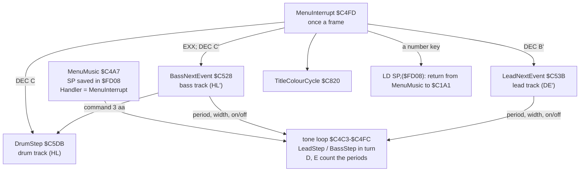
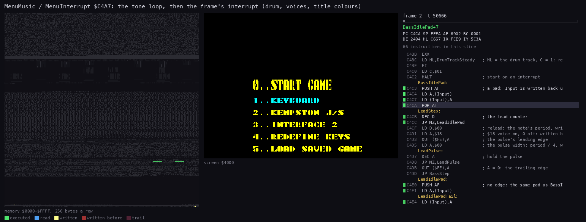
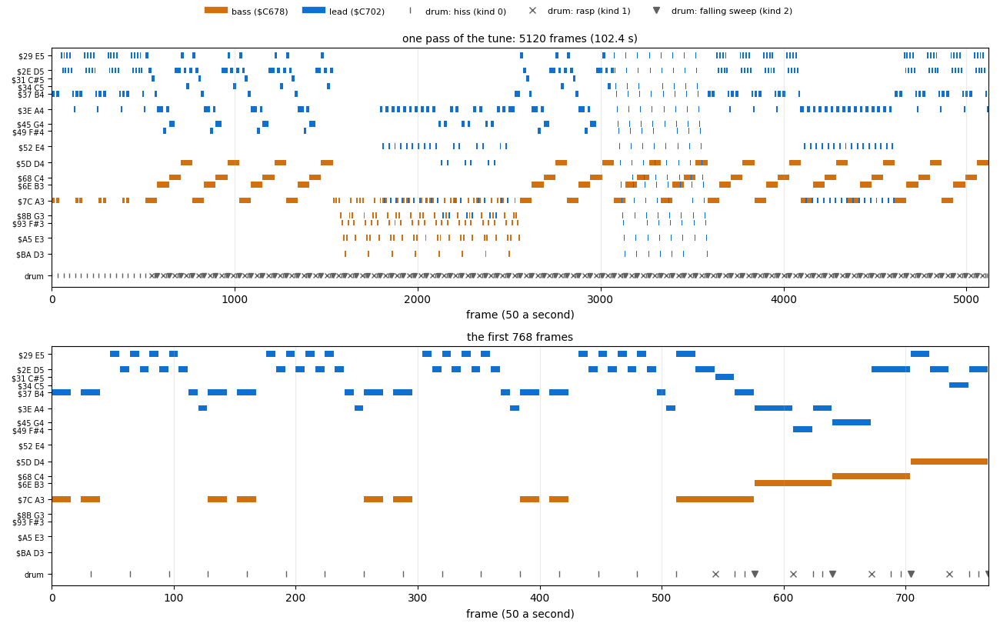
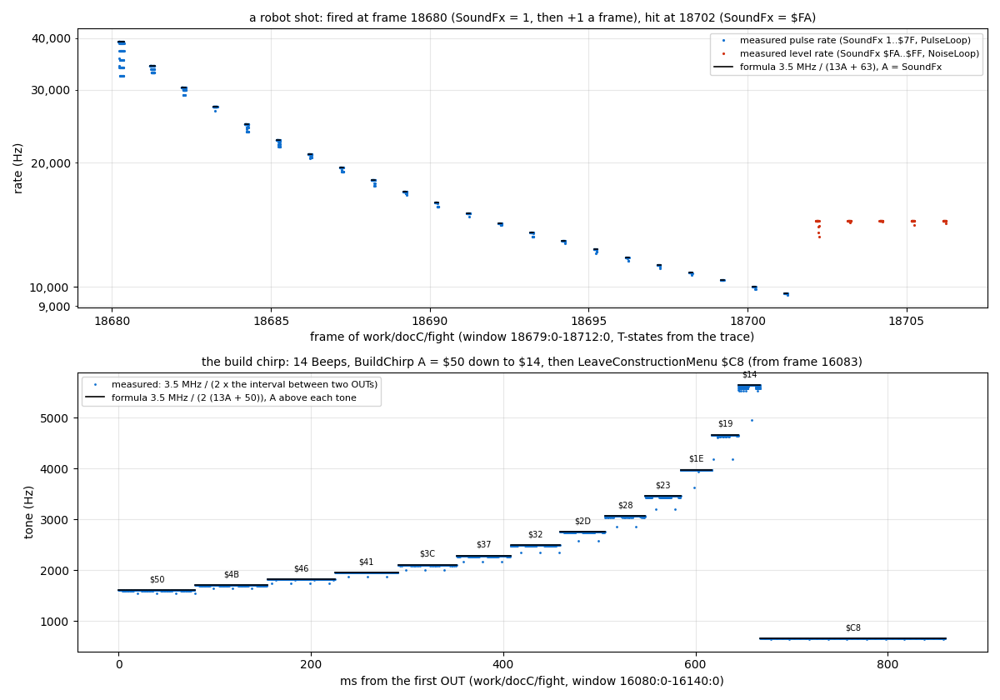

# 9. Sound

The game has three sound sources, all on the beeper (port `$FE`, bit 4 EAR and bit 3 MIC):

- **The menu tune.** It plays while the main menu waits: two pulse voices in a busy loop and a drum track, all
  driven by the frame interrupt.
- **SoundEffect.** In play, a frame interrupt routine makes the shot sounds. Each frame it plays one short burst,
  under 3 ms.
- **Beep.** The menus use a blocking square wave of 256 half-periods for their clicks and chirps. The game stands
  still while it sounds.

Evidence:

- the code of `src/game/main.asm` and the track data in `build/game.bin`, which `tools/tune_roll.py` reads;
- `work/docC/rec`: recorded on an own instance (port base 25200) from the menu snapshot `work/play/start.szx`.
  It holds 400 frames of the menu with the tune playing, then the bot of
  `tools/bot.py play --record --frames 9000`. TTD `memory_at` reads of the player's operands were taken at every
  frame 1-399 and 407-427;
- `work/docC/fight`: the same bot on the own instance for 19829 frames:
  `tools/bot.py play --record --frames 19800 --work work/docC/fight`.
  - It replays `work/deep` exactly: the first `FireShot` and `SoundEffect` are at frames 18679 and 18680 in both.
  - Its access traces of frames 18679-18712 (a shot and its hit) and 16080-16140 (the build chirp) are the
    measured points of the effects figure (9.6);
- `work/deep` and `work/docC/rec`: the L1 counts of the `Beep` call sites;
- `work/ann/r4.md`: the menu left alone for 5300 frames on r4's instance (the tune loops at frame 5099).

## 9.1 The menu tune at a glance

The main menu (`$C19E`) calls `MenuMusic` once all keys are up. The setup:

1. Save SP in `SavedSP` (`$FD08`).
2. Install `MenuInterrupt` as `Handler` (`$FDFE`).
3. Set the voice registers:
   - HL' the bass track `$C678`;
   - DE' the lead track `$C702`;
   - HL the drum track `$C665`;
   - every frame count to 1, so the first interrupt reads the first record of each track.
4. `HALT`, then run the tone loop for ever.

Nothing returns from the loop. When a number key is down, `MenuInterrupt` loads SP from `$FD08`, puts
`StartInterrupt` back and returns, which leaves `MenuMusic` itself (`MenuMusicExit` `$C51B`). The menu at `$C1A1`
then reads the key.

The whole tune state is in registers and in the operands of the tone loop's own instructions. This is why the
interrupt can drive the tune with three `DEC`s: the tone loop works in the main set (D, E), and the interrupt takes
the alternate set (B', C', HL', DE') with one `EXX`.

`python3 ../../kit/routine_anim.py --work work/docC/rec --window 2:50000-3:40000 --listing build/game.lst --view screen
--pc C4A7-C848 --out docs/img/routines/MenuInterrupt.gif`: 90 pictures of 666 T each.

- The tone loop's few bytes stay green for most of the frame.
- At the interrupt, `MenuInterrupt` reads the next records and `TitleColourCycle` (`$C820`) repaints the title's
  attributes; the screen panel flashes them.

## 9.2 The tone loop `$C4C3`

`LeadStep` (`$C4CB`) and `BassStep` (`$C4E8`) take turns. Each one decrements its counter (D for the lead, E for
the bass):

- **The counter is not 0:** the step runs a pad of the same length (`PUSH AF`, read `Input` and write it back,
  `POP AF`; `BassIdlePad` `$C4C3`, `LeadIdlePad` `$C4E0`). The time is the same whether a voice pulses or not, so
  neither voice detunes the other.
- **The counter reaches 0:**
  1. It is reloaded from the note's period (the operand at `$C4D0` lead, `$C4ED` bass).
  2. The voice's on value goes out: `$18` (EAR and MIC) when on, 0 when off (operands `$C4D2`, `$C4EF`).
  3. A `DEC A; JP NZ` loop holds the pulse for period / 4 turns of 14 T (operands `$C4D6`, `$C4F3`).
  4. `OUT ($FE),A` with A = 0 ends the pulse.

A turn of both steps is about 122 T, and the pulse adds about 3.5 T per period unit. A period p therefore sounds at
about 3.5 MHz / (125.5 × p): `$7C` gives 225 Hz, `$29` 680 Hz. The pulse width is a quarter of the period, so every
note is a 25 % duty pulse whatever its pitch.

These figures come from the T-states of the code. No beeper capture of the menu has been measured, so the absolute
pitch is **unverified**. The intervals are what the tune is made of; they are equal-tempered within 17 cents. The
names below take `$7C` as A3; by the T count the whole tune is about 40 cents sharp of that.

| Period | Hz (est.) | Note | Period | Hz (est.) | Note |
| --- | --- | --- | --- | --- | --- |
| `$29` | 680 | E5 | `$52` | 340 | E4 |
| `$2E` | 606 | D5 | `$5D` | 300 | D4 |
| `$31` | 569 | C#5 | `$68` | 268 | C4 |
| `$34` | 536 | C5 | `$6E` | 254 | B3 |
| `$37` | 507 | B4 | `$7C` | 225 | A3 |
| `$3E` | 450 | A4 | `$8B` | 201 | G3 |
| `$45` | 404 | G4 | `$93` | 190 | F#3 |
| `$49` | 382 | F#4 | `$A5` | 169 | E3 |
| | | | `$BA` | 150 | D3 |

## 9.3 The interrupt and the track formats

`MenuInterrupt` (`$C4FD`) runs once a frame, in this order:

1. `DEC C`: when the drum's frames run out, `DrumStep` (`$C5DB`) plays the next drum record. The drum sounds inside
   the interrupt, and the tone loop waits meanwhile.
2. `EXX`, then `DEC C'`: when the bass note's frames run out, `BassNextEvent` (`$C528`).
3. `DEC B'`: when the lead note's frames run out, `LeadNextEvent` (`$C53B`).
4. `TitleColourCycle` (`$C820`).
5. Read the keys 1-5 and 6-0 (`IN` with `$E7`): any number key exits (9.1).

**Voice records.** A byte of 9 or more is a note: the byte is the period, and the next byte its length in frames.
The reader writes the period into the tone loop's `LD D,n` / `LD E,n` and period / 4 into the pulse width. A byte
below 9 is a command. `MusicDispatch` (`$C65B`) jumps through the 3-byte `JP` table after the reader's
`CALL MusicDispatch` (`BassCommandTable` `$C553`, `LeadCommandTable` `$C572`). Every handler jumps back to the
reader, so a command takes no frames.

| Command | Operand | Bass | Lead |
| --- | --- | --- | --- |
| 0 | | `JP $C4A6`: would return into the pushed HL; never used | the same |
| 1 | aa | goto (`BassGoto` `$C5A7`) | goto (`LeadGoto` `$C5B0`) |
| 2 | aa | call a pattern; the return point is in `BassReturnPos` `$FD54`, one level only (`BassCall` `$C58D`) | the same with `$FD56` (`LeadCall` `$C599`) |
| 3 | aa | the drum continues at aa from its next record (`SetDrumTrack` `$C5CC`) | the same handler, but it reads HL', the bass position: unusable from the lead, and unused |
| 4 | | voice on: `$18` into `$C4EF` (`BassOn` `$C635`) | `$18` into `$C4D2` (`LeadOn` `$C648`) |
| 5 | | voice off: 0 into `$C4EF`; the notes keep their time, silent (`BassOff` `$C63F`) | 0 into `$C4D2` (`LeadOff` `$C652`) |
| 6 | | return from the pattern (`BassReturn` `$C5BB`) | `LeadReturn` `$C5C3` |
| 7, 8 | aa | as 3 (unused) | as 3 (unused) |

**Drum records.** A record is the frames until the next record and a kind; `1 aa` in place of the frames is a
goto.

| Kind | Bytes | Sound | Code |
| --- | --- | --- | --- |
| 0 | n 0 | hiss: 96 bytes of ROM page `$08` straight to the beeper (bits 3-4), about 1 ms | `DrumHiss` `$C608` |
| 2 | n 2 p | falling sweep: 48 cycles; the low half starts at p - 1 and shortens by 1, the high half starts at p / 2 and lengthens by 4 | `DrumSweep` `$C616` |
| other | n k | rasp: 80 bytes of ROM page `$00` with a gap of (~B & `$3F`) loops after each | `DrumRasp` `$C5EB` |

## 9.4 The tune

`python3 tools/tune_roll.py roll docs/img/sound-menu-tune.png`. The script models `MenuInterrupt` frame by frame on
the tracks in `build/game.bin`:

- the bass in orange, the lead in blue, each sounding note a bar at its period's pitch;
- the drum hits marked under the notes;
- the y labels give the period and the note name with `$7C` = A3.

The tracks:

| Track | Address | Contents |
| --- | --- | --- |
| drum, steady | `$C665` | `32 0`, `1 $C665`: a hiss every 32 frames |
| (unused) | `$C66A` | `32 0`: no goto reaches it |
| drum, beat | `$C66C` | `16 1` rasp, `8 0`, `8 0` hiss, `32 2 $30` sweep, `1 $C66C`: a 64-frame bar |
| bass | `$C678` | drum steady; pattern `$C6BD` × 4; drum beat; `$C6CC` × 2; `$C6DD` × 8; `$C6CC` × 5; drum steady; goto `$C678` |
| bass patterns | `$C6BD`, `$C6CC`, `$C6DD` | A3 pulses with rests (commands 5 / 4); a slow A3-B3-C4-D4 walk of 64-frame notes; 8-frame A3 pulses, then a G3-F#3-E3-D3 run down and back |
| lead | `$C702` | `$C789` × 4, `$C7AA` × 4, `$C7AA` once more silent (5 ... 4), `$C7C5` / `$C7D2` alternating, A4 and B4 for 32 frames each, `$C7AA` × 2, `$C7DF` × 4, `$C789` × 4, `$C7C5` × 8, `$C789` × 4, goto `$C702` |
| lead patterns | `$C789`, `$C7AA`, `$C7C5`, `$C7D2`, `$C7DF` | a B4 figure and an E5 / D5 trill; the melody (E5 D5 C#5 B4 A4 F#4 A4 G4 D5 ...); two broken-chord riffs; a 4-frame scale from E5 down to D3 played twice |

`python3 tools/tune_roll.py events` gives the counts of one pass:

- both voices loop after exactly 5120 frames (102.4 s); r4 saw both jump back at frame 5099 of its menu
  experiment;
- the bass has 178 sounding notes on 8 periods, the lead 472 on 17;
- the drums hit 304 times: 161 hisses, 72 rasps, 71 sweeps. r4's 5300-frame experiment counted 72 rasps and 72
  sweeps.

**Verified against a recording.** `python3 tools/tune_roll.py verify --work work/docC/rec --from 1 --to 400` reads
the four operands the player writes at every frame with TTD `memory_at`:

- `$C4D0` the lead period, `$C4D2` the lead on/off;
- `$C4ED` the bass period, `$C4EF` the bass on/off.

All 399 frames agree with the model, at the single model offset 93: the snapshot was taken 93 frames into the tune.

### A restart keeps a silent voice

`MenuMusic` sets the track positions and the counts, but not the on/off operands `$C4D2` and `$C4EF`. In
`work/docC/rec` the bot pressed 2 (KEMPSTON) near frame 405, while the bass was in a rest of pattern `$C6BD`
(command 5). The menu reprinted its options and called `MenuMusic` again (first interrupt in frame 406). The tune
restarted with the bass off, and it stays silent until the track's next command 4. In pattern `$C6BD` this comes
after 24 frames: the first A3 of 16 frames and the next of 8 are lost.

`tune_roll.py verify --from 407 --to 428 --bass-on 0` agrees on all 21 frames at offset 0. With the bass on (the
image's initial value) it does not. A tune restarted with the lead off would likewise lose the lead until a 4.
Harmless, but a real bug: the restart is not the start.

## 9.5 Effects in play: SoundEffect `$D5C4`

One byte drives every play-time sound: `SoundFx` (`$FD53`). The game writes it:

| Value | Written by | Event |
| --- | --- | --- |
| 1 | `FireShot` (`$B6D6`) when the first step of a shot survives | a shot fired |
| `$FC` | `ShotGone` (`$B7EA`) | a shot ends on a wall, a building or nothing (range spent) |
| `$FA` | `MoveShot` (`$B724`) | a robot hit and still alive |
| `$C8` | `MoveShot` (`MoveShotKill` `$B7D7`) | a robot destroyed |

`PlayInterrupt` (`$D566`) increments a non-zero `SoundFx` each frame. Values reaching `$80` and values wrapping past
`$FF` become 0. It then calls `SoundEffect` with the new value:

- **A positive (2 to `$7F`).** C = 500 / (A + 2) + 1 pulses. The level of each is bit 4 of the next ROM byte from
  `$0000` (`PulseLoop` `$D5DB`). The pulses are 13A + 63 T apart: `PUSH BC` 11, `LD A,(HL)` 7, `INC HL` 6,
  `AND` 7, `OUT` 11, the `DJNZ` delay 13A - 5, `POP BC` 10, `DEC C` 4, `JR` 12. A burst lasts
  C × (13A + 63) T: 3.2 ms at A = 2, about 2 ms from A = 40 on. The pulse rate falls as A climbs, so the effect is
  a noisy downward sweep over 126 frames, from 39 kHz to 2 kHz.
- **A negative (`$FA`-`$FF`, `$C8`-`$FF`).** 30 levels from `Random` (`NoiseLoop` `$D5EE`). This is white noise
  for `$FC` (3 frames), `$FA` (5 frames) and `$C8` (55 frames, the explosion).

A new event overwrites the running one. In `work/docC/fight` the fire sound of frame 18680 ran for 22 frames, then
the hit at 18702 cut it off. The fire sound also restarts at every new shot. The sounds take at most 3.2 ms of each
20 ms frame, so play goes on while they sound.

`SoundEffect` ran 1356 times in `work/deep`: from frame 18680 (the first shot) to 35333. `FireShot` ran 51 times.

## 9.6 Beep `$CCAC`

`Beep` toggles bit 4 of port `$FE` 256 times (C = 0), with a `DJNZ` delay of A between the toggles. A half-period
is 13A + 50 T (`PUSH BC` 11, `XOR` 7, `OUT` 11, `DJNZ` 13A - 5, `POP BC` 10, `DEC C` 4, `JR` 12), so:

- the tone is f = 3.5 MHz / (2 (13A + 50));
- the length is 256 × (13A + 50) T, and the game waits for it.

| Site | Routine | A | Tone (est.) | Length | Event | Calls in `work/deep` / `work/docC/rec` |
| --- | --- | --- | --- | --- | --- | --- |
| `$CB47` | `CursorMoved` | `$14` | 5.6 kHz | 23 ms | the construction menu's cursor moved | 42 / 21 |
| `$AD17` | `ListMenuKey` | `$14` | 5.6 kHz | 23 ms | a list menu's highlight moved | 55 / 32 |
| `$AAB3` | `DistanceShow` | `$14` | 5.6 kHz | 23 ms | the miles changed | 0 / 0 |
| `$AD37` | `ListMenuChosen` | `$64` | 1.3 kHz | 98 ms | a list menu item chosen | 28 / 16 |
| `$CA91` | `PartPaid` | `$64` | 1.3 kHz | 98 ms | a part paid for | 22 / 10 |
| `$A803` | `LeaveRobot` | `$78` | 1.1 kHz | 117 ms | LEAVE ROBOT | 7 / 4 |
| `$ABF7` | `OrderSet` | `$78` | 1.1 kHz | 117 ms | an order given | 7 / 4 |
| `$A96D` | `DirectControlLoop` | `$78` | 1.1 kHz | 117 ms | fire ends DIRECT CONTROL | 0 / 0 |
| `$AA06` | `OrdersMenuChoose` | `$78` | 1.1 kHz | 117 ms | STOP AND DEFEND chosen | 0 / 0 |
| `$AAC6` | `DistanceDone` | `$78` | 1.1 kHz | 117 ms | the distance fired | 0 / 0 |
| `$CAAE` | `PartRefused` | `$78` | 1.1 kHz | 117 ms | a part refused or taken back | 0 / 0 |
| `$CB83` | `BuildChirp` | `$50` down to `$14` by 5 | 1.6-5.6 kHz | 13 beeps, 0.66 s | START ROBOT accepted | 91 / 52 (7 / 4 builds) |
| `$CB90` | `LeaveConstructionMenu` | `$C8` | 660 Hz | 194 ms | leaving the construction menu | 7 / 4 |
| `$ACD0` | `CombatRefused` | `$FA` | 530 Hz | 241 ms | COMBAT MODE refused | 0 / 0 |
| `$AEEC` | `GameOverWait` | `$FA` | 530 Hz | 241 ms | the game's end (won or lost) | 0 / 0 |
| `$C284` | `LoadError` | `$FA` | 530 Hz | 241 ms | LOADING ERROR! | 0 / 0 |

The sites with no calls in a recording ran in the region agents' experiments (`work/ann/r1.md`, `r4.md`). The
pitches are the formula's.

`python3 tools/effects_chart.py extract --work work/docC/fight --window 18679:0-18712:0 --out work/docC/fx-fire.json`,
the same for `16080:0-16140:0` into `fx-chirp.json`, then `python3 tools/effects_chart.py chart --fire
work/docC/fx-fire.json --chirp work/docC/fx-chirp.json --out docs/img/sound-effects.png`. The points come from
every `OUT ($FE)` in the traces; the black lines are the formulas.

**Top: a shot.** An enemy missile is fired in frame 18679 (`FireShot` at T 24670). From frame 18680 one burst a
frame steps down:

| Frame | A | Pulses | Interval (T) | Formula 13A + 63 |
| --- | --- | --- | --- | --- |
| 18680 | 2 | 126 | 89-108 | 89 |
| 18681 | 3 | 101 | 102-106 | 102 |
| 18690 | 12 | 36 | 219-224 | 219 |
| 18701 | 23 | 21 | about 362 | 362 |

From frame 18702 come five frames of noise at about 14 kHz: the missile hit robot 2 (strength 100 to 70).

The intervals agree with the formula. The spread above it, up to +19 T in the first frame, is the ULA's
contention on the `OUT` to an even port while the beam draws the screen.

**Bottom: the build chirp of frame 16083.** The bot started robot 5, placed in frame 16084:

- 13 beeps rise from 1.6 kHz (`$50`) to 5.6 kHz (`$14`) in 0.66 s;
- 401 T after the last of them comes the long `$C8` at 660 Hz, 0.19 s; the whole sound takes 0.86 s.

Of the 3570 half-periods within a beep, 3527 are within 6 T of the formula (the rest of the spread is contention).
The other 43 are 43 T longer, one in each frame: the interrupts stay enabled during `Beep`, and the construction
menu's `StartInterrupt` (`EI; RET`) runs in them. These are the points under each step.

## 9.7 Design notes

- **Self-modifying operands as the state.** The tone loop has no memory reads besides the pad's `Input`: periods,
  widths and on/off are its own operands. The readers write them in the interrupt, so the loop stays cycle-steady.
- **Padded both ways.** Both branches of each step take the same time, so a two-voice pulse player gets steady
  pitches without any timer.
- **Commands cost nothing.** Every handler jumps back to the reader, so gotos, calls and on/off fall between two
  frames without a gap.
- **Effects never block play.** `SoundEffect` spends at most 3.2 ms a frame. The pitch sweep comes from one byte
  counted by the interrupt, so the shooter's code only sets `SoundFx`.
- **Beeps block on purpose.** Only the menus use `Beep`, where a short stop is feedback. The longest stall is the
  build chirp with the leave beep, about 0.86 s.
