# 10. Gameplay logic

Nether Earth is a war of production. Each side starts with warbases and 20 general resource. A day of game time
pays out per building owned, and robots built from parts capture more buildings. The player never fights directly:
the robots walk, look, shoot and capture on their own, steered by orders. The enemy (the "Insignians") uses the
same robots, the same costs and the same capture rule. Its commander is a few lines of random choices
(`EnemyCommander` `$B7F4`). A side with no warbase left has lost.

Evidence:

- the code of `src/game/*.asm` (the routines named below);
- `work/deep`: the bot's 36046-frame game from the menu snapshot `work/play/start.szx`, 11.8 game days. The bot
  is `tools/bot.py play --record`.
  - L1 counts.
  - TTD `memory_at` samples of `$FD00`-`$FDFF` and the robot records every 120 frames, taken by
    `tools/course_chart.py sample`. The instance was only read: no seek, no resume.
- `work/docC/fight`: the same bot on an own instance for 19829 frames. It replays `work/deep` frame for frame:
  `FireShot` and `SoundEffect` first run at frames 18679 and 18680, `GameTurn` at frame 61, in both.
  - Its access trace of frames 18679-18712 shows a shot and its hit.
  - Its `memory_at` reads show the robot strengths.
- the region agents' notes and experiments on own instances (`work/ann/r1.md`-`r5.md`): the game ends, the full
  slots, the nuclear blast, the construction menu with poked resources, the target bug.
- the figures of this chapter (`docs/img/events/`), all drawn by `tools/ill_events.py` from memory pictures:
  - `sample` reads `$4000`-`$FFFF` from the `work/deep` recording with `memory_at` (`deep10.npz`: every 10th
    frame, 0-36040; `deep-fight.npz`: every frame, 18660-19419);
  - `snap` cuts snapshots out of it (`work/ill1/snaps/deep-F.szx`);
  - `turns` and `combat` replay such a snapshot on an own instance, fly or land the ship with `tools/bot.py`, poke
    memory where a caption says so, and keep one picture a game turn (or a frame).

  A turn's picture is the memory of the frame before the clock `$FD35` moves with the screen of the frame after
  it ([10.1](#101-the-game-turn-and-the-clock)). The game logic is deterministic per turn: with the ship parked
  above the robots' tops elsewhere, the same fight replays in turns, only shifted in frames. The caches are in
  `work/ill1/cache/`; each caption gives the command that draws the figure from its cache, and the commands that
  fill the caches are listed in [10.14](#1014-the-figure-experiments).

## 10.1 The game turn and the clock

The play loop (`PlayLoop` `$A69A`, [4.3](04-game-loop.md)) runs one game turn a pass:

1. read the controls;
2. move the ship;
3. `WorldTurn` (`$B0CA`);
4. draw the view;
5. `GameTurn` (`$AD62`).

The menus call `WorldTurn` and `GameTurn` between key presses too, so the war goes on while the player chooses
([5.5](05-controls.md)). Only the construction menu stops the world: it installs `StartInterrupt` and runs no
turns.

`GameTurn`, step by step:

1. `Random` (`$D358`): one step of the random generator a turn, whatever else draws numbers.
2. The clock (`$FD35` minutes, `$FD36` hours, `$FD37` days): +5 minutes. 60 minutes make an hour, 24 hours a day;
   a new day calls `DailyProduction` (`$AE38`, 10.2).
3. The clock print ([8.5](08-hud-and-text.md)).
4. `CheckGameEnd` (`$AE6B`, 10.10).
5. The capture loop over the 28 capture points (10.7).
6. The pacing (`TurnPace` `$AE1D`): wait until `PlayInterrupt` has counted 10 frames in `TurnFrames` (`$FD34`)
   since the last turn, then clear it.

A turn is at least 10 frames (0.2 s), an hour 12 turns, and a day 288 turns: at least 2880 frames, 57.6 s. In
`work/deep` 3414 turns took 36046 frames, 10.56 frames a turn: some turns'
work takes more than 10 frames.

## 10.2 Production and resources

`DailyProduction` runs `ProduceSide` (`$AE4E`) for both sides, then reprints the panel:

- general += 5 × warbases;
- each part resource += 2 × the factories of its kind;
- every resource stops at 99 (`AddCapped` `$AE62`).

Each side has 7 resources: general, electronics, nuclear, phasers, missiles, cannon, chassis. Ours are at
`Resources` (`$FD22`) and the enemy's at `$FD4A`; the building counts are at `$FD3A` and `$FD42`, in the same order
(warbases, then the six factory kinds). It ran 11 times in `work/deep`, once a game day.

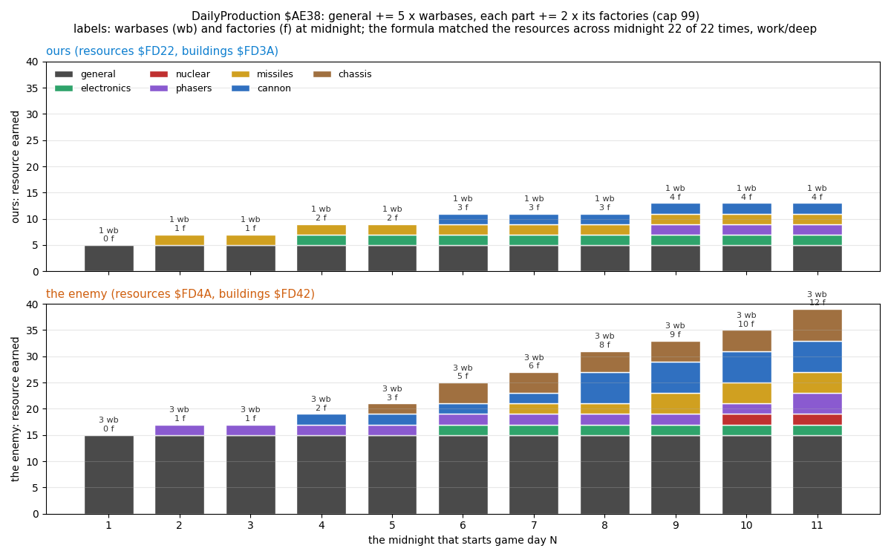

```sh
python3 tools/ill_events.py fig-production --cache work/ill1/cache/deep10.npz --out docs/img/events/production.png
```

Each bar is 5 × warbases + 2 × each factory kind at midnight, from `$FD3A` / `$FD42` in the last sample of the day.
The resources at `$FD22` / `$FD4A` in the first sample of the new day equal the old ones plus these gains (capped
at 99) at all 22 midnights of both sides. The enemy's 3 warbases earn 15 general to our 5; its factories took the
lead from day 5 (3 factories to our 2).

At the start our side has 1 warbase and the enemy 3, and both have 20 general and nothing else (`work/deep` frame
120). So the enemy earns 15 general a day to our 5 until factories change hands.

## 10.3 Construction: costs and limits

The construction menu opens when the ship sinks onto the pad of our warbase. This takes three things:

- altitude 15;
- the door cell 4 rows below the pad free of map bit 6;
- the three cells of the row under the door free of bit 6.

The menu itself is in [5.4](05-controls.md). Its rules, from `ConstructionMenuLoop` (`$CA0F`), `RefundPart`
(`$CAC1`) and `StartRobot` (`$CB52`):

| Part | Bit | Cost (`PartCosts` `$CAF0`) | Paid from (`$CAF8`) | Height (`PartHeights` `$D7B4`) |
| --- | --- | --- | --- | --- |
| bipod | 0 | 3 | chassis | 11 |
| tracks | 1 | 5 | chassis | 7 |
| anti-grav | 2 | 10 | chassis | 8 |
| cannon | 3 | 2 | cannon | 6 |
| missiles | 4 | 4 | missiles | 6 |
| phasers | 5 | 4 | phasers | 7 |
| nuclear | 6 | 20 | nuclear | 7 |
| electronics | 7 | 3 | electronics | 7 |

- A part pays from its own resource. The rest comes out of general; if general cannot cover it, the part is
  refused.
- The menu works on a copy of the resources (`MenuResources`). The copy goes back into `Resources` only on START.
- Exactly one chassis: choosing one refunds the chosen one first.
- At most three of the four weapon bits 3-6 (`MenuParts & $78` is never `$78`).
- START ROBOT needs a chassis and a weapon; electronics count as neither.
- A side has 24 robot slots: ours are `$DA00` + 16 × n for n = 0-23, the enemy's `$DB80` + 16 × n.

Our new robot stands on the warbase's door, facing down: `+$05` 4, `+$06` 5, order 0, strength 100, `+$0F` 1, so it
moves at the next turn. Its height `+$09` is the sum of its parts' heights. `work/deep` frame 360, the first robot:
`16 EF 16 00 09 00 00 09 04 11` (cell `$EF16`, column 22, row 9, bipod + cannon, height 17).

## 10.4 A robot's turn

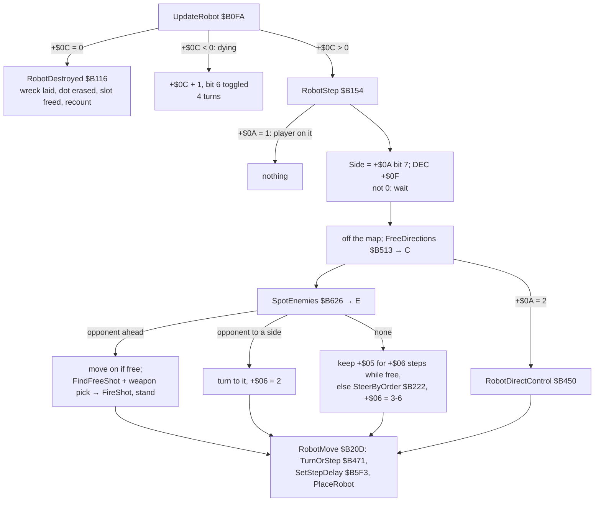

`WorldTurn` first calls `EnemyCommander` (10.8). It then calls `UpdateRobot` for each of the 48 records whose
`+$01` is not 0 (ours first), then `UpdateShot` for each of the 5 shot records ([7.1](07-objects.md)). In
`work/deep` `UpdateRobot` ran 49165 times and took 9652 steps.


`python3 ../../kit/routine_anim.py --work work/docC/fight --window 18679:13500-18679:57000 --listing build/game.lst
--view buffer:D7D3:9x5 --pc B0CA-B7F3 --range D700-FFFF --pictures 80 --out docs/img/routines/RobotStep.gif`.

- The memory panel shows the robots' records at `$DA00`-`$DCFF` read one by one, and the map reads of
  `FreeDirections` and `SpotEnemies`.
- The view is the five shot records. At T 24670 an enemy robot's step fires: `FireShot` fills record 3 at `$D7EE`.
- `UpdateShot` moves the shots at the end of the turn.

**Step delays.** `SetStepDelay` reloads `+$0F` from `StepDelays` (`$B61D`), in turns per step. The column is the
locomotion: the lowest set bit of the parts `+$07`, so exactly one in every built robot. The row is the ground
height under the robot (`+$0D`):

| Ground | bipod | tracks | anti-grav |
| --- | --- | --- | --- |
| flat (0) | 6 | 4 | 3 |
| low (1-3) | 8 | 6 | 3 |
| high (4 and up) | 9 | 7 | 4 |

A turn of 90 degrees costs a step (`TurnOrStep`). A turn from right to left goes through down or up, so it costs
two steps.

**Movement thresholds.** `FreeDirections` tests the 2 × 2 footprint's next cells against the terrain type. It also
tests for object anchors (bit 6), and for the ship's cell (bit 7) when the ship is lower than the robot's top.

| Locomotion | Blocks from type | Ground heights it climbs |
| --- | --- | --- |
| bipod | `$08` | 0, 2, 3 |
| tracks | `$0C` | also 6 |
| anti-grav | `$0F` | also the types `$0C`-`$0E` |

Types `$0F` and above (tall blocks, buildings) stop every robot ([7.3](07-objects.md)).

**Vision.** `SpotEnemies` scans 8 cells in each direction, and in the facing direction 10 cells (12 with
electronics) on three parallel lanes. The first object on a lane ends it. Only an opponent (`+$0A` bit 7 differs)
with strength above 0 counts, so buildings, shots and friends hide what is behind them. The result E has the
direction bits in the `Input` order: 0 right, 1 left, 2 down, 3 up.

**An opponent ahead.** The robot moves on if it can. It fires if a shot record of its side is free
(`FindFreeShot` `$B6B8`: records 1-2 ours, 3-4 the enemy's) and it has a weapon:

1. `Random AND $38 AND` the parts chooses each of cannon, missiles and phasers with a coin flip.
2. The highest chosen fires: phasers 3, missiles 2, cannon 1 (`RobotWeaponPick` `$B1B7`).
3. Firing makes the robot stand this step: `+$05` = 0, `+$06` = 1.

So a robot fires its best weapon on half its chances, and a lone cannon fires only on half the turns that see an
opponent. With two shot records a side, at most two of its shots fly at once (plus the player's COMBAT MODE
shot).

## 10.5 Orders

`SteerByOrder` (`$B222`) picks a direction among the free ones C by the order `+$0B`. It runs only when the robot
has no opponent in sight and its course `+$06` is used up or blocked. The new course lasts 3-6 steps.

| Order | Name ([8.3](08-hud-and-text.md)) | Steering |
| --- | --- | --- |
| 0 | STOP AND DEFEND | stand; it still turns and fires at what it sees |
| 1 | ADVANCE n MILES | lean right: the order's direction with chance 3/4 when free, else a random free one other than the opposite (`RobotLeanTo` `$B326`). `+$0E` = miles × 2 counts the columns down (`StepPosition` `$B4B9`: -1 a column in the order's direction, +1 against, at most 99); at 0 the order becomes 0 |
| 2 | RETREAT n MILES | the same to the left |
| 3 | SEARCH & DESTROY ENEMY ROBOTS | the opponent at slot `+$0E`, kept while it lives and is under 50 columns away; else the nearest live opponent by column (`FindNearestOpponent` `$B41D`); none: a random free direction |
| 4 | ... ENEMY FACTORYS | a building target (below); needs the nuclear part |
| 5 | ... ENEMY WARBASES | the same; needs the nuclear part |
| 6 | SEARCH & CAPTURE NEUTRAL FACTORYS | a building target |
| 7 | ... ENEMY FACTORYS | a building target |
| 8 | ... ENEMY WARBASES | a building target |

`SetOrder` (`$ABC8`) turns an order 4 or 5 for a robot without the nuclear part into 0. Any order whose search
finds no target becomes 0 too.

**Building targets.** `TargetBuildingTable` (`$B3D5`) gives the table (warbases `$FD70` for 5 and 8, factories
`$FD84` for the others) and the owner bits wanted:

- `$20` (the enemy's) for our robots;
- `$40` (ours) for the enemy's;
- 0 (neutral) for order 6.

The target is record `+$0E`, kept while it still has those owner bits. Else `FindTargetBuilding` (`$B34D`) takes
the nearest by column that no robot of the side with the same order is already after (`ConsiderBuilding`
`$B36C`). With none, our robot stands and an enemy robot switches to order 3.

**The aim** (`RobotAim` `$B2D5`):

- D = the directions toward the target. While the columns differ, the row aimed at is 3 below the building's row:
  its door.
- 8 or more columns away: lean horizontally, as an advance does.
- Closer: a random free direction among the wanted ones. A horizontal one is kept for |dx| - 1 steps.
- Arrived (D = 0): orders 4 and 5 detonate (`NuclearBlast`, 10.9); the others face down and stand. A robot that
  stands on a door captures it (10.7).

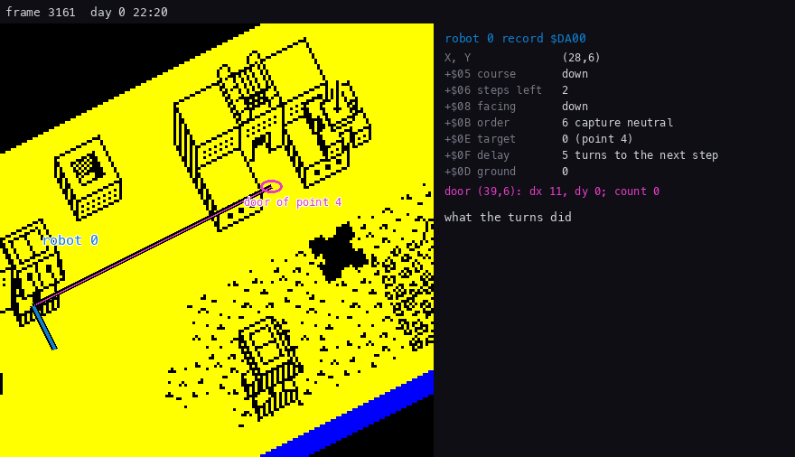

```sh
python3 tools/ill_events.py fig-ai --cache work/ill1/cache/capture.npz --out docs/img/events/robot-ai.gif --opt slot=0 from=0 to=112
```

One picture a game turn on an own instance replayed from `work/deep` frame 3000; the ship
is parked over (40,10).

- The magenta line runs from the robot to its target's door, point 4 (+`$0E` 0 indexes the factory table).
- The blue arrow is the course `+$05`.
- The panel shows the record at `$DA00`; a field that changed this turn is yellow.

The robot comes down from (28,6), turns right (a turn costs a step), walks right with a new course of 5 steps
(`SteerByOrder`) and `+$0F` reloaded to 6 per step on flat ground (bipod). At (39,8) it turns up, steps onto the
door (39,6) and stands: the capture count of point 4 starts (10.7).

## 10.6 Shooting and damage

`FireShot` (`$B6D6`) launches the shot from the robot's anchor in its facing direction:

- 5 steps of range, 7 for missiles, one more with electronics;
- each step moves 2 cells;
- the first step is taken at once (`MoveShot` `$B724`); when the shot survives it, `SoundFx` = 1
  ([9.5](09-sound.md)).

Every turn `UpdateShot` (`$B70D`) moves each shot one step. The shot is gone off rows 0-15, when its steps run out,
or over ground of height 10 or more (types `$10` and `$12`). Then the 3 × 3 cells around its new cell are tested
for an object (bit 6):

- **Nothing:** the shot marks its cell and flies on.
- **A live robot of either side** takes the damage below; there is friendly fire.
- **Anything else** ends the shot: a building, another shot, a dying robot (`ShotGone` `$B7EA`, `SoundFx` `$FC`).

    damage = ((60 - (+`$09` + +`$0D`)) / 4) × (weapon + 1)        integer division, weapon 1 cannon, 2 missiles, 3 phasers

A tall robot on high ground takes less. For a robot of height 19 on flat ground: 10 per point, so a cannon does
20, missiles 30 and phasers 40.

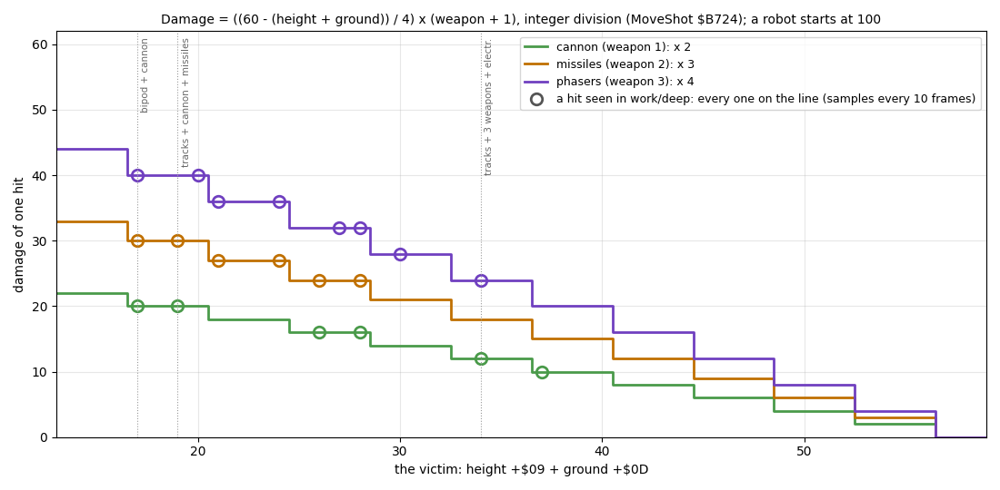

```sh
python3 tools/ill_events.py fig-damage-table --cache work/ill1/cache/deep10.npz --out docs/img/events/damage-table.png
```

The lines are the formula; the dots are the 20 distinct pairs (height + ground,
damage) of the hits in the `work/deep` samples, each a drop of a robot's `+$0C`. All of them sit on the formula.

- Strength 0 or below: `+$0C` = `$FC`, dying, `SoundFx` `$C8`.
- Otherwise `SoundFx` `$FA`.

The recordings agree:

| Moment | Shot | Victim | Strength |
| --- | --- | --- | --- |
| `work/deep` from frame 18680 | an enemy missile, record `$D7EE`: `7B F3 7B 00 0B 08 06 02 0A` (column `$7B`, row 11, up, 6 steps left, missiles) | our robot 2, height 19 | 100 → 70 → 40 |
| `work/deep`, later | our cannon | enemy robot 25, height 19 | 100 → 80 → 60 → 40 |
| `work/docC/fight` frame 18702 | the same missile | robot 2 (`$DA2C`: `$64` at frame 18701, `$46` at 18703) | 100 → 70 |

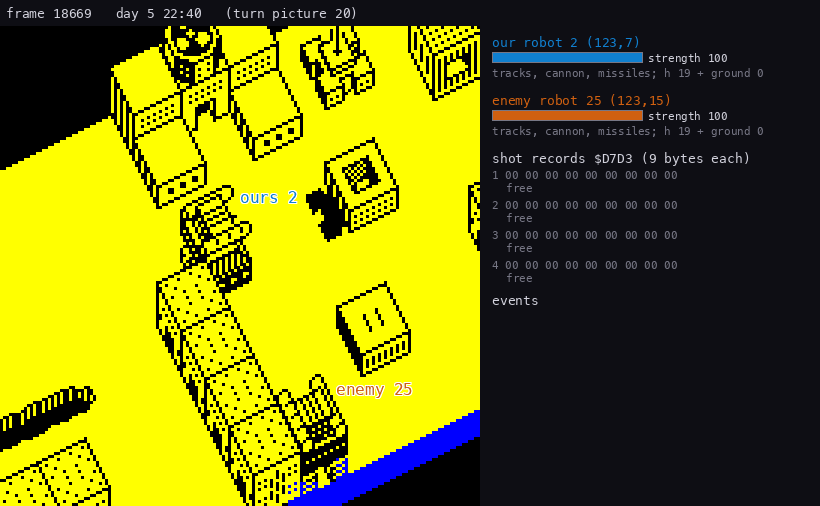

```sh
python3 tools/ill_events.py fig-fight --cache work/ill1/cache/duel.npz --out docs/img/events/fight-duel.gif --opt from=20 to=98
```

An own instance replays `work/deep` from frame 17400 with the ship parked over (128,7). The view is
scaled 3 ×.

- Each shot's cells are joined into a path in its side's colour (blue ours, orange the enemy's). The cell is the
  shot record's `+$00` / `+$01`, drawn at the shot's height `+$08`.
- The robots are labelled with their slot and strength `+$0C`.
- The list on the right shows the shots fired, the hits and the deaths of the last turns, read from the records.

Enemy robot 25 dies at the end: four turns of blinking, then its slot is freed and a wreck is left.

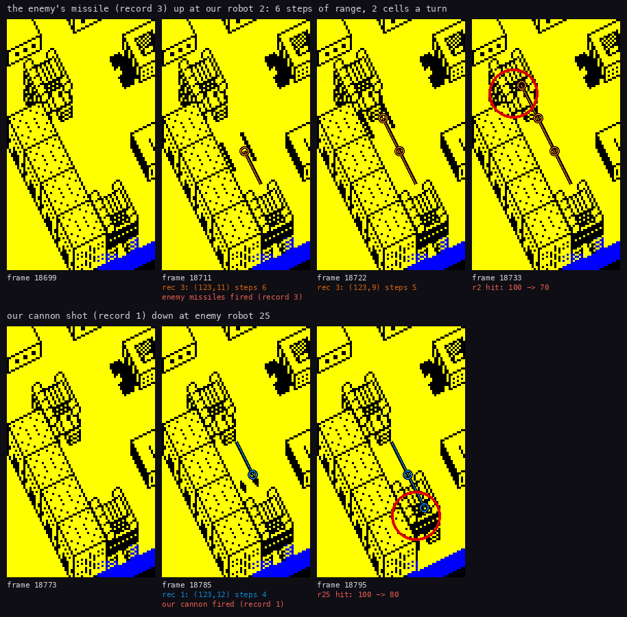

```sh
python3 tools/ill_events.py fig-strip --cache work/ill1/cache/duel.npz --out docs/img/events/shot-strip.png --opt "rows=23,24,25,26;30,31,32" "titles=the enemy's missile (record 3) up at our robot 2: 6 steps of range, 2 cells a turn;our cannon shot (record 1) down at enemy robot 25"
```

The shot sprite is `$2B` + 2 × weapon + axis, drawn 8
pixels above the cell (`DrawMover`, [6.3](06-rendering.md)). The recordings never drew one in the view: the
`work/deep` fight was out of the ship's view, so these turns are the first witness of that branch.

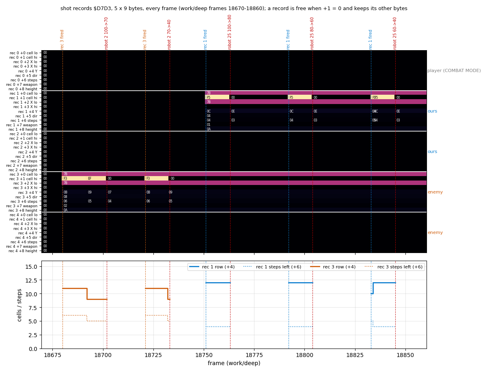

```sh
python3 tools/ill_events.py fig-shot-record --cache work/ill1/cache/deep-fight.npz --out docs/img/events/shot-records.png --opt from=18670 to=18860
```

Each panel is one record, each line one of its 9 bytes
([7.1](07-objects.md)):

- `FireShot` fills a record at once with its first step taken;
- `+$06` counts the steps down while the cell moves 2 columns or rows a turn;
- `+$01` = 0 frees the record at the hit or at the end of the range.

A freed record keeps its other bytes.

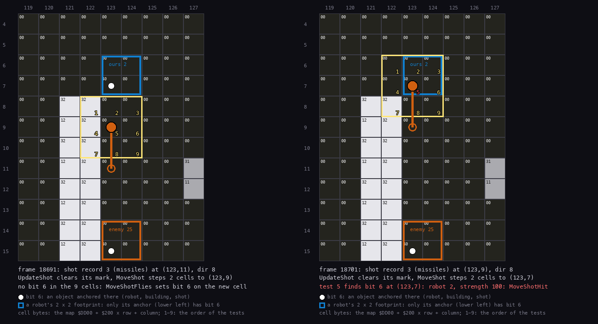

```sh
python3 tools/ill_events.py fig-hit-test --cache work/ill1/cache/deep-fight.npz --out docs/img/events/hit-test.png --opt steps=18691:3,18701:3 cols=119-127 rows=4-15
```

The map cells (`$C000` + `$200` × row + column) around
record 3's two last steps, coloured by terrain type; bit 6 (an object anchor) is marked.

- `MoveShot` tests the 9 cells in the numbered order: the row above, its own row, the row below.
- `UpdateShot` cleared the shot's own bit 6 first.
- At frame 18691 all 9 cells are free: the shot marks its cell and flies on.
- At frame 18701 a cell holds robot 2's anchor: the hit.

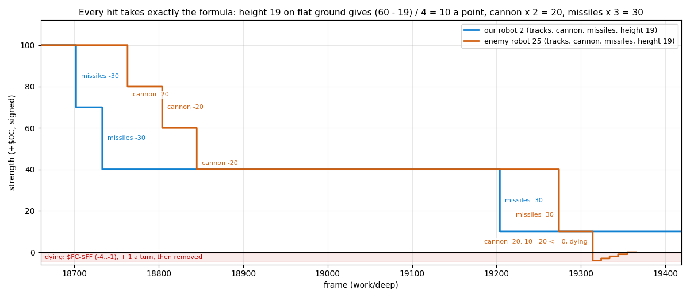

```sh
python3 tools/ill_events.py fig-strength --cache work/ill1/cache/deep-fight.npz --out docs/img/events/strength.png
```

Each step is one hit, annotated with its weapon, the victim's height + ground and the formula's result.

A dying robot counts `+$0C` up from `$FC` and toggles its cell's bit 6 for four turns, so shots and eyes see it
only every other turn. At 0 `RobotDestroyed` frees the slot, erases the dot and recounts. On bare ground it lays a
2 × 2 wreck of terrain types 6 / 7 (height 3), which every locomotion can climb.

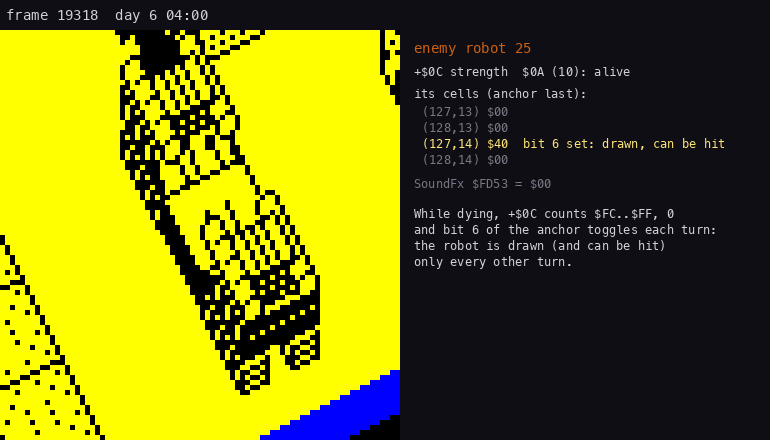

```sh
python3 tools/ill_events.py fig-death --cache work/ill1/cache/duel.npz --out docs/img/events/death-blink.gif --opt slot=25 from=84 to=94 wreck=86,93 out2=docs/img/events/wreck.png
```

The command draws both figures. In the duel the strength byte went `$FC`, `$FD`, `$FE`, `$FF`, 0, one step a turn, and its cell's bit 6 toggled with it. `SoundFx` (`$FD53`) counted
up from `$C8` meanwhile ([9.5](09-sound.md)).

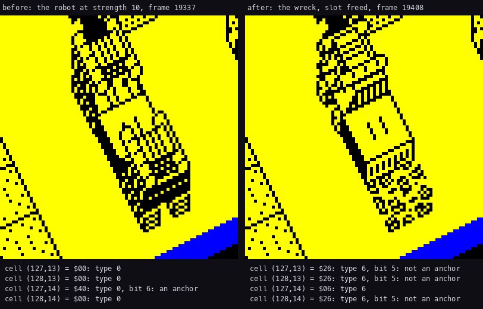

The wreck's four cells read `$06` (the anchor (127,14)) and `$26`: terrain type 6 in all four.

COMBAT MODE in the robot menu fires shot record 0 (`$D7D3`) from the player's robot, or detonates its bomb
(`CombatMenuCode` `$AC7C`). Without the weapon chosen it buzzes (`CombatRefused` `$ACCE`). No recording entered it.
My own instance did: it replayed `work/deep` from frame 17400 and landed the ship on our robot 2 at frame 18736.
It then chose COMBAT MODE and the items FIRE CANNON, FIRE PHASERS, FIRE MISSILES, FIRE CANNON, driven by
`tools/bot.py`:

- the cannon hit enemy robot 25, 60 → 40;
- phasers: refused, robot 2 has none (a low beep `$FA`, record 0 unchanged);
- the missiles hit it, 40 → 10;
- the second cannon shot killed it.

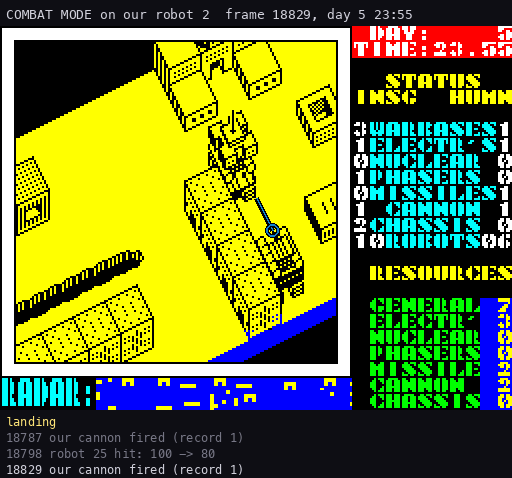

```sh
python3 tools/ill_events.py fig-screen --cache work/ill1/cache/combat.npz --out docs/img/events/combat-mode.gif --opt from=8 to=40 slots=2,25 "title=COMBAT MODE on our robot 2" delay=300
```

The whole screen, one picture a game turn,
with the step the bot was taking under it.

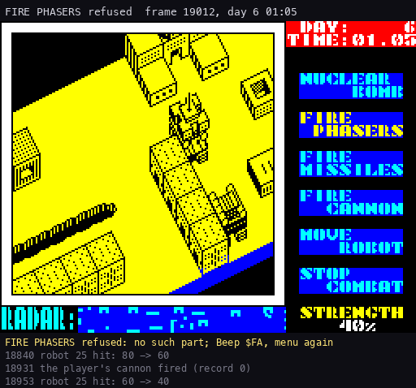

```sh
python3 tools/ill_events.py fig-screen --cache work/ill1/cache/combat.npz --out docs/img/events/combat-refused.png --opt from=22 to=22 slots=2,25 "title=FIRE PHASERS refused"
```


## 10.7 Capture

In each turn, `GameTurnEnd` (`$AD90`) looks at the 28 capture points at `$FD70` (5 bytes each: column, row, owner
and type, a count). Points 0-3 are the warbases, 4-27 the factories. The test cell is each point's door.

1. Map bit 6 on the door (a robot anchored there): the count `+4` goes up by 1.
2. At 144 (`$90`) turns, about 30 s of play, the count is reset and the robot there (`FindRobot` `$CDD8`) takes the
   point for its side (`+$0A` bit 7):
   - a warbase: `GiveWarbase` (`$BB86`);
   - a factory: `GiveFactory` (`$BB61`), point - 4.
3. An empty door resets the count to 0.
4. After any capture `CountBases` (`$BB09`) recounts both sides and the panel is reprinted.

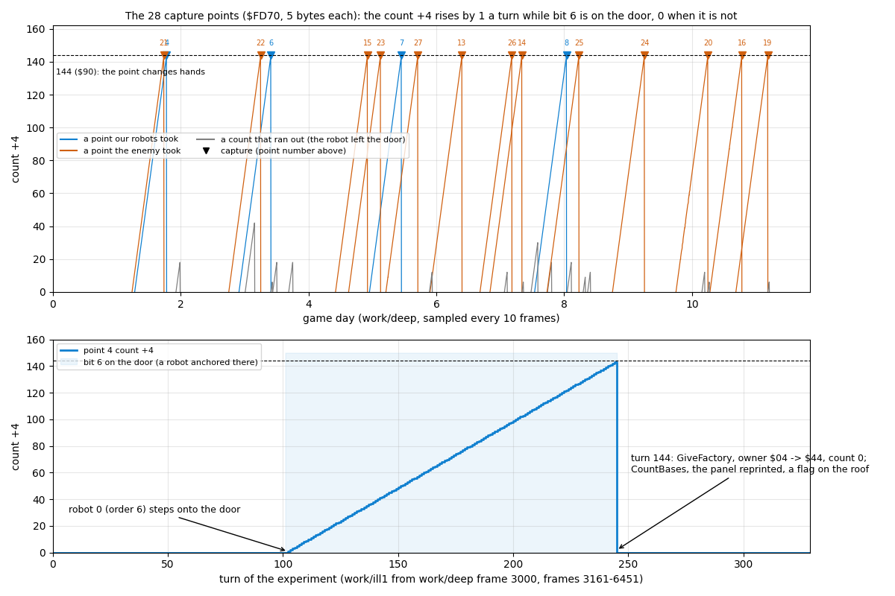

```sh
python3 tools/ill_events.py fig-capture-counts --cache work/ill1/cache/deep10.npz work/ill1/cache/capture.npz --out docs/img/events/capture-counts.png
```


- Top: each run of a non-zero count `+4` in `work/deep`, coloured by the side that took the point (grey: the robot
  left first). The marks are the captures, labelled with the point.
- Bottom: point 4 in my replay from frame 3000 (the robot of [10.5](#105-orders)'s figure). The count rises by 1 a
  turn from the turn robot 0 stands on the door. At 144 `GiveFactory` sets the owner `$04` → `$44` and resets the
  count.

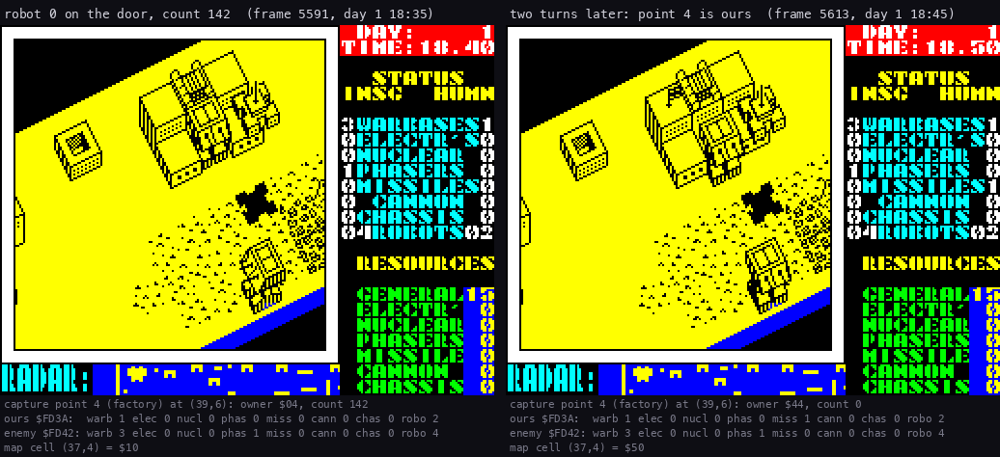

```sh
python3 tools/ill_events.py fig-pair --cache work/ill1/cache/capture.npz --out docs/img/events/capture-flag.png --opt pics=243,245 "titles=robot 0 on the door, count 142|two turns later: point 4 is ours" state=point:4,counts,cell:37/4
```


The capture changes three things on the screen:

- the factory's flag cell (37,4) goes from `$10` to `$50`: a flag on the roof;
- the panel's MISSILES count for our side goes from 0 to 1;
- nothing on the radar. Its buffers changed only by the robot's dot and the ship's blip: `$D800` in those cells,
  `$D900` not at all. The radar does not show who owns a building.

Any robot captures, whatever its order: an ADVANCE that stops on a door takes the building. A warbase the player
captures gets a pad, a second construction site. The robot has to stay on the door for 144 turns. An opponent
ahead makes it step on if it can (10.4), which takes it off the door and resets the count; this follows from the
code and was not seen in a recording. In `work/deep` every capture followed a count of 121-143
in the 250-frame samples (r1).

## 10.8 The enemy commander

`EnemyCommander` (`$B7F4`) runs first in every `WorldTurn`; there were 3415 calls in `work/deep`. `Random AND $1F`
picks one of the enemy's slots 24-47; the values 24-31 do nothing, so it acts in 3 turns of 4.

**A free slot: maybe a new robot.**

1. Each of the 4 warbases in turn is taken with chance 1/2, but only if its owner byte is exactly `$20` (the
   enemy's, intact).
2. The door and the three cells of the row under it must be free of bit 6.
3. Parts: one random byte (the second of two `Random` calls, `$B84D`). There is no second try: the slot stays
   free this turn unless the byte has
   - exactly one chassis (bit 0, 1 or 2);
   - weapons (bits 3-6) neither none nor all four;
   - at least EnemyRobots / 8 + 1 weapons: 1 below 8 robots, 2 from 8, 3 from 16.

   Electronics (bit 7) come with chance 1/2.
4. Payment on a copy in `MenuResources`, with `PartCosts` like the player's. The shortfall of the own resources
   must be at most max(general / 2, 11), and at most general. Otherwise nothing is spent and nothing built.
5. The new robot: `+$0A` `$80`, `+$05` 4 and `+$08` 4 (down), `+$06` 3, order 0, strength 100, `+$0E` `$FF`,
   `+$0F` 1, height the sum of `PartHeights`. Then the counts and the panel.

The enemy pays the same prices but can borrow up to half its general resource. Its robots grow better armed as
its army grows.

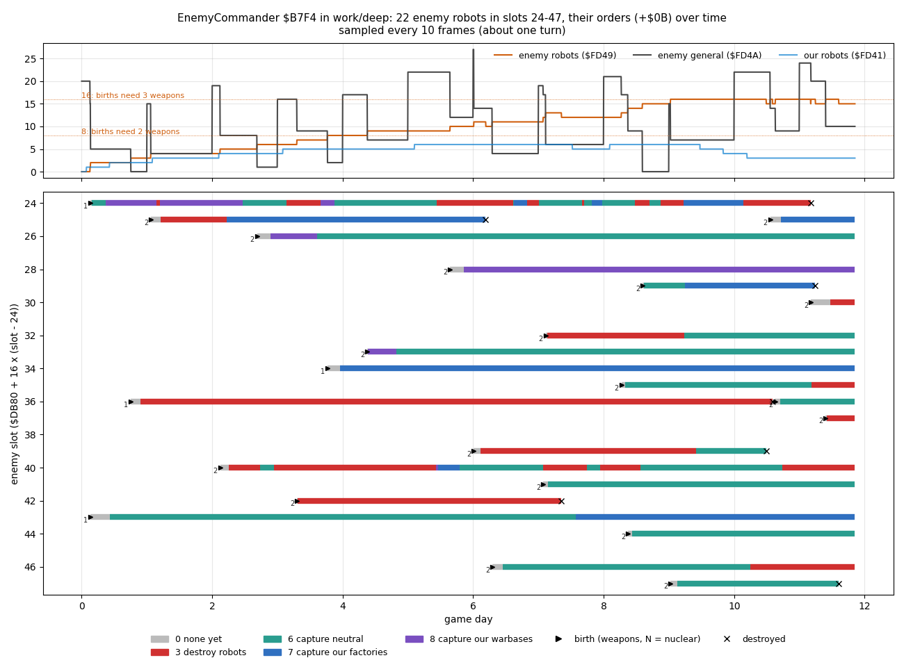

```sh
python3 tools/ill_events.py fig-commander --cache work/ill1/cache/deep10.npz --out docs/img/events/commander.png
```


- Top: the enemy's robots (`$FD49`), its general resource (`$FD4A`) and our robots. The dotted lines are the
  weapon thresholds of step 3.
- Bottom: one row per enemy slot. A bar is one robot's life, coloured by its order `+$0B`. A triangle marks the
  birth, with the number of weapons in its parts; a cross marks a death seen in the samples.

What it shows:

- New robots appear only when the general resource can pay. The resource drops at each birth and refills at each
  midnight.
- The army never passed 16, so no birth needed 3 weapons.
- Order 0 lasts a sample or two; it is replaced at once.
- Orders 6 (capture neutral) and 3 (hunt robots) dominate, with 7 and 8 between them. No robot had the nuclear
  part, so orders 4 and 5 never appear.
- Long single-colour bars are kept capture orders. The changes in between are the 1/32 replans.

**A live robot: maybe a new order** (`EnemyReplan` `$B920`).

- Order 0 is replaced at once; any other order only with chance 1/32 a turn.
- Orders 1-3 are always chosen anew.
- For orders 4-8 the order is kept only if the target has changed owner *and* the robot stands on its door: the
  capture is under way. Otherwise the order is chosen anew, which usually gives the nearest target again.

`EnemyChooseOrder` (`$B95D`):

| Parts | Order | Chance |
| --- | --- | --- |
| with nuclear | 5 destroy warbases | 3/4 |
| | 4 destroy factories | 1/4 |
| without | 6 capture neutral factories | 1/2 |
| | 7 capture the player's factories | 1/4 |
| | 8 capture the player's warbases | 1/4 |

The target is the nearest by column (`FindTargetBuilding`). If there is none, the order is 3: hunt robots. The
commander never gives ADVANCE or RETREAT.

## 10.9 The nuclear blast

`NuclearBlast` (`$B99F`) runs when a robot with order 4 or 5 reaches its target, or from COMBAT MODE's NUCLEAR
BOMB.

1. The first intact base in reach is destroyed: its owner byte gets bit 7 (`$80`) and its blocks become debris.
   - Warbases: |dy| < 7, |dx| < 7 and dx + dy < 10, with dy measured from the robot's row + 5.
   - Factories: 5, 5 and 7, from the row + 1.
2. A round area of 9 × 9 cells around the robot (rows of 5, 7, 9, 9, 9, 9, 9, 7, 5 cells; map rows 1-15 only):
   - every robot there dies, of both sides;
   - blocks of the types `$11`-`$14` become debris (types 6 / 7).
3. The robot itself dies.
4. `NuclearFlash` (`$BA87`): 61 random paper colours on the view, with a fading rumble of ROM bytes
   (`NuclearRumble` `$BAEE`). The game stands still meanwhile. In my run the colours ran from frame 24033 to 24249
   (216 frames, 4.3 s). The clock stood at 19:10 from frame 24018 to 24268.
5. The radar is rebuilt, the bases and robots are recounted, and the panel is reprinted.

No recording built a nuclear robot. My instance replayed `work/deep` from frame 23000 with robot 0's parts and
height poked:

- `$DA07` = `$49` (bipod, cannon, nuclear) and `$DA09` = 24;
- robot 0 had order 6 and stood on the door (97,3) of neutral factory point 8 (owner `$03`, count 75);
- the ship landed on it and chose COMBAT MODE, NUCLEAR BOMB.

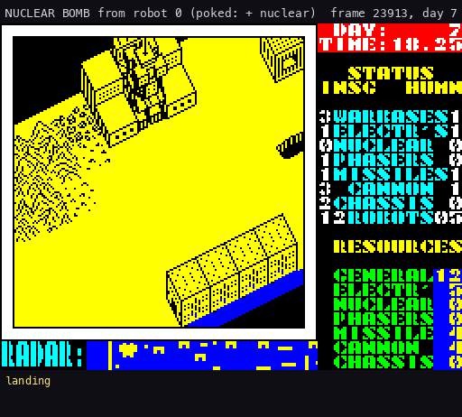

```sh
python3 tools/ill_events.py fig-screen --cache work/ill1/cache/nuke.npz --out docs/img/events/nuclear-blast.gif --opt from=150 to=560 dense=266-500:4 slots=0,5 "title=NUCLEAR BOMB from robot 0 (poked: + nuclear)" delay=120 lines=3 "notes=270-486:NuclearFlash: random paper colours and the rumble; the clock stands still|487-560:after: the factory is debris, point 8 owner \$80, robot 0 gone"
```

One picture a frame; the flash is shown every 4th.

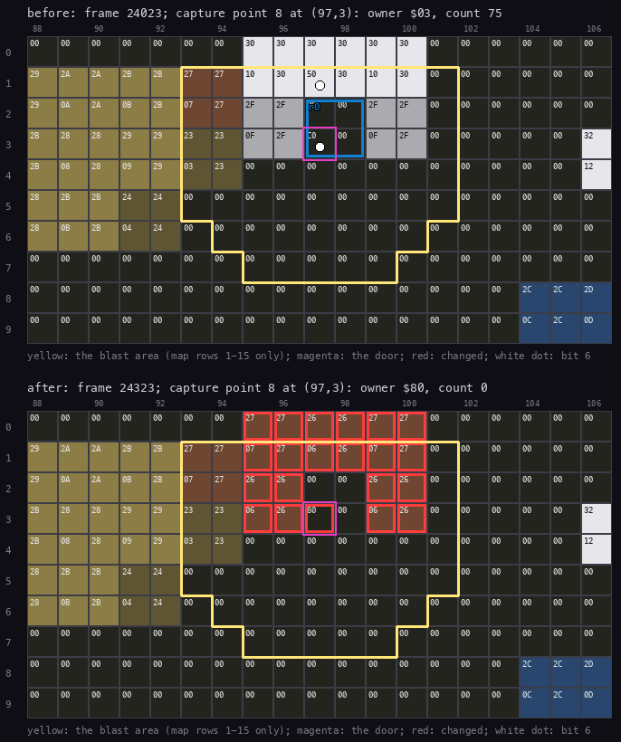

```sh
python3 tools/ill_events.py fig-blast-map --cache work/ill1/cache/nuke.npz --out docs/img/events/nuclear-map.png --opt before=260 after=560 x=97 y=3 point=8
```

The outline is `BlastArea`'s 5, 7, 9, 9, 9, 9, 9, 7, 5 cells
around the robot, cut at row 1. Point 8's blocks (types `$11`-`$14`) became debris.

- Robot 0 was the only robot in the area. Its slot was freed at once: no blink and no wreck. Our robot count went
  5 → 4.
- Point 8's owner byte became exactly `$80`: the bit 7 is set, and the type bits (3) are lost too.

**A destroyed base can be captured again, and then counts as a warbase.** `CountBases` and the target searches
skip bit 7, but the capture loop (10.7) does not test it. It counts any robot on the door. `GiveFactory` →
`SetBaseOwner` then does `AND $1F` and ORs in the new owner, which clears bit 7 and keeps the type: 0 after the
blast, the warbase type.

My instance continued after the blast (frame 24368). It parked the ship over (101,9) and poked our free slot 10
onto the door (97,3): `$DAA0` = `61 E3 61 00 03 00 00 09 04 11 00 00 64 00 FF 05` (order 0, strength 100), and
the door cell `$E361` = `$40`. Then:

- point 8's count rose 1 a turn: 142 at frame 25856, 143 at 25866;
- at 144 (frame 25876) the owner went `$80` → `$40`, ours with type 0;
- `CountBases` made our warbases (`$FD3A`) 2, and the panel printed WARBASES 2;
- the flag cell on the debris was set;
- at the next midnight (frame 27726) our general rose 17 → 27: 5 × 2 warbases.

The robot stayed on the door and the count started again. Robots cannot build at this "warbase": it has no
pad. The construction menu needs the pad cells of a real warbase (10.3). This last point was not tested.

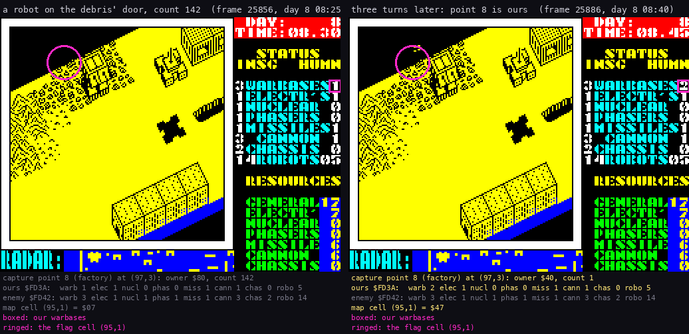

```sh
python3 tools/ill_events.py fig-pair --cache work/ill1/cache/destroyed-capture.npz --out docs/img/events/destroyed-recaptured.png --opt pics=142,145 "titles=a robot on the destroyed door|144 turns later: ours" state=point:8,counts
```


r3 had reported "no one can capture it again" from two poked blasts on its instance. Its notes do not say whether
a robot stood 144 turns on the destroyed door; the experiment above did, and the point was taken.

## 10.10 Winning and losing

`CheckGameEnd` (`$AE6B`) runs every turn:

- **The enemy has no warbase** (`$FD42` = 0): `GameWon` (`$AEB1`) prints " INSIGNIANS DESTROYED / YOU HAVE WON !"
  over the radar.
- **Ours are 0** (`$FD3A` = 0): "YOU HAVE NO BASES LEFT / BETTER LUCK NEXT TIME!".

Factories and robots do not count. Both ends then run the same code:

1. `GameStop` (`$AF00`).
2. `GameOverWait` (`$AEEA`): a low beep (`$FA`), 100 HALTs (2 s), `WaitRelease`, then the first control pressed.
3. `JP Start`: the title menu.

There is no score. r1 verified both ends by poking the counts on its instance (`work/ann/r1.md`). The enemy's
warbases can only be taken by capture (order 8 for us) or destroyed by a nuclear robot (order 5).

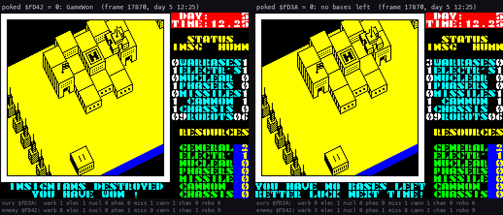

```sh
python3 tools/ill_events.py fig-pair --cache work/ill1/cache/end-won.npz work/ill1/cache/end-lost.npz --out docs/img/events/game-end.png --opt pics=0:30,1:30 "titles=poked \$FD42 = 0: GameWon|poked \$FD3A = 0: no bases left" state=counts scale=2
```

Two replays from `work/deep` frame 17400, each with one count poked. At the next turn
`CheckGameEnd` printed the message over the radar, and the panel showed the poked count. The clock stopped
there. The pictures are frame 17870, about 470 frames after the poke: past the 100 HALTs of `GameOverWait`, the
game waits for a control, and none was pressed. Only the count is tested: in the won case the enemy's three
warbases still stood on the map.

## 10.11 What the deep recording showed


`python3 tools/course_chart.py sample --work work/deep --out work/docC/course.json` (memory_at at every 120th frame,
0-36000), then `python3 tools/course_chart.py chart work/docC/course.json docs/img/game-deep-course.png`. The panels:

- top: the robots per side (`$FD41`, `$FD49`), with our robots built and lost;
- middle: the factories per side and the neutral ones;
- bottom: the general resource and the sum of the part resources per side.

Only samples taken while `PlayInterrupt` was the handler count.

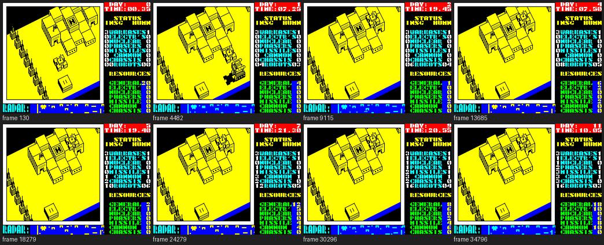

The bot ([5.6](05-controls.md)) builds a robot whenever it can afford its plan, and orders it to capture neutral
or enemy factories or to destroy robots (`PLAN` in `tools/bot.py`).

| Day | Frame | Robots ours / enemy | Warbases | Factories | Neutral | General | Parts (sum) |
| --- | --- | --- | --- | --- | --- | --- | --- |
| 0.02 | 120 | 0 / 0 | 1 / 3 | 0 / 0 | 24 | 20 / 20 | 0 / 0 |
| 1.00 | 3360 | 2 / 3 | 1 / 3 | 0 / 0 | 24 | 15 / 15 | 0 / 0 |
| 2.00 | 6480 | 3 / 4 | 1 / 3 | 1 / 1 | 22 | 9 / 19 | 2 / 2 |
| 4.03 | 12840 | 5 / 8 | 1 / 3 | 2 / 2 | 20 | 6 / 17 | 4 / 4 |
| 6.01 | 18840 | 6 / 11 | 1 / 3 | 3 / 5 | 16 | 7 / 14 | 7 / 4 |
| 8.01 | 24600 | 5 / 12 | 1 / 3 | 3 / 8 | 13 | 17 / 21 | 19 / 18 |
| 10.02 | 30720 | 4 / 16 | 1 / 3 | 4 / 10 | 10 | 13 / 22 | 26 / 31 |
| 11.84 | 36000 | 3 / 15 | 1 / 3 | 4 / 13 | 7 | 18 / 10 | 34 / 20 |

What the game did:

- **17 captures, all of neutral factories.** Ours were 4: points 4, 6, 7 and 8, on days 1.80, 3.45, 5.47 and 8.05.
  The enemy took 13: points 21, 22, 15, 23, 27, 13, 26, 14, 25, 24, 20, 16 and 19. No warbase and no owned
  factory changed hands.
- **The enemy outbuilt us** from its 3 warbases' 15 general a day. It built 22 robots in the samples and lost 7,
  ending with 15. Our side built 7 (the bot's whole plan), peaked at 6 and ended with 3.
- **Production shows in steps.** Our general rose by 5 a day with one warbase; each new factory added 2 a day to
  its resource.
- **The end state, frame 36000.**
  - Our buildings `1 1 0 1 1 1 0` (warbases, electronics .. chassis) and resources `18 10 0 6 8 10 0`.
  - The enemy's buildings `3 1 1 2 3 3 3` and resources `10 4 4 0 0 12 0`.
- **The fighting began late.** The first shot was fired near the end of day 5 (frame 18679). `FireShot` ran 51 times, and
  `SoundEffect` 1356 times from frame 18680 to 35333.
- **No nuclear robot, no game end.** The enemy commander builds nuclear robots only by chance and pays 20 for the
  part; none appeared in 11.8 days. The bot's own nuclear robot is the 8th entry of its plan, and it built only 7.
  Neither side lost a warbase.

## 10.12 Bugs

| Where | What | Witness |
| --- | --- | --- |
| `ConstructionMenu`, the play loop at `$A6F3` | With all 24 of our slots taken, the menu returns at once with IY = `$DB80`, the enemy's slot 24. The play loop then writes the new-robot values there: that enemy robot gets strength 100 and order 0 back, every turn the ship sits on the pad | r1, on its instance: a poked strength `$20` was `$64` again after landing |
| `SteerByOrder` `$B2B8` | After `FindTargetBuilding` finds a new target, HL is past the table (`$FDFF` for factories, `$FD87` for warbases). The aim reads `$FDFE` / `$FDFD` (the `JP` and `Handler`) as row `$66`, column `$C300`: one step of a wrong course, corrected at the next decision | r2, a breakpoint at `$B2BB`: HL = `$FDFF`, DE = `$C300` |
| `PrintTensUnits` `$D407` | A value above 99 prints a wrong tens digit (200 is "D0"); only poked resources get there | r4 ([8.6](08-hud-and-text.md)) |
| `ConstructionMenuLoop` `$CA0F` | A refused chassis swap leaves the old chassis refunded: the robot has no chassis until another is chosen | r4, experiment 3 |
| `MenuMusic` `$C4A7` | A restarted tune keeps a voice's on/off state from where it was cut | `work/docC/rec` frames 406-427 ([9.4](09-sound.md)) |
| `PrintDigitColumn` `$D2E3` | A count of 10 or more would print `:` onwards; no count gets there | code reading |
| `GameTurnEnd` `$AD90` capture loop, `SetBaseOwner` | The capture loop does not test bit 7 (destroyed) of a capture point. A robot that stands 144 turns on the door of a nuked base takes it. `SetBaseOwner`'s `AND $1F` clears bit 7, and the type bits the blast left are 0. So a destroyed factory or warbase comes back as a live warbase of the capturing side. It is counted in `$FD3A` / `$FD42`, pays 5 general a day, and keeps its side alive in `CheckGameEnd` | 10.9: my instance, point 8 `$80` → `$40`, our warbases 1 → 2, general +10 at midnight (`destroyed-recaptured.png`) |

Never-run code: `UnusedTapeCode` (`$AE29`). Keys 6 and 7 held together jump into the ROM's SAVE code at `$04B0`
with `Start` as the return address. It looks like a debugging leftover; nothing calls it.

## 10.13 Design notes

- **One rule set for both sides.** The enemy builds from the same parts at the same prices, steps with the same
  delays, captures by the same count and is hit by the same formula. Its edges are the start (3 warbases to 1) and
  the credit of half its general resource.
- **Orders, not control.** A robot's orders only matter when it sees no opponent. Seeing one always wins: turn,
  fire, stand. A capture order is fragile, since a single opponent in view stops the walk.
- **Time is the currency.** Production is daily and capture takes 144 turns. Step delays make a bipod on rough
  ground three times slower than an anti-grav: the long game rewards factories over robots, as `work/deep` shows.
- **Cheap randomness.** One `Random` per turn plus the draws of the commander and the robots decide all choices;
  the deep recording and `work/docC/fight` show that the whole game is deterministic from the snapshot and the
  inputs.

## 10.14 The figure experiments

The caches behind the figures, all in `work/ill1/`. The recording instance is `tools/ill_events.py`'s own
`re_session.py open` of `work/deep` with the work dir `work/ill1/deep`. The live instance is a `tools/bot.py`
instance in `work/ill1/live`.

| Cache | Command |
| --- | --- |
| `deep10.npz`, `deep-fight.npz` | `python3 tools/ill_events.py sample --work work/ill1/deep --frames 0:36046:10 --out work/ill1/cache/deep10.npz` (and `18660:19420:1` for `deep-fight.npz`) |
| snapshots | `python3 tools/ill_events.py snap --work work/ill1/deep --frame F --out work/ill1/snaps/deep-F.szx` for F = 3000, 17400, 23000 |
| `duel.npz` | `python3 tools/ill_events.py turns --work work/ill1/live --load work/ill1/snaps/deep-17400.szx --frame0 17400 --fly 128,7 --turns 110 --out work/ill1/cache/duel.npz` |
| `combat.npz` | `python3 tools/ill_events.py combat --work work/ill1/live --load work/ill1/snaps/deep-17400.szx --frame0 17400 --fly 124,7 --cruise 26 --land-at 18736 --slot 2 --fire 4 2 3 4 --gap 30 --tail 120 --out work/ill1/cache/combat.npz` |
| `nuke.npz` | `python3 tools/ill_events.py combat --work work/ill1/live --load work/ill1/snaps/deep-23000.szx --frame0 23000 --poke DA07=49 DA09=18 --fly 100,5 --cruise 30 --land-at 23330 --slot 0 --fire 1 --gap 40 --tail 300 --every-frame --out work/ill1/cache/nuke.npz` |
| `destroyed-capture.npz` | right after `nuke.npz`, on the same instance: `python3 tools/ill_events.py turns --work work/ill1/live --frame0 24368 --fly 101,9 --cruise 45 --poke DAA0=61e3610003000009041100006400ff05 E361=40 --turns 170 --out work/ill1/cache/destroyed-capture.npz`, then `turns --frame0 26126 --turns 200` for `destroyed-day.npz` |
| `capture.npz` | `python3 tools/ill_events.py turns --work work/ill1/live --load work/ill1/snaps/deep-3000.szx --frame0 3000 --fly 40,10 --cruise 45 --turns 330 --out work/ill1/cache/capture.npz` |
| `end-won.npz`, `end-lost.npz` | `python3 tools/ill_events.py turns --work work/ill1/live --load work/ill1/snaps/deep-17400.szx --frame0 17400 --turns 2 --poke FD42=00 --frames 60 --every 5 --out work/ill1/cache/end-won.npz` (`FD3A=00` for `end-lost.npz`) |
