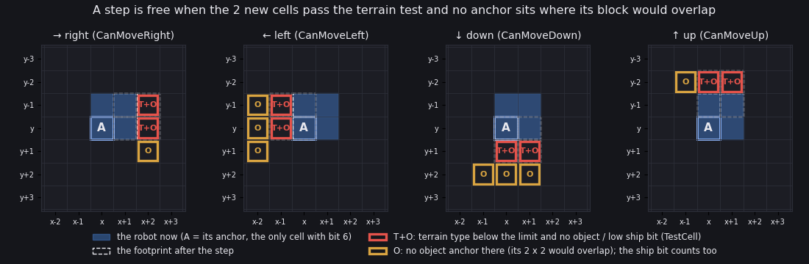
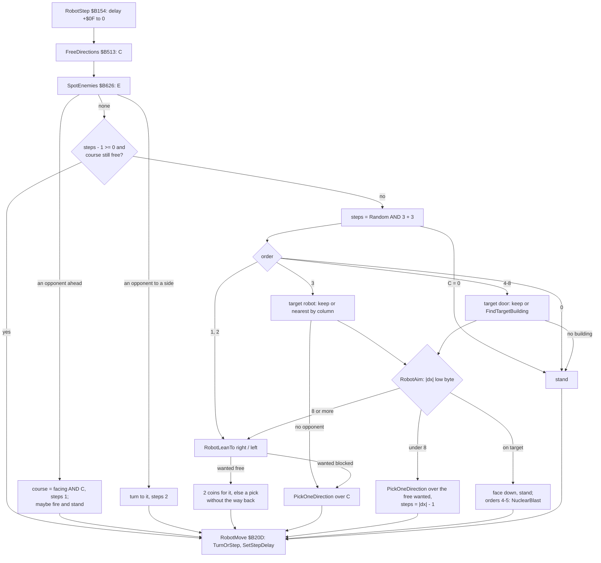
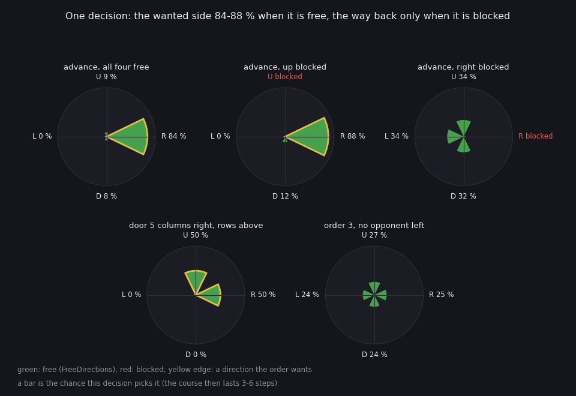
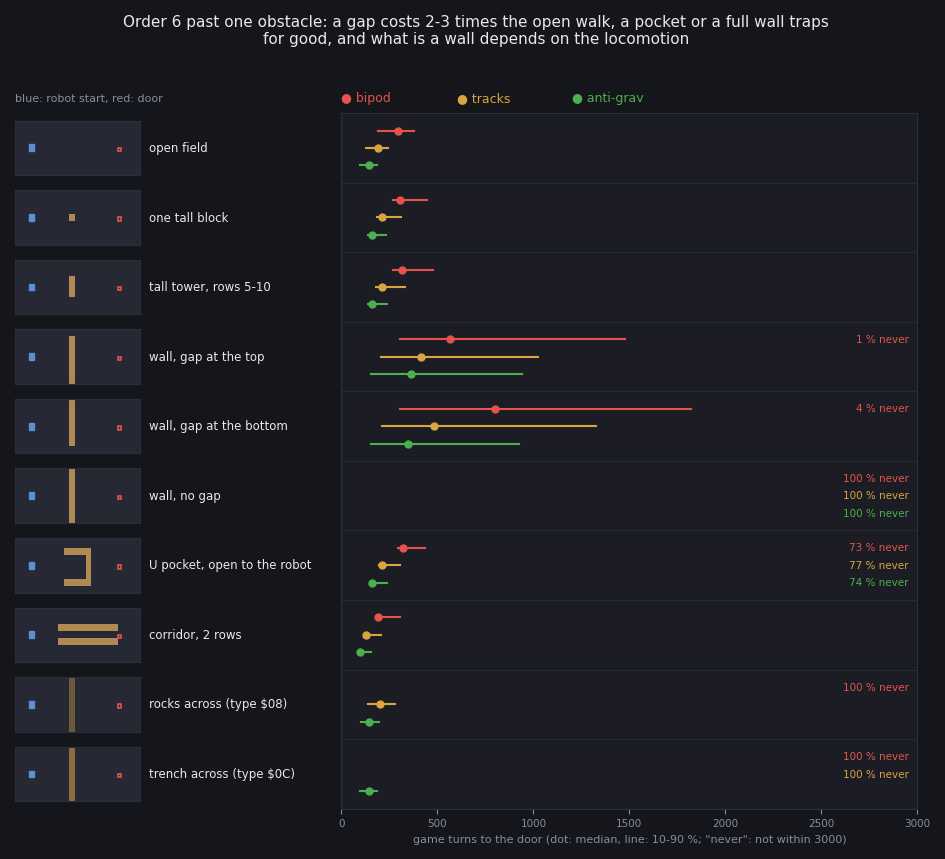
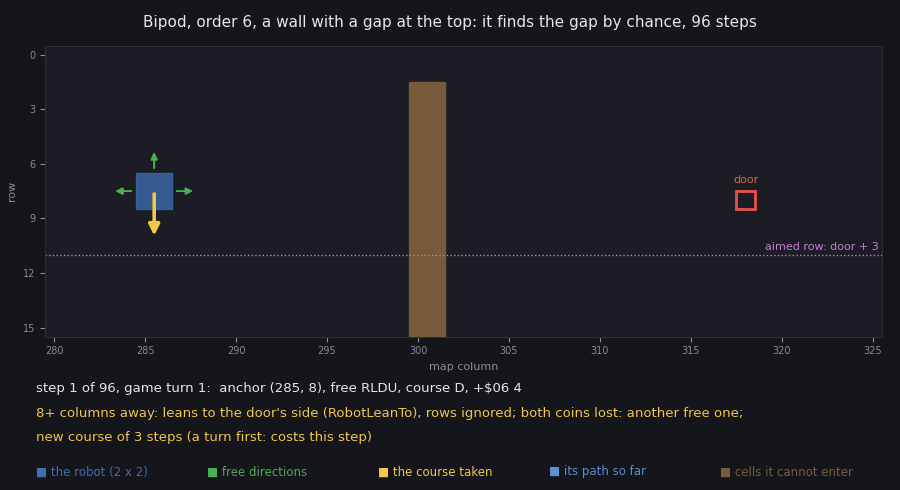
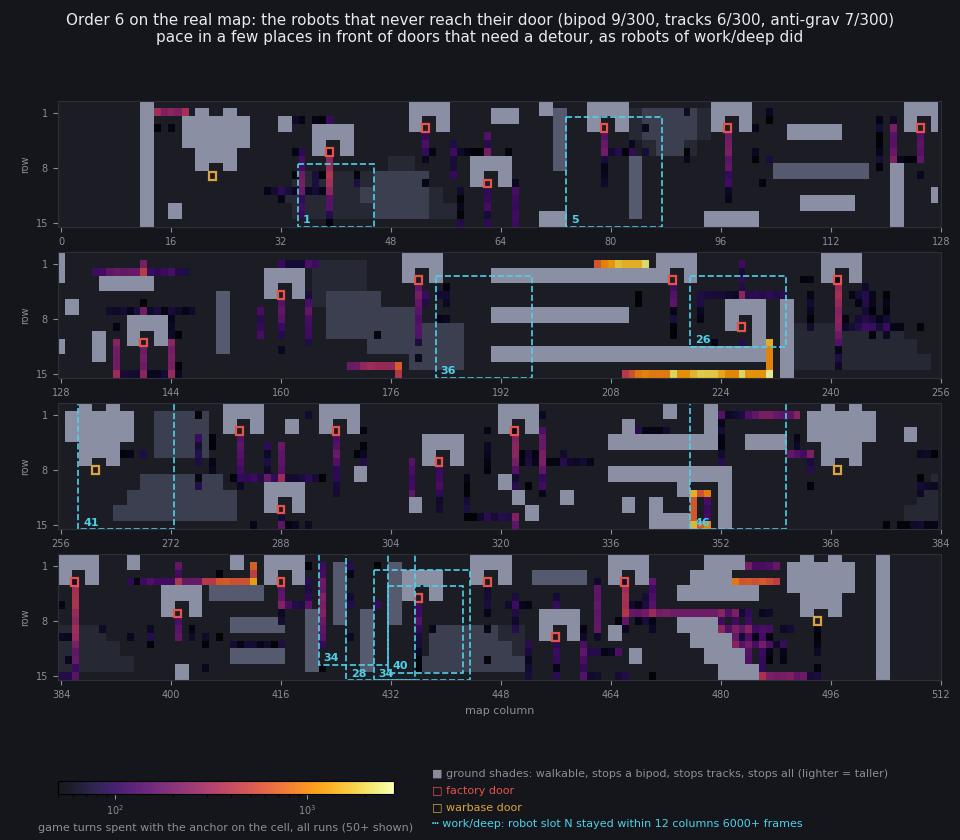

# 13. Path finding

How a robot finds its way to a target, from the code, and what that rule does on obstacles and on the real map.

The short answer:

- There is no path finding.
- Each step a robot looks at the four cells next to it, and either keeps its course or picks a new one.
- The pick is a weighted coin: toward the target's side when that is free, else any free way.
- Nothing is remembered between two picks except the course and how many steps are left on it.

Evidence:

- the code of `src/game/world.asm` (the routines named below; addresses from `build/game.lst`);
- `tools/path_model.py`, a Python copy of the robot and shot loops of `WorldTurn` (`$B0CA`). It is checked byte for
  byte against the game on an own instance (13.3.1);
- `tools/path_lab.py`, the experiments run on that model, and `tools/path_check.py`, the check;
- `work/deep` (doc 10), the bot's 36046-frame game, for the real map and the robots that got stuck in it.

The figures are drawn by `tools/fig_path_*.py`; each one carries its command.

## 13.1 The decision, from the code

### 13.1.1 When a robot decides

`RobotStep` (`$B154`) runs for each live robot once a game turn (`UpdateRobot` `$B0FA`, [10.4](10-gameplay-logic.md#104-a-robots-turn)).
Most turns it only counts the step delay `+$0F` down:

```asm
RobotStep:
  ...
  DEC (IY+$0F)            ; the step delay
  RET NZ                  ; not yet: wait another turn
```

- A robot acts once every 3-9 turns, by its locomotion and the ground (13.1.8).
- At that step it clears its own object bit, so it does not block itself.

The step then decides in a fixed order:

1. `FreeDirections` (`$B513`): C = the directions it can step into (13.1.2).
2. `SpotEnemies` (`$B626`): E = the directions with an opponent in sight (13.1.3).
3. An opponent ahead or to a side wins over the order.
4. Nobody in sight: keep the course, or ask the order for a new one.

```asm
RobotNoEnemy:
  DEC (IY+$06)            ; nobody in sight: keep the course while it lasts and
                          ; is free
  JP M,RobotNewCourse     ; spent: a new course
  LD A,(IY+$05)           ; the course ...
  AND C                   ; ... still free?
  JR NZ,RobotMove         ; yes: on along it
RobotNewCourse:
  CALL Random             ; a new course for 3-6 steps
  AND $03                 ; (0-3 ...)
  ADD A,$03               ; (... + 3)
  LD (IY+$06),A           ; +$06 = the steps of the new course (SteerByOrder
                          ; may set its own)
  CALL CountDirections    ; at least one free direction: ask the order
  CALL NC,SteerByOrder    ; (carry: boxed in, C = 0: stand)
```

- The course `+$05` is one direction bit; `+$06` counts the steps left on it.
- `+$06` = k gives k + 1 moves, since the count is taken before the move and runs to -1.
- A course stops early only when its direction is blocked.
- Nothing else is kept: no visited cells, no blocked attempts, no plan.

### 13.1.2 The free set: FreeDirections and the four probes

A robot covers 2 × 2 cells: its anchor (x, y), the only cell with the object bit 6, and (x+1, y), (x, y-1), (x+1, y-1).
`FreeDirections` tests each direction with its own probe (`CanMoveRight` `$B557`, `CanMoveLeft` `$B56F`,
`CanMoveDown` `$B58F`, `CanMoveUp` `$B5B1`).

```asm
FreeDirections:
  LD C,$00                ; C = no direction yet
  LD A,(Altitude)            ; the ship lower than our top?
  SUB (IY+$09)            ; (minus its height)
  SUB (IY+$0D)            ; (minus the ground under it: negative = the ship
                          ; hangs below the robot's top)
  AND $80                 ; then bit 7 (the ship's cell) blocks too
  OR $40                  ; objects always block
  LD E,A                  ; E = the blocking bits: $40, or $C0 under a low ship
  LD A,(IY+$07)           ; A = the parts: bit 0 bipod, 1 tracks, 2 anti-grav
  LD D,$08                ; bipod: types below 8
  ...
  LD D,$0C                ; tracks: types below $0C
  ...
  LD D,$0F                ; anti-grav: types below $0F
```

- D is the first terrain type the locomotion cannot enter: bipod 8, tracks `$0C`, anti-grav `$0F`.
- E holds the marks that block: always bit 6 (an object anchor). It also holds bit 7 (the ship's cell) when the ship
  hangs lower than the robot's top (`Altitude` - height `+$09` - ground `+$0D` < 0).

`TestCell` (`$B5CD`) is the test of a cell the footprint enters:

```asm
TestCell:
  LD A,(HL)               ; the cell ...
  AND $1F                 ; ... its terrain type (bits 0-4)
  CP D                    ; at or past the locomotion's limit D?
  JR NC,CellBlocked       ; yes: blocked
  LD A,(HL)               ; an object (or the low ship) in it?
  AND E                   ; (bit 6, and bit 7 when E has it)
  RET                     ; Z when free
```

- The two cells the footprint enters must pass TestCell: terrain type below D, and none of the marks in E.
- A few more cells are tested only for the marks (`AND E`): the anchors of other objects whose own 2 × 2 would
  overlap the new footprint.
- The ground height is never compared: only the terrain type is. The types and heights are in [7.3](07-objects.md#73-a-robots-step).



```sh
python3 tools/fig_path_probes.py --out docs/img/path/probes.png
```

How to read it:

- Each panel is one probe; A is the robot's anchor, the blue 2 × 2 the robot now.
- The dashed 2 × 2 is where the robot would stand after the step.
- Red frames (T+O): cells tested for the terrain type and the marks (TestCell).
- Orange frames (O): cells tested only for an object anchor or the low ship.
- The cells come from the model's probes, asked which addresses they read.

Edges:

- Down and up stop at the map's last and first rows: an anchor lives in rows 1-15.
- Columns 12-13 and 503-504 are posts of type `$15` on every row, so the playfield is columns 14-502.

### 13.1.3 Opponents in sight: SpotEnemies

`SpotEnemies` scans from the anchor in the four directions ([10.4](10-gameplay-logic.md#104-a-robots-turn)):

- 8 cells to the sides and back;
- 10 cells ahead (12 with electronics), on three parallel lanes;
- the first object on a lane ends it, so buildings and friends hide what is behind them.

What it does to the walk:

```asm
  LD A,E                  ; A = the directions with an opponent ...
  OR A                    ; ... none?
  JR Z,RobotNoEnemy       ; nobody in sight
  AND (IY+$08)            ; an opponent straight ahead?
  JR Z,RobotTurnToEnemy   ; no: only to a side
  AND C                   ; move on ahead if free (else stand)
  LD (IY+$05),A           ; +$05 = the facing if free, else 0: stand
```

- Ahead: the course is the facing if free, `+$06` = 1. A shot (`Random AND $38 AND` the parts) makes the robot stand.
- To a side: the robot turns to it (one of them at random if several), `+$06` = 2.
- In both cases the order is not asked. A robot that sees an opponent leaves its route.
- The opponent is never chased by this branch: it only turns, steps ahead and shoots.

### 13.1.4 SteerByOrder: what each order wants

`SteerByOrder` (`$B222`) runs with C = the free set (never empty) and returns one direction, or 0 to stand.

```asm
SteerByOrder:
  LD B,C                  ; B = the free directions, kept for the random picks
  LD A,(IY+$0B)           ; the order
  OR A                    ; 0 stop?
  JR NZ,SteerMoveOrders   ; no: an order that moves
  LD C,A                  ; 0 stop: stand
  RET                     ; C = 0
SteerMoveOrders:
  CP $03                  ; orders 1-8: advance / retreat, destroy robots, the
                          ; building orders
  JP C,RobotLeanTo        ; 1-2: lean right / left (A AND 3 is the direction)
  JR NZ,SteerBuildingOrder ; 4-8: the building orders
```

| Order | The target | The steering |
| --- | --- | --- |
| 0 | none | stand |
| 1 advance | none | lean right (`RobotLeanTo`, 13.1.6) |
| 2 retreat | none | lean left |
| 3 destroy robots | the opponent of slot `+$0E`, kept while it lives and is under 50 columns away; else the nearest by column (`FindNearestOpponent` `$B41D`) | aim at its anchor (13.1.5); no opponent: `PickOneDirection` over the free set |
| 4-8 buildings | capture point `+$0E`, kept while its owner bits are still the ones wanted; else `FindTargetBuilding` (`$B34D`) | aim at its door; while the columns differ, at the row 3 below it (13.1.5) |

For the building orders:

```asm
SteerAtBuilding:
  ...
  SBC HL,DE               ; HL = our column - its column
  LD D,A                  ; D = 0: no wanted direction yet
  JR Z,RobotAimVertical   ; same column: go for the door's own row
  LD A,B                  ; columns differ: aim at the row 3 below it
  SUB $03                 ; (the row aimed at: the door's + 3)
```

- The door of a factory or warbase sits inside the building, open to the bottom ([7.6](07-objects.md#76-buildings-and-capture-points)).
- Aiming 3 rows below the door brings the robot under the opening first; in the door's column it then aims at the
  door itself.
- A building order with no target left: our robot stands; an enemy robot switches to order 3.

### 13.1.5 RobotAim: far and near

`RobotAim` (`$B2D5`) turns the column difference HL (ours - its) and the row difference B into D, the wanted
directions:

```asm
RobotAim:
  LD A,H                  ; horizontal: 2 left when we are right of it, 1 right
  RRCA                    ; (H's bits 1-2 to bits 0-1: H is $FF / $FE when we
  AND $03                 ; (3 when we are left of it, 0 when right)
  XOR $02                 ; (1 right, 2 left)
  LD D,A                  ; D = the horizontal wanted direction
RobotAimVertical:
  LD A,B                  ; vertical: 8 up when we are below it, 4 down when
  OR A                    ; same row?
  JR Z,RobotAimCheck      ; yes: no vertical part
  RRCA                    ; (B's bits 4-5, its sign for B in -16..15 ...)
  RRCA                    ; (... rotated to bits 2-3)
  AND $0C                 ; ($0C when we are above it, 0 below)
  XOR $08                 ; (4 down, 8 up)
```

- D can hold one horizontal and one vertical bit.
- D = 0 means "on the target": orders 4 and 5 jump to `NuclearBlast` (`$B99F`); the others face down and stand.

The distance decides how D is used:

```asm
RobotAimMove:
  LD A,L                  ; off the target: L = |the column difference|
  OR A                    ; (L's sign: only the low byte of the difference is
  JP P,RobotAimColumns    ; positive: A = L
  NEG                     ; negative: A = -L
  LD L,A                  ; L = |the difference| (modulo 256)
RobotAimColumns:
  CP $08                  ; 8 or more columns away: lean horizontally (the row
                          ; ignored), else pick among the free wanted
                          ; directions
  LD B,C                  ; B = the free directions again
  LD A,D                  ; A = the wanted directions
  JR NC,RobotLeanTo       ; far: lean as an advance does
  AND C                   ; the wanted directions that are free
  JR Z,PickOneDirection   ; none: any free direction
  LD B,A                  ; B = the free wanted ones
  AND $03                 ; only vertical ones: pick one
  JR Z,PickOneDirection   ; (no horizontal part)
  LD A,L                  ; the columns agree: pick one
  OR A                    ; (a column difference of 0 modulo 256)
  JR Z,PickOneDirection   ; (no horizontal course to keep)
  DEC A                   ; keep a horizontal course for |dx| - 1 steps
  LD (IY+$06),A           ; +$06 = the steps of that course
  JR PickOneDirection     ; pick one of the free wanted ones
```

- Far (8 columns or more): `RobotLeanTo` with the horizontal part only. The row of the target is ignored.
- Near (under 8 columns): one of the free wanted directions, at even odds.
  - None of them free: any free direction, the way back included.
  - With a horizontal part in the free wanted set, `+$06` = |dx| - 1, whichever direction the pick returns. A vertical
    pick then also runs |dx| moves (or until blocked).
- "Far" and "near" use the low byte of the difference only. A target 256 + 5 columns away is "near" (the sign comes
  from the high byte, so the direction is still right).

### 13.1.6 RobotLeanTo and PickOneDirection

`RobotLeanTo` (`$B326`) leans to one side d (right for advance, the target's side for a far aim):

```asm
RobotLeanTo:
  AND $03                 ; D = the horizontal part (1 right, 2 left), E = all
                          ; but the opposite one
  LD D,A                  ; D = right or left
  XOR $FC                 ; (1 -> $FD, 2 -> $FE: every bit but the opposite
                          ; one)
  LD E,A                  ; E = the directions allowed when the lean fails
  LD A,C                  ; the free directions ...
  AND D                   ; wanted direction blocked: any free one, the
                          ; opposite included
  JR Z,PickOneDirection   ; (blocked)
  LD C,D                  ; C = the wanted direction
  CALL Random             ; two random bits for it (0.74 together; with the
                          ; fall-back pick 0.835 when all four are free)
  AND D                   ; (its bit in a random byte)
  RET NZ                  ; set: take it (1/2)
  CALL Random             ; a second try ...
  AND D                   ; (its bit again)
  RET NZ                  ; set: take it (another 1/4)
  LD A,B                  ; else: among the free ones but the opposite (it may
                          ; be the wanted one again)
  AND E                   ; (the free set ...)
  LD B,A                  ; (... without the opposite: B is not 0, it holds D)
```

- d blocked: a pick over the whole free set, the way back included.
- d free: two coin flips for d (0.74 together); then a pick over the free set without the way back,
  which may return d again.
- So d is taken with more than 3/4: 84 % with all four free, 88 % with one side blocked, 100 % in a corridor (13.3.2).
- The way back is never taken while d is free.

`PickOneDirection` (`$B33E`) narrows a set to one bit:

```asm
PickOneDirection:
  LD C,B                  ; C = the whole set
PickOneLoop:
  CALL Random             ; C AND a random byte
  AND C                   ; (C AND it)
  LD C,A                  ; C = the narrowed set
  CALL CountDirections    ; how many are left?
  RET Z                   ; exactly one: done
  JR NC,PickOneLoop       ; still several: narrow on
  LD C,B                  ; none left: from the whole set again
  JR PickOneLoop          ; try again
```

- Each direction of the set is equally likely (measured: 13.3.2).
- It takes about 2.0-2.3 draws for 2 directions, 2.5 for 3, 2.9 for 4.

### 13.1.7 The targets

`FindTargetBuilding` (`$B34D`) and `ConsiderBuilding` (`$B36C`):

- the table by the order: warbases (`$FD70`) for 5 and 8, factories (`$FD84`) for 4, 6, 7;
- the owner wanted: `$20` (the enemy's) for our robots, `$40` (ours) for the enemy's, 0 (neutral) for order 6;
- a record is skipped when a robot of the same side with the same order has it as `+$0E`;
- the nearest by column distance wins. The row does not count.

`FindNearestOpponent` (`$B41D`): the live opponent with the smallest column distance, rows ignored again.

Both searches run only when the old target is gone. A target is never replaced by a nearer one.

### 13.1.8 Moving: TurnOrStep, StepPosition, SetStepDelay

```asm
TurnOrStep:
  OR A                    ; no direction?
  RET Z                   ; then nothing: the robot stands
  CP (IY+$08)             ; already facing it: step
  JR Z,TurnOrStepStep     ; (yes)
  ...
TurnFace:
  LD (IY+$08),C           ; +$08 = the new facing, +$06 counts the turn
  INC (IY+$06)            ; +$06 one more: the turn does not use up the course
  RET                     ; the turn is the whole step
```

- A turn of 90 degrees takes a whole step and does not use up the course.
- A reversal goes through a side: right to left through up, left to right through down, down to up through left, up
  to down through right. It takes two steps.
- `StepPosition` (`$B4B9`) moves one cell. For orders 1 and 2 it also counts the distance `+$0E`: one less per
  column in the order's direction, one more per column against it (at most 99); at 0 the order becomes 0.
- `SetStepDelay` (`$B5F3`) reloads `+$0F` from `StepDelays` (`$B61D`), by the ground under the footprint and the
  locomotion: bipod 6 / 8 / 9, tracks 4 / 6 / 7, anti-grav 3 / 3 / 4 turns on flat / low / high ground.
- It runs after a turn and after standing too, so every decision costs one delay.

### 13.1.9 The random numbers

`Random` (`$D358`):

```asm
Random:
  PUSH HL                 ; HL kept
  LD HL,RandomSeed             ; the four bytes, the top first
  LD A,(HL)               ; the top byte
  AND $48                 ; bits 6 and 3
  ADD A,$38               ; bit 6 of the sum = bit 6 XOR bit 3
  RLCA                    ; carry = the feedback bit
  RLCA                    ; (two rotations: bit 6 of the sum reaches the carry)
  LD L,$03                ; shift $FD03..$FD00 left
  RL (HL)                 ; $FD03 gets the feedback bit
  ...
  LD L,$00                ; the index from the last call: the operand $D371
  LD A,(HL)               ; that byte, after the shift
  AND $03                 ; the next index
  LD L,A                  ; L = the index
  LD (Random+$0019),A     ; kept for the next call
  LD A,(HL)               ; A = the byte at that index
```

- A 32-bit shift register at `$FD00`-`$FD03`, one bit a call; the result is one of its four bytes, chosen by the
  low bits of the byte the last call chose.
- Each bit of a result is set with chance 0.50 (measured over 50000 states).
- Two calls in a row are not independent: they share most of their bits, shifted by one.
- The robot loop takes these draws, with the probabilities of 13.3.2:

| Where | Draws | What decides |
| --- | --- | --- |
| `RobotNewCourse` | 1 | the course length, `AND 3` + 3: 3-6 steps (0.26 / 0.23 / 0.23 / 0.27) |
| `RobotLeanTo` | 1-2 | `AND d`: the lean, then a second try |
| `PickOneDirection` | 2-3 on average | `AND` the set until one bit is left |
| the opponent ahead | 1 | `AND $38 AND` the parts: the weapons fired at even odds, the highest wins |

- The same generator serves `GameTurn`, `EnemyCommander` and the noise of the sound effects.
- `PlayInterrupt` can run in the middle of the robot loop. While a noise effect plays (`SoundFx` `$80` or more),
  `NoiseSound` calls `Random` 30 times a frame. A robot's choice then depends on whether an explosion crackles at
  that instant (13.3.1).

### 13.1.10 The whole decision

```text
RobotStep(robot):                                   # once a game turn
    if control == 1: return                         # the player sits on it
    delay -= 1;  if delay > 0: return
    C = FreeDirections()                            # the 2 x 2 probes, by locomotion and a low ship
    E = SpotEnemies()                               # opponents in the lanes
    if E & facing:                                  # an opponent ahead
        course = facing & C;  steps = 1
        if a shot record is free and (Random & $38 & parts): fire the best of them;  course = 0
    elif E:                                         # an opponent to a side
        course = E if one bit else PickOne(E);  steps = 2
    else:
        steps -= 1
        if steps < 0 or not (course & C):           # spent or blocked
            steps = (Random & 3) + 3
            course = SteerByOrder(C) if C else 0
    TurnOrStep(course)                              # a turn is a whole step and gives steps + 1
    delay = StepDelays[ground][locomotion]

SteerByOrder(C):
    order 0:      return 0
    order 1, 2:   return LeanTo(right or left, C)
    order 3:      keep the target robot if alive and under 50 columns, else the nearest by column
                  none: return PickOne(C)
                  return Aim(target column, target row)
    order 4-8:    keep the target point while its owner bits are wanted, else FindTargetBuilding
                  none: stand (an enemy robot takes order 3)
                  return Aim(door column, door row + 3 while the columns differ)   # a new target: the bug, 13.3.6

Aim(dx, dy):
    D = toward the target: the side of dx (high byte), the side of dy
    if D == 0: orders 4, 5: NuclearBlast;  else face down and stand
    n = |low byte of dx|
    if n >= 8: return LeanTo(the horizontal part of D, C)          # rows ignored
    W = D & C
    if W == 0: return PickOne(C)
    if W has a horizontal bit and n > 0: steps = n - 1
    return PickOne(W)

LeanTo(d, C):
    if not (C & d): return PickOne(C)                # the way back allowed
    if Random & d: return d
    if Random & d: return d
    return PickOne(C without the way back)           # may return d again
```



## 13.2 What it is and what it is not

It is a greedy local rule with randomness:

- one decision per course of 3-6 steps, or when the course is blocked;
- toward the target's side with a weighted coin, else a uniform pick among the free ways;
- in front of a wall it goes along it at random, and back only when the way forward is blocked.

It is not a search:

- no path is computed, no cell beyond the next one is looked at;
- no map memory: visited cells, dead ends and blocked tries are forgotten at once;
- no cost, no distance field, no "the gap is up there".

What a decision uses:

| Information | Where from |
| --- | --- |
| the 2 to 5 cells around the footprint in each direction, their terrain type and marks | `FreeDirections` and its probes |
| the locomotion (the terrain limit), the robot's height and ground against `Altitude` | `+$07`, `+$09`, `+$0D` |
| the robot's facing, course and steps left | `+$08`, `+$05`, `+$06` |
| the order and the target index | `+$0B`, `+$0E` |
| opponents' anchors in the lanes of sight | `SpotEnemies` |
| the target's column, and its row only when under 8 columns away (low byte) | the capture point or robot record |
| the owner bits of the capture points, the orders and targets of the side's robots | `FindTargetBuilding` |
| the columns of all live opponents | `FindNearestOpponent` |
| random bits | `Random` |

What it never uses:

- the map beyond the probes: the shape of an obstacle, where it ends, the gap in it;
- the rows when choosing a target (the nearest by column wins, maybe behind a wall);
- the target's row when 8 or more columns away;
- the way it came or how long it has been trying;
- friends as planners: they block like any object and only "taken" targets are shared;
- the ship's position, except as an obstacle when low.

## 13.3 Behaviour, proven

### 13.3.1 The model and how it was checked

`tools/path_model.py` is the robot and shot loops of `WorldTurn`, routine for routine (`RobotStep`, the probes,
`SpotEnemies`, `SteerByOrder`, the searches, `TurnOrStep`, `FireShot`, `MoveShot`, `PutBlock` for wrecks). It runs
on a 64K memory picture. It raises `Unmodelled` for direct control and for `NuclearBlast`.

`tools/path_check.py` checks it against the game:

1. `capture`: an own instance stops at `$B0CD` (after `EnemyCommander`, before the robot loop) and at `$B0F9` (the
   `RET` of `WorldTurn`). The 64K at both stops is kept, one pair a turn.
2. `verify`: the model runs on the first picture of each pair and must give the second, byte for byte. Compared:
   the robot records, the shots, the map, `$FD00`-`$FD03` and `$D371`, the robot counts, `Side`, `SoundFx`.

```sh
python3 tools/path_check.py capture --work work/path/live --load work/ill1/snaps/deep-17400.szx --turns 500 \
    --out work/path/check-17400.npz
python3 tools/path_check.py verify --cache work/path/check-17400.npz
```

| Snapshot of `work/deep` | Turns | Equal | Equal but `SoundFx` | Equal with noise draws | Robot steps | Draws |
| --- | --- | --- | --- | --- | --- | --- |
| frame 3000 | 500 | 500 | 0 | 0 | 513 | 378 |
| frame 17400 | 500 | 495 | 3 | 2 | 1618 | 1032 |
| frame 23000 | 500 | 497 | 0 | 3 | 1799 | 1108 |
| frame 29900 | 500 | 454 | 24 | 22 | 2129 | 1403 |
| frame 33400 | 500 | 460 | 23 | 17 | 2039 | 1271 |

- All 2500 turns are explained; none is left over.
- "Equal but `SoundFx`": the interrupt ran inside the loop and counted the sound effect on; nothing else differs.
- "Equal with noise draws": the interrupt played a noise effect inside the loop. The turn is equal once 30 `Random`
  draws are put in at one point (or two points) among the loop's own draws: `NoiseSound`.
- The checked steps cover every branch: keep 6082, far lean 1303, arrived 371, near 137, stop 72, fire 69, ahead 32,
  turn to an opponent 9, boxed in 10, no building 3, after a new target (the bug) 10.

The test worlds of the experiments were checked too: the world of `path_lab.py` is written into the running game
right before the robot loop, and the game's turns are compared.

```sh
python3 tools/path_check.py capture --work work/path/live --load work/ill1/snaps/deep-3000.szx \
    --scenario pocket:1:bipod:3 --turns 600 --out work/path/check-pocket-1-bipod-3.npz
```

| Test world | Turns | Equal |
| --- | --- | --- |
| U pocket, order 1, bipod | 600 | 600 |
| one block, order 6, anti-grav | 430 (the game was won: no enemy base left) | 430 |
| corridor, order 2, tracks | 600 | 600 |
| rocks, order 1, tracks | 600 | 600 |
| wall with a gap at the top, order 6, bipod (one new target) | 600 | 600 |

So the numbers below, run on the model, are the game's numbers.

### 13.3.2 Probabilities per decision

`path_lab.py odds` runs single decisions on 50000 states of the generator, 3 draws apart.

```sh
python3 tools/path_lab.py odds --states 50000 --out work/path/odds.json
python3 tools/fig_path_rose.py --odds work/path/odds.json --out docs/img/path/rose.png
```



How to read it:

- Each rose is one situation; a bar is the chance this decision picks that direction.
- Green: free; red: blocked; a yellow edge: a direction the order wants.
- The course then lasts 3-6 steps.

| Situation | Right | Left | Down | Up |
| --- | --- | --- | --- | --- |
| advance, all free | 0.835 | 0 | 0.076 | 0.089 |
| advance, right and down free | 0.884 | - | 0.116 | - |
| advance, right and up free | 0.878 | - | - | 0.122 |
| advance, right and left free (a corridor) | 1.0 | 0 | - | - |
| advance, right blocked, left, down, up free | - | 0.338 | 0.321 | 0.341 |
| advance, right blocked, left and down free | - | 0.502 | 0.498 | - |
| near aim, door up and to the right, all free | 0.503 | 0 | 0 | 0.497 |
| `PickOneDirection` over all four (order 3, no opponent) | 0.252 | 0.238 | 0.240 | 0.270 |

- The lean: the first coin 0.504, the second 0.234, the fall-back pick 0.262.
- The two coins give 0.738, not 0.75: consecutive draws are correlated.
- Retreat (left) is the mirror: 0.845 with all free, 0.881 / 0.894 with one side blocked.
- The far aim of the building and robot orders is the lean: 0.835 toward the target's side.
- Firing, by the weapons carried: one weapon 0.50; cannon and missiles: missiles 0.50, cannon 0.25, none 0.25; all
  three: phasers 0.50, missiles 0.25, cannon 0.125, none 0.125.

Per order, in the open:

| Order | A course | Steps toward the target |
| --- | --- | --- |
| 0 | stand | none |
| 1, 2 | right / left 84 %, up 9 %, down 8 % | 36 moves for 31 columns (bipod, median) |
| 3 | the lean while 8+ columns away, then the near pick | as the building orders |
| 4-8 | the lean while 8+ columns away, then the near pick toward door + 3, then the door's column and row | 44 moves for 33 columns and the door |

### 13.3.3 Obstacles

`path_lab.py shapes`: one robot at (285, 8) facing right, on bare ground (columns 270-370), one obstacle at column
300. Order 1 must reach column 316; order 6 must stand on a neutral door at (318, 8). 200 seeds each, at most 3000
turns.

```sh
for l in bipod tracks anti-grav; do python3 tools/path_lab.py shapes --seeds 200 --locos $l \
    --out work/path/shapes-$l.json; done
python3 tools/fig_path_shapes.py --runs work/path/shapes-bipod.json work/path/shapes-tracks.json \
    work/path/shapes-anti-grav.json --order 6 --out docs/img/path/shapes.png
```



How to read it:

- A row is one obstacle; the thumbnail shows it (brown), the start (blue) and the door (red).
- A dot is the median of the runs that arrived, the line their 10-90 % range.
- "never" is the share of runs not at the door after 3000 turns (about 10 game days at 288 turns a day).

Order 6, game turns to the door (median / 90 %), moves, and the share arrived within 3000 turns:

| Obstacle | Bipod | Tracks | Anti-grav |
| --- | --- | --- | --- |
| open field | 295 / 380, 44 moves | 189 / 245 | 142 / 184 |
| one tall block | 307 / 446, 47 moves | 211 / 310 | 160 / 232 |
| tall tower, rows 5-10 | 316 / 475 | 213 / 333 | 160 / 235 |
| wall, gap at the top (rows 0-1) | 568 / 1475, 82 moves, 99 % | 417 / 1023 | 364 / 942 |
| wall, gap at the bottom (rows 14-15) | 799 / 1819, 110 moves, 96 % | 483 / 1327 | 346 / 926 |
| wall, no gap | never | never | never |
| U pocket open to the robot | 27 % (those that pass it) | 22 % | 26 % |
| corridor, 2 rows | 193 / 307, 32 moves | 129 / 205 | 97 / 154 |
| rocks across (type `$08`) | never | 200 / 278 | 145 / 196 |
| trench across (type `$0C`) | never | never | 142 / 184 |

Within 1000 turns: wall with a top gap 79 % / 90 % / 92 %, bottom gap 57 % / 82 % / 92 %. Order 1 gives the same
picture, about 20 % faster (no door at the end).

What the numbers mean:

- An obstacle the robot can step round costs little: the blocked course ends, the lean or the pick goes up or down,
  the next lean goes right again.
- A wall with one gap 7 rows away costs 2-3 times the open walk, and its 90 % is 4-5 times. The robot finds the gap
  by a random walk along the wall: each pick goes up or down at even odds, and each free right turns it back.
- A full wall, rocks for a bipod and a trench for a bipod or tracks are walls: the robot paces along them forever.
- A corridor is faster than the open field: with up and down blocked the lean is certain.



```sh
python3 tools/fig_path_walk.py --shape wall-top-gap --order 6 --seed 24 \
    --title "Bipod, order 6, a wall with a gap at the top: it finds the gap by chance, 96 steps" \
    --out docs/img/path/walk-wall.gif
```

How to read it:

- One picture a robot step (a decision or a kept course); seed 24 took 571 turns, near the median of 568.
- The blue 2 × 2 is the robot, the blue line its path so far, the brown cells what a bipod cannot enter.
- Green arrows: the free set C of this step; the yellow arrow: the course taken.
- The dotted line is the row aimed at, door + 3; the red square is the door.
- The text says why: a kept course, the far lean, the near pick, and which coin decided.

### 13.3.4 Traps and pacing

One rule explains every trap:

- 8 or more columns from the target, a robot moves away from the target's side only when the way toward it is
  blocked (13.1.6).
- Such a move lasts one course: at most 7 moves (`+$06` = 6), and the next decision with the way open turns back.
- Under 8 columns away it picks among the free wanted directions, and only when none is free among all free ones.

So a detour that needs 8 or more moves away from the target's side, or a move away while the way toward is open, does
not happen. The robot stays for good:

- **A U pocket open toward the robot.** In `pocket` the robot enters in 73-78 % of the runs and never leaves. All 47
  trapped runs out of 60 checked stayed at columns 297 and up; the arms reach to column 298:
  1. At the back wall right is blocked: the pick goes left, up or down.
  2. A left course lasts at most 7 moves, and the arms are 8 columns long.
  3. As soon as right is free again, left is never picked, and up and down are blocked by the arms.
- **A wall with no way round for the locomotion** (a full wall, rocks for a bipod, a trench for a bipod or tracks).
  The robot paces along it: up and down at random, back a few columns while right is blocked, then right again.
- **A wall whose end is far from the target's column.** Under the wall the near pick finds the way up blocked and
  walks sideways at random; once 8 columns away the lean pulls it back toward the target's column.

`path_lab.py stuck` puts 300 robots of each locomotion with order 6 on random free cells of the real map (`work/deep`
frame 3000, every factory neutral), one at a time:

```sh
python3 tools/path_lab.py stuck --runs 300 --cap 3000 --out work/path/stuck.npz
python3 tools/path_lab.py deep --out work/path/deep-stuck.json
python3 tools/fig_path_stuck.py --stuck work/path/stuck.npz --deep work/path/deep-stuck.json \
    --out docs/img/path/stuck-map.png
```

| Locomotion | At the door within 3000 turns | Median turns |
| --- | --- | --- |
| bipod | 291 / 300 | 171 |
| tracks | 294 / 300 | 113 |
| anti-grav | 293 / 300 | 76 |



How to read it:

- The map in four bands of 128 columns; lighter grey is terrain that stops more locomotions.
- The heat is the game turns robots spent with their anchor on a cell, summed over all 900 runs; cells with under 50
  turns are left out, so the walks fade and the places robots stay show.
- Red squares are factory doors, orange ones warbase doors.
- The dashed cyan boxes are the robots of `work/deep` that kept a moving order and stayed within 12 columns for 6000
  frames or more; the number is the slot.

The hot spots, each the third trap above or a pocket:

- row 15 under the wall of columns 191-230, rows 12-13: robots after the doors (217, 3) and (227, 9). The wall's ends
  are 26 and 13 columns from the door's column. The heat at column 231 is the narrow passage at its right end.
- row 1 above columns 207-213: a strip above the wall of rows 2-3. The factory of (217, 3) closes it on the right; the
  way down is at columns 184-189, 28 columns from the door's column.
- columns 348-351, rows 10-15: a pocket between walls, 26 columns right of the door (322, 3), open only to the left
  at rows 12-13.
- (412, 3): next to the door (416, 3), the factory's wall on the right and a trench under it: a bipod or tracked
  robot can neither step right nor down.

`work/deep` had 10 such stretches (`path_lab.py deep`):

- slot 1 (bipod, order 6, door (53, 3)) paced columns 35-44, rows 9-15, from frame 3130 to the end (36040). The
  rocks band of columns 44-53 stops a bipod, and the far lean ignores the row, so it never walks round;
- slot 34 (tracks, order 7, door (62, 10)) paced columns 422-442 from frame 17330 to the end, in a row of trenches;
- slots 5, 26, 28, 36, 40, 41 and 46 for 6000-11000 frames each.

### 13.3.5 The door approach

`path_lab.py door`: 300 robots with order 6 from random cells of an open field (columns 220-299) to the door at (318,
8).

```sh
python3 tools/path_lab.py door --runs 300 --out work/path/door.json
```

- All 300 arrived; median 460 turns.
- 8 or more columns away the robot walks on any row: the far lean ignores the rows. Rows 1 and 15 hold the most
  moves, since a robot drifting up or down stops at the edge.
- Under 8 columns away it aims at door + 3 (row 11) and the door's column together, a pick between them.
- The last moves are mostly in the door's column: of the last 6 cells of the 300 runs, 300 are the door, 537 are
  below it in its column, 339 above it in its column, and 624 in other columns.
- On the real map the door is inside a building open to the bottom ([7.6](07-objects.md#76-buildings-and-capture-points)): the
  row 3 below brings the robot under the opening, and the walk up the door's column enters it.

### 13.3.6 The bug of 10.12: the first aim after a new target

`FindTargetBuilding` leaves HL past the table; the aim reads the three bytes below it as the target's record:

```asm
SteerNewBuilding:
  LD (IY+$0E),D           ; another target building found: +$0E = its index
SteerAtBuilding:
  DEC HL                  ; B = our row - the building's row, DE = its column
  LD A,(IY+$04)           ; our row ...
  SUB (HL)                ; ... - the record's row (the door's)
```

- The factory orders (4, 6, 7): HL = `$FDFF`. The aim reads row `$66` (`$FDFE`, the low byte of `Handler`) and column
  `$C300` (`$FDFD` the `JP`, `$FDFC` 0).
- The warbase orders (5, 8): HL = `$FD87`. The aim reads factory 0's door, (39, 6).
- Only the first decision after a new target is wrong; the next one finds the target kept and aims right.
- A new target comes after every capture by the robot itself (its target is no longer neutral or the enemy's), and
  when another robot takes or destroys it.

What the wrong aim at (`$C300`, `$66` + 3) wants, by where the robot stands:

| Robot | Wanted | What it does |
| --- | --- | --- |
| column 256 and up | right (and up and down on rows 1-8) | the far lean to the right, a whole course of 3-6 steps |
| columns 14-255, rows 1-8 | up and down, no horizontal part | far: a lean with no direction, so a uniform pick over the free set |
| columns 14-255, rows 9-15 | nothing: "on the target" | orders 6, 7: face down and stand one step; order 4: `NuclearBlast` where it stands |

- Columns 249-263 and 505-511 are "near" by the low byte: there the pick is among the free wanted directions.

`path_lab.py bug` measures it: one robot on a flat map, every 8th column and every row, 8 generator states each.
It compares the first decision after a new target with the same decision when the target is already known. A move
is "toward" when it shortens the way to the cell the aim should want (door + 3, or the door in its column).

```sh
python3 tools/path_lab.py bug --step 8 --seeds 8 --out work/path/bug.json
```

| Order, door | Robot | After a new target | Target known |
| --- | --- | --- | --- |
| 6, (311, 7) | columns 14-255, rows 1-8 | toward 0.44, away 0.56 | toward 1.00 |
| 6, (311, 7) | columns 14-255, rows 9-15 | stands ("arrived") 1.00 | toward 1.00 |
| 6, (311, 7) | column 256 and up | toward 0.22, away 0.78 | toward 0.91 |
| 4, (311, 7), nuclear | columns 14-255, rows 9-15 | `NuclearBlast` 1.00 | toward 1.00 |
| 7, (62, 10) | column 256 and up | toward 0.01, away 0.99 | toward 0.95 |
| 8 (a warbase), (369, 8) | columns 14-255, rows 9-15 | toward 0.20, away 0.80 (it aims at factory 0) | toward 1.00 |

- The wrong course is a whole course: 3-6 steps (`RobotNewCourse`), not one step.
- Order 4 elsewhere and order 6 give the same shares; the nuclear robot's only difference is the blast.
- Robots right of column 255 walk right whatever their target: for a target on the left (order 7 above) that is
  away 99 % of the time.

The nuclear case was run on the game:

```sh
python3 tools/path_check.py capture --work work/path/live --load work/ill1/snaps/deep-3000.szx \
    --scenario open:4:bipod-nuclear:1:250,12 --turns 4 --out work/path/check-bug-nuclear.npz
```

- Robot 0 with bipod, cannon and nuclear (`+$07` = `$49`) at (250, 12), order 4, `+$0E` = `$FF`; the one enemy
  factory is point 4 at (318, 8).
- In its first decision it took point 4 as the target (`+$0E` = 4) and was gone at the `RET` of `WorldTurn`
  (`+$01` = 0): it blew up at (250, 12), 68 columns from the factory.
- The model gives the same: `Unmodelled('nuclear blast')` on that turn.

So doc 10.12 understated it: a wrong course of 3-6 steps, and for a nuclear robot with order 4 on the left half of the
map a blast in the wrong place.

### 13.3.7 The ship in the way

The ship marks its cell with bit 7. A robot treats it as an obstacle only when the ship hangs lower than the robot's
top (13.1.2). `path_lab.py ship` runs the open field with the ship parked in the robot's path, 200 seeds:

```sh
python3 tools/path_lab.py ship --seeds 200 --out work/path/ship.json
```

| Ship | Order 1 (median / 90 %) | Order 6 (median / 90 %) |
| --- | --- | --- |
| none | 226 / 301 | 295 / 380 |
| at (300, 8), `Altitude` `$30` | 226 / 301 | 295 / 380 |
| at (300, 8), `Altitude` 12, over a robot whose top is 11 | 226 / 301 | 295 / 380 |
| at (300, 8), `Altitude` 10 | 247 / 368 | 307 / 446 |
| at (300, 8), `Altitude` 0 | 247 / 368 | 307 / 446 |
| at (300, 7), `Altitude` 0 | 247 / 374 | 307 / 451 |
| on the door (318, 8), `Altitude` 0 | 226 / 301 | never (0 / 200) |
| on the door, `Altitude` `$30` | 226 / 301 | 295 / 380 |

- A high ship changes nothing: the runs are the same, seed for seed.
- A low ship in the path is one tall block: the same turns as the block of 13.3.3.
- A low ship on a door keeps every robot off it: no capture while it hangs there. The player can hold an enemy
  capture off this way, and keep his own robots off a door by mistake.

## 13.4 Corrections to docs 10 and 12

- 10.5 and 12 (`SteerByOrder`) said the lean takes the order's direction "with chance 3/4 when free, else a random
  free one other than the opposite". The two coins give 0.74, and the fall-back pick may return the direction again:
  0.835 with all free, 0.88 with one side blocked, 1.0 in a corridor. When the direction is blocked, the opposite is
  allowed.
- 10.5 said a near horizontal pick is kept for |dx| - 1 steps. The count is set whichever direction the pick returns,
  vertical too; and "near" is the low byte of dx under 8.
- 10.5 did not say that the far aim ignores the target's row.
- 10.12 and 12 said the wrong aim after a new target is "one step of a wrong course". It is a whole course of 3-6
  steps; on the left half of the map's lower rows the robot stands, and a nuclear robot with order 4 blows up there.
- 10.4 is right as it stands; it now links here.

Doc 12 is written by `kit/refdocs.py` from the comments of `src/game/game.ann`. Those comments (`SteerByOrder`,
`RobotLeanTo`, `RobotAimColumns`) now say the above; `src/game/world.asm` and doc 12 were written again from them.

## 13.5 The tools

| Tool | What |
| --- | --- |
| `tools/path_model.py` | the robot and shot loops of `WorldTurn` in Python, with a log of every decision |
| `tools/path_check.py` | `capture` turns on an own instance, `verify` them against the model |
| `tools/path_lab.py` | the experiments: `odds`, `shapes`, `stuck`, `deep`, `door`, `bug`, `ship` |
| `tools/fig_path_probes.py`, `fig_path_rose.py`, `fig_path_shapes.py`, `fig_path_walk.py`, `fig_path_stuck.py` | the figures of this chapter |
