# 1. Game design

What this covers: the game as a player meets it. The premise and the goal, the controls, every screen from the load
to the wrap after level 8, the eight levels with their maps and bosses, and the rules as the game plays them: lives,
the shield, the restart points, continues, the beam, the Force, the pick-ups, the score, the extra lives and the high
scores. Then the key moments with the frames they were taken at, and what is known only from the code.

The recordings it rests on ([WALKTHROUGH 6.0](../WALKTHROUGH.md#60-the-recordings)):

| Recording | What it is | Used for |
| --- | --- | --- |
| `c1` | a 48K from power-on, the original tape at signal speed; the title, DEFINE, level 1 played to game over | the load screens, the title, the first lives |
| `l1`-`l8` | each level loaded by the game and played to its end (immortality POKE `$91F2`, RAM only) | the levels, the bosses, the score across a game |
| `continue`, `gameover`, `hiscore`, `hiscore-typed` | games lost with and without a continue, high scores entered | MISSION OVER, CONTINUE, the name entry |
| `deaths-l7` | level 7 without the POKE, 8 lives lost | the three ways to die |
| `ending` | level 8's end and the wrap to level 1 | the end of a game |
| `ctl-kempston`, `ctl-if2`, `ctl-sinclair` | the control methods | 1.2 |

## 1.1 The premise and the goal

R-Type is a horizontally scrolling shooter for one player. It is Bob Pape's 1988 Spectrum conversion of Irem's 1987
arcade game, published by Electric Dreams (the credits the loading screen scrolls). The player flies the R-9 fighter
from left to right through eight levels of the Bydo Empire. The title's line is the whole brief: "BLAST OFF AND
STRIKE THE EVIL BYDO EMPIRE!".

- **The goal:** reach the end of each level, where a boss or a last wave waits, and go on to the next. Each level is
  loaded from tape when the one before it ends ([doc 3, 3.9](03-build-and-load.md#39-the-games-level-loader)).
- **The end:** after level 8 the game goes back to level 1 and asks for the tape to be rewound. The score and the
  lives carry on. A closing text exists in level 8's data and never shows (1.7).
- **The opposition:** waves of enemies placed by each level's wave script, enemy shots, and the scenery, which kills
  on contact.

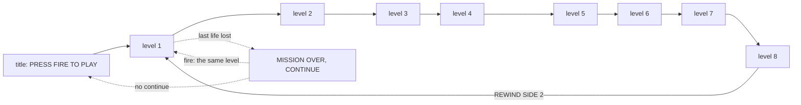

*A game, level by level. How to read it: the solid arrows are the levels in order, each a tape load; the dotted
ones the end of a game, which can come on any level (drawn from level 1 only). The point: the game is a loop of eight
loads; it has no last screen. Witnesses: `c1` (title to level 1), `l1`-`l8` (each level to the next), `ending` (8 to
1), `continue`, `gameover`.*

## 1.2 The controls

The ship moves in eight directions, fires, and detaches the Force. The title takes the first fire it sees on any of
four devices, and that device is used for the game ([doc 5](05-controls.md)):

| Method | Device | Left, right, down, up, fire | Detach the Force |
| --- | --- | --- | --- |
| 1 | Interface 2, the "Sinclair 2" joystick | 1 2 3 4 5 | SPACE |
| 2 | the keyboard, the six defined keys | Q W K O P as loaded | SPACE as loaded |
| 3 | Kempston joystick (only when the probe found one) | the stick and its button | SPACE |
| 4 | Interface 2, the "Sinclair 1" joystick | 6 7 8 9 0 | SPACE |

- **DEFINE:** ENTER on the title asks for the six keys in turn, PRESS A KEY FOR LEFT to DETACH.
- **Fire:** a tap fires a shot; holding fire charges the beam (1.5).
- **Pause:** CAPS SHIFT and 1 pauses, CAPS SHIFT and 2 resumes ([doc 4, 4.4](04-game-loop.md#44-where-the-interrupts-are-off)).
- **No abort key:** a game ends only when its last life is lost.

## 1.3 The screens

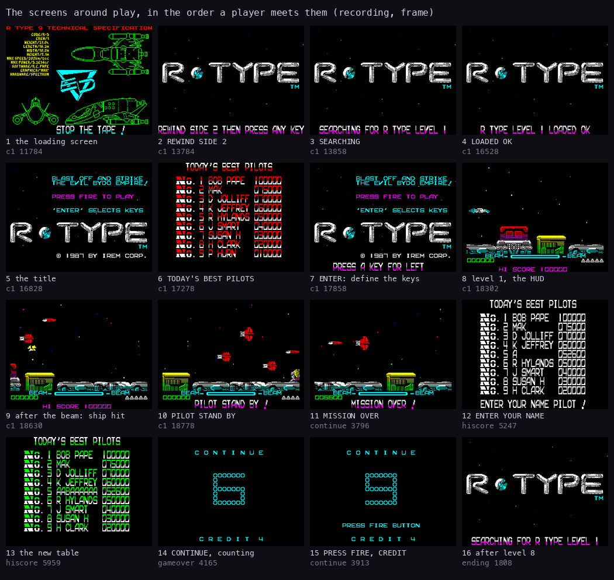

*The screens around play, in the order a player meets them. How to read it:

- one screenshot a screen, numbered in the order of a game;
- under each, what it shows, then the recording and the frame it was taken at.

The point: everything outside play is a line of text under the title logo or a full page of text. The game has no
picture of its own after the load but the logo. Command: `python3 tools/fig_screens.py around
docs/img/play/screens-around.png` (the screenshots are the recordings' `screens/`, listed in
[WALKTHROUGH 6.1](../WALKTHROUGH.md#61-the-screens)).*

The screens, with what leads to the next:

| Screen | What it shows | It leaves on |
| --- | --- | --- |
| 1 the loading screen | the R-9's technical specification; STOP THE TAPE ! and the credits scrolling along the bottom | the end of the scroller |
| 2 REWIND SIDE 2 THEN PRESS ANY KEY | the title logo and the loader's line | a key |
| 3 START TAPE, SEARCHING FOR R TYPE LEVEL n, LOADING | the loader's line | the level's header, then its body (about 50 s) |
| 4 R TYPE LEVEL n LOADED OK, STOP TAPE THEN PRESS ANY KEY | the loader's line | 92 frames, then a key |
| 5 the title | the logo and four lines: the brief, PRESS FIRE TO PLAY, 'ENTER' SELECTS KEYS, the copyright | ENTER, or after a while 6 |
| 6 TODAY'S BEST PILOTS | the nine high scores | fire on any device, or back to 5 |
| 7 PRESS A KEY FOR LEFT ... DETACH | DEFINE, under the logo | six keys |
| 8 play | the play field, 20 character rows; the HUD: the BEAM meter, the score, the lives as ship icons, HI SCORE | the last life lost, or the level's end |
| 9 the beam | play with the charged beam in flight, two columns a pass ([doc 5, 5.8](05-controls.md#58-the-fire-and-the-beam-charge)); the figure's shot, 30 frames after the release, already shows `c1`'s ship exploding (ShipFrame 0 at 18 624) | the beam's hit or the right edge; back to 8 |
| 10 PILOT STAND BY ! | a life lost, lives left | 80 frames, then the same level from its restart point |
| 11 MISSION OVER ! | the last life lost | 176 frames |
| 12 ENTER YOUR NAME PILOT ! | the table with the new score in place | the name |
| 13 the table | the new name in it | 256 frames |
| 14, 15 CONTINUE | a big digit counting 9 to 0, PRESS FIRE BUTTON, CREDIT n | fire: play again; 0: the title |
| 16 after level 8 | REWIND SIDE 2, then SEARCHING FOR R TYPE LEVEL 1 | the tape |

Screen 3 also has an error path: ERROR IN LOADING, then REWIND TAPE THEN PRESS ANY KEY, and the search starts again
([doc 3, 3.10](03-build-and-load.md#310-how-the-load-can-fail)).

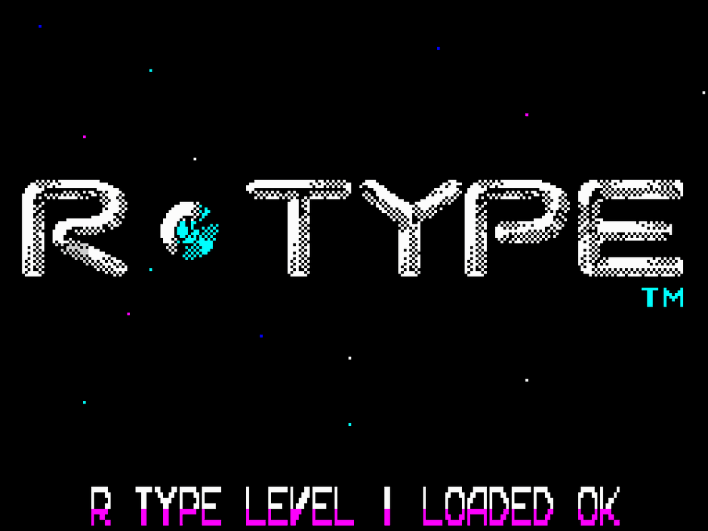

*The title cycle: `c1` frames 16 540-17 900, a picture every 20 frames. How to read it: the screen as the player sees
it: LOADED OK under the logo, the title page with its stars, TODAY'S BEST PILOTS, the title again, then the DEFINE
prompts after ENTER. The point: the title has no timer; it alternates the page and the table at the pace of its own
loops ([doc 4, 4.8](04-game-loop.md#48-every-delay-pause-and-timer)), and a fire on any device starts the game.
Command: `python3 ../../kit/screen_anim.py --work work/docs/rtA/c1 --from 16540 --to 17900 --step 20 --width 1050
docs/img/play/title-cycle.gif`.*

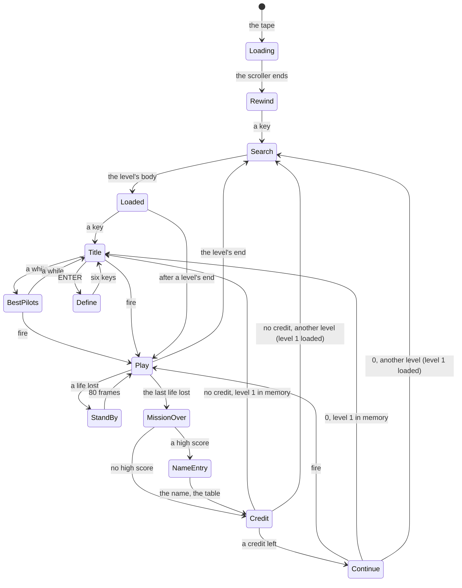

*The screens as states. How to read it: each box is a screen of the sheet above, each arrow the event that leaves it;
Credit is not a screen but LoseLifeNow's test of CreditDigit `$72CB` at `$928E` (no credit left: back to `'5'`, and
LoadLevel of level 1 at `$92B8` first when another level is in memory). The point: a lost game and a won level both pass through the tape loader when the level in memory is not the one
needed. Witnesses: `c1`, `continue`, `gameover`, `hiscore`, `l1`-`l8`, `ending`.*

## 1.4 The eight levels

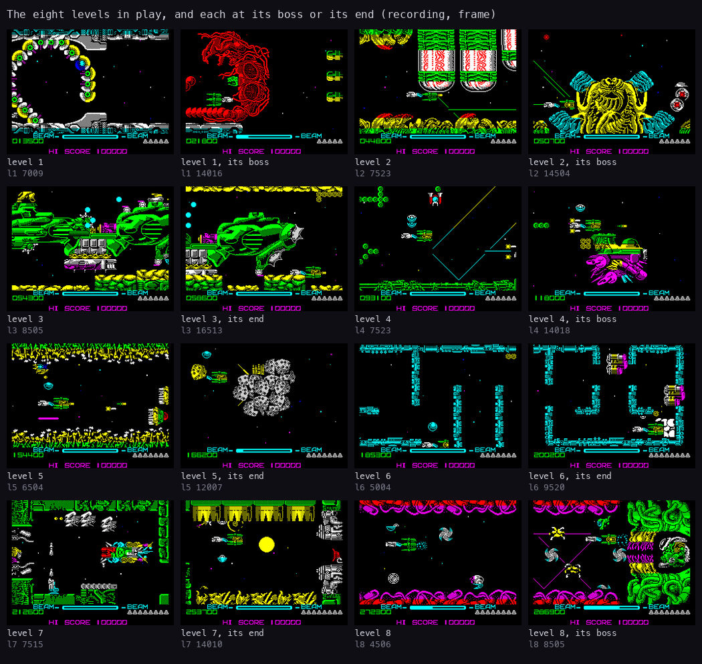

*Each level in play and at its boss or its end. How to read it: two screenshots a level, the left one in mid-level,
the right one at its end; under each, the recording and the frame. The score in the HUD runs on from level to level,
because each `lN` recording starts from the one before. The point: each level has its own scenery, colours and
enemies, all brought by its tape block. Levels 1, 2, 4 and 8 are shown at their boss; levels 3, 5, 6 and 7 at their end. Command: `python3 tools/fig_screens.py levels docs/img/play/screens-levels.png`.*

| Level | Bytes on tape | Block columns drawn | Restart points inside | Its end (recording, frame) |
| --- | --- | --- | --- | --- |
| 1 | 13 228 | 102 | at columns 37 and 75 | a boss, `l1` 14 016 |
| 2 | 12 856 | 65 | at column 43 | a boss built into the map, `l2` 14 504 |
| 3 | 13 074 | 64 | none | a giant ship on the screen, `l3` 16 513 |
| 4 | 12 998 | 63 | at column 41 | a boss, `l4` 14 018 |
| 5 | 8904 | 66 | at column 35 | a mass of rock on the screen, `l5` 12 007 |
| 6 | 8849 | 61 | at column 39 | inside the maze, `l6` 9520 |
| 7 | 12 997 | 73 | at column 45 | the end of the level, `l7` 14 010 |
| 8 | 11 980 | 32 | none | a boss, `l8` 8505 |

A block column is 32 pixels wide: five metatiles of 4 x 4 character cells, top to bottom. The restart points come
from the three bytes at `$C4B1` of each level (LevelChecks); a value of 255 is never reached. The maps, drawn from the
level data without the emulator:

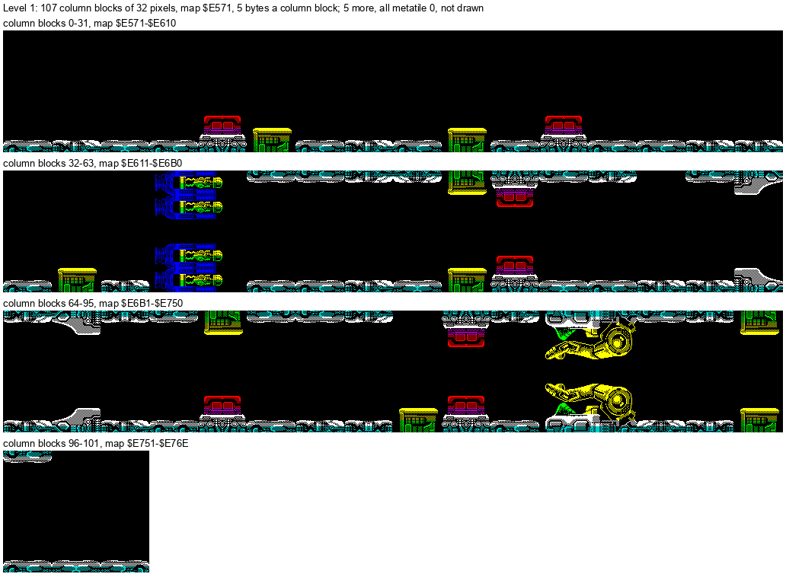

*Level 1's scenery, drawn from `src/res/levels/level1`. How to read it: the level from left to right, cut every 32
block columns into rows; each row is labelled with its first block column and its map address. The point: the
scenery is a strip of metatiles 160 pixels high, mirrored and flipped to make walls and floors out of few tiles.
Command for all eight: `python3 tools/levelmap.py --per-row 32 work/docs/rtA/maps`, then the `level-N.png` copied to
`docs/img/maps`.*

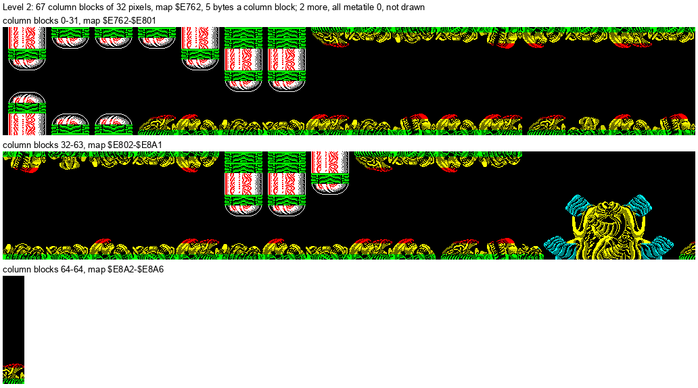

*Level 2: pillars, then an organic cave; the boss is part of the map (the yellow and cyan block at the end of the
second row), so it scrolls in with the scenery. Same command.*

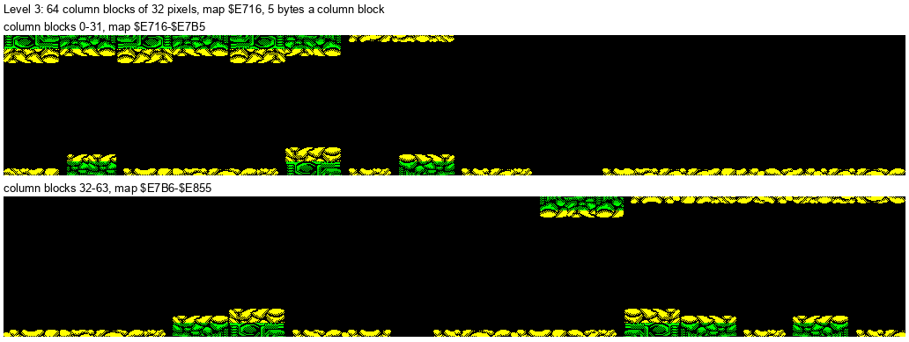

*Level 3: a ceiling and a floor only; the giant ship of this level is a sprite, not scenery. Same command.*

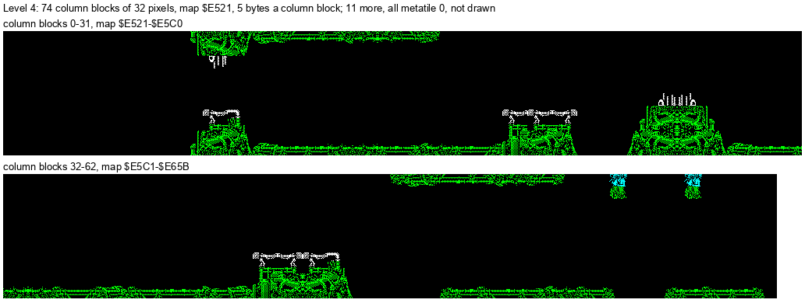

*Level 4. Same command.*

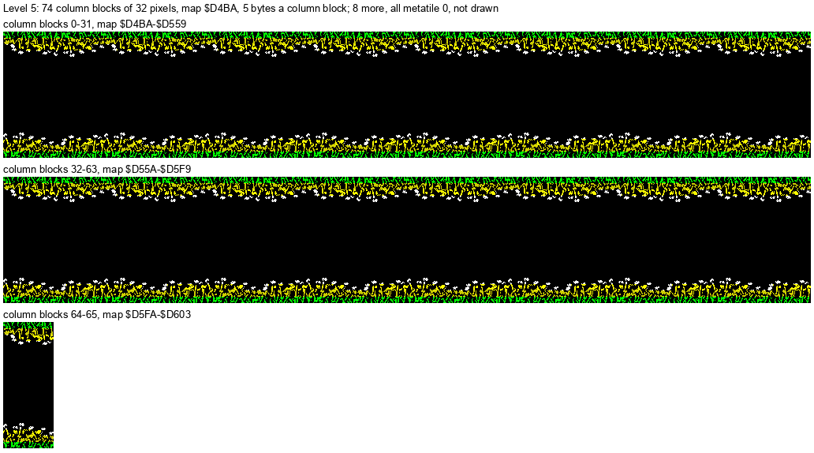

*Level 5. Same command.*

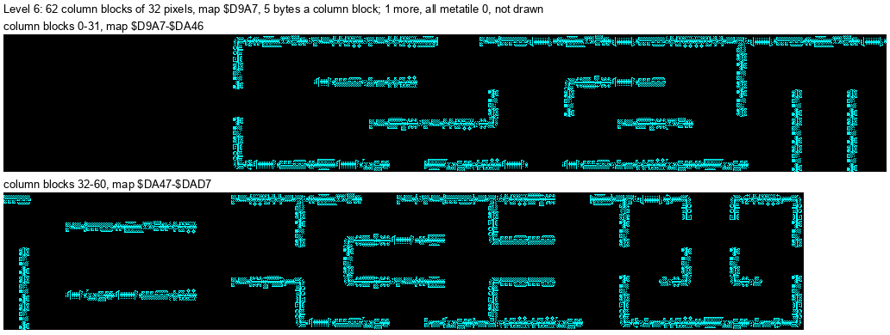

*Level 6: walls that make a maze. Same command.*

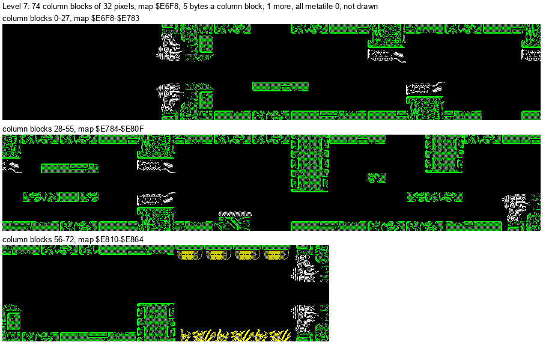

*Level 7. Same command.*

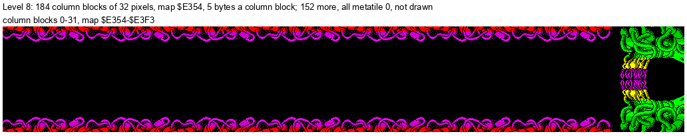

*Level 8: a corridor of 32 block columns with the boss's wall at its end. `levelmap.py` counts 152 more block
columns of metatile 0 before the wave script and does not draw them; the scroll stops at the boss. Same command.*

Where each enemy appears on these maps is drawn from the wave scripts in [doc 7](07-objects.md); the objects of each
level are sheets of their own (`img/sprites/objects-level-N.png`, [doc 7](07-objects.md)).

## 1.5 The rules

### Lives, death and the restart

- **Lives:** 5 at the start of a game, shown as ship icons at the right of the HUD.
- **Death:** the ship dies when it flies into the scenery, into an enemy, or is hit by an enemy shot (the three paths
  of ShipDies `$91F2`, [doc 10](10-gameplay-logic.md)). `deaths-l7` loses 8 lives on level 7: 4 to the scenery, 1 to an
  enemy, 3 to enemy shots.
- **After a death:** the explosion plays on for 32 passes, about 3 s, while the level goes on moving. Then PILOT STAND
  BY ! for 80 frames, and the level is drawn again from its restart point.
- **Restart points:** each level starts from its first column. When the scroll reaches one of the level's restart
  columns, a later life starts 8 block columns before it, with the waves from that point (recording `restart`: the
  checkpoint 37 of level 1 passed, a life lost at 2667, the next life's screen from column 29,
  [doc 7, 7.2.1](07-objects.md#721-the-header-byte-by-byte)).
- **The shield:** a new life starts with the shield drawn around the ship for a while, the first life with its fly-in
  for longer (ShieldTimer `$38` against `$20`); it does not protect ([doc 10, 10.9](10-gameplay-logic.md#109-the-shield)).

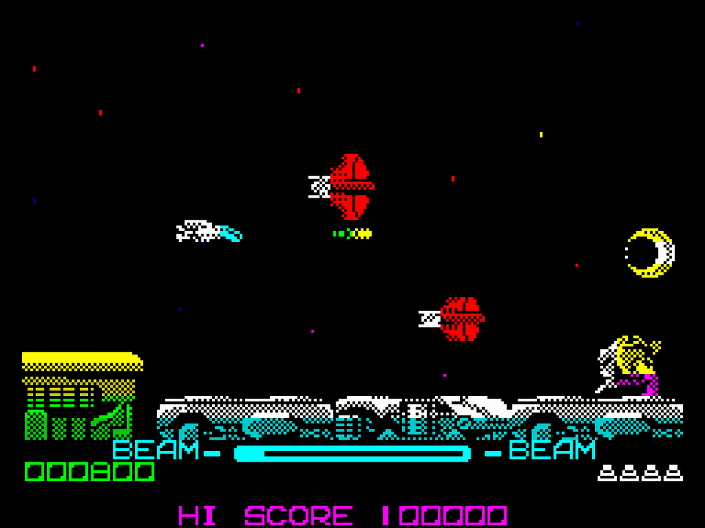

*The end of `c1`: lives lost on level 1, frames 19 230-19 884, a picture every 8 frames. How to read it: the screen as
the player sees it; watch the ship icons at the bottom right go down by one at each death, and the scenery go back
to the restart point. The point: a death costs the ground gained since the restart point and the weapons
([doc 10, 10.2](10-gameplay-logic.md#102-the-weapon-state-over-a-level)); the score stays. Command: `python3 ../../kit/screen_anim.py --work work/docs/rtA/c1 --from 19230 --to 19884 --step 8 --width
1050 docs/img/play/life-lost.gif`.*

### Continues

When the last life is lost: MISSION OVER, the high score table if the score made it, then CONTINUE. A big digit
counts down from 9 to 0, 80 frames a digit (16 s in all). Fire during the count continues the game:

- the same level, from its last restart point;
- 5 lives;
- the score back to `000000`.

The credit counter starts at 5 and shows the credits left after the one being used; there are 4 continues in a game.
With no credit left, or no fire, the game returns to the title, and to level 1 (a tape rewind if the level in memory
is another). Witnesses: `continue` (fire on the count, CREDIT 4), `gameover` (the count runs out).

### The beam

Holding fire charges the beam. The BEAM meter in the HUD fills as BeamCharge `$7ABF` grows by 2 each pass, up to
`$3E` (the next step, `$40`, is never stored). Releasing fire shoots the beam; its strength depends on the charge reached (thresholds `$0C`, below which the release fires a plain shot, `$14` and
`$24`), and
the beam is drawn and moved by MoveBeam `$9E6B` ([doc 5, 5.8](05-controls.md#58-the-fire-and-the-beam-charge),
[doc 10](10-gameplay-logic.md)).

### Worked example: charging a full beam

The charge starts at 0 and grows by 2 a pass:

1. `$3E` is 62, so a full charge takes 31 passes.
2. On level 2 a pass takes 4.68 frames on average ([doc 4, 4.5](04-game-loop.md#45-the-measured-pass-468-frames-on-level-2)).
3. 31 x 4.68 = 145 frames, 2.9 s at 50.08 frames a second.

A busy screen makes the passes longer, and the beam takes longer to charge: the charge counts passes, not time.
Witness: `c1` frames 18 602-18 620, the full beam in flight (BeamPower 30, its column 8 to 16; Animation 5.4 in
[doc 5](05-controls.md#58-the-fire-and-the-beam-charge)).

### The Force and the pick-ups

Pick-ups come out of carrier enemies. Each one taken is worth 400 points and plays sound `$0D` (TakePickup `$98BD`):

| Pick-up | Effect |
| --- | --- |
| a laser crystal (kinds 3-5) | the Force arrives or grows a level (up to 3), and its laser becomes the crystal's (WeaponKind = kind - 2: 1 the bouncing laser, 2 the ground laser, 3 the anti-air laser) |
| the bits (kind 8; kind 9 the lower one) | a bit device above the ship, then a second below |
| the missiles (kind 7) | missiles fired with the shots (MissilesOn) |
| the shield (kind 6) | a shield drawn around the ship for a while (it does not protect: [doc 10, 10.9](10-gameplay-logic.md#109-the-shield)), and 600 points more |

The Force sits at the ship's nose or its tail, or flies free after the detach key. It is kept across a level's end
([doc 4, 4.7](04-game-loop.md#47-the-level-start), [doc 10](10-gameplay-logic.md)).

### The score and the extra lives

An enemy is worth 100 to 1000 points by its kind (the table ScoreAwards `$70DC`). A pick-up is worth 400. The score
has six digits and is printed when it changes.

Extra lives come at 50 000, at 100 000 and at each 100 000 after, with sound `$0E` (CheckExtraLife `$FDA5`).

### Worked example: the extra lives

CheckExtraLife keeps a count of the extra lives given, ExtraLives `$7A8C`, and looks at two digits of the score:

1. The score reaches `050000`. The ten-thousands digit is `5` and ExtraLives is 0: a life, ExtraLives 1.
2. The score reaches `100000`. The hundred-thousands digit is `1`, equal to ExtraLives: a life, ExtraLives 2.
3. The score passes `150000`: the ten-thousands digit is `5`, but ExtraLives is not 0; the hundred-thousands digit is
   `1`, not 2. No life.
4. The score reaches `200000`: the digit `2` equals ExtraLives: a life, ExtraLives 3.

Witness: the HUD of the `lN` recordings, which never lose a life: 5 ship icons on level 1 (`l1` 7009, score `013500`),
7 at level 4's boss (`l4` 14 018, score `118000`, past 50 000 and 100 000).

### The high scores

TODAY'S BEST PILOTS holds nine names and scores, from BOB PAPE 100000 down to P HURN 010000 as loaded. A score that
beats the ninth is inserted, the table shown with ENTER YOUR NAME PILOT !, and the name entered letter by letter
([doc 5, 5.11](05-controls.md#511-the-name-entry)). Witnesses: `hiscore`, `hiscore-typed`.

## 1.6 The key moments

| Moment | Recording, frame |
| --- | --- |
| the game's entry, after the SpeedLock load | `c1` 11 700 |
| the loading screen with its scroller | `c1` 11 784 |
| SEARCHING FOR R TYPE LEVEL 1 | `c1` 13 858 |
| R TYPE LEVEL 1 LOADED OK | `c1` 16 528 |
| the title | `c1` 16 828 |
| level 1, the first pass | `c1` 18 302 |
| the beam fired, in flight | `c1` 18 602-18 620 |
| the longest pass of level 2 (12 frames) | `l2` 8982 |
| level 2's boss | `l2` 14 504 |
| MISSION OVER | `continue` 3796 |
| CONTINUE, PRESS FIRE BUTTON | `continue` 3913 |
| ENTER YOUR NAME PILOT ! | `hiscore` 5247 |
| SEARCHING FOR R TYPE LEVEL 1 after level 8 | `ending` 1808 |

## 1.7 Known only from the code

- **The closing text:** level 8's object 32 at `$CAFF` draws "THANKS TO YOUR BRAVE FIGHTING THE COSMOS RESTORED
  PEACE ..." over 24 x 21 cells. The waves that would show it come after the level-end command that wraps the game, so
  no recording shows it ([doc 2, 2.5](02-architecture.md#25-the-leftovers), [doc 8](08-hud-and-text.md)).
- **The immortal stretch after level 8:** LevelEnd at the digit `'8'` writes `RET` into ShipDies, so the ship cannot
  die between level 8's first level-end command and the wrap ([doc 4, 4.7](04-game-loop.md#47-the-level-start)).
  It cannot fire or detach either: the same LevelEnd passes leave `RET` at ShieldControls `$95A5`, and only
  ClearPlayState, when level 1 is loaded, writes the two `NOP`s back. `ending` starts after it; the writes are read
  from the code.
- **The restart columns** are no longer only from the code: `restart` (the integration's recording, with the
  immortality POKE until frame 2640) passes the checkpoint 37, LevelRestartColumn `$C4AE` becomes 29, and the life
  after the death at 2667 starts with MapColumn 37, its first screen from block column 29
  ([doc 7, 7.2.1](07-objects.md#721-the-header-byte-by-byte)).
