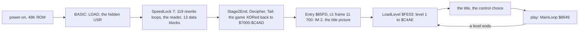
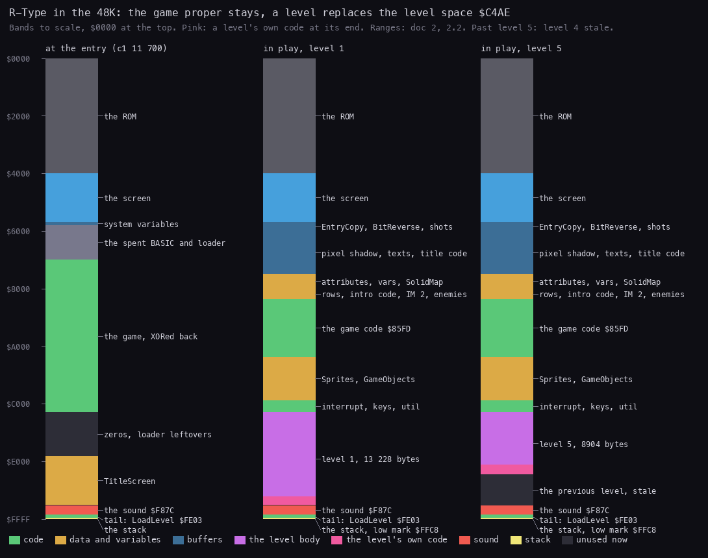
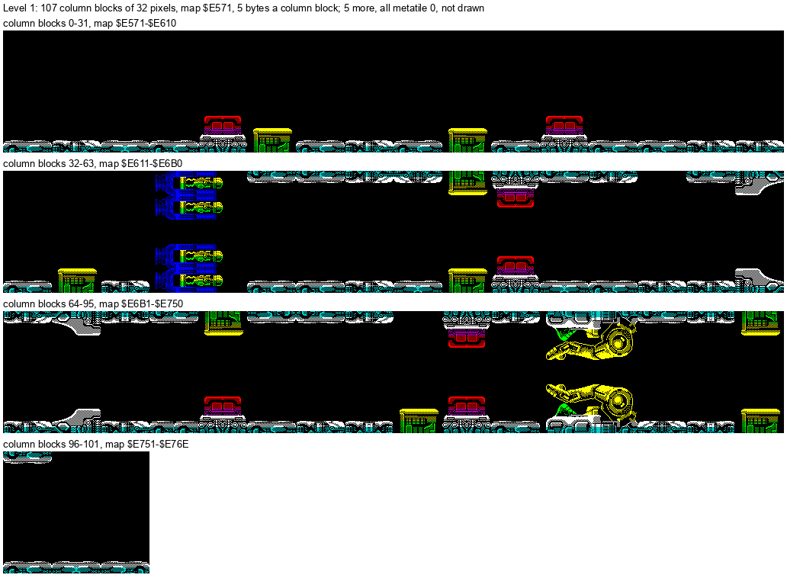
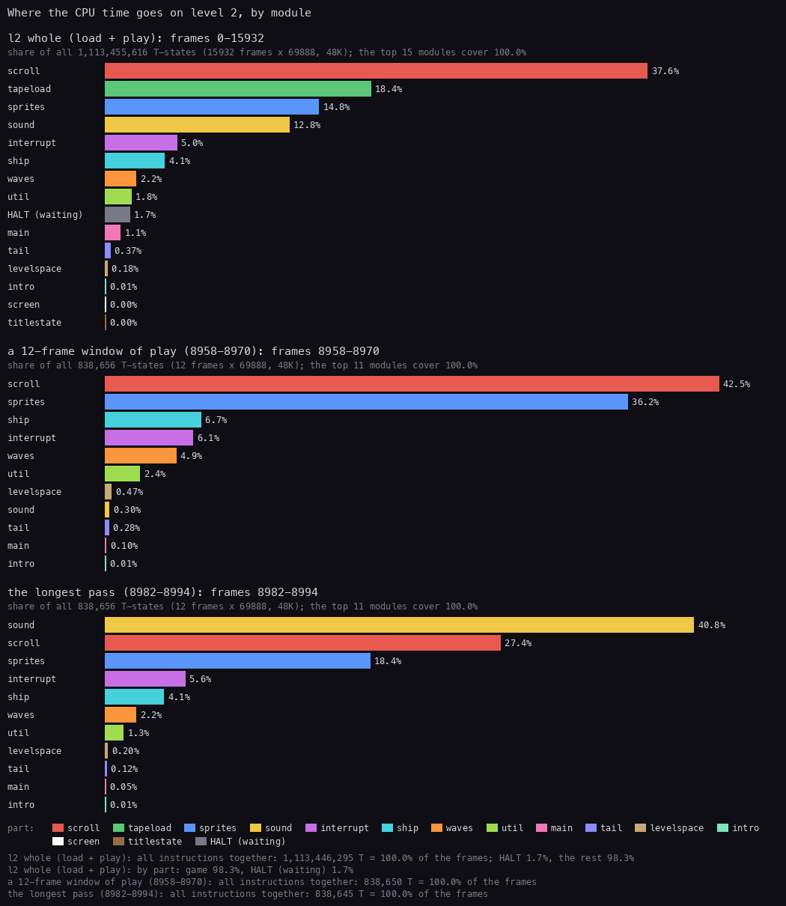
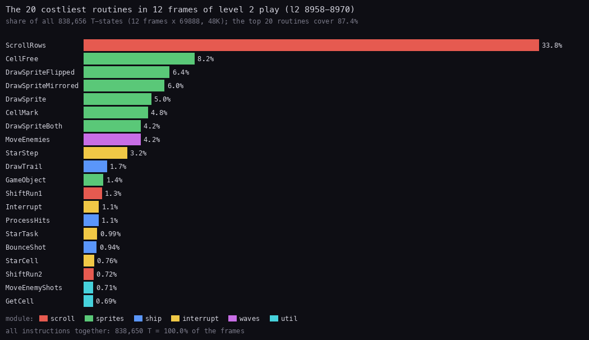
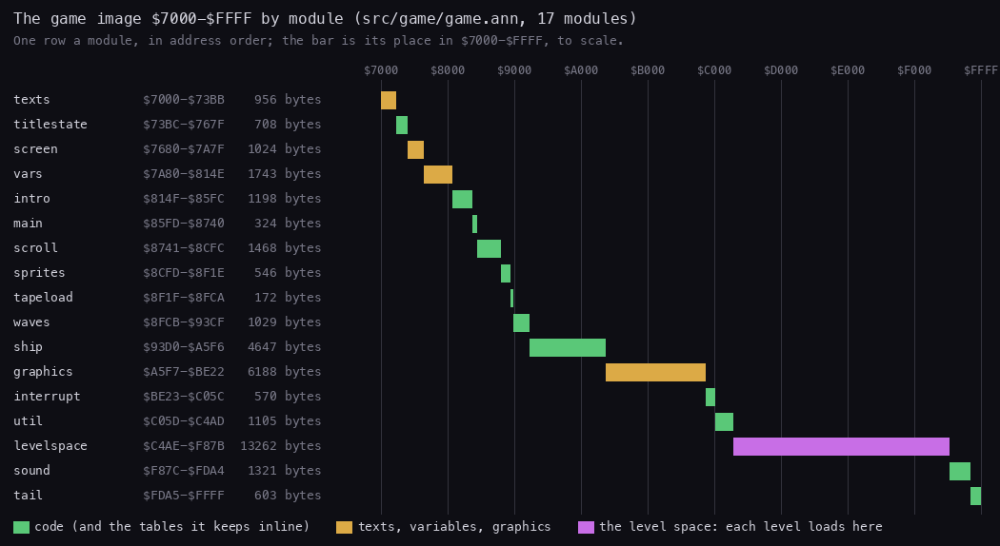
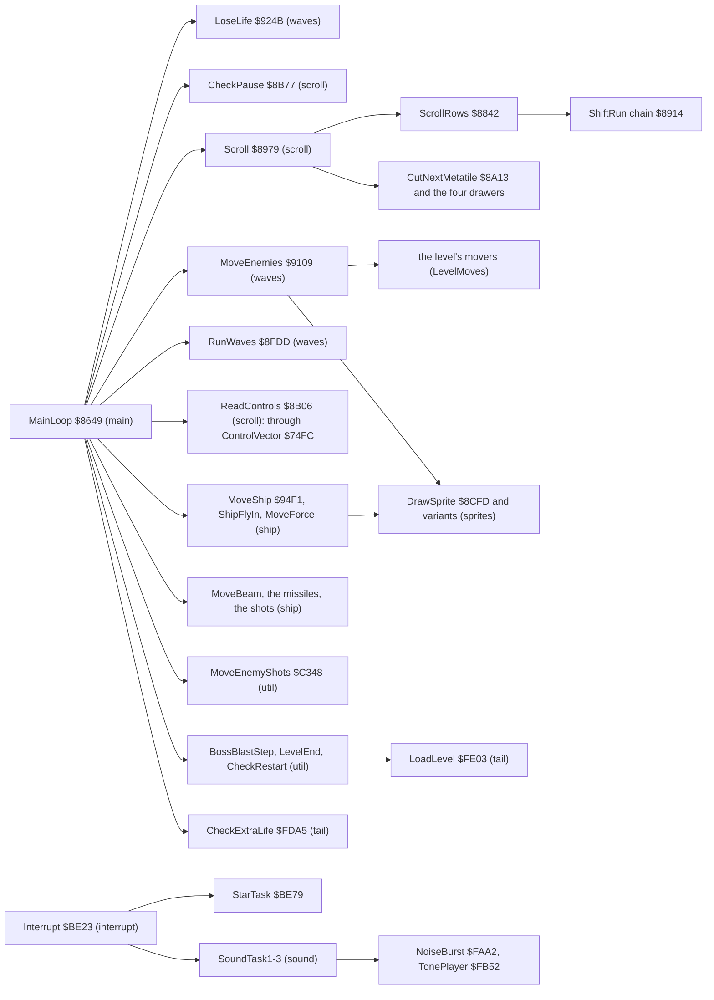
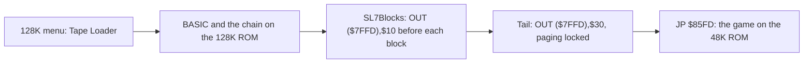

# 2. Architecture

What this covers:

- the machine the game asks for, and the stages from power-on to play;
- the memory map as stage 2 corrected it: the code, the data, the buffers, the level space `$C4AE`, the sound, the
  stack;
- the eight levels in memory;
- the heatmap of every recording and the stack;
- the leftovers: bytes the game never reads;
- the frame budget, by module and by routine;
- the module map of `src/game/game.ann`;
- the main loop's call graph;
- the 48K and the 128K.

The recordings it rests on ([WALKTHROUGH 6.0](../WALKTHROUGH.md#60-the-recordings)):

| Recording | What it is | Used for |
| --- | --- | --- |
| `c1` | a 48K from power-on, the original tape at signal speed | the image at the entry (frame 11 700 T 1379), the image in play on level 1 |
| `l1`-`l8` | each level loaded by the game and played to its end (immortality POKE `$91F2`, RAM only) | the levels in memory, each level's own code, the budget (`l2`) |
| the 16 recordings after the entry | `c1`, `l1`-`l8`, `continue`, `gameover`, `hiscore`, `hiscore-typed`, `ending`, `ctl-*` | the heatmap and the stack (their summed `L1`, `work/stage1/heat/all-l1.json`) |
| `m128` | the same tape on a 128K | 2.9 |

Addresses are those of the 48K's 64 K view. A picture of frame N is the memory at the start of frame N.

## 2.1 The machine and the stages

R-Type asks for a 48K Spectrum: 3.5 MHz, a frame of 69 888 T, 50.08 frames a second, the beeper on port `$FE` and the
keyboard. It uses IM 2 with its own vector table, three beeper channels run by the interrupt, and no other hardware;
a Kempston joystick and the Interface 2 are read when present ([doc 5](05-controls.md)). On a 128K the loader locks
the 48K ROM in and the game runs as on a 48K (2.9).

The game is CPU-bound. A pass of the main loop takes 4.68 frames on level 2 on average, never less than 3, and the
scroll and the sprites use four fifths of it ([doc 4, 4.5](04-game-loop.md#45-the-measured-pass-468-frames-on-level-2)).



*The stages from power-on to play (the details in [doc 3, 3.11](03-build-and-load.md#311-the-stages-of-the-load-in-c1)).
How to read it: left to right in time; the arrow back is the level load, eight times a game. The point: the game
proper is loaded once and stays; only the level space is loaded again. Witness: `c1` (BASIC to level 1), `l2`-`l8`
(each later level).*

## 2.2 The memory map



*The 64 K at the entry (`c1` frame 11 700), in play on level 1 and in play on level 5. How to read it:

- one column a moment, `$0000` at the top, the bands to scale;
- the colours are the kinds of the key at the bottom;
- pink is a level's own code, at the end of its body; dark grey is a part no one reads at that moment.

The point: from the entry on, `$5B00-$C4AD` and `$F87C-$FFFF` do not move. Only `$C4AE-$F87B` changes, and past a
short level (level 5, 8904 bytes) the bytes of the level before it stay, unread. Command: `python3
tools/fig_arch.py memory docs/img/arch/memory-map.png` (the ranges are the table below; the level lengths from
`build/levelN.bin`, the level code from `src/levelN/levelN.ann`).*

The map in play. The sources: the image at the entry (`work/stage1/images/entry.cpu.bin`), the image in play on
level 1 (`play-L1.cpu.bin`), the executed ranges of the 16 recordings (`work/stage1/heat/executed-ranges.txt`) and
`src/game/game.ann`.

| Range | What | Module |
| --- | --- | --- |
| `$0000-$3FFF` | the ROM; its bytes are also the random numbers (NextRandom `$C05D` reads them through RandomPtr `$7ACD`) | |
| `$4000-$5AFF` | the screen: 20 character rows of play field, the HUD below (BEAM, score, lives, HI SCORE) | |
| `$5B00-$5B63` | below EntryCopy; the same bytes at the entry and in play on level 1 | |
| `$5B64-$5D01` | EntryCopy: 414 bytes copied from `$7EE2` at the entry; its last two bytes land on BitReverse (below) | |
| `$5D00-$5DFF` | BitReverse: each byte with its bits reversed, built at the entry (the mirrored metatiles and sprites) | |
| `$5E00-$5EB3` | ColumnBuffer: the column the scroll brings in, 20 cells of 9 bytes | |
| `$5EB4-$5FFF` | the ship's shots `$5EB4`, the three missiles `$5F00`, `$5F34`, `$5F68`, the explosions `$5FC1` | |
| `$6000-$77FF` | the pixel shadow: the play field drawn off screen, laid out like the screen `$2000` higher. In its third third only the first 128 bytes of each pixel line are play field, and the other halves hold the texts (`$7080-$73BB`), the star switches and the Kempston probe (`$73BC`), the screen helpers and TitleLoop (`$7680`) | texts, titlestate, screen |
| `$7800-$7A7F` | PlayAttrs: the attribute shadow, 20 rows of 32, at `$5800 + $2000` | screen |
| `$7A80-$7AEF` | the variables of play (GameVars): the scroll, IntTicks `$7A8A`, the timers, Lives `$7AA0`, the ship, the Force, the beam | vars |
| `$7AF0-$7CD7` | the font, 8 bytes a character from `!` | vars |
| `$7CD8-$7D81` | HiScoreTable: 9 entries of 17 bytes, then HiScoreSpare `$7D71` | vars |
| `$7D82-$7DFF` | the missiles' frame lists, the anti-air paths, LevelVars `$7DF9` | vars |
| `$7E00-$807F` | SolidMap: one byte a cell of the play field, the tag of what is there; it starts with EntryCopySource `$7EE2` | vars |
| `$8080-$814E` | RowTable (the 20 rows' screen and attribute addresses), the star states, the star buffer | vars |
| `$814F-$8382` | ShowLoadingScreen and its credits text | intro |
| `$8383-$83FF` | `JP Interrupt`; the enemy shots, the ship's trail, the beam shot, the anti-air shots | intro |
| `$8400-$8500` | Im2Table: 257 bytes of `$83` | intro |
| `$8501-$85FC` | EnemySlots: 28 slots of 9 bytes | intro |
| `$85FD-$A5F6` | the code: the entry and the main loop, the scroll, the sprite drawers, LoadBytes, the waves, the ship and its weapons | main, scroll, sprites, tapeload, waves, ship |
| `$A5F7-$BE22` | the graphics: GraphicsHead, the sprites, the object table; read, never executed | graphics |
| `$BE23-$C4AD` | the interrupt and its task table `$BE60`, the stars, the keys, the control choice; the text printer, the cells, the score, the boss | interrupt, util |
| `$C4AE-$F871` | the level space: each level's body, loaded by LoadLevel (2.3) | levelspace |
| `$F872-$F87B` | SoundStack: ten bytes the tone player uses as a stack | levelspace |
| `$F87C-$FDA4` | the sound: PlaySound, the three channel tasks, NoiseBurst `$FAA2`, TonePlayer `$FB52`, the sound table and scripts | sound |
| `$FDA5-$FF93` | CheckExtraLife, WaitFrames, the fills, LoadLevel `$FE03`, DrawFirstScreen `$FEEB` | tail |
| `$FF94-$FFFF` | StackArea: loader leftovers, then the stack below `$FFFE` | tail |

Stage 1's map had three ranges wrong, which stage 2 corrected: the enemy slots are 28, not 24; `$6000-$77FF` is the
pixel shadow, not "a header and buffers" (the level header LoadLevel reads at `$6000` lives there only during a load);
and the level space ends at `$F871`, with the sound's stack above it.

### Worked example: one cell, three places

The play field's cell at character row 5, column 10 (the ship's area on level 2):

- **On the screen** its first pixel line is at `$40AA`: row 5 is in the first third, so the address is
  `$4000 + 5 x 32 + 10`.
- **In the pixel shadow** the same cell is at `$60AA`, `$2000` higher; its eight lines are at `$60AA`, `$61AA`, ...
  `$67AA`, as on the screen.
- **Its attribute** is at `$58AA` on the screen and at `$78AA` in PlayAttrs, again `$2000` higher.

ScrollRows copies a changed cell from the shadow to the screen by adding `$20` to the high byte (`l_8881`):

```asm
8886  LD A,H                  ; H: the screen line's high byte
8887  ADD A,$20               ; the shadow's
8889  LD B,A
888A  LD C,L
888B  LD A,(BC)               ; the shadow byte
888C  LD (HL),A               ; to the screen
```

The point: the layout makes the copy one `ADD`. It is why the texts and the title code sit in the shadow's spare
halves: the play field is 20 rows, so the last 4 rows' worth of the shadow's third third is free memory.

### BitReverse loses one byte

The entry builds BitReverse at `$5D00` first, then copies the 414 bytes of EntryCopy to `$5B64`. The copy ends at
`$5D01`, two bytes into the table:

```text
85FD  Entry:
      BitReverse[b] = b with its 8 bits reversed, for b = 0 to 255     # $5D00-$5DFF
      LDIR 414 bytes from $7EE2 to $5B64                                # $5B64-$5D01
```

The last two bytes of EntryCopySource (`$807E-$807F`) are `$00 $00`. `$5D00` stays right (0 reversed is 0);
`$5D01` should hold `$80` (1 reversed) and holds `$00`. Taken from the image in play on level 1
(`work/stage1/images/play-L1.cpu.bin`): `$5D00-$5D03` read `00 00 40 C0`. The point: a mirrored pixel byte `$01` draws
as `$00`, instead of `$80`: a lone pixel at the right edge of a stored byte vanishes in the mirrored copy. Which graphics hold such a
byte is not checked here ([doc 6](06-rendering.md) draws the mirrored variants).

### The bytes the code writes into itself

Single bytes of the code change in play (`tools/image_diff.py --gap 64` over the entry and each level's `next.szx`,
`work/stage1/images/diffs.txt`):

| Address | At the entry | In play | Written by |
| --- | --- | --- | --- |
| `$95A5` ShieldControls | `$00` | `$C9` (`RET`) | `$86FE`, `$8BC2`, `$8CBA`, `$C1B7`, LevelEnd `$C263` |
| `$91F5` (in ShipDies) | `$00` (`NOP`) | `$C9` after level 8 | LevelEnd at the digit `'8'` ([doc 4, 4.7](04-game-loop.md#47-the-level-start)) |
| `$8FB4` (EdgeLoop's border mask) | `$02` | `$02` in a pilot, `$01` in the data | LoadBytes `$8F27`, `$8F5B` |
| `$9D3F`, `$9E59-$9E5A`, `$97C4-$97D9`, `$A161-$A174`, `$A1C6` | as loaded | different from one level's end to the next | the weapon code: `$9B3D`, `$9D00` and `$9D4F` write `$9D3F`, `$9E53` writes `$9E59`, `$9BE5` writes `$A1C6` ([doc 10](10-gameplay-logic.md)) |
| `$BECB`, `$BF24-$BF25` | as loaded | `$3C` / `$08 $77` on the title, `$00` / `$3E $02` in play | TitleStarsOn `$73D8`, PlayStars `$73C5` |

## 2.3 The levels in memory

Each level is one block loaded to `$C4AE`: a header of words, then its data (sprites, objects, metatiles, map, wave
script, kinds), then its own code. [Doc 7](07-objects.md) decodes the format byte by byte.

| Level | Bytes | Last byte | Map | Its own code (executed) |
| --- | --- | --- | --- | --- |
| 1 | 13 228 | `$F859` | `$E571` | `$F3A5-$F7E9` |
| 2 | 12 856 | `$F6E5` | `$E762` | `$F4F3-$F57A`, `$F5BC-$F6E5` |
| 3 | 13 074 | `$F7BF` | `$E716` | `$F0E6-$F6EC` |
| 4 | 12 998 | `$F773` | `$E521` | `$F2EE-$F773` |
| 5 | 8904 | `$E775` | `$D4BA` | `$E1E8-$E640`, `$E693-$E775` |
| 6 | 8849 | `$E73E` | `$D9A7` | `$E640-$E73E` |
| 7 | 12 997 | `$F772` | `$E6F8` | `$F4EF-$F772` |
| 8 | 11 980 | `$F379` | `$E354` | `$EEF2-$EFDF`, `$F029-$F12D` |

The executed ranges are per recording, from each level's `L1` (`work/stage1/heat/level-code.txt`). Level 1 is the
largest: it fills the level space to `$F859`, 24 bytes below SoundStack.

### Worked example: the level space at the entry and after level 1

At the entry (`c1` frame 11 700) the level space holds what the loader left:

| Range | Bytes | What |
| --- | --- | --- |
| `$C4AE-$C543` | 150 | LevelSpace: zeros, where the header words will be |
| `$C544-$DD17` | 6100 | LoaderLeftover: what the loader's last moves left |
| `$DD18-$F817` | 6912 | TitleScreen: the title picture, a `SCREEN$` |
| `$F818-$F871` | 90 | LevelSpaceTail |
| `$F872-$F87B` | 10 | SoundStack |

That is 13 262 bytes, `$C4AE` to `$F87B`. ShowLoadingScreen copies TitleScreen to the screen at the entry, before
LoadLevel loads level 1 over it. The title picture exists in memory only until the first load. After it, the title
screen of the game is drawn by TitleLoop from the logo and the texts, not from a picture. Level 1's 13 228 bytes end at
`$F859`: they cover the whole picture and 66 of LevelSpaceTail's 90 bytes. Witness: the images at the entry and in
play on level 1 (`work/stage1/images/`), 21 709 bytes apart.



*Level 1 drawn from its data. How to read it: the strip of the whole level, cut every 32 block columns, each row
labelled with its first block column and its map address; each block column is 5 metatiles of 4 x 4 cells. The point: a level is a short map of
metatiles (102 block columns drawn for level 1), and the whole of its scenery fits in the 13 KB with the sprites and
the code. Command: `python3 tools/levelmap.py --per-row 32 work/docs/rtA/maps` (all eight, from `src/res/levels`), then
`level-1.png` copied to `docs/img/maps`.*

The other seven maps: [level 2](img/maps/level-2.png), [3](img/maps/level-3.png), [4](img/maps/level-4.png),
[5](img/maps/level-5.png), [6](img/maps/level-6.png), [7](img/maps/level-7.png), [8](img/maps/level-8.png); all eight
are shown in [doc 1](01-game-design.md) and the objects of each level in [doc 7](07-objects.md).

## 2.4 The heatmap and the stack


*What all 16 recordings after the entry executed, read and wrote, per byte, summed into
`work/stage1/heat/all-l1.json`. How to read it:

- one row a 256 bytes, `$4000` at the top;
- red a write, green a read, blue an execution, on a log2 scale, mixed;
- the brackets on the right are the ranges of 2.2;
- below, `$4000-$5AFF` drawn as the screen and its attribute cells.

The point: the code is two blue islands, `$85FD-$A5F6` and `$BE23-$C4AD`, with the graphics `$A5F7-$BE22` read
between them; the level space is read all over and executed only at each level's own code near its end; the shadow
`$6000-$77FF` is written and read like the screen, with the text halves in its third third. Command: `python3
../../kit/heatmap.py work/stage1/heat/all-l1.json docs/img/arch/heatmap.png --cell 2 --from 4000 --to FFFF --panels
composite --columns 1 --regions work/docs/rtA/regions.txt --title "What 16 recordings after the entry did, per
byte"`.*

The stack starts at `$FFFE`, set at the entry (`LD HL,$FFFE`, `LD SP,HL`). Its low mark is `$FFC8`, the lowest byte a
`PUSH`, `CALL` or interrupt wrote below `$FFFE` (`kit/merge_l1.py --stack FF00-FFFF`, `work/stage1/heat/stack.txt`):

| Recordings | Lowest SP |
| --- | --- |
| `hiscore`, `hiscore-typed` | `$FFC8` |
| `l4` | `$FFCA` |
| `c1`, `continue`, `gameover`, `l1`-`l3`, `l5`-`l8` | `$FFCE` |
| `ctl-if2`, `ctl-kempston`, `ctl-sinclair` | `$FFD0` |
| `ending` | `$FFD2` |

### Worked example: what the interrupt adds to the stack

An interrupt can come at any depth of the pass. When it does, the stack takes:

- 2 bytes, the return address the CPU pushes;
- 14 bytes, the seven pairs Interrupt `$BE23` saves (`AF`, `BC`, `DE`, `IX`, `IY`, `HL`, `AF'`);
- 4 bytes, `PUSH BC` and `PUSH HL` around a task;
- 2 bytes, the `CALL RunTask`;
- then the task's own calls.

That is 22 bytes before the task does anything. The low mark `$FFC8` is 54 bytes under `$FFFE`, so the pass and the
task together never went deeper than 32 bytes more. The hiscore recordings, the only ones that enter a name, go
lowest. The stack's 108-byte area `$FF94-$FFFF` has 52 bytes below the low mark that
no play recording reads. The point: the stack is small, it sits above the last code byte (`$FF93`), and nothing else uses
its area.

## 2.5 The leftovers

Bytes the game never reads. Each is a resource of its own in `src/res/leftovers` (its README says how it is known):

| Address | Entry | Bytes | What | How it is known |
| --- | --- | --- | --- | --- |
| `$7D71` | HiScoreSpare | 17 | the bytes past the ninth high-score entry, into which the insertion shifts the last entry | the heatmap: written by InsertHiScore, never read |
| `$A5F7` | GraphicsHead | 13 | the bytes before the first sprite | the heatmap: not read in any recording |
| `$C544` | LoaderLeftover | 6100 | what the loader's last moves left in the level space | overwritten by every level before it is read |
| `$F818` | LevelSpaceTail | 90 | the bytes after the title picture | level 1 loads over `$F818-$F859`; no recording reads the rest |
| `$FF94` | StackArea | 108 | loader leftovers (`$FF94-$FFC7`), then the stack | the stack's low mark `$FFC8` |
| `$CAFF` | level 8's object 32 | 24 x 21 cells | the closing text "THANKS TO YOUR BRAVE FIGHTING ..." | level 8's wave script ends the game at column 66, before the kinds that would draw it ([doc 8](08-hud-and-text.md)) |

The closing text is the one leftover a player could have seen. LevelEnd at the digit `'8'` makes the ship immortal
and lets the waves run on; the next level-end command, at column 66 of level 8's script, wraps to level 1 before the
waves at columns 67-73 that would show the text. Witness: `ending` reads nothing in `$CAFF-$D2CE`.

## 2.6 The frame budget



*Where the CPU time goes on level 2, by module, in three windows of `l2`. How to read it:

- each panel is one window: the whole recording (load and play, 15 932 frames), a 12-frame window of play (frames
  8958-8970), and the longest pass (frames 8982-8994);
- each bar is a module's share of all the T-states of the window, the interrupt included;
- HALT is the time the CPU waited in WaitFrames.

The point: in play the scroll (42.5 %) and the sprites (36.2 %) take four fifths of the CPU, and the interrupt with
its stars 6.1 %. Over the whole recording the tape loader takes 18.4 %. In the longest pass the sound takes 40.8 %:
three explosions' noise bursts inside the interrupt ([doc 4, 4.6](04-game-loop.md#46-what-a-pass-costs-against-the-beam)). Command:
`python3 ../../kit/fig_budget.py work/stage1/rec/l2/l1.json docs/img/arch/budget-modules.png --ann
src/game/game.ann --ann src/level2/level2.ann,label=level2 --by module --label "l2 whole (load + play)" --state "a
12-frame window of play (8958-8970)=work/stage2/pass/norm/l1.json" --state "the longest pass
(8982-8994)=work/stage2/pass/long/l1.json" --title "Where the CPU time goes on level 2, by module"`.*



*The 20 costliest routines in 12 frames of level 2 play (`l2` frames 8958-8970). How to read it: one bar a routine,
its share of the 838 656 T of the window, coloured by its module. The point: ScrollRows alone takes a third
(33.8 %); the four sprite drawers (DrawSprite and its flipped, mirrored and both-ways variants) with CellFree and
CellMark take another third; the stars (StarStep, StarTask, StarCell) take 5 %, inside the interrupt. Command:
`python3 ../../kit/fig_budget.py work/stage2/pass/norm/l1.json docs/img/arch/budget-routines.png --ann
src/game/game.ann --ann src/level2/level2.ann,label=level2 --top 20 --title "The 20 costliest routines in 12 frames of
level 2 play (l2 8958-8970)"`.*

The shares of the play window, in T-states of its 12 frames (838 656 T):

| Module | Share | T | Frames of 69 888 T |
| --- | --- | --- | --- |
| scroll | 42.5 % | 356 500 | 5.1 |
| sprites | 36.2 % | 303 600 | 4.3 |
| ship | 6.7 % | 55 900 | 0.8 |
| interrupt | 6.1 % | 51 200 | 0.7 |
| waves | 4.9 % | 41 300 | 0.6 |
| util, the level's code, sound, tail, main | 3.6 % | 30 200 | 0.4 |

The window holds about 2.6 passes, so one pass costs about 2.0 frames of scroll and 1.7 frames of sprites, close to
the traced pass of [doc 4, 4.5](04-game-loop.md#45-the-measured-pass-468-frames-on-level-2).

## 2.7 The module map



*The game image `$7000-$FFFF` by module, from `src/game/game.ann`. How to read it: one row a module, in address order,
with its range and size; the bar is its place in `$7000-$FFFF`, to scale; green is code, yellow texts, variables and
graphics, violet the level space. The point: the code is in one run from `$814F` to `$C4AD` with the graphics in
its middle, and in a second run from `$F87C` up; the texts and the variables sit low, in and above the shadow.
Command: `python3 tools/fig_arch.py modules docs/img/arch/modules.png`.*

| Module | Range | Entries | What |
| --- | --- | --- | --- |
| texts | `$7000-$73BB` | 24 texts, 14 data | the texts and small tables in the pixel shadow's spare halves |
| titlestate | `$73BC-$767F` | 5 code, 10 data | the star task's switches, the Kempston probe |
| screen | `$7680-$7A7F` | 5 code, 7 data | the sides, the high-score table, the title colours, TitleLoop, PlayAttrs |
| vars | `$7A80-$814E` | 11 data | the variables, the font, the high scores, SolidMap, RowTable |
| intro | `$814F-$85FC` | 3 code, 3 data | the loading screen scroller, the IM 2 jump and table, the enemy slots |
| main | `$85FD-$8740` | 5 code | the entry, the main loop, the start of a life |
| scroll | `$8741-$8CFC` | 59 code | the metatile drawers, ScrollRows, ShiftRun, the scroll's step |
| sprites | `$8CFD-$8F1E` | 8 code | DrawSprite and its variants, the cell map |
| tapeload | `$8F1F-$8FCA` | 3 code, 1 data | LoadBytes |
| waves | `$8FCB-$93CF` | 15 code | the wave script, the enemy slots and their movers |
| ship | `$93D0-$A5F6` | 62 code | the ship, the Force, the bits, the pick-ups, the shots, the beam, the missiles |
| graphics | `$A5F7-$BE22` | 3 data | the sprites and the object table |
| interrupt | `$BE23-$C05C` | 10 code, 1 data | the interrupt and its task table, the stars, the keys, the control choice |
| util | `$C05D-$C4AD` | 26 code, 2 data | text, cells, the score, the boss |
| levelspace | `$C4AE-$F87B` | 5 data | the level space and what the loader left in it |
| sound | `$F87C-$FDA4` | 17 code, 7 data | the three beeper channels, PlaySound, the players, the data |
| tail | `$FDA5-$FFFF` | 11 code, 2 data | the extra life, the waits and fills, LoadLevel, the first screen, the stack area |

388 entries in 17 modules; each module is one `src/game/*.asm` written from the `.ann` by `kit/mkgame.py`, and the
game assembles identical to the image at the entry.

## 2.8 The main loop's call graph



*The calls of a pass and of the interrupt, by module (`src/game`). How to read it: an arrow is a call; the module is
in brackets; the interrupt is a second root, entered at any instruction of the pass. The point: two routines are
called from everywhere a thing is drawn, DrawSprite and its variants; the level's own movers are called from
MoveEnemies through the level's two mover tables, so the game calls code that each level brings with it. Witness: the
trace of `l2` frames 8961-8966.*

## 2.9 The 48K and the 128K

The game is a 48K game. On a 128K it runs with the 48K ROM paged in and the paging locked:

- **The loader:** the second block table at `$FF49` gives each SpeedLock block the `$7FFD` value `$10` (RAM bank 0,
  the 48K ROM); SL7Blocks writes it before each block ([doc 3, 3.5](03-build-and-load.md#35-the-speedlock-reader)).
- **The tail:** before `JP GameEntry` the Tail writes `$30` to `$7FFD`: bank 0, the 48K ROM, and bit 5, the lock. From
  then on nothing can page; the machine is a 48K until it is reset.
- **The game:** no AY, no other bank, no `$7FFD` write. The only port it writes is `$FE`.



*The 128K path. The point: the lock makes a 128K a 48K for the game, so the game needs no code of its own for the
128K. Witness: `m128` (18 754 frames): the Tail's `OUT ($7FFD)` ran once; the ROM at `$0000` reads `F3 AF 11 FF FF
C3 CB 11`, the 48K ROM, at the title and after 1500 frames of play; level 1 plays as on the 48K (its screens).*

### Worked example: the value `$30`

`$30` is `0011 0000`:

- bits 0-2 = 0: RAM bank 0 at `$C000`, the same bank as a 48K's top 16 K;
- bit 3 = 0: the normal screen in bank 5;
- bit 4 = 1: ROM 1, the 48K BASIC ROM;
- bit 5 = 1: the lock; further writes to `$7FFD` are ignored.

The value `$10` in the loader's table is the same without the lock, so the loader can still page between its blocks
and the Tail closes the door once the game is in place.
