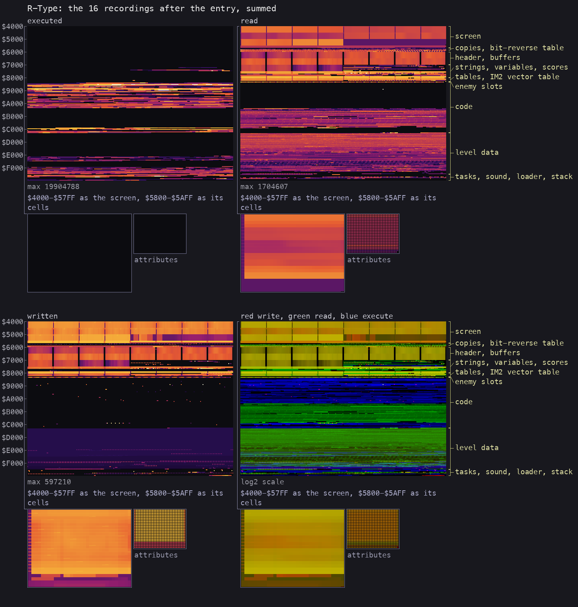

# 2. Architecture

What this covers: the memory map, the images from the load to play and what changes between them, the heatmap and
the stack, the levels' maps and objects as their data holds them. Stage 1's first look; the frame and the main loop
are in [WALKTHROUGH 1](../WALKTHROUGH.md#1-one-recording-from-power-on). The recordings it rests on: c1 (power-on,
the original at signal speed on the 48K), l1-l8 and the others of
[WALKTHROUGH 6.0](../WALKTHROUGH.md#60-the-recordings).

<!-- Figures this document needs (GUIDE.md 4.2), remove each line when it is in: -->
<!-- - the stages from power-on to play (mermaid) -->

## 2.1 The memory map

The 48K's 64 K view in play. The sources: the image at the entry (`work/stage1/images/entry.cpu.bin`, c1 frame
11 700 T 1379), the image in play on level 1 (`play-L1.cpu.bin`), the load timeline (`work/stage1/load-timeline.txt`),
the executed ranges of all 16 recordings after the entry (`work/stage1/heat/executed-ranges.txt`, from their summed
L1) and the code read so far.

| Range | What | Witness |
| --- | --- | --- |
| `$0000-$3FFF` | the ROM | |
| `$4000-$5AFF` | the screen: a playfield of 20 character rows that scrolls, the HUD below (BEAM, score, lives, HI SCORE) | the screens |
| `$5B00-$5DFF` | `$5B64-$5CFF`: 414 bytes copied from `$7EE2` at the entry; `$5D00-$5DFF`: a bit-reverse table built at the entry (the mirrored metatiles and the keys 6-0 are read through it) | the code at `$85FD` |
| `$5E00-$5FFF` | buffers written in play (`$5E95-$5EB3` changes between levels) | image diffs |
| `$6000-$6FFF` | `$6000-$6011` the level header LoadLevel reads (digit `$600D`, length `$6010`); the rest buffers rewritten in play | doc 3, 3.2; image diffs |
| `$7000-$77FF` | strings (`$7196` "R TYPE LEVEL 1" with the level digit `$719C`; `$7280` REWIND SIDE 2 ...), the score `$71C9` (6 ASCII digits), credits `$72CB`, the control method `$74FB` and its vector `$74FC`, the defined keys `$7780` | the code at `$C011`, `$8B06`, `$92A4` |
| `$7800-$7AFF` | variables: the scroll `$7A82-$7A87`, the frame counter `$7A8A`, `$7A8B` (0 when a Kempston answers), `$7A95`, the level-end countdown `$7A9B`, lives `$7AA0`, the word `$7AA1` (read by the collision tests `$9564`, `$9582`: the ship's place, to be confirmed) | code |
| `$7B00-$7FFF` | the high-score table `$7CD8` (9 entries of 17 bytes: name 10, score 6, `$A0`); `$7EE2-$807F` data | the hiscore recording |
| `$8000-$84FF` | tables (`$814F-$837A` rewritten in play), `$8383` `JP $BE23`, the IM 2 table `$8400-$8500` (all `$83`) | the code at `$85FD` |
| `$8501-$85D8` | the enemy slots: 24 of 9 bytes, filled by the attack-wave script `$8FDD` | code |
| `$85FD-$9EEE`, `$9F6E-$A5F6` | code: the entry `$85FD`, the main loop `$8649`, the level loader `$8F1F-$8FBA`, the controls, the objects | executed ranges |
| `$A5F7-$BE22` | data read in play, never executed: graphics and tables of the game proper (stage 2) | heatmap |
| `$BE23-$BF98` | the interrupt handler `$BE23`, its task table `$BE60`, the task `$BE79` | code |
| `$C011-$C4AD` | code: the title and the control choice `$C011`, text `$C07F`, the level end `$C25E` | executed ranges |
| `$C4AE-$F7xx` | the level loaded by LoadLevel: header words (`$C4B4` the attack-wave script, `$C4BA` the object table, `$C4BC` the map, `$C4BE` the kind table), metatiles, map, objects, and each level's own code at its end (below) | doc 3, 3.2; [2.4](#24-the-levels-from-their-data) |
| `$F87C-$FB65` | the sound: the tasks `$F8E8`, `$F8F8`, `$F908` and the beeper `OUT`s at `$FAA2` and `$FB52` | executed ranges, the L1s |
| `$FDA5-$FF93` | `$FDA5` (a main-loop call), `$FDEB` (`HALT` `B` times), LoadLevel `$FE03`, `$FEC0` (`EI` after a load) | code |
| `$FFC8-$FFFD` | the stack (`SP` = `$FFFE` from the entry) | [2.3](#23-the-heatmap-and-the-stack) |

Each level's body holds code of its own at its end, run in play (the executed ranges per recording,
`work/stage1/heat/level-code.txt`): level 1 `$F3A5-$F7E9`, level 2 `$F4F3-$F6E5`, level 3 `$F0E6-$F6EC`, level 4
`$F2EE-$F773`, level 5 `$E1E8-$E775`, level 6 `$E640-$E73E`, level 7 `$F4EF-$F772`, level 8 `$EEF2-$EFDF` and
`$F029-$F12D`.

## 2.2 The images and what changes

`tools/image_diff.py --gap 64` over the 64 K views (`work/stage1/images/diffs.txt`):

- **As loaded and at the entry.** The last loader step and the entry are one moment: the tail at `$61A8` moves the
  8841-byte block to `$DD18-$FFA0` and jumps to `$85FD` (frame 11 700); the two code blocks are decrypted in place
  just before, between the samples of frames 11 675 and 11 700 (21 678 bytes of `$7000-$C4AD` change,
  [doc 3, 3.1](03-build-and-load.md#31-the-tape-block-by-block)). The entry image is the case's image
  (`case.json`).
- **The entry and play on level 1** (`play-L1.cpu.bin`): 21 709 bytes differ. The screen; `$5B64-$5E8F` (the copy
  and the bit-reverse table); the buffers `$6000-$705E`; strings and variables `$7101-$7AD4`; `$7EE2-$807F`,
  `$814F-$837A`; level 1 over `$C4AE-$F879` (the lower part of the `$DD18` block is overwritten: it is the level
  space); the task counters `$BE62-$BE77`; the stack `$FFD2-$FFFD`. In the code only single bytes: `$8FB4` (written
  by the loader), `$95A5` (`$00` at the entry, `RET` in play; written at `$86FE`, `$8BC2`, `$8CBA`, `$C1B7` and `$C263`).
- **Level N and level N+1** (each recording's `next.szx`, the moment the digit steps): the code `$85FD-$C4AD` is the
  same but for single self-modified bytes (`$8FB4`, `$9D3F`, `$9E59-$9E5A`, `$97C4-$97D9`, `$A161-$A174`, `$A1C6`;
  `$91F5` and `$95A5` after level 8); the level `$C4AE-...` is new; the rest is buffers, variables (`$80D8-$80FD`,
  the task counters `$BE63-$BE72`, the sound's `$F9E8-$F9FE`) and the stack.

So the game proper is loaded once; a level is the block at `$C4AE` (8849 to 13 228 bytes) with its own data and
code.

## 2.3 The heatmap and the stack

*What all 16 recordings after the entry executed, read and wrote, per byte (log2 of the counts), summed by
`kit/merge_l1.py` into `work/stage1/heat/all-l1.json`, drawn by `kit/heatmap.py` with the regions of
`work/stage1/heat/regions.txt`, cell 2, from `$4000` to `$FFFF`. The level recordings include their level loads (the writes over `$C4AE-$F7FF`).*

The code is two islands, `$85FD-$A5F6` and `$BE23-$C4AD`, with the data `$A5F7-$BE22` read between them; the level
space `$C4AE-$F7FF` is read all over and executed only at each level's own code; the sound and loader code sits at
`$F87C-$FF93`.

The stack's low mark: `$FFC8` (`kit/merge_l1.py --stack FF00-FFFF`, `work/stage1/heat/stack.txt`), the lowest byte a
`PUSH`, `CALL` or interrupt wrote, in the hiscore recordings; `$FFCA` in l4, `$FFCE` to `$FFD2` in the others. So the
stack uses at most 54 bytes under `$FFFE`, above the last code byte run (`$FF93`).

## 2.4 The levels from their data

Each level body is drawn without the emulator from the tape's bytes, the way the scroll (`$8979` -> `$8A13`) builds
it (`tools/levelmap.py`, the format in its docstring): the map at the word `$C4BC`, 5 bytes per 32-pixel column
block, each a metatile of 4 x 4 cells; bits 6-7 pick the variant (`$8741` as stored, `$8778` mirrored, `$87B8` upside
down, `$87F2` both). Column blocks, total and drawn (a tail of metatile 0 left out): 107/102, 67/65, 64/64, 74/63,
74/66, 62/61, 74/73, 184/32.

- [Level 1](img/maps/level-1.png), map `$E571`
- [Level 2](img/maps/level-2.png), map `$E762`
- [Level 3](img/maps/level-3.png), map `$E716`
- [Level 4](img/maps/level-4.png), map `$E521`
- [Level 5](img/maps/level-5.png), map `$D4BA`
- [Level 6](img/maps/level-6.png), map `$D9A7`
- [Level 7](img/maps/level-7.png), map `$E6F8`
- [Level 8](img/maps/level-8.png), map `$E354`

*Level 1 drawn from its data (`python3 tools/levelmap.py docs/img/maps`): the strip cut every 28 column blocks, each
row labelled with its map address.*

The objects of each level, from the object table at the word `$C4BA` (4-byte entries: width and height in cells, the
address of the cells; a cell is an attribute and 8 pixel bytes, `$36` an empty cell), drawn by `tools/objsheet.py`.
Which object is which enemy, and the boss sprites, are stage 2.

- [Level 1 objects](img/sprites/objects-level-1.png), [level 2](img/sprites/objects-level-2.png),
  [level 3](img/sprites/objects-level-3.png), [level 4](img/sprites/objects-level-4.png),
  [level 5](img/sprites/objects-level-5.png), [level 6](img/sprites/objects-level-6.png),
  [level 7](img/sprites/objects-level-7.png), [level 8](img/sprites/objects-level-8.png) (object 32 at `$CAFF` is a
  closing text that no recording shows)
