# 3. Build and load

What this covers:

- the tape block by block, as a picture;
- the BASIC line and the number it hides;
- CopyChain and the decryption chain of 119 rewrite loops;
- SL7Start: the ROM check and the wipe;
- the SpeedLock 7 reader: its pilot, its marks, its bit timing, its keys and its two block tables;
- the timing check on the pause after the second stage;
- the attribute reveal and the countdown, run inside the bit loop;
- Stage2End, Decipher and the Tail, which put the game in place and lock the 128K's paging;
- the game's own level loader: LoadLevel `$FE03` and LoadBytes `$8F1F`, the header check, the error path, and what
  happens when the tape is wound too far back;
- every way the load can fail;
- the stages from power-on to play, with c1's frames;
- the releases and copies (the standard Spectrum tapes only);
- the source build that gives the tape back byte for byte, with the re-encryption;
- the POKEs;
- what is known only from the code.

The recordings it rests on ([WALKTHROUGH 6.0](../WALKTHROUGH.md#60-the-recordings)):

| Recording | What it is | Used for |
| --- | --- | --- |
| `c1` | a 48K from power-on, the original tape at signal speed | the whole SpeedLock load, the entry at frame 11 700, the load of level 1; every frame number here unless another recording is named |
| `l2` | level 1's end, then level 2 loaded by the game's own loader | the level start, timed ([doc 4, 4.7](04-game-loop.md#47-the-level-start)) |
| `ending` | the wrap after level 8 | REWIND SIDE 2, LoadError |
| `m128` | the same tape on a 128K | the `$7FFD` lock |
| the wound-back experiment | `l1`'s `next.szx` with the tape set before level 1 while the game looks for level 2 (`work/docs/rtA/wound.py`) | the header check and its wait (3.9) |

Every animation was made from `c1` on this case's own emulator instance; each caption names the frames and the
command.

## 3.1 The tape block by block

`orig/R-Type.tzx.zip` holds one file, `R-Type.tzx`, of 69 TZX blocks. `python3 tools/tzxblocks.py list
build/orig/r-type.tzx` lists them. Times are the TZX's own: the pulses at 3.5 MHz, plus the pause after each.

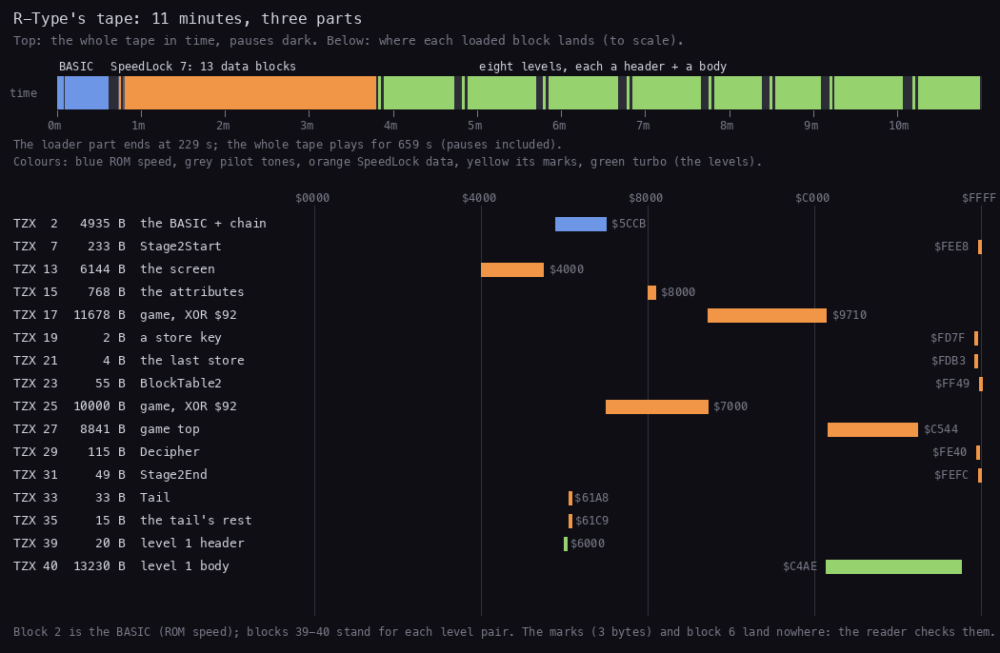

*The tape of R-Type: the whole tape in time (top) and where each loaded block lands in the 64 K (below). Made with
`python3 tools/fig_load.py tape docs/img/load/tape.png` from the TZX's block list; the destinations are from the
reader's two block tables (3.5) and c1's stages (`../../kit/rs.py stages --work work/docs/rtA/c1`).*

How to read it:

- The top band is time, 0 to 11 minutes. Blue is ROM speed, orange the SpeedLock data, yellow its 1-byte and 3-byte
  marks, green the turbo level blocks, dark the pauses.
- The SpeedLock part ends at 229 s. The eight levels take the rest: each a 2-second header and a 33-50 s body.
- Each row below is one loaded block: its TZX number, its size and what it is. The bar is where it lands, `$0000` at
  the left, to scale.
- Two rows say "game, XOR `$92`": those blocks are the game, still enciphered (3.8).

The point: the loader scatters the game over the 64 K, high and low, and not in address order. The levels all land
at the same place, `$C4AE`.

| TZX block | Kind | Bytes | Lands at | Time | `c1` |
| --- | --- | ---: | --- | ---: | --- |
| 0 | archive info | | "Speedlock 7", "Original Release", "TZXed by Andrew Barker" | | |
| 1 | ROM header | 19 | Program "R-TYPE", 4933 bytes, LINE 0 | 5.09 s | PLAY at 234 |
| 2 | ROM data | 4935 | the BASIC at PROG `$5CCB-$700F`, the chain in its tail | 30.84 s + 6.7 s pause | USR at 2081 |
| 3-7 | group "Speedlock 7 Block 1": tone, 16 pulses, the 1-byte `$E8`, then 233 bytes | 233 | Stage2Start `$FEE8-$FFCF` (232 bytes) and its check byte | 2.1 s + 1.7 s pause | entered at 2599 |
| 9-12 | group "Speedlock 7 Block 2": tone, 16 pulses, `$E8` | | | 0.95 s | |
| 13 | SpeedLock data | 6144 | the loading screen's pixels, `$4000-$57FF` | 30.54 s | 2600-4200 |
| 15 | SpeedLock data | 768 | the attributes, to `$8000-$82FF` | 3.86 s | the reveal from 4389 |
| 17 | SpeedLock data | 11 678 | the game's `$9710-$C4AD`, enciphered | 53.42 s | |
| 19 | SpeedLock data | 2 | `$FD7F`: the reader's own store key | 0.01 s | |
| 21 | SpeedLock data | 4 | `$FDB3`: the store of a block's last byte | 0.02 s | |
| 23 | SpeedLock data | 55 | BlockTable2 over `$FF49` | 0.27 s | |
| 25 | SpeedLock data | 10 000 | the game's `$7000-$970F`, enciphered | 46.93 s | |
| 27 | SpeedLock data | 8841 | the game's top, at `$C544-$E7CC` | 43.78 s | |
| 29 | SpeedLock data | 115 | Decipher `$FE40` and its leftover | 0.56 s | run at 11 680 |
| 31 | SpeedLock data | 49 | Stage2End over `$FEFC` | 0.24 s | |
| 33 | SpeedLock data | 33 | the Tail `$61A8` | 0.16 s | run at 11 697 |
| 35 | SpeedLock data | 15 | `$61C9`: the Tail's rest and the check byte | 0.07 s + 1.0 s pause | |
| 14, 16, ... 34 | SpeedLock marks | 3 each | none: `07 FF 00` at 875/1750 T, read and checked | 0.02 s each | |
| 37 | stop the tape | | | | |
| 38-40 | text "Level 1", two turbo blocks | 20 + 13 230 | the header to `$6000`, the body to `$C4AE` | 2.08 s + 1.9 s, 50.24 s + 5.8 s | 13 858-16 528 |
| 41-68 | stop, text and two turbo blocks for each of levels 2-8 | | the same | 33-49 s a body | `l2`-`l8` |

Total 659.3 s with the pauses: 32 967 frames.

*From `tools/tzxblocks.py list`, the two block tables (3.5) and c1. The point: 13 SpeedLock data blocks, read in one
stream with a mark between each two; the levels are a second format, the game's own (3.9).*

Stage 1's first table took the destinations from memory samples every 25 frames. It placed blocks 7, 19, 23, 29,
31, 33 and 35 wrongly: the samples cannot see a block land on bytes that already hold the same values, nor one that
is overwritten within 25 frames. The table above is from the reader's own block tables, read in the listing, and
from c1's stages.

## 3.2 The BASIC line and its hidden number

The BASIC "R-TYPE" has one line, line 0:

```text
0 INK 0: PAPER 0: RANDOMIZE USR ((PEEK 23635+256*PEEK 23636)+10)
```

`python3 tools/basic_list.py` prints it. INK 0 and PAPER 0 are control codes inside the line, so a LIST would show
black on black. PEEK 23635 + 256 * PEEK 23636 is the system variable PROG: where the program starts. The line seems
to call PROG + 10.

It calls PROG + 59. The Spectrum stores every number in a line twice: the digits a person reads, then the byte
`$0E` and five bytes the interpreter really uses. The digits say 10. The five bytes say 59.

```asm
5CFA 29 2B 31 30 0E    ; ) + "10" and the number marker $0E
5CFF 00 00 3B 00 00    ; BasicHiddenNumber: the small integer 59 ($3B)
5D04 29 0D             ; ) and the end of the line
```

### Worked example: the five bytes after "10"

1. The ROM loads the program at PROG = `$5CCB` (23 755) on a 48K without a disk interface.
2. A small integer in the five-byte form is `00`, the sign `00`, the value low and high, `00`. Here:
   `00 00 3B 00 00`, so the value is `$003B` = 59.
3. The USR address is 23 755 + 59 = 23 814 = `$5D06`.
4. `$5D06` is the first byte after the line's `$0D`. c1 enters `$5D06` at frame 2081, called from the ROM's `$34BB`.
5. Someone who reads the listing and computes PROG + 10 = `$5CD5` lands inside the line's own tokens.

The point: the listing lies on purpose, and the program area holds machine code after the line.

### CopyChain: the first machine code

CopyChain `$5D06` blackens the attribute file `$5800-$5BFF` (the bitmap stays, so whatever the ROM printed goes
invisible), sets the border black and copies 4840 bytes from PROG + `$5C` = `$5D27` to `$EC00-$FEE7`. It pushes
`$EC00` first, so the `RET` after the LDIR enters the copy.

```asm
CopyChain:            ; $5D06
  DI
  LD HL,$5800
  LD DE,$5801
  LD BC,$03FF
  LD (HL),L           ; L = 0
  LDIR                ; the attributes black
  XOR A
  OUT ($FE),A         ; the border black
  LD HL,($5C53)       ; PROG
  LD DE,$005C
  ADD HL,DE           ; HL = PROG + $5C = $5D27, ChainTape
  LD BC,$12E8         ; 4840 bytes
  LD DE,$EC00
  PUSH DE             ; the RET below goes to $EC00
  LDIR
  RET
```

Pseudocode:

```text
interrupts off
attributes[0 .. 1023] = 0              # black on black
border = black
copy 4840 bytes from PROG + $5C to $EC00
jump to $EC00
```

The source is found from PROG, not assumed. The block's last byte, `$700F`, is past the copy and nothing reads it.
Witness: c1 frames 2081-2083.

## 3.3 The decryption chain: 119 rewrite loops

The 4840 bytes at `$EC00` are the chain. Only its first 52 bytes are plain code when it starts. Each piece of the
chain:

1. shifts the 100 bytes behind itself down by one with an LDDR, so the code already run is garbled;
2. rewrites every byte after itself, up to `$FEE7`, with a loop;
3. falls or jumps into the bytes it has just made.

`tools/speedlock7.py layers build/basic.bin` runs the chain in SkoolKit's simulator and prints one line a rewrite
loop (`work/docs/rtA/layers.txt`). It finds 119 loops, 3 243 365 instructions and no byte lost. The source cuts the
chain into ChainStart and 46 entries in `src/loader/chain.ann` (Layer02 ... LayerKeyed46, with the LayerExit data
between them). Several loops share one entry when no `CALL` or jump target falls between them. The last loop leaves
the SpeedLock reader at `$FB7E` (3.5).

Stage 1 and the docstring of `tools/speedlock7.py` say "26 layers". That is the number of code arrivals c1's L1 saw
(an arrival is a jump into bytes written since the last one), not the number of loops: one arrival holds up to nine
loops.

### The six kinds of rewrite

| Kind | Loops | The loop body | A byte c becomes |
| --- | ---: | --- | --- |
| add | 24 | `LD A,R / ADD A,(HL)`, then `SUB D`, `CPL` or `SUB n` | R + c, then the step after |
| sub | 25 | the keyed form: `LD A,R / XOR IXH / SUB (HL) / XOR IXL`; IX is the loop's return address + 28, taken with `CALL` and `POP IX` | ((R XOR IXH) - c) XOR IXL |
| xor | 36 | `LD A,R / XOR (HL)`, in the chained form `XOR D` with D the byte just written, plus 1 | R XOR c (XOR D) |
| pop | 18 | `POP DE / LD A,R / XOR D / LD D,A / PUSH DE / DEC SP`: the stack pointer walks down from `$FEE6` | R XOR c, from `$FEE7` down |
| inc | 9 | `INC (HL)` | c + 1 |
| dec | 7 | `DEC (HL)` | c - 1 |

R is the refresh register. ChainStart sets it to `$45`. It then steps by one on every opcode fetch, so its value at
each byte depends on every instruction since. A simulator that miscounts one fetch gets every later byte wrong. That
is the protection: the key is the exact path of execution.

The pop layers use the stack as their pointer. `POP DE` reads two bytes, the loop changes the high one and `PUSH DE`
puts both back; `DEC SP` then moves one byte down. Interrupts are off from CopyChain on, so nothing else touches the
stack meanwhile.

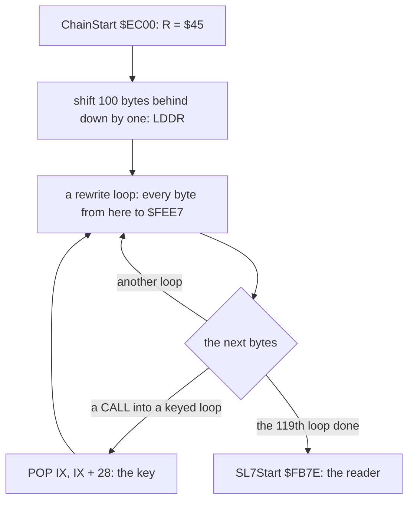

*The chain's shape. The point: every loop rewrites all that follows it, so a byte near the end is rewritten up to 119
times, and only the last loop's output is plain.*

### One keyed layer, line by line

ChainStart and its first loop, as they run:

```asm
ChainStart:           ; $EC00
  LD A,$45
  LD R,A              ; the key starts here
  LD HL,$EC04
  LD DE,$EC03
  LD BC,$0064
  LDDR                ; 100 bytes up to $EC04 shifted down by one
  LD BC,$12B4         ; 4788 bytes to rewrite
  LD HL,$EC34         ; from $EC34
  CALL LayerKeyed01   ; pushes $EC18
LayerKeyed01:         ; $EC18
  POP IX              ; IX = $EC18
  LD DE,$001C
  ADD IX,DE           ; IX = $EC34
LoopEC1F:
  LD A,R
  XOR IXH             ; R XOR $EC
  SUB (HL)
  XOR IXL             ; XOR $34
  LD (HL),A
  DEC BC
  LD A,C
  INC HL
  OR B
  JP NZ,$EC31         ; $EC31: JP LoopEC1F
  JP $EC34            ; into the bytes just made
```

Pseudocode of any layer:

```text
shift the 100 bytes behind this code down by one
for p from the byte after the loop to $FEE7 (or down, for a pop loop):
    key = R at this moment (with IX or D, by kind)
    memory[p] = rewrite(kind, memory[p], key)
continue at the byte after the loop
```

### Worked example: the first three loops on real bytes

From `work/docs/rtA/chain_example.py`, which steps the simulator and prints R at each store:

**Loop 0, keyed (sub), its `SUB (HL)` at `$EC23`, IX = `$EC34`.** A = R XOR IXH, then A - c, then XOR IXL:

| Address | c (tape) | R | R XOR `$EC` | minus c | XOR `$34` | Meaning |
| --- | --- | --- | --- | --- | --- | --- |
| `$EC34` | `$E1` | `$1A` | `$F6` | `$15` | `$21` | `LD HL,nn` |
| `$EC35` | `$C1` | | | | `$37` | n low |
| `$EC36` | `$02` | | | | `$EC` | n high: `LD HL,$EC37` |

**Loop 1, add, its `ADD A,(HL)` at `$EC49`, D = 0.** A = R + c - D:

| Address | c | R | R + c | Result |
| --- | --- | --- | --- | --- |
| `$EC52` | `$AC` | `$40` | `$EC` | `$EC` |
| `$EC53` | `$79` | | | `$C3` (`JP`) |
| `$EC54` | `$02` | | | `$56` |

**Loop 2, chained xor, its `XOR (HL)` at `$EC60`, D starts at 4.** A = R XOR c XOR D; then D = A + 1:

| Address | c | R | D | Result | Meaning |
| --- | --- | --- | --- | --- | --- |
| `$EC6E` | `$C8` | `$20` | `$04` | `$EC` | the high byte of the loop's own `JP $EC5E` |
| `$EC6F` | `$1D` | `$2D` | `$ED` | `$DD` | LayerExit01, byte 1 |
| `$EC70` | `$0D` | | `$DE` | `$E9` | LayerExit01, byte 2: `JP (IX)` |

The first store of loop 2 repairs the loop's own jump. `JP $EC5E` at `$EC6C` holds `$C8` as its high byte until the
loop's first pass writes `$EC` there, a few instructions before the jump is fetched. The `$DD,$E9` it makes next is a
`JP (IX)` that no code runs: later loops rewrite it again, and it stays in the plain view as LayerExit01, data.

The point: each byte is a function of the whole run so far, and the code repairs its own branches one step ahead.

### The chain in memory

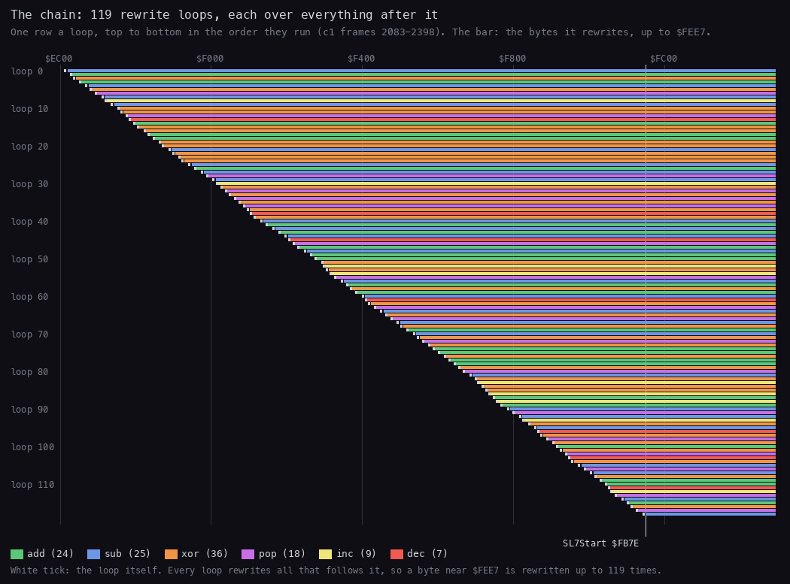

*The 119 rewrite loops in the order they run, from `tools/speedlock7.py layers build/basic.bin`. Made with `python3
tools/fig_load.py layers docs/img/load/layers.png work/docs/rtA/layers.txt`.*

How to read it:

- One row is one loop, top to bottom in time (c1 frames 2083-2398).
- The white tick is the loop itself; the bar is the bytes it rewrites, to `$FEE7`.
- The colour is the kind: add, sub (the keyed loops), xor, pop, inc, dec.
- The white line marks SL7Start `$FB7E`, the reader the last loop leaves.

The point: the loops sit 20 to 60 bytes apart, and each one pays for the whole rest. The reader at `$FB7E` and its
data up to `$FEE7` go through all 119 rewrites.

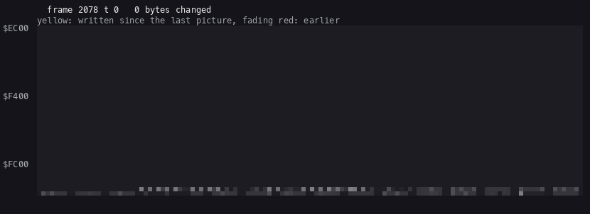

*The chain rewriting `$EC00-$FFFF`, c1 frames 2078-2400, a picture every 489 216 T (7 frames). Made with `python3
../../kit/memanim.py --work work/docs/rtA/c1 --from 2078 --to 2400 --step 489216 --from-address EC00 --to-address
FFFF --cell 6 --row-bytes 128 docs/img/play/load-chain.gif`.*

How to read it:

- Each cell is a byte, 128 bytes a row, `$EC00` at the top left.
- Bright cells were written since the last picture; the trail fades.
- The written front moves down the rows: each new loop starts a little lower.

The point: for 315 frames (6.3 s) the screen and the border are black, and all the work is this rewrite. Witness: c1
stages `$EC00` at 2083, `$EC34` at 2089 and 24 more arrivals up to `$FB2D` at 2396.

## 3.4 SL7Start: the ROM check and the wipe

The last loop falls into SL7Start `$FB7E` at c1 frame 2398 T 62 589. It checks twice that the byte at `$0000` is
`$F3`, the `DI` every Spectrum ROM starts with:

```asm
SL7Start:              ; $FB7E
  NOP
  CCF
  LD A,($0000)
  CP $F3
CheckRom:              ; $FB85
  JP NZ,$0000          ; not the ROM: reset
  IN A,($9F)
  LD A,($0000)
  CP $F3
  JR NZ,CheckRom
  XOR A                ; L = H = 0, A = 0
  ...
  OUT ($1F),A          ; 0
  OUT ($7B),A          ; 1
  OUT ($BB),A          ; 1
  LD (HL),L            ; ($0000) = 0
  LD A,$43
  LD BC,$3FFF
  LDIR                 ; $0000 over $0001-$3FFF
  OUT ($7F),A          ; $43
  LDDR                 ; and back down
  LD HL,$4000
  LD DE,$4001
  LD BC,$1BFF
  LD (HL),L
  LDIR                 ; $4000-$5BFF cleared
  ...                  ; an LDDR of 15 bytes
  JP SL7Main           ; $FECD
```

`IN A,($9F)` is the read a Multiface One pages its ROM in on. With one attached, the second check reads the
interface's ROM at `$0000`, not `$F3`, and the machine resets. The writes to `$1F`, `$7B`, `$BB` and `$7F` go to the
paging ports of other interfaces; which interface answers which port was not determined here. The LDIR and LDDR over
`$0000-$3FFF` change nothing in a ROM, but would wipe RAM paged there.

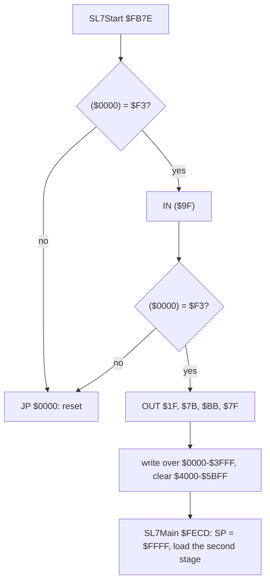

*The point: before any byte is read from the tape, a copier interface must be absent or wiped. Witness: c1 passed both
checks at frame 2398; the reset is known only from the code.*

## 3.5 The SpeedLock reader

SL7Main `$FECD` sets `SP` to `$FFFF`, clears the screen again, and calls SL7LoadStage2 to load 232 bytes to `$FEE8`
(TZX block 7). The reader is SL7LoadBlock `$FCF6`. It is not the ROM's LD-BYTES: it has its own pilot, a sync
pattern, a mark, its own bit timing and a byte store that deciphers.

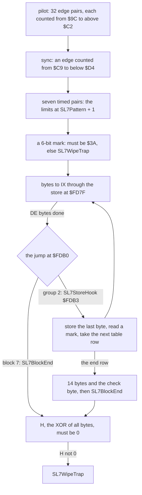

*The reader's states. The point: one call of SL7LoadBlock reads the whole of group 2, eleven blocks and their marks,
without returning.*

### The bit timing

Each bit is two edges. The loop waits for an edge after a fixed delay (SL7EdgeDelay), calls the per-bit task, then
waits for the second edge. B counts the polls in between; the count decides the bit.

```asm
NextBit:               ; $FD93
  LD A,$09
ReadBit:               ; $FD95
  CALL SL7EdgeDelay    ; A x 16 T, then poll until an edge
  RET NC               ; B wrapped: a timeout
  CALL SL7Reveal       ; the per-bit task, its address patched at $FD9A (3.7)
  RET NC
  LD A,$13
  LD A,$D0             ; the threshold
  CP B
  RL L                 ; the bit into L
  LD B,$B2             ; the count's start for the next bit
  JP NC,NextBit        ; until the marker bit leaves L
SL7EdgeDelay:          ; $FCDB
  DEC A
  JR NZ,SL7EdgeDelay
EdgePoll:              ; $FCDF
  INC B                ; 4 T
  RET Z                ; 5 T
  LD A,$7F             ; 7 T
  IN A,($FE)           ; 11 T
  RRA                  ; 4 T
  XOR C                ; 4 T: C holds the last level
  AND $20              ; 7 T
  JR Z,EdgePoll        ; 12 T: 54 T a poll
```

### Worked example: a zero and a one

Counted from the code, without contention:

1. A poll is 54 T. The count starts at `$B2` and the threshold is `$D0`: 30 polls.
2. A zero is two pulses of 714 T. After the delay and the task, about 8 polls fit in each half: B ends near `$C2`,
   below `$D0`. The bit is 0.
3. A one is two pulses of 1428 T: about 21 polls a half, B ends near `$DC`, above `$D0`. The bit is 1.
4. Every version of the task is padded with DJNZ loops so that it costs the same time whatever it does. A task that
   took longer would move every bit's count.

The marks use the same scheme with their own numbers, in SL7ReadBit `$FE2A`: the start `$B3`, a delay of 12 and the
threshold `$DB`, for pulses of 875 and 1750 T.

### The store and its keys

The store at `$FD7F` does not store the byte it read. It stores (L XOR k) + a:

```asm
StoreByte:             ; $FD7F
  LD A,$C1             ; k: the operand at $FD80
  XOR L                ; L: the byte from the tape
  ADD A,$11            ; a
  LD (IX+$00),A
  INC IX
  DEC DE
```

A block's last byte goes through SL7StoreHook `$FDB3`, which holds its own copy of the same three instructions. Both
start with k = `$C1` and a = `$11`.

Tape block 19 loads 2 bytes at `$FD7F`, the store's own first instruction. Block 21 loads 4 bytes at `$FDB3`, the
hook's. From then on both stores use k = `$86`: the stream changes its own key.

### Worked example: blocks 13, 19, 21 and 25

Block 13 (the screen, key `$C1`) starts `C1 2E EE D8` on the tape:

| Tape L | L XOR `$C1` | + `$11` | Stored at | `src/res/screens/loading.scr` |
| --- | --- | --- | --- | --- |
| `$C1` | `$00` | `$11` | `$4000` | `$11` |
| `$2E` | `$EF` | `$00` | `$4001` | `$00` |
| `$EE` | `$2F` | `$40` | `$4002` | `$40` |
| `$D8` | `$19` | `$2A` | `$4003` | `$2A` |

There is no flag byte: the first byte of the block is pixel data.

Block 19 is `EC B4`, still under k = `$C1`:

| Tape L | L XOR `$C1` | + `$11` | Stored at | Meaning |
| --- | --- | --- | --- | --- |
| `$EC` | `$2D` | `$3E` | `$FD7F` | `LD A,n` |
| `$B4` | `$75` | `$86` | `$FD80` | n = `$86`, the new k |

Block 21, `AB F3 1A 33`, under the new key gives `3E 86 AD C6` at `$FDB3`: `LD A,$86 / XOR L / ADD A,...`, the
hook's copy with the new key too.

Block 25 (the game's `$7000-$970F`, key `$86`), the bytes of `$70AC`:

| Address | Tape L | (L XOR `$86`) + `$11` | XOR `$92` (Decipher, 3.8) | The game |
| --- | --- | --- | --- | --- |
| `$70AC` | `$37` | `$C2` | `$50` | P |
| `$70AD` | `$4C` | `$DB` | `$49` | I |
| `$70AE` | `$4B` | `$DE` | `$4C` | L |
| `$70AF` | `$4A` | `$DD` | `$4F` | O |
| `$70B0` | `$33` | `$C6` | `$54` | T |

The start of PilotStandByText "PILOT STAND BY", as it is in the image.

The point: two ciphers stack on the game's code. The reader's store undoes the first as the bytes arrive; the second,
XOR `$92`, stays in memory until the last block is in.

### The block tables

Stage2Start `$FEE8` sets the screen as the target, points the jump at `$FDB0` (its operand `$FDB1`) at SL7StoreHook,
and calls SL7LoadBlock once:

```asm
Stage2Start:           ; $FEE8
  XOR A
  LD ($82FF),A         ; the reveal's switch off (3.7)
  LD IX,$4000
  LD DE,$17FF          ; 6143 bytes, the last through the hook
  LD HL,SL7StoreHook
  LD (SL7StorePtr),HL  ; $FDB1 = $FDB3
  CALL SL7LoadBlock
```

From then on, each block's last byte goes through the hook, which falls into SL7Blocks `$FDC7`. SL7Blocks reads the
row of the table at IY: five bytes, the address, the length less one and a value for port `$7FFD`. It writes the
`$7FFD` value, reads the 3-byte mark between the blocks (7 bits that must be `$7F`, else SL7Pattern is set), and
goes on with the next block. The end row, all zeros, loads 14 bytes and the check byte to `$61C9` and leaves through
SL7BlockEnd.

The table is loaded in two parts. The first is in the second stage's data at `$FF49` (block 7). Its fifth row loads
block 23 over the table itself:

| Row | First table (block 7) | BlockTable2 (block 23) | Read from |
| ---: | --- | --- | --- |
| 0 | `$8000`, `$02FF`, `$10` | `$8000`, `$02FF`, `$10` | the first: block 15 |
| 1 | `$9710`, `$2D9D`, `$10` | `$9500`, `$64FF`, `$10` | the first: block 17 |
| 2 | `$FD7F`, `$0001`, `$10` | zeros | the first: block 19 |
| 3 | `$FDB3`, `$0003`, `$10` | zeros | the first: block 21 |
| 4 | `$FF49`, `$0036`, `$10` | `$0000`, `$0027`, `$10` | the first: block 23 |
| 5 | `$6000`, `$1FFF`, `$13` | `$7000`, `$270F`, `$10` | the second: block 25 |
| 6 | `$4000`, `$1AFF`, `$12` | `$C544`, `$2288`, `$10` | the second: block 27 |
| 7 | `$FB00`, `$01FF`, `$10` | `$FE40`, `$0072`, `$10` | the second: block 29 |
| 8 | zeros | `$FEFC`, `$0030`, `$10` | the second: block 31 |
| 9 | | `$61A8`, `$0020`, `$10` | the second: block 33 |
| 10 | | zeros: the end | the end: block 35, 15 bytes |

*From `src/res/loader/stage2-data.bin` (offset `$32`) and `build/table2.lst`. The point: the table is rewritten in
the middle of the stream. SL7Blocks has read row 4 completely before block 23 lands, so rows 0-4 of BlockTable2 are
never read; row 1 there, `$9500` for 25 856 bytes, misleads whoever reads the tape's bytes without running the
reader. Rows 5-7 of the first table (with `$7FFD` values `$13` and `$12`: banks 3 and 2 of a 128K) are never read
either: block 23 replaces them first.*

Every row read writes `$10` to `$7FFD`: on a 128K, bank 0 at `$C000` and the 48K ROM. On a 48K the write reaches no
device. Witness: c1 (48K) and m128 (128K) load alike ([doc 2, 2.9](02-architecture.md#29-the-48k-and-the-128k)).

## 3.6 The timing check

SL7LoadStage2 does more than load block 7. After it, it samples the EAR line 255 times into `$9000`, each sample the
number of level changes SL7CountEdges sees in 255 polls (about 4.4 ms). Then, unless the ROM byte at `$006D` is
`$28`, it calls SL7CheckSamples:

```text
S1 = sum of samples 50 .. 99
S2 = sum of samples 205 .. 254
if S2 >= $0D00:            flag = high byte of S2        # a great many edges
elif S2 < S1:              ok
elif S2 - S1 < 50:         ok
else:                      flag = 1
```

The samples cover about 1.1 s of the 1.7 s pause after block 7. On the original the line is quiet there. A copy that
shortened the pause would put block 13's pilot under the second window: about 7 edges a sample, S2 near 350 against
S1 near 50, and the flag set. The flag is SL7Pattern `$FEB3`. Nothing happens at once: the reader goes on, and
Stage2End wipes memory at the very end (3.8), two and a half minutes later.

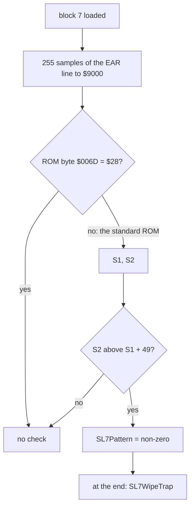

### Worked example: c1's samples

At c1 frame 2599 the 255 bytes at `$9000` are all `$01`: one change each, the line read once at its level, then
quiet. S1 = 50, S2 = 50, S2 - S1 = 0 < 50: no flag. SL7Pattern is still 0 when Stage2End reads it at frame 11 680.

The standard 48K ROM holds `$20` at `$006D` (the `JR NZ` of its NMI routine), so the check runs on it. A ROM with
`$28` there (`JR Z`) skips it; which ROM that is was not determined (known only from the code).

The point: the pause on the tape is part of the protection, and a failed check is punished late, far from its cause.

## 3.7 The reveal and the countdown

The per-bit task is the `CALL` at `$FD99`; its target, the word at `$FD9A`, changes twice in the load. Each version
is padded to the same length (3.5).

| From c1 frame | The task | What it does |
| --- | --- | --- |
| 2599 | SL7Reveal `$FBD7`: wait | reads `$82FF`; while it is 0, a DJNZ pad |
| 4389 | `$FBFC`: the reveal | 12 LDI a bit from `$8000` to `$5800`; when 64 calls have copied 768 bytes, switch |
| 4391 | `$FC3D`: the countdown | count bits; every so many, take a tenth off the digits and draw them |

`$82FF` is the last byte of block 15, the attributes loaded to `$8000-$82FF`. It is `$45`, not zero. So the
attribute block's own last byte, landing, switches the reveal on. The screen's pixels have been black on black since
CopyChain, and they now get their colours in 64 bits' time.

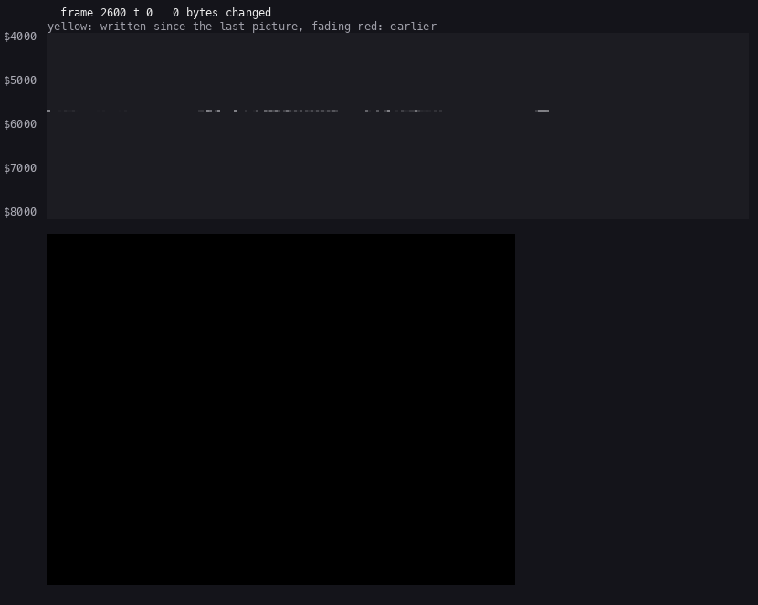

*The screen and `$4000-$83FF` during blocks 13 and 15, c1 frames 2600-4500, a picture every 2 795 520 T (40 frames).
Made with `python3 ../../kit/memanim.py --work work/docs/rtA/c1 --from 2600 --to 4500 --step 2795520 --from-address
4000 --to-address 83FF --cell 3 --screen docs/img/play/load-screen.gif`.*

How to read it:

- The left grid is memory from `$4000`; the screen is drawn beside it.
- The pixels arrive in the screen's own order, a third at a time, invisible (black on black).
- At the end the attributes arrive at `$8000` (the grid's lower part) and are copied up to `$5800`.

The point: the pixels and the colours come apart, so the picture shows at once when the colours land.

### The countdown

After the reveal the task draws four digits at `$50E0-$50E5`, at the bottom left: minutes, tens of seconds, seconds
and tenths. The digits are SL7Bytes `$FCD1-$FCD4`, each the low byte of a glyph in the second stage's data (`$FF80`
+ 8 x digit). Every so many bits the tenths go down by one (`ADD A,$F8`). A digit that falls below `$80` becomes 9
(`$C8`), or 5 (`$A8`) for the tens of seconds, and the digit to its left goes down. The glyphs are drawn over the
next calls, 4 rows a call.

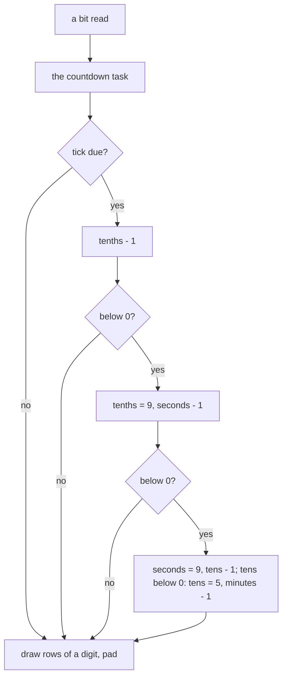

### Worked example: the countdown in c1

| c1 frame (the frame's start) | SL7Bytes | Digits | Shown |
| --- | --- | --- | --- |
| as loaded | `90 98 80 90` | (`$90` - `$80`) / 8 = 2, then 3, 0, 2 | 2 30 2: 2 min 30.2 s |
| 4400 | `90 98 80 80` | 2, 3, 0, 0 | 2 min 30.0 s |
| 11 000 | `80 88 98 90` | 0, 1, 3, 2 | 13.2 s |
| 11 680 | `80 80 80 80` | 0, 0, 0, 0 | 0.0 s: Decipher starts |

From frame 4400 to 11 680 is 7280 frames, 145.6 s, for 150.0 s on the display. The countdown counts bits, not
time: it runs 3 % fast, and reaches 0 with the last block. (Read with `python3 work/docs/rtA/mem.py work/docs/rtA/c1
FRAME FCD1 4`.)


*The loading screen with its countdown, c1 frames 4300-11 800, a picture every 150 frames. Made with `python3
../../kit/screen_anim.py --work work/docs/rtA/c1 --from 4300 --to 11800 --step 150 --width 1050
docs/img/play/load-countdown.gif`.*

How to read it:

- The picture is the screen as the player sees it, border included.
- The four digits at the bottom left count down from 2 30 0.
- At the end the screen changes to the title picture (the game's entry, 3.8).

The point: the player watches a picture and a clock for two and a half minutes, while the game arrives enciphered
under it.

## 3.8 Stage2End, Decipher and the Tail

Stage2Start's own code after its `CALL` (IM 2, `SP` = `$752F`, `JP $7530`) never runs. Block 31 loads Stage2End over
`$FEFC`, so when SL7LoadBlock returns after block 35, it returns into Stage2End. `$7530` is in the game's texts at
that moment: the jump belongs to another layout of the same second stage, and copies of that older code are in
DecipherLeftover `$FE53` and TailLeftover `$61C9`.

```asm
Stage2End:             ; $FEFC
  LD A,(SL7Pattern)
  OR A
  CALL NZ,SL7WipeTrap  ; a failed check: wipe
  LD IY,$5C3A
  IM 1
  LD HL,$2758
  EXX                  ; HL' = $2758: the BASIC's registers back
  LD A,$00
  OUT ($FE),A
  LD A,$00
  LD R,A
  LD A,$3F
  LD I,A
  LD SP,$6FFD
  DI
  LD HL,$0000
  LD DE,$0000
  LD BC,$0001
  LD (HL),$00
  LDIR                 ; one byte onto the ROM: nothing
  JP Decipher
Decipher:              ; $FE40
  LD HL,$7000
  LD BC,$54AE          ; 21 678 bytes
DecipherLoop:
  LD A,(HL)
  XOR $92
  LD (HL),A
  INC HL
  DEC BC
  LD A,B
  OR C
  JR NZ,DecipherLoop
  JP Tail              ; $61A8
Tail:                  ; $61A8
  LD HL,$2758
  EXX
  LD SP,$6FFE
  LD IY,$5C3A
  DI
  LD HL,$E7CD
  LD DE,$FFA1
  LD BC,$2292          ; 8850 bytes
  LDDR                 ; $C53C-$E7CD to $DD10-$FFA1
  LD A,$30
  LD BC,$7FFD
  OUT (C),A            ; bank 0, the 48K ROM, paging locked
  JP $85FD             ; the game's entry
```

Pseudocode:

```text
if the timing check failed: wipe memory for ever
restore the BASIC's IY and HL'; IM 1; R = 0; I = $3F
for p in $7000 .. $C4AD: memory[p] ^= $92
move $C53C .. $E7CD up by $1FD4 (to $DD10 .. $FFA1)
port $7FFD = $30          # 128K: paging locked in the 48K layout
jump to the game's entry $85FD
```

The `$7FFD` value `$30` sets bit 4 (the 48K ROM) and bit 5, the lock: after it, a 128K cannot page again until it is
reset. The game is 48K only, and the lock keeps it so. On a 48K the write reaches no device.

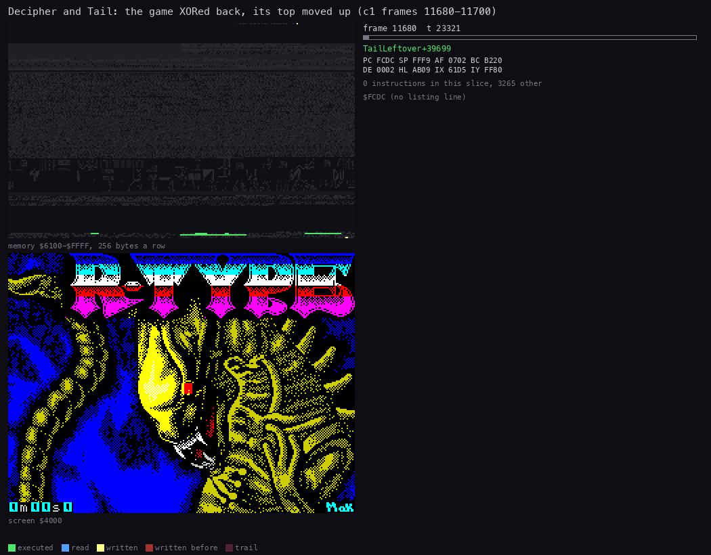

*Decipher and the Tail at work, c1 frames 11 680-11 700 (188 489 instructions). Made with `python3
../../kit/routine_anim.py --trace work/docs/rtA/c1/traces/11680_0-11700_1500.uatr --listing build/decipher.lst
--listing build/tail.lst --view screen --range 6100-FFFF --pc FE40-FE52,61A8-61C8 --pictures 60 --title "Decipher and
Tail: the game XORed back, its top moved up (c1 frames 11680-11700)" --out docs/img/routines/Decipher.gif`.*

How to read it:

- The listing on the left shows the line being run.
- The memory grid on the right is `$6100-$FFFF`; the written bytes light up.
- First the XOR front walks from `$7000` to `$C4AD`; then the LDDR moves a block up, from its top down.

The point: the whole game is enciphered in memory until 0.4 s before it runs.

### Worked example: the move

The Tail's LDDR copies 8850 bytes, from `$E7CD` down to `$C53C`, to `$FFA1` down to `$DD10`. Block 27 put the game's
top, 8841 bytes, at `$C544-$E7CC`. After the move it is at `$DD18-$FFA0`: TitleScreen `$DD18`, the level space's
tail, the sound and the tail module ([doc 2, 2.2](02-architecture.md#22-the-memory-map)). The 9 bytes below it move to
`$DD10-$DD17`. The bytes left at `$C544-$DD0F` are LoaderLeftover, in the level space; the first level overwrites
them.

Witness: c1 Decipher from frame 11 680 to about 11 697; the Tail in 11 697-11 700; the entry `$85FD` at frame
11 700 T 1379, from `$61C6`.

## 3.9 The game's level loader

The game loads its levels itself, with LoadLevel `$FE03` and its tape reader LoadBytes `$8F1F`. The level blocks are
turbo blocks: pilot 2165 T x 3251, syncs 714/714 T, bits 583/1166 T, flag `$E6`. Each level is two blocks: an
18-byte header and the body.

### The header, byte by byte

Level 1's header, TZX block 39, with its flag and check byte:

| Offset | Bytes | What |
| --- | --- | --- |
| flag | `E6` | the flag LoadBytes checks |
| 0-12 | `00 00 AA 00 AA 00 AA 00 AA 00 AA 00 00` | the same in all eight |
| 13 (`$600D`) | `31` | the level, an ASCII digit `'1'`-`'8'` |
| 14-15 | `00 00` | |
| 16-17 (`$6010`) | `AC 33` | the body's length, `$33AC` = 13 228 |
| check | `E2` | the XOR of the flag and the 18 bytes |

The body follows: flag `$E6`, the level's bytes, a check byte. It lands at LevelSpace `$C4AE` ([doc 7](07-objects.md)
decodes it).

### LoadBytes

LoadBytes `$8F1F` is the ROM's LD-BYTES re-timed, with three changes:

- `DI` and a `PUSH` of LoadDone `$FEC0`, so every return, good or bad, goes through `EI` and `RET C`;
- its own counts: the pilot from `$90` to above `$BF`, 256 pairs; the sync below `$D4` from `$C3`; the bits from `$C0`
  (`$C2` after a byte) against `$DB`;
- the border: `$0F` (white) while it waits, then the ROM's stripes.

```asm
LoadBytes:             ; $8F1F
  DI
  LD A,$E6             ; the flag
  OR A
  SCF
  EX AF,AF'
  ...
  LD A,$0F
  OUT ($FE),A
  LD HL,LoadDone       ; $FEC0: EI / RET C
  PUSH HL
  ...
EdgeLoop:              ; $8FA3
  INC B
  RET Z                ; a timeout
  LD A,$7F
  IN A,($FE)           ; port $7FFE: EAR and the SPACE row
  RRA
  RET NC               ; SPACE held: give up
  XOR C
  AND $20
  JR Z,EdgeLoop
```

`IN A,($FE)` with A = `$7F` reads the half-row B, N, M, SYMBOL SHIFT, SPACE. SPACE pressed clears bit 0, `RRA` moves
it to the carry, and `RET NC` gives up: the ROM's BREAK test. So SPACE breaks a level load, and LoadLevel shows ERROR
IN LOADING.

### LoadLevel

```text
LoadLevel:
    stars off; play state cleared; the title logo drawn
    if digit = '0':                         # the first load, and after level 8
        print REWIND SIDE 2 THEN PRESS ANY KEY; wait for a key
    digit = digit + 1
    print START TAPE THEN PRESS ANY KEY; wait for a key
  LoadLevelStart:
    print SEARCHING FOR R TYPE LEVEL <digit>
    repeat:
        LoadBytes(18 bytes to $6000)        # an error goes to LoadError
        if $600D = digit: break
        wait 128 frames                     # 2.56 s: let the wrong body go by
    print LOADING R TYPE LEVEL <digit>
    LoadBytes(($6010) bytes to $C4AE)
    print R TYPE LEVEL <digit> LOADED OK; wait 92 frames
    print STOP TAPE THEN PRESS ANY KEY; wait for a key
LoadError:
    print ERROR IN LOADING; wait 96 frames
    print REWIND TAPE THEN PRESS ANY KEY; wait 64 frames, wait for a key
    go to LoadLevelStart                    # the digit is not stepped again
```

```asm
LoadLevelHeader:       ; $FE5B
  LD IX,$6000
  LD DE,$0012          ; 18 bytes
  CALL LoadBytes
  LD A,($600D)
  LD L,A
  LD A,(LevelDigit)    ; $719C
  CP L
  JR Z,$FE76           ; the right level: load its body
  LD B,$80
  CALL WaitFrames      ; 128 frames
  JR LoadLevelHeader
```

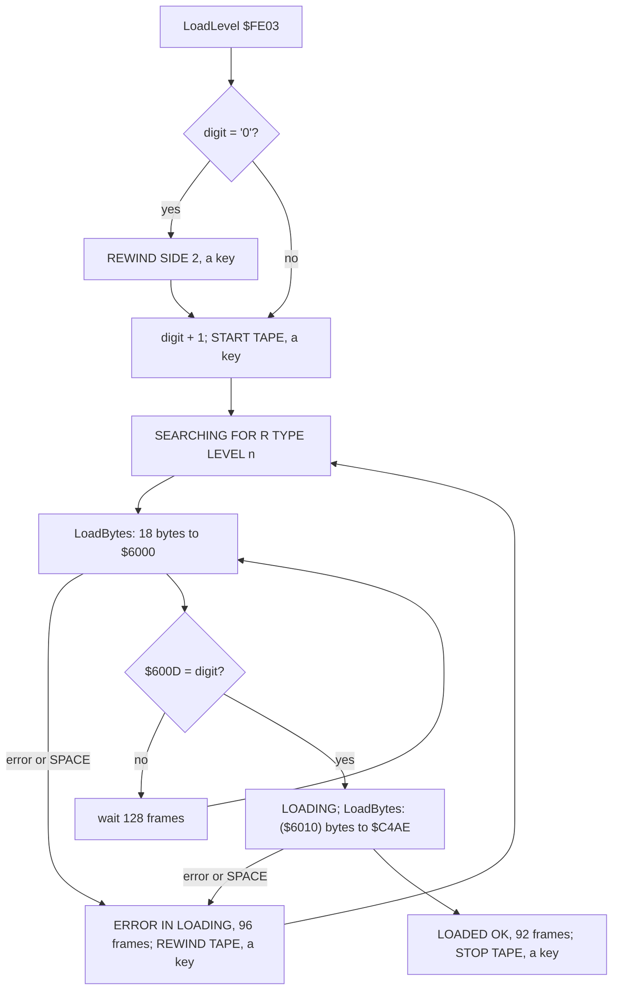

*The point: the loader knows which level it wants and checks the header's digit; a failed load is never fatal.*

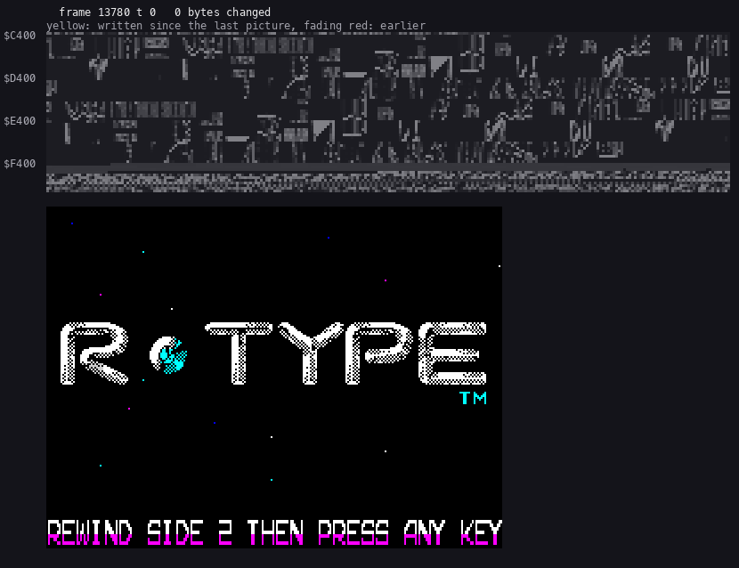

*The level space during level 1's load, c1 frames 13 780-16 560, a picture every 4 193 280 T (60 frames). Made with
`python3 ../../kit/memanim.py --work work/docs/rtA/c1 --from 13780 --to 16560 --step 4193280 --from-address C400
--to-address FFFF --screen docs/img/play/load-level1.gif`.*

How to read it:

- The grid is `$C400-$FFFF`; the screen is drawn beside it with its texts at the bottom.
- REWIND SIDE 2 shows first (the digit is `'0'` at the start), then START TAPE, then SEARCHING FOR R TYPE LEVEL 1.
- The header lands at `$6000`, off this grid; then the body fills `$C4AE` upward, over the loader's leftovers.
- The body stops at `$F859`; above it, the sound and the tail are untouched.

The point: one level is up to 13 KB, the size of the level space; the game around it stays put. Witness: c1 SEARCHING
at 13 858, LOADED OK at 16 528.

### What happens when the tape is wound too far back

Stage 1 read the header check and concluded that a tape wound too far back still finds the level. The experiment
says otherwise (`work/docs/rtA/wound.py`, its log `work/docs/rtA/wound.txt`; frames from the snapshot's start):

1. Start from `l1`'s `next.szx`: level 1 is over and the digit has just become `'2'`.
2. Set the tape at the block before level 1's header (emulator block 32), press ENTER at START TAPE.
3. Frame 107: LoadBytes reads level 1's header. `$600D` = `'1'`, not `'2'`. LoadLevel waits 128 frames.
4. The wait ends 2.56 s after the header. On the tape, level 1's header is followed by a 1.95 s pause and a 2.01 s
   pilot: the wait ends inside the body's pilot, with 1.4 s of it left.
5. LoadBytes locks onto that pilot. The body's flag is `$E6` too, so it is accepted, and 18 body bytes are read as a
   header (`$600D` = `$D7`). The byte after them is no check byte: ERROR IN LOADING at about frame 382, then REWIND
   TAPE THEN PRESS ANY KEY.

So on this tape a skipped header always leads to ERROR IN LOADING: the 128-frame wait is shorter than the pause plus
the pilot (3.96 s). The header check does reject a wrong level; the player then has to wind on by hand. With the
tape played on after the error, the experiment met a second ERROR, and level 2's header was not read by frame 4493.
Why is open (the run and the question are in `work/docs/rtA-NOTES.md`).

The experiment also found that SPACE as the "any key" at START TAPE breaks the load at once: the key is still held
when LoadBytes starts, and EdgeLoop gives up.

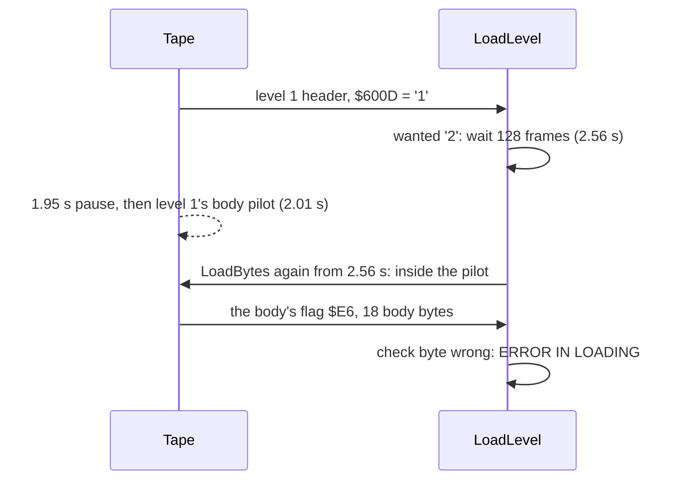

*The wound-back experiment. The point: the check is right, the wait is too short for this tape's timings.*

### The wrap after level 8

LevelEnd `$C25E` turns the digit `'8'` into `'9'` and does not load: level 8's boss stays on screen and the ship is
made immortal (`RET` at `$91F5`). At the next level end it sets `'0'` and calls LoadLevel, which shows REWIND SIDE 2
THEN PRESS ANY KEY and then looks for level 1 (recording `ending`: `$C28B`, `$C290` and `$C2A3` once each; LoadError
twice). At the very start of a game the digit is `'0'` too, so the first load also asks to rewind side 2 (c1 frame
13 784).

The MCM re-release keeps the same code but for `$8F1F-$8FBA`, LoadBytes' timings: its levels are ROM-speed blocks
(3.12).

## 3.10 How the load can fail

| Where | The cause | What happens | Witness |
| --- | --- | --- | --- |
| SL7Start `$FB7E` | `$0000` is not `$F3`, before or after `IN ($9F)` | `JP $0000`: a reset | known only from the code |
| SL7LoadBlock | the 6-bit mark is not `$3A` | SL7WipeTrap `$FBCB` | known only from the code |
| SL7BlockEnd `$FEC2` | the XOR of the bytes is not 0 | SL7WipeTrap | known only from the code |
| SL7Blocks | a mark between blocks is not `$7F` | SL7Pattern set: the wipe at Stage2End | known only from the code |
| SL7CheckSamples | the pause after block 7 too short | SL7Pattern set: the wipe at Stage2End | known only from the code |
| the reader | a timeout (no edge in 256 polls) | `RET NC` to `$FEC3` in SL7BlockEnd: the wipe unless H is 0 | known only from the code |
| LoadBytes `$8F1F` | a timeout, a wrong flag, a wrong check byte, SPACE | ERROR IN LOADING, REWIND TAPE, retry | `ending`, the wound-back experiment |
| LoadLevel | the wrong level's header | wait 128 frames, read again; on this tape an error follows | the wound-back experiment |

*The point: the SpeedLock part never says "error": it resets or wipes. The game's own loader always lets the player
try again.*

SL7WipeTrap writes zeros from `$FBD7` upward with `LD (IY+$11),0 / INC IY / JR`, round the 64 K, until it zeros its
own loop: memory is cleared and the machine is lost.

## 3.11 The stages of the load in `c1`

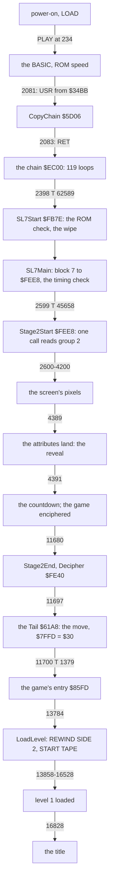

*From `../../kit/rs.py stages --work work/docs/rtA/c1` (the code arrivals and their writers) and the screens of
[WALKTHROUGH 6.1](../WALKTHROUGH.md#61-the-screens). The point: 229 s of SpeedLock, of which 6 s are the chain and
146 s the game's big blocks under the countdown.*

| Stage | Entered (c1) | From | Its bytes written by | Static decode against the recording |
| --- | --- | --- | --- | --- |
| CopyChain `$5D06` | 2081 | the ROM `$34BB` | the ROM's loader | `basic.lst` byte for byte |
| ChainStart `$EC00` | 2083 | `$5D26` (RET) | CopyChain's LDIR | 4840 bytes identical (`speedlock7.py tape`) |
| 26 arrivals `$EC34` ... `$FB2D` | 2089-2396 | each loop | the loop before | each loop's output identical in the simulator |
| SL7Start `$FB7E` | 2398 T 62 589 | the last loop | the last loop | `chain.lst` |
| Stage2Start `$FEE8` | 2599 T 45 658 | SL7Main | `$FD84`, the store | `stage2.lst` |
| Decipher `$FE40` | 11 680 | Stage2End | `$FD84` | `decipher.lst` |
| Tail `$61A8` | 11 697 | `$FE50` | `$FD84` | `tail.lst` |
| Entry `$85FD` | 11 700 T 1379 | `$61C6` | `$FE49` (Decipher's XOR) | `game.lst`, the image `build/game.bin` |

## 3.12 The releases and the copies

The collection's copies of the standard tape, compared block by block with the original (`tools/media_compare.py`,
`work/stage1/media-compare.txt`; [the README](../README.md#other-releases-and-copies) lists every file):

| Copy | What it is | How it differs |
| --- | --- | --- |
| Electric Dreams, 1988, this TZX | the original, SpeedLock 7, eight levels | |
| two other TZX transcriptions (TOSEC) | the original | every data block byte for byte |
| The Hit Squad, 1990 | the re-release, side 1 only | the same 14 loader and game blocks byte for byte; no level blocks |
| MCM Software, Spain, 1989 | a ROM-speed re-save in two sides | the game byte for byte but `$8F1F-$8FBA` (LoadBytes' timings); the eight levels as standard blocks, their bodies byte for byte |
| TAP re-saves and hacks | other loaders | all eight level bodies byte for byte; three hacks change level 8 |
| Torasoft's 128K crack | the levels in memory | no level body whole |

ZXDB notes that the first tapes had level 7 twice and no level 8. This TZX has its own level 8 (digit `'8'`, 11 980
bytes against level 7's 12 997), which `l8` plays to its boss.

The point: the game's code never changed; only the loaders around it did. The Hit Squad copy, with no level blocks,
cannot load even level 1.

## 3.13 The build

`tools/build.sh` builds `build/R-Type.tzx` from the sources and compares it with the original:

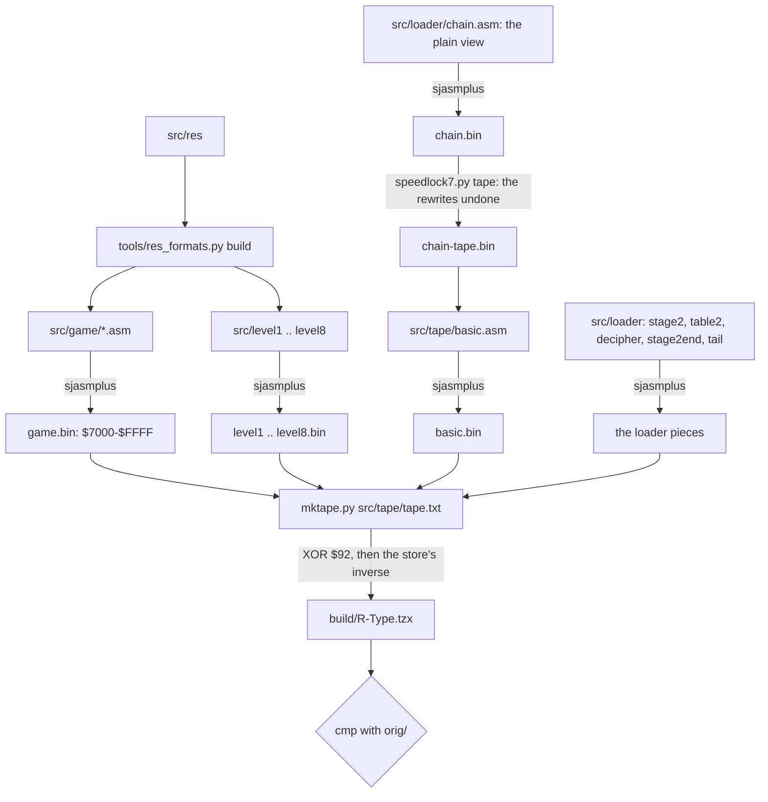

*The point: the sources hold the plain forms; the build applies the protection, the way the publisher's mastering
did.*

| Input | Turned into | How |
| --- | --- | --- |
| `src/game` | `game.bin`, then the tape's blocks 17, 25, 27 | the slices `$9710-$C4AD` and `$7000-$970F` XORed with `$92`; `$DD18-$FFA0` as block 27, loaded at `$C544` |
| `src/loader/chain.asm` | the tail of the BASIC | `speedlock7.py tape` runs the chain over the plain view in the simulator, notes every rewrite of every byte, then undoes each byte's rewrites in reverse order |
| `src/loader` pieces | blocks 7, 23, 29, 31, 33, 35 | assembled at their addresses |
| `src/level1` ... `src/level8` | the turbo pairs | the header from the digit and the length; no cipher |
| every SpeedLock block | its tape bytes | `mktape.py`: L = ((p - a) AND 255) XOR k, the store's inverse, k = `$C1` up to block 19 and `$86` after |
| `src/res` | the screens, texts, tables | `res_formats.py build` |

The chain can be undone byte by byte because its control flow never depends on the bytes it rewrites: the loops count
BC or DE, so the same run of R holds whatever the bytes are.

### Worked example: mastering one byte

The game's byte `$54` ('T') at `$70B0`:

1. XOR `$92`: `$C6`.
2. The store's inverse with k = `$86`, a = `$11`: `$C6` - `$11` = `$B5`; `$B5` XOR `$86` = `$33`.
3. `$33` is block 25's byte for `$70B0` (3.5's table).

Run `sh tools/build.sh $SJASMPLUS` after `. work/env.sh`. It prints "build: R-Type.tzx identical to
orig/R-Type.tzx.zip's R-Type.tzx".

## 3.14 The POKEs

The ZXDB POKE file "R-Type (1988)(Electric Dreams Software).pok":

| POKE | Address | The original | Poked | Effect |
| --- | --- | --- | --- | --- |
| `37374,0` | `$91FE` in ShipDies | `DEC (HL)`, HL = Lives `$7AA0` | `NOP` | a death costs no life |
| `37362,201` | `$91F2`, ShipDies' first byte | `CALL ClearHits` | `RET` | the ship cannot die |

The level recordings `l1`-`l8` use the second, in RAM only, and say so in their `record.json`. The game itself puts
a `RET` three bytes later, at `$91F5`, after level 8: the same immortality the POKE gives
([doc 10](10-gameplay-logic.md)).

## 3.15 Known only from the code

- The reset in SL7Start and SL7WipeTrap `$FBCB`; every failure of 3.10 but LoadBytes'.
- SL7CheckSamples' failing branch; the ROM with `$28` at `$006D` that skips the check.
- Stage2Start after its `CALL` (IM 2, `JP $7530`): overwritten by Stage2End before it can run.
- DecipherLeftover `$FE53-$FEB2` and TailLeftover `$61C9-$61D6`: copies of an older second stage's code, never run.
- Rows 0-4 of BlockTable2 and rows 5-7 of the first table: never read.
- The level header's bytes 0-12 and 14-15: nothing reads them.
