# 4. Game loop

What this covers:

- the program as a state machine, from the entry to the wrap after level 8;
- the interrupt: IM 2 through `$8383`, the handler `$BE23` and its task table `$BE60`;
- the main loop `$8649`, the order of a [pass](README.md#terms) and its wait for the third interrupt;
- where the interrupts are off;
- the pass as measured on level 2 (4.68 frames), what each frame of it costs, and the pass against the beam;
- the 12-frame pass: three explosions' noise bursts inside the interrupt;
- the level start: the tape search, the load with the interrupts off, the first screen;
- every delay, pause and timer;
- what is known only from the code.

The recordings it rests on ([WALKTHROUGH 6.0](../WALKTHROUGH.md#60-the-recordings)):

| Recording | What it is | Used for |
| --- | --- | --- |
| `l2` | level 2 loaded by the game and played to its end (immortality POKE `$91F2`, RAM only) | the passes (frames 3500-15 500), the traces of frames 8961-8966 and 8981-8994, the level start (frames 0-2780) |
| `c1` | a 48K from power-on, the original tape at signal speed | the entry (frame 11 700), the title, the last life |
| `pause` (rtB, [doc 5](05-controls.md)) | CAPS SHIFT and 1, 150 frames paused, CAPS SHIFT and 2 | the pause |
| `continue`, `gameover`, `hiscore` | a game lost with and without a continue, a high score entered | the death paths, MISSION OVER, CONTINUE |
| `deaths-l7` | eight deaths on level 7 without the POKE (all three death paths) | DeathTimer |
| `ending` | level 8's end and the wrap | LevelEnd with the digits `'8'` and `'9'` |

Frame numbers: a picture of frame N is the state at the start of frame N; a trace puts an instruction in the frame
where it ran. A frame of the 48K is 69 888 T (3.5 MHz, 50.08 frames a second); its interrupt comes at T 0. A time
written `F:T` is T-state T of frame F.

## 4.1 The program as a state machine

The game is one program with one entry. Every state below is a place where the program stays; most of them are a
loop that waits for a key or for a count of interrupts.

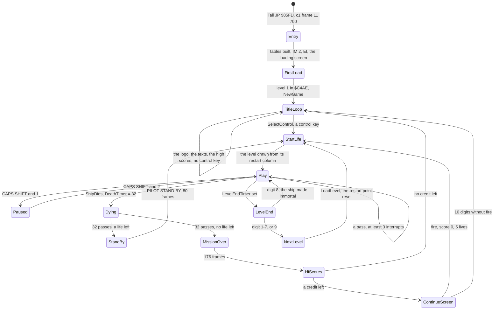

*The program of `src/game` (`main.asm`, `screen.asm`, `scroll.asm`, `waves.asm`, `util.asm`, `tail.asm`). How to read it:

- every arrow is labelled with its trigger;
- Dying, LevelEnd and Paused are drawn as states because the player sees them so; in the code Dying and LevelEnd are
  timers that the pass counts down (`LoseLife`, `LevelEnd`), and Paused is a loop inside `CheckPause`;
- FirstLoad and NextLevel are the same routine, LoadLevel `$FE03`
  ([doc 3, 3.9](03-build-and-load.md#39-the-games-level-loader)).

The point: play is one loop, and every way out of it (a lost life, a lost game, a level end) drops the pass's return
address with `POP DE` and jumps back to `StartLife` or `NewGame`. Nothing returns into the middle of a pass.
Witnesses: `c1` (entry, title, play), `l1`-`l8` (each level end), `continue`, `gameover`, `hiscore`, `deaths-l7`,
`ending` (the digits `'8'` and `'9'`).*

The transitions, with their code:

| From | Trigger | To | Code |
| --- | --- | --- | --- |
| the loader's Tail | always | Entry `$85FD` | `JP GameEntry`, c1 11 700 ([doc 3, 3.8](03-build-and-load.md#38-stage2end-decipher-and-the-tail)) |
| Entry | always | LoadLevel `$FE03` | `CALL LoadLevel` at `$8631`; the digit is `'0'`, so REWIND SIDE 2 comes first |
| NewGame `$8634` | always | TitleLoop `$7796` | `CALL RestartPoint`, `CALL NewGameState`, `CALL TitleLoop` |
| TitleLoop | a control key | StartLife `$863D` | SelectControl `$C011`: `POP BC`, `POP BC`, `RET` leaves TitleLoop for its caller, which falls into StartLife |
| a pass | CAPS SHIFT and 1 | the pause | CheckPause `$8B77`: `DI`, a loop until CAPS SHIFT and 2 |
| a pass | the ship hit | Dying | ShipDies `$91F2`: lives - 1, sound `$0983`, DeathTimer = `$20` |
| Dying | DeathTimer reaches 0, a life left | StartLife | LoseLifeNow `$9269`: PilotStandBy, `POP DE`, `JP StartLife` |
| Dying | DeathTimer reaches 0, no life left | NewGame or StartLife | MissionOver, CheckHiScore, Continue `$8BE8` |
| a pass | wave command 5, or the boss blast done | LevelEnd | LevelEndTimer `$7A9B` = `$41` (`$90E5`) or `$3F` (`$C190`) |
| LevelEnd | the timer's low 5 bits reach 0 | StartLife | LoadLevel, `POP DE`, RestartPoint, `JP StartLife` |

The Continue screen keeps the level and the restart column the player reached. It calls NewGameState `$86A9` (score
`000000`, 5 lives, no extra life yet) and not RestartPoint. A continued game goes on from the last restart column
of the level it was lost on, with the score at 0.

When no continue is taken, the game goes back to level 1. The credits are set back to `'5'` and FirstPlay to 0. If
the digit is `'1'` the level in memory is level 1 and the program jumps to NewGame; otherwise it sets the digit to
`'0'` and calls LoadLevel, which asks for side 2 to be rewound.

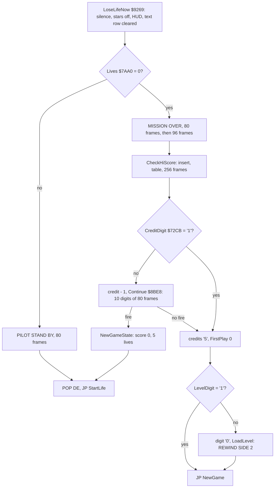

*The end of a life (`src/game/waves.asm`, LoseLife `$924B`). How to read it: each box is a step of LoseLifeNow, the
diamonds its tests. The point: a game has 4 continues (the credit digit starts at `'5'` at `$72CB`, and the last
credit gives none), and a game lost past level 1 costs a tape rewind. Witnesses: `deaths-l7` (lives left),
`gameover` (no continue taken), `continue` (fire on the countdown), `hiscore` (a name entered).*

## 4.2 The interrupt: IM 2, a jump and a task table

The entry sets the interrupt mode before anything else that needs time:

```asm
85FD  Entry:
85FD  DI
85FE  LD HL,$FFFE
8601  POP DE                  ; the loader's return address, dropped
8602  LD SP,HL
      ...                     ; BitReverse built at $5D00, EntryCopy moved to $5B64
8624  LD A,$84
8626  LD I,A
8628  IM 2
862A  EI
```

- **The vector:** `I` = `$84`, and Im2Table `$8400-$8500` is 257 bytes of `$83`. Whatever byte the bus gives, the
  CPU reads the word `$8383` and jumps there.
- **The jump:** `$8383` holds `JP Interrupt` (`C3 23 BE`), just below the vector table.
- **The handler:** Interrupt `$BE23` saves every register it uses, the alternate `AF` included, and counts IntTicks
  `$7A8A`.
- **The tasks:** it then walks TaskTable `$BE60`, five entries of five bytes, and calls each task whose counter runs
  out.

```text
Interrupt:
    save AF, BC, DE, IX, IY, HL, AF'
    IntTicks = IntTicks + 1
    for each of the 5 entries (address, switch, counter, reload):
        if bit 0 of switch is set:
            counter = counter - 1
            if counter = 0:
                counter = reload
                call address
    restore the registers
    EI; RET
```

```asm
BE23  Interrupt:
BE23  PUSH AF
BE24  PUSH BC
BE25  PUSH DE
BE26  PUSH IX
BE28  PUSH IY
BE2A  PUSH HL
BE2B  EX AF,AF'
BE2C  PUSH AF
BE2D  LD HL,IntTicks          ; $7A8A
BE30  INC (HL)
BE31  LD HL,TaskTable         ; $BE60
BE34  LD B,$05
BE36  l_BE36:
BE36  LD E,(HL)               ; the task's address
BE37  INC L
BE38  LD D,(HL)
BE39  INC L
BE3A  LD C,(HL)               ; the switch
BE3B  INC L
BE3C  RRC C
BE3E  JR NC,l_BE4E            ; off: skip
BE40  DEC (HL)                ; the counter
BE41  JR NZ,l_BE4E
BE43  INC L
BE44  LD A,(HL)               ; the reload
BE45  DEC L
BE46  LD (HL),A
BE47  PUSH BC
BE48  PUSH HL
BE49  CALL RunTask            ; $BE5E: EX DE,HL / JP (HL)
BE4C  POP HL
BE4D  POP BC
BE4E  l_BE4E:
BE4E  INC HL
BE4F  INC HL
BE50  DJNZ l_BE36
BE52  POP AF
      ...                     ; the registers back
BE5C  EI
BE5D  RET
```

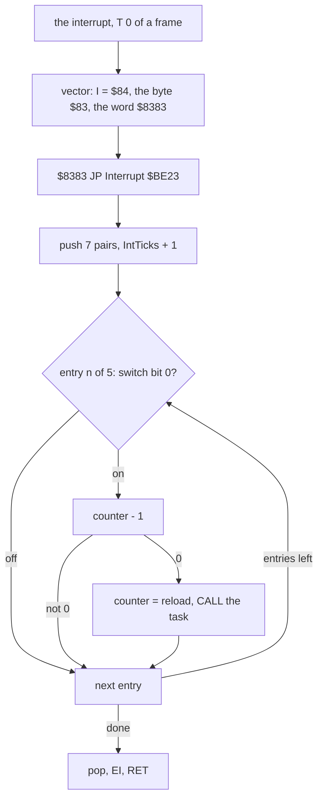

*The handler (`src/game/interrupt.asm`). How to read it: one pass of the loop per table entry. The point: one table
drives all the background work, and a task is switched on or off by writing one byte. Witness: the handler ran
134 792 times over the recordings (the summed `L1` of the 16 recordings after the entry: `continue`, `ctl-*`, `ending`, `gameover`, `hiscore`,
`hiscore-typed`, `l1`-`l8`).*

The task table as loaded (`src/res/tables/task-table.csv`):

| Entry | Task | Switch | Counter | Reload | What it does |
| --- | --- | --- | --- | --- | --- |
| 0 | StarTask `$BE79` | `$00` | 3 | 3 | the background stars; switched by StarsOn `$73BC` and StarsOff `$73C2` |
| 1 | SoundTask1 `$F8E8` | `$01` | 1 | 3 | sound channel 1, the high timbre |
| 2 | SoundTask2 `$F8F8` | `$01` | 2 | 3 | sound channel 2, the middle timbre |
| 3 | SoundTask3 `$F908` | `$01` | 3 | 3 | sound channel 3, the low timbre |
| 4 | CycleTitleColour `$76CB` | `$00` | 1 | 8 | the title's colour cycle; ShowHiScores `$7698` sets its switch to 1, so the interrupt runs it while the hiscore table is shown; ClearPlayState `$86FB` and CheckHiScore `$92F6` set it back to 0 |

### Worked example: six interrupts

The counters 1, 2 and 3 with the same reload 3 stagger the three sound channels. Start from the table as loaded, with
the stars switched on (StarsOn writes 1 to `$BE62`):

| Interrupt | Star counter | Sound 1 | Sound 2 | Sound 3 | Tasks called |
| --- | --- | --- | --- | --- | --- |
| 1 | 3 to 2 | 1 to 0, reload 3 | 2 to 1 | 3 to 2 | SoundTask1 |
| 2 | 2 to 1 | 3 to 2 | 1 to 0, reload 3 | 2 to 1 | SoundTask2 |
| 3 | 1 to 0, reload 3 | 2 to 1 | 3 to 2 | 1 to 0, reload 3 | StarTask, SoundTask3 |
| 4 | 3 to 2 | 1 to 0, reload 3 | 2 to 1 | 3 to 2 | SoundTask1 |
| 5 | 2 to 1 | 3 to 2 | 1 to 0, reload 3 | 2 to 1 | SoundTask2 |
| 6 | 1 to 0, reload 3 | 2 to 1 | 3 to 2 | 1 to 0, reload 3 | StarTask, SoundTask3 |

Each interrupt runs exactly one sound channel, and each channel steps 16.7 times a second. The stars move on every
third interrupt.

The witness is the cost of the interrupt in `l2`'s frames 8961-8966, from the trace
(`work/docs/rtA/pass-frames.txt`). The handler and its table walk take 774 T in four of the six frames, and 12 084 T
and 10 314 T in frames 8962 and 8965, the frames where StarTask ran. The sound tasks take 175-194 T a frame while no
sound plays.

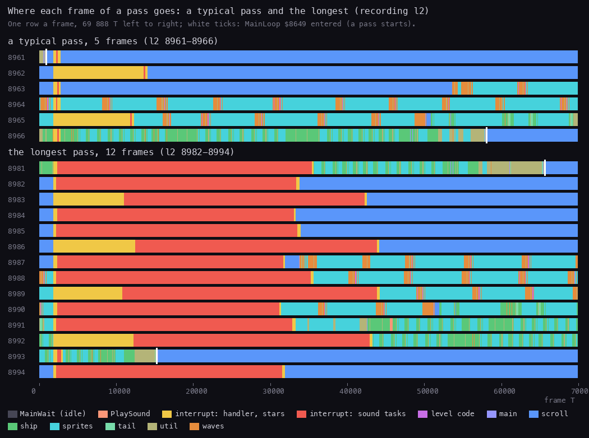

*Where each frame of two passes of level 2 goes, from the traces of `l2` frames 8961-8966 and 8981-8994. How to read
it:

- one row a frame, 69 888 T from left to right;
- each instruction is coloured by what it belongs to: the interrupt's sound tasks (red), the handler and the stars
  (yellow), MainWait's idle loop (dark grey), the level's own code (violet), else the `game.ann` module of its PC;
- a white tick marks each entry of MainLoop `$8649`, the start of a pass.

The point: the star task shows as a yellow block every third frame; the handler alone is a sliver at T 0. In the
lower group the red sound tasks fill almost half of every frame. Command: `python3 tools/fig_loop.py frames
docs/img/loop/pass-frames.png "a typical pass, 5 frames (l2 8961-8966)=work/docs/rtA/l2/traces/8961_0-8967_0.uatr"
"the longest pass, 12 frames (l2 8982-8994)=work/docs/rtA/l2/traces/8981_0-8995_0.uatr"`.*

## 4.3 The main loop and the order of a pass

StartLife `$863D` sets up a life, and the code falls into MainLoop `$8649`. One pass of the loop is 20 calls in a
fixed order, then a wait:

```text
StartLife:
    TitleStarsOn; ClearPlayState; StartPlayField; StartPlay
MainLoop:
    IntTicks = 0
    LoseLife            # count down a death, end the life at 0
    CheckPause          # CAPS SHIFT and 1
    Scroll              # the playfield one step
    (3 NOPs: MainLoopPatch)
    MoveEnemies; RunWaves
    ReadControls; MoveShip; ShipFlyIn
    MoveForce; DrawExplosions
    MoveBeam; MoveMissileSet; MoveForceShots; MoveMissiles; MoveShipShots; MoveEnemyShots
    BossBlastStep; CheckExtraLife; LevelEnd; CheckRestart
MainWait:
    while IntTicks < 3: loop
    go to MainLoop
```

```asm
8649  MainLoop:
8649  XOR A
864A  LD (IntTicks),A         ; $7A8A
864D  CALL LoseLife           ; $924B
8650  CALL CheckPause         ; $8B77
8653  CALL Scroll             ; $8979
8656  MainLoopPatch:
8656  NOP
8657  NOP
8658  NOP
8659  CALL MoveEnemies        ; $9109
865C  CALL RunWaves           ; $8FDD
865F  CALL ReadControls       ; $8B06
8662  CALL MoveShip           ; $94F1
8665  CALL ShipFlyIn          ; $8C8B
8668  CALL MoveForce          ; $95F6
866B  CALL DrawExplosions     ; $C40E
866E  CALL MoveBeam           ; $9E6B
8671  CALL MoveMissileSet     ; $A01F
8674  CALL MoveForceShots     ; $9DFA
8677  CALL MoveMissiles       ; $93D0
867A  CALL MoveShipShots      ; $9DA5
867D  CALL MoveEnemyShots     ; $C348
8680  CALL BossBlastStep      ; $C0F9
8683  CALL CheckExtraLife     ; $FDA5
8686  CALL LevelEnd           ; $C25E
8689  CALL CheckRestart       ; $C2D6
868C  MainWait:
868C  LD A,(IntTicks)
868F  CP $03
8691  JR C,MainWait
8693  JP MainLoop
```

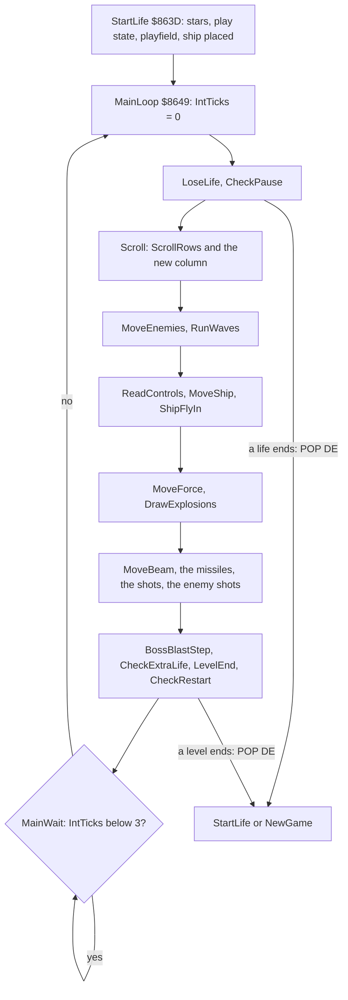

*The pass (`src/game/main.asm`). How to read it: the boxes group the 20 calls in their order; the two exits on the
side are the jumps that drop the pass. The point: the scroll and the enemies move before the controls are read, so a
key pressed in this pass moves the ship over a playfield that has already moved. Witness: the 20 calls ran in this
order in the traced pass, `l2` frames 8961-8966.*

Three details of the order:

- **IntTicks is cleared at the top.** The wait at the bottom counts the interrupts since this pass began, so a pass
  takes at least 3 interrupts. A pass that ends after the third interrupt does not wait at all.
- **MainLoopPatch `$8656`** is three `NOP`s with a label of their own. No recording writes there. Known only from
  the code.
- **Scroll runs while the map stands.** On a boss the map does not advance, but ScrollRows still walks the 20 rows
  and copies the changed cells; it skips the scenery cells, which the unrolled ShiftRun chain shifts only while the
  map moves ([doc 6](06-rendering.md)).

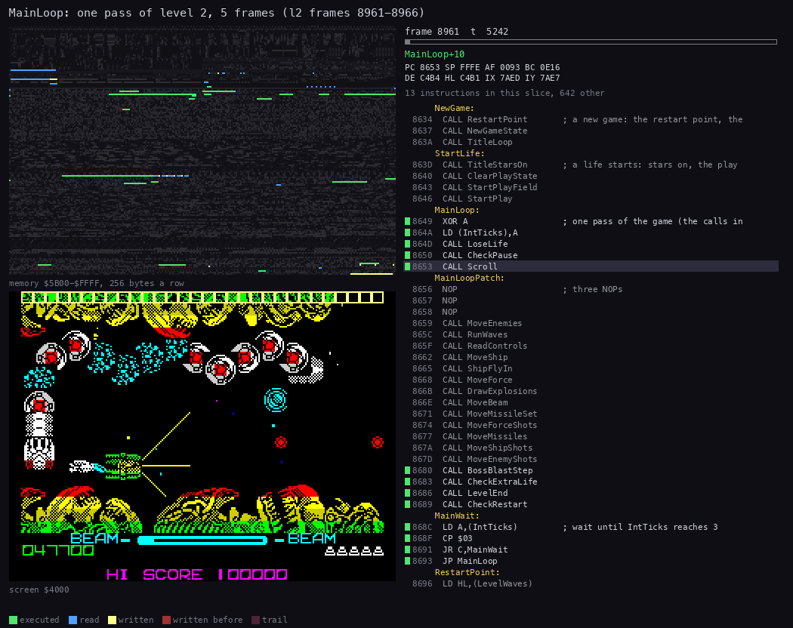

*MainLoop at work: one pass of level 2, `l2` frames 8961-8966 (5 frames), 80 pictures. How to read it:

- top left, memory `$5B00-$FFFF` at 256 bytes a row: green executed, blue read, yellow written in this picture, red
  written before;
- below it, the screen, with the cells written in this picture marked;
- on the right, the frame and T, the registers, and the listing around the PC.

The point: the pass spends its first two and a half frames in Scroll, the rows filling from the right, and most of
the rest in the sprites; MainWait at the end is one test, because the third interrupt has already come. Command:
`python3 ../../kit/routine_anim.py --trace work/docs/rtA/l2/traces/8961_0-8967_0.uatr --listing build/game.lst
--listing build/level2.lst --view screen --pc 8649-8695 --range 5B00-FFFF --pictures 80 --title "MainLoop: one pass
of level 2, 5 frames (l2 frames 8961-8966)" --out docs/img/routines/MainLoop.gif`.*

## 4.4 Where the interrupts are off

The game runs with the interrupts on. Five places turn them off:

| Where | From | To | Why |
| --- | --- | --- | --- |
| Entry `$85FD` | `DI` | `EI` at `$862A` | the stack and IM 2 are set up |
| LoadBytes `$8F1F` | `DI` | `EI` in LoadDone `$FEC0` | the edge timing of the tape; one level body is 50.8 s with the interrupts off on `l2` |
| PlaySound `$F87C` | `DI` | `EI` at `$F892` | the interrupt's sound tasks read the channel records SoundStart writes |
| CheckPause `$8B7F` | `DI` | `EI` at `$8B92` | the pause loop |
| Interrupt `$BE23` | the CPU's own | `EI` at `$BE5C` | the handler is not re-entered |

The pause shows it best. CheckPause reads two keyboard half-rows directly:

```text
CheckPause:
    if row $FEFE gives not exactly CAPS SHIFT: return
    if row $F7FE gives not exactly 1: return
    DI; clear the text row
    loop:
        if row $FEFE gives exactly CAPS SHIFT and row $F7FE gives exactly 2:
            clear the text row; EI; go to DrawHud
        print PAUSED
```

```asm
8B77  CheckPause:
8B77  CALL ReadRow0           ; $FEFE: Z when only CAPS SHIFT is down
8B7A  RET NZ
8B7B  CALL ReadRow1           ; $F7FE: Z when only 1 is down
8B7E  RET NZ
8B7F  DI
8B80  CALL ClearTextRow
8B83  l_8B83:
8B83  CALL ReadRow0
8B86  JR NZ,l_8B96
8B88  CALL ReadRow1
8B8B  CP $02                  ; key 2 alone
8B8D  JR NZ,l_8B96
8B8F  CALL ClearTextRow
8B92  EI
8B93  JP DrawHud
8B96  l_8B96:
8B96  LD HL,PausedText
8B99  LD C,$0A
8B9B  CALL PrintRow22
8B9E  JR l_8B83
```

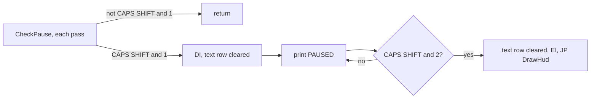

*The pause (`src/game/scroll.asm`). The point: a paused game is a frozen machine. The stars, the sound and IntTicks
stop with the `DI`, and the first interrupt after the `EI` counts in the pass that was paused. DrawHud's `RET`
returns to the pass, after the call of CheckPause. Witness: rtB's `pause` recording, where `DI` at `$8B7F` and the
resume at `$8B8F` ran once each ([doc 5, 5.10](05-controls.md#510-the-pause) has its animation). `c1`'s CAPS SHIFT
and 1 at frame 18 722 came during PILOT STAND BY, when no pass runs, so `c1` never paused.*

## 4.5 The measured pass: 4.68 frames on level 2

`tools/pass_frames.py` reads IntTicks `$7A8A` at the start of every frame of `l2` and finds the frames where it drops
back, the starts of the passes. Over frames 3500-15 500 there are 2512 whole passes:

| Frames a pass | 2 | 3 | 4 | 5 | 6 | 7 | 8 | 9 | 10 | 11 | 12 |
| --- | --- | --- | --- | --- | --- | --- | --- | --- | --- | --- | --- |
| Passes | 1 | 501 | 768 | 647 | 386 | 106 | 64 | 31 | 5 | 2 | 1 |

The mean is 4.676 frames a pass: 10.7 passes a second. The game is CPU-bound. Only the passes of 3 frames can have
waited in MainWait, a fifth of them; the others end after the third interrupt has come and go round at once.

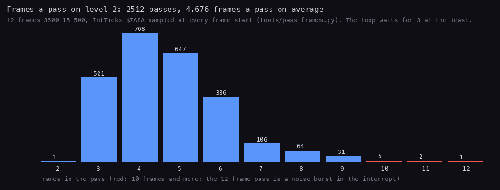

*The lengths of 2512 passes of level 2, `l2` frames 3500-15 500. How to read it: one bar per length in frames, its
height the number of passes; the red bars are the passes of 10 frames and more. The point: the 3-frame floor of
MainWait is reached by a fifth of the passes; the rest are as long as their work, and the long tail is the sound
(4.6). Command: `python3 tools/pass_frames.py --work work/stage2/pass --from 3500 --to 15500` (its output is
`work/stage1/pass-frames-l2.txt`), then `python3 tools/fig_loop.py passes docs/img/loop/pass-lengths.png
work/stage1/pass-frames-l2.txt`.*

The one pass of 2 frames is a sampling effect: the tool reads the counter at the start of each frame, and a pass that
begins just before an interrupt and ends just after its third spans only two frame starts.

The boss does not slow the game. While the map is halted on level 2's boss (from frame 10 200; the window's last
pass starts at 15 243) a pass takes 4.670 frames (1080 passes, 5044 frames), against 4.679 while the map moves (1432
passes, 6701 frames, 3501-10 199; counted from `work/stage1/pass-frames-l2.csv`). The boss passes have more lengths
of 6-9 frames (308 against 279). A 12-frame window on the boss (12 500-12 512) runs 17 300 more instructions in
ScrollRows and 9883 more in DrawSprite than a 12-frame window of scrolling (stage 2 NOTES, Facts 6).

### Worked example: one pass, l2 frames 8961-8966

The pass begins in frame 8961 and the next begins in frame 8966. The trace gives the T-states of each frame by what
ran (`work/docs/rtA/pass-frames.txt`, values in T, each frame 69 888 T):

| Frame | Scroll | Sprites | Waves | Ship | Interrupt and stars | Sound tasks | MainWait |
| --- | --- | --- | --- | --- | --- | --- | --- |
| 8961 | 67 908 | 0 | 28 | 0 | 774 | 194 | 37 |
| 8962 | 57 611 | 0 | 0 | 0 | 12 084 | 194 | 0 |
| 8963 | 52 637 | 12 945 | 2909 | 0 | 774 | 175 | 0 |
| 8964 | 0 | 57 608 | 9185 | 0 | 774 | 194 | 0 |
| 8965 | 600 | 46 814 | 6085 | 2837 | 10 314 | 194 | 0 |
| 8966 | 11 753 | 22 914 | 665 | 26 197 | 774 | 175 | 37 |

The rest of each row is `util`, the level's own code, `main` and `tail`, a few thousand T.

- In frame 8961 the previous pass ends: MainWait runs one test (37 T) and the new pass starts.
- Frames 8961-8963 are Scroll: 178 156 T, 2.55 frames.
- Frames 8963-8966 are the sprites (MoveEnemies, the shots, DrawSprite): 140 281 T, 2.0 frames.
- The ship (MoveShip, MoveForce) comes last, in frame 8966.
- The interrupt and its tasks take 26 620 T over the six frames, 6 %.
- MainWait runs 74 T in all: the pass had used up its 3 interrupts long before its end.

## 4.6 What a pass costs, against the beam

The beam timeline puts the screen writes of one pass on the raster. The pass is the same, `l2` frames 8961-8966.

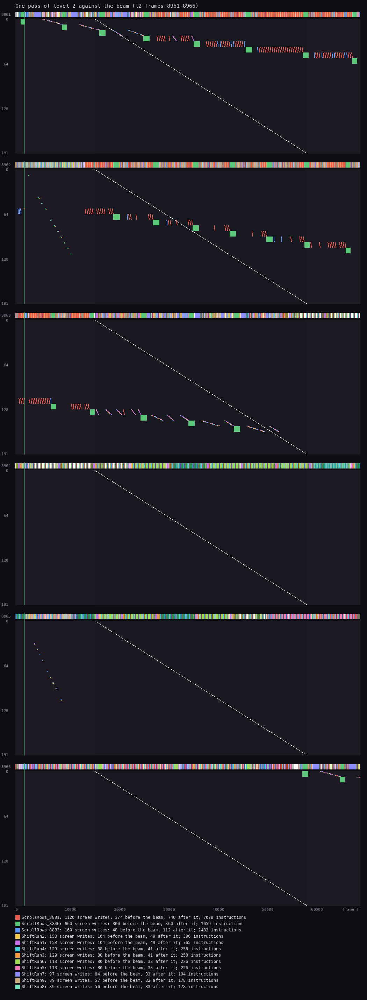

*One pass against the raster: `l2` frames 8961-8966, level 2. How to read it:

- one panel a frame: the beam's line 0-191 (down) against the frame's T-states (across);
- the white diagonal is the beam drawing the screen;
- each coloured mark is a screen write, at the line it writes and the T it writes it; its colour is the routine (the
  key under the figure);
- the bar on top of each panel is the routine running.

The point: there is no sync with the beam. ScrollRows' inner loops (at `$8881`, `$8846` and `$88B3`) and the ShiftRun
chain make 3005 screen writes in the pass; 1443 of them land before the beam reaches their line, so those lines show
the new picture on this frame and the others on the next. A row can show half shifted for a frame. Command: `python3
../../kit/beam_timeline.py --work work/docs/rtA/l2 --window 8961:0-8967:0 --listing work/docs/rtA/game-scrollrows.lst --listing
build/level2.lst --out docs/img/loop/beam-pass.png --frames 8961-8966 --title "One pass of level 2 against the beam
(l2 frames 8961-8966)"`, where `game-scrollrows.lst` is `build/game.lst` with ScrollRows' three loop labels named after
their routine: `sed -E 's/ l_(8846|8881|88B3):/ ScrollRows_\1:/' build/game.lst`.*

The writes by routine, from the figure's key:

| Routine | What it writes | Screen writes | Before the beam | After it | Instructions |
| --- | --- | --- | --- | --- | --- |
| ScrollRows (`$8881`) | a cell's 8 pixel bytes, copied from the pixel shadow (`H + $20`) | 1120 | 374 | 746 | 7078 |
| ScrollRows (`$8846`) | a row's attributes, shifted by `LDDR` | 660 | 300 | 360 | 1059 |
| ScrollRows (`$88B3`) | a cell's 8 pixel bytes, cleared | 160 | 48 | 112 | 2482 |
| ShiftRun1-ShiftRun9 | a run of scenery cells, shifted one pixel left by the unrolled `RL (HL)` chain | 1065 | 721 | 344 | 2589 |

The frame budget of the whole of `l2` and of a 12-frame window, by module and by routine, is in
[doc 2, 2.6](02-architecture.md#26-the-frame-budget).

### The 12-frame pass: three explosions inside the interrupt

The longest pass of `l2` starts in frame 8982 and takes 12 frames. Nothing in the pass is heavier than usual. The
interrupt is:

- three small explosions (sound `$08`) hold all three channels: channel 3 plays one from 8977, and at 8978
  AwardScore starts two more (PlaySound with HL = `$0882`, twice), which take channels 2 and 1;
- each explosion's script is noise: its channel's task calls NoiseBurst `$FAA2`, a loop of `OUT ($FE)` and delays
  ([doc 9, 9.8](09-sound.md#98-the-cost-the-12-frame-pass));
- the shot that bounced off the scenery at 8979 and 8991 (BounceShot, PlaySound HL = `$1841`, three times) finds no
  free channel: sound `$18`, a chord, is dropped, and TonePlayer runs 0 T in the window;
- the loop runs inside the interrupt, so for 12 frames each interrupt keeps the CPU for about 30 000 T, 45 % of the
  frame (the noise T per frame from 8978 to 8992: 28 350-32 621; 0 at 8993).

| Window | Sound tasks | Scroll | Sprites | Interrupt and stars |
| --- | --- | --- | --- | --- |
| a typical pass, frames 8961-8966 (6 frames) | 1126 T | 190 509 T | 140 281 T | 25 494 T |
| the longest pass, frames 8981-8994 (14 frames) | 404 100 T | 273 712 T | 165 408 T | 48 289 T |

NoiseBurst runs 39 089 instructions in the 12 frames from 8982, and none in the 12 frames from 8958 (stage 2 NOTES,
Facts 6). Witness: the trace of 8976-8996 (`work/docs/rtC/l2/traces/8976_0-8996_0.uatr`; the T per frame by
engine part in `work/docs/rtC/l2-tsplit.txt`; the PlaySound calls by `work/docs/integrate/playsound_calls.py`). The pass does its normal work in the 55 % of each frame the interrupt leaves.

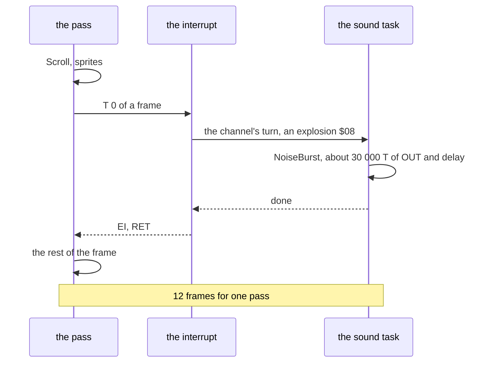

*The 12-frame pass as a sequence. How to read it: time runs down; one round of the arrows is one frame. The point:
the pass and the sound share the CPU, and the sound always wins because it runs in the interrupt. The game slows
down while explosions play, for a quarter of a second. Witness: `l2` frames 8982-8994 in the trace. The other
long passes (11 frames from 11 721 and 11 732, 10 frames from 8848, 8858, 11 776, 11 804 and 14 956) were not
traced.*

## 4.7 The level start

A level ends in LevelEnd `$C25E`, and the next level starts with a tape load. The `l2` recording begins in LoadLevel
at the moment the digit steps to `'2'`, and runs on into level 2's first pass:

| Frames (`l2`) | Seconds | What runs |
| --- | --- | --- |
| 0-2 | 0.04 | START TAPE THEN PRESS ANY KEY; the script presses the key |
| 2-108 | 2.1 | the header search: LoadBytes on the 18-byte headers, EdgeLoop 1.06 M instructions |
| 108-2650 | 50.8 | the level body loaded with the interrupts off, 2542 frames |
| 2650-2742 | 1.8 | LOADED OK, WaitFrames 92 |
| 2742-2760 | 0.4 | STOP TAPE, the key; StartLife draws the first screen (FirstScreenMarks 7395 and FillRest 10 314 instructions) |
| 2760 | | the first pass of level 2 |

From LoadLevel on, the level start is 55 s, and all but 2 s of it is the tape. Before LoadLevel, LevelEnd's Wait256
(256 frames, 5.1 s, in the chart below and not in `l2`) adds its own wait: about 60 s from the level's end to the next
level's first pass.

```mermaid
flowchart LR
    A["LevelEnd $C25E: LevelEndTimer low 5 bits = 0"] --> B["ScrollRows, StarsOff, sound $1583"]
    B --> C["Wait256: 256 frames"]
    C --> D["LoadLevel $FE03: START TAPE, a key"]
    D --> E["header search: 18 bytes to $6000, the digit checked"]
    E --> F["body: ($6010) bytes to $C4AE, DI, 50.8 s"]
    F --> G["LOADED OK, 92 frames; STOP TAPE, a key"]
    G --> H["POP DE, RestartPoint, the Force re-attached"]
    H --> I["JP StartLife: the first screen, the first pass"]
```

*The level start (`src/game/util.asm` LevelEnd, `src/game/tail.asm` LoadLevel). How to read it: left to right in
time. The point: the game keeps the Force across a level: if ForceLevel is not 0, LevelEnd writes the attached
Force's record before StartLife. Witness: `l2` (the timings above), `l1`-`l8` (each level's start).*

```text
LevelEnd:                                   # each pass
    if LevelEndTimer = 0: return
    ShieldControls ($95A5) = RET
    LevelEndTimer = LevelEndTimer - 1
    if its low 5 bits are not 0: return
    if digit = '8':                         # the end of level 8
        digit = '9'; WavesHalted = 0; LevelEndTimer = 0
        ShipDies + 3 ($91F5) = RET          # the ship cannot die
        # ShieldControls keeps its RET: no fire, no detach, until ClearPlayState at the wrap
        return
    if digit = '9': digit = '0'             # LoadLevel will ask for side 2 again
    ScrollRows; StarsOff; sound $1583; LevelEndTimer = 0
    Wait256
    LoadLevel
    drop the pass's return; RestartPoint
    if ForceLevel: the Force attached again
    go to StartLife
```

```asm
C25E  LevelEnd:
C25E  LD A,(LevelEndTimer)    ; $7A9B
C261  AND A
C262  RET Z
C263  LD HL,ShieldControls    ; $95A5
C266  LD (HL),$C9
C268  DEC A
C269  LD (LevelEndTimer),A
C26C  AND $1F
C26E  RET NZ
C26F  LD A,(LevelDigit)
C272  CP $38                  ; '8'
C274  JR NZ,l_C287
      ...                     ; '9', the waves on, RET at $91F5
C287  l_C287:
C287  CP $39                  ; '9'
C289  JR NZ,l_C290
C28B  LD A,$30
C28D  LD (LevelDigit),A
C290  l_C290:
C290  CALL ScrollRows
C293  CALL StarsOff
C296  LD HL,$1583
C299  CALL PlaySound
C29C  XOR A
C29D  LD (LevelEndTimer),A
C2A0  CALL Wait256
C2A3  CALL LoadLevel
C2A6  POP DE
C2A7  CALL RestartPoint
```

Two places set the timer. Wave command 5 (`$90E5`) writes `$41`: the next pass takes it to `$40`, whose low 5 bits
are 0, so the level ends at once. The end of the boss blast (`$C190`) writes `$3F`: 31 passes go by, about 145 frames
(2.9 s at 4.68 frames a pass), before it reaches `$20` and the level ends.

### Worked example: the wrap after level 8

The digit at `$719C` is `'8'` when level 8's end comes:

1. LevelEnd sees `'8'`, writes `'9'`, clears WavesHalted and the timer, and writes `RET` at `$91F5`, inside ShipDies.
   The pass goes on; the waves run again; a hit now returns after ClearHits and costs no life. LevelEnd's earlier
   steps have left `RET` at ShieldControls `$95A5` too, and nothing clears it before the wrap: the ship moves but
   cannot fire or detach the Force.
2. The next level end finds `'9'`, writes `'0'` and goes on to LoadLevel.
3. LoadLevel sees `'0'`: REWIND SIDE 2, then the digit becomes `'1'` and level 1 loads.

Witness: `ending` (SEARCHING FOR R TYPE LEVEL 1 at frame 1808). Both `RET`s end at the wrap: LoadLevel calls ClearPlayState (`$FE06`), whose `$8707` and `$86FE`
write `$00` back to `$91F5` and `$95A5`, so level 1 starts mortal and with the controls on
([doc 2, 2.2](02-architecture.md#22-the-memory-map)).

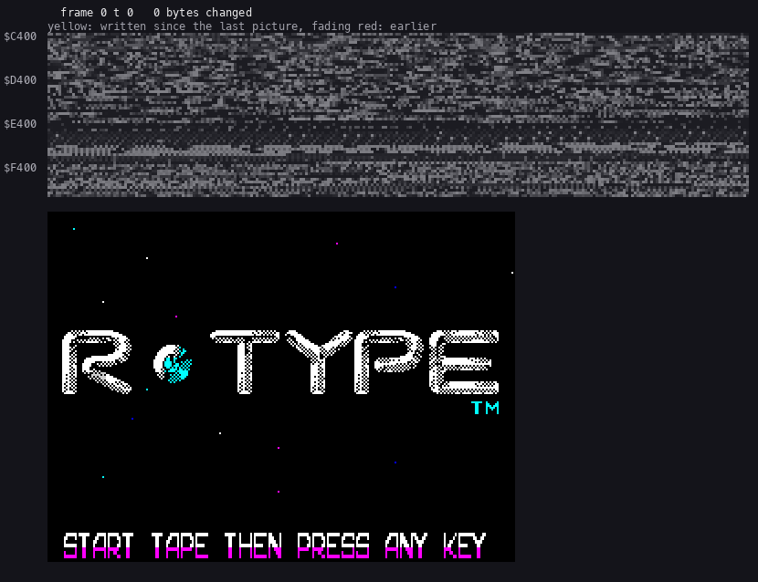

*The level start in memory: `l2` frames 0-2780, a picture every 4 193 280 T (60 frames), the level space
`$C400-$FFFF` beside the screen. How to read it: each cell is a byte, lit when it changes; the screen shows the
loader's texts. The point: for 50 s only the level space changes, bottom to top, while the screen holds the title
logo and the loader's line; the code and the sound above the level stay put. Command: `python3 ../../kit/memanim.py
--work work/docs/rtA/l2 --from 0:0 --to 2780:0 --step 4193280 --from-address C400 --to-address FFFF --cell 3
--screen docs/img/play/level-start-l2.gif`.*

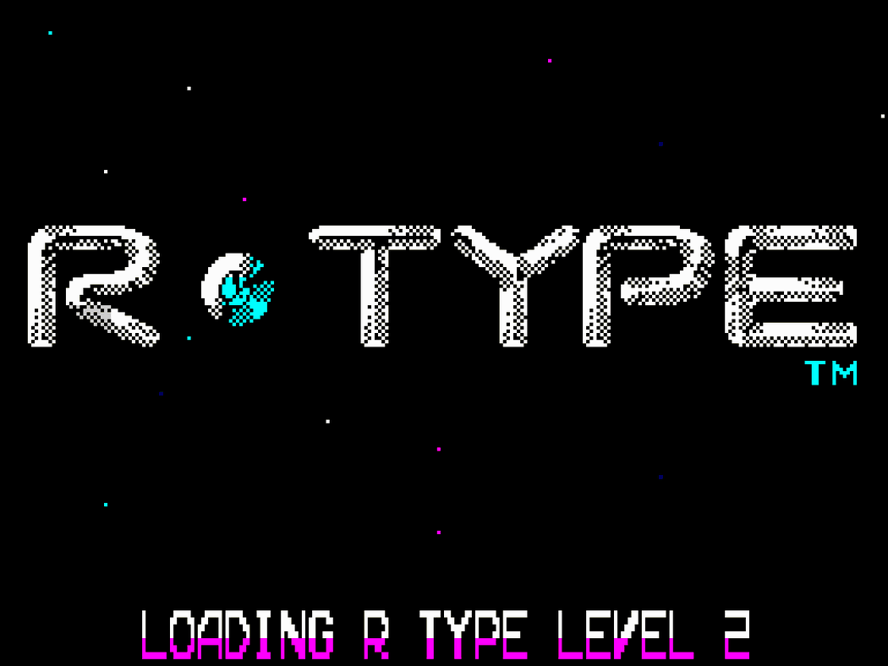

*The first screen: `l2` frames 2640-2800, a picture every 2 frames. How to read it: the screen as the player sees
it, with LOADING R TYPE LEVEL 2, then LOADED OK held for 92 frames (the long picture), STOP TAPE THEN PRESS ANY KEY,
then the playfield and the ship. The point: the first screen of a level is drawn whole in about a third of a second
and play starts at once, with the score and the lives carried over. Command: `python3 ../../kit/screen_anim.py
--work work/docs/rtA/l2 --from 2640 --to 2800 --step 2 --width 1050 docs/img/play/level-start-l2-screen.gif`.*

## 4.8 Every delay, pause and timer

Two kinds of delay exist. The fixed waits halt the CPU for a count of interrupts. The timers are counted down by the
pass, so their length in frames is a count of passes times about 4.7.

```asm
FDE9  Wait256:
FDE9  LD B,$00                ; 256 frames
FDEB  WaitFrames:
FDEB  HALT                    ; B interrupts
FDEC  DJNZ WaitFrames
FDEE  RET
```

| Delay | Where | Length | When |
| --- | --- | --- | --- |
| MainWait | `$868C` | until 3 interrupts since the pass's start | every pass |
| WaitFrames `$80` | LoadLevelHeader `$FE6F` | 128 frames, 2.56 s | a header of another level |
| WaitFrames `$5C` | LoadLevel `$FEA7` | 92 frames | LOADED OK |
| WaitFrames `$60` | LoadError `$FECE` | 96 frames | ERROR IN LOADING |
| WaitFrames `$40` | LoadError | 64 frames | REWIND TAPE, before the key |
| WaitFrames `$50` | PrintAndWait `$92E2` | 80 frames | PILOT STAND BY, MISSION OVER |
| WaitFrames `$60` | LoseLifeNow `$9284` | 96 frames | after MISSION OVER |
| Wait256 | CheckHiScore `$92F2` | 256 frames | the high score table after a game |
| Wait256 | LevelEnd `$C2A0` | 256 frames | between a level's end and its load |
| WaitFrames 7 | SelectControl `$C057` | 7 frames | the three choice sounds |
| WaitFrames 1, 80 times a digit | Continue `$8C2D` | 10 digits, 800 frames, 16 s | the continue countdown; fire is read every frame |
| `HALT` | the credits scroll `$8188` | one frame a step | ShowLoadingScreen at the entry |
| DeathTimer `$7A8D` | ShipDies `$9213`, LoseLife `$924B` | 32 passes, about 150 frames | a death: the second explosion at 24, the life ends at 0 |
| LevelEndTimer `$7A9B` | `$90E5`, `$C190`, LevelEnd | 1 or 31 passes | a level's end |
| ShieldTimer `$7A98` | StartPlay `$8BAE` | `$38` on the first life (with the fly-in), `$20` on later lives | the shield is drawn; it does not protect: no test reads ShieldTimer, and `deaths-l7` 8376 is a death under it ([doc 10](10-gameplay-logic.md)) |
| CheckExtraLife | `$FDA5` | each pass the score changed | a life at 50 000, then each 100 000 |

The title waits on nothing. TitleLoop `$7796` draws the logo and the texts, then runs DefineKeys, StarTask and an
attribute copy 1024 times, then shows the high scores and polls SelectControl 21 508 (`$5404`) times, and starts again. The counts come from
`BC` across calls: the first loop's `B` = 4 meets the `C` = 0 FillBlock leaves (`$0400`, 1024), the second loop's
`B` = `$54` meets the `C` = 4 ShowHiScores leaves from its `LD BC,$0304` (`$5404`). Its
pace is the speed of its own code, with the interrupts on. (The title cycle, `c1` frames 16 540-17 900, is animated
in [doc 1](01-game-design.md).)

### Worked example: a death in passes

ShipDies writes `$20` to DeathTimer. LoseLife, first in every pass, counts it down:

```asm
924B  LoseLife:
924B  LD A,(DeathTimer)       ; $7A8D
924E  AND A
924F  RET Z
9250  DEC A
9251  LD (DeathTimer),A
9254  JR Z,LoseLifeNow
9256  CP $18
9258  RET NZ
9259  LD HL,$0A83             ; the second explosion sound
925C  CALL PlaySound
925F  LD HL,Explosions
9262  LD (HL),$48
```

| Pass after the hit | DeathTimer | What happens |
| --- | --- | --- |
| 0 | `$20` | ShipDies: a life off, sound `$0983`, the first explosion |
| 8 | `$18` | sound `$0A83`, a second, larger explosion |
| 32 | `$00` | LoseLifeNow: PILOT STAND BY or MISSION OVER |

At 4.68 frames a pass the 32 passes take about 150 frames, 3 s, during which the playfield goes on scrolling and the
enemies go on moving. Witness: `deaths-l7` (eight deaths without the POKE) and `c1` frames 19 230-19 884 (the last
life of `c1`, animated in [doc 1](01-game-design.md)).

## 4.9 Known only from the code

- **MainLoopPatch `$8656`**: three `NOP`s with a label of their own; no recording writes there.
- **LevelEnd with the digit `'9'` from a level other than 8**: unreachable, because only level 8's end writes `'9'`.
- **CycleTitleColour's switch**: ShowHiScores `$7698` sets it to 1, so the interrupt runs the routine while the
  hiscore table is shown; ClearPlayState `$86FB` and CheckHiScore `$92F6` set it back to 0. The title screen calls the
  routine directly (`$77A1`, `$FE0E`).
- **StarTask's counters after a pause**: the counters do not move while the interrupts are off, and nothing resets
  them.
- **The vector byte**: the 257 bytes of `$83` make any byte on the bus give `$8383`; every recording ran on a machine
  with nothing on the expansion bus.
