# 5. Controls

What this covers:

- the four control methods, the one byte every method writes (ControlBits `$74FA`) and the vector that picks the
  reader (ControlVector `$74FC`);
- each reader instruction by instruction: keys 1-5, the defined keys, the Kempston port, keys 6-0;
- what an emulator must decode for the game to see its input;
- the Kempston probe `$73EC` at power-on, and why a machine without a Kempston never offers it;
- the title page and the control choice `$C011`, which leaves the title through the stack;
- DEFINE (ENTER on the title): ReadKey `$BF55`, its key codes, the duplicate check;
- the path from ControlBits to the ship: MoveShip `$94F1`, its limits and its tilt;
- the fire, the beam charge and its meter, the release in three strengths;
- the Force's detach key and the recall;
- the pause (CAPS SHIFT + 1, CAPS SHIFT + 2) and the missing abort key;
- the name entry of the high-score table, and why letter keys do nothing there.

The recordings it rests on ([WALKTHROUGH 6.0](../WALKTHROUGH.md#60-the-recordings)):

| Recording | Load | Used for |
| --- | --- | --- |
| `c1` | power-on on the 48K, `LOAD ""`, the original tape, `tests/inputs/c1.txt` | the title, DEFINE (O P Q A M N), M as fire on the title (method 2), play on level 1: moves, a charged beam |
| `ctl-kempston` | `work/stage1/c1/menu.szx` (the title), `tests/inputs/ctl-kempston.txt` | Kempston fire on the title: method 3; the four directions and fire |
| `ctl-if2` | the same start, `tests/inputs/ctl-if2.txt` | key 5 on the title: method 1; the keys 1-5 |
| `ctl-sinclair` | the same start, `tests/inputs/ctl-sinclair.txt` | key 0 on the title: method 4; the keys 6-0 |
| `hiscore` | `work/stage1/c1/play.szx`, the score POKEd to "045000" (`$71C9`), `tests/inputs/hiscore.txt` | the name entry with the defined keys: AABAAAAAA at No. 5 |
| `hiscore-typed` | the same, `tests/inputs/hiscore-typed.txt` | the name typed with letter keys: nothing happens |
| `pause` (new, rtB) | `work/stage1/c1/play.szx`, `tests/inputs/pause.txt`, no POKE, in `work/docs/rtB/rec/pause` | CAPS SHIFT + 1, 150 frames paused, CAPS SHIFT + 2 |

The `pause` recording was made for this document with `tools/record.py` (a plan "pause" added by
`work/docs/rtB/tools/rec_pause.py`). c1's own CAPS SHIFT + 1 at 18722 came while PILOT STAND BY was on the screen, so
CheckPause never ran its loop there.

Conventions:

- **A frame** is 1/50 s of the 48K, 69 888 T. "18819:25793" is frame 18819, T 25793 of that frame, as an access
  trace places an instruction. In these recordings a script frame and a TTD frame are the same number.
- A value read with `time_travel memory_at` is the memory at T 0 of the frame named: what the code did before that
  frame began.
- **A pass** is one turn of MainLoop `$8649` ([doc 4](04-game-loop.md)). It waits for the third interrupt, so a
  pass takes 3 frames or more. The controls are read once a pass.
- **A half-row** is one of the eight groups of five keys the ULA reads at port `$xxFE`. The high byte has one bit
  clear for the half-row wanted. Bit 0 is the key at the outer end of the half-row (CAPS SHIFT, A, Q, 1, 0, P, ENTER,
  SPACE).

## 5.1 The four methods and ControlBits

R-Type knows four control methods. ControlMethod `$74FB` says which one is in use, 1 to 4. The tape loads it as 4.
Every method writes the same byte, ControlBits `$74FA`, once a pass. The rest of the game reads only that byte.

| Bit | Meaning | Read by |
| --- | --- | --- |
| 0 | left | MoveShip (`DEC L`), the name entry (the previous letter) |
| 1 | right | MoveShip (`INC L`), the name entry (the next letter) |
| 2 | down | MoveShip (`INC H`) |
| 3 | up | MoveShip (`DEC H`) |
| 4 | fire | ShieldControls `$95A5`, FireBeam `$9A2C`, the name entry (take the letter) |
| 5 | detach the Force | ShieldControls `$95B6` |

The four methods differ only in where the six bits come from:

| ControlMethod | Reader | Device | Left, right, down, up, fire | Detach |
| --- | --- | --- | --- | --- |
| 1 | ReadIf2 `$8B0A` | keys 1-5 (Interface 2, the "Sinclair 2" joystick) | 1 2 3 4 5 | SPACE |
| 2 | ReadKeys `$8B14` | the six keys of DefinedKeys `$7780` | as loaded Q W K O P | as loaded SPACE |
| 3 | ReadKempston `$8B19` | port `$1F` | Kempston bits 1 0 2 3 4 | SPACE |
| 4 | ReadSinclair `$8B2D` | keys 6-0 (Interface 2, the "Sinclair 1" joystick) | 6 7 8 9 0 | SPACE |

The reader takes keys 6 7 8 9 0 as left right down up fire, the Sinclair joystick, not the cursor keys (those
would be 5 8 6 7), hence the name ReadSinclair. The recording that witnesses it is called `ctl-sinclair`.

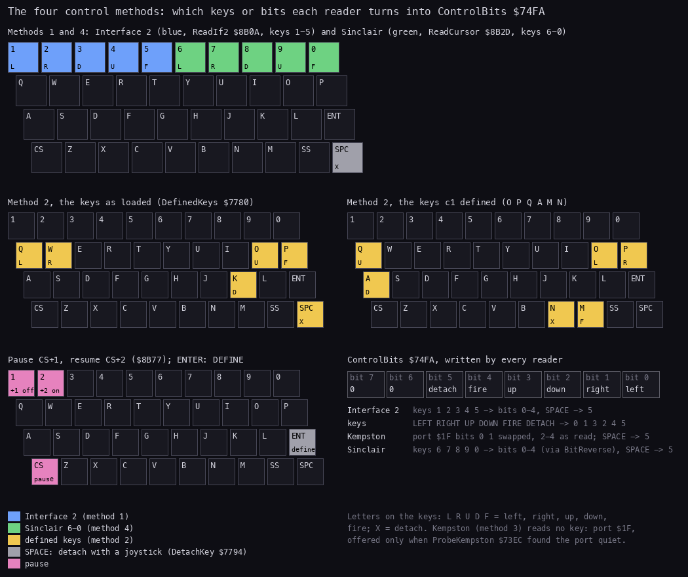

*Figure 5.1: the keys each method reads, the defined keys as loaded and as c1 defined them, the pause keys and
ENTER, and the six bits of ControlBits. Drawn from `build/game.bin` (DefinedKeys `$7780`, DetachKey `$7794`) and the
readers' code. Command: `python3 tools/fig_controls.py methods --out docs/img/controls/methods.png`.*

How to read:

- Each keyboard is one method. A coloured key is read by that method, labelled L R U D F X (left, right, up,
  down, fire, detach).
- The bottom row is ControlBits as every reader leaves it.

ControlVector `$74FC` holds the reader's address. ReadControls `$8B06` is two instructions:

```asm
ReadControls:                  ; $8B06
        LD HL,(ControlVector)  ; one of ReadIf2, ReadKeys, ReadKempston, ReadSinclair
        JP (HL)                ; the reader stores ControlBits and returns to the caller
```

ClearPlayState `$86C3` sets the vector at the start of every life, from ControlMethod and the table
ControlVectors `$778C`:

```asm
        LD A,(ControlMethod)   ; $870A: 1-4
        DEC A
        ADD A,A                ; (method - 1) x 2
        LD H,$00
        LD L,A
        LD DE,ControlVectors   ; $778C: ReadIf2, ReadKeys, ReadKempston, ReadSinclair
        ADD HL,DE
        LD A,(HL)
        INC HL
        LD H,(HL)
        LD L,A
        LD (ControlVector),HL  ; $74FC
```

As loaded the vector is `$8B2D` (method 4). The title's choice ([5.5](#55-the-title-and-the-control-choice)) only
writes ControlMethod. The vector follows when ClearPlayState runs for the first life. In c1 ControlMethod is 4 and
the vector `$8B2D` at frame 18200; at 18300, after M on the title, they read 2 and `$8B14`.

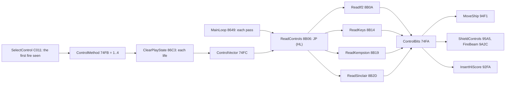

The point: the game has one input byte. A new device would need one reader and one table entry, nothing else.

## 5.2 The four readers

ReadControls runs once a pass, after RunWaves and before MoveShip. The pass order is in [doc 4](04-game-loop.md).

### ReadIf2: keys 1-5

```asm
ReadIf2:                       ; $8B0A
        LD A,$F7
        IN A,($FE)             ; half-row 1 2 3 4 5, bits 0-4, a key down reads 0
        XOR $BF                ; invert: a key down is now 1
        AND $1F                ; key 1 bit 0 ... key 5 bit 4
        JR ControlDetach
```

The keys land on the bits in their own order: 1 left, 2 right, 3 down, 4 up, 5 fire. That is the Interface 2
joystick wired to keys 1-5.

Worked example: key 2 alone. The port returns `$FD` with bits 5-7 high (bit 6, the EAR input, may read either
way). `$FD XOR $BF = $42`, `AND $1F = $02`: bit 1, right.

### ReadKempston: port `$1F`

```asm
ReadKempston:                  ; $8B19
        IN A,($1F)             ; Kempston: bit 0 right, 1 left, 2 down, 3 up, 4 fire, 1 = pressed
        AND $1F
        JR Z,ControlDetach     ; nothing pressed
        LD B,A
        AND $03                ; right or left?
        LD A,B
        JR Z,ControlDetach     ; neither: down, up, fire pass as they are
        XOR $03                ; swap bit 0 and bit 1: right and left
```

The Kempston has right in bit 0 and left in bit 1. The game wants them the other way round, so `XOR $03` swaps
them. With both bits set (no real stick can) the XOR would clear both.

Worked example: the stick right, port `$1F` = `$01`. `AND $03` is not zero, `$01 XOR $03 = $02`: bit 1, right.

### ReadSinclair: keys 6-0 through the bit-reverse table

```asm
ReadSinclair:                    ; $8B2D
        LD A,$EF
        IN A,($FE)             ; half-row 0 9 8 7 6: key 0 bit 0 ... key 6 bit 4
        LD B,$5D
        LD C,A
        LD A,(BC)              ; BitReverse $5D00: the byte with its bits in reverse order
        RRCA
        RRCA
        RRCA                   ; port bit b is now bit 4 - b
        XOR $BF                ; invert
        AND $1F
        JR ControlDetach
```

The half-row 6-0 runs the other way on the keyboard: key 0 is bit 0, key 6 is bit 4. The reader reverses the byte
through BitReverse `$5D00` (the same 256-byte table the scroll uses to mirror metatiles, [doc 6](06-rendering.md)),
then rotates it three places, so port bit b lands on bit 4 - b. Key 6 (bit 4) becomes bit 0, key 0 (bit 0)
becomes bit 4.

Worked example: key 7 alone. The port returns `$F7` (bit 3 clear). BitReverse(`$F7`) = `$EF`. Three RRCA give
`$FD`. `$FD XOR $BF = $42`, `AND $1F = $02`: bit 1, right.

### ReadKeys: six TestKey calls

```asm
ReadKeysFrom:                  ; $8B3E, HL = DefinedKeys $7780
        LD C,$00
        CALL TestKey           ; LEFT
        JR NZ,l_8B47
        SET 0,C
l_8B47: CALL TestKey           ; RIGHT
        JR NZ,l_8B4E
        SET 1,C
l_8B4E: CALL TestKey           ; UP
        JR NZ,l_8B55
        SET 3,C
l_8B55: CALL TestKey           ; DOWN
        JR NZ,l_8B5C
        SET 2,C
l_8B5C: CALL TestKey           ; FIRE
        JR NZ,ReadDetach
        SET 4,C
ReadDetach:                    ; $8B63, also the joystick readers' way in
        CALL TestKey           ; DETACH
        JR NZ,l_8B6A
        SET 5,C
l_8B6A: LD A,C
        AND A
        LD (ControlBits),A     ; $74FA
        RET

TestKey:                       ; $8B70: (HL) = port high byte, (HL+1) = mask
        LD A,(HL)
        IN A,($FE)
        INC HL
        AND (HL)               ; Z when the key is down
        INC HL
        RET
```

DefinedKeys is six (port high byte, mask) pairs in the order LEFT RIGHT UP DOWN FIRE DETACH. The third pair sets
bit 3 and the fourth bit 2, because ControlBits keeps down below up.

| DefinedKeys | LEFT | RIGHT | UP | DOWN | FIRE | DETACH |
| --- | --- | --- | --- | --- | --- | --- |
| as loaded | Q `FB 01` | W `FB 02` | O `DF 02` | K `BF 04` | P `DF 01` | SPACE `7F 01` |
| c1 after DEFINE | O `DF 02` | P `DF 01` | Q `FB 01` | A `FD 01` | M `7F 04` | N `7F 08` |

### ControlDetach: the joysticks' sixth bit

The three joystick readers end at ControlDetach `$8B27`:

```asm
ControlDetach:                 ; $8B27
        LD C,A                 ; the five bits so far
        LD HL,DetachKey        ; $7794: $7F, $01 = SPACE
        JR ReadDetach          ; one TestKey for bit 5, then store
```

A joystick has one button. The detach is always SPACE for methods 1, 3 and 4. Only the keyboard method can move it.

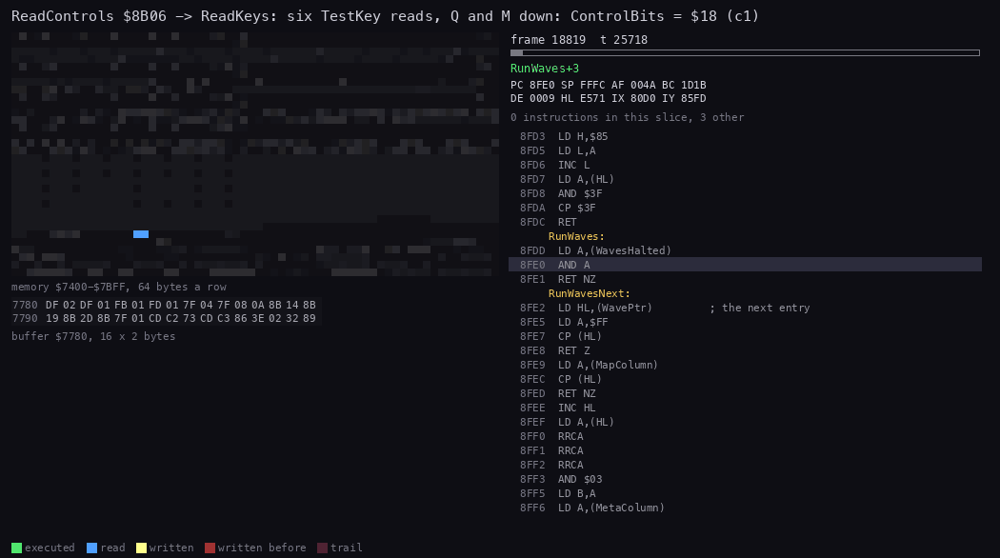

*Animation 5.1: ReadControls `$8B06` jumping to ReadKeys and the six TestKey reads, with DefinedKeys `$7780` (as c1
defined them) in the view and ControlBits written at the end. Recording c1, window 18819:25700-18819:26400.
Command: `python3 ../../kit/routine_anim.py --work work/docs/rtB/c1 --window 18819:25700-18819:26400 --listing
build/game.lst --view buffer:7780:16x2:hex --range 7400-7BFF --pc 8B06-8B77 --pictures 39 --out
docs/img/routines/ReadControls.gif`.*

What to watch:

- the six `IN A,($FE)` reads, each with the port byte read from DefinedKeys;
- the write of ControlBits at `$74FA` at the end.

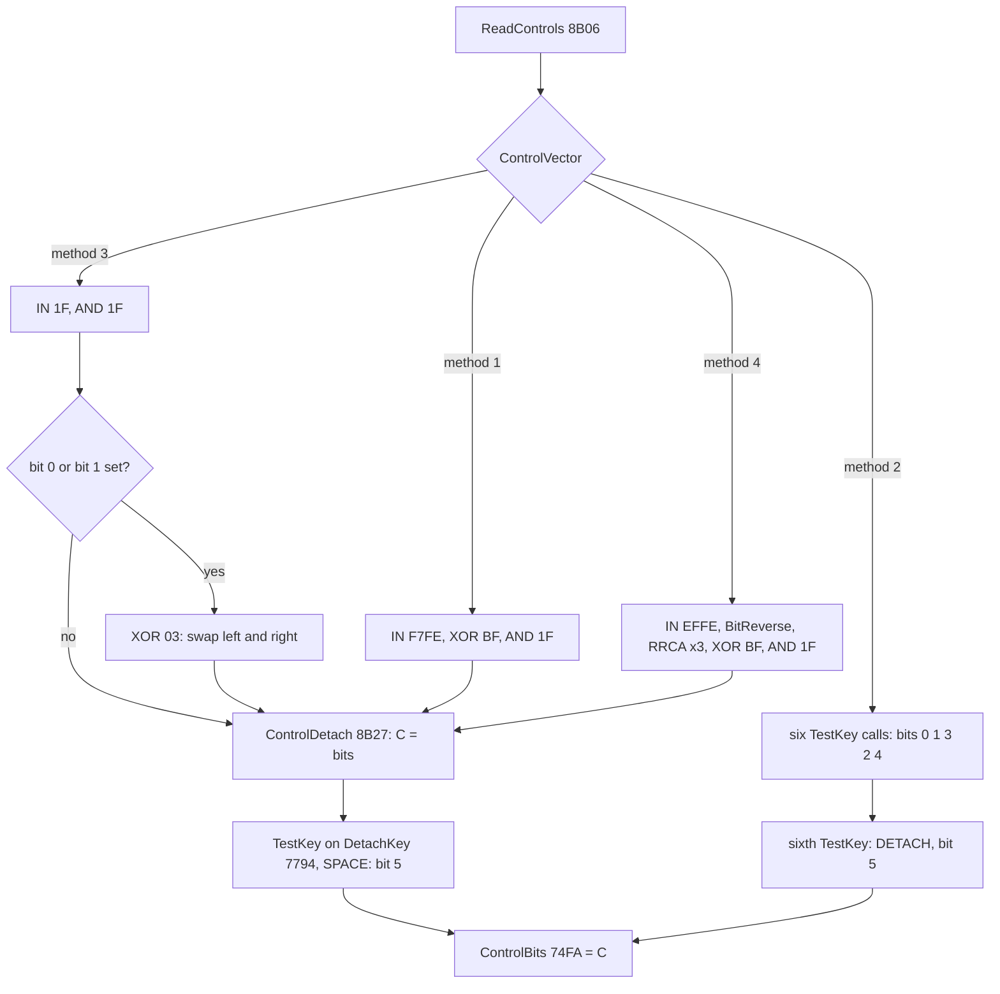

The point: three readers share the tail that reads SPACE; the keyboard reader shares the same tail with its own
sixth key. Each reader costs one port read, except ReadKeys with six.

## 5.3 What an emulator must decode

The game reads these ports and no other (the only port it writes is `$FE`, [doc 9](09-sound.md)):

| Port read | Where | What must answer |
| --- | --- | --- |
| `$FEFE` ... `$7FFE`, any half-row | TestKey `$8B70`, ReadKey `$BF55`, ReadRow0 `$8BA4` (CheckPause) | the keyboard: bits 0-4, 0 = down |
| `$F7FE` | ReadIf2 `$8B0A`, ReadRow1 `$8BA0` | keys 1-5 (an Interface 2 joystick maps onto these keys) |
| `$EFFE` | ReadSinclair `$8B2D` | keys 6-0 (the other Interface 2 joystick) |
| `$BFFE` | DefineKeys `$BF92` | ENTER, bit 0 |
| `$1F` (`$001F` from ProbeKempston, `$xx1F` from ReadKempston) | `$73F1`, `$8B19` | a Kempston: bits 0-4 high when pressed, 0 at rest |

Two things matter for an emulator:

- **The Kempston must read 0 at rest.** ProbeKempston ([5.4](#54-the-kempston-probe)) takes any non-zero low nibble
  as "no Kempston here" and hides the method for the whole session.
- **A port `$1F` without a Kempston** returns what the bus holds. On a real 48K that is the floating bus: screen bytes
  during the 128 T of each picture line the ULA fetches, `$FF` in the other 96 T and in the border and retrace. A
  probe read takes 42 T (`IN` 12, `AND` 7, `JR` 7, `DEC` 4, `JR` 12), so a `$FF`, whose low nibble is not zero, comes
  within one 224 T line, about six reads; the 255 reads span about 10 700 T and cannot miss it. A machine without a
  Kempston never passes, and the game hides the method, as it should. This is derived from the code and the 48K
  timing; no recording ran without a Kempston.

The Interface 2 needs no decoding of its own: its joysticks press keys 1-5 and 6-0.

## 5.4 The Kempston probe

GameEntry runs ProbeKempston `$73EC` once, after it sets IM 2 and before the loading screen:

```asm
        IM 2                   ; $8628
        EI
        CALL ProbeKempston     ; $862B
        CALL ShowLoadingScreen
        CALL LoadLevel

ProbeKempston:                 ; $73EC
        LD E,$FF               ; up to 255 reads
        LD BC,$001F
l_73F1: IN A,(C)
        AND $0F                ; right, left, down, up
        JR NZ,l_73FA           ; something answered
        DEC E
        JR NZ,l_73F1
l_73FA: LD (KempstonAbsent),A  ; $7A8B: 0 = quiet 255 times, else the first non-zero nibble
        RET
```

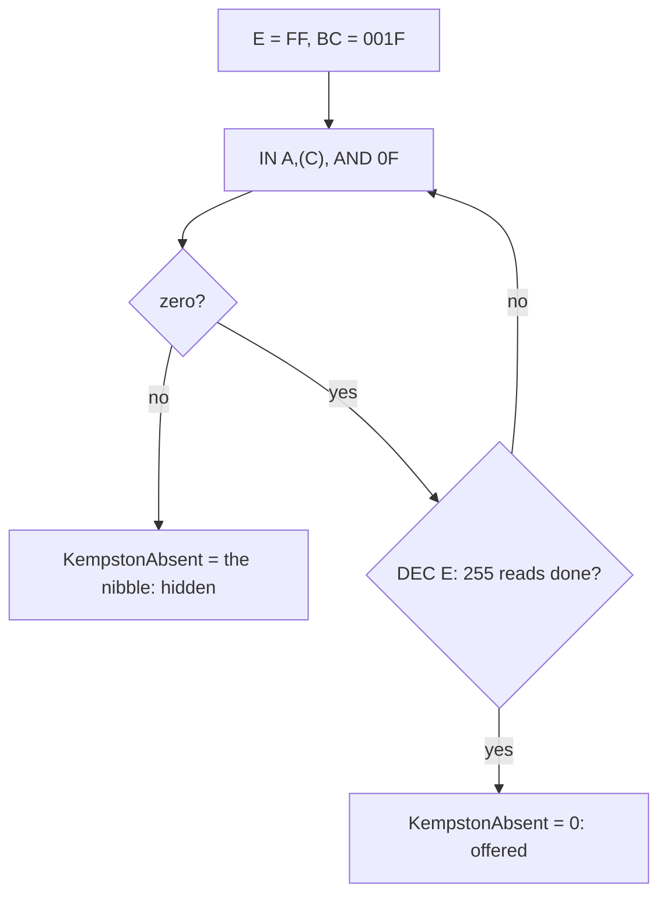

Only bits 0-3 count, so a fire button held at power-on does not hide the Kempston.

Witness: every recording runs with unreal-ng's Kempston on, which reads 0 at rest. KempstonAbsent reads 0 at the
title of c1 (`memory_at` frame 16828), and ctl-kempston picks method 3. A machine with no Kempston is known only from
the code.

The point: the probe runs once. A Kempston plugged in later, or a stick pushed at power-on, is never offered.

## 5.5 The title and the control choice

TitleLoop `$7796` draws the title page, then runs two waits in turn. In each it keeps testing for a fire:

```asm
TitleLoop:                     ; $7796
        CALL StarsOff
        CALL ClearPlayState
        ...                    ; the logo and five lines of TitleTexts
        LD B,$04               ; C = 0 from FillBlock: $0400 = 1024 turns
l_77D5: PUSH BC
        CALL DefineKeys        ; ENTER: define; else falls into SelectControl
        CALL StarTask          ; the stars, by hand
        LD HL,PlayAttrs
        LD DE,$5800
        LD BC,$0280
        LDIR                   ; the colours of the logo
        POP BC
        DEC BC
        LD A,B
        OR C
        JR NZ,l_77D5
        CALL ShowHiScores      ; TODAY'S BEST PILOTS
        LD B,$54               ; C = 4 from ShowHiScores: $5404 = 21 508 turns
l_77F2: PUSH BC
        CALL SelectControl
        POP BC
        DEC BC
        LD A,B
        OR C
        JR NZ,l_77F2
        JP TitleLoop
```

Neither wait sets `C`: each takes the low byte the code before it left. FillBlock, the last call before the first
wait, returns from its `LDIR` with `BC` = 0, so the first wait runs `$0400` = 1024 turns. ShowHiScores loads
`BC` = `$0304`, keeps it across its prints with `PUSH BC` / `POP BC` and returns when `B` reaches `$15` with `C` still
4, so the second wait runs `$5404` = 21 508 turns.

DefineKeys `$BF92` tests ENTER first. With ENTER up it jumps (not calls) to SelectControl, so the title page tests
both ENTER and the fire on every turn. The high-score page tests only the fire.

SelectControl `$C011` asks each method in turn whether its fire is down:

```asm
SelectControl:                 ; $C011
        CALL ReadKeys
        BIT 4,A
        JR Z,l_C01C
        LD A,$02               ; the defined fire key: method 2
        JR l_C040
l_C01C: CALL ReadIf2
        BIT 4,A
        JR Z,l_C027
        LD A,$01               ; key 5: method 1
        JR l_C040
l_C027: LD A,(KempstonAbsent)
        AND A
        JR NZ,l_C038           ; no Kempston: skip it
        CALL ReadKempston
        BIT 4,A
        JR Z,l_C038
        LD A,$03               ; Kempston fire: method 3
        JR l_C040
l_C038: CALL ReadSinclair
        BIT 4,A
        RET Z                  ; no fire anywhere: back to the title loop
        LD A,$04               ; key 0: method 4
l_C040: POP BC                 ; the return into the title loop
        POP BC                 ; the loop counter
        LD (ControlMethod),A   ; $74FB
        ...                    ; sounds $19, $1D, $1E, then 7 frames
        RET                    ; to TitleLoop's caller: the game starts
```

Both callers leave the stack the same way: a pushed counter under a return address into the loop. The two
`POP BC` drop both, and the `RET` leaves TitleLoop altogether, back to GameEntry, which goes on to StartLife.

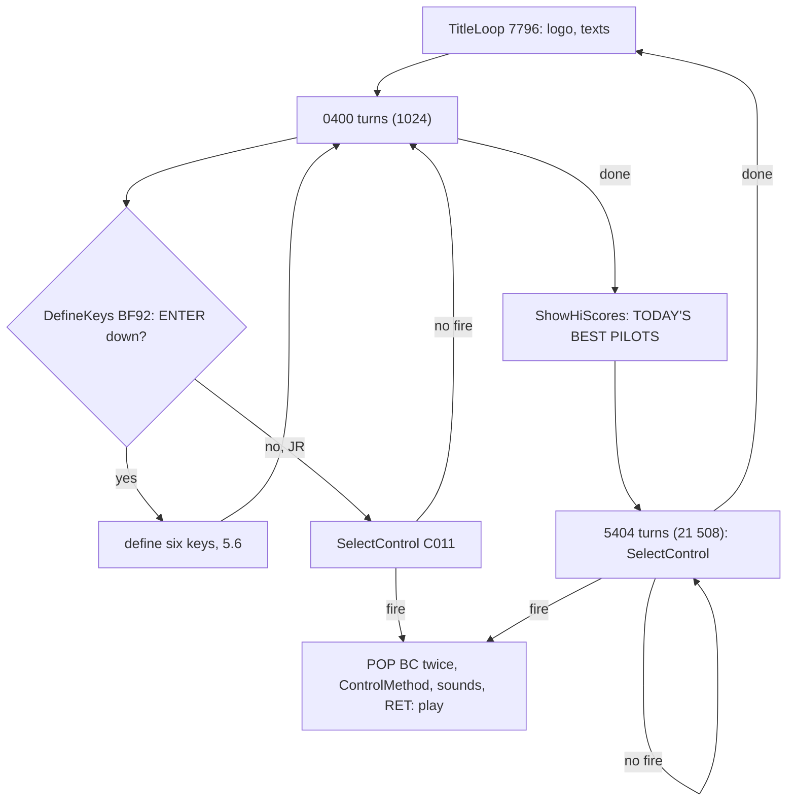

The order decides a tie. The defined fire key wins over key 5, key 5 over the Kempston, the Kempston over key 0.
As loaded the defined fire is P, so P on the title picks the keyboard.

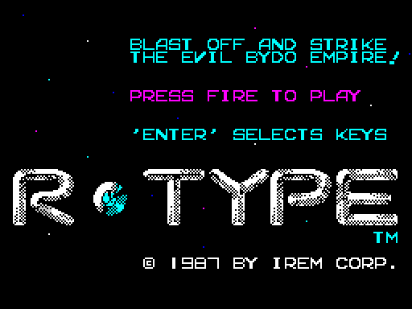

*Figure 5.2: the title page, c1 frame 16828: PRESS FIRE TO PLAY and 'ENTER' SELECTS KEYS. Screenshot from the c1
recording ([WALKTHROUGH 6.1](../WALKTHROUGH.md#61-the-screens)).*

Witness: SelectControl's store `$C042` ran once in each of c1 (M, method 2), ctl-if2 (key 5, method 1),
ctl-kempston (Kempston fire, method 3), ctl-sinclair (key 0, method 4) and m128.

The point: the device is chosen by the first fire pressed. There is no menu and no confirmation.

## 5.6 DEFINE

ENTER on the title page defines the six keys. DefineKeys `$BF92` clears DefinedKeys and asks for each key in the
order LEFT RIGHT UP DOWN FIRE DETACH, on the bottom row: PRESS A KEY FOR LEFT, and so on.

```asm
DefineKeys:                    ; $BF92
        LD A,$BF
        IN A,($FE)
        RRA                    ; ENTER into the carry
        JR C,SelectControl     ; ENTER up: test the fire instead
        LD HL,$0B41
        CALL PlaySound         ; sound $0B
        LD IX,DefinedKeys
        LD HL,DefinedKeys
        LD BC,$000C
        CALL ClearBlock        ; all six pairs zero
        LD HL,KeyNameLeft
        CALL DefineKey
        ...                    ; RIGHT, UP, DOWN, FIRE, DETACH
        CALL ClearTextRow
        RET
```

### ReadKey: one key, as a port and a mask

ReadKey `$BF55` scans the eight half-rows and returns one key, or NZ when two are down:

```asm
ReadKey:                       ; $BF55
        LD DE,$FF2F            ; D = $FF: no key yet; E = $2F - half-row
        LD BC,$FEFE
ReadKeyRow:
        IN A,(C)
        CPL
        AND $1F                ; the keys down, as 1
        JR Z,ReadKeyNext
        INC D
        RET NZ                 ; a key in an earlier half-row too: refuse
        LD H,A
        LD A,E
l_BF66: SUB $08                ; A = E - 8 x (bit + 1)
        SRL H
        JR NC,l_BF66
        RET NZ                 ; two keys in this half-row: refuse
        LD D,A                 ; the key's code
        LD L,B                 ; the port high byte
ReadKeyNext:
        DEC E
        RLC B                  ; the next half-row
        JR C,ReadKeyRow
        LD A,D
        AND $38
        RRCA
        RRCA
        RRCA                   ; 4 - bit
        ...                    ; H = KeyBitTable $72F0 [4 - bit] = 1 << bit
        XOR A                  ; Z: one key or none (D = $FF)
        RET
```

The code in D is `$2F` - row - 8 x (bit + 1), a number from `$00` to `$27` for the 40 keys. Bits 3-5 of D are then
4 - bit, and KeyBitTable `$72F0` (`$10 $08 $04 $02 $01`) turns that into the mask. L is the port's high byte.

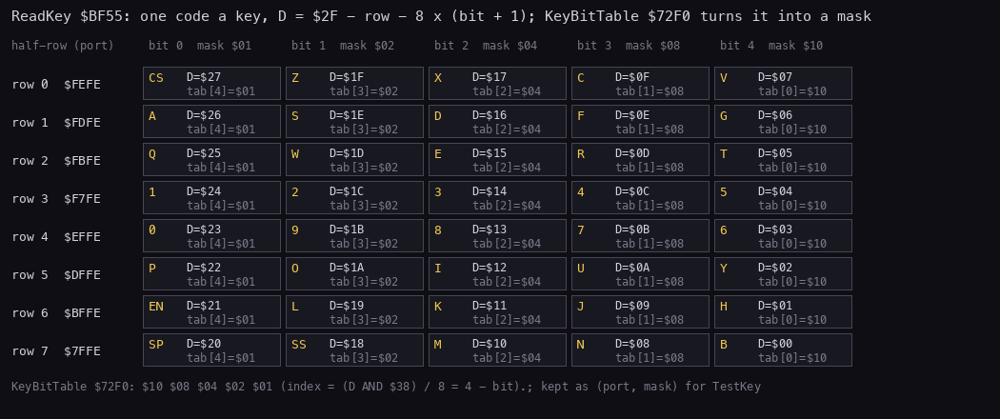

*Figure 5.3: the code D and the KeyBitTable index for each key, half-row by half-row, computed by the formula of
ReadKey `$BF55`. Command: `python3 tools/fig_controls.py readkey --out docs/img/controls/readkey.png`.*

### DefineKey: wait, check, store

```asm
DefineKey:                     ; $BFD4, HL = the key's name
        ...                    ; PRESS A KEY FOR <name> on row 22
l_BFE1: CALL ReadKey
        LD A,D
        CP $FF
        JR NZ,l_BFE1           ; wait until no key is down
l_BFE9: CALL WaitKey           ; $BF87: one key, D <> $FF
        EX DE,HL               ; E = port, D = mask
        LD HL,DefinedKeys
        LD B,$06
l_BFF2: LD A,E
        CP (HL)
        JR NZ,l_BFFC
        INC L
        LD A,D
        CP (HL)
        JR Z,l_BFE9            ; already taken: wait for another key
        DEC L
l_BFFC: INC L
        INC L
        DJNZ l_BFF2
        LD (IX+$00),E
        LD (IX+$01),D
        INC IX
        INC IX
        LD HL,$0B41
        CALL PlaySound         ; sound $0B
        RET
```

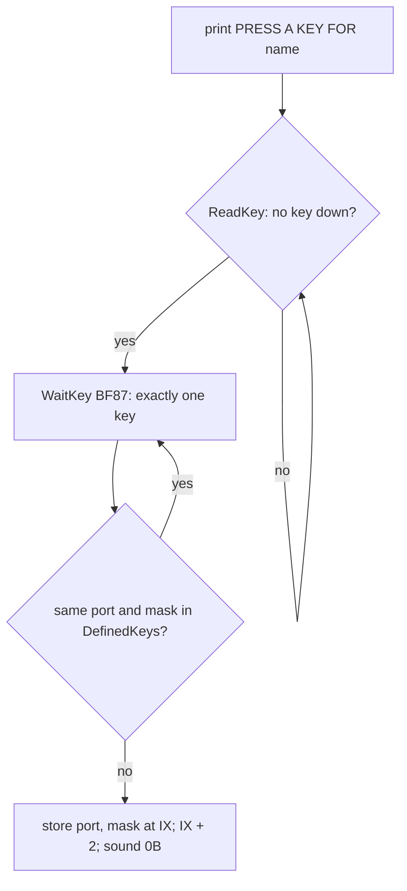

The check covers all six pairs. DefineKeys zeroed them first, so the pairs not yet defined (`00 00`) never match a
key.

Worked example, c1 frame 17858: O alone. Half-row `$DFFE` (row 5) reads `$FD`: bit 1. E = `$2F` - 5 = `$2A`;
D = `$2A` - 16 = `$1A`; (`$1A AND $38`) / 8 = 3, KeyBitTable[3] = `$02`. DefineKey stores `DF 02` at `$7780`.

Witness: DefineKeys' sound path `$BF99` ran once in c1 (ENTER at 17818) and once in m128. After c1's six keys
DefinedKeys reads `DF 02 DF 01 FB 01 FD 01 7F 04 7F 08` (`memory_at` frame 18200).

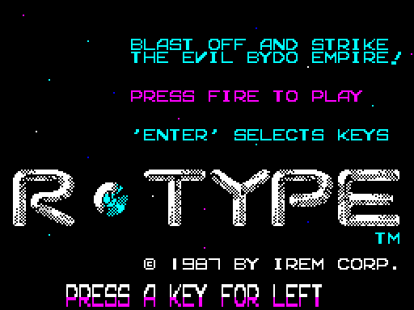

*Figure 5.4: c1 frame 17858, PRESS A KEY FOR LEFT on the bottom row. Screenshot from the c1 recording.*

The point: a duplicate is refused silently; the prompt stays until a new key comes. ENTER itself can be defined:
it is just half-row 6, bit 0.

## 5.7 From the bits to the ship

MoveShip `$94F1` runs right after ReadControls. ShipColumn `$7AA1` and ShipRow `$7AA2` are one word, so L is the
column and H the row.

```asm
MoveShip:                      ; $94F1
        LD A,(ShipFrame)
        AND A
        RET Z                  ; 0: flying in, or dead
        LD HL,(ShipColumn)     ; L = column, H = row
        LD D,H
        LD E,L                 ; the old place
        LD A,(ControlBits)
        LD B,A
        AND $0F
        JR NZ,l_951A           ; a direction is held
        ...                    ; none: ShipFrame drifts back to 3 (level)
l_951A: BIT 0,B
        JR Z,l_951F
        DEC L                  ; left
l_951F: BIT 1,B
        JR Z,l_9524
        INC L                  ; right
l_9524: BIT 2,B
        JR Z,l_9534
        INC H                  ; down
        ...                    ; ShipFrame - 1, down to 2 (nose down)
l_9534: BIT 3,B
        JR Z,l_9544
        DEC H                  ; up
        ...                    ; ShipFrame + 1, up to 4 (nose up)
l_9544: LD A,H
        CP $14
        JR C,l_954D
        ...
        LD H,D                 ; row 20 or more (or -1): keep the old row
l_954D: LD A,L
        AND A
        JR Z,l_9555            ; column 0: keep the old one
        CP $1D
        JR C,l_9556
l_9555: LD L,E                 ; column 29 or more: keep the old one
l_9556: LD (ShipColumn),HL
        ...                    ; DrawGame, then GetCell at (row, column + 3): scenery or a hit ends the life
```

In pseudocode:

```text
if ShipFrame == 0: return                       # fly-in or death
row, col = ShipRow, ShipColumn
if no direction bit:
    ShipFrame moves one step toward 3           # the ship levels out
else:
    if left:  col -= 1
    if right: col += 1
    if down:  row += 1; ShipFrame = max(ShipFrame - 1, 2)
    if up:    row -= 1; ShipFrame = min(ShipFrame + 1, 4)
    if not 0 <= row <= 19: row = old row
    if not 1 <= col <= 28: col = old col
draw the ship; test the cell ahead of it
```

The ship moves one character cell a pass in each axis, so a diagonal is as fast as a straight move. Left and right
together cancel out; so do up and down.

| Value | Meaning |
| --- | --- |
| ShipFrame 2 / 3 / 4 | nose down / level / nose up (the game objects drawn by DrawGame) |
| ShipRow 0-19 | the 20 rows of the playfield |
| ShipColumn 1-28 | the ship is 3 cells wide; columns 29 and beyond would reach the black column 31 |

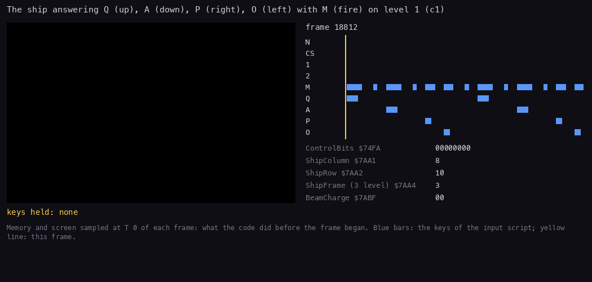

*Animation 5.2: c1 frames 18812-19072, every third frame, the playfield and the key bars of `tests/inputs/c1.txt`
with ControlBits, ShipColumn, ShipRow, ShipFrame and BeamCharge sampled with `memory_at` at T 0. Command:
`python3 tools/fig_controls.py play --work work/docs/rtB/c1 --from 18812 --to 19072 --step 3 --keys
tests/inputs/c1.txt --crop 0,0,256,160 --var ControlBits=74FA:1:bits --var ShipColumn=7AA1:1:dec --var
ShipRow=7AA2:1:dec --var ShipFrame=7AA4:1:dec --var BeamCharge=7ABF:1:hex --out docs/img/play/ship-keys.gif`.*

What to watch:

- the row going 8, 6, then 10, and the column 8 to 10 while Q, A and P are held;
- ShipFrame going to 4 on up and to 2 on down, and back to 3 when the keys are released;
- a key held for less than one pass, which may not show: the bits are sampled once a pass.

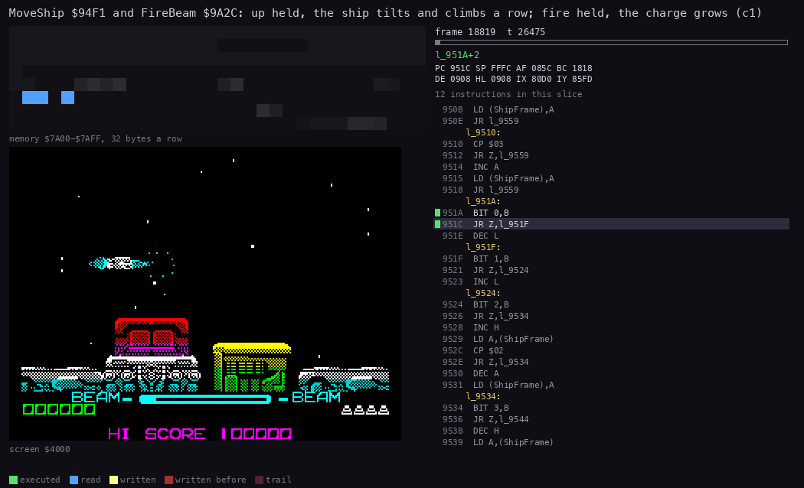

*Animation 5.3: MoveShip `$94F1` and ShipShield, ShieldControls and FireBeam in one pass of c1, 932 instructions,
window 18819:26380-18819:33000, the screen as the view and GameVars `$7A00-$7AFF` as the memory. Command:
`python3 ../../kit/routine_anim.py --work work/docs/rtB/c1 --window 18819:26380-18819:33000 --listing
build/game.lst --view screen --range 7A00-7AFF --pc 94F1-95F6,9A2C-9AE8 --pictures 70 --out
docs/img/routines/MoveShip.gif`.*

Worked example, one pass of c1: ReadControls ran at 18819:25793, MoveShip at 18819:26392, DrawGame at 26725,
ShipShield at 29226, ShieldControls at 31016, FireBeam at 31073. The next pass began at 18820:2852.

During the fly-in StartPlay `$8BAE` sets ShipFrame 0 and turns ShieldControls `$95A5` into `RET`, so neither the
moves nor the fire answer. c1's keys from 18302 to 18456 fell in that window and had no effect.

The point: a move is one cell a pass, about 1 cell every 3 frames. The ship has no speed, no inertia and no
position finer than a cell.

## 5.8 The fire and the beam charge

ShipShield `$9577` falls into ShieldControls `$95A5`. Its first byte is a patched `NOP`, a `RET` while the ship flies
in, dies or ends a level:

```asm
ShieldControls:                ; $95A5
        NOP                    ; RET while the controls are off
        LD A,(ControlBits)
        BIT 4,A
        JR NZ,l_95B3           ; fire held
        LD A,(BeamCharge)      ; $7ABF
        AND A
        JR Z,l_95B6            ; fire up and nothing charged
l_95B3: CALL FireBeam          ; held, or just released with a charge
l_95B6: ...                    ; the detach (5.9)
```

FireBeam `$9A2C` keeps the charge while fire is held, and decides what to fire when it is released:

```asm
FireBeam:                      ; $9A2C
        LD A,(ControlBits)
        BIT 4,A
        JR NZ,l_9A45           ; held: charge
        LD A,(BeamCharge)
        CP $0C
        JR NC,BeamRelease      ; released at $0C or more: a beam
        LD DE,(ShipColumn)
        INC E
        CALL ShotFire          ; released early: a plain shot
        JP l_9AD5              ; clear the charge and the meter
l_9A45: LD A,(BeamCharge)
        CP $0C
        JR NZ,l_9A52
        LD HL,$0283
        CALL PlaySound         ; sound $02: the charge has begun
l_9A52: ...                    ; the glow's phase: object $63 + phase / 2
        LD A,(BeamCharge)
        INC A
        INC A
        CP $40
        JR Z,l_9A6D            ; $40 is never stored: the charge stays at $3E
        LD (BeamCharge),A
l_9A6D: CP $28
        JR NC,l_9A87           ; the meter is full from $28
        LD HL,BeamMeter        ; $7A97
        LD DE,BeamMeterFull    ; '@'
        AND $03
        JR NZ,l_9A7D
        INC (HL)               ; every second step: the next cell
        INC E                  ; '>'
l_9A7D: LD A,(HL)
        ADD A,$0B
        LD C,A                 ; column BeamMeter + 11
        LD B,$14               ; row 20
        EX DE,HL
        CALL PrintTextNormal
l_9A87: ...                    ; the glow at (row - 1, column + 3), 3 more with the Force at the nose
```

The plain shot comes on release, not on press. A tap shorter than six passes (charge below `$0C`) gives one shot.
Holding longer gives a beam when fire is let go.

The charge rises 2 a pass. The compare with `$40` skips the store, so the charge tops out at `$3E` on the 31st pass.

The meter is the ten cells of row 20 from column 11 (the HUD, [doc 8](08-hud-and-text.md)). Each cell shows '<' when
empty, '>' when it starts to fill and '@' when full. Two passes fill a cell. The meter is full at `$28`, after 20
passes.

BeamRelease `$9AA2` picks one of three beams by the charge:

```asm
BeamRelease:                   ; $9AA2
        LD DE,$181E            ; object $18, power 30
        LD A,(BeamCharge)
        CP $24
        JR NC,l_9AB6
        LD DE,$1714            ; object $17, power 20
        CP $14
        JR NC,l_9AB6
        LD DE,$160A            ; object $16, power 10
l_9AB6: LD HL,BeamShot         ; $83E2: object, row, column
        LD BC,(ShipColumn)
        ...                    ; 3 columns further with the Force attached
        LD (HL),D
        INC L
        LD (HL),B
        INC L
        LD (HL),C
        LD A,E
        LD (BeamPower),A       ; $7AC0
        LD HL,$0543
        CALL PlaySound         ; sound $05
l_9AD5: XOR A
        LD (BeamCharge),A
        LD (BitPositions+$0009),A
        LD (BeamMeter),A
        LD BC,$140B
        LD HL,BeamMeterEmpty   ; ten '<'
        CALL PrintTextNormal
l_9AE8: ...                    ; the Force and the bits fire too (doc 10, 10.5)
```

| BeamCharge at release | Passes held | Fires | BeamShot object | BeamPower |
| --- | --- | --- | --- | --- |
| `$02`-`$0A` | 1-5 | a plain shot (ShotFire `$9D5C`) | none | none |
| `$0C`-`$12` | 6-9 | a small beam | `$16` | 10 |
| `$14`-`$22` | 10-17 | a middle beam | `$17` | 20 |
| `$24`-`$3E` | 18 or more | the full beam | `$18` | 30 |

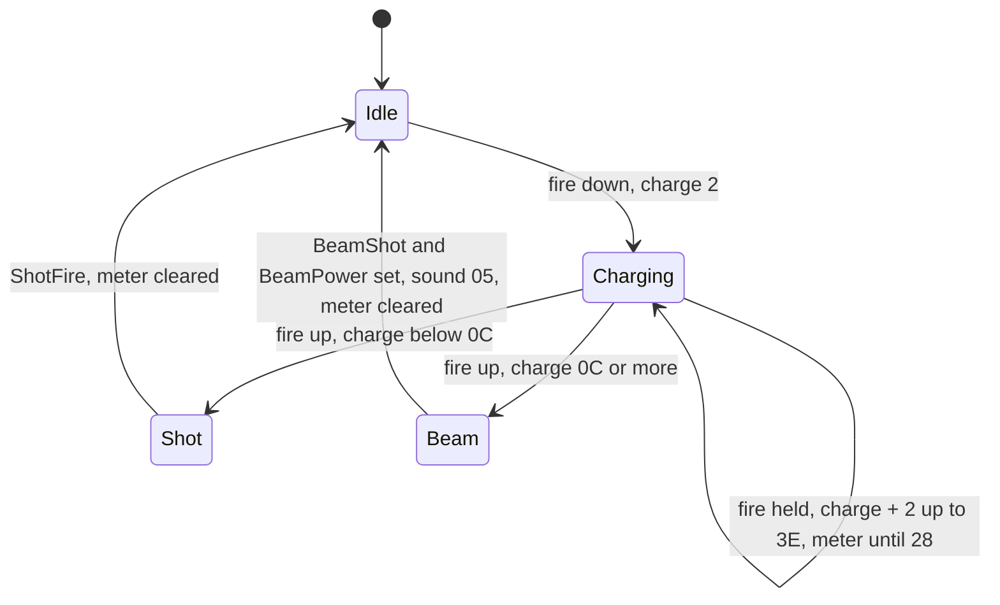

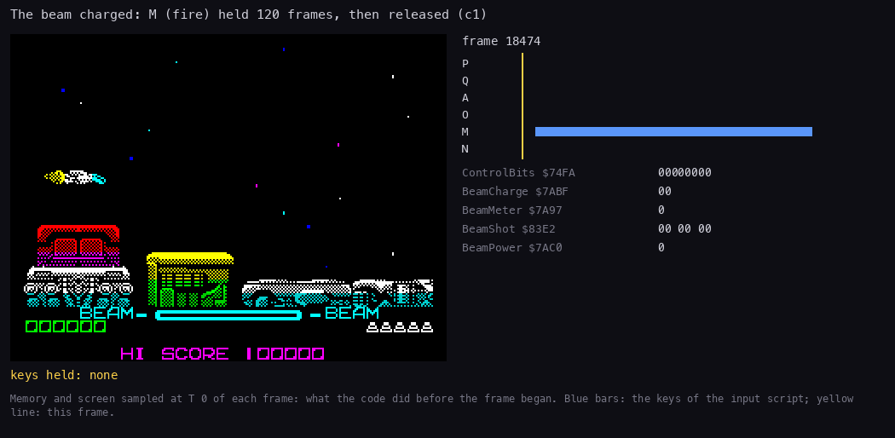

*Animation 5.4: c1 frames 18474-18630, every second frame: M (fire) held from 18480 to 18600, the BEAM meter
filling, the glow at the ship's nose, then the full beam. ControlBits, BeamCharge, BeamMeter, BeamShot (object,
row, column) and BeamPower sampled with `memory_at` at T 0. Command: `python3 tools/fig_controls.py play --work
work/docs/rtB/c1 --from 18474 --to 18630 --step 2 --keys tests/inputs/c1.txt --crop 0,0,256,192 --var
ControlBits=74FA:1:bits --var BeamCharge=7ABF:1:hex --var BeamMeter=7A97:1:dec --var BeamShot=83E2:3:hex --var
BeamPower=7AC0:1:dec --out docs/img/play/beam-charge.gif`.*

Worked example, c1: BeamCharge reads `$06` at 18492, then `$0C`, `$14`, `$1A`, `$22`, `$2A`, `$30`, `$36` and `$3E`
from 18588 on. M is released at 18600. At 18602 BeamShot reads `18 0A 06` (object `$18`, row 10, column 6) and
BeamPower 30, the full beam. The beam's column reads 8 at 18606, 10 at 18610, 14 at 18616 and 16 at 18620: two
columns a pass.

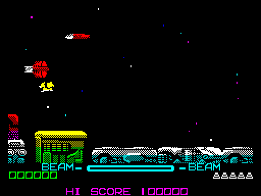

*Figure 5.5: c1 frame 18630, 30 frames after the release: the beam has gone, the meter is empty again and c1's ship
is exploding (ShipFrame 0 at 18624, the life lost near 18 640). The full beam in flight is in Animation 5.4, frames
18602-18620. Screenshot from the c1 recording.*

The charge stops at `$3E`: the code compares the new value with `$40` and stores it only
when it differs, so `$40` is never stored. c1 shows `$3E` at the top.

The point: the beam's strength has three steps, and the meter is cosmetic past `$24`: holding from pass 18 to pass
31 changes nothing but the glow.

## 5.9 The detach key

The last part of ShieldControls takes bit 5:

```asm
l_95B6: LD A,(ControlBits)
        BIT 5,A
        RET Z
        LD A,(ForceLevel)      ; $7ABE
        AND A
        RET Z                  ; no Force
        CALL ForceRecordOf     ; the Force's state byte
        ...
        LD A,(ForceAttached)   ; $7AA3: 1 at the nose, 2 at the tail, 0 free
        AND A
        JR Z,l_95EB
        CP $02
        LD A,(ShipColumn)
        JR Z,l_95DA
        CP $1A
        RET NC                 ; at the nose and too far right: stay
        LD A,$04               ; launch forwards
        JR l_95DF
l_95DA: CP $04
        RET C                  ; at the tail and too far left: stay
        LD A,$05               ; launch backwards
l_95DF: LD (HL),A
        XOR A
        LD (ForceAttached),A
        LD HL,$1481
        CALL PlaySound         ; sound $14
        RET
l_95EB: LD A,(HL)              ; free: recall it when it waits (state 3 or 7)
        CP $03
        JR Z,l_95F3
        CP $07
        RET NZ
l_95F3: LD (HL),$06            ; state 6: come back
        RET
```

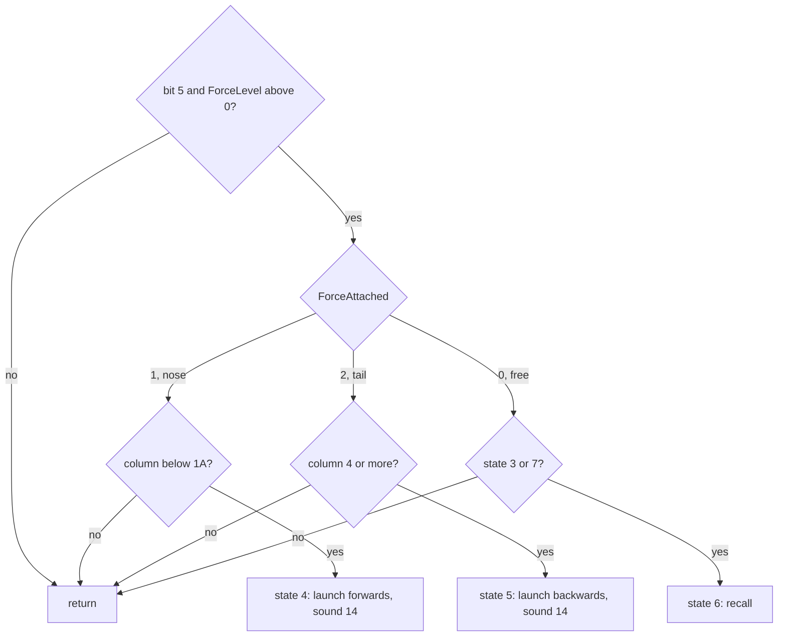

The key is read as held, not as a press. Holding it launches the Force; once the Force waits (state 3 or 7) the
same held key recalls it. What the Force does in states 4 to 7 is in [doc 10](10-gameplay-logic.md).

c1's N presses at 18630 and 18676 came while the ship was dead (ShipFrame 0 at 18624), and ctl-kempston's SPACE came
with no Force, so the stage 1 recordings never reach `$95BC`. Witness: `force` (the integration's recording: c1's play start with `l1`'s keys and POKE to frame 2100): the Force
docked at the tail by 2126 (ForceAttached 2); N held from 2144 with the ship at column 8: `$95DF` ran once,
ForceAttached 0 and state 5 at 2156; the Force waited (state 3) at 2166; N again from 2168: `$95F3` ran once, state 6
at 2180; docked again at the tail at 2250.

The point: one key both throws and calls back the Force. The column limits stop it leaving the playfield at once.

## 5.10 The pause

CheckPause `$8B77` runs second in every pass, after LoseLife:

```asm
CheckPause:                    ; $8B77
        CALL ReadRow0
        RET NZ                 ; CAPS SHIFT alone on its half-row?
        CALL ReadRow1
        RET NZ                 ; 1 alone on its half-row?
        DI
        CALL ClearTextRow
l_8B83: CALL ReadRow0
        JR NZ,l_8B96
        CALL ReadRow1
        CP $02                 ; 2 alone?
        JR NZ,l_8B96
        CALL ClearTextRow
        EI
        JP DrawHud             ; redraw the HUD, back into the pass
l_8B96: LD HL,PausedText       ; "GAME  PAUSED"
        LD C,$0A
        CALL PrintRow22
        JR l_8B83

ReadRow1:                      ; $8BA0
        LD A,$F7
        JR l_8BA6
ReadRow0:                      ; $8BA4
        LD A,$FE
l_8BA6: IN A,($FE)
        CPL
        AND $0F                ; the first four keys of the half-row
        CP $01                 ; Z when only the outer key is down
        RET
```

The pause is CAPS SHIFT + 1; the resume is CAPS SHIFT + 2. Each test wants that key alone among the half-row's
first four. ReadRow1 compares the whole low nibble with 2, so 1 and 2 together do not resume. Key 5 and V are
outside the nibble and do not matter.

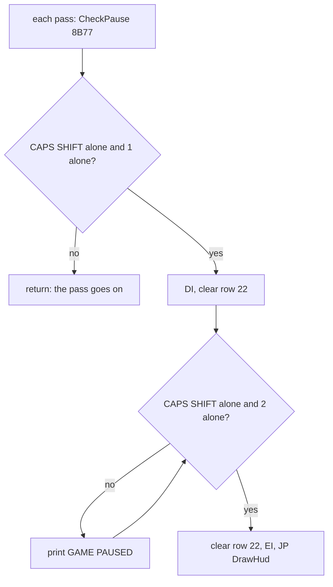

The loop runs with interrupts off. The stars and the sound tasks stop with it. The game resumes in the same pass,
where it stopped.

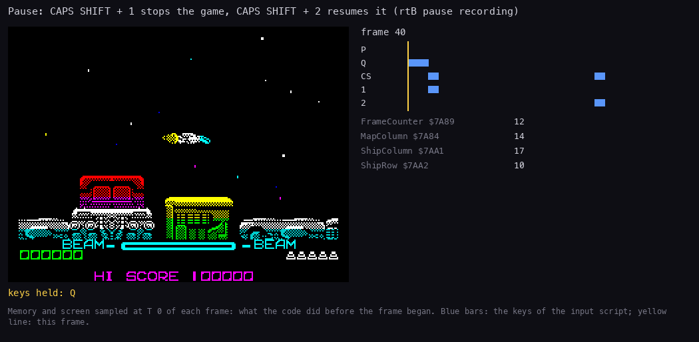

*Animation 5.5: the `pause` recording (rtB), frames 40-310, every third frame: CAPS SHIFT + 1 at 60, GAME PAUSED
for 150 frames, CAPS SHIFT + 2 at 220, play again. FrameCounter `$7A89`, MapColumn `$7A84`, ShipColumn and
ShipRow, sampled with `memory_at` at T 0, stand still while paused. Command: `python3 tools/fig_controls.py play
--work work/docs/rtB/pause --from 40 --to 310 --step 3 --keys tests/inputs/pause.txt --crop 0,0,256,192 --var
FrameCounter=7A89:1:hex --var MapColumn=7A84:1:dec --var ShipColumn=7AA1:1:dec --var ShipRow=7AA2:1:dec --out
docs/img/play/pause.gif`.*

Witness: in the `pause` recording `DI` at `$8B7F` and the resume at `$8B8F` ran once each, and the loop head
`$8B83` 1185 times. The recording's screenshots are in `work/docs/rtB/rec/pause/screens` (frame 145: GAME PAUSED).

There is no abort key. Neither the pass nor the pause loop reads any other key. A game ends only when the last life
is lost.

The point: the pause stops the whole machine except the loop that prints its message, so nothing moves while the
game is paused.

## 5.11 The name entry

After MISSION OVER, CheckHiScore `$92E8` calls InsertHiScore `$92FA` with the score (ScoreText `$71C9`, six ASCII
digits). The first table entry with a lower score gets the new one. The rest shift down by one entry (17 bytes),
and the last falls into HiScoreSpare `$7D71`. The table's format is in [doc 8](08-hud-and-text.md).

The name is then picked letter by letter with the player's own control method:

```asm
l_9354: POP HL                 ; the place in the name
        LD A,(NameLetter)      ; $71D2
        LD (HL),A
        PUSH HL
        CALL PrintHiScores     ; redraw the whole table
        CALL ReadControls      ; the chosen method's reader
        BIT 0,A
        JR NZ,l_936E           ; left: the previous letter
        BIT 1,A
        JR NZ,l_937A           ; right: the next letter
        BIT 4,A
        JR NZ,l_9394           ; fire: take it
        JR l_9354
l_936E: LD A,(NameLetter)
        DEC A
        CP $40
        JR NZ,l_9384
        LD A,$5D               ; below A: wrap to ']'
        JR l_9384
l_937A: LD A,(NameLetter)
        INC A
        CP $5E
        JR NZ,l_9384
        LD A,$41               ; past ']': wrap to A
l_9384: LD (NameLetter),A
l_9387: LD HL,$0C81
        CALL PlaySound         ; sound $0C
        LD B,$0C
        CALL WaitFrames        ; 12 frames
        JR l_9354
l_9394: LD A,(NameLetter)
        CP $5C
        JR Z,l_93AF            ; '\': rub out
        CP $5D
        JR Z,l_93C0            ; ']': end
        LD A,(NamePos)         ; $71D3
        CP $08
        JR Z,l_93CD            ; the ninth place: end
        INC A
        LD (NamePos),A
        ...                    ; the next place
l_93AF: LD A,(NamePos)         ; '\': rub out
        AND A
        JR Z,l_9387            ; the first place: only the sound
        DEC A
        LD (NamePos),A
        POP HL
        LD (HL),$20            ; blank the current place (where the '\' stood)
        DEC HL                 ; back one: l_9354 writes the '\' there
        PUSH HL
        JR l_9387
```

The letters run A to Z, then `[` `\` `]` (`$5B`-`$5D`). The font draws `[` as a blank, `\` as a rub-out sign and `]`
as an end sign ([doc 8](08-hud-and-text.md)). Fire on `\` blanks the current place and steps back one; the next
pass of `l_9354` writes NameLetter, still `\`, on the previous place, so the letter there shows `\` until a new
letter is picked over it. At the first place the fire gives only the sound. Fire on `]`, or fire on the ninth place,
ends the entry with sound `$16`.

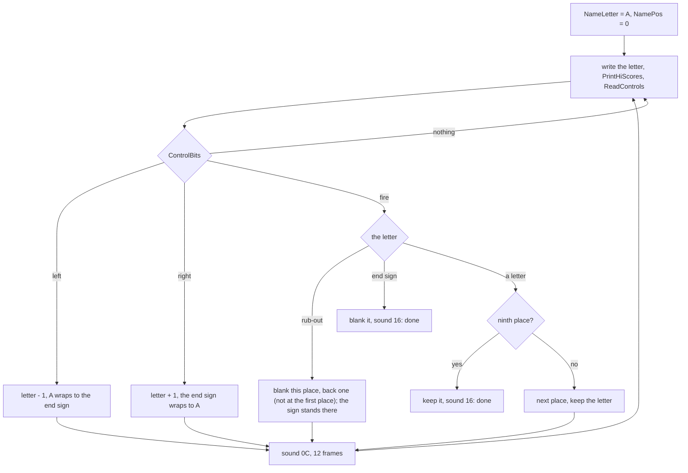

Why letter keys do nothing: the loop reads only ControlBits, the six bits of the chosen method. No keyboard scan
runs, so a letter key counts only if it is one of the six defined keys, and then as its direction. Up and down are
read but not tested.

The next place starts with the letter just taken, not with A. Three fires in a row give three equal letters.

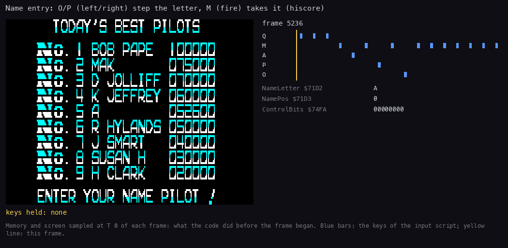

*Animation 5.6: the hiscore recording, frames 5236-5800, every fourth frame: Q (up) three times and A (down) change
nothing; M (fire) takes A twice, P (right) gives B, M takes it, O (left) gives A again, then M to the ninth place.
NameLetter `$71D2`, NamePos `$71D3` and ControlBits sampled with `memory_at` at T 0; the screen trails the
variables by one redraw. Command: `python3 tools/fig_controls.py play --work work/docs/rtB/hiscore --from 5236 --to
5800 --step 4 --keys tests/inputs/hiscore.txt --crop 0,0,256,192 --var NameLetter=71D2:1:text --var
NamePos=71D3:1:dec --var ControlBits=74FA:1:bits --out docs/img/play/name-entry.gif`.*

Worked example, hiscore: the keys are c1's (O left, P right, Q up, A down, M fire).

| Frame | Key | Bit | Result (NamePos after) |
| --- | --- | --- | --- |
| 5247, 5283, 5319 | Q | up | nothing (0) |
| 5355 | M | fire | A taken (1) |
| 5391 | A | down | nothing (1) |
| 5427 | M | fire | A taken (2) |
| 5463 | P | right | the letter is B (2) |
| 5499 | M | fire | B taken (3) |
| 5535 | O | left | the letter is A (3) |
| 5571, 5607, 5643, 5679, 5715 | M | fire | A taken five times (8) |
| 5751 | M | fire | the ninth place: A kept, the entry ends |
| 5787, 5823 | M, ENTER | | after the end: nothing |

The name is AABAAAAAA, at No. 5 with 052600. Witness: the right step `$937A` and the left step `$936E` ran once
each; the loop head `$9354` 378 times. In hiscore-typed, A G E N T ENTER leave the loop head running (922 times)
and no letter changes.

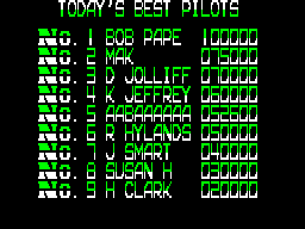

*Figure 5.6: hiscore frame 5959, TODAY'S BEST PILOTS with AABAAAAAA at No. 5. Screenshot from the hiscore
recording.*

The WALKTHROUGH and the code agree: left and right change the letter.

The point: the name entry is a joystick entry. It works the same with any method, and a keyboard player must use
the direction keys, not the letters.

## 5.12 Summary

- One byte, ControlBits `$74FA`, carries all input: bits 0-5 left, right, down, up, fire, detach.
- ControlVector `$74FC` picks one of four readers. The title's first fire picks the method.
- The Kempston is offered only if port `$1F` read 0 255 times at power-on.
- DEFINE takes six keys as (port, mask) pairs and refuses duplicates.
- The ship moves one cell a pass per axis, rows 0-19, columns 1-28.
- Fire charges the beam 2 a pass to `$3E`. The release gives a shot below `$0C` or one of three beams.
- The pause is CAPS SHIFT + 1 / + 2 with interrupts off. There is no abort key.
- The name entry steps letters with left and right. Letter keys do nothing because nothing scans the keyboard.
