# 6. Rendering

What this covers:

- the screen: a playfield of 20 character rows, the HUD below, and two black columns at the sides;
- the buffers: the pixel shadow `$6000`, the attribute shadow PlayAttrs `$7800`, the cell map SolidMap `$7E00`,
  DrawnMap `$8100`, the column buffer `$5E00` and the bit-reverse table `$5D00`;
- the scroll (`$7A82-$7A87`): an 8-pass cycle that shifts the scenery one pixel a pass on the screen itself and moves
  the attributes one cell every 8 passes;
- the map and the 4 x 4 metatiles in four variants (`$8741`, `$8778`, `$87B8`, `$87F2`);
- ScrollRows `$8842`, the copy to the screen, the erase and the unrolled shift chain ShiftRun `$8914`;
- DrawSprite `$8CFD`: the ship, the Force, the enemies and the shots as cells, the rule that keeps them off the
  scenery, and the hits gathered while drawing;
- the first screen of a level, the stars, and the code against the screen and the beam on a real frame;
- the profile items of a scrolling shooter: the scroll against the beam, the erase, the draw order, the attribute
  grid and the clash.

The recordings it rests on ([WALKTHROUGH 6.0](../WALKTHROUGH.md#60-the-recordings)):

| Recording | Load | Used for |
| --- | --- | --- |
| `l2` | `work/stage1/probe/ch-003045-L2-idle.szx`, the tape at block 35, the immortality POKE `$91F2` = `$C9` in RAM | the level start (DrawFirstScreen at 2750), one pass of play (7535-7539), the right edge over 38 passes (7500-7660) |
| `c1` | power-on, `LOAD ""`, the original tape, `tests/inputs/c1.txt` | play on level 1: the pass's order |
| `l1`-`l8` | each level from its load, the same POKE | the maps and the screens of each level |

The POKE makes the ship immortal; it changes nothing the renderer does.

Conventions:

- **A frame** is 1/50 s of the 48K, 69 888 T. "7535:19381" is frame 7535, T 19381 of that frame, as an access trace
  places an instruction.
- A value read with `time_travel memory_at` is the memory at T 0 of the frame named.
- **A pass** is one turn of MainLoop `$8649` ([doc 4](04-game-loop.md)): 4 to 5 frames on level 2 (7535:19188 to
  7539:46103 is 4.4 frames).
- **A cell** is one character cell of the playfield: row 0-19, column 0-31. Its SolidMap byte, its PlayAttrs byte and
  its DrawnMap byte all sit at row x 32 + column from their tables' starts.
- **A tag** is a cell's SolidMap byte: 0 empty, `$DC` or more scenery, `$FA` a soft cell, anything else the object
  that drew itself there in this pass.

## 6.1 The screen and the buffers

The screen is cut in two. Rows 0-19 are the playfield; rows 20-23 are the HUD ([doc 8](08-hud-and-text.md)).
ClearSides `$7680` paints the attributes of columns 0 and 31 black on black for all 24 rows. Nothing in those two
columns is ever seen.

Column 31 is not empty, though. The scroll writes each new column of scenery there, hidden, and shifts its pixels
into column 30 one pixel a pass ([6.4](#64-scrollrows-the-copy-the-erase-and-the-shift)). Column 0 is where shifted
pixels fall off.

The renderer keeps one byte a cell in three tables and one shadow of the playfield's pixels:

| Buffer | Address | Size | Holds |
| --- | --- | --- | --- |
| BitReverse | `$5D00` | 256 | each byte with its bits reversed, built at the entry |
| ColumnBuffer | `$5E00` | 180 | the next column of scenery: 20 cells of 9 bytes (8 pixel lines, then the attribute) |
| pixel shadow | `$6000-$77FF` | 6144 (used: rows 0-19) | the playfield's pixels as the screen lays them out, at screen address + `$2000` |
| PlayAttrs | `$7800` | 640 | the attribute of each playfield cell (bit 7 removed) |
| GameVars | `$7A80` | | ColumnPtr `$7A80`, ScrollStep `$7A82`, MetaColumn `$7A83`, MapColumn `$7A84`, MapReadPtr `$7A85`, MapBlockPtr `$7A87`, FrameCounter `$7A89`, ScrollHalted `$7A8E`, DrawTag `$7A9C` |
| SolidMap | `$7E00` | 640 | the tag of each cell |
| RowTable | `$8080` | 80 | per row: the screen address and the attribute address of column 31; the entry after row 19 has 0 as its page |
| DrawnMap | `$8100` | 640 | 1 where a sprite cell is on the screen and must be erased when nothing redraws it |

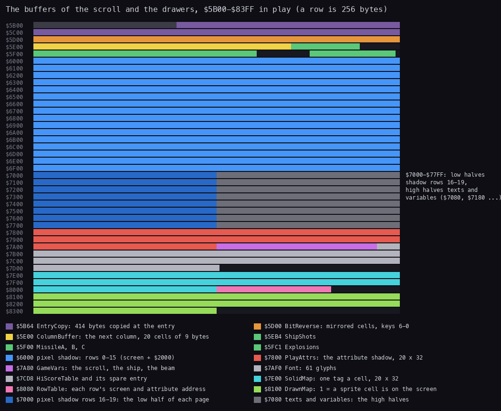

*Figure 6.1: `$5B00-$83FF` in play, a row a page, coloured by the tables above (the addresses of
`src/game/game.ann`). Command: `python3 tools/fig_render.py memory --out docs/img/render/memory.png`.*

How to read:

- the blue rows are the pixel shadow, one page per pixel line of the screen's thirds;
- in `$7000-$77FF`, the third holding rows 16-23, only the low half of each page is shadow (rows 16-19). The game
  keeps its texts and variables in the high halves: KeyPromptText `$7080`, HiScoreLabel `$7180`, RewindSide2Text
  `$7280`, TitleTexts `$7480`, BestPilotsText `$7580`, DefinedKeys `$7780`.

The shadow is laid out like the screen, so a cell's shadow is the cell's screen address with `$20` added to the high
byte. CellMark `$8EA2` gets there from the PlayAttrs page in four instructions:

```asm
        LD A,D                 ; the PlayAttrs page: $78, $79 or $7A, one per third
        AND $03                ; 0, 1, 2
        RLCA
        RLCA
        RLCA                   ; 0, 8, 16
        ADD A,$60              ; $60, $68, $70: the shadow's third
```

The same `ADD A,$60` is the byte that SoftCellsOn patches to `$40`, the screen itself ([6.5](#65-drawsprite-cells-into-the-shadow)).

The point: every cell has a fixed byte in each table, and the three cell tables and the shadow are addressed from one
another by adding constants to the high byte.

## 6.2 The map and the metatiles

A level's scenery is a map of metatiles ([doc 7](07-objects.md) has the level block). The word LevelMetatiles at
`$C4BC` points at the map. The map is 5 bytes per column block, top to bottom, each byte one metatile of 4 x 4 cells,
so 5 bytes fill the 20 rows. A column block is 4 cells (32 pixels) wide.

A map byte:

| Bits | Meaning |
| --- | --- |
| 0-5 | the metatile number n |
| 6-7 | the drawer: `$00` as stored, `$40` mirrored left to right, `$80` upside down, `$C0` both |

The metatiles lie below the map, numbered downwards from it. MetatileAddress `$882D` computes
LevelMetatiles - (n + 1) x 144:

```asm
MetatileAddress:               ; $882D, A = n
        INC A
        ADD A,A
        ADD A,A                ; 4 (n + 1): fits in a byte for n up to 62
        LD H,$00
        LD L,A
        ADD HL,HL
        ADD HL,HL              ; 16 (n + 1)
        PUSH HL
        ADD HL,HL
        ADD HL,HL
        ADD HL,HL              ; 128 (n + 1)
        POP DE
        ADD HL,DE              ; 144 (n + 1)
        EX DE,HL
        LD HL,(LevelMetatiles)
        SBC HL,DE              ; the carry is clear from the last ADD
        RET
```

A metatile is 144 bytes: 4 rows of 4 cells, each cell 9 bytes (the attribute, then 8 pixel lines), so a row is 36
bytes. Bit 7 of a cell's attribute (the FLASH bit on the screen) marks it solid; the game strips it before the
attribute reaches the screen.

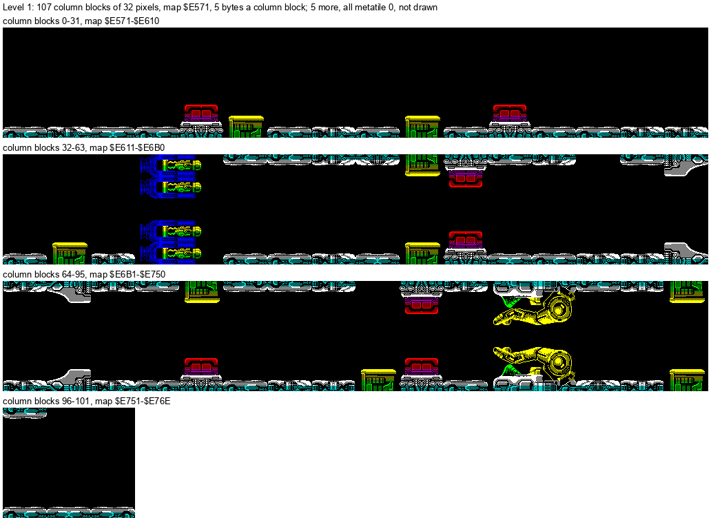

*Figure 6.2: level 1's map, 107 column blocks, drawn from the resources by `python3 tools/levelmap.py 1
docs/img/maps/level-1.png`. The other levels are in `docs/img/maps/level-2.png` to `level-8.png`.*

### The four cutters

The scroll never draws a whole metatile. Each of steps 2-6 of the scroll cuts one column of one metatile, 4 cells,
into ColumnBuffer. MetaColumn `$7A83` (0-3) says which column. The four cutters differ only in where they start and
which way they read:

| Cutter | Map bits 6-7 | Starts at | Reads |
| --- | --- | --- | --- |
| CutMetatile `$8741` | 00 | + 9 x column | the attribute, 8 lines forwards (`LDI` x 8); next row + 27 |
| CutMetatileMirrored `$8778` | 01 | + 9 x (column XOR 3) | MirrorCell `$879E`: each line through BitReverse; next row + 27 |
| CutMetatileFlipped `$87B8` | 10 | + `$8F` - 9 x (column XOR 3) | from the bottom row's last line backwards, the attribute last; next row - 28 |
| CutMetatileBoth `$87F2` | 11 | + `$8F` - 9 x column | the same backwards, each line through BitReverse |

CutMetatile, the plain one:

```asm
CutMetatile:                   ; $8741, A = n
        CALL MetatileAddress
        LD A,(MetaColumn)
        LD E,A
        ADD A,A
        ADD A,A
        ADD A,A
        ADD A,E                ; 9 x column
        LD D,$00
        LD E,A
        ADD HL,DE
        LD DE,(ColumnPtr)      ; the next free byte of ColumnBuffer
        LD A,$04               ; 4 cells
l_8756: EX AF,AF'
        LD A,(HL)              ; the attribute, kept
        INC HL
        LDI                    ; 8 pixel lines
        LDI
        LDI
        LDI
        LDI
        LDI
        LDI
        LDI
        LD (DE),A              ; the attribute after the lines
        INC E
        LD BC,$001B
        ADD HL,BC              ; the same column, the next row of the metatile
        EX AF,AF'
        DEC A
        JR NZ,l_8756
        LD (ColumnPtr),DE
        RET
```

The mirrored cutter reads column 3 - c instead of c and reverses each line through the table:

```asm
MirrorCell:                    ; $879E
        LD A,(HL)              ; the attribute
        EX AF,AF'
        INC HL
        LD B,$5D               ; BitReverse
        LD IXL,$08
l_87A6: LD C,(HL)
        LD A,(BC)              ; the line, reversed
        LD (DE),A
        INC HL
        INC DE
        DEC IXL
        JP NZ,l_87A6
        EX AF,AF'
        LD (DE),A              ; the attribute last
        INC E
        LD BC,$001B
        ADD HL,BC
        RET
```

The upside-down cutter starts at byte `$8F` (143, the last line of the bottom-right cell) less 9 x (column XOR 3),
which is the last line of the bottom cell of column c. It copies 8 bytes backwards, then the attribute it lands on,
then steps back 28 bytes to the last line of the cell above. The "both" cutter starts at `$8F` - 9 x column, the
bottom cell of column 3 - c, and reverses each line on the way.

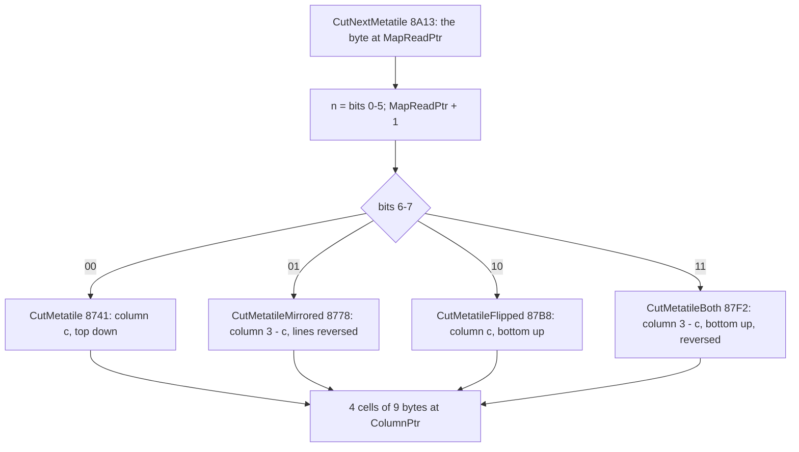

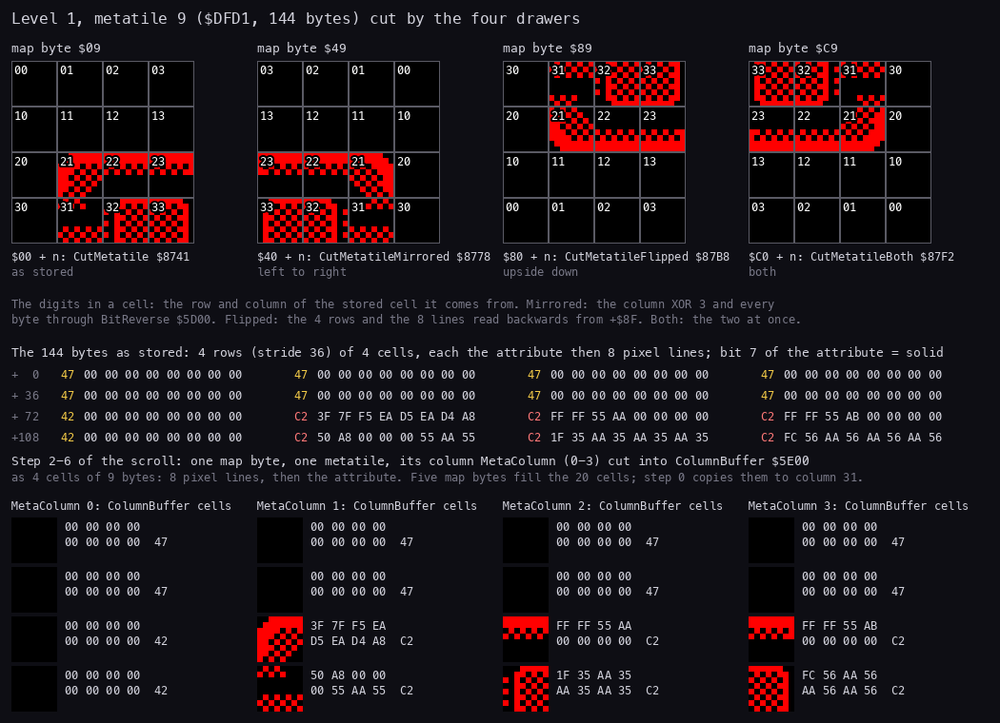

*Figure 6.3: level 1's metatile 9 (`$DFD1`) as each cutter builds it, with the source cell of every target cell; its
144 stored bytes; and the four columns MetaColumn 0-3 cut into ColumnBuffer, 8 lines then the attribute. Drawn from
the resources (`src/res/levels/level1`) the way the cutters read them. Command: `python3 tools/fig_render.py
metatile --level 1 --tile 9 --out docs/img/render/metatile.png`.*

How to read:

- the two digits in a cell are the stored row and column it comes from;
- in the byte rows, a red attribute has bit 7 set (solid scenery), a yellow one not.

Worked example: level 1 uses metatile 9 in all four variants (map bytes `$09`, `$49`, `$89`, `$C9`). Its column 1,
row 2 holds `C2 3F 7F F5 EA D5 EA D4 A8`: attribute `$C2` (solid, bright red on black), 8 lines. Cut plainly with
MetaColumn 1, the third cell of the ColumnBuffer group gets `3F 7F F5 EA D5 EA D4 A8 C2`. Mirrored, the same target
place takes column 2's cell `FF FF 55 AA 00 00 00 00` reversed: `FF FF AA 55 00 00 00 00`.

The empty cells beside the scenery are not plain black. Metatile 9's empty cells in rows 2 and 3 carry `$42` (red ink
on black), the ink of the solid cells beside them; those in rows 0 and 1 carry `$47`. Why that matters is in
[6.10](#610-the-attribute-grid-and-the-clash).

The point: a level stores each shape once and gets three more for free. Level 1 needs 22 metatiles for 107 column
blocks; 20 of them appear in more than one variant.

## 6.3 The scroll's 8-pass cycle

Scroll `$8979` runs third in every pass. FrameCounter `$7A89` counts the passes; its low three bits are ScrollStep
`$7A82`.

```asm
Scroll:                        ; $8979
        CALL ScrollRows        ; every pass: the scenery 1 pixel left, the sprites to the screen
        LD A,(ScrollStep)
        CP $07
        CALL Z,ScrollAttrs     ; step 7: attributes and tags one cell left
        LD A,(FrameCounter)
        INC A
        LD (FrameCounter),A
        AND $07
        LD (ScrollStep),A
        JR Z,ScrollNewColumn   ; step 0: the cut column to column 31
        CP $02
        RET C                  ; step 1: nothing more
        CP $07
        RET NC                 ; step 7: nothing more
        LD A,(ScrollHalted)
        AND A
        RET NZ
        JR CutNextMetatile     ; steps 2-6: one map byte, one metatile column
```

| Step after the increment | Work |
| --- | --- |
| 0 | ScrollNewColumn `$899F`: MetaColumn + 1 (and MapColumn + 1, MapBlockPtr + 5 every fourth time); ColumnBuffer to column 31 |
| 1 | none |
| 2-6 | CutNextMetatile `$8A13`: one map byte of the block column, 4 cells into ColumnBuffer |
| 7 | none, but the next pass starts with ScrollAttrs |

ScrollAttrs `$8CD8` moves PlayAttrs and SolidMap one cell left, columns 2-31 to 1-30, 30 bytes a row with `LDIR`.
It runs at step 7, right before ScrollNewColumn writes a fresh column 31. ScrollRows runs every pass.

ScrollNewColumn copies the 20 cells to the screen's column 31 through RowTable, and writes the column's attributes
and tags:

```asm
ScrollNewColumn:               ; $899F
        LD HL,(MapBlockPtr)
        LD A,(MetaColumn)
        INC A
        AND $03
        LD (MetaColumn),A
        JR NZ,l_89BB
        LD A,(MapColumn)       ; a new block of 4 columns
        INC A
        LD (MapColumn),A
        LD DE,$0005
        ADD HL,DE
        LD (MapBlockPtr),HL
l_89BB: LD (MapReadPtr),HL     ; steps 2-6 read the block's 5 bytes from here
        LD A,(ScrollHalted)
        AND A
        RET NZ
        LD HL,ColumnBuffer
        LD (ColumnPtr),HL
        LD IX,RowTable
        LD B,$14               ; 20 rows
l_89CF: LD E,(IX+$00)
        LD D,(IX+$01)          ; the screen byte of column 31, line 0
        LD A,(HL)
        LD (DE),A
        INC L
        INC D
        ...                    ; 8 lines in all
        LD A,(IX+$03)
        ADD A,$20
        LD D,A                 ; PlayAttrs, column 31
        LD A,(HL)
        AND $7F
        LD (DE),A              ; the attribute without bit 7
        LD A,D
        ADD A,$06
        LD D,A                 ; SolidMap, column 31
        LD A,(HL)
        RLCA
        AND $01
        CPL
        INC A                  ; bit 7 set: $FF, else 0
        LD (DE),A
        INC L
        LD DE,$0004
        ADD IX,DE
        DJNZ l_89CF
        RET
```

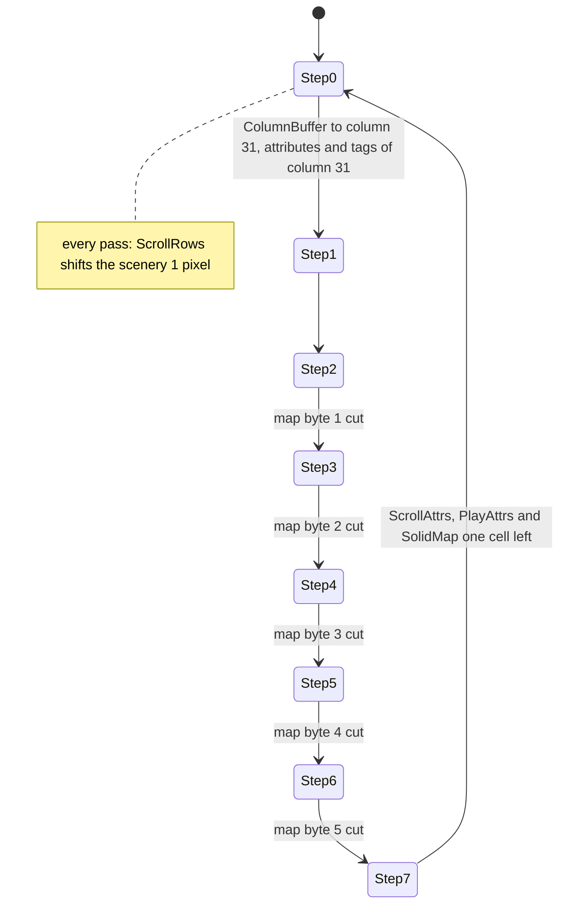

So the scenery moves 8 pixels in 8 passes, and the cell grid follows it by one cell every 8 passes. The column cut in
steps 2-6 is the one that appears 2 to 6 passes later, at step 0.

While the scroll stands (ScrollHalted `$7A8E` non-zero: a boss, or wave command 1, [doc 7](07-objects.md)), steps 0
and 2-6 return early, ScrollAttrs does nothing, and ScrollRows skips the scenery. FrameCounter still counts. Wave command 1 (`$90B5`) also patches
CellFreeEmpty's first two bytes to `SCF` / `RET`, so every empty cell is free while the scenery stands still;
ResumeWaves `$90F7` puts the code back.

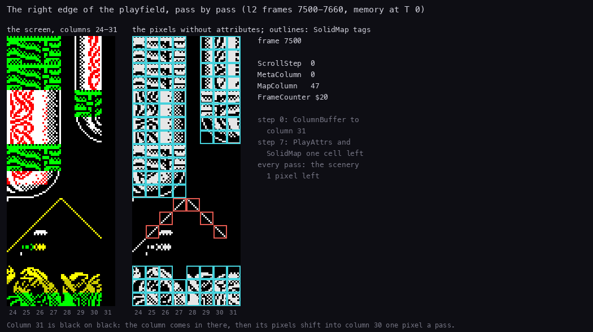

*Animation 6.1: the scroll of a column. l2 frames 7500-7660, one picture per pass (38 passes, the frames where
ScrollStep changes), memory at T 0. Left: the screen's columns 24-31 as shown. Right: the same pixels without
attributes, with the SolidMap tags outlined; ScrollStep, MetaColumn and MapColumn beside. Command: `python3
tools/fig_render.py scrollzoom --work work/docs/rtB/l2 --from 7500 --to 7660 --columns 8 --scale 3 --out
docs/img/play/scroll-edge.gif`.*

What to watch:

- column 31 is black on the left and full on the right: the hidden staging column;
- the pixels move one pixel a picture, the outlines one cell every 8 pictures;
- MapColumn steps once every 32 passes, MetaColumn every 8.

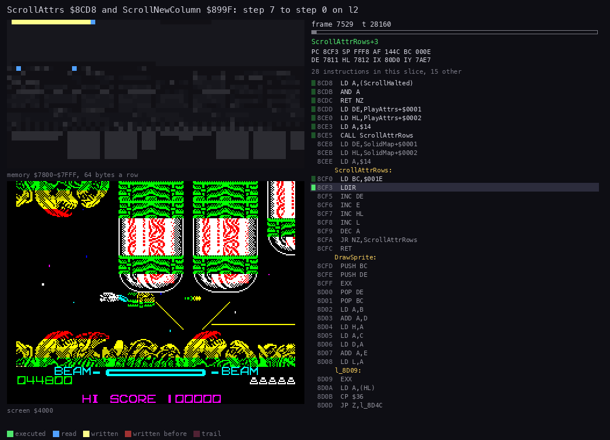

*Animation 6.2: the end of a pass at step 7 on l2: ScrollAttrs moves PlayAttrs and SolidMap one cell left, then
ScrollNewColumn copies the 20 cells of ColumnBuffer into column 31 (the screen, PlayAttrs and SolidMap). Window
7529:27400-7530:3100. Command: `python3 ../../kit/routine_anim.py --work work/docs/rtB/l2 --window
7529:27400-7530:3100 --listing build/game.lst --view screen --range 7800-7FFF --pc 8979-8A13,8CD8-8CFD
--pictures 60 --out docs/img/routines/ScrollNewColumn.gif`.*

What to watch:

- the memory panel: PlayAttrs (top) and SolidMap (bottom) move one byte left row by row, then column 31 of both is
  written, 20 times;
- the screen: column 31 fills with pixels that stay invisible, its attribute being black.

Witness: on l2 ScrollAttrs ran at 7529:27569 and ScrollNewColumn at 7529:64652; CutNextMetatile at 7538:46225,
7542:29824, 7547:22805, 7551:9492, 7556:36552, one a pass.

The point: the expensive part of a scroll, cutting new graphics, is spread over five passes, one metatile column a
pass, and the copy into the screen is one column of 20 cells.

## 6.4 ScrollRows: the copy, the erase and the shift

ScrollRows `$8842` is the only routine that writes the playfield in play (6.8 shows it). For each of the 20 rows of
RowTable it does three things.

First, the row's attributes go from PlayAttrs to the screen, columns 1-30, with `LDDR`:

```asm
ScrollRows:                    ; $8842
        LD IX,RowTable
l_8846: LD A,(IX+$03)          ; the attribute page; 0 ends the table
        AND A
        RET Z
        LD D,A
        ADD A,$20
        LD H,A                 ; PlayAttrs page
        LD E,(IX+$02)
        DEC E                  ; column 30
        LD L,E
        LD BC,$001E
        LDDR                   ; columns 30 to 1
        LD A,D
        ADD A,$26
        LD D,A                 ; SolidMap page
        LD E,(IX+$02)          ; column 31
        LD H,(IX+$01)          ; the screen, line 0
        LD L,E
        LD BC,$0004
        ADD IX,BC
l_8869: LD A,E                 ; the cell loop
        AND $1F
        JP Z,l_8846            ; column 0: the next row
        LD A,(DE)
        CP $DC
        JP C,l_8881            ; a sprite tag or 0
        LD A,(ScrollHalted)
        AND A
        JP Z,l_88E6            ; scenery and scrolling: a shift run
        DEC E                  ; scenery, halted: leave it
        DEC L
        JP l_8869
```

Then it walks the row from column 31 to column 1 and decides each cell by its tag:

```text
for column = 31 down to 1:
    tag = SolidMap[row][column]
    if tag >= $DC:                              # scenery
        if ScrollHalted: continue
        run = the scenery cells from here leftwards, plus the cell after them (none past column 1)
        shift the 8 lines of the run 1 pixel left, right to left, the carry passing between cells
        resume at the run's left non-scenery cell (LD L,E): its tag then copies or erases it
    elif tag != 0:                              # a sprite drew itself here in this pass
        copy the cell's 8 lines from the shadow (screen + $2000) to the screen
        DrawnMap[row][column] = 1
    elif DrawnMap[row][column] == 1:            # a sprite was here and nothing redrew it
        clear the cell's 8 lines on the screen
        DrawnMap[row][column] = 0
    if tag == $9C and FrameCounter AND 7 != 7: keep the tag
    else: SolidMap[row][column] = 0             # sprite tags live one pass
```

The scenery is never copied: its pixels live only on the screen, and ScrollRows shifts them in place. Sprites are
copied from the shadow, and only the cells tagged in this pass.

### The shift run

For a run of scenery cells ScrollRows builds a call chain on the stack and returns into it:

```asm
l_88E6: LD BC,ShiftRunDone
        PUSH BC                ; where the chain ends
        PUSH HL                ; the run's right cell on the screen
        LD B,$01
l_88ED: DEC E                  ; count the run leftwards
        LD A,E
        AND $1F
        JP Z,l_88FB            ; column 0: stop
        INC B                  ; this cell joins the run, scenery or not
        LD A,(DE)
        CP $DC
        JP NC,l_88ED           ; scenery: go on
l_88FB: LD A,B
        XOR $1F
        LD L,A
        ADD A,A
        ADD A,L
        LD L,A
        LD H,$00               ; 3 x (31 - B)
        LD BC,ShiftRun
        ADD HL,BC              ; the entry for B cells
        POP BC                 ; BC = the right cell
        PUSH HL                ; 8 returns into the chain, one per line
        PUSH HL
        PUSH HL
        PUSH HL
        PUSH HL
        PUSH HL
        PUSH HL
        PUSH HL
        LD H,B
        LD L,C
        RET                    ; into the chain

ShiftRun:                      ; $8914: 30 x (RL (HL), DEC L), 3 bytes a cell,
        RL (HL)                ; then ShiftRun1: 31 cells from this top entry
        DEC L
        ...
ShiftRun1:                     ; $896E
        RL (HL)                ; the run's left cell
        INC H                  ; the next pixel line
        LD L,C                 ; back to the right cell
        AND A                  ; no carry into the next line's right cell
        RET                    ; to the next copy of the entry, or ShiftRunDone

ShiftRunDone:                  ; $8974
        LD H,B
        LD L,E                 ; the run's left non-scenery cell, handled next by its tag
        JP l_8869              ; and on along the row
```

`RL (HL)` shifts a byte left one pixel; its bit 7 goes into the carry and from there into bit 0 of the next byte to
the left. Running right to left over the run, the pixels cross the cell borders.

The run takes one cell more than its scenery: the cell left of it, scenery or not, is counted before its tag is
tested. That cell receives the pixels shifted out of the scenery's left edge. After 8 passes they have filled it,
and ScrollAttrs moves the tags so that it becomes a scenery cell.

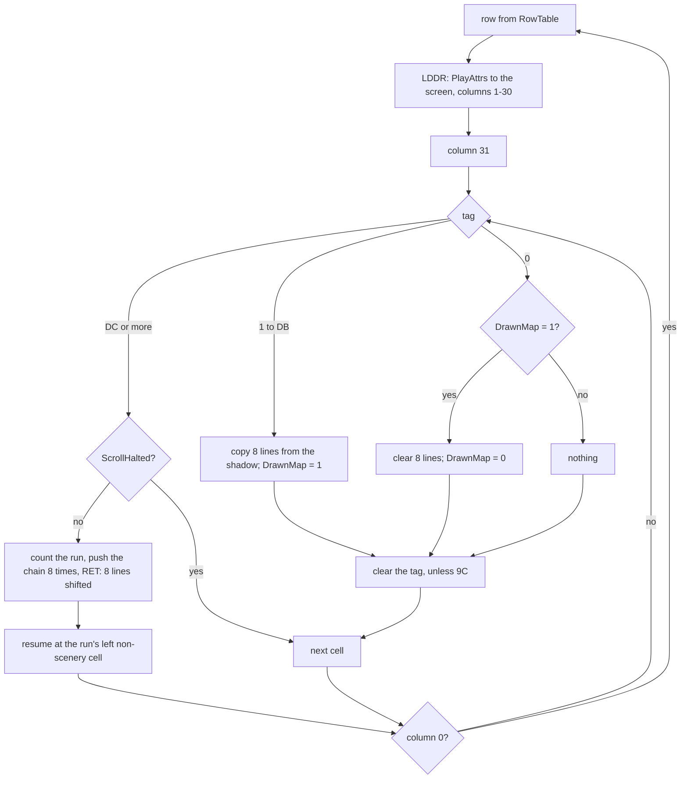

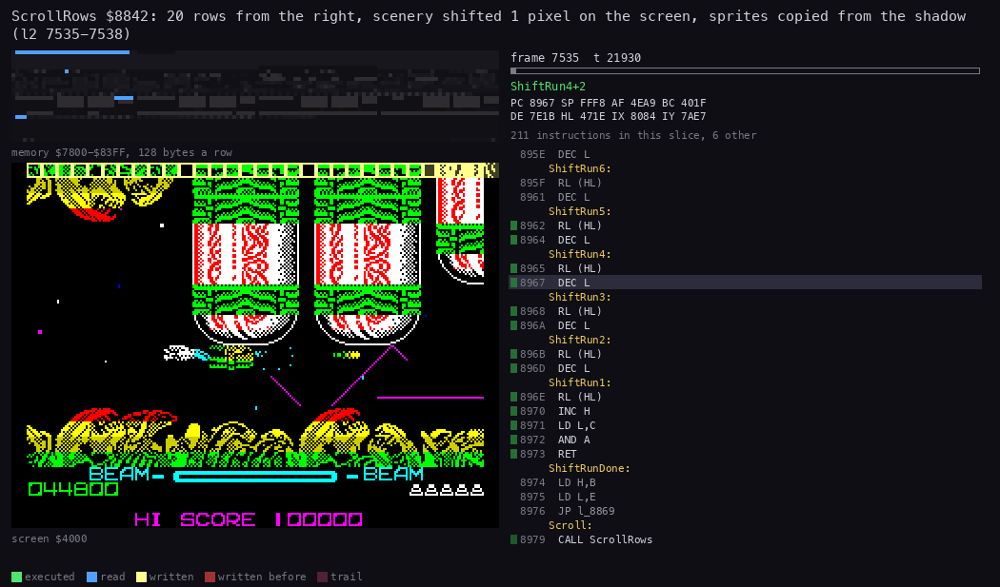

*Animation 6.3: ScrollRows in one pass of l2, window 7535:19300-7538:46300 (236 000 T, 90 pictures). The rows are
done top to bottom, each from the right; the ShiftRun chain runs most of the time. Memory panel `$7800-$83FF`
(PlayAttrs, SolidMap, RowTable, DrawnMap). Command: `python3 ../../kit/routine_anim.py --work work/docs/rtB/l2
--window 7535:19300-7538:46300 --listing build/game.lst --view screen --range 7800-83FF --pc 8842-8979 --pictures
90 --out docs/img/routines/ScrollRows.gif`.*

What to watch:

- the PC in the ShiftRun labels most of the time: the scenery is the cost;
- the rows lit one after another, never two at once;
- the sprite cells (the ship, the shots) copied one by one, DrawnMap written beside them.

Worked example, l2 pass 7535: ScrollRows starts at 7535:19381 and CutNextMetatile, the next instruction after it in
the pass, at 7538:46225: 236 508 T. The pass from MainLoop at 7535:19188 to the next at 7539:46103 is 306 467 T.
ScrollRows takes 77 % of the pass, interrupts included.

Tag `$9C` is the one exception to "sprite tags live one pass". `$9C` is the tag of enemy slot `$1C` (MoveEnemies
draws enemies with tag `$80` + slot, `$912D`), and ScrollRows keeps it for 7 passes of 8. No recording shows
what slot `$1C` holds; the rule is known only from the code (`$88CD-$88E0`).

The point: R-Type scrolls only what is there. A run of scenery costs 19 T a byte (`RL (HL)`, `DEC L`) for each of 8 lines; an empty cell costs a
few compares; nothing is copied from a back buffer.

## 6.5 DrawSprite: cells into the shadow

Everything that moves is drawn as whole cells: the ship, the Force, the bits, the enemies, the shots, the beam, the
explosions. DrawSprite `$8CFD` takes B = row, C = column, D = height, E = width (in cells) and HL = the cells. A cell
is 9 bytes (attribute, 8 lines) or the single byte `$36`, an empty cell that is skipped.

```asm
DrawSprite:                    ; $8CFD
        PUSH BC
        PUSH DE
        EXX                    ; the loop counters in the other set
        POP DE                 ; D = height, E = width
        POP BC                 ; B = row, C = column
        LD A,B
        ADD A,D
        LD H,A                 ; the row after the last
        LD A,C
        LD D,A                 ; the first column
        ADD A,E
        LD L,A                 ; the column after the last
l_8D09: EXX
        LD A,(HL)
        CP $36
        JP Z,l_8D4C            ; an empty cell: one byte
        EXX
        LD A,B
        CP $14
        JP NC,l_8D5A           ; row 20 or below: off the playfield
        LD A,C
        CP $1F                 ; the draw limit, $20 for the first screen
        JP NC,l_8D5A
        AND A
        JP Z,l_8D5A            ; column 0
        CALL CellFree
        JP NC,l_8D5B           ; taken: skip the 9 bytes
        CALL CellMark          ; the tag and the attribute; D = the shadow's third
        JP Z,l_8D5B
        LD D,A
        LD A,(HL)              ; 8 lines into the shadow
        LD (DE),A
        INC HL
        INC D
        ...
l_8D4C: INC HL
        EXX
        INC C                  ; next column
        LD A,C
        CP L
        JR NZ,l_8D09
        INC B                  ; next row
        LD A,B
        CP H
        RET Z
        LD C,D
        JR l_8D09
```

DrawSpriteMirrored `$8D65`, DrawSpriteFlipped `$8DD3` and DrawSpriteBoth `$8E29` are the same loop with the lines
reversed through BitReverse or written bottom up. GameObject `$8E8C` and LevelObject `$8E85` look up an object's
width, height and cells (4 bytes an entry) and set DrawTag `$7A9C`. For the game's own objects the tag is the
object's number.

### Whether a cell may be drawn

```asm
CellFree:                      ; $8EC2, B = row, C = column
        LD A,B
        RRCA
        RRCA
        RRCA
        AND $03
        ADD A,$7E              ; the SolidMap page of the row's third
        EX AF,AF'
        LD A,B
        AND $07
        RRCA
        RRCA
        RRCA                   ; (row AND 7) x 32
        ADD A,C
        EXX
        LD E,A
        EX AF,AF'
        LD D,A                 ; DE' = the cell's tag
        LD A,(DE)
        AND A
        JR Z,CellFreeEmpty
        RET                    ; $8EDA, taken: NC (DrawPrepare patches it to NOP: CollectHit)

CellFreeEmpty:                 ; $8F0B
        INC E
        LD A,(DE)              ; the cell to the right
        DEC E
        CP $DC
        RET NC                 ; $8F10, scenery to the right: not free (RET C while the soft cells are on)
        LD A,(ScrollStep)
        CP $07
        RET NZ                 ; free: the carry comes from CP $07
        INC E
        INC E
        LD A,(DE)              ; at step 7, two to the right as well
        DEC E
        DEC E
        CP $DC
        RET
```

A sprite cell may not land:

- on a cell already taken in this pass (by scenery, or by an object drawn earlier);
- left of a scenery cell, because that cell is the one the shift run pushes scenery pixels into;
- at step 7, two cells left of scenery, because ScrollAttrs is about to move the grid one cell.

So a sprite never shares a cell with scenery pixels. There are no masks, and no sprite is ever drawn over the
scenery: it is clipped cell by cell instead.

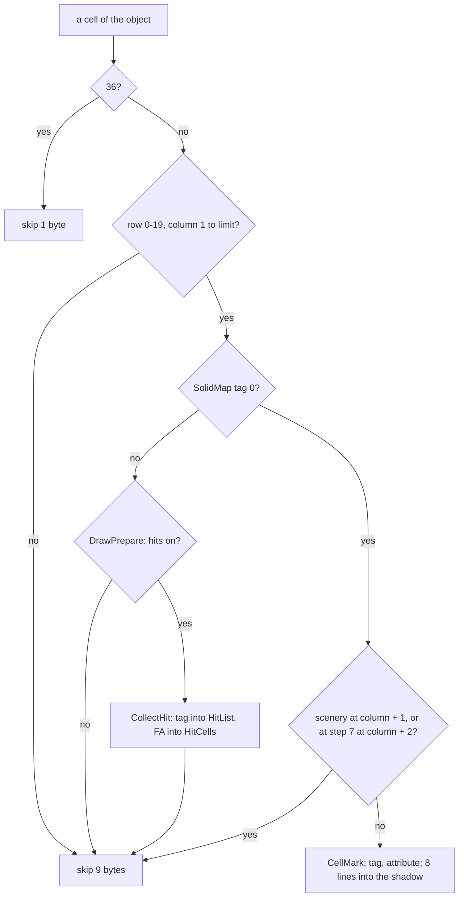

The hits come from the same test. DrawPrepare `$9A1E` turns CellFree's `RET` at `$8EDA` into `NOP`, so a taken cell
falls into CollectHit `$8EDB`. It appends the tag to HitList `$7AD7` (14 at most) and the position of a soft cell
(`$FA`) to HitCells. MoveShip draws the ship this way and dies on any hit ([doc 5](05-controls.md),
[doc 10](10-gameplay-logic.md)). Collision is a by-product of drawing.

### CellMark and the soft cells

```asm
CellMark:                      ; $8EA2
        LD A,(DrawTag)
        LD (DE),A              ; SolidMap
        LD A,D
        SUB $06
        LD D,A                 ; PlayAttrs
        LD A,(CellMark+$000F)  ; a colour override (the shield's flashing)
        AND A
        JR Z,l_8EB5
        LD A,$00               ; patched: the override colour
        LD (DE),A
        JR l_8EB7
l_8EB5: LD A,(HL)              ; the cell's own attribute
        LD (DE),A
l_8EB7: INC HL
        LD A,D
        AND $03
        RLCA
        RLCA
        RLCA
        ADD A,$60              ; the shadow's third: $60, $68, $70 (SoftCellsOn: $40, the screen)
        AND A
        RET
```

SoftCellsOn `$C3E5` patches two bytes: `ADD A,$60` at `$8EBE` becomes `ADD A,$40`, so the cells go straight to the
screen, and the `RET NC` at `$8F10` becomes `RET C`. With `RET C` an empty cell with no scenery to its right returns
free at once, and one with scenery to its right goes on to the ScrollStep test, which lets it through, except at step 7
when `+2` is scenery too (`CP $DC`, NC). So the scenery-to-the-right rule is off. SoftCellsOff `$C3EE` puts back `$60` and `$D0` (`RET NC`). Three users switch it on:

- DrawFirstScreen ([6.6](#66-the-first-screen-and-the-stars)), which draws the scenery itself;
- the level code that places ground objects (level 1 `$F4A3`): DrawTag = `$DC` + slot, a scenery tag, so the object
  scrolls with the ground;
- ExplodeSoftCell `$A4E5`, which clears a soft cell and its neighbours.

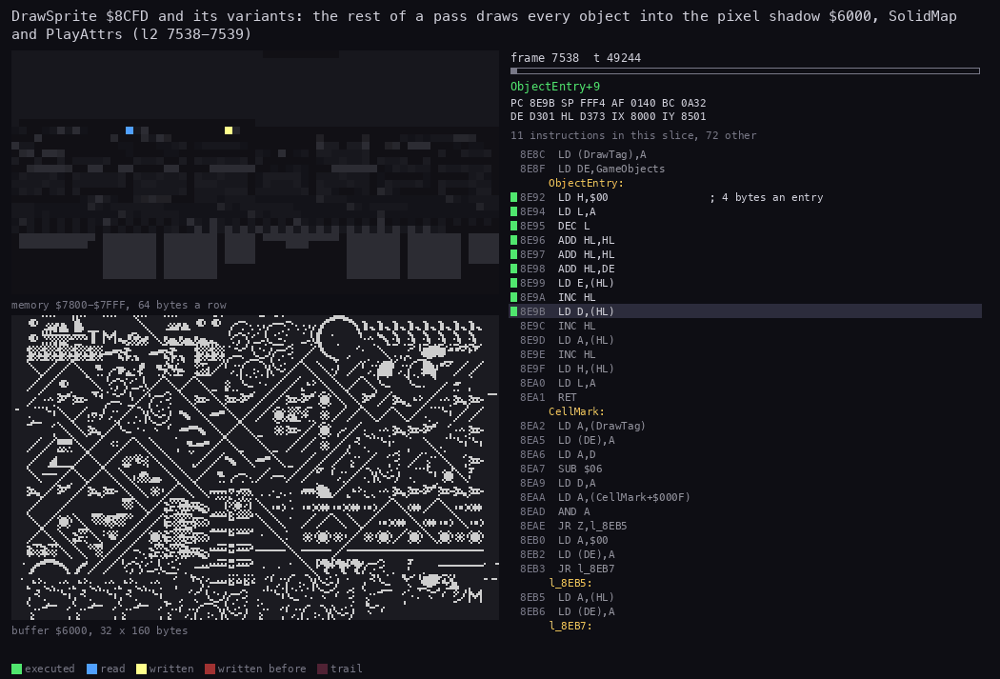

*Animation 6.4: the end of a pass of l2, MoveEnemies to the end (window 7538:48400-7539:46000): DrawSprite and its
variants write each object into the pixel shadow `$6000` (the view), and their tags and attributes into SolidMap and
PlayAttrs (the memory panel `$7800-$7FFF`). The shadow is never cleared; it keeps whatever was last drawn in each
cell. Command: `python3 ../../kit/routine_anim.py --work work/docs/rtB/l2 --window 7538:48400-7539:46000 --listing
build/game.lst --view buffer:6000:32x160:screen --range 7800-7FFF --pc 8CFD-8F1F --pictures 80 --out
docs/img/routines/DrawSprite.gif`.*

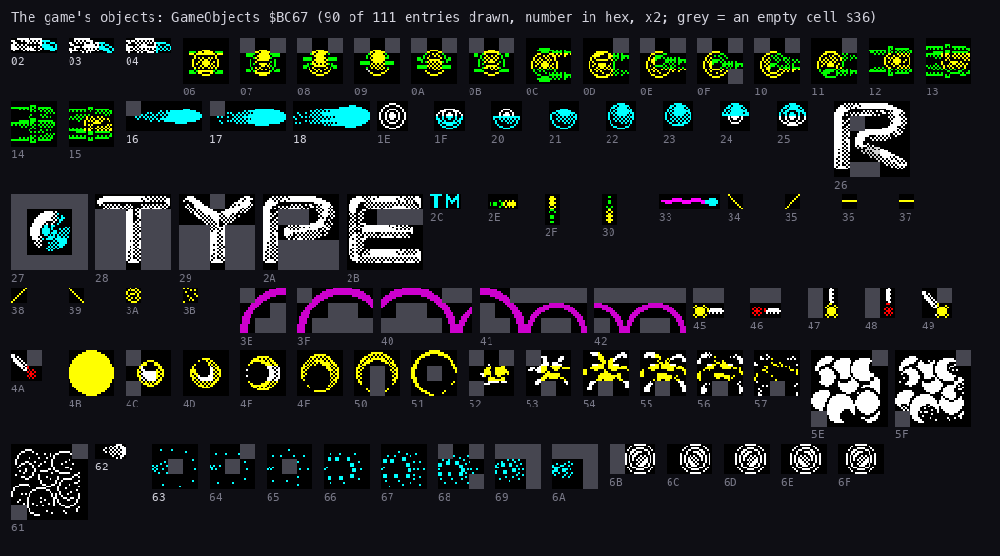

*Figure 6.4: the game's own objects (GameObjects `$BC67`, 111 entries of which 90 have cells; the cells at Sprites
`$A604`), drawn from `build/game.bin`. Objects 2-4 are the ship nose down, level and nose up; `$16`-`$18` the three
beams; `$26`-`$2C` the title logo; `$62` the shield; `$63`-`$6A` the beam's glow. The levels' own objects (bosses,
gun towers) are in `docs/img/sprites/objects-level-N.png`. Command: `python3 tools/fig_render.py objects --out
docs/img/render/game-objects.png`.*

The point: a sprite is a set of cells written into a shadow. Moving it means drawing it at the new place in the next
pass; the old cells, not redrawn, are erased by ScrollRows through DrawnMap.

## 6.6 The first screen and the stars

At the start of each life StartPlayField `$8721` sets MapColumn from the restart point and calls DrawFirstScreen
`$FEEB`. With the scroll's cutters it would take 256 passes to fill the screen (32 columns, one every 8 passes), so it draws the 8 x 5 metatiles of
the first 8 column blocks directly, as 4 x 4 sprites:

```asm
DrawFirstScreen:               ; $FEEB
        CALL SoftCellsOn       ; straight to the screen
        LD HL,$5800
        LD BC,$0280
        CALL ClearBlock        ; the playfield's attributes black on black
        LD B,$20
        CALL SetDrawLimit      ; column 31 may be drawn
        LD A,(MapColumn)
        LD E,A
        ADD A,$08
        LD (MapColumn),A       ; the scroll goes on 8 blocks further
        ...                    ; ColumnPtr, ScrollStep, MetaColumn, DrawTag, FrameCounter = 0; B = C = 0
        ADD HL,DE              ; HL = E (the old MapColumn), D = 0: 2E
        ADD HL,HL              ; 4E
        ADD HL,DE              ; 5E: 5 map bytes a block
        LD DE,(LevelMetatiles)
        ADD HL,DE              ; the map byte of the first block
        LD DE,$0508            ; 5 metatiles down, 8 blocks across
DrawFirstCell:                 ; $FF28
        PUSH BC
        PUSH DE
        PUSH HL
        LD A,(HL)
        AND $3F
        EX AF,AF'              ; n
        LD A,(HL)
        LD HL,DrawSprite
        AND $C0
        JR Z,DrawFirstPatch
        LD HL,DrawSpriteMirrored
        CP $40
        JR Z,DrawFirstPatch
        LD HL,DrawSpriteFlipped
        CP $80
        JR Z,DrawFirstPatch
        LD HL,DrawSpriteBoth
DrawFirstPatch:                ; $FF48
        LD (DrawFirstPatch+$000B),HL ; into the CALL at $FF52
        EX AF,AF'
        CALL MetatileAddress
        LD D,$04
        LD E,D                 ; 4 x 4 cells
        CALL $0000             ; the drawer chosen
        POP HL
        POP DE
        POP BC
        INC HL                 ; the next map byte
        INC B
        INC B
        INC B
        INC B                  ; 4 rows down
        DEC D
        JR NZ,DrawFirstCell
        LD B,$00
        LD D,$05
        INC C
        INC C
        INC C
        INC C                  ; 4 columns right
        DEC E
        JR NZ,DrawFirstCell
        LD (MapBlockPtr),HL
        LD (MapReadPtr),HL
        LD DE,PlayAttrs
        LD HL,SolidMap
        LD BC,$0280
FirstScreenMarks:              ; $FF7A
        LD A,(DE)
        BIT 7,A
        JR Z,l_FF81
        LD (HL),$FF            ; solid: a scenery tag
l_FF81: RES 7,A
        LD (DE),A
        INC HL
        INC DE
        DEC BC
        LD A,B
        OR C
        JR NZ,FirstScreenMarks
        LD B,$1F
        CALL SetDrawLimit
        CALL SoftCellsOff
        RET
```

The four sprite drawers are the same four variants as the cutters: a metatile is a 4 x 4 sprite whose cells happen
to be in rows of 36 bytes. DrawTag is 0 while it draws, so CellMark writes the attributes but no tags.
FirstScreenMarks then tags the solid cells `$FF` from the attributes' bit 7 and clears that bit in PlayAttrs.
Column 0 is refused by DrawSprite as always, so the first block shows only its columns 1-3.

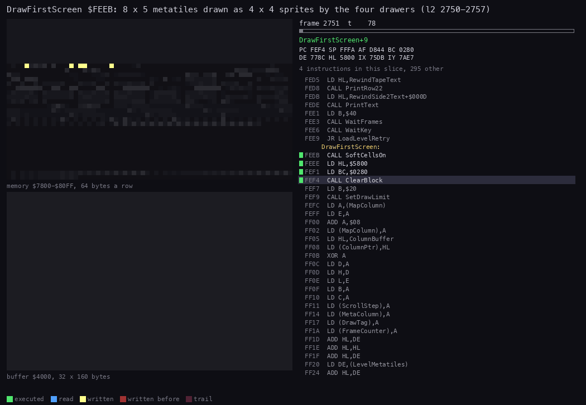

*Animation 6.5: a metatile drawn in its variants. DrawFirstScreen at the start of level 2, l2 window
2750:64000-2757:52000 (80 pictures): 40 metatiles column block by column block, each by the drawer its map byte
picks; the view is the screen's pixels without attributes (they are all 0 until the first ScrollRows). Command:
`python3 ../../kit/routine_anim.py --work work/docs/rtB/l2 --window 2750:64000-2757:52000 --listing build/game.lst
--view buffer:4000:32x160:screen --range 7800-80FF --pc FEEB-FF93,8CFD-8F1F,882D-8842 --pictures 80 --out
docs/img/routines/DrawFirstScreen.gif`.*

Witness: on l2, StartPlayField at 2750:64058, DrawFirstScreen at 2750:64163, its last metatile at 2757:51624,
FirstScreenMarks from 2757:51866: about 7 frames.

The stars are not part of the passes. StarTask `$BE79`, run from the frame interrupt, walks RowTable from its
second entry and moves one star in each row (their states in PlayStarStates `$80D8`). StarStep `$BE97` draws a star
straight on the screen, and only in a cell whose SolidMap and DrawnMap bytes are 0 and whose right neighbours are
not scenery. DrawnMap `$8100` is ScrollRows' erase map, which the star task reads
too.

The point: the first screen reuses the sprite drawers for scenery, so the game has one set of four variant loops for
cells in any layout.

## 6.7 Draw order and the erase

The pass order ([doc 4](04-game-loop.md)) is also the draw order:

```mermaid
flowchart LR
    SR["Scroll: ScrollRows shows pass N-1"] --> ME["MoveEnemies: tag 80 + slot"]
    ME --> RW["RunWaves"]
    RW --> MS["ReadControls, MoveShip: the ship, hits on"]
    MS --> FI["ShipFlyIn, MoveForce"]
    FI --> DX["DrawExplosions"]
    DX --> MB["MoveBeam"]
    MB --> MM["missiles, Force shots, ship shots, enemy shots"]
    MM --> NX["next pass: ScrollRows shows them"]
```

Three consequences:

- **One pass of lag.** Everything drawn in pass N reaches the screen in the ScrollRows of pass N + 1. The screen
  always shows the last pass's world, in one go per row.
- **First drawn wins.** CellFree refuses a taken cell, so an object drawn earlier in the pass keeps its cells. The
  enemies come first; the ship, drawn after them with the hits on, collides with them instead of covering them.
- **No erase pass.** A cell is erased only when ScrollRows finds DrawnMap = 1 and no tag: the object moved away or
  died. Nothing draws the background back, because the background is black: the scenery cells are never sprite cells.

The point: the shadow and the tags make the erase free. The cost is a shadow the size of the playfield and one pass
of latency.

## 6.8 The code against the screen on one frame

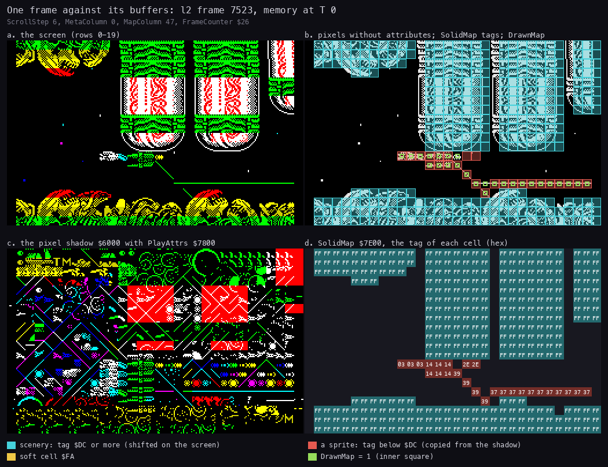

*Figure 6.5: l2 frame 7523, memory at T 0 (ScrollStep 6, MapColumn 47). a: the screen. b: the same pixels without
attributes, with SolidMap's tags outlined (scenery cyan, sprites red) and DrawnMap's 1s as green squares. c: the
pixel shadow `$6000` with PlayAttrs `$7800`. d: SolidMap's tags in hex. Command: `python3 tools/fig_render.py frame
--work work/docs/rtB/l2 --frame 7523 --label l2 --out docs/img/render/frame-l2-7523.png`.*

How to read:

- **b** shows column 31 full of pixels the screen hides, and the empty cells left of each scenery run holding the
  first pixels of it;
- **c** is mostly junk: the shadow is never cleared, and only the cells tagged in a pass are copied out;
- **d**: 329 cells tagged `$FF` (scenery) and 26 sprite cells: the ship (`$03`, object 3), the Force and its shots
  (`$14`, `$2E`), the beam's trail (`$37`, `$39`).

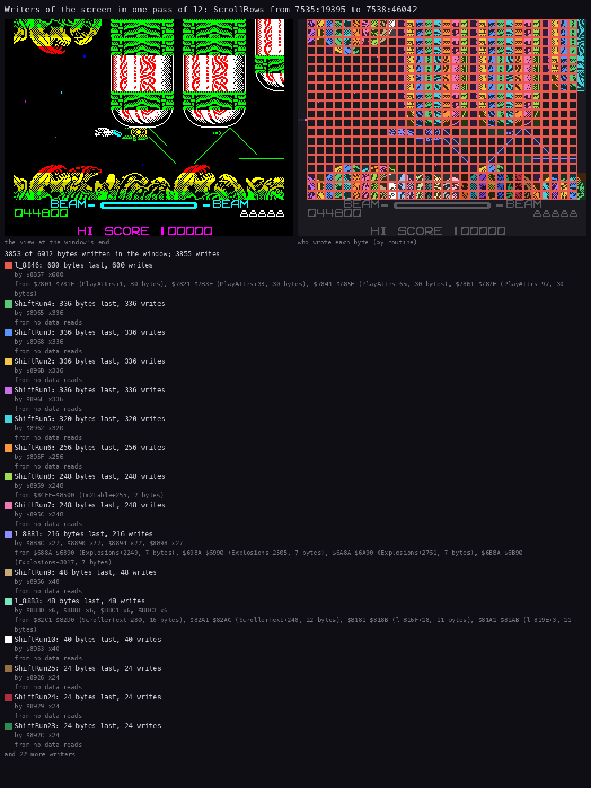

*Figure 6.6: every screen byte written in one pass of l2 (7535-7539), by routine. ShiftRun1-31 (the shift chain) and
`l_8846` (the attribute `LDDR`) write almost all of it; `l_8881` is the sprite copy from the shadow, `l_88B3` the
erase. No other routine writes the playfield. Command: `python3 ../../kit/writers_map.py --work work/docs/rtB/l2
--window 7535:0-7540:0 --listing build/game.lst --view screen --sources --width 1050 --out
docs/img/render/writers-l2.png`.*

Witness: 3853 of the 6912 screen bytes were written in the pass, 4503 writes: 600 attribute bytes by the `LDDR`,
216 sprite bytes copied, 48 erased, the rest shifted.

The point: the screen has one writer in play. A bug in a picture is a bug in a tag or the shadow.

## 6.9 The scroll against the beam

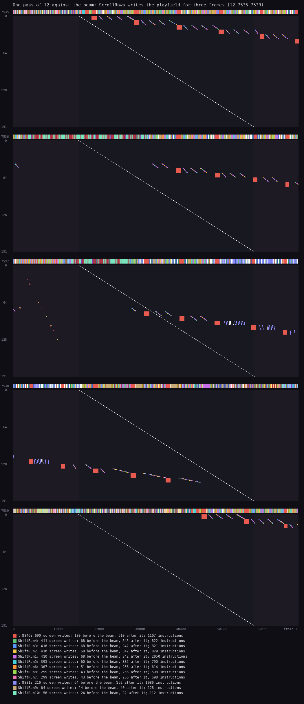

*Figure 6.7: the frames 7535-7539 of l2 with the screen line each instruction writes against the time in the frame;
the white diagonal is the beam. Command: `python3 ../../kit/beam_timeline.py --work work/docs/rtB/l2 --window
7535:0-7540:0 --listing build/game.lst --machine 48k --frames 7535-7539 --width 1050 --out
docs/img/render/beam-scroll.png`.*

[Doc 4, 4.6](04-game-loop.md#46-what-a-pass-costs-against-the-beam) places the whole pass against the beam; this
section follows ScrollRows alone. The trace of the pass gives the start of each row (`l_8846`, frame:T):

| Rows | Started in frame | Starts |
| --- | --- | --- |
| 0-5 | 7535 | 19395, 29800, 40186, 50514, 60636, 69184 |
| 6-9 | 7536 | 40045, 49531, 59005, 66833 |
| 10-14 | 7537 | 32221, 40885, 49505, 58499, 66292 |
| 15-19 | 7538 | 4151, 11873, 19772, 28904, 37481 (the end at 46042) |

A row takes 8 000-10 000 T. The long gaps are the frame interrupt (`Im2Jump` `$8383`, [doc 4](04-game-loop.md)):
it ran from 7536:1832 to 7536:33540 and from 7537:1834 to 7537:29066, 31 700 and 27 200 T, but only from 7538:1838
to 7538:2794 in frame 7538.

On the 48K the beam draws pixel line y at T 14336 + 224 y; row r's lines are drawn from T 14336 + 1792 r. Row 0 is
drawn by T 16 128, before ScrollRows reaches it at 19395. So:

- frame 7535 shows the old picture;
- frame 7536 shows rows 0-4 shifted. Row 5 is split: ScrollRows was inside it when the interrupt came at 1832 and
  went on at 33540, after the beam had drawn the row (T 23 296-24 864). Its right part, walked first, is shifted;
  the left part is not. Rows 6-19 are old;
- frame 7537 shows rows 0-8 new. Row 9 is written from 29066 to 32221 while the beam draws it (30 464-32 256), a
  race inside the row. Rows 10-19 are old;
- frame 7538 shows all 20 rows new: rows 15-19 are written well before the beam reaches line 120 (T 41 216).

So the picture is sheared by one pixel for two frames of the pass, at a row the scroll has reached, sometimes inside
the row. The sprites move with their rows: a sprite cell is copied in its row's turn.

The game makes no attempt to race or avoid the beam. A pass starts when MainWait `$868C` sees IntTicks `$7A8A`
reach 3, just after an interrupt, and ScrollRows follows a few hundred T later (7535:19395 here). Nothing aligns the
rows to the beam, and at one pixel a pass the shear is only one pixel wide.

The point: the scroll is too slow to finish inside a frame, so it does not try to; moving one pixel a pass keeps the
tear to a one-pixel step.

## 6.10 The attribute grid and the clash

The scenery's pixels move one pixel a pass, its attributes one cell every 8 passes. So for 7 passes of 8 the
leftmost pixels of a scenery run sit in a cell whose attribute is still the empty cell's.

The game hides this in the data: an empty cell beside scenery carries the ink of its scenery neighbour (6.2: `$42`,
red, beside the red `$C2` cells of metatile 9). The shifted pixels show in the right colour before the attribute
grid catches up. In figure 6.5 b these cells are the empty cells left of each run that already hold scenery pixels;
on the screen (a) they look like the scenery.

Sprites cannot clash with the scenery at all: CellFreeEmpty keeps them out of the cell left of a run, and CellFree
out of the run. Two sprites do not share a cell either, since the first drawn takes it. The only clash left is
between the black background and a sprite's own cells, which carry their own attribute. The stars are drawn only in
empty cells, coloured per cell.

The point: R-Type never has two colours fighting in one cell, because no two things are ever in one cell: the cell is
the unit of drawing, colliding and colouring.

## 6.11 Summary

- The playfield is rows 0-19, columns 1-30; column 31 is a hidden staging column, column 0 black.
- The scenery lives only on the screen and is shifted in place one pixel a pass by an unrolled `RL (HL)` chain.
- Attributes and tags move one cell every 8 passes; a new column arrives at step 0, cut over steps 2-6 from the map.
- A map byte is a metatile (bits 0-5) and one of four drawers (bits 6-7); BitReverse `$5D00` makes the mirrors.
- Sprites are cells drawn into a shadow at screen + `$2000`, tagged in SolidMap, copied by ScrollRows a pass later and
  erased through DrawnMap.
- Drawing is collision detection: a taken cell is a hit.
- ScrollRows takes three quarters of a pass; the beam shears the picture by one pixel at a row border; nothing
  ever clashes.
