# 8. HUD and text

What this covers:

- the one text printer PrintText `$C081` and its two heights;
- the font at `$7AF0`, and the glyphs that are not their characters: the meter, the life, "No.", the copyright and
  TM signs, the name entry's signs;
- every string of the game and where it is printed;
- the HUD (rows 20-23): the BEAM meter, the score, the lives, the high score, and what is missing from it (the
  level);
- the score: the awards, the ASCII adder AddScore `$C23F`, the extra lives at 50 000 and every 100 000;
- the messages of play (PILOT STAND BY, MISSION OVER, GAME PAUSED, CONTINUE);
- the high-score table, and the closing text that the game holds but never shows.

The recordings it rests on ([WALKTHROUGH 6.0](../WALKTHROUGH.md#60-the-recordings)):

| Recording | Load | Used for |
| --- | --- | --- |
| `l2` | `work/stage1/probe/ch-003045-L2-idle.szx`, tape at block 35, the POKE `$91F2` = `$C9` in RAM | the HUD drawn at the level start (2758), the extra life at 50 000 (12087-12090) |
| `hiscore` | `c1/play.szx`, the score `$71C9` = "045000" | the high-score table printed (5461-5464) |
| `c1` | power-on, `LOAD ""`, the original tape | the title, the pause, PILOT STAND BY |
| `ending` | `rec/l8/next.szx` (digit `'9'`) | the end of level 8: the closing text is not read |

Conventions:

- **Row, column** are character cells of the screen, row 0-23, column 0-31. The printer takes them as B = row,
  C = column.
- "12087:13646" is frame 12087, T 13646 of that frame, from an access trace.
- A **string** is a run of character codes whose last byte has bit 7 set.

## 8.1 The printer

All the game's text goes through one routine with three entries:

| Entry | Address | Sets | Height |
| --- | --- | --- | --- |
| PrintRow22 | `$C07F` | B = 22 | double, rows 22-23 |
| PrintText | `$C081` | TextHeight `$7A94` = 0 | double: each line twice, the glyph over two rows |
| PrintTextNormal | `$C084` | TextHeight = 1 | normal: 8 lines in one row |

```asm
PrintRow22:                    ; $C07F
        LD B,$16
PrintText:                     ; $C081, HL = the string, B = row, C = column
        XOR A
        JR PrintTextA
PrintTextNormal:               ; $C084
        LD A,$01
PrintTextA:
        LD (TextHeight),A
PrintChar:                     ; $C089
        LD A,(HL)
        AND $7F                ; bit 7 only ends the string
        PUSH HL
        SUB $20
        JR NZ,l_C093
        LD A,$3B               ; a space prints glyph $3B ('[', blank)
l_C093: LD H,$00
        LD L,A
        ADD HL,HL
        ADD HL,HL
        ADD HL,HL
        LD DE,MissileLaunch+$0001 ; $7AE8: the font less one glyph
        ADD HL,DE              ; the glyph
        LD A,B
        AND $F8
        ADD A,$40
        LD D,A                 ; the screen third
        LD A,B
        AND $07
        RRCA
        RRCA
        RRCA
        ADD A,C
        LD E,A                 ; the cell's first line
        PUSH BC
        LD A,(TextHeight)
        AND A
        JR Z,l_C0BC
        LD B,$08               ; normal: 8 lines
l_C0B4: LD A,(HL)
        LD (DE),A
        INC D
        INC HL
        DJNZ l_C0B4
        JR l_C0D0
l_C0BC: LD A,D                 ; double: 4 lines twice in this row ...
        EX AF,AF'
        CALL PrintHalf
        EX AF,AF'
        LD D,A
        LD A,E
        ADD A,$20              ; ... and 4 lines twice in the row below
        LD E,A
        JR NC,l_C0CD
        LD A,D
        ADD A,$08              ; across a third
        LD D,A
l_C0CD: CALL PrintHalf
l_C0D0: POP BC
        INC C                  ; the next column
        POP HL
        BIT 7,(HL)
        INC HL
        RET NZ                 ; HL past the string
        JR PrintChar

PrintHalf:                     ; $C0D9
        LD B,$04
l_C0DB: LD A,(HL)
        LD (DE),A
        INC D
        LD (DE),A              ; each glyph line on two screen lines
        INC D
        INC HL
        DJNZ l_C0DB
        RET
```

The printer writes pixels only. The colour of a text is whatever the attributes of its cells already are: DrawHud
fills them first, the title has a colour task, the messages sit in the HUD's rows.

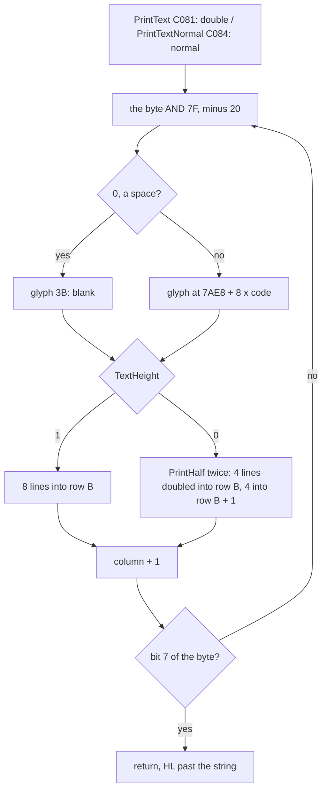

Worked example: "HI SCORE" at row 23, column 8 (`$1708`), normal. 'H' is `$48`: `$48 - $20 = $28`, glyph
`$7AE8 + $140 = $7C28`. Row 23: D = `$17 AND $F8 + $40 = $50`, E = `($17 AND 7) x 32 + 8 = $E8`: the first line at
`$50E8`, the next ones at `$51E8` to `$57E8`. The string `48 49 20 53 43 4F 52 C5` ends at `$C5`, 'E' with bit 7.

Because a string returns HL past its end, DrawHud prints strings that lie one after another with one call each and
no address loads between them (`$C472` to `$C47B`).

The point: one printer, two heights, no colour, no control codes: a string is just glyph numbers.

## 8.2 The font

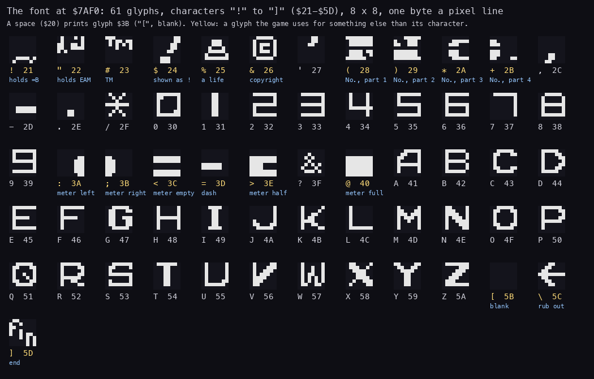

*Figure 8.1: the 61 glyphs at `$7AF0`, `!` to `]`, from `build/game.bin`; yellow, the glyphs the game uses for
something else than their character. The same glyphs are `src/res/graphics/font.png`. Command: `python3
tools/fig_hud.py font docs/img/hud/font.png`.*

The font is upper case only: digits, letters, a few signs. Fifteen glyphs are not what their codes say:

| Code | Character | Drawn as | Used in |
| --- | --- | --- | --- |
| `$21`, `$22` | `!` `"` | junk: their bytes hold "=BEAM" (`$7AF6`) | never printed; DrawHud prints `$7AF6` as a string |
| `$23` | `#` | TM | the scroller: "R TYPE#" |
| `$24` | `$` | `!` | PILOT STAND BY !, MISSION OVER !, ENTER YOUR NAME PILOT !, THE EVIL BYDO EMPIRE ! |
| `$25` | `%` | the ship: a life | LifeChar `$718D` |
| `$26` | `&` | the copyright sign | "& 1987 BY IREM CORP." on the title |
| `$28`-`$2B` | `(` `)` `*` `+` | "No." over four cells | StarChars `$73A8` "()*+ ": each high-score line |
| `$3A`, `$3B` | `:` `;` | the meter's left and right ends | BeamHudText `$83F3` |
| `$3C` | `<` | the meter, empty | BeamHudText, BeamMeterEmpty `$72DE` |
| `$3D` | `=` | a dash | "=BEAM" right of the meter |
| `$3E`, `$40` | `>` `@` | the meter, half and full | BeamMeterStep `$70DB`, BeamMeterFull `$70DA` |
| `$5B` | `[` | blank | the space; the name entry |
| `$5C`, `$5D` | `\` `]` | rub out, end | the name entry ([doc 5](05-controls.md#511-the-name-entry)) |

The "=BEAM" string at Font+6 is the strangest: the six bytes `3D 42 45 41 4D` + bit 7 sit in the last two lines of
the `!` glyph and the first lines of `"`. No string of the game contains `!` or `"`, so those glyphs are free, and
the author stored a string in them. Where the text needs an exclamation mark it uses `$`.

The `src/game/game.ann` calls `$73A8` StarChars and says nothing reads it. PrintHiScores reads it at `$76B1` for
every line of the table, and the font draws it as "No." (8.7).

The point: the font is the game's only tile set for the HUD; the meter, the lives and "No." are letters in it.

## 8.3 Every string

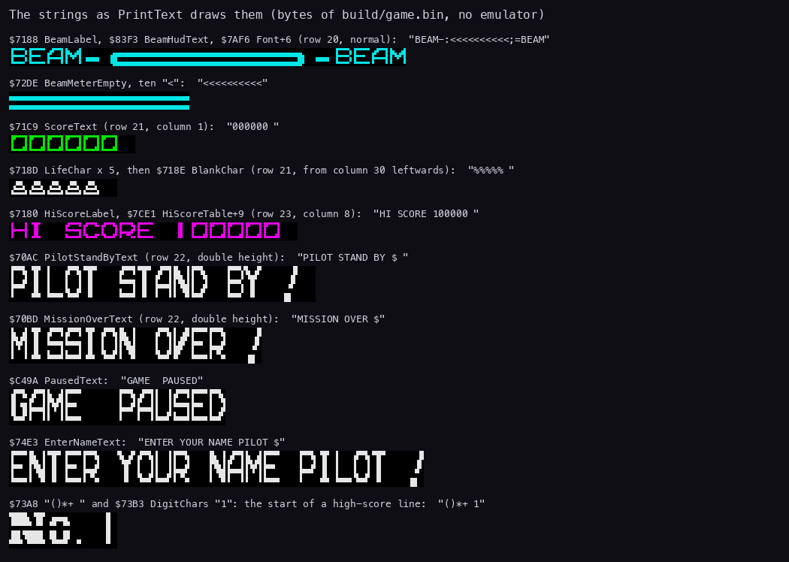

*Figure 8.2: the strings of the HUD and of the messages, drawn from their bytes with the font, in the HUD's colours
where they have one. Command: `python3 tools/fig_hud.py texts docs/img/hud/texts.png`.*

The texts are resources (`src/res/texts`, one file each, the table in `src/res/texts/README.md`). Where each is
printed:

| String | Address | Printed by | Row, column | Height |
| --- | --- | --- | --- | --- |
| BEAM- | `$7188` | DrawHud `$C469` | 20, 5 | normal |
| the meter `:<<<<<<<<<<;` | `$83F3` | DrawHud `$C472` | 20, 10 | normal |
| =BEAM | `$7AF6` | DrawHud `$C478` | 20, 22 | normal |
| the meter, empty (ten `<`) | `$72DE` | after the beam is fired, `$9AE2` | 20, 11 | normal |
| `>` / `@` | `$70DB` / `$70DA` | the beam charge, `$9A84` | 20, 11 + BeamMeter | normal |
| the score | `$71C9` | PrintScore `$FDAA` | 21, 1 | normal |
| `%` per life, then a blank | `$718D`, `$718E` | DrawLives `$9234` | 21, from 30 leftwards | normal |
| HI SCORE and the top score | `$7180`, `$7CE1` | DrawHud `$C47E` | 23, 8 | normal |
| PILOT STAND BY ! | `$70AC` | PilotStandBy `$92C5` | 22, 8 | double |
| MISSION OVER ! | `$70BD` | MissionOver `$92CD` | 22, 9 | double |
| GAME  PAUSED | `$C49A` | CheckPause `$8B96` | 22, 10 | double |
| 32 blanks | `$718E` | ClearTextRow `$C2C5` | 22, 0-31 | double |
| C O N T I N U E | `$70CB` | `$8BF6` | 3, 8 | normal |
| PRESS FIRE BUTTON | `$72CD` | `$8BFF` | 19, 7 | normal |
| C R E D I T  n | `$72BE` | `$8C08` | 22, 9 | normal |
| ENTER YOUR NAME PILOT ! | `$74E3` | `$934C` | 22, 4 | double |
| TODAY'S BEST PILOTS | `$7580` | PrintHiScores `$769B` | 0, 6 | double |
| the title's five lines | `$7480` | `$77AA` | the title page | double |
| REWIND SIDE 2 ..., SEARCHING FOR R TYPE LEVEL n, LOADING, LOADED OK, STOP TAPE, START TAPE, ERROR IN LOADING, REWIND TAPE | `$7280`-`$76F5` | the level loader `$FE26`-`$FEDB` | [doc 3](03-build-and-load.md#39-the-games-level-loader) | |
| the scroller's credits | `$81A9` | the title's scroller | [doc 4](04-game-loop.md) | |

The point: every string has one fixed place; nothing is centred or measured at run time.

## 8.4 The HUD

DrawHud `$C44B` draws the whole panel at the start of each life, after the extra life, and after the pause:

```asm
DrawHud:                       ; $C44B
        LD HL,$5A80            ; row 20's attributes
        LD BC,$0020
        LD A,$45               ; bright cyan on black
        CALL FillBlock
        LD BC,$0008            ; HL is left at the last byte filled: row 20, column 31
        LD A,$44               ; bright green: row 20 column 31, row 21 columns 0-6
        CALL FillBlock
        LD HL,$5AE0            ; row 23
        LD BC,$0020
        LD A,$43               ; bright magenta
        CALL FillBlock
        LD HL,BeamLabel        ; "BEAM-"
        LD BC,$1405            ; row 20, column 5
        CALL PrintTextNormal
        LD HL,BeamHudText      ; ":<<<<<<<<<<;": the meter, empty
        CALL PrintTextNormal
        LD HL,Font+$0006       ; "=BEAM"
        CALL PrintTextNormal
        LD HL,HiScoreLabel     ; "HI SCORE"
        LD BC,$1708            ; row 23, column 8
        CALL PrintTextNormal
        LD HL,HiScoreTable+$0009 ; the last letter of entry 1's name (a space), then its score
        CALL PrintTextNormal
        LD A,(Lives)
        LD BC,$151E            ; row 21, column 30
        CALL DrawLives
        CALL PrintScore        ; row 21, column 1
        RET
```

FillBlock `$FDF0` leaves HL at the last byte it filled, not after it, so the second fill starts one byte early: it
covers row 20's column 31 (black again once ClearSides runs) and row 21's columns 0-6, not 0-7. The score's six
digits are in columns 1-6, so nothing shows it. Row 21 from column 7 and row 22 get no attribute from DrawHud: on l2
at 2759 they hold `$47`, white on black.

| Row | Colour | Holds |
| --- | --- | --- |
| 20 | `$45` cyan | BEAM- [the meter] -BEAM |
| 21 | `$44` green (columns 0-6), the rest `$47` white | the score at column 1; the lives from column 30 leftwards |
| 22 | `$47` white, not set by DrawHud | the messages, double height over rows 22 and 23 |
| 23 | `$43` magenta | HI SCORE and the best score of the table |

There is no level number on the HUD. The level digit LevelDigit `$719C` is shown only by the loader, in
SEARCHING FOR R TYPE LEVEL n.

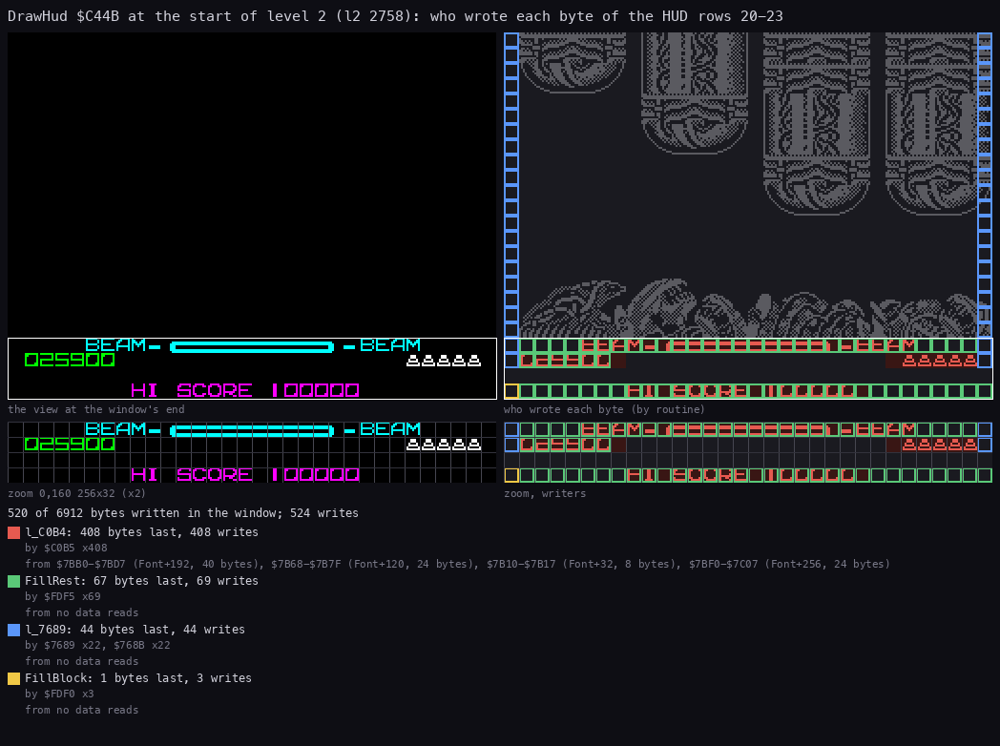

*Figure 8.3: the HUD as DrawHud draws it at the start of level 2 (l2 2758:37000-2759:1000), and who wrote each
byte: `l_C0B4`, the printer's normal-height loop (408 bytes: 51 characters of 8 lines, the glyphs read from the font
at `$7B10`-`$7C07`); FillRest/FillBlock, the attribute fills; `l_7689`, ClearSides painting columns 0 and 31 right
after. Command: `python3 ../../kit/writers_map.py --work work/docs/rtB/l2 --window 2758:37000-2759:1000 --listing
build/game.lst --view screen --sources --zoom 0,160,256,32 --width 1050 --out docs/img/hud/writers-hud.png`.*

Witness: DrawHud ran from 2758:37076 to 2758:69887. The playfield is still black: DrawFirstScreen cleared its
attributes, and the first ScrollRows has not copied PlayAttrs yet ([doc 6](06-rendering.md#66-the-first-screen-and-the-stars)).

The point: the HUD is drawn once and then only patched: the score, the meter and the lives each redraw their own
cells.

## 8.5 The score and the extra lives

The score is six ASCII digits at ScoreText `$71C9`, followed by `$A0`. AddScore adds to it digit by digit:

```asm
AddScore:                      ; $C23F, E = the place (1 units ... 4 thousands), D = the digit to add
        LD A,E
        AND A
        RET Z                  ; place 0: no score
        LD (ScoreChanged),A
        LD HL,ScoreText
        LD A,E
        XOR $07
        DEC A
        LD E,A                 ; 6 - place: the digit's offset
        LD A,D
        LD D,$00
        ADD HL,DE
l_C251: ADD A,(HL)             ; add to the ASCII digit
        LD (HL),A
        CP $3A
        RET C                  ; still a digit
        SUB $0A
        LD (HL),A
        DEC HL                 ; carry 1 into the digit on the left
        LD A,$01
        JR l_C251
```

The awards come from ScoreAwards `$70DC`, pairs (place, digit) picked by the low nibble of the enemy's kind
(AwardScore `$A5B4`): 100 to 900 (place 3), 1000 and 5000 (place 4). A pick-up gives 400, the shield 600 more
([doc 10](10-gameplay-logic.md)). The last two digits never change: the score counts hundreds.

AddScore only marks ScoreChanged `$7A99`. The pass ends with CheckExtraLife `$FDA5`, which returns at once unless
ScoreChanged is set, and otherwise falls into PrintScore:

```asm
CheckExtraLife:                ; $FDA5
        LD A,(ScoreChanged)
        AND A
        RET Z
PrintScore:                    ; $FDAA
        LD HL,Lives
        PUSH HL
        LD HL,ScoreText
        LD DE,ExtraLives
        LD BC,$1501            ; row 21, column 1
        PUSH HL
        PUSH DE
        CALL PrintTextNormal
        POP HL                 ; HL = ExtraLives
        POP IX                 ; IX = ScoreText
        XOR A
        LD (ScoreChanged),A
        LD A,(IX+$01)
        CP $35                 ; the ten-thousands digit '5'
        JR NZ,l_FDCE
        LD A,(HL)
        AND A
        JR Z,l_FDDA            ; and no extra life yet: 50 000
l_FDCE: LD A,(HL)
        AND A
        JR Z,ExtraLifeNone
        LD A,(IX+$00)
        SUB $30
        CP (HL)                ; the hundred-thousands digit = the lives given
        JR NZ,ExtraLifeNone
l_FDDA: INC (HL)               ; ExtraLives + 1
        POP HL
        INC (HL)               ; Lives + 1
        CALL DrawHud
        LD HL,$0E83
        CALL PlaySound         ; sound $0E
        RET
ExtraLifeNone:
        POP HL
        RET
```

| ExtraLives | Condition | At |
| --- | --- | --- |
| 0 | digit 1 is '5' | 50 000 |
| 1 | digit 0 is '1' | 100 000 |
| 2 | digit 0 is '2' | 200 000 |
| n | digit 0 is n | n x 100 000 |

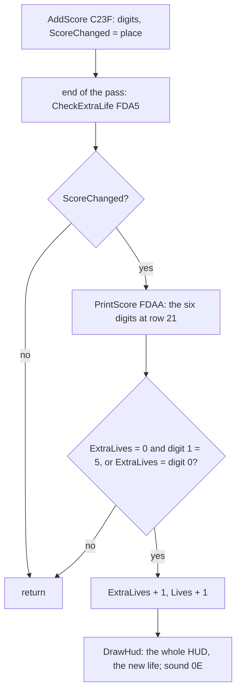

Worked example, l2: at 12087:13646 AddScore adds 2 at place 3 to "049900". The hundreds digit `'9' + 2 = $3B` is past
`'9'`: it becomes '1', 1 is carried to the thousands, `'9' + 1` becomes '0', and 1 more to the ten-thousands: '4'
becomes '5'. Three turns of `l_C251` (13723, 13788, 13853), "050100". At 12088:54341 PrintScore prints it; digit 1
is '5' and ExtraLives is 0, so at 58641 ExtraLives and Lives step to 1 and 6, and DrawHud at 58690 draws six ships.

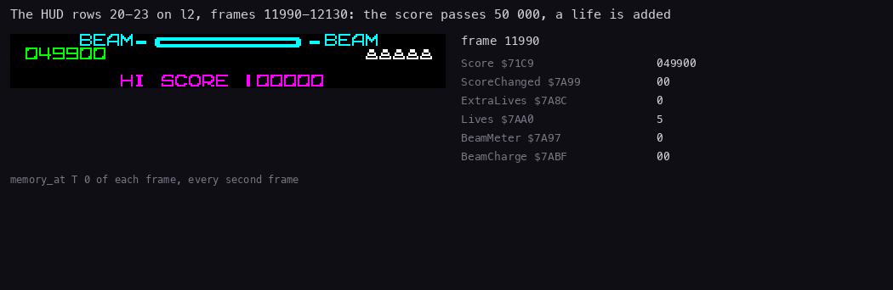

*Animation 8.1: rows 20-23 of l2, frames 11990-12130, every second frame, with ScoreText, ScoreChanged, ExtraLives,
Lives, BeamMeter and BeamCharge sampled with `memory_at` at T 0. Command: `python3 tools/fig_controls.py play --work
work/docs/rtB/l2 --from 11990 --to 12130 --step 2 --crop 0,160,256,192 --scale 2 --var 'Score=71C9:6:text' --var
'ScoreChanged=7A99:1:hex' --var 'ExtraLives=7A8C:1:dec' --var 'Lives=7AA0:1:dec' --var 'BeamMeter=7A97:1:dec' --var
'BeamCharge=7ABF:1:hex' --out docs/img/play/hud-extra-life.gif`.*

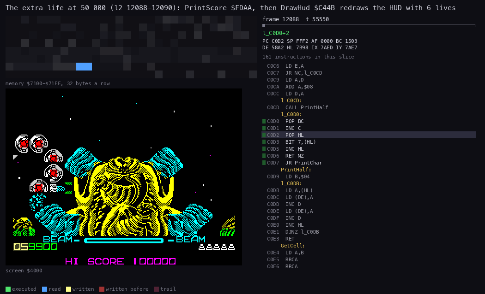

*Animation 8.2: the same moment in code, l2 window 12088:54300-12090:14500 (80 pictures): PrintScore prints the six
digits, the test passes, DrawHud fills the attributes and prints every string again, DrawLives draws six ships and
PrintScore runs once more from DrawHud. Memory panel `$7100-$71FF` (the HUD strings and ScoreText). Command: `python3
../../kit/routine_anim.py --work work/docs/rtB/l2 --window 12088:54300-12090:14500 --listing build/game.lst --view
screen --range 7100-71FF --pc FDA5-FDE9,C44B-C49A,9234-924B,C07F-C0E4 --pictures 80 --out
docs/img/routines/DrawHud.gif`.*

What to watch:

- the score's cells written first, at the start of the window;
- the ships drawn from column 30 leftwards, one cell each, then the blank that clears the place of a life lost;
- the long pause in the middle: the frame interrupt's tasks.

Known only from the code: AddScore has no limit. Past 999 900 the carry walks into `$71C8`, the byte before
ScoreText, and on into the bytes below it.

The point: the score is text, added in text; the extra life is a compare of two digits, not of a number.

## 8.6 The meter and the lives

The BEAM meter is ten cells, columns 11-20 of row 20, between the end glyphs `:` and `;`. While the fire key is held
the charge BeamCharge `$7ABF` rises by 2 each pass, up to `$3E` ([doc 5](05-controls.md#58-the-fire-and-the-beam-charge)).
Below `$28` the meter is drawn too:

```asm
        CP $28
        JR NC,l_9A87           ; charge 40 or more: the meter is full
        LD HL,BeamMeter        ; $7A97, the meter's column
        LD DE,BeamMeterFull    ; '@'
        AND $03
        JR NZ,l_9A7D
        INC (HL)               ; every second pass: the next column ...
        INC E                  ; ... with '>', half full
l_9A7D: LD A,(HL)
        ADD A,$0B
        LD C,A
        LD B,$14
        EX DE,HL
        CALL PrintTextNormal
```

So each column is drawn twice: half (`>`) when the meter reaches it, full (`@`) the pass after. Twenty passes fill
ten cells. When the beam is fired the meter is reset by printing BeamMeterEmpty, ten `<`, at column 11 (`$9AE2`).

DrawLives `$9234` prints one `%` per life from column 30 leftwards (PrintText moves one column right, DrawLives two
back), then one blank. The blank erases the ship of a life just lost, so the row needs no clearing. Six lives reach
column 25. The extra lives have no limit: from the 25th life on the ships would cover the score's digits (known only
from the code).

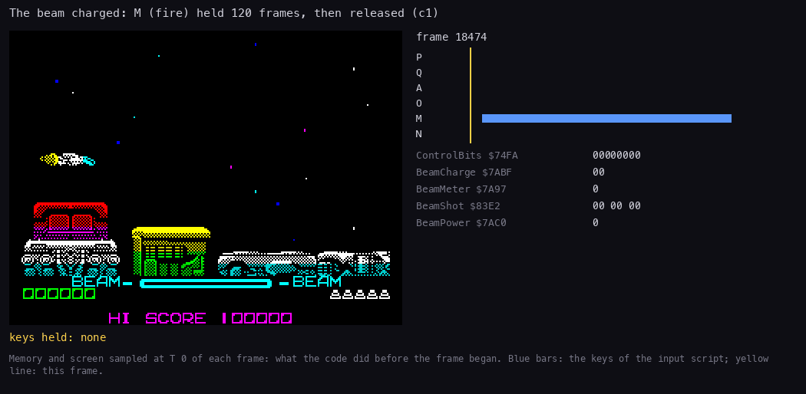

*Animation 8.3: the meter filling while the fire key is held, from doc 5 (c1, its command in
[5.8](05-controls.md#58-the-fire-and-the-beam-charge)).*

The point: the meter and the lives are strings of one character, printed one cell at a time.

## 8.7 The messages

The messages are printed double height in row 22, over the HUD's rows 22 and 23 (HI SCORE is overwritten while a
message shows):

```asm
PilotStandBy:                  ; $92C5, after a life is lost
        LD HL,PilotStandByText
        LD BC,$1608            ; row 22, column 8
        JR PrintAndWait
MissionOver:                   ; $92CD, after the last life
        LD HL,$1B81
        CALL PlaySound         ; sounds $1B and $1A
        LD HL,$1A81
        CALL PlaySound
        LD BC,$1609            ; row 22, column 9
        LD HL,MissionOverText
PrintAndWait:                  ; $92DF
        CALL PrintText         ; double height
        LD B,$50
        CALL WaitFrames        ; 80 frames
        RET
```

ClearTextRow `$C2C5` prints 32 blanks double height from row 22, column 0. After a lost life (`$9269`) the order
is DrawHud, ClearTextRow (HI SCORE goes too), then PILOT STAND BY or MISSION OVER; the next life's StartPlayField
calls DrawHud again and HI SCORE comes back.

GAME PAUSED is printed by CheckPause at row 22, column 10 ([doc 5](05-controls.md#510-the-pause)). The CONTINUE page
(MISSION OVER, then C O N T I N U E, PRESS FIRE BUTTON and C R E D I T n on a cleared screen, `$8BF6`-`$8C0E`) is
in [doc 4](04-game-loop.md).

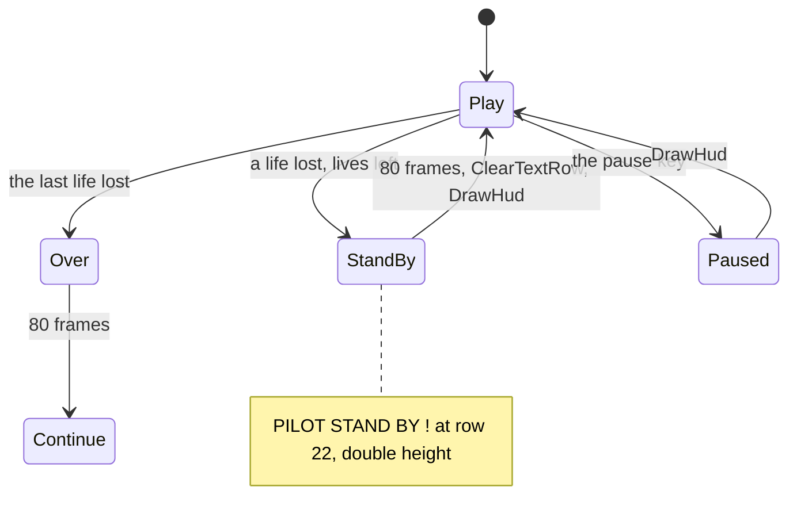

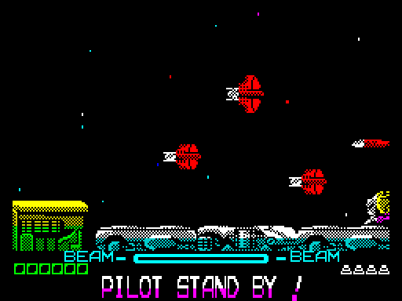

*Figure 8.4: c1 frame 18778, after the life lost between 18 620 and 18 660 (Lives `$7AA0` 5 to 4): PILOT STAND BY ! double height over rows 22-23. Its top
half is white (row 22, `$47`), its bottom half magenta (row 23, `$43` from DrawHud): the printer has no colour of
its own. The screen is the one of [WALKTHROUGH 6.1](../WALKTHROUGH.md#61-the-screens).*

The point: a message is a string printed over the lower HUD and erased by blanks; the HUD is then drawn again.

## 8.8 The high-score table

HiScoreTable `$7CD8` holds nine entries of 17 bytes: a name of 10 characters, six score digits, and `$A0`, a space
with bit 7 that ends the string. So one PrintText prints a whole entry. HiScoreSpare `$7D71` after it is the room the
insertion uses ([doc 5](05-controls.md#511-the-name-entry)). The defaults are BOB PAPE 100000, MAK 075000, D JOLLIFF
070000, K JEFFREY 060000, R HYLANDS 050000, J SMART 040000, SUSAN H 030000, H CLARK 020000, P HURN 010000.

```asm
PrintHiScores:                 ; $769B
        LD HL,BestPilotsText   ; "TODAY'S BEST PILOTS"
        LD BC,$0006            ; row 0, column 6
        CALL PrintText
        LD BC,$0304            ; row 3, column 4
        LD HL,HiScoreTable
        LD DE,DigitChars       ; "1" to "9"
l_76AD: PUSH DE
        PUSH BC
        PUSH HL
        PUSH DE
        LD HL,StarChars        ; "()*+ ": drawn as "No. "
        CALL PrintText
        POP HL
        CALL PrintText         ; the entry's digit
        POP HL
        INC C                  ; a space
        CALL PrintText         ; name and score, 17 bytes
        POP BC
        POP DE
        INC DE
        INC B
        INC B                  ; two rows down: double height
        LD A,B
        CP $15
        JR C,l_76AD            ; rows 3 to 19
        RET
```

DigitChars `$73B3` holds `'1'`-`'9'`, each with bit 7, so each is a one-character string. HL comes back past the
entry's `$A0`, at the next entry.

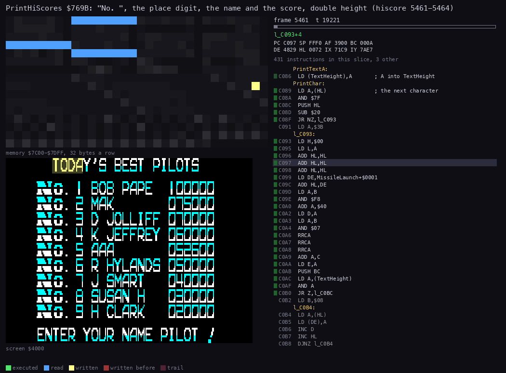

*Animation 8.4: PrintHiScores on the hiscore recording, window 5461:15900-5464:5480 (60 pictures), the table with
the new entry at No. 5; memory panel `$7C00-$7DFF` (HiScoreTable). Command: `python3 ../../kit/routine_anim.py
--work work/docs/rtB/hiscore --window 5461:15900-5464:5480 --listing build/game.lst --view screen --range 7C00-7DFF
--pc 769B-76CA,C07F-C110 --pictures 60 --out docs/img/routines/PrintHiScores.gif`.*

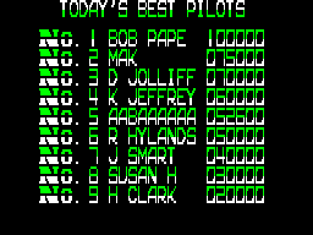

*Figure 8.5: the result, hiscore frame 5959: "AABAAAAAA" 052600 at No. 5.*

Worked example: entry 5 is printed at row 3 + 2 x 4 = 11. "No. " at columns 4-7, '5' at 8, a space at 9, the name
from 10 to 19, the score from 20 to 25, and the `$A0` blank at 26.

The point: the table is printed exactly as it is stored; inserting a score is moving bytes.

## 8.9 The closing text that never shows

Level 8's block holds a page of text that no player sees. It is not a string: it is object 32 of level 8, 24 x 21
character cells drawn in the font's style as graphics.

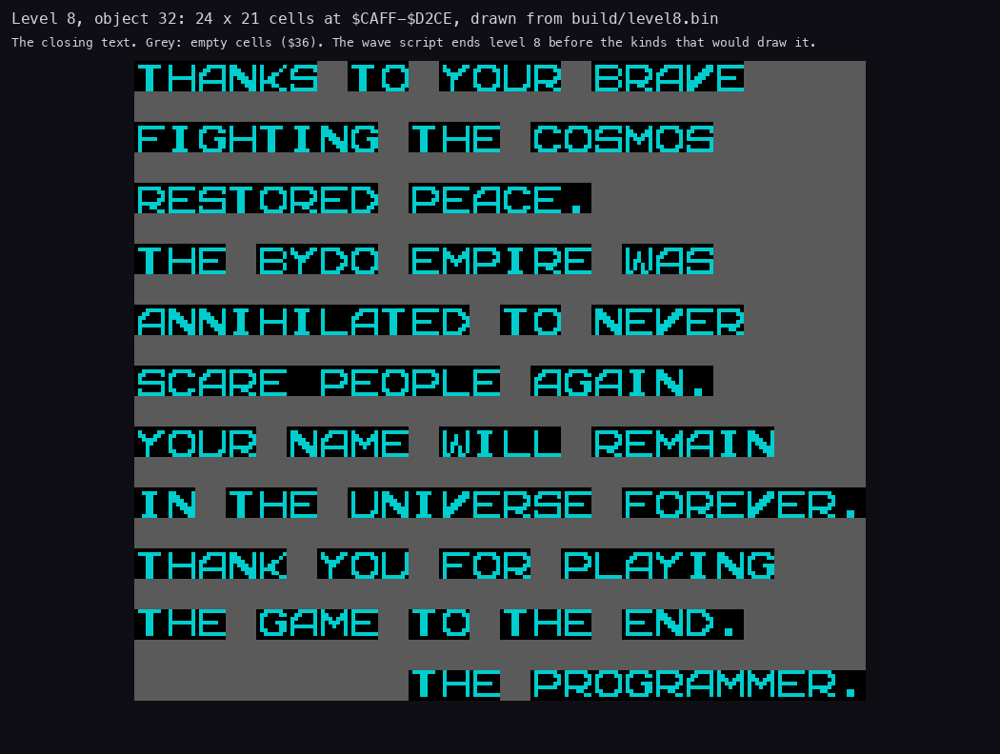

*Figure 8.6: level 8's object 32 (`$CAFF`-`$D2CE`), drawn from `build/level8.bin` with the object drawer of
`tools/objsheet.py`. Command: `python3 tools/fig_hud.py closing docs/img/hud/closing-text.png`.*

"THANKS TO YOUR BRAVE FIGHTING THE COSMOS RESTORED PEACE. THE BYDO EMPIRE WAS ANNIHILATED TO NEVER SCARE PEOPLE
AGAIN. YOUR NAME WILL REMAIN IN THE UNIVERSE FOREVER. THANK YOU FOR PLAYING THE GAME TO THE END. THE PROGRAMMER."

Why it never shows (stage 2, `work/stage2/NOTES.md` item 1):

- level 8's wave script has command 5, the level's end, at map column 56 and again at 66;
- the wave kinds `$1C`-`$28` that would draw the text come at columns 67-73, with a last command 5 at 82;
- LevelEnd `$C25E` at digit '8' makes it '9', clears WavesHalted and makes the ship immortal (a `RET` at
  ShipDies + 3); at '9' it makes '0' and loads level 1. So command 5 at column 66 ends the game first.

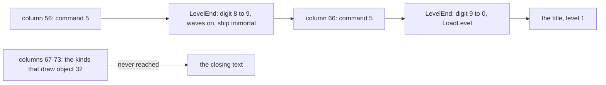

Witness: the `ending` recording runs from digit '9' through the level 1 search; it reads nothing in
`$CAFF`-`$D2CE`.

The point: the game's last message exists in the data, placed in the map six columns too late.

## 8.10 Summary

- One printer, `$C081`, prints strings of glyph numbers (bit 7 ends them) in normal or double height, pixels only.
- The font is 61 glyphs; the meter, the lives, "No.", the signs of the name entry, TM and the copyright are glyphs.
- The HUD is rows 20-23: BEAM meter, score and lives, the message row, HI SCORE; there is no level number.
- The score is ASCII, added digit by digit; an extra life comes at 50 000 and every 100 000.
- The high-score table is printed as stored, one PrintText per entry.
- The closing text is graphics of level 8 that the wave script never reaches.
