# 9. Sound

What this covers:

- the engine: three channels, each a script, each stepped by an interrupt task;
- PlaySound `$F87C`, and how it picks a channel and a timbre;
- the script format and its 16 commands;
- the two players: TonePlayer `$FB2F` (its `OUT` at `$FB52`) for chords, NoiseBurst `$FA71` (its `OUT` at `$FAA2`)
  for noise;
- the 35 sounds `$00`-`$22`, each decoded, rendered and tied to the event that plays it;
- what the sound costs the game: the 12-frame pass;
- Silence and its bug;
- 48K against 128K.

The game has beeper sound only. In play it writes no port but `$FE`, on a 48K and on a 128K alike
([9.10](#910-48k-against-128k)).

The recordings and tools it rests on:

- `l1` (level 1, [WALKTHROUGH 6.0](../WALKTHROUGH.md#60-the-recordings)): the pick-up sound in the interrupt;
- `l2` (level 2 with its load): the 12-frame pass;
- `tools/sound_sim.py`, which runs the game's own sound code in SkoolKit's Z80 simulator. It calls PlaySound, then the
  interrupt handler once a frame, as the machine does. It writes every table, figure and audio file below.

Both recordings were opened on an own muted instance (the same command for `l1`):

```text
python3 ../../kit/rs.py open --work work/docs/rtC/l2 --ttd work/stage1/rec/l2/session.ttd --model 48K --port-base 37790 --binary $BIN
```

The audio files were rendered from the simulated speaker bit. None was played while writing this.

## 9.1 The engine: three channels in the interrupt

The sound runs inside the IM 2 handler Interrupt `$BE23`. The handler walks the task table `$BE60`: 5 entries of 5
bytes (the address, a mask, a counter, the reload). An entry whose mask bit is set counts down. At 0 it reloads and
runs its task.

| Entry | Address | Task | Mask | Counter, reload | Runs |
| ---: | --- | --- | --- | --- | --- |
| 1 | `$BE60` | `$BE79` | 0 | 3, 3 | off in play |
| 2 | `$BE65` | SoundTask1 `$F8E8` | 1 | 1, 3 | every third interrupt |
| 3 | `$BE6A` | SoundTask2 `$F8F8` | 1 | 2, 3 | every third interrupt, one later |
| 4 | `$BE6F` | SoundTask3 `$F908` | 1 | 3, 3 | every third interrupt, two later |
| 5 | `$BE74` | the stars `$76CB` | 0 in the file | 1, 8 | while the stars are on |

The three sound tasks are staggered, so each interrupt runs exactly one of them. A task plays one step of its
channel's script: a "tick". A channel therefore moves once every 3 frames, 16.7 times a second.

Each channel is a 2-byte script pointer at `$FBCD`, `$FBCF`, `$FBD1` (SoundData+`$67`). A pointer of 0 is a free
channel.

```text
Interrupt:                                  # every frame
    IntTicks += 1
    for entry in TaskTable[1..5]:
        if entry.mask & 1:
            entry.counter -= 1
            if entry.counter == 0: entry.counter = entry.reload; call entry.address
SoundTaskN:                                 # N = 1, 2, 3
    IX = the channel's pointer; IY = the task (to run the next step at once)
    call the channel's timbre routine       # the operand PlaySound patches
    SoundStep()                             # one step of the script; nothing if the channel is free
```

```asm
Interrupt:
BE2D  LD HL,IntTicks
BE30  INC (HL)
BE31  LD HL,TaskTable
BE34  LD B,$05
l_BE36:
BE36  LD E,(HL)
BE37  INC L
BE38  LD D,(HL)               ; DE = the task
BE39  INC L
BE3A  LD C,(HL)
BE3B  INC L
BE3C  RRC C                   ; the mask bit
BE3E  JR NC,l_BE4E
BE40  DEC (HL)                ; the counter
BE41  JR NZ,l_BE4E
BE43  INC L
BE44  LD A,(HL)
BE45  DEC L
BE46  LD (HL),A               ; reload
BE47  PUSH BC
BE48  PUSH HL
BE49  CALL RunTask
SoundTask1:
F8E8  LD IX,SoundData+$0067   ; channel 1's pointer
F8EC  LD IY,SoundTask1
F8F0  CALL TimbreHigh         ; the operand PlaySound patches
F8F3  JR SoundStep
SoundStep:
F913  LD L,(IX+$00)
F916  LD H,(IX+$01)
F919  LD A,H
F91A  OR L
F91B  RET Z                   ; a free channel
```

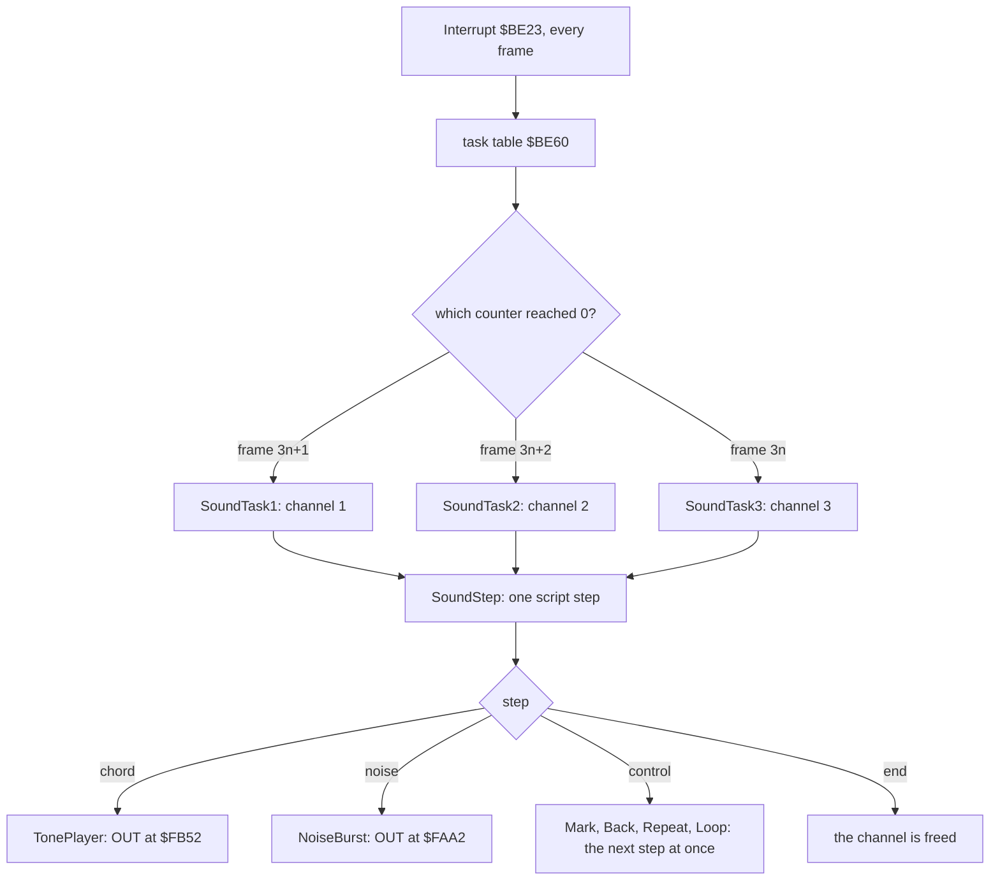

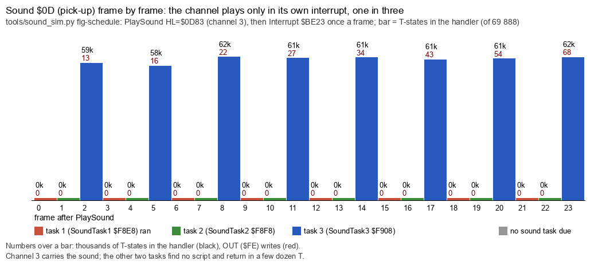

How to read it:

- x is the frame after PlaySound; a bar per interrupt, its height the T-states spent in the handler;
- the colour is the task that ran; only channel 3 is busy, so a step plays every third frame;
- the footer gives the totals.

Drawn by `python3 tools/sound_sim.py fig-schedule docs/img/sound/schedule.png` (simulated, no recording).

Worked example: the pick-up sound `$0D` is started on channel 3. Its 11 ticks fall on every third frame: 31 frames in
all, 0.62 s. A tick spends up to 62 320 T in the handler, 0.89 of a frame.

Witness: `l1` frame 2056 starts `$0D` (TakePickup). In frame 2058 SoundTask3 plays its first chord
([9.5](#95-toneplayer-and-the-chords)).

**The point**: the beeper has one bit, so a step plays to its end with the CPU busy. The three channels are three
scripts taking turns, one tick an interrupt, never mixed.

## 9.2 PlaySound: a channel and a timbre

PlaySound `$F87C` takes H = the sound (`$00`-`$22`) and L = the channel bits. It runs with the interrupts off.

| L bits | Meaning |
| --- | --- |
| 0-1 = 3 | channel 3, whatever it plays (the sound replaces it) |
| 0-1 = 1 or 2 | the first free channel, searching 3, 2, 1; none free: the sound is dropped |
| 5-7 = `$80` | TimbreHigh for that channel |
| 5-7 = `$40` | TimbreMid |
| 5-7 = other, not 0 | TimbreLow |
| 5-7 = 0 | the channel keeps its timbre |

SoundStart `$F894` writes the timbre into the chosen task's `CALL` operand (SoundTask1+9 + 16 x (channel - 1)). Then
SoundSetScript `$F9D4` sets the channel's pointer from the script table `$FC0B`.

```text
PlaySound(H = sound, L = bits):
    if L & 3 == 3: channel = 3
    else:
        channel = the first of 3, 2, 1 whose pointer is 0
        if none: return                     # dropped
    if L & $E0: the channel's task CALLs Timbre[High if $80, Mid if $40, else Low]
    channel.pointer = ScriptTable[H]        # $FC0B + 2 x H
```

```asm
SoundStart:
F894  LD C,L
F895  LD A,H
F896  EX AF,AF'
F897  LD A,C
F898  LD B,$03
F89A  AND B
F89B  LD HL,SoundData+$006C   ; channel 3's high byte
F89E  CP B
F89F  JR Z,l_F8B2             ; bits 3: channel 3, forced
F8A1  LD A,(HL)
F8A2  AND A
F8A3  JR Z,l_F8B2             ; channel 3 free
F8A5  DEC HL
F8A6  DEC HL
F8A7  DEC B
F8A8  LD A,(HL)
F8A9  AND A
F8AA  JR Z,l_F8B2             ; channel 2 free
F8AC  DEC HL
F8AD  DEC HL
F8AE  DEC B
F8AF  LD A,(HL)
F8B0  AND A
F8B1  RET NZ                  ; channel 1 busy too: dropped
l_F8B2:
F8B2  DEC HL
F8B3  PUSH HL
F8B4  POP IX                  ; the channel's pointer
F8B6  LD A,B
F8B7  DEC A
F8B8  ADD A,A
F8B9  ADD A,A
F8BA  ADD A,A
F8BB  ADD A,A
F8BC  LD HL,SoundTask1+$0009  ; the task's CALL operand
F8BF  ADD A,L
F8C0  LD L,A
F8C1  JR NC,l_F8C4
F8C3  INC H
l_F8C4:
F8C4  LD (SoundTimbre+$0001),HL
F8C7  LD A,C
F8C8  AND $E0
F8CA  JR Z,l_F8E0             ; keep the timbre
F8CC  LD HL,TimbreHigh
F8CF  CP $80
F8D1  JR Z,SoundTimbre
F8D3  LD HL,TimbreMid
F8D6  CP $40
F8D8  JR Z,SoundTimbre
F8DA  LD HL,TimbreLow
SoundTimbre:
F8DD  LD ($0000),HL           ; the store patched above
```

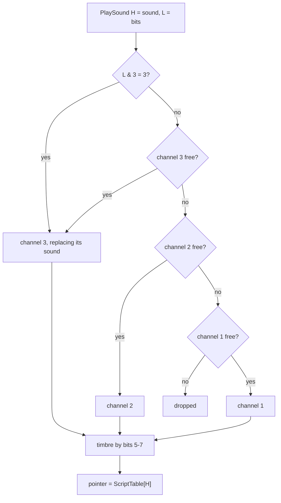

The timbre routines patch three operands. They set how long a note lasts and how many bursts a noise step plays:

| Timbre | Bits | Length shift | Mask | Voice factor | Effect |
| --- | --- | ---: | ---: | ---: | --- |
| TimbreHigh `$F952` | `$80` | 2 | 3 | 1 | the longest notes |
| TimbreMid `$F963` | `$40` | 3 | 7 | 2 | half as long |
| TimbreLow `$F975` | `$20` | 4 | 15 | 4 | a quarter as long |

Worked example: TakePickup calls PlaySound with HL = `$0D83`. Bits 0-1 are 3, so channel 3 takes it, whatever it was
playing. Bits 5-7 are `$80`, so channel 3 plays it with TimbreHigh. The shot (`$0121`) goes to the first free channel
with TimbreLow. It is dropped when all three are busy.

Witness: `l2` frame 8979 ([9.8](#98-the-cost-the-12-frame-pass)). BounceShot starts sound `$18` (bits `$41`) while
three explosions hold the three channels. It never plays: TonePlayer runs 0 T in frames 8979-8992.

The figure of [9.3](#93-the-script-format-and-its-commands) shows a whole script with the timbre it got.

**The point**: priority is one rule. Bits 3 take channel 3 by force; everything else waits for a free channel or is
lost. The important sounds (the pick-up, a life lost, the level's end) use bits 3.

## 9.3 The script format and its commands

A script is a list of 2-byte steps: a command byte (high nibble the command, low nibble its parameter p), then an
argument byte a. For a chord or a noise the argument is an entry of the period table at SoundData `$FB66`. Each entry
is a word: its low byte the half-period's delay E, its high byte the length.

| Command | Name | Handler | What it does | Time |
| ---: | --- | --- | --- | --- |
| 0 | End | `$F948` | the channel is freed | none |
| 1 | Rest | `$F994` | nothing | one tick |
| 2 | Mark | `$F985` | keep the next step's place in place p (0-7) | none: the next step at once |
| 3 | Back | `$F996` | go to the step kept in place p | none |
| 4 | Repeat | `$F9A5` | counter p = a; keep the next step in place p | none |
| 5 | Loop | `$F9BA` | counter p - 1; not 0: back to place p | none |
| 6 | spare | `$F9C7` | bytes left over, never used | |
| 7 | Noise | `$FA71` | bursts of ROM bytes ([9.6](#96-noiseburst)) | one tick |
| 8-13 | Chord1-6 | `$FAAF`-`$FAFF` | four voices from entry a, step p ([9.5](#95-toneplayer-and-the-chords)) | one tick |
| 14-15 | spare | `$FB0F`, `$FB1F` | two chord variants no script uses | |

The places (8 words at SoundData+`$6D`) and the counters (8 bytes at SoundData+`$7D`) are shared by the three
channels. The commands that take no time end in `JP (IY)`: the task runs the next step in the same tick.

```text
SoundStep:
    step = channel.pointer; if step == 0: return
    command, p = step[0] >> 4, step[0] & 15; a = step[1]
    channel.pointer += 2
    jump CommandTable[command]              # $FBEB, 16 words; DE = PeriodTable + 2 x a
```

```asm
SoundStep:
F91C  XOR A
F91D  RRD                     ; A = the low nibble: the parameter
F91F  LD C,A
F920  RRD                     ; A = the high nibble: the command
F922  LD B,A
F923  RRD                     ; the byte restored
F925  INC HL
F926  LD A,(HL)               ; the argument
F927  INC HL
F928  LD (IX+$00),L           ; the pointer moves on
F92B  LD (IX+$01),H
F92E  ADD A,A
F92F  LD D,$00
F931  LD E,A
F932  LD HL,SoundData
F935  ADD HL,DE               ; the period entry
F936  PUSH HL
F937  LD A,B
F938  ADD A,B
F939  LD E,A
F93A  LD HL,SoundData+$0085   ; the command table $FBEB
F93D  ADD HL,DE
F93E  SLA C
F940  POP DE
F941  LD B,(HL)
F942  INC HL
F943  LD H,(HL)
F944  LD L,B
F945  LD B,$00
F947  JP (HL)
SoundLoop:
F9BA  LD HL,SoundData+$007D   ; the counters
F9BD  SRL C
F9BF  ADD HL,BC
F9C0  SLA C
F9C2  DEC (HL)
F9C3  JR NZ,SoundReturn       ; not 0: back to the place
F9C5  JP (IY)                 ; 0: the next step at once
```

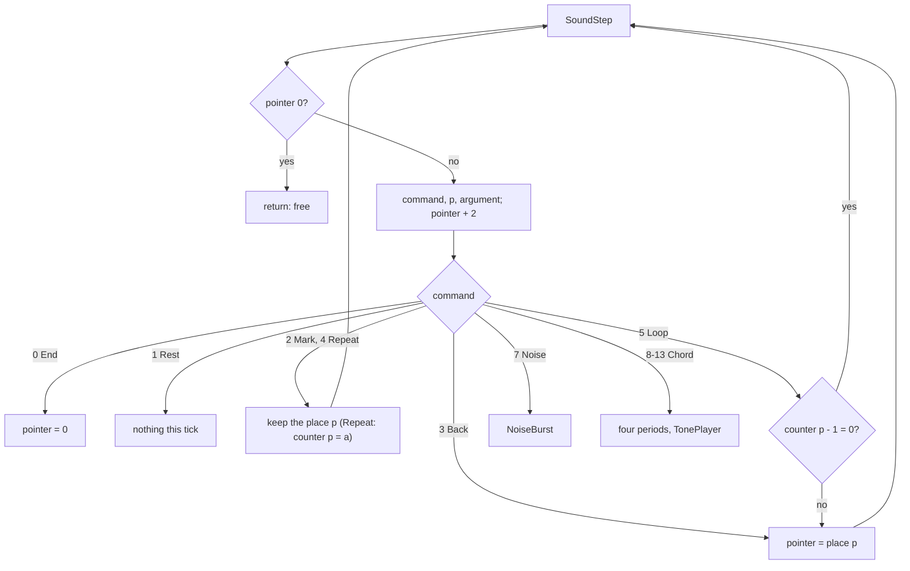

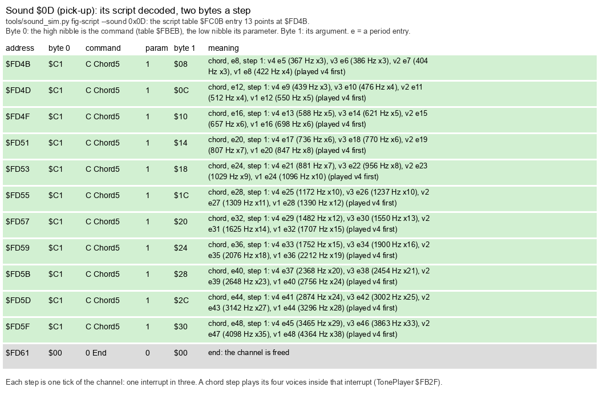

How to read it:

- a row per step: the two bytes as boxes, the command's name, and the four voices' notes;
- the frequency of a delay E is 3 500 000 / (2 x (115 + 26 x E)).

Drawn by `python3 tools/sound_sim.py fig-script docs/img/sound/script-0d.png` from `build/game.bin`.

Worked example, sound `$0D` at `$FD4B`: `C1 08`, `C1 0C`, `C1 10`, `C1 14`, and on. `C1` is Chord5 with step 1: the four
voices take entries a, a - 1, a - 2, a - 3. The argument climbs by 4 entries a step, so the chord rises: 367-422 Hz,
then 439-550 Hz, then 588-698 Hz, then 736-847 Hz. Every sound decoded step by step: `python3 tools/sound_sim.py
decode`.

Witness: `l1` frame 2058 plays this script's first chord ([9.5](#95-toneplayer-and-the-chords)).

**The point**: the script is a tiny language with marks and loops in 2 bytes a step. The longest tunes (the level's
end `$15`, the control choice `$19`) fit in a few dozen bytes.

## 9.4 The 35 sounds as pitch over time

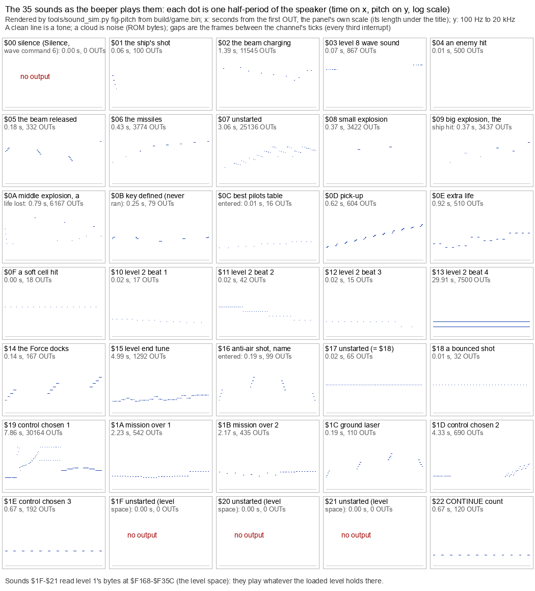

How to read it:

- a panel per sound, its number and name on the left;
- x is the time from PlaySound; y is the frequency of the speaker's toggles, on a logarithmic scale;
- chords show as bands of four lines, noise as a cloud;
- an empty panel is a sound with no script or no output.

Drawn by `python3 tools/sound_sim.py fig-pitch docs/img/sound/pitch.png` (simulated, each sound alone, with the
channel bits the game uses).

```text
for each sound n:
    PlaySound(n, the game's bits) on a fresh machine
    run Interrupt once a frame until the channels are free (or 1500 frames)
    record each OUT ($FE): its T and bit 4
    plot 1 / (2 x the time between toggles) against the time
```

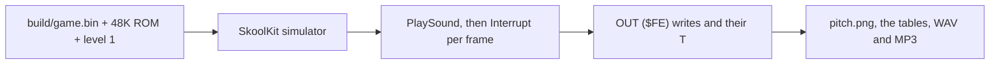

Worked example: sound `$02` (the beam charging) is a cloud that lasts 1.39 s, 24 noise steps. Sound `$13` (level 2's
beat) is a single chord repeated with no end; the simulation cuts it at 30 s.

Witness: the simulation runs the game's own code from `build/game.bin`, which rebuilds the tape identically
([doc 3](03-build-and-load.md#313-the-build)).

**The point**: half the sounds are chords, half noise. The tunes are chord sequences, one chord a tick.

## 9.5 TonePlayer and the chords

A chord command (8-13) builds four voices from one entry. Voice v takes entry a + k(v) x p:

| Command | Name | k for voices 1-4 | Shape |
| ---: | --- | --- | --- |
| 8 | Chord1 | 0, 0, -1, -2 | voices 1-2 steady, 3-4 falling |
| 9 | Chord2 | 0, 0, 1, 2 | voices 1-2 steady, 3-4 rising |
| 10 | Chord3 | 0, 1, 1, 1 | voices 2-4 one step up |
| 11 | Chord4 | 0, -1, -1, -1 | voices 2-4 one step down |
| 12 | Chord5 | 0, -1, -2, -3 | all four spread down |
| 13 | Chord6 | 0, 1, 2, 3 | all four spread up |

NotePeriod `$F9E7` turns an entry into a pair (D, E): E the delay of a half-period, D the number of half-periods. D is
the high byte shifted right by the timbre's shift, plus 1. It gets 1 more when the high byte's masked low bits reach
the voice's number times the voice factor. The four pairs go onto a small stack, SoundStack. TonePlayer `$FB2F` then
plays them one after the other, voice 4 first: D half-periods of E, each ending in `OUT ($FE)` with bit 4 flipped.

```text
Chord(command, p, a):
    for v in 1..4: push NotePeriod(entry a + k(command, v) x p, v)
    TonePlayer()
TonePlayer:
    for (D, E) in the pushed pairs, voice 4 first:
        repeat D times:
            wait 115 + 26 x E T            # the delay chain
            speaker bit ^= 1; OUT ($FE)
```

```asm
TonePlayer:
FB2F  LD HL,SoundStack        ; the pushed periods
FB32  LD SP,(SoundData+$0063) ; the real stack back
FB36  LD A,(SoundData+$0062)  ; the speaker byte
FB39  JP TonePlayerNext
TonePlayerLoop:
FB3C  JP l_FB3F               ; the delay chain
l_FB3F:
FB3F  JP l_FB42
l_FB42:
FB42  JP TonePlayerPeriod
TonePlayerPeriod:
FB45  LD E,D                  ; one half-period
FB46  JR l_FB48
l_FB48:
FB48  JR l_FB4A
l_FB4A:
FB4A  JR l_FB4C
l_FB4C:
FB4C  JR l_FB4E
l_FB4E:
FB4E  ADD A,$00
FB50  XOR $10                 ; flip the speaker bit
FB52  OUT ($FE),A
l_FB54:
FB54  DEC E
FB55  JP l_FB58
l_FB58:
FB58  JR NZ,l_FB54            ; 26 T a count
FB5A  DJNZ TonePlayerLoop
TonePlayerNext:
FB5C  LD D,(HL)               ; the next voice
FB5D  INC L
FB5E  LD B,(HL)
FB5F  INC L
FB60  DJNZ TonePlayerPeriod
FB62  LD (SoundData+$0062),A
FB65  RET
```

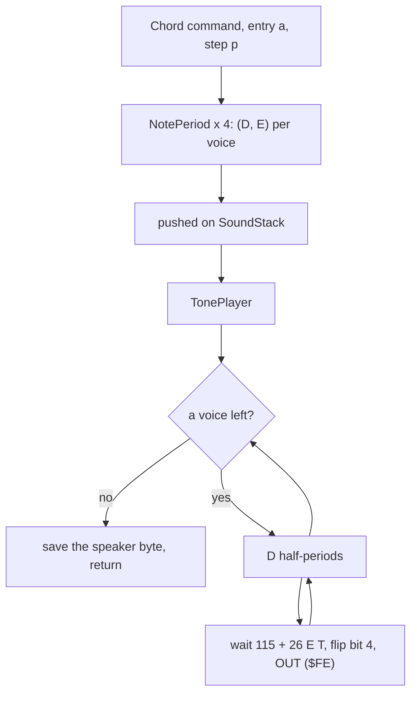

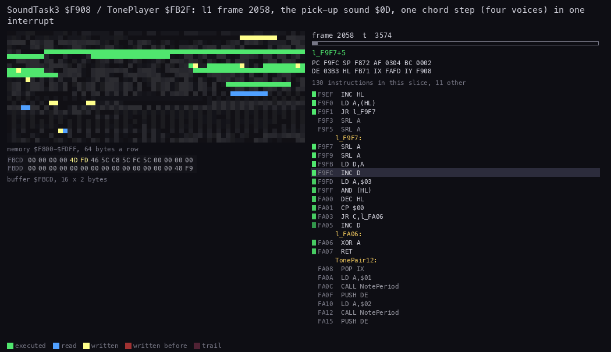

How to read it:

- left, the sound engine's memory `$F800-$FDFF` and the channel pointers from `$FBCD` (two rows of 16 bytes);
- right, the code: SoundStep, the chord, NotePeriod four times, then TonePlayer's loop and its `OUT` at `$FB52`.

Recording `l1`, frame 2058, T 2300 to 66 000, 50 pictures: `python3 ../../kit/routine_anim.py --work
work/docs/rtC/l1 --listing build/game.lst --listing build/level1.lst --window 2058:2300-2058:66000 --out
docs/img/routines/SoundTask3.gif --view buffer:FBCD:16x2:hex --range F800-FDFF --pc F908-FB66 --pictures 50`.

Worked example: entry 8 of the period table is `$0E9B`. E = `$9B` = 155, so a half-period is 115 + 26 x 155 = 4145 T,
and the voice sounds at 3 500 000 / 8290 = 422 Hz. With TimbreHigh it plays 4 half-periods. That is voice 1 of
`$0D`'s first step, `C1 08`.

Witness: `l1` frame 2058, the trace of the animation: SoundTask3, then the four NotePeriod calls, then TonePlayer's
`OUT ($FE)` at `$FB52`.

**The point**: a chord is four short tones played in a row, fast enough to blur. One 50-entry table serves every
tune, and the timbre stretches the notes.

## 9.6 NoiseBurst

Noise command 7 plays bursts of ROM bytes. The argument's entry gives the burst length B (its low byte) and the number
of bursts (its high byte, shifted by the timbre). The parameter p picks where the bytes come from:

- p = 0: from `$00FF` downwards, and the loop reloads the start each burst, so every burst plays the same bytes;
- p not 0: from `$00FF` + 512 x p downwards, running on from burst to burst (sound `$01`'s step `77 1C` reads from
  `$0EFF`).

Each byte, AND `$F8`, OR the border colour, goes to `OUT ($FE)`: the speaker is the ROM byte's bit 4. After each burst
comes a gap of B x 13 T.

```text
NoiseBurst(p, entry):
    B = entry.low; bursts = entry.high >> shift
    src = $00FF + 512 x p
    repeat bursts:
        if p == 0: HL = src                 # the same bytes each burst
        for i in 1..B: OUT ($FE), (ROM[HL] & $F8) | border; HL -= 1
        wait B x 13 T
```

```asm
NoiseBurst:
FA71  LD A,C
FA72  AND A
FA73  LD A,$F0
FA75  JR NZ,l_FA79
FA77  SUB $04                 ; p = 0: the loop back reloads HL
l_FA79:
FA79  LD (l_FAA8+$0005),A     ; the JR NZ offset at $FAAC
FA7C  EX DE,HL
FA7D  LD D,C
FA7E  LD E,$00
FA80  LD B,(HL)               ; B = the burst length
FA81  INC HL
FA82  LD C,(HL)               ; C = the bursts, shifted below
l_FA83:
FA83  JR l_FA83               ; patched by the timbre: skips some of the shifts
FA85  SRL C
FA87  SRL C
FA89  SRL C
FA8B  SRL C
FA8D  LD HL,$00FF
FA90  ADD HL,DE
FA91  LD (l_FA83+$0018),HL    ; the start, into LD HL at $FA9A
FA94  LD A,(SoundData+$0062)
FA97  AND $07
FA99  LD D,A                  ; the border colour
FA9A  LD HL,$00FF
FA9D  LD E,B
l_FA9E:
FA9E  LD A,(HL)               ; a ROM byte
FA9F  AND $F8
FAA1  OR D
FAA2  OUT ($FE),A
FAA4  DEC HL
FAA5  DJNZ l_FA9E
FAA7  LD B,E
l_FAA8:
FAA8  DJNZ l_FAA8             ; the gap
FAAA  LD B,E
FAAB  DEC C
FAAC  JR NZ,l_FA9E            ; patched: $FA9E or $FA9A
FAAE  RET
```

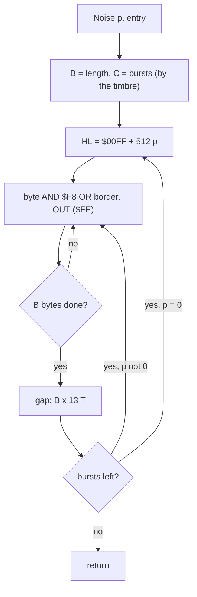

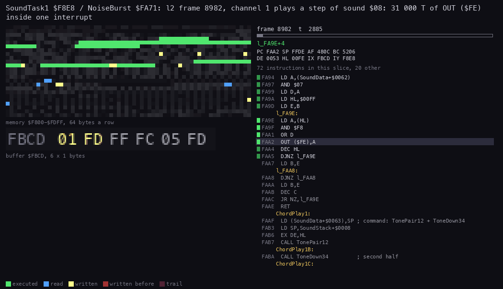

How to read it:

- left, the engine's memory and the three channel pointers at `$FBCD` (6 bytes);
- right, the code: SoundTask1, SoundStep, then NoiseBurst's loop with its `OUT ($FE)` at `$FAA2`.

Recording `l2`, frame 8982, T 2100 to 33 500 (3619 instructions), 40 pictures: `python3 ../../kit/routine_anim.py
--work work/docs/rtC/l2 --listing build/game.lst --listing build/level2.lst --window 8982:2100-8982:33500 --out
docs/img/routines/NoiseBurst.gif --view buffer:FBCD:6x1:hex --range F800-FDFF --pc F8E8-F947,FA71-FAAE --pictures 40`.

Worked example: sound `$04` (an enemy hit) is one step `70 1A`: noise, p = 0, entry 26. The entry is `$2A32`: B = 50
bytes, and `$2A` >> 2 = 10 bursts with TimbreHigh (bits `$81`). So 500 `OUT` writes, 10 bursts of the same 50 ROM
bytes from `$00FF` down: 32 126 T, almost half a frame.

Witness: `l2` frame 8982: SoundTask1 at T 2200, NoiseBurst from T 2641 to its `RET` at T 33 368.

**The point**: the noise is the ROM read as sound. It costs no table, and it always sounds the same, because the ROM
never changes.

## 9.7 The 35 sounds

The script table `$FC0B` holds 35 words. "Played by" names the code that starts each sound and, in parentheses, the
run count of its starting instruction over all the recordings (game.ann, SoundData). Ticks, the length and the longest
tick come from `python3 tools/sound_sim.py table`, each sound alone with the bits shown. A tick's T is its time inside
the interrupt.

| Sound | Script | Bits | Played by | Kind | Ticks | Length | Longest tick | Audio |
| --- | --- | --- | --- | --- | ---: | --- | --- | --- |
| `$00` | none | `$83` | Silence; a wave command 6 with 0 | frees channel 3 | 0 | | | none |
| `$01` | `$FC51` | `$21` | ShotSound: the ship's shot (3940) | chord, noise | 2 | 0.06 s | 16 663 T | [wav](audio/sound-01.wav) |
| `$02` | `$FC57` | `$83` | FireBeam at charge `$0C` (90) | noise | 24 | 1.39 s | 33 956 T | [wav](audio/sound-02.wav) |
| `$03` | `$FC89` | `$83` | level 8 wave command 6 (columns 35, 41, 48) | noise | 2 | 0.07 s | 29 740 T | [wav](audio/sound-03.wav) |
| `$04` | `$FC8F` | `$81` | EnemyHit: hit, not killed (2492) | noise | 1 | 0.01 s | 32 126 T | [wav](audio/sound-04.wav) |
| `$05` | `$FC93` | `$43` | BeamRelease (143) | chords | 4 | 0.18 s | 31 993 T | [wav](audio/sound-05.wav) |
| `$06` | `$FC9D` | `$81` | FireMissiles (482) | noise | 8 | 0.43 s | 34 842 T | [wav](audio/sound-06.wav) |
| `$07` | `$FCAF` | (`$81`) | nothing: unused | noise | 52 | 3.06 s | 34 842 T | [mp3](audio/sound-07.mp3) |
| `$08` | `$FCFD` | `$82` | AwardScore, enemy size `$10` (1377) | noise | 7 | 0.37 s | 33 778 T | [wav](audio/sound-08.wav) |
| `$09` | `$FD0D` | `$82`, `$83` | AwardScore, sizes `$20`-`$30` (747); ShipDies (38) | noise | 7 | 0.37 s | 34 842 T | [wav](audio/sound-09.wav) |
| `$0A` | `$FD1D` | `$82`, `$83` | AwardScore, size `$40` (848); LoseLife (37); level 7 wave command | noise | 14 | 0.79 s | 63 142 T | [wav](audio/sound-0a.wav) |
| `$0B` | `$FD3B` | `$41` | DefineKeys, DefineKey: never ran | chords | 5 | 0.25 s | 32 258 T | [wav](audio/sound-0b.wav) |
| `$0C` | `$FD47` | `$81` | InsertHiScore: a place in the best pilots (10) | chord | 1 | 0.01 s | 55 522 T | [wav](audio/sound-0c.wav) |
| `$0D` | `$FD4B` | `$83` | TakePickup (20) | chords | 11 | 0.62 s | 62 320 T | [wav](audio/sound-0d.wav) |
| `$0E` | `$FD63` | `$83` | ExtraLifeSound (6) | chords | 16 | 0.92 s | 61 943 T | [wav](audio/sound-0e.wav) |
| `$0F` | `$FD85` | `$21` | ProcessHitsNext: a soft cell hit (717) | chord | 1 | 0.00 s | 16 439 T | [wav](audio/sound-0f.wav) |
| `$10` | `$FD89` | `$83` | level 2 wave command (the boss's beat) | chord | 1 | 0.02 s | 60 228 T | [wav](audio/sound-10.wav) |
| `$11` | `$FD8D` | `$83` | level 2 wave command | chord | 1 | 0.02 s | 61 828 T | [wav](audio/sound-11.wav) |
| `$12` | `$FD91` | `$83` | level 2 wave command | chord | 1 | 0.02 s | 65 280 T | [wav](audio/sound-12.wav) |
| `$13` | `$FD95` | `$83` | level 2 wave command: a chord with no end | chord loop | endless | cut at 30 s | 65 817 T | [mp3](audio/sound-13.mp3) |
| `$14` | `$FD9D` | `$81` | ForceDraw: the Force docks (1); ShieldControls' detach (never ran) | chords | 3 | 0.14 s | 62 225 T | [wav](audio/sound-14.wav) |
| `$15` | `$5B64` | `$83` | LevelEnd: the level's end tune (8) | chord tune | 84 | 4.99 s | 62 439 T | [mp3](audio/sound-15.mp3) |
| `$16` | `$5BC6` | `$41`, `$21` | the anti-air shots; InsertHiScore: the name entered (1) | chords | 4 | 0.19 s | 32 166 T | [wav](audio/sound-16.wav) |
| `$17` | `$5BD0` | (`$81`) | nothing: unused, the script of `$18` | chord | 1 | 0.02 s | 61 975 T | [wav](audio/sound-17.wav) |
| `$18` | `$5BD0` | `$41` | BounceShot: a shot bounced off the scenery (1576) | chord, 1900 Hz | 1 | 0.01 s | 31 634 T | [wav](audio/sound-18.wav) |
| `$19` | `$5BD4` | `$83` | SelectControl (3) | chord tune | 126 | 7.86 s | 63 125 T | [mp3](audio/sound-19.mp3) |
| `$1A` | `$5C4C` | `$81` | MissionOver (4) | chord tune | 38 | 2.23 s | 61 825 T | [mp3](audio/sound-1a.mp3) |
| `$1B` | `$5C72` | `$81` | MissionOver (4) | chord tune | 22 | 2.17 s | 61 947 T | [mp3](audio/sound-1b.mp3) |
| `$1C` | `$5CB0` | `$41` | ForceGround: the ground laser (507) | chords | 4 | 0.19 s | 31 996 T | [wav](audio/sound-1c.wav) |
| `$1D` | `$5CBA` | `$82` | SelectControl (3) | chord tune | 33 | 4.33 s | 61 943 T | [mp3](audio/sound-1d.mp3) |
| `$1E` | `$5CF4` | `$81` | SelectControl (3) | chord tune | 12 | 0.67 s | 62 073 T | [wav](audio/sound-1e.wav) |
| `$1F` | `$F168` | (`$81`) | nothing: the word points into the level space | level data | 0 | | | none |
| `$20` | `$F294` | (`$81`) | nothing: the word points into the level space | level data | 0 | | | none |
| `$21` | `$F35C` | (`$81`) | nothing: the word points into the level space | level data | 0 | | | none |
| `$22` | `$72E8` | `$81` | Continue: the CONTINUE count (21) | chord loop | 12 | 0.67 s | 59 020 T | [wav](audio/sound-22.wav) |

Notes on the table:

- the scripts of `$15`-`$1E` live at `$5B64`, in the copy the entry makes from EntryCopySource `$7EE2`;
- bits in parentheses are the simulation's choice for a sound no code starts;
- a wave command 6 always uses bits `$83` (StartWave `$90EF`: `LD L,$83`), so the level sounds take channel 3;
- BossDestroyed would start `$09` or `$0A` by the frame's parity, bits `$81`; it never ran;
- the WAV files are 44.1 kHz renders of the speaker bit; a sound over 2 s is an MP3 made by `lame -V 4`;
- the renders: `python3 tools/sound_sim.py wavs docs/audio`.

```text
AwardScore (an enemy killed):
    size = KindRecord[2] & $F0
    if size: PlaySound(HL = ($08 if size == $10 else $0A if size == $40 else $09) << 8 | $82)
```

```asm
AwardScore:
A5BF  LD A,(DE)               ; the kind's score byte
A5C0  AND $F0                 ; the explosion size
A5C2  JR Z,l_A5E6
A5C4  PUSH HL
A5C5  LD L,$82
A5C7  LD H,$08                ; size $10: small
A5C9  CP $10
A5CB  JR Z,l_A5D5
A5CD  LD H,$0A                ; size $40: middle
A5CF  CP $40
A5D1  JR Z,l_A5D5
A5D3  LD H,$09                ; else: big
l_A5D5:
A5D5  CALL PlaySound
```

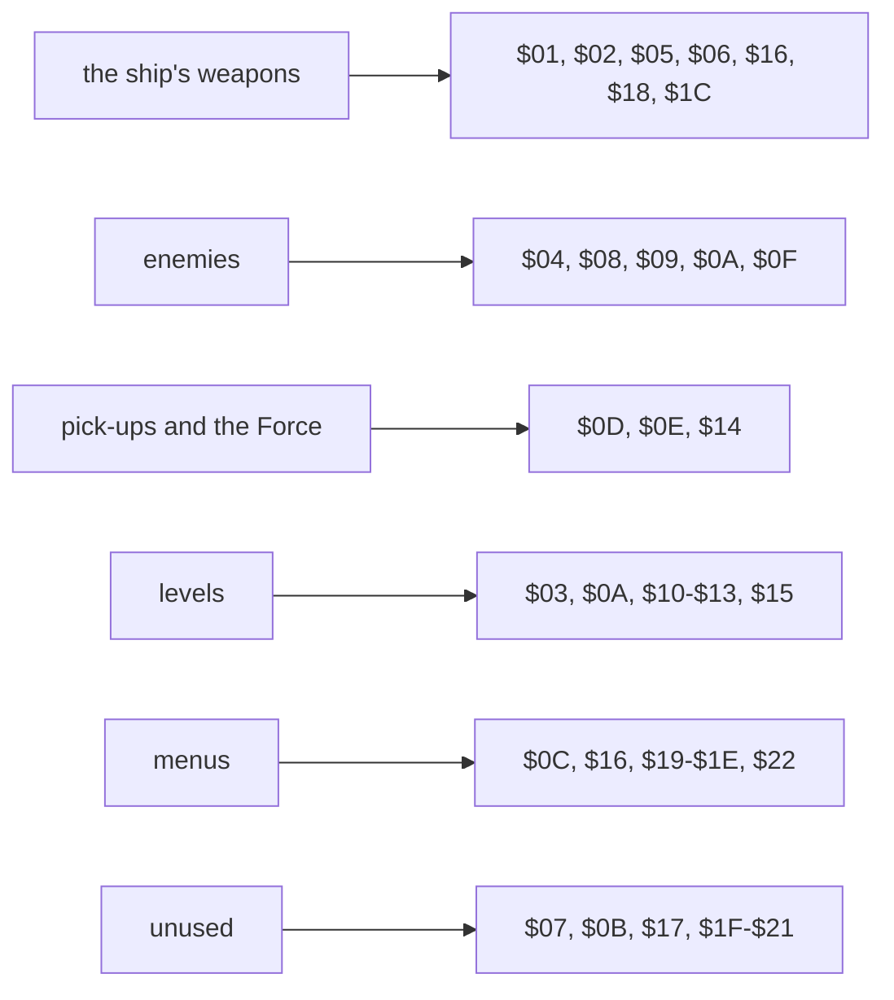

Worked example: a level 1 kill of a kind with score byte `$12` has size `$10`. AwardScore plays `$08` with bits `$82`
on the first free channel: 7 noise steps, 0.37 s.

Witness: the run counts in game.ann (SoundData) over all the recordings; `l1` frame 2056 for `$0D`; `l2` frames
8977-8979 for `$08` and `$18` ([9.8](#98-the-cost-the-12-frame-pass)).

The figure of [9.4](#94-the-35-sounds-as-pitch-over-time) draws every row of this table.

The unused ones:

- `$07`: a 3-second noise sweep that no code and no wave starts;
- `$0B`: the "key defined" sound of DefineKeys and DefineKey; no recording ran either;
- `$17`: the same script as `$18`; nothing starts it;
- `$1F`-`$21`: their words point into level 1's space (`$F168`, `$F294`, `$F35C`), so they would play level data;
  nothing starts them.

**The point**: 29 of the 35 sounds are played. The game has no music in play: effects, a beat in level 2 and short
tunes between the screens.

## 9.8 The cost: the 12-frame pass

The beeper sound costs CPU time, and all of it is spent inside the interrupt. A tick plays to its end:

- a chord tick costs up to 65 817 T, 0.94 of a frame (the long notes of TimbreHigh);
- a noise tick costs 16 000 to 35 000 T (`$0A` runs two noise steps in a tick: 63 142 T);
- a channel ticks every third frame; with three busy channels every interrupt plays a tick.

The main loop gets what is left. Its normal pass takes 4.68 frames on level 2 ([doc 4](04-game-loop.md)). The longest
pass of `l2`, 12 frames, is three explosions at once.

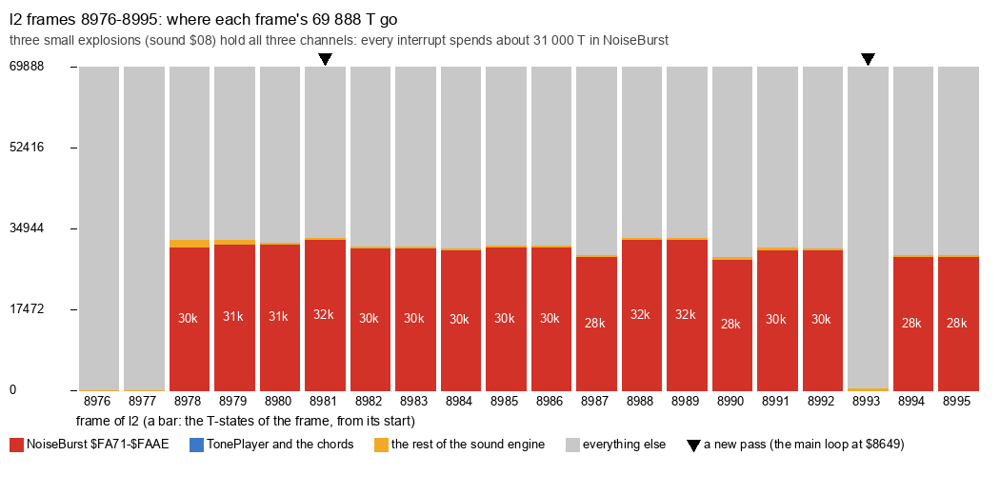

How to read it:

- a bar per frame of `l2`, the full height a frame of 69 888 T;
- red is NoiseBurst, orange the rest of the sound engine, grey everything else (the main loop and the other tasks);
- a black triangle marks a frame where the main loop's top `$8649` ran.

Drawn by `python3 tools/fig_soundcost.py work/docs/rtC/l2-tsplit.txt docs/img/sound/cost-l2.png 8981 8993`. The split
is `python3 work/docs/rtC/tools/tsplit.py work/docs/rtC/l2 8976:0-8996:0`: the T from each traced instruction to the
next, by its address.

What happened, from the trace and the channel pointers at `$FBCD`:

1. At frame 8977 channel 3 holds an explosion `$08` started earlier.
2. In frame 8978 two more enemies die: AwardScore starts `$08` twice (HL = `$0882`). Channels 2 and 1 take them.
3. In frame 8979 BounceShot starts `$18` (HL = `$1841`). No channel is free, so it is dropped; the same at 8991.
4. From 8978 to 8992 every interrupt runs a noise tick of 28 350-32 621 T: 44 % of each frame.
5. The main loop's top runs at 8981 and next at 8993: a 12-frame pass. At 8993 channel 3's turn finds it free (0 T of
   noise), and at 8994 the two other explosions play on.

```text
for each frame f in the window:
    split the T-states by routine: NoiseBurst, TonePlayer, the engine, the rest
    mark f when $8649 ran
```

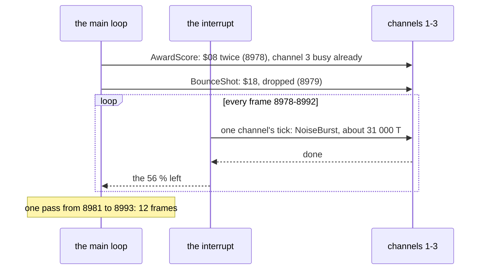

Worked example: with 44 % of every frame gone, a normal 4.68-frame pass would stretch to about 4.68 / 0.56 = 8.4
frames. The measured 12 also carry the work of the three kills (the explosion records, the score), and the loop waits
for whole frames.

Witness: `l2` frames 8976-8996, traced on the own instance. The passes break where `$8649` runs
(`work/docs/rtC/tools/pccount.py`). Stage 2's notes put the noise on `$18`. The trace shows `$18` was dropped and the
noise is three `$08`s (the correction goes to the lead).

**The point**: in R-Type the sound is not free. Each explosion takes 44 % of the CPU for a third of a second, and a
big fight slows the game to a third of its speed.

## 9.9 Silence and its bug

Silence `$8CC5` is meant to stop all three channels. It calls PlaySound three times with sound 0 (no script) and
bits `$83`, `$82`, `$81`.

```text
Silence:
    PlaySound(0, $83)       # channel 3, forced: freed
    PlaySound(0, $82)       # the first free channel: channel 3 again (just freed)
    PlaySound(0, $81)       # channel 3 again
```

```asm
Silence:
8CC5  LD HL,$0083
8CC8  PUSH HL
8CC9  CALL PlaySound
8CCC  POP HL
8CCD  DEC L                   ; $0082
8CCE  PUSH HL
8CCF  CALL PlaySound
8CD2  POP HL
8CD3  DEC L                   ; $0081
8CD4  CALL PlaySound
8CD7  RET
```

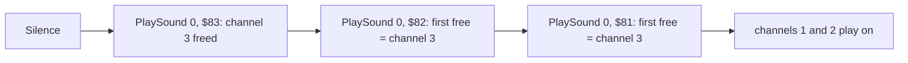

Bits 1 and 2 do not name channels 1 and 2. They mean "the first free channel from 3 down", and channel 3 has just
been freed. So only channel 3 is ever silenced.

Worked example, simulated (`python3 tools/sound_sim.py silence`): three sounds `$15`, `$0D` and `$09` started with bits
`$81` hold the channels at `$FD0D`, `$FD4B`, `$5B64`. After Silence they read `$FD0D`, `$FD4B`, `$0000`: channels 1 and
2 play on.

The schedule figure of [9.1](#91-the-engine-three-channels-in-the-interrupt) shows the same engine with one channel.

Witness: known only from the code and the simulation. In play the endless `$13` always sits on channel 3 (the wave
command's bits `$83`), so Silence does stop it; the explosions on channels 1 and 2 end by themselves.

**The point**: a bug that never shows. The effects on channels 1 and 2 are short and end on their own.

## 9.10 48K against 128K

The game is 48K only, and it plays the same on a 128K:

- in play it writes no port but `$FE`: no AY, no other bank;
- the tape's Tail writes `$30` to `$7FFD` before the game starts: bank 0, the 48K ROM, paging locked;
- so NoiseBurst reads the same ROM bytes on both machines.

What differs is the clock. A 128K runs at 3.5469 MHz with 70 908 T a frame, against 3.5 MHz and 69 888 T. TonePlayer
counts T-states, so every tone sounds 1.3 % higher on a 128K. The ticks come every third frame on both, so the rhythm
differs by 0.1 %.

```text
f(48K)  = 3 500 000 / (2 x (115 + 26 E))
f(128K) = 3 546 900 / (2 x (115 + 26 E)) = f(48K) x 1.0134
```

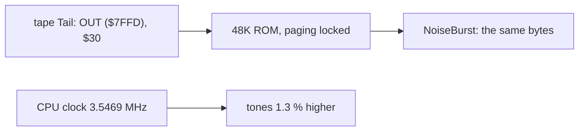

Worked example: voice 1 of `$0D`'s first chord, E = 155, is 422.2 Hz on a 48K and 427.9 Hz on a 128K.

Witness: `m128` (the 128K path): the Tail's `OUT ($7FFD)` ran once, and the ROM read back is the 48K ROM
([doc 2, 2.9](02-architecture.md#29-the-48k-and-the-128k)).

The pitch figure of [9.4](#94-the-35-sounds-as-pitch-over-time) holds for the 128K with every line 1.3 % higher.

**The point**: no 128K version of the sound exists. The 128K plays the 48K beeper code a hair sharper.

## 9.11 Notes and what is known only from the code

- **The level 2 beat**: sound `$13` loops with no end (Mark, a chord, Back); Silence stops it at a life lost.
- **The interrupt waits**: the handler runs with the interrupts off. No tick is longer than 0.94 of a frame, so no
  interrupt is lost and the tasks keep their beat.
- **The spare commands**: 6 is bytes left over; 14 and 15 are chord variants (`$FB0F`, `$FB1F`) that no script uses.
- **Known only from the code or the simulation**: sounds `$07`, `$0B`, `$17`, `$1F`-`$21` (never started); Silence on
  channels 1 and 2; BossDestroyed's `$09`/`$0A` (no boss died by hits); the detach sound `$14` from ShieldControls.
