# 10. Gameplay logic

What this covers, as code: the ship, its weapons (the shot, the charged beam, the Force, the bits, the missiles, the
shield), the pick-ups, the enemies and bosses of each level, the collisions and the three ways to die, lives,
continues, the score, the level's end and the wrap after level 8.

The recordings it rests on, each opened on an own muted instance:

```text
python3 ../../kit/rs.py open --work work/docs/rtC/NAME --ttd REC/session.ttd --model 48K --port-base 37790 --binary $BIN
```

The recordings:

- `l1` (`work/stage1/rec/l1`): level 1 from its load, played by the autopilot. Like every `lN` recording it runs with
  POKE `$91F2` = `$C9` (ShipDies returns at once), so the ship never dies in it;
- `deaths-l7` (`work/stage2/rec/deaths-l7`, 8390 frames): level 7 from `l6`'s end state without the POKE: 8 lives
  lost, every death path;
- `l2` for the sound's cost, `l8` and `ending` for the wrap.

The variable samples (`work/docs/rtC/l1-vars.jsonl`, `d7-vars.jsonl`) are the memory at the start of every tenth
frame, written by `work/docs/rtC/sample.py`. The game variables themselves are listed in
[doc 7, 7.1](07-objects.md#71-the-game-variables).

## 10.1 The ship: movement and limits

MoveShip `$94F1` runs once a pass. Each direction bit of ControlBits moves the ship one cell: left and right change
ShipColumn, down and up change ShipRow. The vertical keys also bank the ship: ShipFrame goes from 3 (level) to 2 or
4, and back to 3 when no key is held. A move that leaves the field is undone, coordinate by coordinate:

| Coordinate | Allowed | Outside |
| --- | --- | --- |
| ShipColumn `$7AA1` | 1 to 28 | 0 or 29 and up: the old column |
| ShipRow `$7AA2` | 0 to 19 | 20 and up: the old row |

The ship is 3 cells wide. Then MoveShip draws it and tests the cell ahead of its nose ([10.11](#1011-collisions-and-the-three-death-paths)).

```text
MoveShip:
    if ShipFrame == 0: return               # no ship (dying, between lives)
    new = (ShipColumn, ShipRow)
    if no direction: ShipFrame drifts back to 3
    left: column - 1; right: column + 1
    down: row + 1, ShipFrame down to 2; up: row - 1, ShipFrame up to 4
    if row >= 20: row = old row
    if column == 0 or column >= 29: column = old column
    draw the ship; test the nose cell and HitCount
```

```asm
MoveShip:
94F1  LD A,(ShipFrame)
94F4  AND A
94F5  RET Z                   ; no ship
94F6  LD HL,(ShipColumn)      ; L = column, H = row
94F9  LD D,H
94FA  LD E,L                  ; the old place
94FB  LD A,(ControlBits)
94FE  LD B,A
94FF  AND $0F
9501  JR NZ,l_951A            ; a direction held
...
l_9544:
9544  LD A,H
9545  CP $14
9547  JR C,l_954D
9549  AND A
954A  JR Z,l_954D
954C  LD H,D                  ; row 20 and up: the old row
l_954D:
954D  LD A,L
954E  AND A
954F  JR Z,l_9555
9551  CP $1D
9553  JR C,l_9556
l_9555:
9555  LD L,E                  ; column 0 or 29 and up: the old column
l_9556:
9556  LD (ShipColumn),HL
```

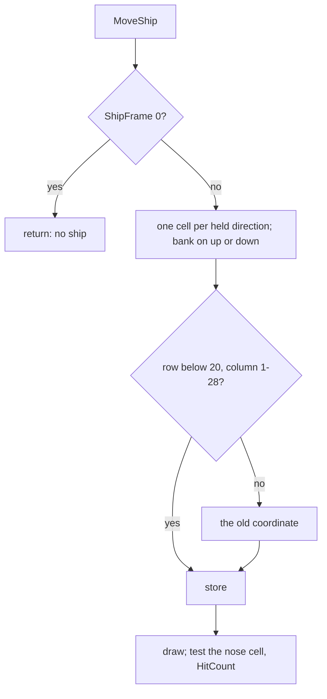

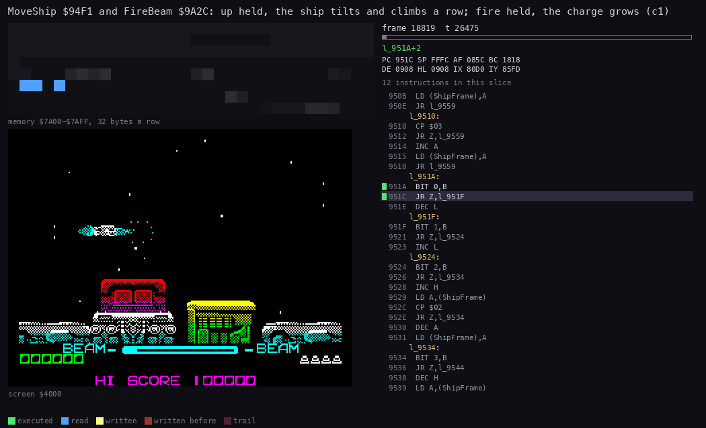

How to read it: the animation from [doc 5, 5.7](05-controls.md#57-from-the-bits-to-the-ship) shows MoveShip's code
and the ship's coordinates as the keys change; its caption there names the recording and the command.

Worked example: the ship at column 28 with the right key held computes column 29. 29 is `$1D`, not below it, so L
takes back E = 28 and the ship stays at the right edge. Up at row 0 gives row `$FF`, which is 20 and up, so the row
stays 0.

Witness: in the `l1` samples the ship stays within columns 1-27 and rows 8-18 (`work/docs/rtC/l1-vars.jsonl`, ShipColumn and
ShipRow at `$7AA1`); the keys from `ctl-sinclair` and `c1` move the ship as [doc 5](05-controls.md) shows.

**The point**: one cell a pass and a clamp; the speed of the ship is the speed of the main loop, so it slows down
with the game ([doc 9, 9.8](09-sound.md#98-the-cost-the-12-frame-pass)).

## 10.2 The weapon state over a level

Everything the player owns is a handful of bytes:

| Variable | Address | Values | Set by |
| --- | --- | --- | --- |
| WeaponKind | `$7ABD` | 1 bouncing laser, 2 ground laser, 3 anti-air | a Force pick-up (kinds 3, 4, 5) |
| ForceLevel | `$7ABE` | 0 none, 1-3 the Force's size | each Force pick-up, up to 3 |
| ForceAttached | `$7AA3` | 0 free, 1 at the nose, 2 at the tail | ForceDraw, ShieldControls |
| BitUpperOn, BitLowerOn | `$7AA5`, `$7AA6` | 0 or 1 | pick-ups 8 and 9 |
| MissilesOn | `$7AA7` | 0 or 1 | pick-up 7 |
| ShieldTimer | `$7A98` | passes left | pick-up 6, a new life |
| BeamCharge, BeamPower | `$7ABF`, `$7AC0` | the charge, the beam's power | FireBeam, BeamRelease |

A death clears all of them but ShieldTimer, which the next life sets (ClearShipStuff zeroes the `$55` bytes
`$7AA1-$7AF5` from ShipColumn; ShieldTimer `$7A98` lies before them).

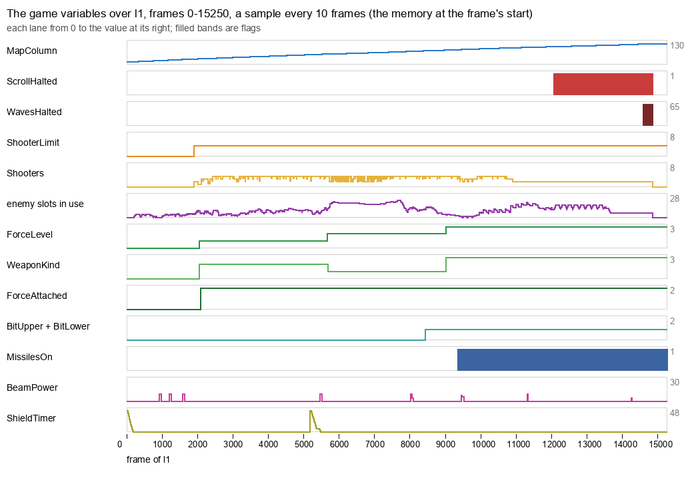

How to read it:

- a lane per variable, x the frame of `l1`;
- ForceLevel, WeaponKind and ForceAttached step up as the Force pick-ups come; the bits and the missiles are flags;
- BeamPower shows each released beam.

Drawn by `python3 tools/fig_objects.py vars work/docs/rtC/l1-vars.jsonl docs/img/objects/l1-vars.png`; the samples
by `python3 work/docs/rtC/sample.py work/docs/rtC/l1 0 15250 10 work/docs/rtC/l1-vars.jsonl` on the open `l1`.

```text
the course of l1, from the samples:
    2060  ForceLevel 1, WeaponKind 2 (the first crystal)
    2090  ForceAttached 2 (the Force docks at the tail)
    5670  ForceLevel 2
    8450  BitUpperOn 1
    9020  ForceLevel 3
    9340  MissilesOn 1
```

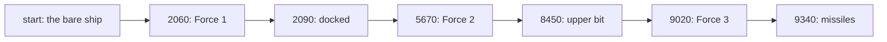

Worked example: at frame 2060 the samples show ForceLevel going 0 → 1 and WeaponKind 0 → 2. The pick-up taken at
2056 was kind 4, and 4 - 2 = 2: the ground laser ([10.6](#106-the-pick-ups)).

Witness: `l1`, the samples above; the pick-up at 2056:38791 (TakePickup), the dock at 2083:17238.

**The point**: the ship's whole arsenal is a handful of bytes. A death empties them at once, which is why a death in R-Type
costs so much more than a life.

## 10.3 The controls in a pass: fire, charge, detach

ShipShield `$9577` runs right after MoveShip and falls into ShieldControls `$95A5`. ShieldControls is the only place
that reads the fire and detach bits in play. Its first byte is `NOP`; the level's end, a boss's death and the fly-in
patch it to `RET`, which turns the ship's weapons off.

| Input | Condition | Action |
| --- | --- | --- |
| fire held (bit 4) or BeamCharge not 0 | | FireBeam: charge while held, fire on release ([10.4](#104-the-shot-and-the-charged-beam)) |
| detach (bit 5) | ForceLevel 0 | nothing |
| detach | attached at the nose, ShipColumn below 26 | Force state 4: launched forward; sound `$14` |
| detach | attached at the tail, ShipColumn 4 or more | Force state 5: launched backward; sound `$14` |
| detach | free, in state 3 or 7 (hovering) | state 6: the Force comes back to the ship |

```text
ShieldControls:                             # NOP; RET while the controls are off
    if fire held or BeamCharge: FireBeam()
    if not detach or ForceLevel == 0: return
    r = the Force's record
    if ForceAttached == 1 and ShipColumn < 26: r.state = 4
    elif ForceAttached == 2 and ShipColumn >= 4: r.state = 5
    elif ForceAttached == 0 and r.state in (3, 7): r.state = 6; return
    else: return
    ForceAttached = 0; PlaySound($14, $81)
```

```asm
ShieldControls:
95A5  NOP                     ; RET while the controls are off
95A6  LD A,(ControlBits)
95A9  BIT 4,A
95AB  JR NZ,l_95B3            ; fire held
95AD  LD A,(BeamCharge)
95B0  AND A
95B1  JR Z,l_95B6
l_95B3:
95B3  CALL FireBeam
l_95B6:
95B6  LD A,(ControlBits)
95B9  BIT 5,A                 ; detach
95BB  RET Z
95BC  LD A,(ForceLevel)
95BF  AND A
95C0  RET Z
95C1  CALL ForceRecordOf
...
95CC  CP $02
95CE  LD A,(ShipColumn)
95D1  JR Z,l_95DA
95D3  CP $1A
95D5  RET NC                  ; at the nose, too far right
95D6  LD A,$04
95D8  JR l_95DF
l_95DA:
95DA  CP $04
95DC  RET C                   ; at the tail, too far left
95DD  LD A,$05
l_95DF:
95DF  LD (HL),A
95E0  XOR A
95E1  LD (ForceAttached),A
95E4  LD HL,$1481
95E7  CALL PlaySound
```

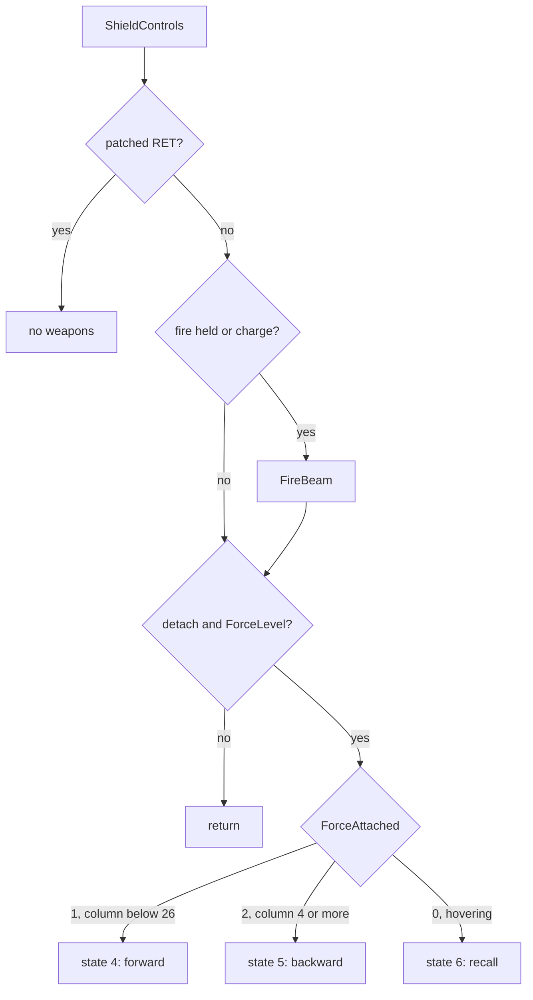

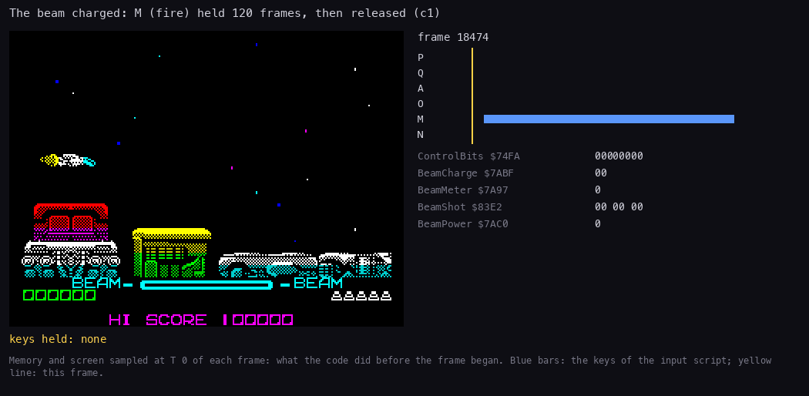

How to read it: the animation from [doc 5, 5.8](05-controls.md#58-the-fire-and-the-beam-charge), with its recording
and command in its caption there; the meter under the play area fills while fire is held.

Worked example: the Force at the tail (ForceAttached 2) and the ship at column 3. The detach key reaches `CP $04` with
A = 3: carry, `RET C`. Nothing happens: the Force cannot be thrown backward off the left edge.

Witness: FireBeam runs from here in every recording; the detach branch `$95CC`-`$95EA` and the recall `$95F3` ran
only in `force` ([doc 5, 5.9](05-controls.md#59-the-detach-key) has the key and the frames): the detach at the tail
at 2156 (state 5), the recall at 2180 (state 6), docked again at 2250.

**The point**: one byte, `NOP` or `RET`, switches all the weapons. The game uses it for the fly-in, the boss's death
and the level's end.

## 10.4 The shot and the charged beam

FireBeam `$9A2C` makes the shot and the beam one control. While fire is held, BeamCharge climbs by 2 a pass. The
shot leaves when fire is let go:

| BeamCharge on release | What fires | BeamShot record | BeamPower |
| --- | --- | --- | ---: |
| below `$0C` | a plain shot (ShotFire, object `$18`), sound `$01` | | |
| `$0C` to `$13` | the beam, kind `$16` | `$16`, row, column | 10 |
| `$14` to `$23` | the beam, kind `$17` | `$17` | 20 |
| `$24` and up | the beam, kind `$18` | `$18` | 30 |

The charge stops at `$3E`: the store is skipped when the next value would be `$40`. At `$0C` the charging sound `$02`
starts. Below `$28` the meter grows one character every 4. With the Force at the nose the beam starts 3 columns
further on. Any release also fires the free Force and the bits ([10.5](#105-the-force-levels-attach-detach-and-its-shots)).

```text
FireBeam:
    if fire held:
        if BeamCharge == $0C: PlaySound($02, $83)
        if BeamCharge + 2 != $40: BeamCharge += 2
        if BeamCharge < $28: grow the meter every 4
        draw the charge sprite at the nose
    elif BeamCharge < $0C: ShotFire(ShipColumn + 1, ShipRow)        # sound $01
    else:                                                           # BeamRelease
        (kind, power) = ($18, 30) if BeamCharge >= $24 else ($17, 20) if BeamCharge >= $14 else ($16, 10)
        BeamShot = kind, ShipRow, ShipColumn (+ 3 if the Force is attached)
        BeamPower = power; PlaySound($05, $43)
    on release: BeamCharge = 0, the meter emptied
```

```asm
FireBeam:
9A2C  LD A,(ControlBits)
9A2F  BIT 4,A
9A31  JR NZ,l_9A45            ; held: charge
9A33  LD A,(BeamCharge)
9A36  CP $0C
9A38  JR NC,BeamRelease
9A3A  LD DE,(ShipColumn)
9A3E  INC E
9A3F  CALL ShotFire           ; a plain shot
9A42  JP l_9AD5
...
9A61  LD A,(BeamCharge)
9A64  INC A
9A65  INC A
9A66  CP $40
9A68  JR Z,l_9A6D             ; full: not stored
9A6A  LD (BeamCharge),A
BeamRelease:
9AA2  LD DE,$181E             ; kind $18, power 30
9AA5  LD A,(BeamCharge)
9AA8  CP $24
9AAA  JR NC,l_9AB6
9AAC  LD DE,$1714             ; kind $17, power 20
9AAF  CP $14
9AB1  JR NC,l_9AB6
9AB3  LD DE,$160A             ; kind $16, power 10
l_9AB6:
9AB6  LD HL,BeamShot
...
9ACB  LD A,E
9ACC  LD (BeamPower),A
9ACF  LD HL,$0543
9AD2  CALL PlaySound
```

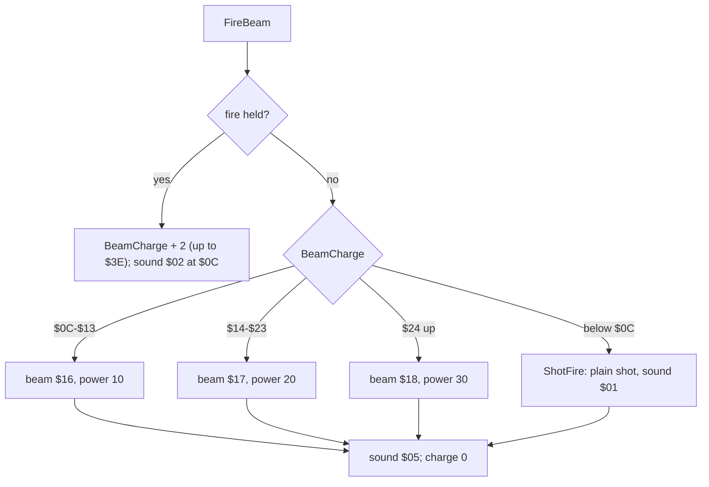

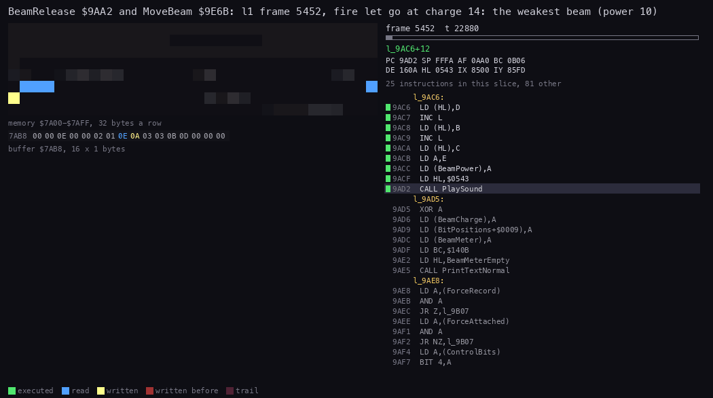

How to read it:

- left, the variables `$7A80-$7AFF` and the 16 bytes from `$7AB8` (BeamShot, BeamCharge, BeamPower);
- right, the code: BeamRelease picks `$160A`, stores the beam, plays `$05`, clears the charge; then MoveBeam moves it.

Recording `l1`, frame 5452, T 22 000 to 66 000, 50 pictures: `python3 ../../kit/routine_anim.py --work
work/docs/rtC/l1 --listing build/game.lst --listing build/level1.lst --window 5452:22000-5452:66000 --out
docs/img/routines/BeamRelease.gif --view buffer:7AB8:16x1:hex --range 7A80-7AFF --pc 9AA2-9AE7,9E6B-A01E --pictures 50`.

Worked example: at frame 5452 BeamCharge is `$0E` (14) when fire is let go. 14 is not below `$0C`, so BeamRelease
runs. It is below `$24` and below `$14`, so DE = `$160A`: beam kind `$16`, BeamPower 10.

Witness: `l1` 5452:22559, BeamRelease, BeamPower 10 in the sample after it.

**The point**: every shot leaves on the release of fire. Tapping fires plain shots; holding it for 6 passes or more
turns the same press into a beam of three strengths.

## 10.5 The Force: levels, attach, detach and its shots

The Force is one of three records, ForceRecord `$7AA8`, +3 and +6, one per ForceLevel; only one is in use. A record
is a state, a column and a row. MoveForce `$95F6` takes the first nonzero one and moves it by its state:

| State | Meaning | Movement |
| ---: | --- | --- |
| 1 | at the nose | column = ShipColumn + 3, row = ShipRow - 1 |
| 2 | at the tail | column = ShipColumn - 3 (drawn mirrored) |
| 3 | hovering in front | holds 13 columns ahead of the ship (ForceTarget, ForceSeek) |
| 4 | launched forward | right until scenery or column `$1D`, then state 7 |
| 5 | launched backward | left until scenery or column 1, then state 3 |
| 6 | recalled | seeks the ship every 4th pass (ForceSeek) |
| 7 | hovering behind | holds behind the ship |

ForceDraw `$97DC` draws it and checks the hits gathered while drawing. A hit tag below 6 is the ship: the Force
docks. It attaches at the nose (1) when the ship is left of it (ShipColumn below the Force's column + 1), else at the
tail (2), and plays `$14`. The other hits go to ProcessHits through AddScoreFlag: the Force hurts what it touches.

```text
MoveForce:
    r = the first of ForceRecord[1..3] with a state
    if r.state == 1: r.place = (ShipColumn + 3, ShipRow - 1)
    elif r.state == 2: r.place = (ShipColumn - 3, ShipRow - 1)
    else: move by the state (3-7)
ForceDraw:
    draw the Force (mirrored at the tail)
    if a gathered hit tag < 6:              # the ship
        ForceAttached = r.state = 1 if ShipColumn < r.column + 1 else 2
        PlaySound($14, $81)
    the other hits: damage the enemies
```

```asm
MoveForce:
95F6  LD A,(ForceRecord)
95F9  AND A
95FA  JR Z,l_9607             ; record 1 empty: try 2, then 3
...
9637  LD BC,(ShipColumn)
963B  CP $01
963D  JR NZ,l_9649
963F  INC C                   ; state 1: the nose
9640  INC C
9641  INC C
l_9642:
9642  DEC B
9643  LD (HL),C
9644  INC L
9645  LD (HL),B
9646  JP ForceDraw
ForceDraw:
97F9  LD A,(HitCount)
97FC  AND A
97FD  JR Z,l_9826
97FF  LD HL,HitList+$0001
9802  LD B,A
l_9803:
9803  LD A,(HL)
9804  CP $06
9806  JR C,l_980D             ; a ship tag: dock
...
l_980D:
980D  POP HL
980E  LD C,(HL)               ; the Force's column
980F  INC C
9810  DEC L
9811  LD A,(ShipColumn)
9814  LD B,$01                ; the nose
9816  CP C
9817  JR C,l_981A
9819  INC B                   ; the tail
l_981A:
981A  LD A,B
981B  LD (HL),A
981C  LD (ForceAttached),A
981F  LD HL,$1481
9822  CALL PlaySound
```

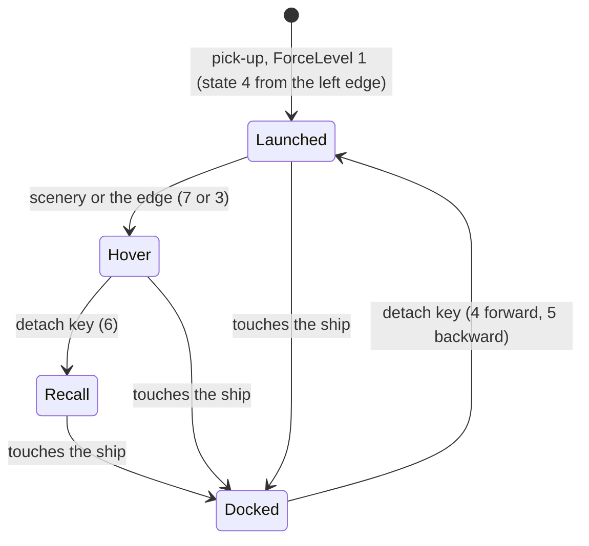

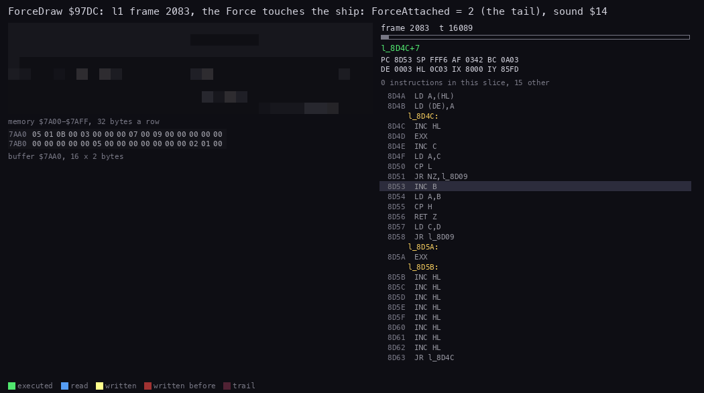

How to read it:

- left, the variables and the 32 bytes from `$7AA0`: ForceAttached at `$7AA3`, the records from `$7AA8`;
- right, ForceDraw: the hit list scanned, a tag below 6 found, the side chosen, `$14` started.

Recording `l1`, frame 2083, T 16 000 to 19 600, 40 pictures: `python3 ../../kit/routine_anim.py --work
work/docs/rtC/l1 --listing build/game.lst --listing build/level1.lst --window 2083:16000-2083:19600 --out
docs/img/routines/ForceDraw.gif --view buffer:7AA0:16x2:hex --range 7A80-7AFF --pc 97DC-9829 --pictures 40`.

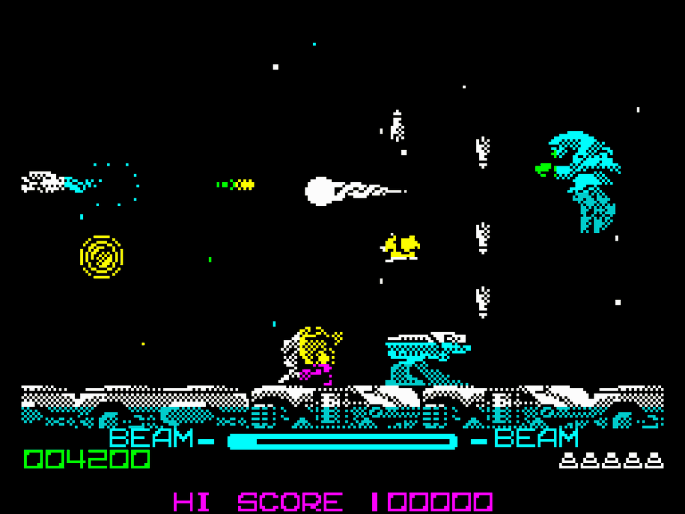

Recording `l1`, frames 2040 to 2100, every second frame: `python3 ../../kit/screen_anim.py --work work/docs/rtC/l1
--from 2040 --to 2100 --step 2 --width 1050 docs/img/play/l1-pickup-force.gif`.

Its shots: on each release of fire ([10.4](#104-the-shot-and-the-charged-beam)) a free Force fires from its own
place (record 1: one shot, record 2: ShotFireDouble, record 3: ShotFireTriple). Docked, the Force fires the weapon of
WeaponKind from ForceLevel 2 (`$9AE8`-`$9C99`): 1 the bouncing laser (BounceShot `$A060`, sound `$18`), 2 the ground
laser (ForceGround `$9C40`, `$1C`), 3 the anti-air shots (MoveAntiAir `$9ED5`, `$16`). Record 2 fires it with
parameter 3 (`$9B27`-`$9B54`: `JP l_9BDE`, `JP l_9C42`, or the ForceShotA/B pair), record 3 in full (`$9B76`: the
`$0F` patches, AntiAirShots, sound `$16`). At ForceLevel 1 a docked Force fires nothing of its own (`$9B07` →
`$9B57` → FireMissiles).

Worked example: at 2083 the Force comes from the left in state 4. The ship is at a column at or above the Force's
column + 1, so B goes to 2: ForceAttached = 2, docked at the tail.

Witness: `l1` 2083:17238 (the `$14` start), ForceAttached 2 in the sample at 2090.

**The point**: the Force is both shield and gun. It docks on whichever side it touches, it kills by contact, and
which side it sits on decides where its weapon fires.

## 10.6 The pick-ups

A pick-up is a carrier enemy (level 1's movers B7-B15) that leaves an item when shot. TakePickup `$98BD` runs when
the ship touches the item. It always plays `$0D` (bits `$83`) and gives 400 points, then acts by the item's kind:

| Kind | Name | Effect |
| ---: | --- | --- |
| 3 | red crystal | WeaponKind 1 (the bouncing laser), ForceLevel + 1 |
| 4 | blue crystal | WeaponKind 2 (the ground laser), ForceLevel + 1 |
| 5 | yellow crystal | WeaponKind 3 (the anti-air), ForceLevel + 1 |
| 6 | shield | ShieldTimer = `$30` and 600 more points |
| 7 | missiles | MissilesOn = 1 |
| 8 | bit | the upper bit; if the upper is on, the lower |
| 9 | bit | the lower bit |

ForceLevel stops at 3. At ForceLevel 1 the Force record starts in state 4 at column 0, row 8: it flies in from the
left. At a higher level the new record takes over the old record's state and place.

The carriers of level 1 and their items:

| Mover | B7 | B8 | B9 | B10 | B13 | B14 | B15 |
| --- | --- | --- | --- | --- | --- | --- | --- |
| Item kind | 8 | 9 | 4 | 3 | 5 | 6 | 7 |

```text
TakePickup(item):
    PlaySound($0D, $83); AddScore(4 in the hundreds)
    kind = item.kind; item.kind = 0
    if kind == 9: lower bit on
    elif kind == 8: upper bit on, or the lower if the upper is on
    elif kind == 7: MissilesOn = 1
    elif kind == 6: ShieldTimer = $30; AddScore(6 in the hundreds)
    else:
        WeaponKind = kind - 2
        ForceLevel = min(ForceLevel + 1, 3)
        if ForceLevel == 1: the Force = state 4, column 0, row 8
        else: the new record = the old one
```

```asm
TakePickup:
98BD  PUSH DE
98BE  LD HL,$0D83
98C1  CALL PlaySound
98C4  LD DE,$0403             ; 4 in the hundreds: 400
98C7  CALL AddScore
98CA  POP HL
98CB  LD A,(HL)
98CC  LD (HL),$00             ; the item is gone
98CE  CP $09
98D0  JP Z,l_9964             ; the lower bit
98D3  CP $08
98D5  JR Z,l_9943             ; a bit
98D7  CP $07
98D9  JR Z,l_993D             ; the missiles
98DB  CP $06
98DD  JR Z,l_9931             ; the shield
98DF  SUB $02
98E1  LD (WeaponKind),A
98E4  LD A,(ForceLevel)
98E7  INC A
98E8  CP $04
98EA  JR Z,l_98EF             ; already 3
98EC  LD (ForceLevel),A
```

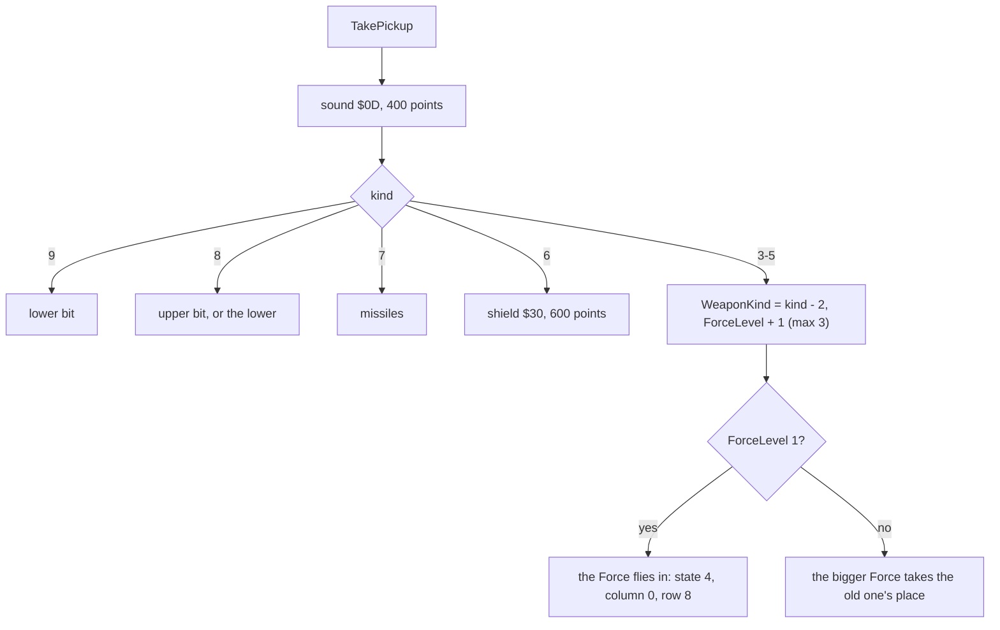

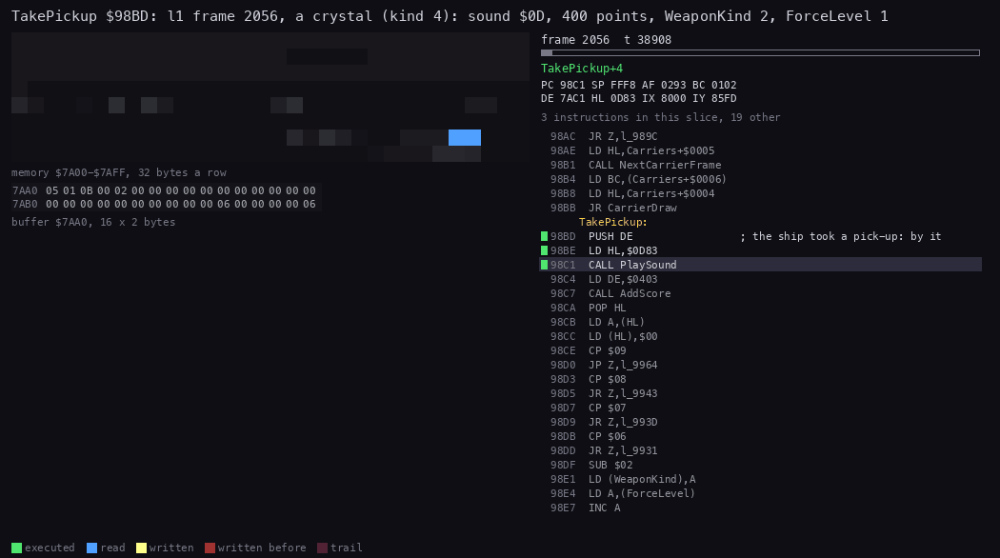

How to read it:

- left, the variables and the 32 bytes from `$7AA0` (WeaponKind `$7ABD`, ForceLevel `$7ABE` in the second row);
- right, TakePickup and AddScore `$C23F` adding the 4 to the hundreds digit.

Recording `l1`, frame 2056, T 38 700 to 47 000, 40 pictures: `python3 ../../kit/routine_anim.py --work
work/docs/rtC/l1 --listing build/game.lst --listing build/level1.lst --window 2056:38700-2056:47000 --out
docs/img/routines/TakePickup.gif --view buffer:7AA0:16x2:hex --range 7A80-7AFF --pc 98BD-9968,C23F-C25D --pictures 40`.

Worked example: the item at 2056 has kind 4. It is not 9, 8, 7 or 6, so WeaponKind = 4 - 2 = 2 and ForceLevel goes
0 → 1. ForceLevel is 1, so the record becomes state 4, column 0, row 8. The Force enters from the left edge and docks
27 frames later ([10.5](#105-the-force-levels-attach-detach-and-its-shots)).

Witness: `l1` 2056:38791; the samples at 2060 (ForceLevel 1, WeaponKind 2), 8450 (the upper bit), 9340 (the
missiles). TakePickup ran 20 times over all the recordings (game.ann, SoundData).

**The point**: every item is worth 400 points, and the crystals stack: a second crystal grows the Force and only
changes the colour of its weapon.

## 10.7 The bits

The two bits are small satellites. MoveBitDevices `$9969` places them on the ship's trail: TrailPoint gives a place
the ship passed a few passes ago; the upper bit sits 4 rows above it, the lower 3 rows below. Each is drawn with an
animated frame (BitFrame) and its hits go to AddScoreFlag, so a bit kills what it touches. FireBits `$9CF2` passes record
3's state (`$7AAE`) to ForceShotA (the upper bit) and ForceShotB (the lower one), and ForceShotFrom `$9D16` returns
unless that state is 1 or 2, ForceAttached is not 0 and WeaponKind is 3: the bits fire only with a docked
ForceLevel 3 Force and the anti-air weapon.

```text
MoveBitDevices:
    if BitUpperOn: p = TrailPoint(); BitPositions[0] = (p.column, p.row - 4); draw; damage the hits
    if BitLowerOn: p = TrailPoint(); BitPositions[1] = (p.column, p.row + 3); draw flipped; damage the hits
FireBits (fire released):
    if record 3 docked (state 1 or 2) and ForceAttached and WeaponKind == 3:
        if BitUpperOn: a shot from BitPositions[0] (ForceShotA)
        if BitLowerOn: a shot from BitPositions[1] (ForceShotB)
```

```asm
MoveBitDevices:
9969  LD A,(BitUpperOn)
996C  AND A
996D  JR Z,l_998C
996F  CALL TrailPoint
9972  DEC D
9973  DEC D
9974  DEC D
9975  DEC D                   ; 4 rows above the trail
9976  LD (BitPositions),DE
...
9986  CALL DrawGame
9989  CALL AddScoreFlag       ; the bit's hits
l_998C:
998C  LD A,(BitLowerOn)
998F  AND A
9990  RET Z
9991  CALL TrailPoint
9994  INC D
9995  INC D
9996  INC D                   ; 3 rows below
```

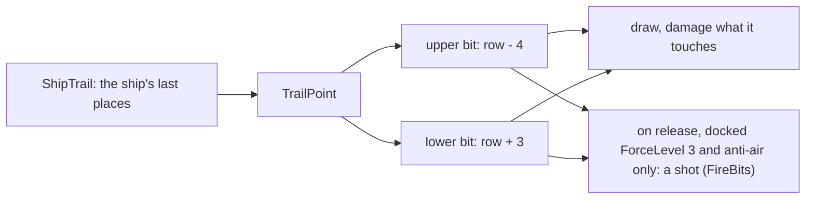

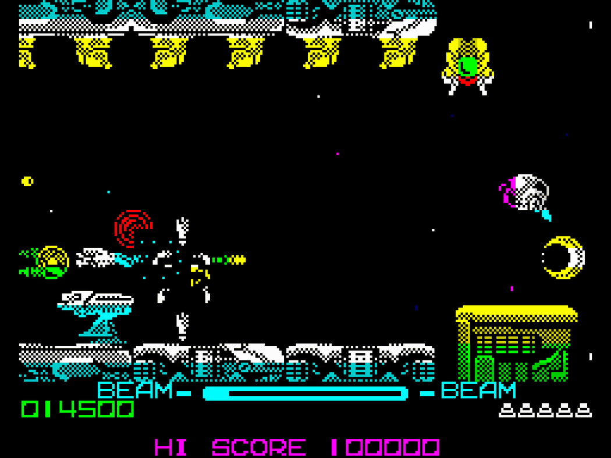

Recording `l1`, frames 8430 to 8478, every second frame: `python3 ../../kit/screen_anim.py --work work/docs/rtC/l1
--from 8430 --to 8478 --step 2 --width 1050 docs/img/play/l1-bits.gif`.

Worked example: the first bit item at `l1` is kind 8 with no bit on: BitUpperOn = 1, and TakePickup fills ShipTrail
with the ship's place so the bit starts at the ship. A second kind 8 would turn on the lower bit.

Witness: `l1`, BitUpperOn 1 from the sample at 8450; the lower bit never came in a recording.

**The point**: the bits follow where the ship was, not where it is, so they swing behind it on a turn.

## 10.8 The missiles

With MissilesOn, FireMissiles `$9C99` launches a pair of missiles whenever MissileTimer is 0 and both launch
records (MissileLaunch `$7AE7`, `$7AED`) are free. It has no caller of its own: it runs at the end of FireBeam's chain
(`JP FireMissiles` at `$9B5B`, `$9B63`, `$9B73`, `$9B86`, `$9B9F`, `$9BC3`), and FireBeam runs only from
ShieldControls (at `$95B3`) while fire is held or on the release pass. It sets MissileTimer to `$20` and plays `$06`. One
missile starts at the ship's row - 1, the other at the row; MoveMissiles `$93D0` moves the two along their frame
lists, turning each toward a target (MoveMissile `$93F0`: they home), and counts MissileTimer down. (MoveMissileSet
`$A01F` moves other records, MissileA-C `$5F00`, `$5F34`, `$5F68`, that StartMissile `$9C2C` fills for the docked
bouncing laser at `$9BDC`.)

```text
FireMissiles (FireBeam's chain: fire held, or the release pass):
    if MissilesOn and MissileTimer == 0 and both launch records free:
        MissileTimer = $20
        launch one at (ShipColumn, ShipRow - 1), one at (ShipColumn, ShipRow)
        PlaySound($06, $81)
MoveMissiles:
    if MissileTimer: MissileTimer -= 1
    for each of the two missiles: MoveMissile (along its frame list, turning toward a target)
```

```asm
FireMissiles:
9C99  LD A,(MissilesOn)
9C9C  AND A
9C9D  JR Z,FireBits
9C9F  LD A,(MissileTimer)
9CA2  AND A
9CA3  JR NZ,FireBits
9CA5  LD A,(MissileLaunch)
9CA8  AND A
9CA9  JR NZ,FireBits
9CAB  LD A,(MissileLaunch+$0006)
9CAE  AND A
9CAF  JR NZ,FireBits
9CB1  LD A,$20
9CB3  LD (MissileTimer),A
...
9CEC  LD HL,$0681
9CEF  CALL PlaySound
```

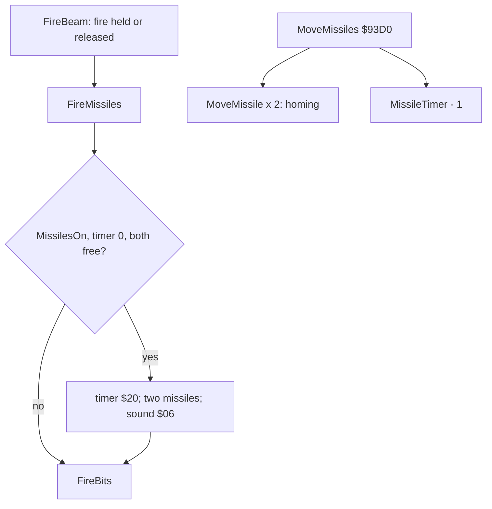

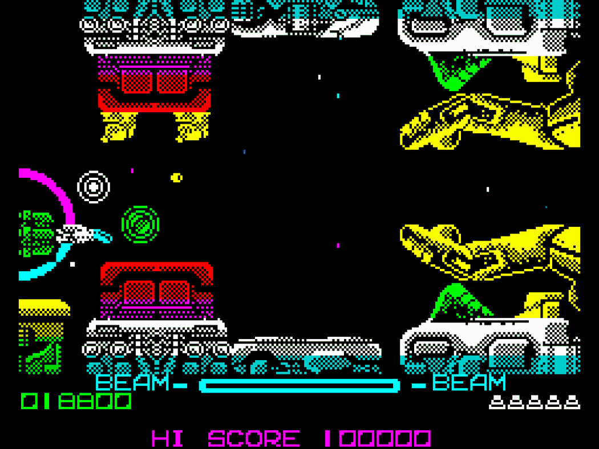

Recording `l1`, frames 9320 to 9380, every second frame: `python3 ../../kit/screen_anim.py --work work/docs/rtC/l1
--from 9320 --to 9380 --step 2 --width 1050 docs/img/play/l1-missiles.gif`.

Worked example: MissileTimer counts down from `$20`. A new pair can leave only when it is 0 and both earlier missiles
are gone, and only in FireBeam's chain: holding fire launches a pair whenever both are free. (With a free
level 1 Force and fire held, `$9AF9` jumps over FireMissiles to FireBits.)

Witness: `l1`, MissilesOn 1 from the sample at 9340; FireMissiles started `$06` 482 times over the recordings.

**The point**: the missiles ride on the fire key: holding it keeps launching homing pairs, with no aiming.

## 10.9 The shield

ShipShield `$9577` runs every pass after MoveShip. While ShieldTimer is above 0 it counts it down and draws object
`$62` around the ship, flipped on alternate frames. A new life starts with ShieldTimer `$20` (StartPlay `$8BAE`, its `$20` branch at `$8BD3`; `$38` on the first
play); the shield item sets it to `$30`.

No test reads ShieldTimer but ShipShield. The nose test and the hit test run before it in MoveShip, and the enemy
shots test the ship's tags without it. So the shield is drawn, and the ship can still die under it.

```text
ShipShield:
    if ShieldTimer:
        ShieldTimer -= 1
        draw object $62 at (ShipColumn - 2, ShipRow), flipped on odd frames
    ShieldControls()
```

```asm
ShipShield:
9577  LD A,(ShieldTimer)
957A  AND A
957B  JR Z,ShieldControls
957D  DEC A
957E  LD (ShieldTimer),A
9581  LD BC,(ShipColumn)
9585  DEC C
9586  DEC C
9587  LD A,$62
9589  CALL GameObject
958C  LD A,(FrameCounter)
958F  AND $01
9591  ADD A,$45
9593  LD (CellMark+$000F),A
9596  CP $45
9598  JR Z,l_959F
959A  CALL DrawSprite
959D  JR l_95A2
l_959F:
959F  CALL DrawSpriteFlipped
```

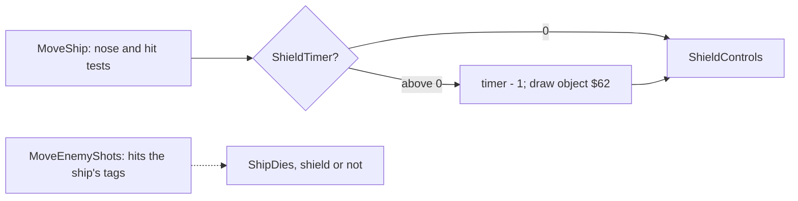

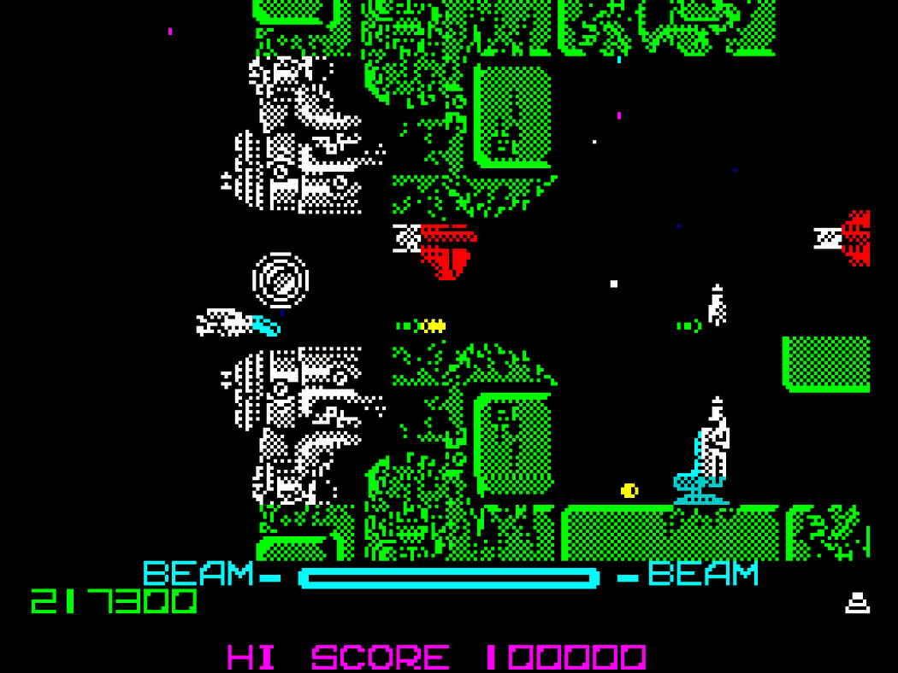

Recording `deaths-l7`, frames 8350 to 8384, every frame: `python3 ../../kit/screen_anim.py --work work/docs/rtC/d7
--from 8350 --to 8384 --step 1 --width 1050 docs/img/play/d7-shield-death.gif`.

Worked example: the samples read ShieldTimer 47 at 8360 and 45 at 8370, two counts in 10 frames: one count a pass of
about 5 frames. At 8376 the ship dies to an enemy shot (`$C3CE`) with the timer still at about 44.

Witness: `deaths-l7`, the death at 8376:45567 through `$C3CE`, ShieldTimer 45 in the sample at 8370.

**The point**: the shield in this version does not protect. It is a picture and 600 points.

## 10.10 The enemies, the waves and the bosses of each level

The enemies come from each level's wave script and kind records. [Doc 7](07-objects.md) decodes them in full:
the script and its commands (7.3), every level's waves (7.4), the kind record (7.5), the movers (7.8). Here is what
they mean for play:

| Level | Kinds | Waves | Indestructible kinds | Kinds that fire | Shooter limits | The boss |
| ---: | ---: | ---: | ---: | ---: | --- | --- |
| 1 | 46 | 227 | 9 | 15 | 0, 4 | parts blown at MapColumn 115; a tail of 14 segments |
| 2 | 46 | 248 | 24 | 1 | 0 | 16 hits, then BossDestroyed; heartbeat sounds `$10`-`$13` |
| 3 | 42 | 50 | 7 | 9 | 28 | a big ship placed by 42 commands 3; BossDestroyed |
| 4 | 54 | 203 | 7 | 10 | 2, 4 | movers set MapColumn |
| 5 | 60 | 207 | 1 | 9 | 4 | movers set MapColumn |
| 6 | 57 | 112 | 1 | 24 | 8 | 27 kinds of 12 hits |
| 7 | 53 | 213 | 3 | 25 | 8, 4 | BossDestroyed; command `$5D` |
| 8 | 48 | 70 | 21 | 0 | 0 | BossDestroyed, then MapColumn; three level ends |

A boss is not one object. The wave script halts the scroll (command 1), places the boss's parts in fixed slots
(command 3), and its later entries come by time while the screen stands. A boss dies one of two ways:

- by time or by a level mover: level 1's core (mover A8) frees and explodes its parts at MapColumn 115, whatever the
  player did;
- by BossDestroyed `$C19C`: WavesHalted, ScrollHalted and BossBlast set, ShipDies and ShieldControls patched to `RET`
  (the ship cannot die or fire), then BossBlastOnce explodes it at the places NextRandom draws
  ([doc 7, 7.10](07-objects.md#710-the-random-numbers)). The blast's end sets LevelEndTimer `$3F`.

```text
BossDestroyed:
    WavesHalted = BossBlast = ScrollHalted = 1; BossBlastCount = $80
    ShipDies[3] = RET; ShieldControls = RET; RandomPtr = 0
    every nonzero SolidMap cell = $FF
BossBlast (each pass, from the interrupt chain):
    explode at the next NextRandom cell of $80 or more
    when the sweep reaches row 18: BossBlast = 0; LevelEndTimer = $3F
```

```asm
BossDestroyed:
C19C  LD A,$01
C19E  LD (WavesHalted),A
C1A1  LD (BossBlast),A
C1A4  LD (ScrollHalted),A
C1A7  LD A,$80
C1A9  LD (BossBlastCount),A
...
C1B2  LD A,$C9
C1B4  LD (ShipDies+$0003),A   ; the ship cannot die
C1B7  LD (ShieldControls),A   ; nor fire
C1BA  LD HL,$0000
C1BD  LD (RandomPtr),HL
l_C18C:
C18C  XOR A
C18D  LD (BossBlast),A
C190  LD A,$3F
C192  LD (LevelEndTimer),A    ; the level ends 32 passes later
```

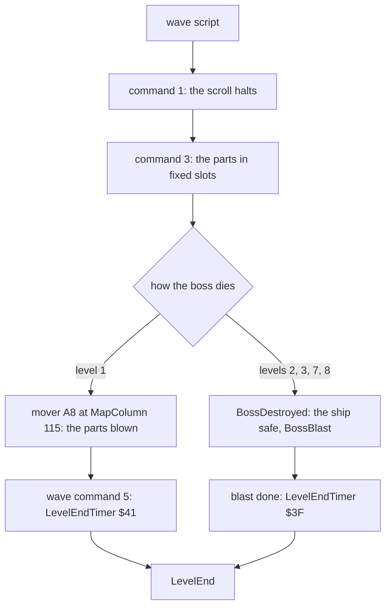

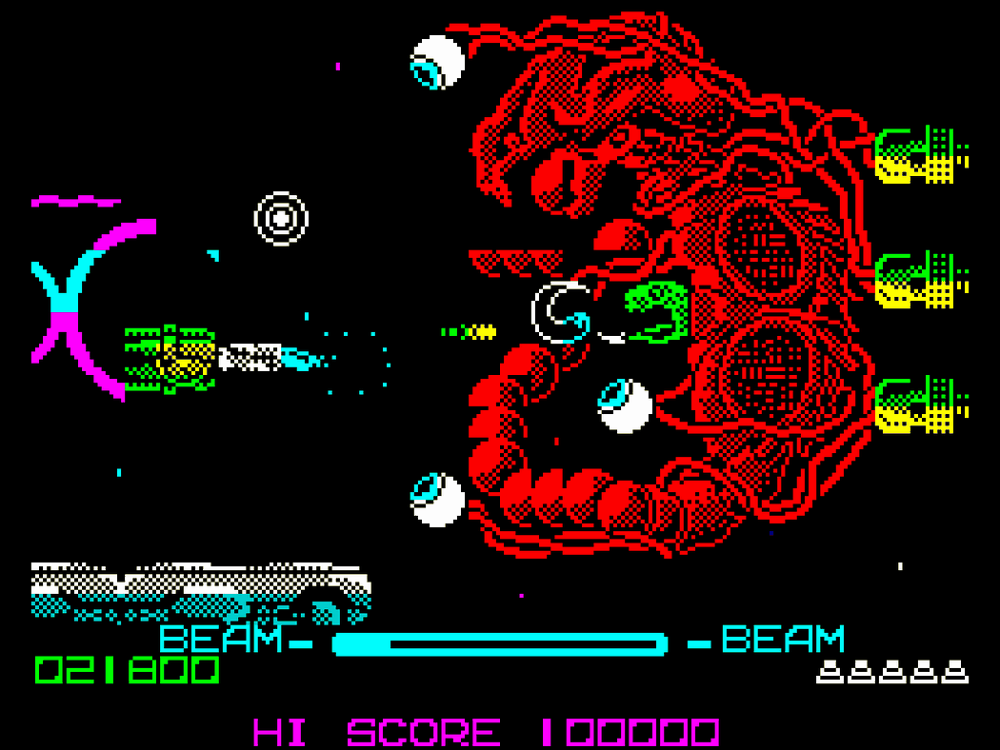

Recording `l1`, frames 13 500 to 13 600, every fourth frame: `python3 ../../kit/screen_anim.py --work
work/docs/rtC/l1 --from 13500 --to 13600 --step 4 --width 1050 docs/img/play/l1-boss-blast.gif`. The code of the same
moment is [L1MoverA8.gif](img/routines/L1MoverA8.gif) in [doc 7, 7.8](07-objects.md#78-the-movers-the-levels-own-code).

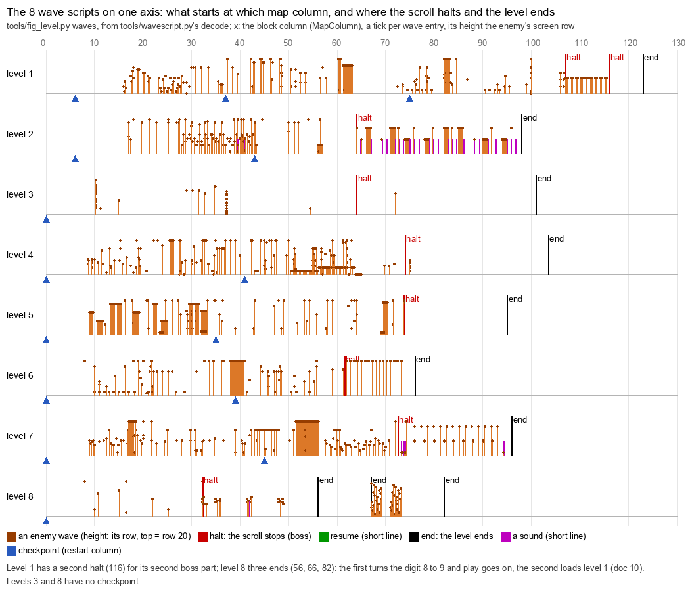

Drawn by `python3 tools/fig_level.py waves docs/img/levels/waves.png` (from the level blocks, no recording).

Worked example: level 1's boss halts the screen at MapColumn 107 (frame 12 050 of `l1`). The core's mover A8 waits
for MapColumn 115 (frame 13 518) and blows the parts in slots 20-23, each with an explosion but no points (L1BlastRecord never calls AddScore): the boss "dies" by the
clock, 1468 frames after the halt.

Witness: `l1` 13518 (L1MoverA8). BossDestroyed ran only in `boss` (the integration's recording, `l1`'s keys from c1's
play start): at 10 856 the tail (mover A9) is out with slot 2's flags `$20`; slot 2's hits were POKEd to 1, but the
shots did not reach it in 1500 frames, so at 12 374 slot 2 was POKEd free (`$850A` = 0). At 12 375 mover A9's
`$F5A1` called BossDestroyed `$C19C` once; BossBlastOnce then ran its random explosions (`$C134` 156 times, each with
sound `$09` or `$0A`) and its sweep (`$C164` 586 times) up to 12 995. The kill is POKEd; everything after it is the
game's own code. No recording killed a boss by hits.

**The point**: R-Type's bosses are timed set pieces. On level 1 the boss ends when the map's clock says so.

## 10.11 Collisions and the three death paths

The ship dies by one of three tests. All three jump to ShipDies `$91F2`:

| Path | Where | Test | `deaths-l7` |
| --- | --- | --- | ---: |
| scenery ahead | `$956D`, MoveShip | GetCell at (ShipColumn + 3, ShipRow) returns no carry: a solid cell at the nose | 4 |
| something under the ship | `$9574`, MoveShip | HitCount not 0: the ship's draw found a taken cell under one of its cells, an enemy's or scenery (`$FF`) | 1 |
| an enemy shot | `$C3CE`, MoveEnemyShots | the shot's cell holds a tag below 6: the ship | 3 |

The tags come from the drawing: each sprite marks its cells, and a draw over a marked cell adds a hit
([doc 7, 7.9](07-objects.md#79-collision-solidmap-tags-and-the-hit-gathering)).

ShipDies clears the hits, takes a life, plays `$09`, puts explosion `$28` at the ship, sets DeathTimer `$20` and
clears every weapon, shot and enemy shot (ClearShipStuff).

```text
MoveShip, after the move:
    if GetCell(ShipColumn + 3, ShipRow) is solid: ShipDies      # $956D
    if HitCount: ShipDies                                       # $9574: enemy or scenery cells
MoveEnemyShots, per shot:
    if the cell's tag < 6: ShipDies                             # $C3CE
ShipDies:
    ClearHits; Lives -= 1
    PlaySound($09, $83); explosion $28 at the ship; DeathTimer = $20
    zero ShipColumn..+$55, EnemyShots (+$6D), ShipShots (+$10D)
```

```asm
9563  LD BC,(ShipColumn)
9567  INC C
9568  INC C
9569  INC C                   ; the nose
956A  CALL GetCell
956D  JP NC,ShipDies          ; scenery ahead
9570  LD A,(HitCount)
9573  AND A
9574  JP NZ,ShipDies          ; something under the ship: an enemy or scenery
ShipDies:
91F2  CALL ClearHits
91F5  NOP                     ; RET: the ship cannot die
91F6  LD HL,PlayAttrs+$01A0
91F9  INC H                   ; Lives at $7AA0
91FA  LD B,$14
91FC  LD C,$01
91FE  DEC (HL)
91FF  LD HL,$0983
9202  CALL PlaySound
...
9213  LD A,$20
9215  LD (DeathTimer),A
ClearShipStuff:
9218  LD HL,ShipColumn
921B  LD BC,$0055
921E  CALL ClearBlock
```

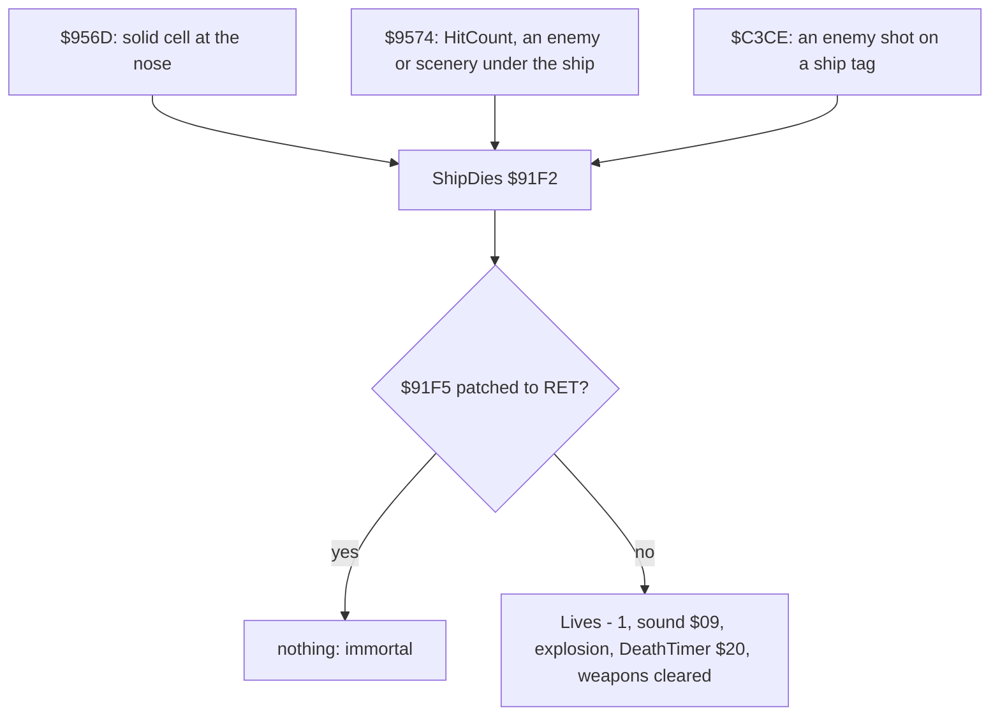

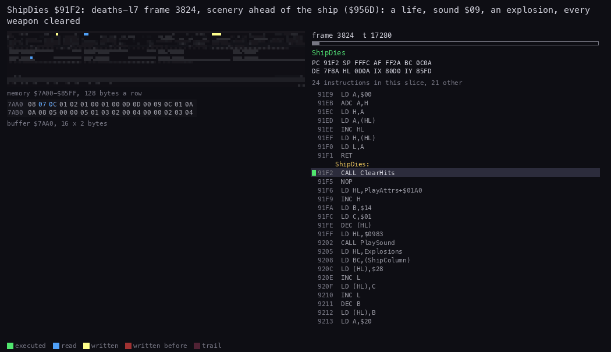

How to read it:

- left, the variables `$7A80-$85FF` and the 32 bytes from `$7AA0` (Lives, ShipColumn, the weapons);
- right, the nose test at `$9563`, GetCell, then ShipDies and ClearShipStuff zeroing the bytes.

Recording `deaths-l7`, frame 3824, T 16 900 to 32 100 (634 instructions), 40 pictures: `python3
../../kit/routine_anim.py --work work/docs/rtC/d7 --listing build/game.lst --listing build/level7.lst --window
3824:16900-3824:32100 --out docs/img/routines/ShipDies.gif --view buffer:7AA0:16x2:hex --range 7A80-85FF --pc
9563-9576,C0E4-C0F8,91F2-9233 --pictures 40`.

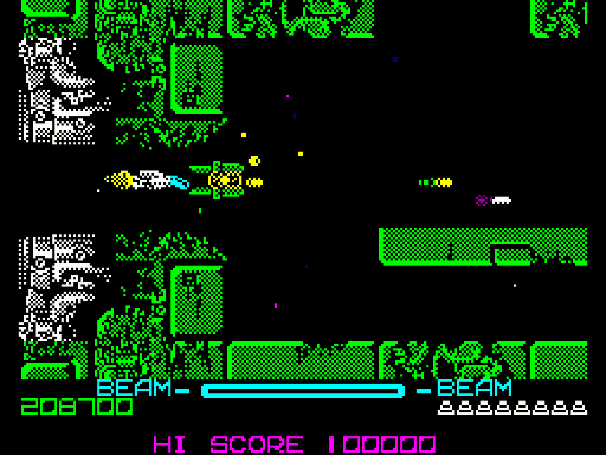

Recording `deaths-l7`, frames 3814 to 3874, every second frame: `python3 ../../kit/screen_anim.py --work
work/docs/rtC/d7 --from 3814 --to 3874 --step 2 --width 1050 docs/img/play/d7-death-wall.gif`.

Worked example: at 3824 the ship's nose cell (ShipColumn + 3) is scenery: GetCell returns no carry and `$956D` jumps
to ShipDies at T 17 111. ClearShipStuff starts at T 18 361 and returns at T 32 069. The first death of the recording
also lost ForceLevel 3, WeaponKind 2, the bits and the missiles.

Witness: `deaths-l7` (8390 frames, lives 8 → 0), the deaths by path (frame:T):

| Path | Deaths |
| --- | --- |
| `$956D` scenery | 3824:17111, 6065:7070, 6792:14220, 7528:18071 |
| `$9574` under the ship | 5203:60884 (tag `$82`, enemy slot 2) |
| `$C3CE` a shot | 4353:9936, 4782:52111, 8376:45567 |

The scenery kills through both tests. MoveShip draws the ship with DrawGame `$99FE`, whose DrawPrepare turns the hit
gathering on, and CollectHit `$8EDB` stores any nonzero SolidMap tag, scenery's `$FF` included. At 3824 and 6065 the
ship's draw gathered `$FF` tags too, but the nose test came first. In `l2` at 8978 and 8990 (ShipDies made harmless
there by the recording's POKE) the nose cell was free and `$9574` fired on HitCount 3: `$FF`, `$FF` and `$82`.
Witness: the traces `work/docs/rtC/d7/traces/` and `work/docs/rtC/l2/traces/8976_0-8996_0.uatr`, the instruction
at `$8EEC` (CollectHit's store) between `$9560` and `$9563`.

**The point**: the whole ship touches the scenery, not just the nose. The nose test only looks one cell ahead; any
ship cell drawn over scenery is gathered as a hit, and the ship dies on it.

## 10.12 Death, lives and continues

After ShipDies the ship is gone (ShipColumn 0) and LoseLife `$924B` counts DeathTimer down once a pass. At `$18` a
second, bigger explosion (`$48`) and sound `$0A`. At 0, LoseLifeNow `$9269`: Silence, the stars off, the HUD redrawn,
ClearShipStuff. Then:

- lives left: PILOT STAND BY, and StartLife at the last restart point;
- no lives: MissionOver (sounds `$1B` and `$1A`, MISSION OVER), a wait of `$60` frames, the best pilots check, then
  the continue.

CreditDigit holds the continues as a character, '5' at the start. If it is not '1', it goes down by one and Continue
counts down (sound `$22` each step). A continue keeps the level: NewGameState sets 5 lives, ExtraLives 0 and the
score to 000000, and play restarts on the same level. With no continue left (or none taken), CreditDigit goes back
to '5' and the game restarts at level 1, loading it first if another level is in memory.

```text
LoseLife (each pass):
    if DeathTimer == 0: return
    DeathTimer -= 1
    if DeathTimer == $18: PlaySound($0A, $83); explosion $48
    if DeathTimer == 0:
        Silence; StarsOff; DrawHud; ClearShipStuff
        if Lives: PilotStandBy; StartLife
        else:
            MissionOver; wait $60; CheckHiScore
            if CreditDigit != '1':
                CreditDigit -= 1
                if Continue(): NewGameState; StartLife       # same level, score 0, 5 lives
            CreditDigit = '5'
            if LevelDigit != '1': LevelDigit = '0'; LoadLevel   # the loader adds 1
            NewGame
```

```asm
LoseLife:
924B  LD A,(DeathTimer)
924E  AND A
924F  RET Z
9250  DEC A
9251  LD (DeathTimer),A
9254  JR Z,LoseLifeNow
9256  CP $18
9258  RET NZ
9259  LD HL,$0A83
925C  CALL PlaySound
LoseLifeNow:
9269  CALL Silence
...
9278  LD HL,PlayAttrs+$01A0
927B  INC H
927C  LD A,(HL)                ; Lives
927D  AND A
927E  JR NZ,l_92BE            ; lives left
...
928E  LD A,(CreditDigit)
9291  CP $31
9293  JR Z,l_92A4             ; '1': no continue
9295  DEC A
9296  LD (CreditDigit),A
9299  CALL Continue
929C  JR Z,l_92A4
929E  CALL NewGameState
92A1  JP StartLife
l_92A4:
92A4  LD HL,CreditDigit
92A7  LD (HL),$35             ; '5'
```

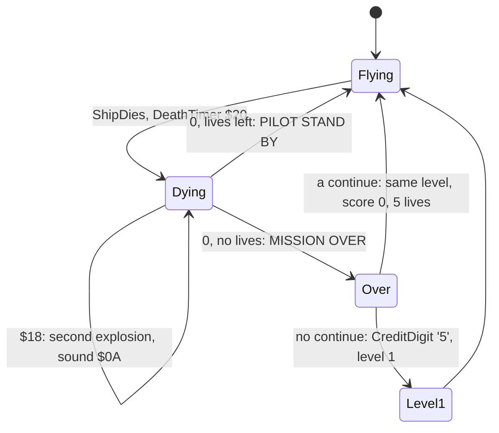

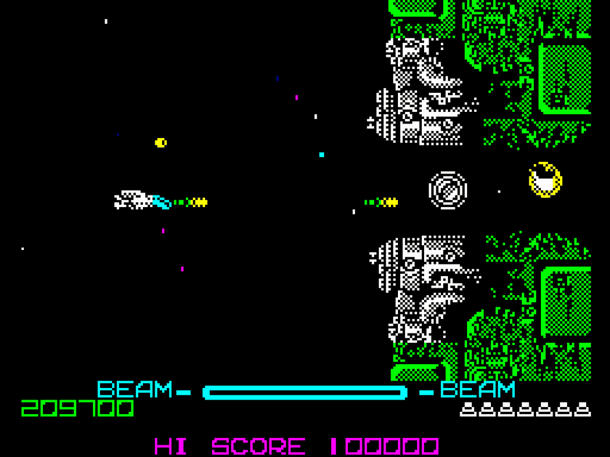

Recording `deaths-l7`, frames 4340 to 4372, every frame: `python3 ../../kit/screen_anim.py --work work/docs/rtC/d7
--from 4340 --to 4372 --step 1 --width 1050 docs/img/play/d7-death-shot.gif`. The lives counter and the PILOT STAND
BY message are in [life-lost.gif](img/play/life-lost.gif), [doc 1, 1.5](01-game-design.md#15-the-rules).

Worked example: the shot death at 4353 sets DeathTimer `$20`. A pass takes about 4.7 frames, so the second explosion
(at `$18`, 8 passes) comes some 38 frames later and LoseLifeNow some 150 frames after the hit. The lives counter in
the samples drops at 4360, right after ShipDies.

Witness: `deaths-l7`, Lives `$7AA0` in the samples: 8 → 7 at 3830, 6 at 4360, 5 at 4790, 4 at 5210, 3 at 6070, 2 at
6800, 1 at 7530, 0 at 8380. The continue path is in `continue` and `gameover` (Continue started `$22` 21 times).

**The point**: a continue gives back the level and 5 lives, but not the score or the weapons; giving up sends the
player to level 1, even if a level 8 was reached.

## 10.13 The score and the extra lives

The score is 6 digit characters, ScoreText. AddScore `$C23F` takes D = the amount and E = the digit (1 the units,
3 the hundreds, 5 the ten-thousands) and adds with a decimal carry. E = 0 adds nothing.

| Points | Source |
| --- | --- |
| 100-1000 | an enemy killed, by its score byte's low nibble (ScoreAwards: 1-9 → 100-900, 10 → 1000) |
| 400 | any pick-up |
| 600 | the shield item, on top of the 400 |
| 1500 | level 1's boss hit (L1BossHit) |
| 3000 | level 1's tail destroyed (mover A9) |

CheckExtraLife `$FDA5` runs when the score changed. It prints the score and gives a life:

- at 50 000: the ten-thousands digit reads '5' and ExtraLives is 0;
- then at each 100 000: the hundred-thousands digit equals ExtraLives (100 000, 200 000, ...).

It adds 1 to Lives and ExtraLives and plays `$0E`.

```text
AddScore(D, E):
    if E == 0: return
    i = 6 - E; ScoreText[i] += D
    while ScoreText[i] > '9': ScoreText[i] -= 10; i -= 1; ScoreText[i] += 1
CheckExtraLife:
    if not ScoreChanged: return
    print the score
    if (ScoreText[1] == '5' and ExtraLives == 0) or (ExtraLives and ScoreText[0] - '0' == ExtraLives):
        ExtraLives += 1; Lives += 1; DrawHud; PlaySound($0E, $83)
```

```asm
AddScore:
C23F  LD A,E
C240  AND A
C241  RET Z                   ; 0: nothing
C242  LD (ScoreChanged),A
C245  LD HL,ScoreText
C248  LD A,E
C249  XOR $07
C24B  DEC A
C24C  LD E,A                  ; the digit's offset: 6 - E
C24D  LD A,D
C24E  LD D,$00
C250  ADD HL,DE
l_C251:
C251  ADD A,(HL)
C252  LD (HL),A
C253  CP $3A
C255  RET C
C256  SUB $0A
C258  LD (HL),A
C259  DEC HL
C25A  LD A,$01                ; the carry
C25C  JR l_C251
CheckExtraLife:
FDC3  LD A,(IX+$01)           ; the ten-thousands digit
FDC6  CP $35
FDC8  JR NZ,l_FDCE
FDCA  LD A,(HL)               ; ExtraLives
FDCB  AND A
FDCC  JR Z,l_FDDA             ; 50 000
l_FDCE:
FDCE  LD A,(HL)
FDCF  AND A
FDD0  JR Z,ExtraLifeNone
FDD2  LD A,(IX+$00)           ; the hundred-thousands digit
FDD5  SUB $30
FDD7  CP (HL)
FDD8  JR NZ,ExtraLifeNone
l_FDDA:
FDDA  INC (HL)                ; ExtraLives
FDDB  POP HL
FDDC  INC (HL)                ; Lives
```

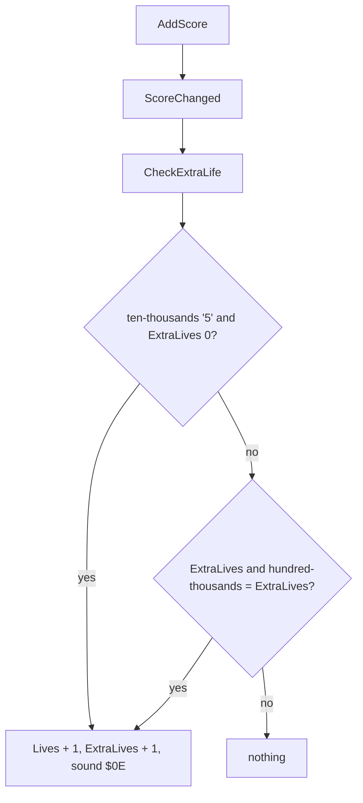

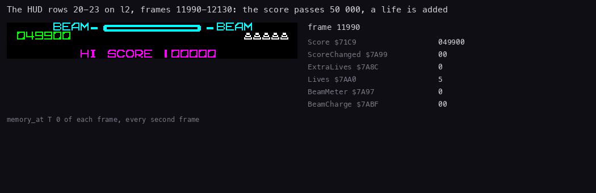

How to read it: the animation from [doc 8, 8.5](08-hud-and-text.md#85-the-score-and-the-extra-lives), with its
recording and command in its caption there.

Worked example: TakePickup's DE = `$0403`: E = 3, 3 XOR 7 = 4, minus 1 = 3, so ScoreText+3, the hundreds digit,
gets 4: 400 points. At 50 000 with ExtraLives 0 a life comes and ExtraLives = 1. At 100 000 the first digit is '1'
= ExtraLives: a life, ExtraLives = 2; at 200 000 the next.

Witness: ExtraLifeSound ran 6 times over the recordings; `deaths-l7` has 8 lives at its start and 208 700 points at frame 3814,
which matches 5 lives plus those of 50 000, 100 000 and 200 000.

**The point**: the extra lives follow the score's printed digits, not a number: the game reads its own HUD text.

## 10.14 The level end and the wrap

A level ends when LevelEndTimer is set: wave command 5 sets it to `$41` (and WavesHalted), the end of a boss blast
to `$3F`. LevelEnd `$C25E` runs each pass. It patches ShieldControls to `RET` (no fire), counts the timer down and
acts when (timer - 1) AND `$1F` is 0: at once for `$41`, after 31 passes for `$3F`.

What it does depends on LevelDigit:

- '8' (the first end of level 8): the digit becomes '9', the waves run again, and ShipDies is patched to `RET`. Play
  goes on, the ship immortal;
- '9' (the next end): the digit becomes '0', then the normal end, so the loader loads level 1 (it adds 1 to the
  digit): the wrap;
- any other: the normal end: ScrollRows, the stars off, the end tune `$15`, Wait256, LoadLevel (the next level from
  tape), the restart point. If the player has a Force, it comes back docked at the nose (state 1, column `$0D`, row
  9), and StartLife.

```text
LevelEnd (each pass):
    if LevelEndTimer == 0: return
    ShieldControls = RET
    LevelEndTimer -= 1
    if LevelEndTimer & $1F: return
    if LevelDigit == '8':
        LevelDigit = '9'; WavesHalted = 0; LevelEndTimer = 0; ShipDies[3] = RET; return
    if LevelDigit == '9': LevelDigit = '0'
    ScrollRows; StarsOff; PlaySound($15, $83); LevelEndTimer = 0
    Wait256; LoadLevel; RestartPoint
    if ForceLevel: the Force = state 1 at (13, 9); ForceAttached = 1
    StartLife
```

```asm
LevelEnd:
C25E  LD A,(LevelEndTimer)
C261  AND A
C262  RET Z
C263  LD HL,ShieldControls
C266  LD (HL),$C9             ; no fire
C268  DEC A
C269  LD (LevelEndTimer),A
C26C  AND $1F
C26E  RET NZ
C26F  LD A,(LevelDigit)
C272  CP $38
C274  JR NZ,l_C287            ; not '8'
C276  INC A
C277  LD (LevelDigit),A       ; '9'
C27A  XOR A
C27B  LD (WavesHalted),A
C27E  LD (LevelEndTimer),A
C281  LD A,$C9
C283  LD (ShipDies+$0003),A   ; immortal
C286  RET
l_C287:
C287  CP $39
C289  JR NZ,l_C290
C28B  LD A,$30
C28D  LD (LevelDigit),A       ; '9' to '0': the wrap
l_C290:
C290  CALL ScrollRows
C293  CALL StarsOff
C296  LD HL,$1583
C299  CALL PlaySound
...
C2A0  CALL Wait256
C2A3  CALL LoadLevel
```

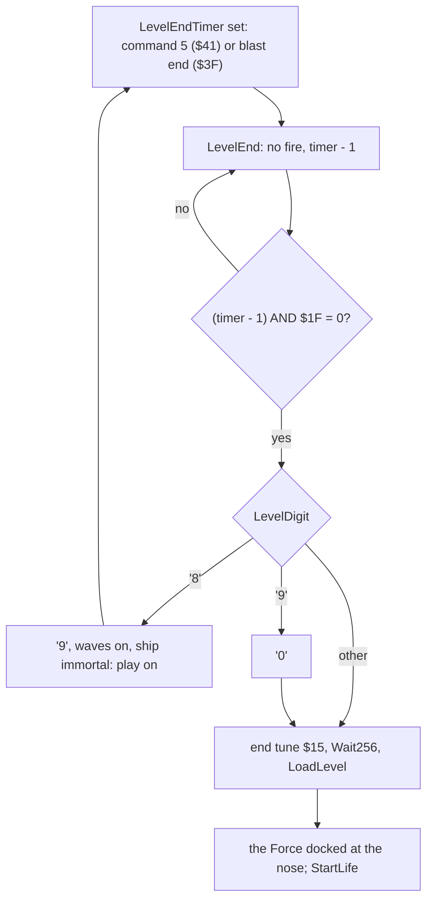

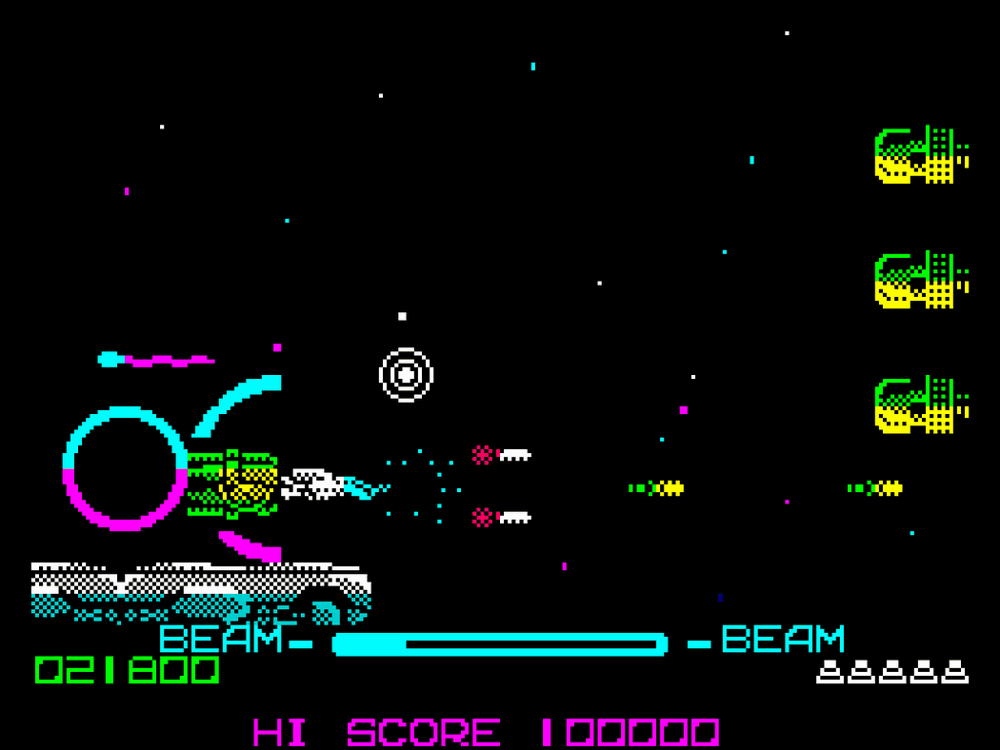

Recording `l1`, frames 14 560 to 14 860, every sixth frame: `python3 ../../kit/screen_anim.py --work
work/docs/rtC/l1 --from 14560 --to 14860 --step 6 --width 1050 docs/img/play/l1-level-end.gif`. Identical frames are
merged, so the GIF holds 10 pictures.

Worked example: in `l1` wave command 5 sets WavesHalted and LevelEndTimer to `$41` at MapColumn 123 (the sample at
14 600 reads WavesHalted 65). LevelEnd's first call makes it `$40`; `$40` AND `$1F` is 0, so it acts in the same pass:
LevelDigit is '1', so the normal end runs and LevelEndTimer reads 0 in every later sample.

Witness: `l1` from frame 14 600; level 8's three ends (MapColumns 56, 66 and 82, [doc 7, 7.12](07-objects.md#712-what-differs-between-the-8-levels))
and `ending` frame 1808, SEARCHING FOR R TYPE LEVEL 1 after level 8
([ending-001808-searching-level1.png](img/play/ending-001808-searching-level1.png)).

**The point**: there is no ending. Level 8's first end makes the ship immortal for the rest of the level, and its
second end loads level 1 with the score and the lives kept: the game wraps.

## 10.15 The notable features

- **Every shot leaves on release.** Fire held charges; letting go fires a shot, a beam and the Force's shot at once (the bits'
  shots only with a docked ForceLevel 3 Force and the anti-air weapon) ([10.4](#104-the-shot-and-the-charged-beam)).
- **The Force docks on either side**, by where it touches ([10.5](#105-the-force-levels-attach-detach-and-its-shots)).
- **The shield does not protect** ([10.9](#109-the-shield)).
- **One patched byte switches the weapons** (ShieldControls) and **one switches death** (ShipDies+3): the boss's
  death, the level's end and level 8 use them.
- **The bosses are clocks**: the scroll halts but the map columns count on, and level 1's boss ends at MapColumn 115.
- **The extra lives read the HUD text** ([10.13](#1013-the-score-and-the-extra-lives)).
- **The sound slows the game**: three explosions take 44 % of each frame ([doc 9, 9.8](09-sound.md#98-the-cost-the-12-frame-pass)).


The figure is the one of [10.2](#102-the-weapon-state-over-a-level), drawn by `python3 tools/fig_objects.py vars
work/docs/rtC/l1-vars.jsonl docs/img/objects/l1-vars.png`.

```text
the patched bytes of play:
    ShieldControls $95A5: NOP (weapons on) / RET (off): fly-in end, LevelEnd, BossDestroyed; ClearPlayState: NOP
    ShipDies+3 $91F5:     NOP (mortal) / RET (immortal): LevelEnd at '8', BossDestroyed; ClearPlayState: NOP
```

```asm
ClearPlayState:
86F5  XOR A
86F6  OUT ($FE),A
86F8  LD (ShieldTimer),A
86FB  LD (TaskTable+$0016),A
86FE  LD (ShieldControls),A   ; NOP: the weapons on
8701  LD (Shooters),A
8704  LD (MissileTimer),A
8707  LD (ShipDies+$0003),A   ; NOP: the ship mortal
```

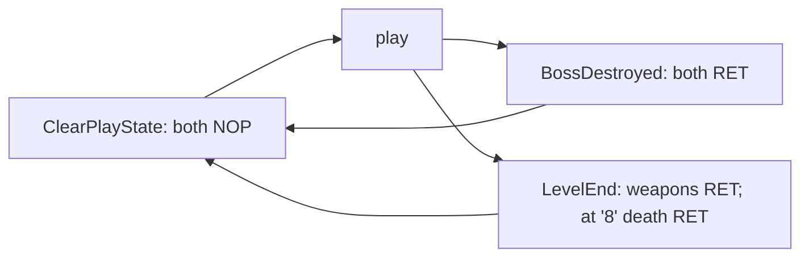

Worked example: after level 8's first end the ship is immortal until the next ClearPlayState, which comes with the
next level's start (level 1 after the wrap).

Witness: the `lN` recordings use the same trick from outside: their POKE `$91F2` = `$C9` makes ShipDies return at
its first byte.

**The point**: the game's state switches are code bytes, not flags: cheap to test, and easy to POKE.

## 10.16 Notes and what is known only from the code

- **Known only from the code**: the lower bit; L1BossHit; level 8's immortal stretch. The detach and the recall
  (`force`) and BossDestroyed with the boss blast (`boss`, the kill POKEd) have their recordings now (10.3, 10.10).
- **Kind 9 is the lower bit**, kind 8 the upper one (or the lower one when the upper is on).
- **The beam never reaches `$40`**: the charge stops at `$3E`; the strongest beam needs `$24`.
- **A kill with no free explosion record** skips AwardScore and adds the caller's DE as points (doc 7, 7.13).
- **ScoreAwards entry 12** reads zeros: a kind with score nibble 12 gives no points.
