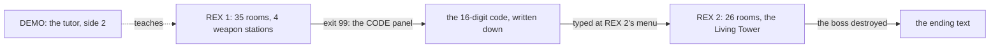
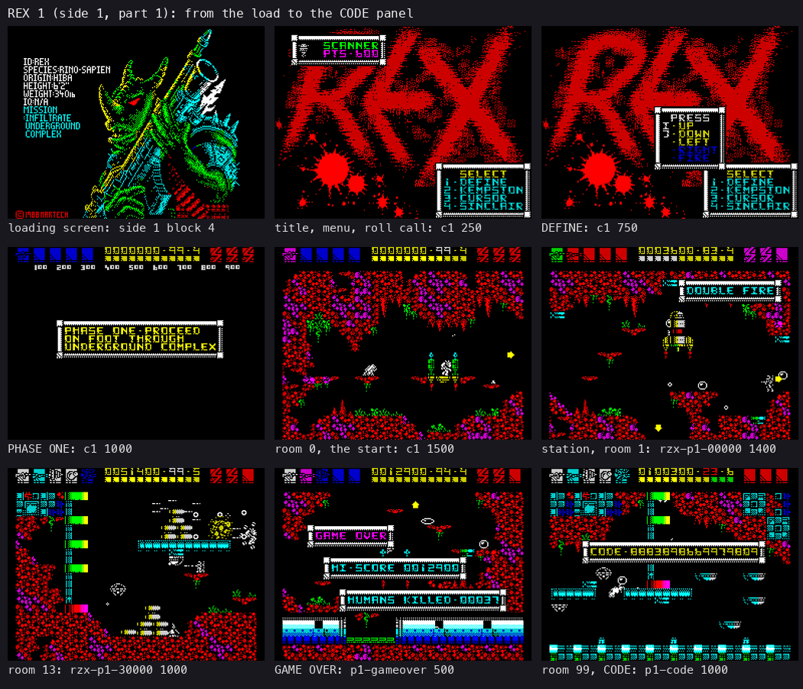
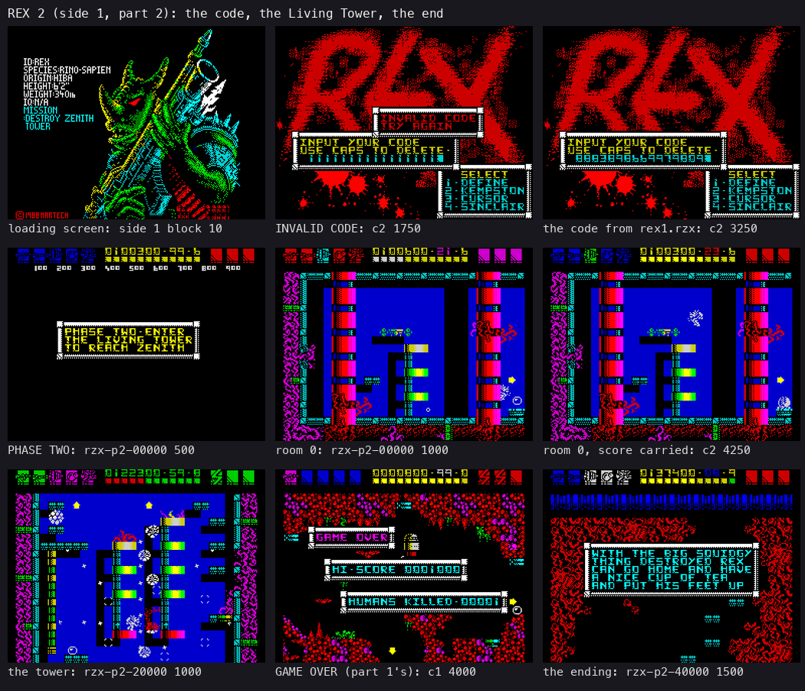
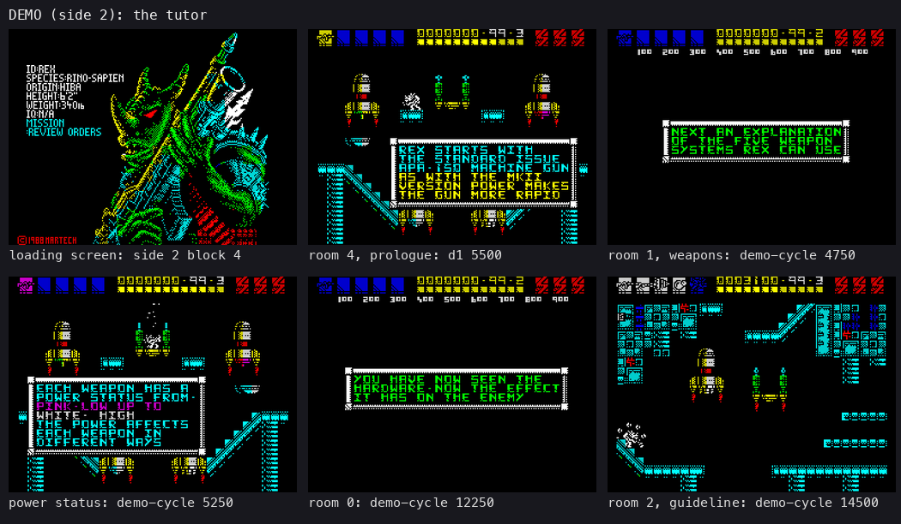
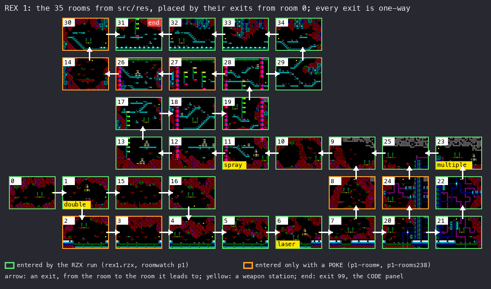
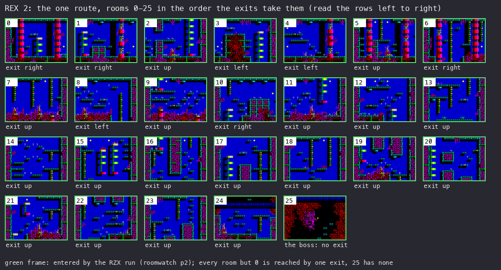
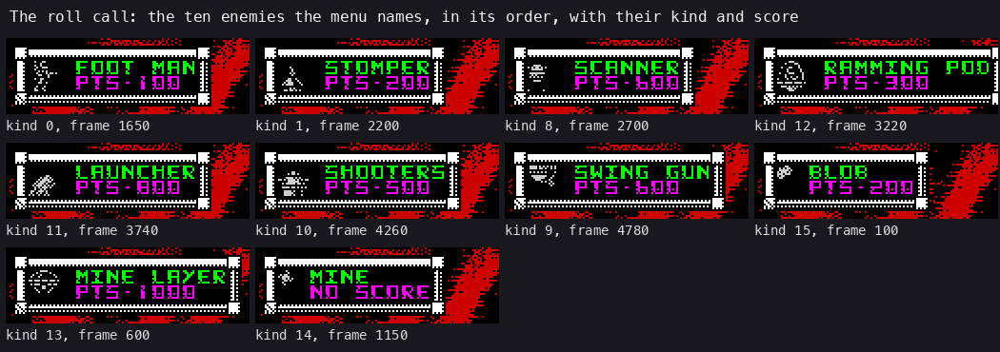
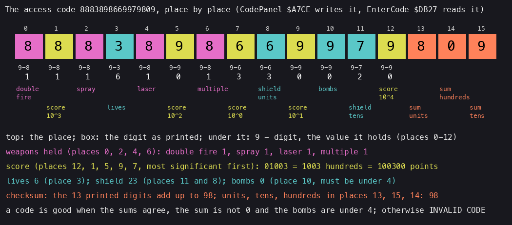
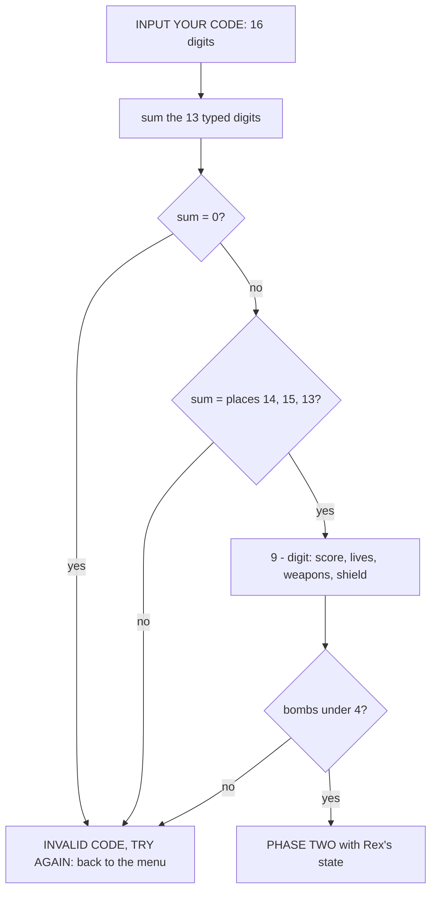

# 1. Game design

What this covers: the game as a player meets it. The premise and the three parts, the controls, every screen, the
world of each part with its maps, the rules (lives, the shield, the sweep, weapons and power, smart bombs, pods, the
score, the extra life, the access code), the enemies, and the key moments with the frames they were taken at.

The recordings it rests on ([WALKTHROUGH 6.0](../WALKTHROUGH.md#60-the-recordings)):

- `c1` (power-on, side 1 at ROM speed, 128K, REX 1 played), `c2` (REX 2 loaded alone, a bad code, then the RZX's
  code), `d1` and `demo-cycle` (DEMO from side 2);
- the RZX segments `rzx-p1-NNNNN` and `rzx-p2-NNNNN` (another player's runs, replayed as our own);
- stage 2's `p1-code`, `p1-gameover`, `p1-room14/24/26/27/30`, `p2-room20`;
- two short recordings made for this document: `p1-rooms238` (rooms 2, 3 and 8, with POKEs) and `menu-rollcall`
  (the menu left alone for 5300 frames).

## 1.1 The premise and the three parts

Rex is a run-and-gun platform shooter for one player, by The Light for Martech Games (1988). Rex, an armoured
"rino-sapien" mercenary (the loading screen's ID card), walks, jumps and shoots his way through the rooms of Zenith.
Each room is one screen; walking off an edge with an exit shows the next room (flip-screen).

The tape holds three programs, each a separate load ([doc 3](03-build-and-load.md)):

| Part | Where | Its goal (the PHASE panel and the loading screen) | Rooms | The end |
| --- | --- | --- | --- | --- |
| REX 1 | side 1, first | "PHASE ONE: PROCEED ON FOOT THROUGH UNDERGROUND COMPLEX"; mission "INFILTRATE UNDERGROUND COMPLEX" | 35 (0-34) | room 31's lift up (exit 99): the CODE panel |
| REX 2 | side 1, second | "PHASE TWO: ENTER THE LIVING TOWER TO REACH ZENITH"; mission "DESTROY ZENITH TOWER" | 26 (0-25) | the big squidgy thing in room 25 destroyed: the ending text |
| DEMO | side 2 | the "Tutor Mode": mission "REVIEW ORDERS" | 4 rooms of REX 1's (4, 1, 0, 2) | none: it plays itself and starts again |

The two levels are joined by a code. REX 1 prints a 16-digit access code when Rex leaves its last room. REX 2 asks
for it before it starts, and takes from it the score, lives, shield, bombs and the weapons Rex owned (1.7); Rex
starts REX 2 with the laser at power level 3 whatever the code says.



*The game as a whole. The point: the only thing carried from part 1 to part 2 is what the code holds; the player
types it. Witness: `p1-code` (the code at frame 1000), `c2` (the code typed at frame 3250, play at 4250),
`rzx-p2-40000` (the ending at frame 1500).*

## 1.2 The controls

The player picks the controls at the menu: 1 DEFINE, 2 KEMPSTON, 3 CURSOR, 4 SINCLAIR. The default keys of the
instructions are Q and W (left, right), I (jump), J (shield), O (fire). Three keys are fixed whatever the choice:

| Key | What it does | Code |
| --- | --- | --- |
| SPACE | a smart bomb | `SmartBomb`, `$7FFE` bit 0 |
| H | pause; fire resumes | `Pause $A4E7`, `$BFFE` bit 4 |
| ENTER | abandon the game: a new game at once | `JP Z,NewGame`, `$BFFE` bit 0 |

*The point: down is the shield, not a crouch; up is the jump. Witnesses: `p1-cursor` (H pauses, SPACE bombs, ENTER
restarts with 4 lives), `p1-kempston`, `p1-define`. The readers and the self-written key code are in
[doc 5](05-controls.md).*

There is no cheat key, no hidden menu and no easter egg in the code of any part (every key read is listed in doc 5).
The POKEs that cheat are in [doc 3, 3.6](03-build-and-load.md#36-the-pokes).

## 1.3 The screens



*REX 1 from the load to the CODE panel. How to read it: each tile is a screenshot, its caption the recording and the
frame. The point: every screen of part 1 is a full-screen picture (loading screen, title) or a boxed panel over the
play area; play is the HUD (top three character rows) above a room of 21 character rows. Command: `python3
tools/fig_screens.py` (from `src/res/screens`, `docs/img/play` and the shots in `work/docs/rxA/shots`).*

The screens of part 1, in the order a player meets them:

- **The loading screen** (side 1 block 4, `src/res/screens/rex1.png`): Rex's portrait and his ID card.
- **The title and menu** ([`c1` frame 250](img/play/c1-000250-menu.png)): the red REX logo, SELECT 1-4, and the roll
  call box in the top left, which shows one enemy after another with its score (1.6).
- **DEFINE** ([`c1` frame 750](img/play/c1-000750-define.png)): PRESS UP, DOWN, LEFT, RIGHT, FIRE in turn.
- **PHASE ONE** ([`c1` frame 1000](img/play/c1-001000-phase-one.png)): the mission, then PRESS FIRE TO BEGIN. About
  14 s without fire (two waits of about 7 s, one after PHASE ONE and one after PRESS FIRE) starts the attract mode,
  which shows eight rooms ([doc 4, 4.8](04-game-loop.md#48-every-delay-pause-and-timer)).
- **Play** ([`c1` frame 1500](img/play/c1-001500-room0.png), room 0; [`rzx-p1-30000` frame 1000](img/play/rzx-p1-31000-play.png),
  room 13). The HUD shows the weapons held, the score (7 digits), the shield, the lives, the power bar and the
  smart bombs; the sweep runs along its attribute row ([doc 8](08-hud-and-text.md)).
- **A weapon station's panel** (`rzx-p1-00000` frame 1400): DOUBLE FIRE, LASER, MULTIPLE or SPRAY over the room.
- **GAME OVER** (`p1-gameover` frame 500; [`c1` frame 4000](img/play/c1-004000-game-over.png)): three boxes, GAME
  OVER, HI-SCORE and HUMANS KILLED.
- **The CODE panel** (`p1-code` frame 1000; [`rex1.rzx` frame 64 000](img/play/rex1-rzx-064000-code.png)): the
  access code over the last room.



*REX 2 from its load to its end. How to read it: as above. The point: part 2 opens with the code, not the roll call;
a code that does not check prints INVALID CODE, TRY AGAIN; the right code puts the score of part 1 back on the HUD
(`c2` frame 4250: 0100300). The GAME OVER tile is part 1's (`c1` 4000): no recording loses REX 2's last life; part
2's panel is the same but for its third box. Command: `python3 tools/fig_screens.py`.*

The screens of part 2:

- **The loading screen** (side 1 block 10): the same portrait, mission "DESTROY ZENITH TOWER".
- **INPUT YOUR CODE** at the menu ([INVALID CODE at `c2` frame 1750](img/play/c2-001750-invalid-code.png); [the
  RZX's code typed, frame 3250](img/play/c2-003250-code.png)).
- **PHASE TWO** ([`rzx-p2-00000` frame 500](img/play/rzx-p2-00500-phase-two.png)).
- **Play**: [room 0 at `rzx-p2-00000` frame 1000](img/play/rzx-p2-01000-room0.png), [the same room with the score
  carried, `c2` frame 4250](img/play/c2-004250-part2.png), [the tower, `rzx-p2-20000` frame 1000](img/play/rzx-p2-21000-play.png).
- **GAME OVER**: the same three boxes; the third reads BIO GROWTHS KILLED (known only from the code and its text: no
  recording reaches it).
- **The ending** ([`rzx-p2-40000` frame 1500](img/play/rzx-p2-41500-ending.png)): "WITH THE BIG SQUIDGY THING
  DESTROYED REX CAN GO HOME AND HAVE A NICE CUP OF TEA AND PUT HIS FEET UP".



*DEMO, the tutor. How to read it: as above. The point: DEMO plays REX 1's rooms by itself and stops on panels that
explain the game: the gun, the five weapons, the power status (pink low up to white high), the guideline. Command:
`python3 tools/fig_screens.py --demo work/docs/rxA/demo`.*

The tutor's screens: the prologue in room 4 ([`d1` frame 5500](img/play/d1-005500-tutor.png)), the weapons in room 1
(`demo-cycle` 4750 and 5250), the effect on the enemy in room 0 (12 250) and room 2 with the guideline (14 500).
After room 2 the credits show and the demo starts again (`demo-cycle`, 30 312 frames, no key).

## 1.4 The world

### REX 1: 35 rooms, one-way exits



*Every room of REX 1, drawn from `src/res/rooms/rex1.txt` and the block and character resources, placed on a grid by
its exits from room 0. How to read it:

- an arrow is an exit, from the room to the room it leads to; there is no arrow back, because every exit is one-way;
- the number is the room's; yellow labels mark the four weapon stations; "end" is room 31's exit 99;
- a green frame: the RZX run entered the room; an orange frame: only a recording with a POKE did (`p1-room14/24/26/27/30`,
  `p1-rooms238` for 2, 3 and 8).

The point: the level is a long cave along the bottom (0-7 and 20-23), a climb back left through the middle (25, 9-13)
and up (17-19), then two ways along the top to room 31. Command: `python3 tools/fig_worldmap.py`.*

Each room has four exits in `RoomExits $B133` (up, right, down, left; 0 none, 99 the end). An exit is only a way
out: the room it leads to does not lead back. So a player who walks into a room cannot walk back the way he came.

```mermaid
flowchart LR
    R0["0 start"] --> R1["1 double fire"]
    R1 --> R15["15"]
    R1 -->|"down"| R2["2"]
    R2 --> R3["3"] --> R4["4"]
    R15 --> R16["16"] -->|"down"| R4
    R4 --> R5["5"] --> R6["6 laser"] --> R7["7"]
    R7 -->|"up"| R8["8"] -->|"up"| R9["9"]
    R7 --> R20["20"]
    R20 -->|"up"| R24["24"] -->|"up"| R25["25"]
    R20 --> R21["21"] -->|"up"| R22["22"] -->|"up"| R23["23 multiple"] -->|"left"| R25
    R25 -->|"left"| R9
    R9 -->|"left"| R10["10"] -->|"left"| R11["11 spray"] -->|"left"| R12["12"] -->|"left"| R13["13"]
    R13 -->|"up"| R17["17"] --> R18["18"] --> R19["19"] -->|"up"| R28["28"]
    R28 --> R29["29"] -->|"up"| R34["34"] -->|"left"| R33["33"] -->|"left"| R32["32"] -->|"left"| R31
    R28 -->|"left"| R27["27"] -->|"left"| R26["26"] -->|"left"| R14["14"] -->|"up"| R30["30"] --> R31["31"]
    R31 -->|"up: exit 99"| END["the CODE panel"]
```



*The room graph of REX 1, from `src/res/rooms/rex1.txt`. How to read it: an unlabelled arrow is a right exit. The
point: the level has three forks (room 1, room 7 and its branches 20/21, room 28). Every route passes 4, 9-13, 17-19
and 28, and ends at 31. The shortest routes take 23 rooms, for example
0-1-15-16-4-5-6-7-8-9-10-11-12-13-17-18-19-28-29-34-33-32-31; 1-2-3-4 and 28-27-26-14-30-31 are as short. The RZX run took 7-20-21-22-23-25-9 (the multiple station is in 23) and 28-29-34-33-32-31.*

The witnesses: the RZX run enters rooms 0, 1, 4-7, 9-13, 15-23, 25, 28, 29, 31-34 and 99 (`work/stage2/roomwatch/p1`).
Rooms 14, 24, 26, 27 and 30 are entered by stage 2's POKE recordings. Rooms 2 (frame 50), 3 (frame 350) and 8 (frame
650) are entered by `p1-rooms238`: from the RZX state at frame 12 000, with infinite lives, Rex immune
(`Immune $A071` = 1), the exit right of the current room poked to 2 and then 8, Rex put at the right edge.

### REX 2: one route up the Living Tower



*Every room of REX 2 in the order its exits take them, from `src/res/rooms/rex2.txt`. How to read it: read the rows
left to right; under each room, the direction of its one exit. The point: part 2 is a single route, 0 to 25: a few
rooms right and left at the foot of the tower, then a climb, and the boss in room 25, which has no exit. Rooms 26-34
of the exits table are leftovers ([doc 2, 2.5](02-architecture.md#25-the-leftovers)). Witness: the RZX run enters
every room 0-25 (`work/stage2/roomwatch/p2`); `p2-room20` too. Command: `python3 tools/fig_worldmap.py`.*

### Against the published maps

Three published maps cover the standard release (the links are on the game's ZXDB entry,
<https://spectrumcomputing.co.uk/entry/4129/ZX-Spectrum/Rex>):

- `Rex.gif`, "Map by Neil Walker 04/10/2000" (retrospec.co.uk), level 1:
  <https://spectrumcomputing.co.uk/pub/sinclair/games-maps/r/Rex.gif>. Its START is our room 0 (bottom left), its
  FINISH our room 31 (top left), and the shape is ours: the cave along the bottom, the climb on the right, the
  pillared rooms in the middle, the top row back left. It marks the restart markers, the power-ups
  and the lifts, not the exits' directions.
- `Rex_SideB.png`, "Map created by Pavero, 2004" (maps.speccy.cz), level 2:
  <https://spectrumcomputing.co.uk/pub/sinclair/games-maps/r/Rex_SideB.png>. Its START at the foot and the tall
  climb to the boss match our route.
- `Rex_2.jpg`, a magazine page with both levels drawn by hand ("the name of the cartographer has gone missing"):
  <https://spectrumcomputing.co.uk/pub/sinclair/games-maps/r/Rex_2.jpg>.

Magazine maps are also listed there for Crash 65 (June 1989, page 25) and Your Sinclair 37 (January 1989, page 76).
What ours adds: the room numbers, the one-way exits, and the five rooms off every route the RZX took (14, 24, 26, 27,
30) drawn from the data.

## 1.5 The rules

### Lives, death and the restart

- Rex starts with 4 lives (`Lives $A063`). An extra life comes every 10 000 points, up to 9.
- Rex dies when an enemy or a shot touches him without the shield, when he falls out of a room with no exit below,
  and when the sweep runs out.
- A death runs 50 passes of flying shards (about 4.4 s), fires a smart bomb for free (the room is empty when he comes
  back), drains the power count twice by 50 (0, 1 or 2 power levels lost, as the count allows; LosePower) and refills
  the shield to 99.
- Rex comes back at the last restart marker he touched (the cell type `$07`; `RestartRoom $A05B`). The restart may
  be in an earlier room: the RZX run's "room 17 to room 11" moves are such restarts.
- No life left: GAME OVER, HI-SCORE (the best score of the session, kept while the program runs) and HUMANS KILLED.

### The shield

Down switches the shield on and off. While it is on, shots and enemies do not kill Rex, and `ShieldEnergy $A04D` loses one unit
every 4 passes (99 units: 2 + 4 x 99, about 400 passes, 35 s at 4.4 frames a pass). Hits drain it too: 5 units an
enemy shot, the object's hits left x 4 for an enemy touched (which dies), 20 for the roulette's SHIELD LOSS. Below 0 the
shield goes off. The recharger cell (`$08`) gives a unit
a pass while Rex stands on it. Witness: `p1-define` (the shield drains), the RZX runs.

### The sweep: the room's time limit

A marker runs back and forth along the HUD's attribute row. Every 5 round trips its track loses one cell; when the
track is gone Rex dies. A new room and a death reset it. A room from width 12 lasts 780 passes, about 69 s
([doc 4, 4.8](04-game-loop.md#48-every-delay-pause-and-timer)). Witness: `p1-gameover` (the sweep poked short kills
Rex).

### Weapons and power

| Weapon | How Rex gets it | What it fires |
| --- | --- | --- |
| the gun | at the start | one shot ahead |
| double fire | the station in room 1 | two shots |
| laser | the station in room 6 | one long beam |
| multiple | the station in room 23 | Rex's shot and one from each drone that follows him |
| spray | the station in room 11 | 8 shots in a fan |

- The weapon power (`PowerLevel $A014`, 1-5) sets how many shots may be in the air. Firing uses it up; the power pods
  the enemies leave raise it. The power bar shows it in colours from pink (low) to white (high), as DEMO says.
- At the lowest level the weapon falls back to the best one held.
- A station gives its weapon once a game and stops the game with its panel until fire (the long passes of
  [doc 4, 4.7](04-game-loop.md#47-the-long-passes-the-weapon-stations)).
- REX 2 has no stations: the code says which weapons Rex owns; StartWeapon `$BAC6` always puts the laser in his hands
  at power level 3 and rank 2.

### Smart bombs

Rex starts with 3. SPACE fires one: over 16 passes it visits the room's 16 object records, one a pass, and kills each but the pods
(`$FE`, `$FD`, `$FC`) and the big gun (`$90`), while the screen flashes.
A bomb pod gives one more, up to 3. A death fires one free.

### Pods

A killed enemy may leave a pod, which Rex takes by touching it:

| Pod | Kind | What it gives |
| --- | --- | --- |
| power | `$FE` | power, twice for a big one |
| bomb | `$FD` | a smart bomb, up to 3 |
| bonus | `$FC` | a roulette that slows to a stop on one of: SPEED UP (200 passes of double speed), SHIELD LOSS (20 units), 1000 BONUS, ENERGY LOSS (two drains of 50 from the power count: 0-2 levels lost, as at a death), 100 RAPID SHOTS |

Witnesses: the power pod in 27 RZX segments; the bomb pod in `rzx-p1-52000` and `rzx-p1-54000`; the roulette in
`rzx-p1-50000` and `rzx-p1-56000`; SPEED UP in `p1-speedup` (the same RZX state, fire pressed while SPEED UP showed:
SpeedUpPhase 200 at frame 1740 down to 0 at 2740, Rex walking 4 pixels a pass meanwhile).

### The score

Each enemy scores its kind's entry of `KillScores $994E` times 100. The score is held in hundreds and shown with
two zeros added. The full table is in 1.6. People killed (the foot man, the four "person" walkers and the ramming
pod) are counted in `HumansKilled $A089` and printed at game over. REX 2 counts every kill but kind 0 as BIO GROWTHS
KILLED, starting from the score the code carries (in hundreds, `94E7`), not from 0.

### Difficulty

There is no difficulty setting and no level of speed. What makes a room hard is its own data: its spawn sides and
period, its scripted spawns (rooms 2, 3, 4, 6, 20) and its hazards ([doc 7](07-objects.md)). The game also slows
down in a busy room, since nothing holds it to the frame ([doc 4, 4.5](04-game-loop.md#45-what-a-pass-costs)).
REX 2 brings new enemies (kinds 1-5 and 9 are its own) and the boss.

## 1.6 The enemies



*The ten enemies the menu introduces, in its order, each with its kind (the object kind in the code) and the frame
of `menu-rollcall` it was taken at. How to read it: the box is the menu's top left corner, twice the size. The point:
the menu names only ten of REX 1's 17 kinds; the walkers and the people are left out. Command: `python3
tools/fig_rollcall.py` (from `work/docs/rxA/rec/menu-rollcall`, the menu left alone for 5300 frames).*

| Kind | Name (roll call) | Points | A person | How it moves and fights |
| ---: | --- | ---: | --- | --- |
| 0 | FOOT MAN | 100 | yes | walks and falls with the common walker code |
| 1 | STOMPER | 200 | | walks (the common walker code) |
| 2, 3 | walkers | 100 | | walk; 3 stops at an edge |
| 4, 5 | walkers, people | 200, 300 | yes | walk; stop at an edge |
| 6, 7 | walkers, people | 100 | yes | walk; die off an edge |
| 8 | SCANNER | 600 | | stalks Rex: rises and sinks to his height, walks his way |
| 9 | SWING GUN | 600 | | a turret that fires in 8 angles |
| 10 | SHOOTERS | 500 | | two shots at once, right and left |
| 11 | LAUNCHER | 800 | | a shot that climbs |
| 12 | RAMMING POD | 300 | yes | walks, rises to the ceiling |
| 13 | MINE LAYER | 1000 | | walks and drops mines |
| 14 | MINE | no score | | drifts; a solid cell turns it |
| 15 | BLOB | 200 | | drifts and bounces |
| 16 | the big gun | 1000 | | always kind `$90`; bobs, fires volleys and drops mines; two lives; KillScore `$98AF` adds 10 hundreds |

*REX 1's kinds, from `src/game/objects.asm` and `src/res/tables/rex1-kill-scores.csv`. How to read it: "a person"
marks the kinds counted as HUMANS KILLED. The point: the score rewards the turrets, the launcher and the mine
layer; the people are cheap. Each kind's code and pictures are in [doc 7](07-objects.md)
and [doc 10](10-gameplay-logic.md).*

REX 2's scores (`rex2-kill-scores.csv`): kind 0 200, 1 300, 2 500, 3 300 (it takes ten hits), 4 600, 5-7 100, 8 600,
9 400, 10-13 100, 14 none. The boss is the big squidgy thing of room 25.

## 1.7 The access code

When Rex takes room 31's lift, `ChangeRoom` sees exit 99 and runs `CodePanel $A7CE`. It writes Rex's state as 16
digits:



*The access code of the RZX run, `8883898669979809`, place by place. How to read it: the top row is the place 0-15;
the box is the digit as printed; under it, 9 minus the digit, the value it holds; the colour groups the weapons, the
score, the state and the checksum. The point: the code is Rex's state, each digit inverted and the score's digits
scattered, closed by a checksum; there is no key and no cipher. Command: `python3 tools/fig_code.py`.*

The asm of the inversion and the checksum, in REX 1:

```
A845  LD B,$0D                ; 13 places
A847  LD E,$00                ; the sum
...                           ; (A849 LD (Temp1),HL)
A84C  LD HL,CodeDigits
A84F  CodeDigitsLoop:
A84F  LD C,(HL)               ; the value as an ASCII digit
A850  LD A,$39
A852  SUB C                   ; "9" - digit
A853  ADD A,$30
A855  LD (HL),A               ; printed inverted
A856  SUB $30
A858  ADD A,E
A859  LD E,A                  ; the sum of the printed digits
A85A  INC HL
A85B  DJNZ CodeDigitsLoop
A85D  LD L,E                  ; then ToDigits: places 13, 15, 14 = units, tens, hundreds
```

Both directions in pseudocode:

```
encode (REX 1, CodePanel):
    value[0] = has_double; value[2] = has_spray; value[4] = has_laser; value[6] = has_multiple
    value[3] = lives % 10; value[10] = bombs % 10
    value[11], value[8] = tens, units of shield
    value[12], value[1], value[5], value[9], value[7] = the five digits of score/100, most significant first
    for p in 0..12: shown[p] = 9 - value[p]
    s = sum(shown[0..12])
    shown[13], shown[15], shown[14] = units, tens, hundreds of s

decode (REX 2, EnterCode):
    s = sum(typed[0..12])          # DE from 0; at most 13 x 9 = 117, so D stays 0
    if s % 256 == 0 or s != typed[14]*100 + typed[15]*10 + typed[13]: INVALID CODE   # OR E; SBC HL,DE
    value[p] = 9 - typed[p]; rebuild score, lives, weapons, shield, bombs
    if bombs >= 4: INVALID CODE
```



*REX 2's check of the code (`EnterCode $DB27`, `CodeSumLoop $DBAA`, the test `$DBDF`). The point: the checksum catches a mistyped
digit; nothing checks the lives or the shield, so a code built by hand with 9 lives and full weapons passes. Witness:
`c2` (a bad code at frame 1750, the RZX's code at frame 3250).*

Worked example, the RZX run's code `8883898669979809` (`p1-code` frame 1000; typed into REX 2 by `c2`):

- the 13 printed digits 8, 8, 8, 3, 8, 9, 8, 6, 6, 9, 9, 7, 9 add up to 98; places 13, 15 and 14 read 8, 9 and 0:
  98, so the code checks;
- the weapons (places 0, 2, 4, 6): 9 - 8 = 1 each: double fire, spray, laser and multiple all held;
- the lives (place 3): 9 - 3 = 6; the bombs (place 10): 9 - 9 = 0; the shield (places 11, 8): 2 and 3, 23;
- the score (places 12, 1, 5, 9, 7): 0, 1, 0, 0, 3, so 1003 hundreds, 100 300 points;
- `c2`'s HUD at frame 4250 shows 0100300, shield 23 and 6 lives.

How the panel is printed and the texts are in [doc 8](08-hud-and-text.md).

## 1.8 The key moments

| Moment | Recording, frame | Picture |
| --- | --- | --- |
| the start: Rex materialises in room 0 | `c1` 1500 | [room 0](img/play/c1-001500-room0.png), and the sheet above |
| the first enemies (walkers, room 0) | `c1` 1500 | the same |
| the first weapon station: DOUBLE FIRE, room 1 | `rzx-p1-00000` 1400 | the REX 1 sheet |
| the first scripted spawn | room 2 or 4, any recording | [doc 7](07-objects.md) |
| a room change | `rzx-p1-08000` 1166-1206 | [the animation in doc 4](04-game-loop.md#46-the-room-change-22-26-frames) |
| death and the restart | `rzx-p1-*`, `p1-gameover` | the GAME OVER tile; [doc 10](10-gameplay-logic.md) |
| the end of part 1: the CODE panel | `p1-code` 1000 | the REX 1 sheet |
| a code refused, a code taken | `c2` 1750, 3250 | the REX 2 sheet |
| the Living Tower | `rzx-p2-20000` 1000 | [the tower](img/play/rzx-p2-21000-play.png) |
| the end of the game | `rzx-p2-40000` 1500 | [the ending](img/play/rzx-p2-41500-ending.png) |

*The point: every moment of the checklist has a recording; the pictures of the enemies, pods and weapons at work are
the animations of [doc 10](10-gameplay-logic.md).*

## 1.9 Known only from the code

- A full sweep run-out from width 12 (69 s): `p1-gameover` poked it short.
- The time-out of the attract wait at a weapon panel.
- That nothing checks the lives or the shield of a typed code (no hand-made code was typed).
- REX 2's bomb pod and bonus pod: the code is there; no REX 2 run takes one.
- REX 2's GAME OVER panel (BIO GROWTHS KILLED): no recording loses REX 2's last life.
