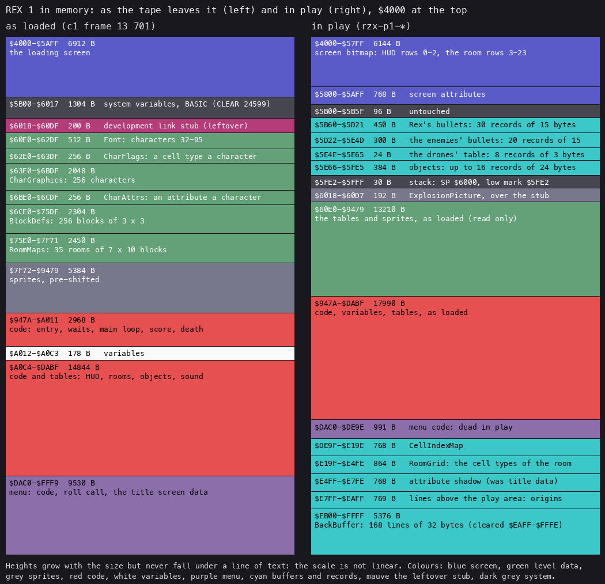
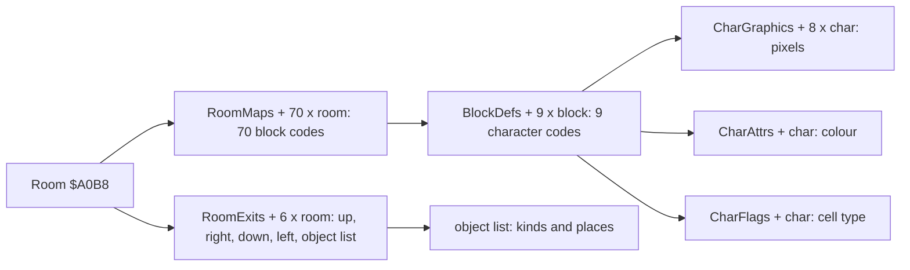
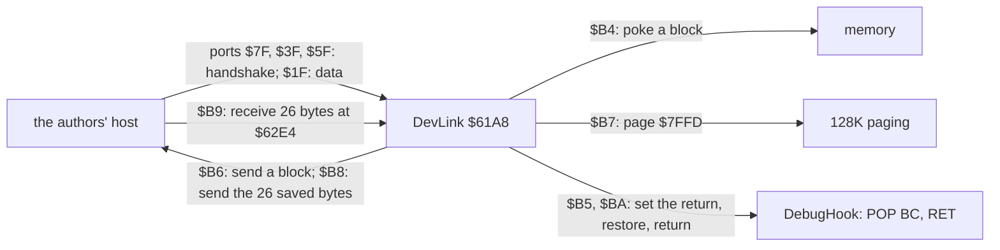
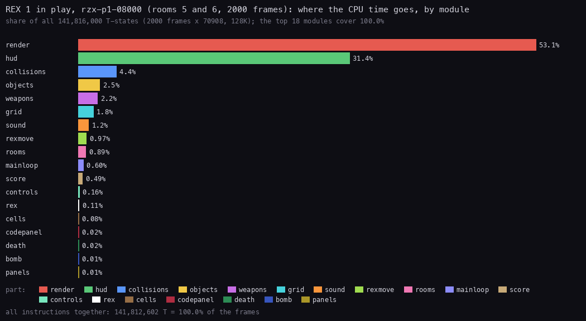
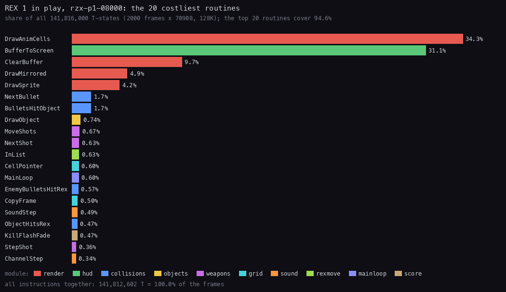
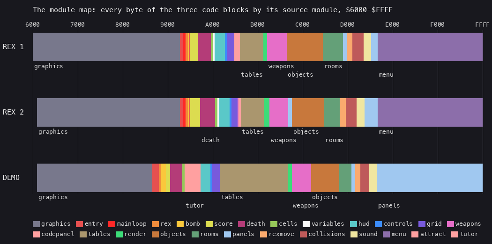
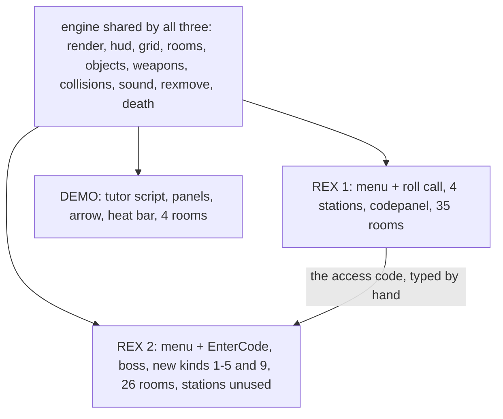
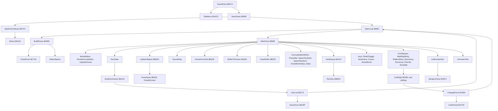
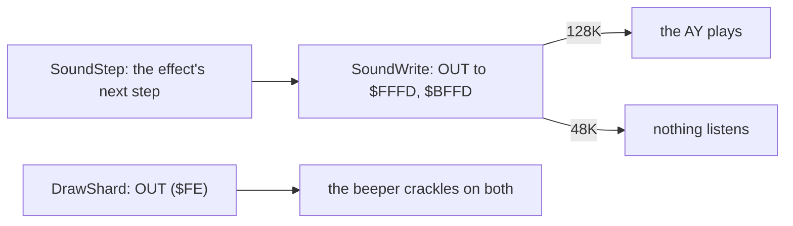

# 2. Architecture

What this covers: the machine and its budget, the memory map of each part (a figure), the level data in memory, the
heatmaps and the stack, the leftovers, the frame budget, the module map and what the three parts share, the main
loop's call graph, and the 48K against the 128K. The stages from the tape to play are in
[doc 3, 3.3](03-build-and-load.md#33-the-stages-from-power-on-to-play).

The recordings it rests on ([WALKTHROUGH 6.0](../WALKTHROUGH.md#60-the-recordings)): `c1` (power-on, side 1 at ROM
speed, 128K), `c2`, `d1`, and the RZX segments `rzx-p1-*` (33, 64 813 frames) and `rzx-p2-*` (21, 41 776 frames).

## 2.1 The machine and the budget

- **The machine:** a 48K or a 128K Spectrum from the same tape. This case runs the 128K, as both RZX runs did. Nothing
  pages: the only write to `$7FFD` in each block is in the development link's code, which never runs (2.5). Each
  part fits in `$6018-$FFF9` (REX 1) or `$61A8-$FFF9` (REX 2, DEMO), the 48K's RAM.
- **The parts:** three programs, loaded one at a time, each a BASIC, a screen and one code block. Nothing stays in
  memory from one to the next but what the player types: the access code ([doc 1, 1.7](01-game-design.md#17-the-access-code)).
- **The frame:** none. The game runs with interrupts off and never waits for the beam
  ([doc 4, 4.2](04-game-loop.md#42-interrupts-none)). A pass takes 4.4 frames on average in part 1, 4.1 in part 2.
- **The budget:** of a pass's 283 000 T, 83 % moves the picture through a back buffer (2.6). The game's logic is
  under a tenth.
- **The memory:** 40 930 bytes of code and data (REX 1), of which 13 410 are graphics and level data and 9530 the
  menu and title. In play the menu's space becomes the room's buffers (2.2).

## 2.2 The memory map



*REX 1's memory as the tape leaves it (left, `c1` frame 13 701, the entry) and in play (right, the RZX run). How to
read it:

- `$4000` is at the top; every box gives its range, its size and what it holds;
- the heights grow with the size but never fall under a line of text, so the scale is not linear;
- the colours: blue the screen, green the level data, grey the sprites, red the code, white the variables, purple the
  menu, cyan the buffers and records.

The point: in play, the 9530 bytes of the menu become the room's work space: the cell index, the cell grid, the
attribute shadow and the back buffer. The level data stays read only; the records of bullets, drones and objects sit below
the code, between the screen and the stack; the stack's box starts at its low mark `$5FE2`, 4 bytes into the last
object record (2.4). Command: `python3 tools/fig_memmap.py`.*

The map of part 1, corrected by stage 2 (the stage-1 draft had room 0 "unused" and `$5B60` as one buffer):

| Range | What | Witness |
| --- | --- | --- |
| `$4000-$5AFF` | the screen: the HUD in character rows 0-2, the room in rows 3-23 (attributes from `$5860`) | BufferToScreen `$A28A`, CopyAttrs `$C8BF` |
| `$5B60-$5D21` | Rex's bullets: 30 records of 15 bytes | MoveBullets `$B64E`; cleared by BuildRoom `$A8AE` |
| `$5D22-$5E4D` | the enemies' bullets: 20 records of 15 bytes | MoveEnemyBullets `$B645` |
| `$5E4E-$5E65` | the drones' table: 8 records of 3 bytes (the multiple weapon; the angle at +2) | InitDrones `$A628`, UpdateDrones `$A639` |
| `$5E66-$5FE5` | the room's objects: 24-byte records; a room's list holds up to 16 (room 5), the count is 5 bits | UpdateObjects `$BA5C`; ReadExits `$C8EF` (`AND $1F`) |
| `$5FE2-$5FFF` | the stack: the main loop at `SP` = `$6000`, the low mark `$5FE2` (4 bytes into the last object record; harmless, 2.4) | 2.4 |
| `$6018-$60DF` | the development link stub (102 bytes) and its tail; from the menu on, ExplosionPicture `$6018-$60D7` | 2.5 |
| `$60E0-$62DF` | Font: characters 32-95 | PrintChar |
| `$62E0-$63DF` | CharFlags: the cell type of each room character | DrawRoomCell `$C80A` |
| `$63E0-$6BDF` | CharGraphics: 256 characters of 8 bytes; a few rotate in place each pass (`$6438`, `$64B0`, `$64C0`, `$6758`, `$6858`) | DrawRoomCell `$C818`, MainAnimate |
| `$6BE0-$6CDF` | CharAttrs: an attribute a character | DrawRoomCell `$C7EA` |
| `$6CE0-$75DF` | BlockDefs: 256 blocks of 3 x 3 characters | DrawRoom `$C78D` |
| `$75E0-$7F71` | RoomMaps: 35 rooms of 7 x 10 blocks, 70 bytes each | DrawRoom `$C773` |
| `$7F72-$9479` | the sprites, pre-shifted ([the sheet](img/sprites/part1-sheet.png), [doc 6](06-rendering.md)) | DrawSprite `$B258` |
| `$947A-$A011` | code: the entry, the waits, the main loop `$9583-$967A`, the score, the death | `c1` entered at 13 701 |
| `$A012-$A0C3` | the variables: score `$A03E`, lives `$A063`, bombs `$A06C`, shield `$A04D`, power `$A014`, room `$A0B8`, Rex `$A0B6`/`$A0B7`, the restart point `$A059-$A05B`, the exits `$A08D-$A090`, the sweep `$A067` | [doc 7](07-objects.md) |
| `$A0C4-$DABF` | code and tables: HUD, text, rooms, render, objects, weapons, collisions, sound, panels; ScreenLines `$AC0D`, MirrorTable `$AD5D`, RoomExits `$B133`, SceneryCellList `$D962` | the listings |
| `$DAC0-$DE9E` | the menu's code (TitleMenu, DEFINE, the roll call); dead in play | `c1` |
| `$DE9F-$E19E` | CellIndexMap: for each room cell, its entry in SceneryCellList | DrawRoom `$C74C` |
| `$E19F-$E4FE` | RoomGrid: the cell type of each cell (play from `$E1FF`) | DrawRoomCell `$C7FC` |
| `$E4FF-$E7FE` | the attribute shadow (play from `$E55F`); the title screen's data before, cleared at the entry `$9485` | CopyAttrs |
| `$E7FF-$EAFF` | buffer lines above the play area (the origins, ObjectBufferOrigin `$E9FF`, BufferPlayOrigin `$EAFF`); never copied | ObjectBufferOrigin |
| `$EB00-$FFFF` | the back buffer (BackBuffer): 168 lines of 32 bytes; cleared by `PUSH` one byte low (`$EAFF-$FFFE`), sprites ORed in, scenery written, columns 0-29 copied to the screen | [doc 4, 4.4](04-game-loop.md#44-the-three-routines-that-borrow-the-stack) |

*The point: one image, no paging, no unpacking. The play state is the variables block and the buffers; the level is
read where it was loaded.*

REX 2 and DEMO load 400 bytes higher (`$61A8`) and keep the same layout. Their tables move up, their buffers do not:

| Table | REX 1 | REX 2 | DEMO |
| --- | --- | --- | --- |
| development link | `$6018` (stub, overwritten) | `$61A8` (complete) | `$61A8` (complete) |
| Font | `$60E0` | `$6306` | `$6338` |
| CharFlags, CharGraphics, CharAttrs | `$62E0`, `$63E0`, `$6BE0` | `$6506`, `$6606`, `$6E06` | `$6538`, `$6638`, `$6E38` |
| BlockDefs | `$6CE0` | `$6F06` | `$6F38` |
| RoomMaps | `$75E0` | `$7806` | `$7838` |
| sprites | `$7F72-$9479` | `$8198-$946F` | from `$79DC` |
| the entry | `$947A` | `$9470` | `$8A84` |
| ScreenLines, MirrorTable | `$AC0D`, `$AD5D` | `$ACCA`, `$AE52` | `$ACBE`, `$AE0E` |
| RoomExits | `$B133` | `$B1A7` | `$B033` |
| SceneryCellList | `$D962` | `$D962` | `$DBF6` |
| the menu, then the work space | `$DAC0-$FFF9` | `$DAC0-$FFF9` | `$DB4D-$FFF9` zeros (no menu) |
| the stack at the loop | `$6000` | `$6190` | |

*From the three listings' labels. The point: the engine is position-independent only in the tables; the buffers
from `$DE9F` up are at the same addresses in all three parts.*

## 2.3 The levels in memory

A room is three levels of data deep: a room is 7 x 10 blocks, a block is 3 x 3 characters, a character is 8 bytes of
pixels, an attribute and a cell type. The maps of both parts drawn from these tables are in
[doc 1, 1.4](01-game-design.md#14-the-world); the formats byte by byte and a room decoded are in
[doc 7](07-objects.md).

| Table | Part 1 | Part 2 | Format |
| --- | --- | --- | --- |
| RoomExits | `$B133` | `$B1A7` | 6 bytes a room: the room up, right, down and left (0 none, 99 the end), then the word of the room's object list |
| RoomMaps | `$75E0` | `$7806` | 70 bytes a room: 7 rows of 10 block codes |
| BlockDefs | `$6CE0` | `$6F06` | 9 character codes a block, 3 x 3 |
| CharGraphics | `$63E0` | `$6606` | 8 bytes a character |
| CharAttrs | `$6BE0` | `$6E06` | an attribute a character |
| CharFlags | `$62E0` | `$6506` | the cell type a character (solid, ladder `$12`, restart `$07`, recharger `$08`, stations `$0A-$0D`) |
| Rooms | 0-34, all used | 0-25 used, 26-34 leftovers | room 0 is the start; an exit of 0 means none, so no exit leads back into room 0 |



*From a room number to its pixels. The point: a few multiplications by repeated addition (`Multiply $C8E8`) and shifts
reach every byte of a room; nothing is packed. Witness: `rzx-p1-08000` frames 1177-1198 (room 6 built,
[doc 4, 4.6](04-game-loop.md#46-the-room-change-22-26-frames)).*

## 2.4 The heatmaps and the stack


*What part 1 executed, read and wrote over the 33 RZX segments `rzx-p1-*` (64 813 frames of play), one row a
256-byte page from `$4000` (top) to `$FFFF`. How to read it: brighter is more often; the composite (bottom right)
shows writes red, reads green, execution blue; the brackets on the right name the regions of the table in 2.2. The point: the code runs in `$9000-$DFFF`; the level tables below
`$9000` are read, and written only where the animated characters rotate; the writes go to the buffers at the top,
the records under `$6000`, the screen and the variables. Command: `python3 kit/heatmap.py
work/stage1/heat/p1-l1.json docs/img/arch/heatmap-part1.png --cell 2 --from 4000 --to FFFF --regions
work/stage1/heat/regions-p1.txt` (the L1s summed by `kit/merge_l1.py`).*


*The same for part 2 over the 21 segments `rzx-p2-*` (41 776 frames). The point: the same layout, the tables 550
bytes higher (2.2). Command: as above with `p2-l1.json` and `regions-p2.txt`.*

What changes between the image as loaded and in play (the RZX run's 64 K every 250 frames against the tape image,
`work/stage1/NOTES.md`): in part 1, 9568 bytes ever differ. They are the variables; the stub at `$6018-$60D7` (the
explosion picture); the characters rotated in place each pass; the key-reading code `$A479-$A4E5` (DEFINE writes
into it, [doc 5](05-controls.md)); the CODE text `$A88C`; DrawSprite's operands `$B2AC` and `$B2B0`; and the
buffers. In part 2, 9072 bytes, of the same kinds.

**The stack.** The BASIC's `CLEAR` leaves it under the code: the main loop runs at `SP` = `$6000` in part 1 and
`$6190` in part 2. The low mark comes from 20 million instructions after each of the RZX states at frames 5000,
20 000, 30 000 and 60 000 (part 1) and 10 000 and 30 000 (part 2) (`work/stage1/stackdepth.py`,
`work/stage1/stackdepth.txt`). It is `$5FE2`, 30 bytes under the loop (part 1, in `DrawRoomChar $C895`), and `$6172`,
30 bytes (part 2, at `$C908`).

Worked example: a room of 16 objects (room 5) fills the records to `$5FE5`, and the stack's low mark is `$5FE2`. The
two would overlap by 4 bytes, but the low mark is reached in DrawRoom, before MakeObjects writes the new room's
records, so the overlap never hurts (known only from the code and the measured low mark).

**The three routines that borrow `SP`.** Each saves `SP` in `Temp1 $A093` or `Temp2 $A095`, points it into a buffer,
and gives it back:

| Routine | `SP` points to | What it does |
| --- | --- | --- |
| ClearBuffer `$B205` | `$FFFF`, going down | 2688 `PUSH HL` zero the back buffer |
| BufferToScreen `$A28A` | ScreenLines `$AC0D` | `POP DE` gives each line's screen address; 30 `LDI` copy it |
| DrawAnimCells `$B33E` | SceneryCellList `$D962` | `POP HL`, `POP DE` give a cell's buffer address and its 8 bytes |

```
B205  ClearBuffer:
B205  LD (Temp1),SP           ; SP kept
B209  LD SP,$FFFF             ; the buffer's top
B20C  LD B,$2A
B20E  LD HL,$0000
B211  PUSH HL                 ; 64 a round, 42 rounds
...
B251  DJNZ ClearBufferLoop
B253  LD SP,(Temp1)           ; SP back
```

*The asm of each, with the pseudocode, the worked example (the 362 cells of room 5) and the data flow, is in
[doc 4, 4.4](04-game-loop.md#44-the-three-routines-that-borrow-the-stack). The point: these tricks are safe only
because the game never takes an interrupt; a `PUSH` per two bytes is the fastest clear the Z80 has.*

## 2.5 The leftovers

What the tape holds and no instruction of the game reaches (`src/res/leftovers/README.md`, stage 2 leftover notes):

| Leftover | Where | What it is | Witness |
| --- | --- | --- | --- |
| the development link stub | REX 1 `$6018-$607D` (102 bytes) and 98 bytes after it | the start of the authors' link to their development machine: `OUT` to `$7F`, `$3F`, `$5F`, `$7FFD`; `IN` from `$3F`, `$1F` | the menu copies ExplosionPicture `$E336` over `$6018-$60D7` before it could run |
| the development link | REX 2 `$61A8-$6305`, DEMO `$61A8-$6337` | the complete link: pages it in, saves every register at `$62E4`, serves the host's commands `$B4-$BA` (poke a block, send a block, page `$7FFD`, send or receive the 26 saved bytes), returns through DebugHook; `OUT` to `$7F`, `$3F`, `$5F`, `$1F`, `$7FFD`, `IN` from `$3F`, `$1F` | no instruction reaches `$61A8` (known only from the code) |
| DebugHook | REX 2 `$D6C6`, REX 1 `UnusedD92E` | `POP BC`, `RET`, then zeros: the routine the link calls | known only from the code |
| the weapon stations' code | REX 2: GiveDoubleFire `$A8F6` to GiveSpray `$A908`, WeaponPanel `$D609` | REX 1's code kept; no block of REX 2's rooms holds a station cell (`$0A-$0D`) | stage 2: the cell types of all 26 rooms |
| 9 room slots | REX 2: rooms 26-34 in RoomExits `$B1A7` and RoomMaps | slots of REX 1's 35-room table, no exit leads to them | `src/res/rooms/README.md` |
| unreached routines | REX 1: UnusedRandom `$A368`, ThreeReturns `$C5FA`, EnemyShotFromX `$B586`; DEMO: PointsLeftover `$8E2B`, SprayLeftover `$C589`, MainLoopLeftover | code no path calls | the L1s: 0 |
| DEMO's work space | `$DB4D-$FFF9` | zeros, one byte `$DCBA`, the machine stack's residue `$FF25-$FF57` and the ROM's default UDGs A-U at `$FF58` | the block was saved from a running machine |



*The development link as REX 2 and DEMO keep it (`src/rex2/graphics.asm`). The point: the game was built on another
machine and poked into the Spectrum through this link; the stub stayed at the front of every block. Known only from
the code: no recording runs it.*

## 2.6 The frame budget



*REX 1 in play, `rzx-p1-08000` (rooms 5 and 6, 2000 frames, 141 816 000 T): the share of each source module. How to
read it: a bar a module, its share of all T-states. The point: render (53 %) and hud (31 %, which holds
BufferToScreen) take 84 % of the time; collisions, objects and weapons, the game itself, take 9 %. Command: `python3
../../kit/fig_budget.py work/stage1/rec/rzx-p1-08000/l1.json docs/img/arch/budget-modules.png --ann src/game/game.ann
--by module --title 'REX 1 in play, rzx-p1-08000 (rooms 5 and 6, 2000 frames): where the CPU time goes, by
module'`.*



*The same recording by routine. How to read it: a bar a routine, the top 20. The point: DrawAnimCells (34.3 %),
BufferToScreen (31.1 %) and ClearBuffer (9.7 %) are three quarters of the game's time; the sprites (DrawMirrored
4.9 %, DrawSprite 4.2 %) are a tenth. Command: `python3 ../../kit/fig_budget.py
work/stage1/rec/rzx-p1-08000/l1.json docs/img/arch/budget-routines.png --ann src/game/game.ann --by routine --top 20
--title 'REX 1 in play, rzx-p1-08000: the 20 costliest routines'`.*

| Module | Share | Module | Share |
| --- | ---: | --- | ---: |
| render | 53.05 % | sound | 1.21 % |
| hud | 31.45 % | rexmove | 0.97 % |
| collisions | 4.42 % | rooms | 0.89 % |
| objects | 2.52 % | mainloop | 0.60 % |
| weapons | 2.24 % | score | 0.49 % |
| grid | 1.76 % | the rest | 0.40 % |

*The point: the design trades speed for simplicity. Each pass redraws the whole room's scenery into a cleared buffer
and copies it all, whatever moved. A design that redrew only the cells under the sprites would run several times
faster; Rex's 4.4 frames a pass are the price of this one. The pass by pass cost is in
[doc 4, 4.5](04-game-loop.md#45-what-a-pass-costs).*

## 2.7 The module map and what the parts share



*Every byte of the three code blocks coloured by the source module that assembles it, `$6000-$FFFF`, read from the
build's listings. How to read it: one bar a part; the colour key under the bars; the long stretches are named under
each bar. The point: the three parts are the same engine in the same order, graphics at the bottom and the menu (or
DEMO's panels) at the top; only the graphics, the tables and the menu or tutor differ in size. Command: `python3
tools/fig_modules.py` (`--table` prints every stretch).*

The modules and their sizes in bytes (from `python3 tools/fig_modules.py --table`):

| Module | REX 1 | REX 2 | DEMO | Role |
| --- | ---: | ---: | ---: | --- |
| graphics | 13 410 | 13 000 | 10 460 | the link stub, the font, characters, blocks, room maps, sprites |
| menu | 9530 | 9530 | | the title, the menu, the roll call (REX 1), the code entry (REX 2), DEFINE |
| panels | 953 | 1571 | 9942 | the boxed panels; DEMO's includes its 9389-byte work space |
| tables | 2134 | 2115 | 6177 | screen lines, mirror table, exits, object lists, spawn scripts; DEMO's tutor texts |
| objects | 3305 | 2918 | 2561 | the enemies and pods |
| weapons | 1800 | 1741 | 1790 | firing, the bullets, the power |
| rooms | 1846 | 1430 | 1133 | DrawRoom, the exits, the spawners |
| death | 1178 | 1361 | 1110 | the death, the restart, game over, the sparkle |
| collisions | 1013 | 1005 | 806 | shots and objects against Rex, the pods |
| hud | 934 | 934 | 919 | the HUD, the printer, the sweep, BufferToScreen |
| score | 712 | 928 | 374 | the kills, the score, the lives |
| grid | 685 | 587 | 685 | the cell grid |
| sound | 682 | 707 | 707 | the AY effects |
| rexmove | 493 | 533 | 444 | walk, jump, fall, the edges |
| codepanel / attract / tutor | 481 | 199 | 1460 | the CODE panel (REX 1), the attract mode (REX 2), the tutor (DEMO) |
| render | 365 | 527 | 366 | ClearBuffer, DrawSprite, DrawAnimCells |
| entry | 323 | 369 | 604 | the entry, a new game, the waits (DEMO: its main loop too) |
| mainloop | 252 | 226 | | the pass |
| rex, cells, variables, controls, bomb | 202, 179, 178, 153, 122 | 202, 179, 193, 153, 122 | 193, 192, inside, 135, 472 | the shield, the cells under Rex, the variables, the key readers, the smart bomb |

How much of the code is shared, from the routine headers of `src/rex2` and `src/demo` (each says "As REX 1's" or
"Changed from REX 1's"):

| Part | Routines | The same as REX 1's | Changed | Its own |
| --- | ---: | ---: | ---: | ---: |
| REX 2 | 284 | 198 | 38 | 48 (the boss, the code entry, the new enemies) |
| DEMO | 268 | 157 | 43 | 68 (the tutor, its panels and arrow, the heat bar) |



*What the parts share. The point: Rex is one engine assembled three times with different data and a few different
modules; the stations' code in REX 2 is the trace of that (2.5).*

## 2.8 The main loop's call graph



*REX 1's call graph from the entry to the pass, cut to the routines that shape the loop. How to read it: an arrow
is a call or a jump; the order inside a pass is in [doc 4, 4.3](04-game-loop.md#43-the-main-loop-and-the-order-of-a-pass).
The point: there is no interrupt handler, so everything is under MainPass; three routines leave the pass by a jump
(ChangeRoom, LifeLost, NewGame). Witness: the L1 of `rzx-p1-08000` (every routine named here runs but CodePanel,
which `p1-code` runs).*

## 2.9 The 48K and the 128K

No part tests the model:

- every `IN` the game runs is `IN A,(C)` on a keyboard row or the Kempston port `$001F`; there is no `IN` from `$FFFD`
  (only the development link, which never runs, has `IN A,($3F)` and `IN A,($1F)`);
- no write to `$7FFD` outside the development link, which never runs (2.5);
- all three parts load below `$FFFF` into the 48K's RAM; on the 128K, bank 0 at `$C000` is that RAM.

The sound is where the models differ. `SoundWrite` (`$D759` in part 1) writes the AY blindly through `$FFFD` and
`$BFFD`. On a 48K those writes reach no device, so the game is silent but for the explosion's beeper crackle
(`OUT ($FE),A` in `DrawShard $BF66`). Everything else runs the same. Witness: the 128K recordings; the 48K was not run
(stage 2 leftover 6: the code has no path the model could change). The effects are in [doc 9](09-sound.md).



*The sound path on each model. The point: one code path for both models; a 48K player hears only the crackle of the
explosions. Known only from the code for the 48K.*
