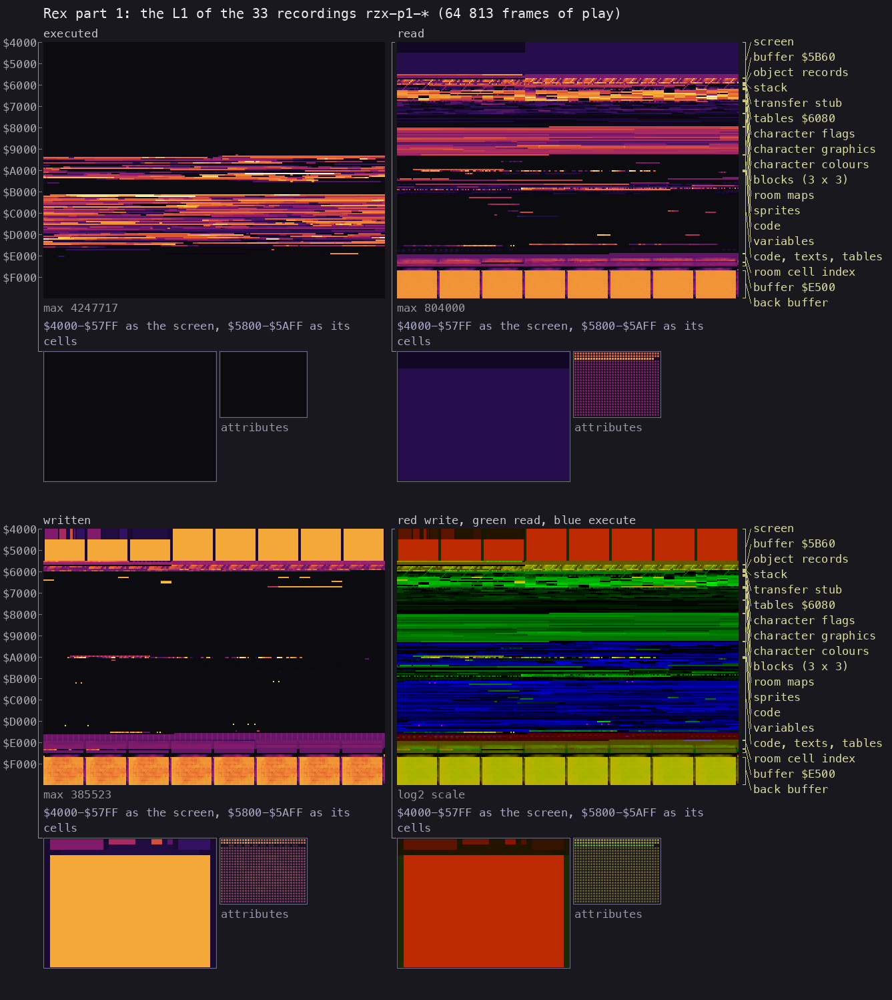
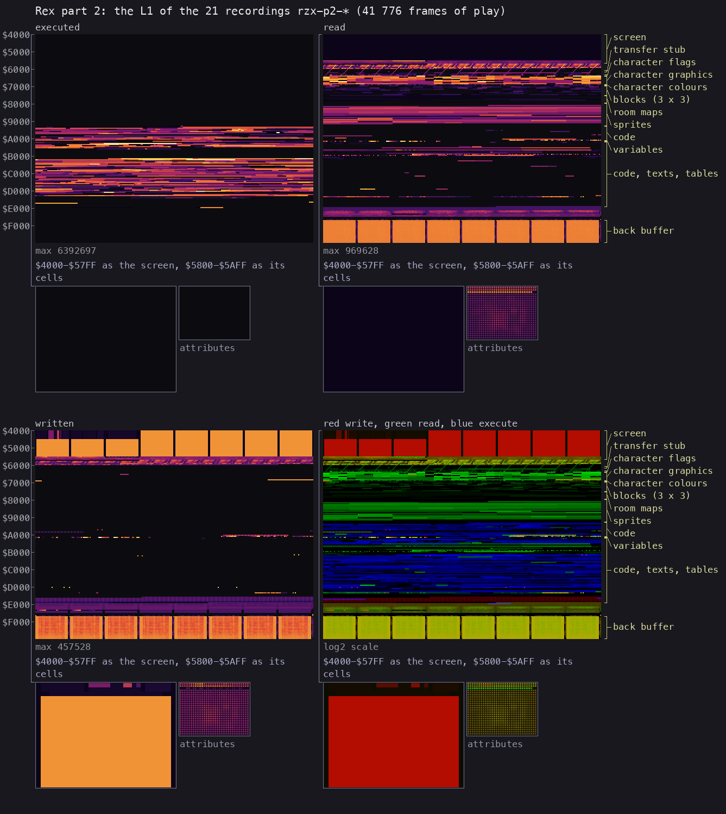
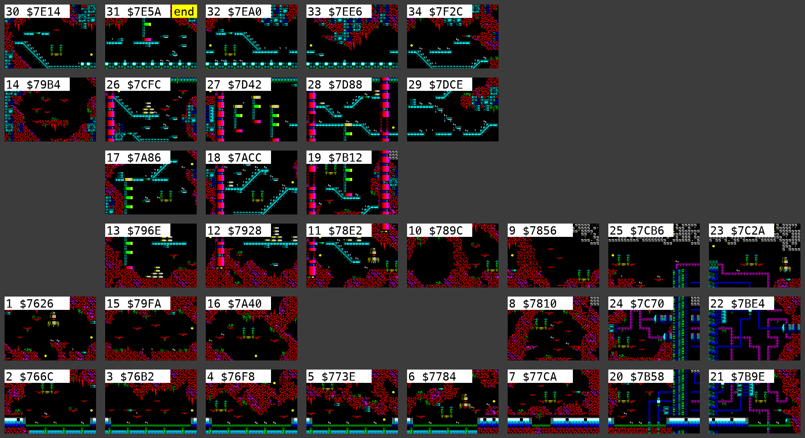
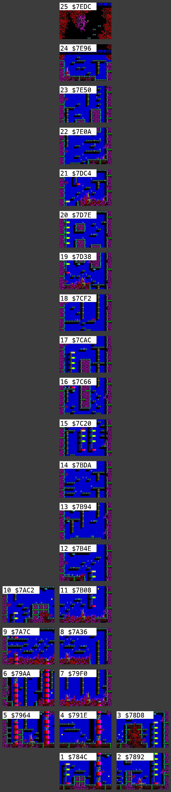

# 2. Architecture

What this covers: the machine budget, the memory map (a figure), stages from the medium to play, the frame, the main
loop's call graph, the module map. The recordings it rests on: `c1` (power-on, side 1 at ROM speed, 128K) and the
RZX segments `rzx-p1-*` and `rzx-p2-*` (from the RZX runs' states; [WALKTHROUGH 6.0](../WALKTHROUGH.md#60-the-recordings)).

<!-- Figures this document needs (GUIDE.md 4.2), remove each line when it is in: -->
<!-- - the stages from power-on to play (mermaid) -->

Stage 1 drew the first map of this chapter; stage 2 names the routines and fills in the rest.

## 2.1 The memory map

Part 1 (REX 1) is one image from `$6018` to `$FFF9`, as the ROM loads it; part 2 (REX 2) and DEMO are
`$61A8-$FFF9`. None of them pages: the only write to `$7FFD` in each is in the transfer stub at the image's start,
which never runs. The map of part 1 (part 2 has the same layout, its tables a few hundred bytes higher, 2.3):

| Range | What | Witness |
| --- | --- | --- |
| `$0000-$3FFF` | ROM; no ROM routine runs in play (interrupts are off) | the L1 of `rzx-p1-*`: 0 interrupts, no instruction below `$9000` executed |
| `$4000-$5AFF` | the screen: the HUD in character rows 0-2, the room in rows 3-23 (attributes from `$5860`) | DrawRoom `$C745` (`$C7A8`) |
| `$5B60-$5E5F` | a 768-byte buffer, written each pass | the heatmap (2.2) |
| `$5E66-$5FBF` | the room's object records, 24 bytes each, the count in `$A092` (position, flags, sprite bank, size) | `$BA5C` (`LD IX,$5E66`) |
| `$5FC0-$5FFF` | the stack: the main loop at `SP` = `$6000`, the low mark `$5FE2` | 2.2 |
| `$6018-$607D` | a transfer stub of the authors' (ports `$3F`, `$1F`, `$7FFD`); never run, overwritten in play | `work/stage1/NOTES.md` |
| `$62E0-$63DF` | character flags, one byte a character | `$C80A` |
| `$63E0-$6BDF` | character graphics, 256 characters of 8 bytes | `$C818` |
| `$6BE0-$6CDF` | character colours, one attribute a character | `$C7EA` |
| `$6CE0-$75DF` | blocks: 256 of 3 x 3 characters (9 bytes) | `$C78D` |
| `$75E0-$7F71` | room maps: 70 bytes a room (7 rows of 10 blocks), rooms 0-34 | `$C773` |
| `$7F72-$9479` | sprites, each picture in four shifts; Rex at `$80F2` | DrawSprite `$B258`; [the sheet](img/sprites/part1-sheet.png) |
| `$947A-$9FFF` | code: the entry `$947A` (`DI`, the variables set), the main loop `$9583-$9678`, a life lost `$9C76` | `c1`: entered at frame 13 701; 2.4 |
| `$A012-$A0C3` | the variables: lives `$A063`, smart bombs `$A06C`, shield `$A04D`, weapons `$A04F-$A053`, score `$A03E`, high score `$A08B`, Rex `$A0B6`/`$A0B7`, room `$A0B8`, restart point `$A059-$A05B`, exits `$A08D-$A090` | `work/stage1/NOTES.md`; the RZX run's memory |
| `$A100-$DE9E` | code, texts (the menu, the roll call, GAME OVER, CODE), tables (RoomExits `$B133`, the shift tables from `$AE5D`, the mirror table `$AD5D`) | the L1 |
| `$DE9F-$E4FE` | the room's cell index (cleared by DrawRoom) | `$C74C` |
| `$E4FF-$E7FE` | a buffer, cleared at the entry | `$9485` |
| `$EB00-$FFFF` | the back buffer: 21 character rows of 256 bytes in plain order; cleared by `PUSH`, sprites ORed in, copied to the screen | `$B205`, `$B258` |

The point: a room is built from three levels of data (rooms of blocks, blocks of characters, characters of eight
bytes and a colour) and drawn with the sprites into a back buffer, which is then copied to the screen. In play the
game changes only its variables, its buffers and a few bytes of its own code (2.2).

## 2.2 The heatmap and the stack

*What part 1 executed, read and wrote over the 33 RZX segments `rzx-p1-*` (64 813 frames of play), one row a 256-byte
page from `$4000` (top) to `$FFFF`. How to read it: brighter is more often; the composite (bottom right) shows writes
red, reads green, execution blue. The point: the code runs only in `$9000-$DFFF`; the tables below `$9000` are read
and never written; the writes go to the buffers at the top, the screen and the variables. Command: `python3
kit/heatmap.py work/stage1/heat/p1-l1.json docs/img/arch/heatmap-part1.png --cell 2 --from 4000 --to FFFF --regions
work/stage1/heat/regions-p1.txt` (the L1s summed by `kit/merge_l1.py`).*

*The same for part 2 over the 21 segments `rzx-p2-*` (41 776 frames). The point: the same layout, the tables moved up
(2.3). Command: as above with `p2-l1.json` and `regions-p2.txt`.*

What changes between the image as loaded and in play (the RZX run's 64 K every 250 frames against the tape image,
`work/stage1/NOTES.md`): in part 1, 9568 bytes ever differ: the variables; the stub at `$6018-$60D6` (reused); the
characters rotated in place each pass (`$6438`, `$64B0`, `$6758`, `$6858`); the key-reading code `$A479-$A4E5` (DEFINE
writes into it); the CODE text `$A88C`; DrawSprite's operands `$B2AC` and `$B2B0`; the room buffers and the back
buffer. In part 2, 9072 bytes, the same kinds.

The stack: the BASIC's `CLEAR` leaves it under the code; the main loop runs at `SP` = `$6000` in part 1 and `$6190`
in part 2. Its low mark comes from 20 million instructions after each of the RZX states at frames 5000, 20 000, 30 000
and 60 000 (part 1) and 10 000 and 30 000 (part 2) (`work/stage1/stackdepth.py`, `work/stage1/stackdepth.txt`). It is
`$5FE2`, 30 bytes under the main loop (part 1, at `$C895`), and `$6172`, 30 bytes (part 2, at `$C908`).

Three routines borrow `SP` to move bytes fast and give it back. `$B205` clears the back buffer with `PUSH HL` from `SP`
= `$FFFF`; the other two are `$A28A` (`SP` = `$AC0D`) and `$B33E` (`SP` = `$D962`). Each saves `SP` in `$A093` or
`$A095` first.

## 2.3 The levels in memory

*Part 1's 34 rooms, drawn from the level data (RoomMaps `$75E0`, BlockDefs `$6CE0`, the characters `$63E0` and
`$6BE0`). They are placed on a grid by RoomExits `$B133`, starting from room 1, where play starts. Each label is the
room's number and its map's address. How to read it: neighbours on the grid are joined by an exit; room 31's up exit
is 99, the end ("end"). The point: the cave runs right along the bottom, climbs through the middle and turns back left
at the top. Rooms 14, 24, 26, 27 and 30 lie off the route of the RZX run. Command: `python3 tools/rooms.py
work/mkgame/original.bin work/stage1/rooms-p1` (`map.png`).*

*Part 2's 25 rooms, drawn the same way: RoomExits `$B1A7`, RoomMaps `$7806`, BlockDefs `$6F06`, the characters `$6606`
and `$6E06`. The point: after a short run right and left, the Living Tower is one climb, with room 25 at the top.
Command: `python3 tools/rooms.py work/stage1/images/part2.bin work/stage1/rooms-p2 --part 2`.*

| Table | Part 1 | Part 2 | Format |
| --- | --- | --- | --- |
| RoomExits | `$B133` | `$B1A7` | 6 bytes a room: the room up, right, down and left (0 none, 99 the end), then a word, the room's object list |
| RoomMaps | `$75E0` | `$7806` | 70 bytes a room: 7 rows of 10 block codes |
| BlockDefs | `$6CE0` | `$6F06` | 9 character codes a block, 3 x 3 |
| Character graphics | `$63E0` | `$6606` | 8 bytes a character |
| Character colours | `$6BE0` | `$6E06` | an attribute a character |
| Rooms | 1-34 | 1-25 | room 0 is not used (0 means no exit) |

## 2.4 The frame: no interrupt

The game never takes an interrupt. The entry's `DI` is the last `DI` or `EI` it runs, and no recording of play counts
an interrupt ([WALKTHROUGH 1](../WALKTHROUGH.md#1-one-recording-from-power-on)). The main loop runs each pass as fast
as its work allows: about 4.4 frames a pass in part 1 and 4.1 in part 2 (the RZX runs). A pass that draws a new room
takes 22 to 26 frames.
