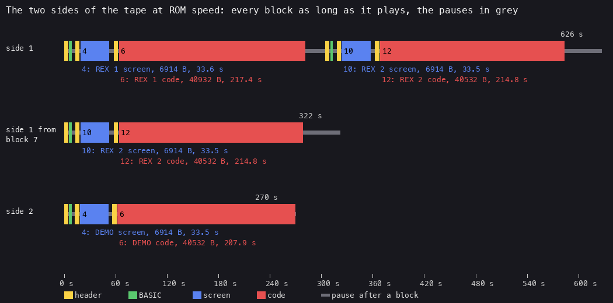
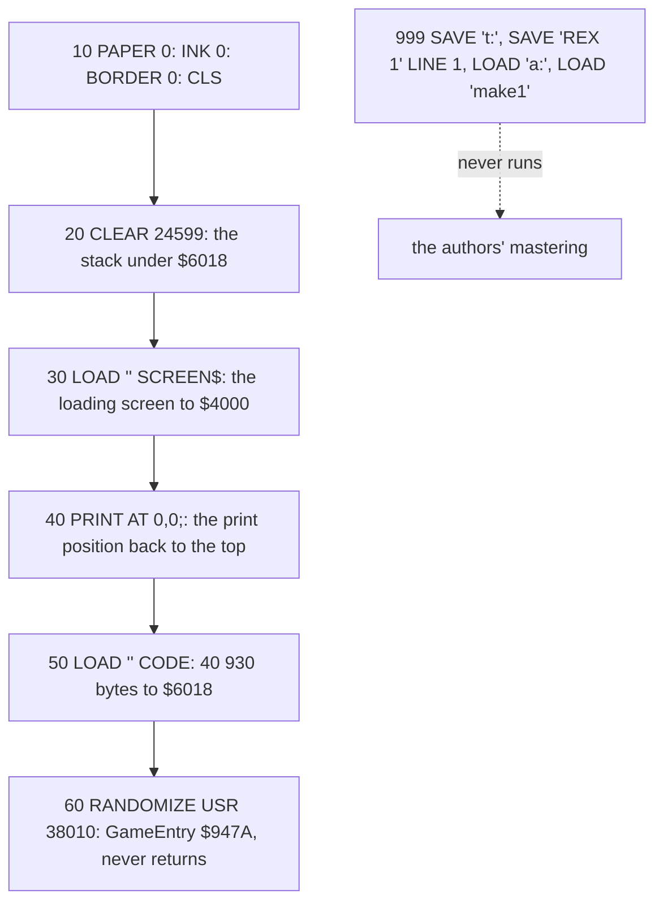
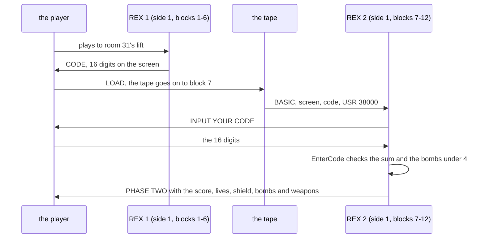
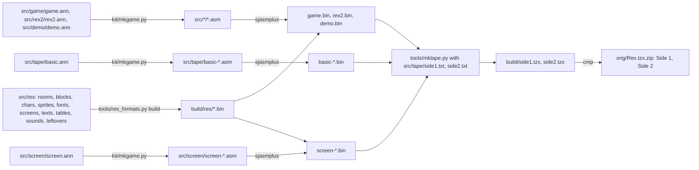
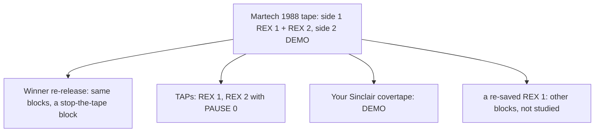

# 3. Build and load

What this covers: the tape block by block (a figure), the BASIC loaders, the stages from power-on to play with their
frames, how REX 2 loads alone and takes the code, the source build, the POKEs, and the releases. There is no custom
loader, no protection and no packer: each part is loaded by the ROM as it was saved.

The recordings it rests on ([WALKTHROUGH 6.0](../WALKTHROUGH.md#60-the-recordings)): `c1` (power-on, side 1 at ROM
speed on the 128K: REX 1), `c2` (power-on, side 1 from tape block 7 at ROM speed: REX 2 alone), `d1` (power-on, side
2 at ROM speed: DEMO). ROM speed means the fast LD-BYTES trap and the turbo tape are off.

## 3.1 The tape block by block

`orig/Rex.tzx.zip` holds two files, one a side of the cassette. Every data block is a standard ROM block (TZX `$10`:
pilot 2168 T, syncs 667 and 735 T, zero 855 T, one 1710 T); the times are at 3.5 MHz, from `tools/tzxblocks.py list`,
and the bytes are the block's as it is on the tape, the flag and the checksum included (the data + 2). Block 0 of each
file is a TZX text block, "Created with Ramsoft MakeTZX".

**Side 1** (`Rex - Side 1.tzx`): two programs, REX 1 (part 1, level 1) and then REX 2 (part 2, level 2).

| Block | Bytes | Flag | What it is | Loads to | Time | Pause after |
| --- | --- | --- | --- | --- | --- | --- |
| 1 | 19 | `$00` | Program header "REX 1", length 151, LINE 1 | | 5.09 s | 1012 ms |
| 2 | 153 | `$FF` | the BASIC of REX 1 (151 bytes, listed below) | the BASIC area | 2.77 s | 4196 ms |
| 3 | 19 | `$00` | Bytes header "ds", length 6912, start 40000 (`$9C40`) | | 5.09 s | 1013 ms |
| 4 | 6914 | `$FF` | the loading screen of REX 1 | `$4000` (`LOAD "" SCREEN$` ignores the header's start) | 33.62 s | 5275 ms |
| 5 | 19 | `$00` | Bytes header "ds", length 40930, start 24600 (`$6018`) | | 5.09 s | 1014 ms |
| 6 | 40 932 | `$FF` | the code of REX 1 | `$6018-$FFF9` | 217.43 s | 23 072 ms |
| 7 | 19 | `$00` | Program header "REX 2", length 151, LINE 1 | | 5.09 s | 1017 ms |
| 8 | 153 | `$FF` | the BASIC of REX 2 | the BASIC area | 2.77 s | 4404 ms |
| 9 | 19 | `$00` | Bytes header "ds", length 6912, start 40000 | | 5.09 s | 1017 ms |
| 10 | 6914 | `$FF` | the loading screen of REX 2 (142 bytes differ from REX 1's, from offset 2147) | `$4000` | 33.54 s | 5147 ms |
| 11 | 19 | `$00` | Bytes header "ds", length 40530, start 25000 (`$61A8`) | | 5.09 s | 1015 ms |
| 12 | 40 532 | `$FF` | the code of REX 2 | `$61A8-$FFF9` | 214.80 s | 42 693 ms |

Side 1 plays 535.47 s, 26 816 frames of 69 888 T, without its pauses (90.9 s of pauses on the tape); REX 1 alone
(blocks 1-6) 269.1 s, 13 478 frames.

**Side 2** (`Rex - Side 2.tzx`): DEMO, the "Tutor Mode" of the instructions.

| Block | Bytes | Flag | What it is | Loads to | Time | Pause after |
| --- | --- | --- | --- | --- | --- | --- |
| 1 | 19 | `$00` | Program header "DEMO", length 150, LINE 1 | | 5.08 s | 1016 ms |
| 2 | 152 | `$FF` | the BASIC of DEMO | the BASIC area | 2.77 s | 3804 ms |
| 3 | 19 | `$00` | Bytes header "ds", length 6912, start 40000 | | 5.09 s | 1015 ms |
| 4 | 6914 | `$FF` | the loading screen of DEMO (97 bytes differ from REX 2's) | `$4000` | 33.52 s | 3960 ms |
| 5 | 19 | `$00` | Bytes header "ds", length 40530, start 25000 (`$61A8`) | | 5.09 s | 1011 ms |
| 6 | 40 532 | `$FF` | the code of DEMO: REX 2's layout (the same length and address), 34 535 bytes different from REX 2's code; byte for byte the Your Sinclair covertape demo (ZXDB `RexDemo.tap`) | `$61A8-$FFF9` | 207.89 s | 0 |

Side 2 plays 259.44 s, 12 993 frames, without its pauses.



*Both sides of `orig/Rex.tzx.zip` on one time scale, at ROM speed. How to read it: each block is a bar as long as it
plays (yellow a header, green a BASIC, blue a screen, red a code block, the number on the bar); the grey bar after
it is its pause; the middle row is side 1 played from block 7, as `c2` loads REX 2 alone. The point: each part is
the same four blocks, a header and BASIC, a screen, a code block of about 40 K that takes 3.5 minutes; side 1 holds
two parts one after the other, and REX 2 can be loaded without REX 1. Command: `python3 tools/fig_tape.py` (the
timings of `tools/tzxblocks.py`).*

The point: there is no custom loader and no protection. Each part is a BASIC that loads a screen and one code block
with the ROM and runs it; the two parts are two programs on the same side, and side 2 holds the demo.

## 3.2 The BASIC loaders

The three programs differ only in their `CLEAR` and their entry (`tools/basic_list.py` on the blocks' data):

| Line | REX 1 | REX 2 | DEMO |
| --- | --- | --- | --- |
| 10 | `PAPER 0: INK 0: BORDER 0: CLS` | the same | the same |
| 20 | `CLEAR 24599` (`$6017`) | `CLEAR 24999` (`$61A7`) | `CLEAR 24999` |
| 30 | `LOAD "" SCREEN$` | the same | the same |
| 40 | `PRINT AT 0,0;` | the same | the same |
| 50 | `LOAD "" CODE` | the same | the same |
| 60 | `RANDOMIZE USR 38010` (`$947A`) | `RANDOMIZE USR 38000` (`$9470`) | `RANDOMIZE USR 35460` (`$8A84`) |
| 999 | `SAVE "t:": SAVE "REX 1" LINE 1: LOAD "a:": LOAD "make1"` | the same with "REX 2", "make2" | the same with "DEMO", "maked" |

Line 999 never runs (the program starts at line 1 and line 60 does not return). It is the authors' mastering line:
`SAVE "t:"` and `LOAD "a:"` select a tape and a disk drive in the syntax of a disk interface, so the parts were
put together from a disk ("make1", "make2", "maked") and saved to tape with `SAVE ... LINE 1` (known only from the
BASIC's text; no recording runs it; which interface is not known).

The entries were checked in the code: REX 1's `$947A` starts with `DI` and clears the game's variables
(`work/stage1/zdis.py` on block 6).



*REX 1's BASIC, line by line (REX 2's and DEMO's differ only in lines 20 and 60). How to read it: the solid arrows
are the order the program runs; line 999 is reached by no path. The point: the loader is the ROM's: three `LOAD`
statements and a `USR`. `CLEAR` puts the BASIC's stack just under the code block, where the game keeps it (doc 2,
2.4). Witness: `c1` (the BASIC's `CLS` by frame 660, the screen by 2620, the code from 3070, the entry at 13 701).*

## 3.3 The stages from power-on to play

```mermaid
flowchart LR
    P["power-on, 128K menu: frame 0"] --> R["ROM: LOAD '' typed, frame 53 on"]
    R -->|"block 2 loaded"| B["BASIC REX 1 runs: CLS by frame 660"]
    B -->|"block 4, 33.6 s"| S["loading screen complete: frame 2620"]
    S -->|"block 5 header"| C["code block starts: $6018 written by frame 3070"]
    C -->|"block 6, 217.4 s"| E["GameEntry $947A: frame 13 701 T 29 586"]
    E -->|"DI, TitleMenu"| M["the menu and the roll call"]
```



*REX 1's load in `c1`, each stage with the first frame at which its effect is in memory (`memory_at` on `$5AFF` and
`$6018`, sampled every 10 frames; the entry from `rs.py stages`). How to read it: the edges name the block that
moves the machine to the next stage. The point: one stage of code: the ROM loads, the BASIC jumps, the game runs; no
code of the game runs before its entry, and nothing is unpacked or decrypted after it. Commands: `python3
work/docs/rxA/mem.py work/docs/rxA/c1 5AFF 1 600 900 10`, the same with `2400 2700 10`, and `6018 1 3000 3300 10`.*

| Stage | REX 1 (`c1`) | REX 2 (`c2`, from block 7) | DEMO (`d1`) |
| --- | --- | --- | --- |
| the code block loaded to | `$6018-$FFF9` | `$61A8-$FFF9` | `$61A8-$FFF9` |
| the entry, from the BASIC's `USR` | `$947A` at frame 13 701 | `$9470` at frame 13 567 | `$8A84` at frame 13 224 |
| interrupts after the entry | none (159 before it) | none: the entry is `DI` | none: the entry is `DI` |

*The stages table. The point: the three parts load the same way and enter at the address their BASIC gives.*

The static decode against the recordings:

| What the static decode says | Where | What the recording shows | Agrees |
| --- | --- | --- | --- |
| REX 1's code is 40 930 bytes for `$6018` (block 5's header) | `tools/tzxblocks.py list` | `c1`'s L1: the ROM's LD-BYTES writes `$6018-$FFF9` | yes |
| REX 1 enters at `USR 38010` = `$947A` (line 60) | `tools/basic_list.py` | `c1`: the first instruction above `$6000` is `$947A`, frame 13 701 | yes |
| REX 2 enters at `USR 38000` = `$9470` | the same | `c2`: `$9470` at 13 567 | yes |
| DEMO enters at `USR 35460` = `$8A84` | the same | `d1`: `$8A84` at 13 224 | yes |
| the game's first instruction is `DI` and no `EI` follows | the listings | the L1s: no interrupt after the entry | yes |
| the block's first bytes (`$6018`) are code of a development link | `src/game/graphics.asm` | no instruction runs there; the menu overwrites it | yes: a leftover (doc 2, 2.5) |

Unpacking: none. No part has a packer or a cipher: the code block as loaded is the code that runs (stage 2 rebuilt
all three byte for byte from plain source), so this document has no unpack animation.

## 3.4 REX 2 alone, and the code

REX 2 is the second program on side 1. It does not need REX 1 in memory: its BASIC clears to `$61A7`, loads its own
screen and its own 40 530 bytes, and enters at `$9470`. A player who finished REX 1 rewinds nothing: the tape is
already past REX 1's last block, and `LOAD ""` takes REX 2's header next. A player who wants part 2 directly
positions the tape at REX 2's header (block 7), as `c2` does (`SEEK=6`: the emulator's tape counts the blocks without
the TZX text block).

What passes from REX 1 to REX 2 is only the code the player wrote down ([doc 1, 1.7](01-game-design.md#17-the-access-code)).
REX 2's menu asks for it first (`MenuCode`, `EnterCode $DB27`), and its NewGame `$948E` starts from it:

```
DC4B  LD A,(CodeTexts+$0073)  ; EnterCode, the last test
DC4E  SUB $30
DC50  LD (CodeBombs),A        ; the bombs from the code
DC53  CP $04
DC55  JP NC,CodeBad           ; 4 or more: INVALID CODE
DC58  RET
...
94E1  LD HL,(CodeScore)       ; NewGame, REX 2
94E4  LD (Score),HL           ; the score of part 1
94E7  LD (GrowthsKilled),HL
94EA  LD A,(CodeLives)
94ED  LD (Lives),A
94F0  LD A,(CodeBombs)
94F3  LD (Bombs),A
94F6  CALL StartWeapon        ; the weapons the code holds
94F9  LD A,(CodeShield)
94FC  LD (ShieldEnergy),A
```



*How a game crosses the two parts. The point: the "multi-load" is two separate programs joined by the player's
handwriting; nothing is saved to tape or kept in memory. Witness: `p1-code` (the code at frame 1000), `c2` (REX 2
loaded alone, INVALID CODE at frame 1750, the RZX's code accepted at 3250, PHASE TWO and the score 0100300 at
4250).*

## 3.5 The build

The source rebuilds both TZX files byte for byte (stage 2; `tools/build.sh`):



*The build. How to read it: boxes are files, arrows the tools between them. The point: every byte of the tape comes
from an editable source; the last step compares the result with the original. Command:
`sh tools/build.sh $SJASMPLUS` prints "side1.tzx and side2.tzx identical to orig/Rex.tzx.zip's Side 1 and Side 2".*

| Input | What it gives | Tool |
| --- | --- | --- |
| `src/game/game.ann` (23 module files and `game.asm`) | REX 1's code, `$6018-$FFF9` | `kit/mkgame.py`, then sjasmplus |
| `src/rex2/rex2.ann` (23 module files and `rex2.asm`) | REX 2's code, `$61A8-$FFF9` | the same |
| `src/demo/demo.ann` (20 module files and `demo.asm`) | DEMO's code, `$61A8-$FFF9` | the same |
| `src/tape/basic.ann` | the three BASIC programs | the same |
| `src/screen/screen.ann` and `src/res/screens/*.png` | the three loading screens | `tools/res_formats.py`, sjasmplus |
| `src/res/` (58 files) | the rooms, blocks, characters, sprites, fonts, texts, tables, sound effects, leftovers | `tools/res_formats.py build` (`check` converts each back) |
| `src/tape/side1.txt`, `side2.txt` | the TZX blocks in order, with their pauses and header fields | `tools/mktape.py` |

## 3.6 The POKEs

The ZXDB POKE file (`Rex (1988)(Martech Games).pok`, `work/candidates/pok/`), each POKE read against the listing:

| POKE | Name | Address | The instruction it changes | What happens |
| --- | --- | --- | --- | --- |
| 40057,0 | [Pt1] Infinite Lives | `$9C79` | `DEC A` in LifeLost, after `LD A,(Lives)` | `NOP`: the lives never drop |
| 38745,0 | [Pt1] Infinite Smarts | `$9759` | `DEC A` in SmartBomb, after `LD A,(Bombs)` | the bombs never drop |
| 39396,0 | [Pt1] Infinite Shields | `$99E4` | `SUB L` in ShieldDrain | the shield never drains |
| 38157,0 | [Pt1] Got all weapons | `$950D` | `XOR A` in NewGame, before the four `LD (HasDoubleFire),A`... | `NOP`: A keeps 1 (from `LD A,$01` before), so all four weapons are held |
| 46661,201 | [Pt1] No gun shots | `$B645` | MoveEnemyBullets' first byte | `RET`: the enemies' shots never move |
| 51576,201 | [Pt1] No extra enemy soldiers fire | `$C978` | SpawnScripted's first byte | `RET`: no scripted spawn |
| 38416,58; 46372,62; 46373,20 | [Pt1] Rapid fire | `$9610`; `$B524` | `JP Z,MainRexKeys`; `SLA A` in SlotsByPower | `LD A,(nn)`: the fire latch is always cleared, so holding fire repeats; `LD A,20`: 21 shot slots whatever the power |
| 53242,58; 53214,58 | [Pt1] Speed up | `$CFFA`; `$CFDE` | `JP Z,WalkLeftFast`, `JP Z,WalkRightFast` | `LD A,(nn)`: the jump is never taken, so the 4-pixel step (with SpeedUpTick) always runs |
| 40303,0 | [Pt2] Infinite Lives | `$9D6F` | `DEC A` in LifeLost | as part 1 |
| 38721,0 | [Pt2] Infinite Smarts | `$9741` | `DEC A` in SmartBomb | as part 1 |
| 39170,0 | [Pt2] Infinite Shields | `$9902` | `SUB L` in ShieldDrain | as part 1 |
| 56287,58; 56405,201 | [Pt2] Access code always right | `$DBDF`; `$DC55` | `JP NZ,CodeBad` after the checksum; `JP NC,CodeBad` after the bombs | `LD A,(nn)`: the checksum is ignored; `RET`: the bombs are not checked |
| 43545,0 | Infinite time | `$AA19` | no instruction: data (ShardPaths in part 1, LobPaths in part 2) | changes a byte of a path table; it does not stop the sweep |

*Each POKE against `build/game.lst` and `build/rex2.lst`. How to read it: "the instruction it changes" is the
original; "what happens" is the effect read from the code. The point: the POKEs are well aimed but one; the
"Infinite time" POKE must come from another version of the game, because in this release its address holds data.
Two more facts from the code: "Access code always right" keeps the test for a sum of 0 (`JP Z,CodeBad` at
`$DBB8`), so a code whose 13 printed digits are all 0 is still refused; and the 4-pixel path the "Speed up" POKE forces also calls SpeedUpTick each step. Known only from
the code: the effects were read from the listings, not run.*

A sweep POKE that works on this release, from the code ([doc 4, 4.8](04-game-loop.md#48-every-delay-pause-and-timer)):
`POKE 41241,0` turns `DEC A` at `$A119` in HudSweep into `NOP`, so the sweep's width never shrinks (known only from
the code; not run).

## 3.7 The releases and the copies

Only the standard Spectrum tape is studied. Every copy of it the collection lists was compared block by block with
the original (`tools/media_compare.py`, `work/stage1/media-compare.txt`; [README](../README.md#other-releases-and-copies)):

| Copy | What it is | Against the original |
| --- | --- | --- |
| `orig/Rex.tzx.zip` (ZXDB; the same files as TOSEC 2012 "(Martech Games)(Side A)", "(Side B)") | Martech, 1988: the original | the reference |
| ZXDB `Rex(Winner).tzx.zip`, TOSEC "(Winner)" | the Winner re-release | every data block byte for byte; other pauses, and a "stop the tape" block between REX 1 and REX 2 |
| ZXDB `RexSideA.tap.zip`, `RexSideB.tap.zip` | REX 1 and REX 2 as TAPs | the screens and code byte for byte; the BASIC adds `PAUSE 0` before `RANDOMIZE USR` |
| TOSEC "(Side B)[a].tzx" | REX 2 alone | REX 2's blocks byte for byte, 1 s gaps |
| TOSEC TAPs "(Martech Games)", "(Side B)", "(Side B)[a]" | REX 2 alone; DEMO; DEMO again | the original's blocks byte for byte (the `[a]` header differs in 4 bytes) |
| ZXDB `RexDemo.tap.zip` | the Your Sinclair covertape demo | side 2's DEMO byte for byte |
| TOSEC "(Side A)[a].tzx", "(Side A).tap" | a re-save of REX 1 | a BASIC "REX" with code in it and four headerless blocks: none of the original's blocks (a hack, not studied) |
| `Rex.dsk`, Z80 snapshots, MDR cartridges, TR-DOS conversions | other media | not studied |



*The copies. The point: every standard copy holds the same code; the differences are pauses, a stop block and a
`PAUSE 0` in the BASIC. Witness: `work/stage1/media-compare.txt`.*

## 3.8 Loaders, protection and packers: none

- **Loaders:** the ROM's `LD-BYTES`, called by `LOAD ""` from the BASIC; every block is a standard ROM block (TZX
  `$10`, standard timings).
- **Protection:** none: no header check, no checksum of the code, no encrypted bytes.
- **Packers:** none: the code block runs as loaded.

Witness: `c1`, `c2` and `d1` load at ROM speed with the ROM's routine only, and the rebuilt tape is identical to the
original (3.5).

## 3.9 Known only from the code

- Line 999 of each BASIC: the authors' disk mastering; no recording runs it (3.2).
- Every POKE's effect (3.6), the "Infinite time" POKE hitting data, and the working sweep POKE `41241,0`.
- REX 2 keeps no byte of REX 1: read from the BASIC's `CLEAR 24999` and the code block's range; `c2` loads REX 2
  alone and plays, which shows it does not need REX 1, not that nothing could be kept.
