# 4. Game loop

What this covers: the state machine of the whole program, the interrupts (there are none), the main loop of each
part, the order of work inside a [pass](README.md#terms), what a pass costs, the room build, the long passes, and
every delay and timer. The recordings it rests on ([WALKTHROUGH 6.0](../WALKTHROUGH.md#60-the-recordings)):

- `c1` (power-on, side 1 at ROM speed, 128K), `c2` (REX 2 loaded alone), `d1` and `demo-cycle` (DEMO);
- the RZX segments `rzx-p1-NNNNN` and `rzx-p2-NNNNN`, chiefly `rzx-p1-08000` (rooms 5 and 6);
- stage 2's `p1-code`, `p1-gameover`, `p1-cursor`.

Frame numbers: a `memory_at` frame N is the state at the start of frame N; a trace puts an instruction in the frame
where it ran. A frame of the 128K is 70 908 T (3.5469 MHz, 50.02 frames a second). A time written `F:T` is T-state T
of frame F.

## 4.1 The program as a state machine

Each of the three parts is one program with one entry. REX 1 and REX 2 share the same states. REX 2 adds the code
entry at the menu and has no code panel. DEMO replaces the menu and the keys with the tutor's script.

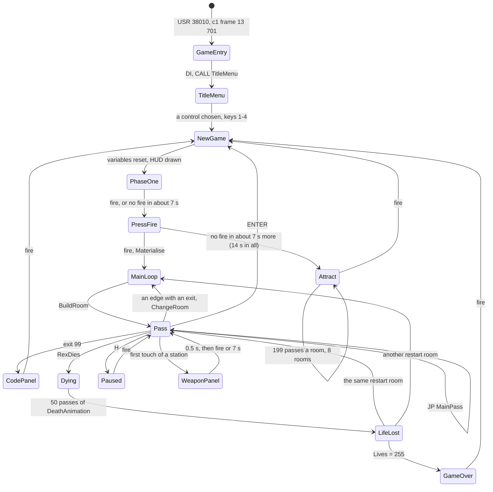

*The program of REX 1 (`src/game/entry.asm`, `mainloop.asm`, `death.asm`, `codepanel.asm`). How to read it:

- every box is a place where the program stays;
- every arrow is labelled with its trigger;
- Dying, WeaponPanel and Paused are drawn as states because the player sees them so; in the code they are a flag
  (`Dying $A055`) or a call that does not return until fire.

The point: the whole game is one loop. A room change and a lost life in another room leave the pass by `POP BC` and
`JP MainLoop`; only ENTER, game over and the code panel go back to `NewGame`. Witnesses: `c1` (menu, PHASE ONE,
attract, play, game over), `p1-code` (the code panel, then a new game), `p1-gameover`, `p1-cursor` (H and ENTER).*

The transitions, with their code:

| From | Trigger | To | Code |
| --- | --- | --- | --- |
| BASIC | `RANDOMIZE USR 38010` | GameEntry `$947A` | `c1` frame 13 701 |
| GameEntry | always | TitleMenu `$DAC0` | `CALL TitleMenu`; it returns once a control is chosen |
| NewGame `$9498` | PHASE ONE, then PRESS FIRE | MainLoop `$9583` | `WaitFireOrAttract $97C3` twice, then `Materialise` |
| the first wait (PHASE ONE) | 50 000 polls without fire | PRESS FIRE | `Temp1` = 0 is not tested: the program goes on |
| the second wait (PRESS FIRE) | 50 000 polls more without fire | Attract `$A915` | `9576 LD A,(Temp1)`, `957A JP Z,Attract` |
| a pass | Rex crosses an edge with an exit | MainLoop | `ExitRight $D0B1` and its three siblings: `POP BC`, `JP ChangeRoom $C95A` |
| a pass | the exit is 99 | CodePanel `$A7CE` | `ChangeRoom`: `CP $63`, `JP Z,CodePanel` |
| a pass | a hit without the shield, or the sweep at 0 | Dying | `RexDies $9BDA` |
| Dying | 50 passes | LifeLost `$9C76` | `DeathAnimation $9AC5` |
| LifeLost | `Lives` drops to `$FF` | GameOver `$9CBF` | `CP $FF`, `JP Z,GameOver` |
| a pass | ENTER (`$BFFE` bit 0) | NewGame | `JP Z,NewGame` in MainKeys `$95D2` |
| a pass | H (`$BFFE` bit 4) | Pause `$A4E7` | `CALL Z,Pause` |
| GameOver, CodePanel | fire | NewGame | `WaitFire $97EA` |

**REX 2** (`src/rex2`) keeps this machine and changes three places:

- The menu runs `MenuCode` and `EnterCode $DB27` before the keys 1-4. A bad code prints INVALID CODE and goes back to
  `MenuCode` (`c2` frame 1750).
- NewGame `$948E` takes the score, lives, bombs, shield and the weapons owned from the code; StartWeapon `$BAC6`
  always starts with the laser at power level 3 and rank 2.
- There is no exit 99. The game ends when the big squidgy thing in room 25 dies (`BossExplodes $99E3`), then the
  ending text (`rzx-p2-40000`).

**DEMO** (`src/demo`) has no menu and no code. Its MainLoop `$8B6A` builds the room itself and runs the tutor:
`TutorStep` feeds a scripted input, `TutorPanels` prints the panels, `TutorArrow` points at things. The rooms come in
the order 4, 1, 0, 2, and then the demo starts again (`demo-cycle`, 30 312 frames). SPACE runs `DemoPause $9FAD`.

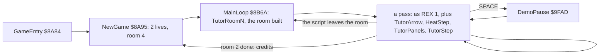

*DEMO's loop (`src/demo/entry.asm`, `controls.asm`, `tutor.asm`). How to read it: the boxes are the routines, the
arrows their order. The point: DEMO is REX 1's engine with the keys replaced by a script. The random seed is reset
in every room (`$0313` and `$11`), so each run is the same. Witness: `demo-cycle` (no key pressed), `d1`.*

## 4.2 Interrupts: none

The game never takes an interrupt. Each part's entry starts with `DI`, and no instruction of the game runs `EI`:

```
947A  GameEntry:
947A  DI                       ; the first instruction of REX 1
947B  XOR A
947C  LD (ControlXor),A
947F  LD (AttractFlag),A
9482  CALL TitleMenu
```

- **The mode:** IM 1, as the ROM left it. There is no `IM 2`, no vector table and no `HALT` in the three blocks (a
  search of `src/*/*.asm`).
- **Where interrupts are off:** everywhere in the game. The ROM's `LD-BYTES` runs with them off too; the BASIC before
  it runs with them on.
- **The witness:** `c1` counts 159 interrupts, all before frame 13 701, the entry. The L1 of every play recording
  (`rzx-p1-*`, `rzx-p2-*`, `p1-*`, `demo-cycle`) counts 0.
- **Why:** three routines point `SP` into a buffer to move bytes fast (4.4). An interrupt in the middle would push its
  return address into the buffer or the cell list. With no interrupt the authors needed no guard around them.
- **How the loop keeps time:** it does not. There is no `HALT`, no frame counter and no read of the ROM's `FRAMES`. A
  pass takes as long as its work, and the speed of the game is the speed of the code (4.5).

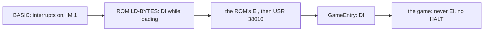

*Interrupts across the load and the game. The point: the last `EI` the machine runs is the ROM's after the last
block; the game's `DI` closes it for good. Witness: `c1`, 159 interrupts in frames 0-13 700, none after.*

A pass longer than a frame breaks nothing here, because nothing waits for the frame. Rex moves 2 pixels a pass, not 2
pixels a frame. A room with more objects runs slower, and the player sees the whole game slow down (4.5).

## 4.3 The main loop and the order of a pass

`MainLoop $9583` builds the room and falls into `MainPass $9586`. The pass is a fixed list of calls, then the keys,
then Rex's movement, then the animated characters, and `JP MainPass` at `$9678`. The stack is `$6000` at the loop's
level in REX 1 and `$6190` in REX 2.

The order, as the code runs it (the asm cut to its lines):

```
9583  MainLoop:
9583  CALL BuildRoom          ; a new room (4.6)
9586  MainPass:
9586  CALL MoveBullets        ; 1. Rex's shots
9589  CALL MoveEnemyBullets   ;    the enemies' shots
958C  CALL UpdateDrones       ;    the multiple's drones
958F  CALL RexState           ;    the death animation, the shield, the shots' hits
      CALL SparkleUpdate
      CALL SparkleDraw
      CALL UpdateObjects      ;    each object moved, its sprite ORed into the buffer
      CALL SoundStep          ; 2. the AY channels
      CALL DrawAnimCells      ;    the scenery written into the buffer
      CALL BufferToScreen     ;    168 lines to the screen
      CALL ClearBuffer        ;    the buffer zeroed by PUSH
      CALL SoundStep
      CALL EnemyBulletsHitRex ; 3. collisions, power, spawns
      CALL PowerBar
      CALL SpawnScripted
      CALL SpawnRandom
      CALL SmartBombStep
      CALL KillFlashFade
      CALL FadeStep
      CALL HudSweep           ;    the room's timer (4.8)
      CALL ReadDown           ; 4. down toggles the shield
      CALL Z,ShieldToggle
95D2  MainKeys:
95D2  LD BC,$BFFE             ;    ENTER, H, SPACE: fixed keys
      IN A,(C)
      BIT 0,A
      JP Z,NewGame            ;    ENTER: a new game
      ...
      CALL Z,Pause            ;    H
      ...
      CALL Z,SmartBomb        ;    SPACE
      LD A,(Dying)
      OR A
      JP NZ,MainAnimate       ; 5. Rex's keys only while he lives
      CALL ReadFire
      CALL Z,FireWeapon
      CALL ReadRight
      CALL Z,WalkRightKey
      CALL ReadLeft
      CALL Z,WalkLeftKey
      CALL ReadUp
      CALL Z,StartJump
      CALL RexJump
      CALL RexFall
      CALL RexWalk            ;    may leave the room by an edge
      CALL CellsUnderRex      ;    lift, restart marker, recharger, station
      MainAnimate:
      RRC (HL)                ; 6. the animated characters rotated in place
      ...
      CALL AnimateCells
      LD A,(PassToggle)
      XOR $01                 ;    work done every other pass
      LD (PassToggle),A
9678  JP MainPass
```

The same in pseudocode:

```
loop forever:
    build_room()                                    # after a room change only
    repeat:
        move_rex_shots(); move_enemy_shots(); move_drones()
        rex_state(); sparkles()
        for each object: move it; OR its sprite into buffer
        sound_step()
        for each scenery cell: write its 8 bytes into buffer     # covers the sprites
        copy buffer to the screen; zero buffer
        sound_step()
        shots_hit_rex(); power_bar(); spawn(); smart_bomb_step(); fades(); hud_sweep()
        if down: toggle shield
        if ENTER: new_game()
        if H: pause()
        if SPACE: smart_bomb()
        if not dying:
            fire, walk right, walk left, jump on their keys
            jump(); fall(); walk(); look at the cells under Rex   # may leave the room
        rotate the animated characters; pass_toggle ^= 1
```

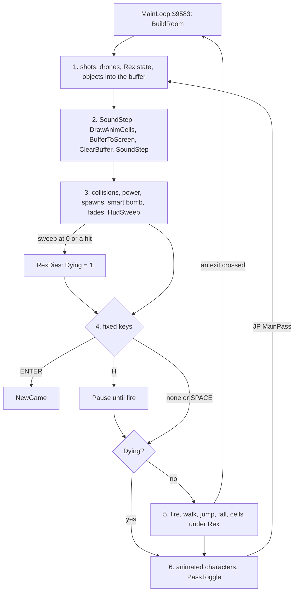

*The order of one pass of REX 1. How to read it: the numbers are the six groups of the asm above; the diamonds are
the only branches inside a pass. The point: the picture is made in the middle of the pass, not at its end. The
sprites are drawn first, then the scenery over them, then the copy. A sprite on a scenery cell is hidden by it: the
scenery is the foreground. Witness: `rzx-p1-08000` frames 1161-1165 (the animation below).*

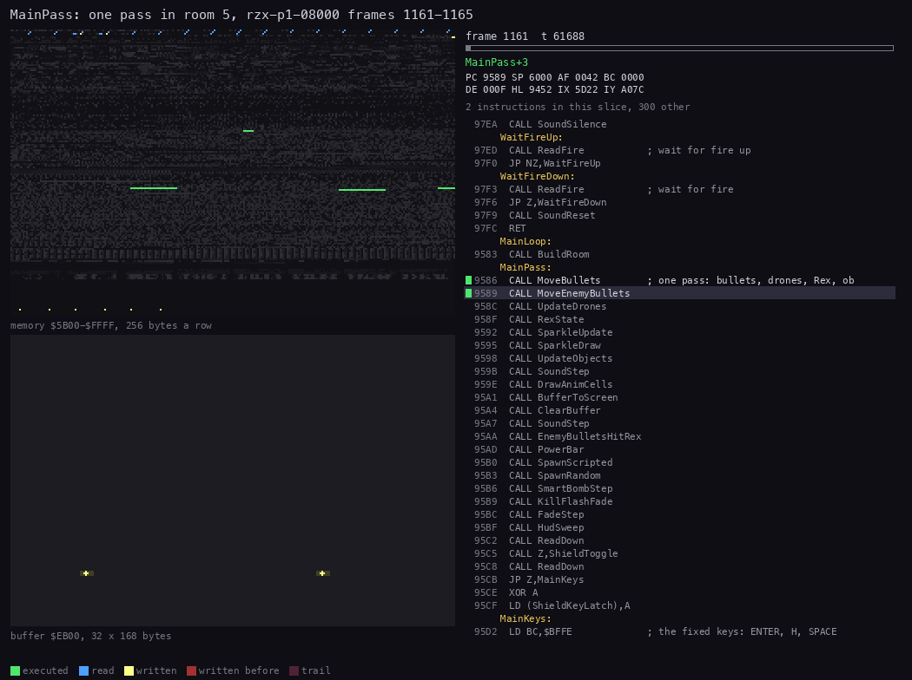

*MainPass at work: one pass of REX 1 in room 5, `rzx-p1-08000` from 1161:58511 to 1165:60804 (285 925 T, 4.03
frames), 90 pictures. How to read it: the left panel is the back buffer `$EB00-$FFFF` as 168 lines of 32 bytes
(BufferToScreen copies columns 0-29 of each); the
right panel lists the routine running and the bytes it touched. The point: the buffer fills with the sprites (step
1), the scenery covers it (DrawAnimCells), the copy takes it to the screen, then `PUSH` clears it from the bottom up.
Command: `python3 ../../kit/routine_anim.py --work work/docs/rxA/p1-08000 --window 1161:58511-1165:60804 --listing
build/game.lst --view buffer:EB00:32x168:rows --range 5B00-FFFF --pc 9583-967E --pictures 90 --title 'MainPass: one
pass in room 5, rzx-p1-08000 frames 1161-1165' --out docs/img/routines/MainLoop.gif`.*

**REX 2's pass** (`src/rex2/mainloop.asm`; MainLoop `$9585`, MainPass `$9588`, `JP MainPass` at `$9660`) is the same
list with three changes:

- after `UpdateObjects` it calls `BossExplodes` while `BossDying` is set;
- while the boss dies Rex cannot walk (`MainBossCheck`), only jump and fall;
- all the animated characters are in `AnimateCells` (REX 1 rotates characters 111 and 143 inline).

**DEMO's pass** (`$8BEF`) adds `TutorArrow` before the draw, `HeatStep` between `KillFlashFade` and `FadeStep`, and `TutorPanels` and
`TutorStep` after the sweep. Its keys come from `TutorStep`'s script, not from the keyboard.

## 4.4 The three routines that borrow the stack

The three heavy steps of every pass use `SP` as a fast pointer. Each first saves `SP` in `Temp1 $A093` or
`Temp2 $A095`, and puts it back at the end. This is safe only because no interrupt can come (4.2).

**ClearBuffer `$B205`** zeroes the 5376 bytes of the buffer with 2688 `PUSH HL`: 42 rounds of 64 pushes, from `SP` =
`$FFFF` down, so it zeroes `$EAFF-$FFFE`: BackBuffer `$EB00-$FFFF` shifted one byte down, from `BufferPlayOrigin`
`$EAFF`. The byte at `$FFFF` is never cleared and `$EAFF` is; neither is copied to the screen.

```
B205  ClearBuffer:
B205  LD (Temp1),SP
B209  LD SP,$FFFF
B20C  LD B,$2A           ; 42 rounds
B20E  LD HL,$0000
B211  ClearBufferLoop:
B211  PUSH HL            ; 64 PUSH HL a round, B211-B250
...
B250  PUSH HL
B251  DJNZ ClearBufferLoop
```

**BufferToScreen `$A28A`** copies the buffer's 168 lines to the screen. `SP` walks `ScreenLines $AC0D`, the screen
address of each play line (line 24 on), and `POP DE` gives each target. Each line copies the buffer's columns 0-29
(`$EB00` + 32 x line on) to screen columns 1-30 with `LDI` and skips buffer columns 30 and 31. `BC` = `$13B0` =
168 x 30 counts the bytes; `JP PE` loops until it is 0.

```
A28A  BufferToScreen:
A28A  LD (Temp1),SP
A28E  LD SP,ScreenLines       ; $AC0D: $4060, $4160, ...
A291  LD HL,BufferPlayOrigin  ; $EAFF
A294  LD BC,$13B0             ; 168 lines x 30 bytes
A297  BufferLine:
A297  POP DE                  ; the line's screen address
A298  INC DE                  ; skip screen column 0
A299  INC HL                  ; HL = $EB00 + 32 x line
A29A  LDI                     ; x 30
...
A2D6  INC HL                  ; skip column 30; A299 skips 31
A2D7  JP PE,BufferLine
A2DA  LD SP,(Temp1)
A2DE  RET
```

**DrawAnimCells `$B33E`** writes every listed scenery cell into the buffer. `SP` walks `SceneryCellList $D962`: pairs of
words, the cell's buffer address and its character's 8 bytes. A low byte of `$FF` ends the list.

```
B33E  DrawAnimCells:
B33E  LD (Temp2),SP
B342  LD SP,SceneryCellList      ; $D962
B345  DrawAnimCellLoop:
B345  POP HL                  ; the cell in the buffer
B346  POP DE                  ; the character's graphics
B347  LD A,L
B348  INC A
B349  JP Z,ReturnToStack      ; $FF: the end
B34C  LD BC,$0020             ; one buffer line down
B34F  LD A,(DE)
B350  LD (HL),A               ; LD, not OR: the scenery covers the sprites
B351  INC DE
B352  ADD HL,BC
...                           ; 8 lines
B36F  JP DrawAnimCellLoop
B339  ReturnToStack:
B339  LD SP,(Temp2)
B33D  RET
```

Worked example, room 5 in `rzx-p1-08000` (memory at frame 1161): the list at `$D962` holds 362 cells before its
`$FF`. Room 5 has 362 non-empty cells, so the list is the whole scenery, not only its animated part. The name
`SceneryCellList` says less than the list holds (sent to the lead). The scenery is drawn again every pass because
`ClearBuffer` wiped it in the pass before.

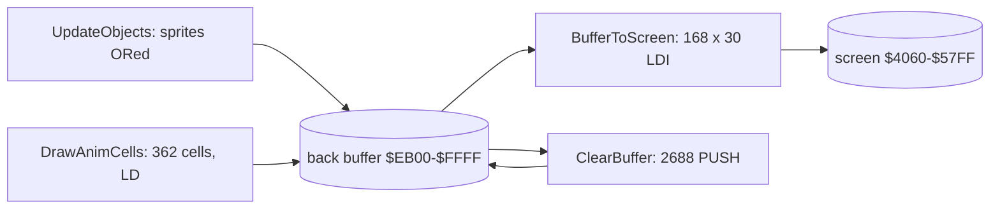

*The data flow of the picture inside one pass. The point: the buffer is rebuilt from nothing every pass. The screen
never shows a half-drawn sprite, but it can show half a copy (4.5). Witness: `rzx-p1-08000` frames 1161-1165.*

## 4.5 What a pass costs

Stage 1 cut the two RZX runs into passes (SkoolKit on the RZX). Part 1 averages 4.40 frames over 14 044 short
passes: 3367 of 3 frames, 8839 of 4, 1775 of 5 and 60 of 6. Part 2's short passes average 4.13 frames. Our L1s of
the replayed segments agree: `rzx-p1-*` runs 14 137 passes in 64 813 frames (4.58 a pass, room builds included);
`rzx-p2-*` runs 9795 in 41 776 (4.27).

So the game runs at about 11 passes a second. Rex walks 2 pixels a pass (4 with SPEED UP): about 22 pixels a
second.

The cost of each step, measured on five light passes of `rzx-p1-08000` (frames 1160-1206, room 5; 283 183 T a pass
on average):

| Step | T a pass | Share |
| --- | ---: | ---: |
| DrawAnimCells | 109 705 | 38.7 % |
| BufferToScreen | 96 474 | 34.1 % |
| ClearBuffer | 30 208 | 10.7 % |
| UpdateObjects | 23 733 | 8.4 % |
| RexState | 4 287 | 1.5 % |
| MoveEnemyBullets | 3 065 | 1.1 % |
| SoundStep (twice) | 2 637 | 0.9 % |
| MoveBullets | 2 222 | 0.8 % |
| AnimateCells | 1 866 | 0.7 % |
| the loop's own lines | 1 000 | 0.4 % |
| the rest | 7 986 | 2.8 % |

*From
`python3 tools/pass_stats.py work/docs/rxA/p1-08000/traces/1160_0-1206_0.uatr --listing build/game.lst --passes --steps`. A step is a call made at the loop's level (`SP` = `$6000`); its T-states are summed until the
loop's next instruction. The point: 83 % of a pass moves the picture (scenery, copy, clear); the game's logic is
under 10 %. A room with more scenery runs slower in proportion.*

Worked example, the pass that starts at 1161:58511 and ends at 1165:60804: 4 x 70 908 + 60 804 - 58 511 = 285 925
T, 4.03 frames. The next passes start at 1165:60804, 1169:63684 and 1173:67208, each about 4 frames apart.

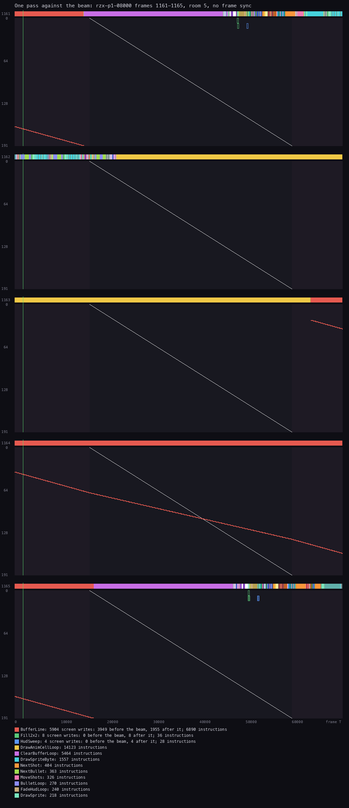

*One pass against the raster: `rzx-p1-08000` frames 1161-1165, room 5. How to read it:

- one panel a frame: the beam's line 0-191 (down) against the frame's T-states (across);
- the white diagonal is the beam drawing the screen;
- the red steps are the lines `BufferToScreen` (`BufferLine`) writes, at the T it writes them;
- the coloured bar on top of each panel is the routine running (the key under the figure).

The point: there is no sync. The copy starts near 1163:63000 and ends near 1165:17000, about 1.4 frames. In frame
1164 it crosses the beam near line 100. Its 3949 writes before the beam show in that frame, its 1955 after it do not:
the frame shows the new picture above and the old one below. Tearing can show on any frame; it is a pixel or two,
because a pass moves things that little. Command: `python3 ../../kit/beam_timeline.py --work work/docs/rxA/p1-08000
--window 1161:0-1166:0 --listing build/game.lst --machine 128k --frames 5 --title 'One pass against the beam:
rzx-p1-08000 frames 1161-1165, room 5, no frame sync' --out docs/img/loop/beam-pass-p1.png`.*

The frame budget of the whole of `rzx-p1-08000`, by module and by routine, is in
[doc 2, 2.6](02-architecture.md#26-the-frame-budget).

## 4.6 The room change: 22-26 frames

When Rex leaves a room, the exit's routine (`ExitRight $D0B1` and its siblings) puts the new room in `Room $A0B8`,
places Rex at the opposite edge, drops the pass's return address and goes to `ChangeRoom $C95A`:

```
D0B1  ExitRight:
D0B1  LD A,(RoomRight)
D0B4  OR A
D0B5  RET Z                   ; no exit: the edge is a wall
D0B6  LD (Room),A
D0B9  LD A,$08
D0BB  LD (RexX),A             ; Rex enters at the left edge
D0BE  POP BC                  ; leave the pass
D0BF  JP ChangeRoom
C95A  ChangeRoom:
C95A  LD A,(Room)
C95D  CP $63                  ; 99: the end of part 1
C95F  JP Z,CodePanel
C962  JP MainLoop
```

`BuildRoom $A89D` then resets the sweep, reads the exits and clears the shot records at `$5B60`. `DrawRoom $C745`
builds the room off the screen: the cell grid, the attribute shadow and the cell list ([doc 6](06-rendering.md)).
Then the play attributes are zeroed, one picture is made (clear, scenery, copy, attributes) and the objects are made.
Rooms 2, 3, 4, 6 and 20 also start the scripted spawn.

```
A89D  BuildRoom:
A8A2  CALL ResetSweep
A8AB  CALL ReadExits
A8AE  LD HL,$5B60             ; the shot records zeroed
A8B4  LD BC,$02ED
A8B9  LDIR
A8BB  CALL DrawRoom           ; 79.9 % of the build
A8BE  LD HL,$5860             ; the play attributes zeroed: the screen goes black
A8C4  LD BC,$029F
A8C9  LDIR
A8CB  CALL ClearBuffer
A8CE  CALL DrawAnimCells
A8D1  CALL BufferToScreen
A8D4  CALL CopyAttrs          ; the new room appears
A8D7  CALL MakeObjects
```

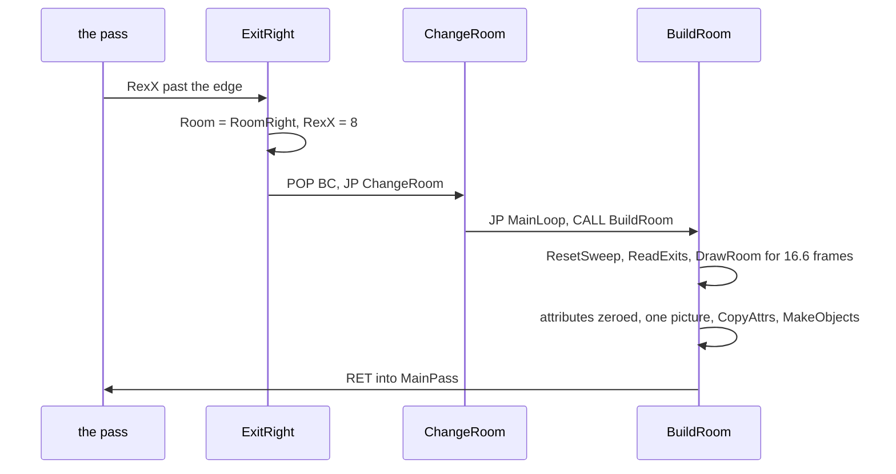

*The room change. The point: the build is a pass of its own, five times a normal one. The old room stays frozen on
the screen while DrawRoom works; then the play area goes black and the new room appears whole. Witness:
`rzx-p1-08000`, room 5 to 6.*

Worked example, room 5 to room 6 in `rzx-p1-08000`: Rex's X goes from `$EE` to `$08`, and `Room` becomes 6 near
frame 1177. MainLoop is fetched at 1177:66045 and MainPass at 1198:45440: the build takes 1 468 463 T, 20.71 frames.

| Step of BuildRoom | T | Share |
| --- | ---: | ---: |
| DrawRoom | 1 173 530 | 79.9 % |
| DrawAnimCells | 97 887 | 6.7 % |
| BufferToScreen | 95 749 | 6.5 % |
| its own lines (the two `LDIR`) | 33 069 | 2.3 % |
| ClearBuffer | 30 203 | 2.1 % |
| CopyAttrs | 18 174 | 1.2 % |
| MakeObjects | 15 889 | 1.1 % |
| ShowShield | 3 104 | 0.2 % |
| ReadExits | 675 | 0.0 % |

*From `work/docs/rxA/sub.py` on the trace `1177_66045-1198_45440`, at BuildRoom's level (`SP` = `$5FFE`). The point:
DrawRoom costs four times the rest of the build. It handles each of the 630 cells of the room one at a time, with a
multiply by repeated `ADD` for each block. The pass that crossed the edge (3.98 frames) and the build (20.71) make
24.7 frames, inside stage 1's 22-26.*

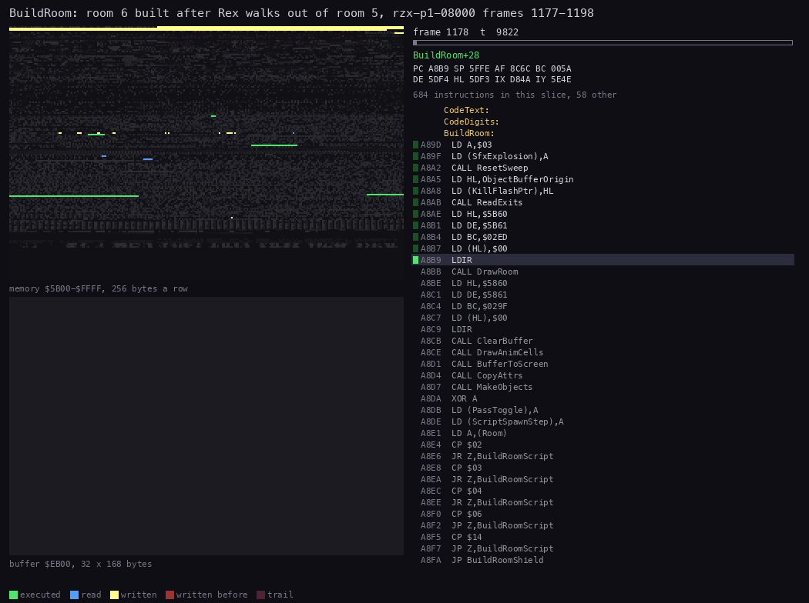

*BuildRoom at work: room 6 built after Rex walks out of room 5, `rzx-p1-08000` from 1177:66045 to 1198:45440
(137 821 instructions, 100 pictures). How to read it: the left panel is the back buffer; the listing on the right
shows BuildRoom's and DrawRoom's lines as they run. The point: most of the time goes to DrawRoom's cell by cell
work; the buffer only fills at the end, for the first picture. Command: `python3 ../../kit/routine_anim.py --work
work/docs/rxA/p1-08000 --window 1177:66045-1198:45440 --listing build/game.lst --view buffer:EB00:32x168:rows
--range 5B00-FFFF --pc A89D-A8FF,C745-C8EE --pictures 100 --title 'BuildRoom: room 6 built after Rex walks out of
room 5, rzx-p1-08000 frames 1177-1198' --out docs/img/routines/BuildRoom.gif`.*

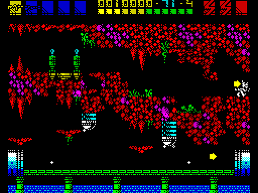

*The same room change on the screen, `rzx-p1-08000` frames 1166-1206, one picture a frame (frames that repeat the
one before are merged), twice the size. How to read it: Rex walks to the right edge of room 5; room 5 stays frozen
while the build runs; the play area goes black for a moment; room 6 appears with Rex at its left edge. The point: the
player sees the change as a pause of about 21 frames. Command: `python3 ../../kit/screen_anim.py --work
work/docs/rxA/p1-08000 --from 1166 --to 1206 --step 1 --scale 2 docs/img/play/room-change-5-6.gif`.*

A death that restarts in another room takes the same road: `LifeLost $9C76` puts the restart room in `Room`, then
`POP BC` and `JP MainLoop`. In the RZX run, the moves "room 17 to room 11" are such restarts.

## 4.7 The long passes: the weapon stations

Four passes of the RZX run of part 1 last 43 to 102 frames. Each is a weapon station's panel (stage 2, leftover 4):

| RZX frames | Frames | Room | Station |
| --- | ---: | ---: | --- |
| 1377-1424 | 47 | 1 | DOUBLE FIRE |
| 10542-10644 | 102 | 6 | LASER |
| 18366-18439 | 73 | 23 | MULTIPLE |
| 26178-26222 | 44 | 11 | SPRAY |

`CellsUnderRex` calls `WeaponPanel $D871` when Rex stands on a station's cell. The station's flag byte lets the panel
run once a game (`$FF` after the first time):

```
D871  WeaponPanel:
D871  LD A,(HL)               ; the station's flag
D872  OR A
D873  RET NZ                  ; seen already
D874  LD (HL),$FF
D87E  CALL SoundSilence
D884  CALL SaveScreen         ; the play area kept in the buffer
D888  CALL PrintBoxed         ; the panel
D88B  LD BC,$2710             ; 10 000
D88E  CALL Delay              ; about 0.5 s
D891  CALL WaitFireOrAttract  ; fire, or about 7 s
D894  CALL BufferToScreen     ; the play area back
D897  CALL CopyAttrs
D89A  CALL SoundReset
```

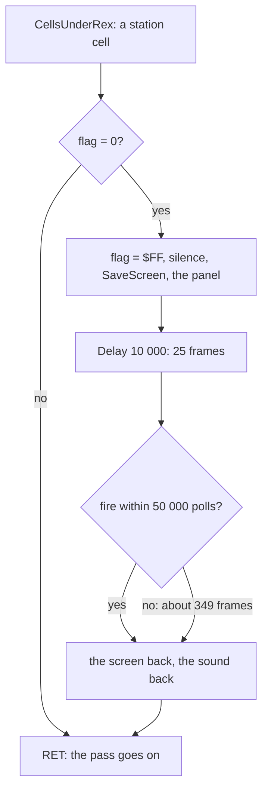

*The station's panel. The point: the panel holds the pass, so the game is frozen while it shows. The RZX player
pressed fire 19 to 77 frames into the wait. As after PHASE ONE, the time-out here only closes the panel
(`WaitFireOrAttract`'s result is not looked at); only the wait after PRESS FIRE tests it. Witness: the four passes above; the panel in room 1 at
`rzx-p1-00000` frame 1400 ([doc 1, 1.3](01-game-design.md#13-the-screens)).*

## 4.8 Every delay, pause and timer

None of them counts frames. Each is a loop of instructions, so its time is the loop's T-states. The times below come
from the instruction timings; the loops run above `$8000`, in memory the 128K does not contend.

| Delay | Where | Loop | T | Time |
| --- | --- | --- | ---: | ---: |
| `Delay $C8DB`, BC = N | the station panels | N x 177 T (`DJNZ` x 10 and the count) | 1 770 000 for N = 10 000 | 25 frames, 0.50 s |
| `WaitFireOrAttract $97C3` | PHASE ONE, PRESS FIRE, the stations | 50 000 polls of 495 T (`DJNZ` x 30 and `ReadFire`) | 24 750 000 | 349 frames, 7.0 s |
| `WaitFire $97EA` | GAME OVER, the code panel | fire up, then fire down | | until fire |
| `Pause $A4E7` (REX 2 `$A68F`) | H in a pass | `ReadFire` until fire | | until fire |
| Attract `$A915` | after both NewGame waits time out (2 x 349 frames, 14 s) | 199 passes a room (`AttractTimer` 200, decremented before the test) | | about 880 frames, 18 s a room |
| `DeathAnimation $9AC5` | while `Dying` = 1 | 50 passes (`DeathTimer`) | | about 220 frames, 4.4 s |
| `HudSweep $A0C4` | every pass | 5 round trips a width, 12 widths | 780 passes | about 3400 frames, 69 s a room |
| DEMO's tutor panels | `TutorPanels` | counts of 33 000, 65 000, 20 000 and 40 000 passes or polls | | |

*The timers counted in passes (attract, death, sweep) use the 4.4 frames of a typical pass; they run slower in a busy
room. Witnesses: `c1` (PHASE ONE's wait, the attract mode); `p1-gameover` (the sweep runs out with `SweepWidth` poked
to 2: Rex dies, game over); `p1-cursor` (H pauses, fire resumes); `rzx-p1-*` (the station panels, the deaths).*

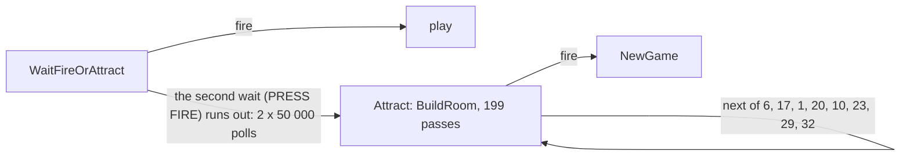

*The attract mode. How to read it: Attract walks `AttractRooms $A90C` (6, 17, 1, 20, 10, 23, 29, 32, then `$FF`
wraps). Each room plays 199 passes without Rex (the timer is loaded with 200 and decremented before its test). The
point: the attract mode shows eight rooms from all over the map.
Witness: `c1`.*

**The sweep is the room's timer.** A marker runs back and forth along the HUD's attribute row at `$582B`. Each time it
comes back to the left, the round count drops. Every 5 rounds the track loses one cell (painted `$04`). When the
width would reach 0, Rex dies. `BuildRoom` and `RexDies` reset it to width 12 and 5 rounds:

```
A133  ResetSweep:
A133  LD A,$0C
A135  LD (SweepWidth),A       ; 12 cells
A138  LD A,$05
A13A  LD (SweepCount),A       ; 5 round trips a width
A13D  RET
...
A108  LD A,(SweepCount)       ; in HudSweep: the marker back at the left
A10B  DEC A
A10C  LD (SweepCount),A
A10F  OR A
A110  RET NZ
A111  LD A,$05
A113  LD (SweepCount),A
A116  LD A,(SweepWidth)
A119  DEC A
A11A  OR A
A11B  JP Z,RexDies            ; out of time
A11E  LD (SweepWidth),A
```

```
each pass (only when no fade runs):
    paint the marker at sweep_pos; move it one cell toward its turning point
    if it came back to the left:
        rounds -= 1
        if rounds == 0:
            rounds = 5; width -= 1
            if width == 0: rex_dies()
            else: grey the cell at width
```

Worked example: from width 12 a room lasts 5 x 2 x (12 + 11 + ... + 1) = 780 passes, about 3400 frames or 69 s at
4.4 frames a pass. `p1-gameover` starts with width 2. After at most 30 passes the width drops to 1; 10 passes later
it would drop to 0, and Rex dies. The GAME OVER panel shows at frame 500.

## 4.9 Known only from the code

- The time-out of `WaitFireOrAttract` inside a weapon panel: no recording waits 7 s on a station.
- The full 69 s of the sweep from width 12: `p1-gameover` shortens it with a POKE.
- The T counts of `Delay` and of the poll loop: computed from the instruction timings, not measured.
- REX 2's and DEMO's pass costs step by step: only their pass lengths were measured (4.27 frames a pass over the
  `rzx-p2-*` L1s).
