# 5. Controls

What this covers:

- the menu after the load: four choices (DEFINE, KEMPSTON, CURSOR, SINCLAIR), the roll call that turns while it
  waits, and the confirm;
- the five readers `$A477-$A4E5`, whose port and `BIT` operands the menu writes (self-modified code);
- DEFINE: ScanKey, which turns any key into a port and a `BIT n,A` opcode;
- what each device gives, and what an emulator must decode for it;
- the path from the readers to Rex: walk, jump, shield, fire, in the order of the main loop;
- the fixed keys: H (pause), SPACE (smart bomb), ENTER (restart);
- the waits for fire and the attract mode;
- REX 2's code entry: 16 keys, a permutation, `9 - digit` and a checksum;
- DEMO, which reads an input script in place of the keys.

The recordings it rests on (WALKTHROUGH 6.0; all on the 128K):

| Recording | Load | Used for |
| --- | --- | --- |
| `c1` | power-on, REX 1 from the tape at ROM speed | the menu and the roll call (TTD 15000-15600), DEFINE with the tape's keys I, J, Q, W, O, play |
| `p1-define` | `work/stage1/probe/128K/loaded.szx` (the menu) | 1 DEFINE: P, L, Z, X, M at frames 190, 280, 370, 460, 550; Y at 640; play on those keys |
| `p1-cursor` | the same | 3 CURSOR: walk, jump, the shield (6 at 1001 and 1087), fire, H at 1253, fire at 1359, SPACE at 1405, ENTER at 1851 |
| `p1-kempston` | the same | 2 KEMPSTON: the stick right, left, up, down, fire |
| `rzx-p1-00000` | the RZX run's first segment | 4 SINCLAIR (another player's choice) |
| `c2` | power-on, REX 2 from block 6 | the code screen: a wrong code (ENTER at script frame 1560), part 1's code (ENTER at 3220) |
| `demo-cycle` | `work/stage1/d1/start.szx` | DEMO's input scripts; SPACE (DemoPause) at 30000 and 30106 |

Conventions:

- **A frame** is 1/50 s of the 128K, 70 908 T. **A pass** is one turn of the main loop `MainPass $9586`
  ([doc 4](04-game-loop.md)). It takes about 4.4 frames, because the game runs with interrupts off and never waits.
- **TTD frames.** `c1` and `c2` were recorded after a load. Their TTD frame is the input-script frame + 15 000
  (`c1`) or + 14 000 (`c2`). The `p1-*` recordings start at the menu: TTD frame = script frame.
- A value read with `time_travel memory_at` is the memory at the start (T 0) of the frame named. So a sample of
  frame N shows what the code did before frame N began.
- A trace puts an instruction in the frame where it ran, with its T-state in that frame ("frame 865 T 30172").
- The keys of an input script are held from their frame on, until the next line.
- "Pressed" means the port bit reads 0 (keyboard) or 1 (Kempston, before the XOR of 5.3).
- Counts of runs ("L1 3012610") are the witness counts of the `.ann` files, summed over our recordings.

## 5.1 The devices and the ports

The game reads the keyboard and the Kempston port, and nothing else. There is no Fuller port. SINCLAIR reads keys
6-0, which is what the Interface 2's first stick sends.

| Port | Keys or bits | Read by | When |
| --- | --- | --- | --- |
| `$F7FE` | 1 2 3 4 5 | MenuLoop `$DB11` (keys 1-4); DefineWait; CURSOR's left (5) | the menu; every pass with CURSOR |
| `$EFFE` | 0 9 8 7 6 | the readers with SINCLAIR or CURSOR | every pass |
| `$DFFE` | P O I U Y | ConfirmWait (Y); the tape's fire O and up I | the confirm; every pass with the tape's keys |
| `$7FFE` | SPACE, SYMBOL, M N B | MainKeys (SPACE); ConfirmWait (N) | every pass; the confirm |
| `$BFFE` | ENTER L K J H | MainKeys (ENTER, H); the tape's down J | every pass |
| `$FBFE` | Q W E R T | the tape's left Q and right W | every pass |
| all 8 half-rows | all 40 keys | ScanKey `$DBAE` | DEFINE; REX 2's code |
| `$001F` | Kempston bits 0-4 | the readers with KEMPSTON | every pass |

Every `IN` of the three parts is `IN A,(C)` with the full 16-bit port in BC. The game never uses `IN A,(n)`.

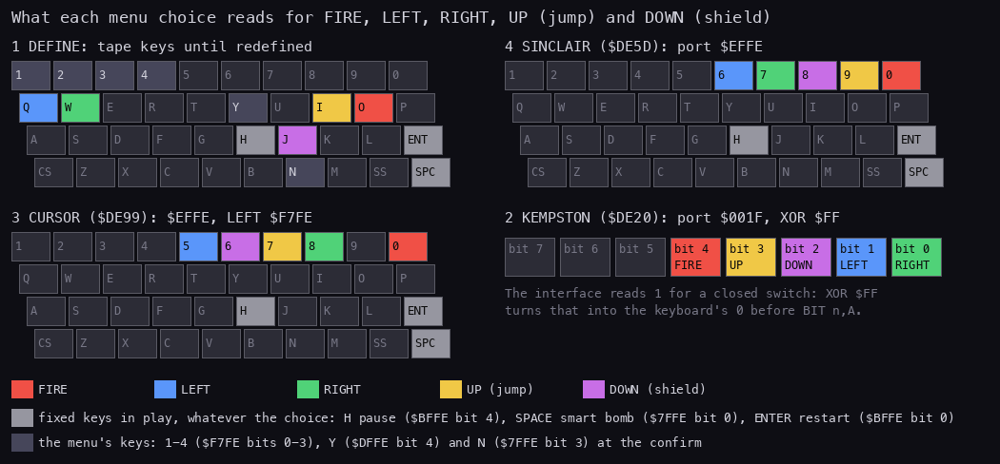

*Figure 5.1: what each menu choice reads for the five controls. Drawn from `build/game.bin`: the readers' operands
as loaded (DEFINE's tape keys), and the operands that ChooseSinclair `$DE5D`, ChooseCursor `$DE99` and ChooseKempston
`$DE20` write (5.4). Command: `python3 tools/fig_controls.py keys --out docs/img/controls/keys.png`. No recording:
the figure is the code's data; figure 5.3 shows the same operands read back from the recordings.*

How to read:

- One keyboard per choice; the number is the menu key. A coloured key is a control; its colour is the move (legend).
- The grey keys H, SPACE and ENTER work in play whatever the choice.
- On the DEFINE keyboard, 1-4, Y and N (dark) are the menu's own keys.
- KEMPSTON reads no key: its five bits are boxes. The game XORs the port with `$FF`, so a 1 from the stick
  becomes the keyboard's 0.

The point: the five controls go through five small readers whose port and bit are data. A choice is a set of ten
operand writes. SINCLAIR and CURSOR share the half-row `$EFFE`. CURSOR is the only choice that mixes two half-rows
(left is 5, on `$F7FE`).

## 5.2 The menu and the roll call

TitleMenu `$DAC0` runs once, from GameEntry, before the first game:

1. It copies the 192-byte ExplosionPicture `$E336` down to `$6018`, over the development-link stub
   ([doc 2](02-architecture.md)).
2. It copies the title TitleScreen `$E4FF` to the screen and prints the five menu records (PrintBoxed `$A13E`,
   MenuTexts `$DF05`).
3. It copies the screen back into TitleScreen. From then on, ShowTitle restores the title with the menu on it.
4. MenuLoop `$DB11` waits for a key 1-4 while the roll call turns.

One poll of MenuLoop draws the roll call's sprite (RollCallSprite `$E00B`), waits `Delay $07D0`, and reads `$F7FE`
four times. Key 4 is tested first, key 1 last. A choice jumps (`JP Z`) to its routine; MenuLoop is never called
again.

The roll call shows the ten enemies of part 1, one at a time, with their score:

| # | Enemy | Points | # | Enemy | Points |
| --- | --- | --- | --- | --- | --- |
| 1 | FOOT MAN | 100 | 6 | SHOOTERS | 500 |
| 2 | STOMPER | 200 | 7 | SWING GUN | 600 |
| 3 | SCANNER | 600 | 8 | BLOB | 200 |
| 4 | RAMMING POD | 300 | 9 | MINE LAYER | 1000 |
| 5 | LAUNCHER | 800 | 10 | MINE | NO SCORE |

The names and scores are RollCallTexts `$DC26` (20 records). The sprites are RollCallSprites `$E067`: one 12-byte
record an enemy, [picture word][width in characters][height in pixels][8 frame offsets], `$FF` at the end. The first
record is `F6 E0 02 10 00 20 40 60 00 20 40 60`: the picture at `$E0F6`, 2 characters by 16 lines, frames at
offsets 0, 32, 64, 96, then the same four again.

SweepCount (the menu borrows the HUD sweep's counter) counts 50 polls. At 0 it is set to 50 again and RollShow
`$A085` flips. With RollShow 1, the next enemy's box is printed (RollCallText `$DB71`). With RollShow 0, the title is
restored alone (RollCallTitle).

```text
TitleMenu:
    copy ExplosionPicture to $6018
    screen = TitleScreen; print MenuTexts; TitleScreen = screen
    RollShow = 0; SweepCount = 50; RollTextPtr = RollCallSprites - 12
    loop:                                   # MenuLoop $DB11, one poll
        draw RollFrame of the current enemy
        Delay($07D0)
        if key 4: goto ChooseSinclair
        if key 3: goto ChooseCursor
        if key 2: goto ChooseKempston
        if key 1: goto DefineKeys
        SweepCount -= 1
        if SweepCount == 0:
            SweepCount = 50
            RollShow ^= 1
            if RollShow: next enemy record; print its name and score
            else:        ShowTitle
```

```text
DB11  2A 83 A0     MenuLoop: LD HL,(RollTextPtr)   ; the current enemy
DB14  CD 0B E0               CALL RollCallSprite
DB17  01 D0 07               LD BC,$07D0
DB1A  CD DB C8               CALL Delay            ; most of the poll
DB1D  01 FE F7               LD BC,$F7FE           ; keys 1-5
DB20  ED 78                  IN A,(C)
DB22  CB 5F                  BIT 3,A               ; key 4
DB24  CA 5D DE               JP Z,ChooseSinclair
DB27  01 FE F7               LD BC,$F7FE           ; then 3, 2, 1 the same way
```

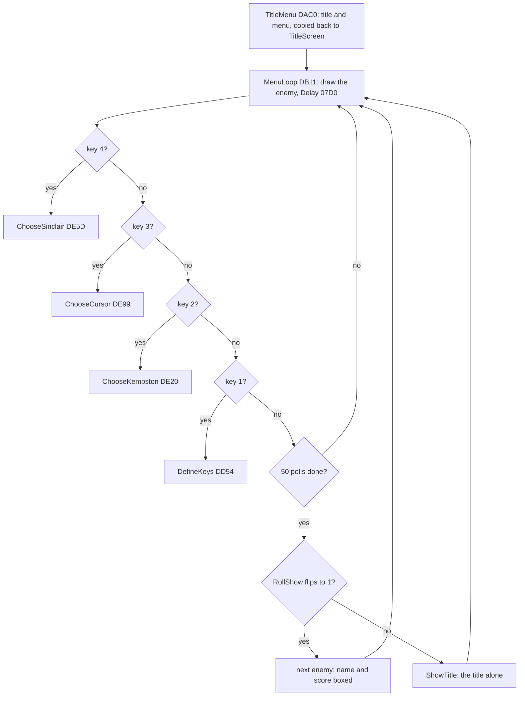

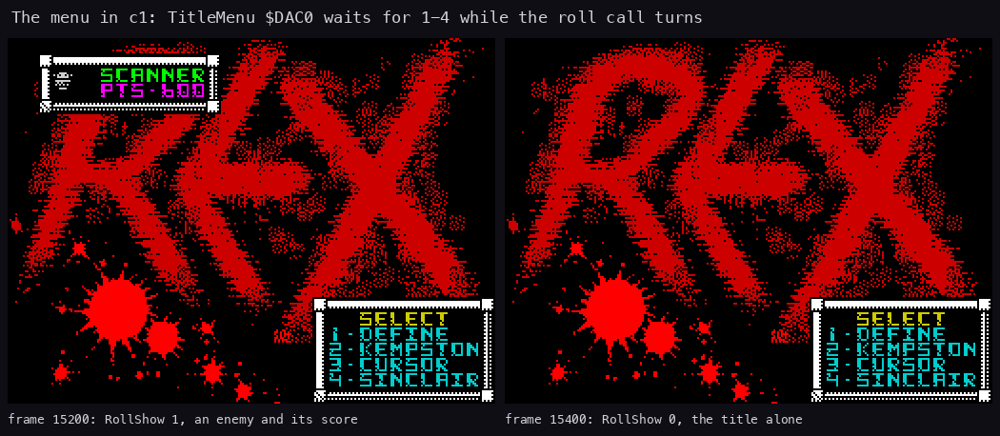

*Figure 5.2: the menu in `c1`, TTD frames 15200 and 15400 (T 0). Command: `python3 tools/fig_controls.py shots
--work work/docs/rxB/c1 --shot "15200=..." --shot "15400=..." --title "..." --out docs/img/controls/menu.png`.*

How to read:

- Left: RollShow is 1. The third enemy, SCANNER, is boxed at the top left with its animated sprite and PTS:600.
- Right: RollShow is 0. The title stands alone. The menu box stays, because it is part of the saved title.

Worked example (`c1`, the roll call variables read at T 0):

| TTD frame | RollFrame `$A07F` | RollPtr `$A081` | RollShow `$A085` | On screen |
| --- | --- | --- | --- | --- |
| 15040 | 3 | `$E08B` | 1 | the SCANNER box |
| 15240 | 1 | `$E08B` | 1 | the same box, another sprite frame |
| 15280 | 6 | `$E08B` | 0 | the title alone (RollShow flipped between 15240 and 15280) |
| 15560 | 5 | `$E097` | 1 | the next enemy's box (RAMMING POD) |

So one phase is 50 polls in about 260 frames: a poll is about 5.2 frames, nearly all of it the delay and the sprite.
An enemy and a blank title take about 10.4 s.

Witness: MenuLoop (c1, p1-*, rzx-p1-00000); RollCallText L1 4 (c1).

Known only from the code: after the tenth enemy, RollCallRestart `$DB6E` and RollCallTextStart `$DB85` start the
list again. No recording stays in the menu for the 104 s that takes, so both are kept as bytes.

The point: the menu is the only place where keys 1-4 are read. The roll call is driven by the poll count, not by a
clock. A poll is slow (about 5 frames), so a tap of 1-4 shorter than about 6 frames can be missed.

## 5.3 The readers: self-modified code

Each control has a reader of 12 bytes and a setter of 13 bytes, at `$A46A-$A4E6` (`src/game/controls.asm`):

```text
A46A  2A AB A0     SetFire:     LD HL,(DefinePort)
A46D  22 78 A4                  LD (ReadFire+$0001),HL      ; the port
A470  3A AD A0                  LD A,(DefineBit)
A473  32 81 A4                  LD (ReadFireBit+$0001),A    ; BIT n,A = CB 47+8n
A476  C9                        RET
A477  01 FE DF     ReadFire:    LD BC,$DFFE                 ; written by SetFire
A47A  ED 78                     IN A,(C)
A47C  21 AE A0                  LD HL,ControlXor            ; 0 keys, $FF Kempston
A47F  AE                        XOR (HL)
A480  CB 4F        ReadFireBit: BIT 1,A                     ; written by SetFire
A482  C9                        RET                         ; Z = pressed
```

The five readers and their tape defaults:

| Control | Reader | Port operand | `BIT` operand | Tape default |
| --- | --- | --- | --- | --- |
| fire | ReadFire `$A477` | `$A478` | `$A481` | O: `$DFFE` bit 1 |
| left | ReadLeft `$A490` | `$A491` | `$A49A` | Q: `$FBFE` bit 0 |
| right | ReadRight `$A4A9` | `$A4AA` | `$A4B3` | W: `$FBFE` bit 1 |
| up (jump) | ReadUp `$A4C2` | `$A4C3` | `$A4CC` | I: `$DFFE` bit 2 |
| down (shield) | ReadDown `$A4DB` | `$A4DC` | `$A4E5` | J: `$BFFE` bit 3 |

A setter copies two variables into its reader: DefinePort `$A0AB` (a word) into the `LD BC` operand, and DefineBit
`$A0AD` into the second byte of `BIT n,A`. DefineBit holds the whole opcode byte, `$47` + 8n.

```text
ReadControl(control):
    value = IN(control.port) XOR ControlXor
    return bit control.bit of value == 0       # Z: pressed

Set(control):
    control.port = DefinePort
    control.bit_opcode = DefineBit             # $47 + 8 * bit
```

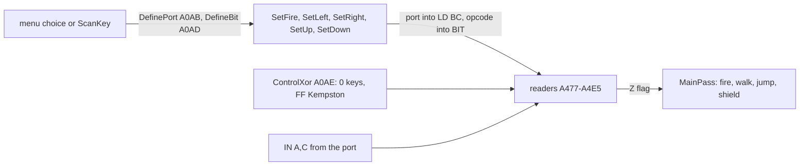

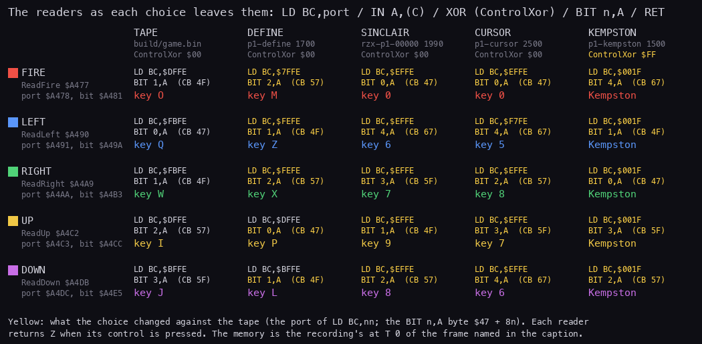

*Figure 5.3: the five readers as each choice leaves them, read back from the recordings at T 0: `p1-define` frame
1700, `rzx-p1-00000` frame 1990 (SINCLAIR), `p1-cursor` frame 2500, `p1-kempston` frame 1500 (125 bytes from `$A46A`
by `time_travel memory_at`, kept in `work/docs/rxB/readers-*.txt`). TAPE is `build/game.bin`. Command: `python3
tools/fig_controls.py readers --out docs/img/controls/readers.png --rec "TAPE,build/game.bin=build/game.bin" --rec
"DEFINE,p1-define 1700=work/docs/rxB/readers-define.txt:00" ...` (one `--rec` a column; ControlXor after the colon).*

How to read:

- A column is a choice; a row is a reader. Each cell shows the reader's `LD BC,port` and `BIT n,A` with its opcode.
- Yellow: the operand differs from the tape's. White: the tape's value is still there.
- The coloured line names the key (or the Kempston bit) that the operands select.
- KEMPSTON's ControlXor is `$FF` (yellow); every other choice leaves 0.

Worked example (`p1-define`): the player pressed P for UP at frames 190-199. ScanKey found P on `$DFFE` bit 0, so
DefineBit = `$47` + 8 x 0 = `$47`. SetUp wrote `FE DF` at `$A4C3` and `47` at `$A4CC`, at frame 200. The reader is
now `LD BC,$DFFE ... BIT 0,A`. At frame 1335 the player pressed P in play, and Rex jumped. The other four writes
landed in frames 290 (down), 380 (left), 470 (right) and 560 (fire): the samples at T 0 of 291, 381, 471 and 561 are
the first to show them.

Witness: ReadFire L1 3012610 and the four other readers over all REX 1 recordings. SetFire, SetLeft, SetRight,
SetUp and SetDown L1 5 each (c1, p1-cursor, p1-define, p1-kempston, rzx-p1-00000).

The point: one reader per control, about 74 T a call. A change of device costs nothing at play time: the menu
rewrites ten operand bytes and one XOR mask, and the main loop never knows which device it reads.

## 5.4 The three fixed choices

KEMPSTON, CURSOR and SINCLAIR are the same code with different constants. Each calls ShowTitle and loads
DefinePort. Then, for each control, it loads DefineBit and calls the setter. Last it goes to Confirm with its own
text.

| Choice | Routine | Port | Fire | Up | Down | Right | Left | ControlXor |
| --- | --- | --- | --- | --- | --- | --- | --- | --- |
| 2 KEMPSTON | ChooseKempston `$DE20` | `$001F` | bit 4 (`$67`) | bit 3 (`$5F`) | bit 2 (`$57`) | bit 0 (`$47`) | bit 1 (`$4F`) | `$FF` |
| 3 CURSOR | ChooseCursor `$DE99` | `$EFFE`, left `$F7FE` | 0 (`$47`) | 7 (`$5F`) | 6 (`$67`) | 8 (`$57`) | 5 (`$67`) | 0 |
| 4 SINCLAIR | ChooseSinclair `$DE5D` | `$EFFE` | 0 (`$47`) | 9 (`$4F`) | 8 (`$57`) | 7 (`$5F`) | 6 (`$67`) | 0 |

```text
DE20  CD 96 DB     ChooseKempston: CALL ShowTitle
DE23  21 1F 00                     LD HL,$001F          ; the Kempston port
DE26  22 AB A0                     LD (DefinePort),HL
DE29  3E 67                        LD A,$67             ; BIT 4,A: fire
DE2B  32 AD A0                     LD (DefineBit),A
DE2E  CD 6A A4                     CALL SetFire
DE31  3E 5F                        LD A,$5F             ; BIT 3,A: up, and so on
; ...
DE8B  CD 83 A4                     CALL SetLeft         ; (ChooseSinclair's last setter)
DE8E  DD 21 45 DF                  LD IX,ConfirmSinclairText
DE92  AF           KeysConfirm:    XOR A                ; keys: no XOR
DE93  32 AE A0                     LD (ControlXor),A
DE96  C3 D2 DE                     JP Confirm
```

CURSOR has a quirk. Its two `LD HL` operands are `$EFFE` and `$F7FE`, but the listing names them
`BackBuffer+$04FE` and `BackBuffer+$0CFE`, because BackBuffer is `$EB00`. They are ports, not buffer addresses. Left
is set last: ChooseCursor loads `$F7FE` and calls SetLeft without a new DefineBit. The `$67` left in DefineBit from
down (key 6, bit 4) is reused. On `$F7FE`, bit 4 is key 5. So "5 = left" works because the two half-rows mirror each
other.

Confirm `$DED2` prints the choice's box (KEYS, KEMPSTON, CURSOR or SINCLAIR SELECTED, CONFIRM Y/N) and waits:

- Y (`$DFFE` bit 4) returns. The return lands in GameEntry, which sets HiScore = 10 and falls into NewGame.
- N (`$7FFE` bit 3) goes to MenuAgain `$DEEC`: `JP $DAEE`, the menu's text and wait again. The readers keep what
  the refused choice wrote.

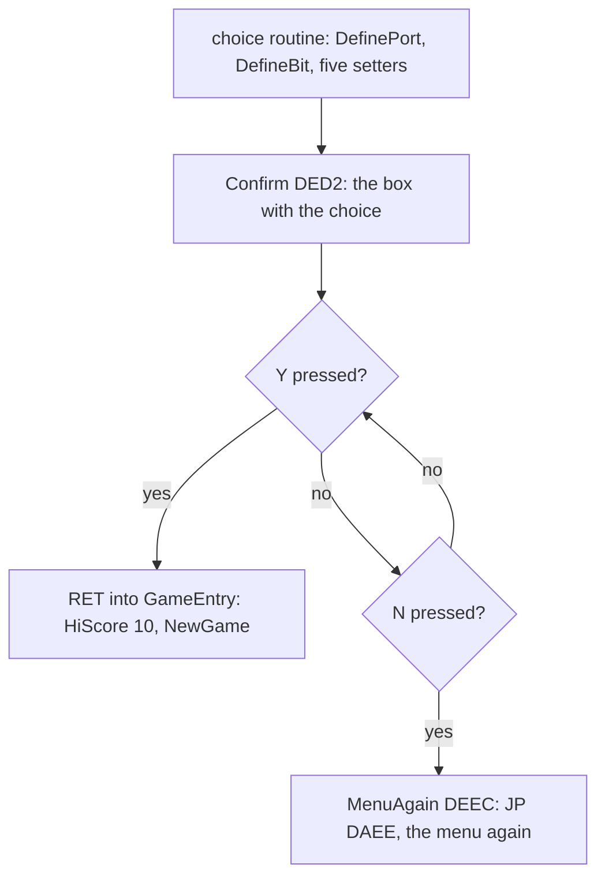

Worked example (`p1-kempston`): 2 at frame 100, Y at 170. At frame 1500 all five readers hold `LD BC,$001F`; fire
is `CB 67`, up `CB 5F`, down `CB 57`, right `CB 47`, left `CB 4F`; ControlXor is `$FF` (figure 5.3). The stick's
right (KR, frames 615-764) then moved Rex right.

Witness: ChooseKempston L1 1 (p1-kempston), ChooseCursor L1 1 (p1-cursor), ChooseSinclair L1 1 (rzx-p1-00000),
Confirm (c1, p1-*). Known only from the code: N at the confirm (MenuAgain); no recording pressed it. MenuAgain sits
inside CellIndexMap `$DE9F`'s span, which play overwrites, so after the menu those bytes are data.

The point: three of the four choices are tables written as code. CURSOR saves one load by reusing a leftover
operand; its two port constants are written as numbers (`LD HL,$EFFE`, `LD HL,$F7FE`), not as buffer addresses.

## 5.5 DEFINE: ScanKey

DefineKeys `$DD54` asks for UP, DOWN, LEFT, RIGHT and FIRE, in that order:

1. ShowTitle. DefineTaken `$DD4E` (five bytes) is cleared. The PressText box (6 records) is printed.
2. DefineWait waits until key 1 is let go, so the 1 that chose DEFINE is not taken as UP.
3. For each control: the prompt (PrintTextHL), ScanKey, the key's character stored in DefineTaken, the character
   drawn beside the prompt (FontChar `$DEF0`, DrawChar `$DEFC` at `$488F`, `$48AF`, `$48CF`, `$48EF`, `$500F`), and
   the setter.
4. ConfirmKeysText, then KeysConfirm `$DE92`, which sets ControlXor = 0 and goes to Confirm.

ScanKey `$DBAE` is the key finder. It walks the eight half-rows of KeyPorts `$E0E0` with the names KeyNames `$A9CC`,
five characters a row:

| Row | Port | Bits 0-4 (KeyNames) |
| --- | --- | --- |
| 0 | `$FEFE` | `-` (CAPS) Z X C V |
| 1 | `$FDFE` | A S D F G |
| 2 | `$FBFE` | Q W E R T |
| 3 | `$DFFE` | P O I U Y |
| 4 | `$BFFE` | `+` (ENTER) L K J H |
| 5 | `$7FFE` | SPACE `.` (SYMBOL) M N B |
| 6 | `$EFFE` | `-` (0) 9 8 7 6 |
| 7 | `$F7FE` | 1 2 3 4 5 |

For each row it stores the port in DefinePort, reads it, and shifts the byte right (RRCA) five times, counting E. A
0 bit is a pressed key. Then it waits until the same port reads a different byte: the key let go, or another key of
the row pressed. Only then does it build DefineBit = `$47` + 8E and fetch the character KeyNames[row x 5 + E].

Three kinds of key are refused, and ScanKey starts again:

- SPACE (`$20`) and H (`$48`): the smart bomb and the pause are fixed keys.
- Any character already in DefineTaken.

```text
ScanKey:
    loop forever:
        for row in 0..7:
            DefinePort = KeyPorts[row]
            d = IN(DefinePort)
            for e in 0..4:
                if bit e of d == 0: goto found
    found:
        while IN(DefinePort) == d: wait             # the key is taken when let go
        DefineBit = $47 + 8 * e
        c = KeyNames[row * 5 + e]
        if c == ' ' or c == 'H' or c in DefineTaken: restart ScanKey
        return c
```

```text
DBC1  ED 43 AB A0                  LD (DefinePort),BC   ; this half-row
DBC5  ED 78                       IN A,(C)
DBC7  06 05                       LD B,$05
DBC9  1E 00                       LD E,$00
DBCB  57                          LD D,A               ; keep the byte
DBCC  0F           ScanKeyShift:  RRCA
DBCD  D2 E2 DB                    JP NC,ScanKeyFound ; a 0: found
DBD0  1C                          INC E
DBD1  10 F9                       DJNZ ScanKeyShift
; ...
DBE4  DD 4E 00     ScanKeyRelease:  LD C,(IX+$00)
DBE7  DD 46 01                    LD B,(IX+$01)
DBEA  ED 78                       IN A,(C)
DBEC  BA                          CP D                 ; the same byte: still held
DBED  CA E4 DB                    JP Z,ScanKeyRelease
DBF0  7B                          LD A,E
DBF1  CB 27                       SLA A                ; 8E, three SLAs
; ...
DBF7  16 47                       LD D,$47
DBF9  82                          ADD A,D              ; the opcode of BIT E,A
DBFA  32 AD A0                    LD (DefineBit),A
```

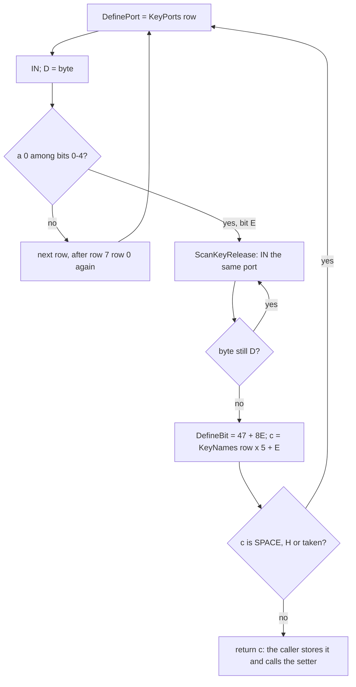

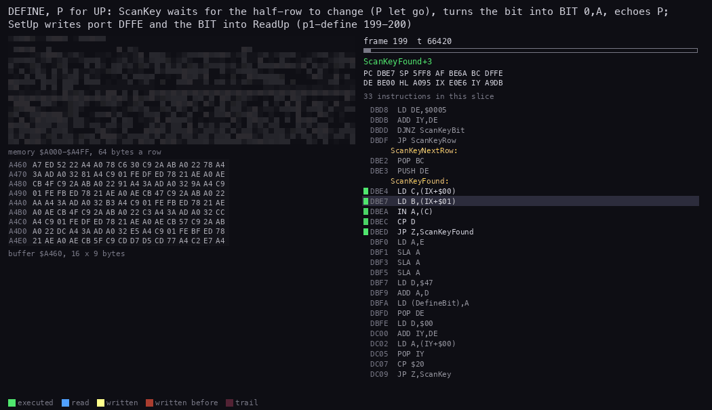

*Animation 5.4: ScanKey and SetUp in `p1-define`, frame 199 T 66000 to frame 200 T 14000 (45 pictures of 420 T,
1622 instructions). Command: `python3 ../../kit/routine_anim.py --work work/docs/rxB/p1-define --window
199:66000-200:14000 --listing build/game.lst --view buffer:A460:16x9:hex --range A000-A4FF --pc
DBAE-DC25,A46A-A4E6,DD54-DE1F,DEF0-DF04 --pictures 45 --title "..." --out docs/img/routines/ScanKey.gif`.*

How to read:

- The code panel shows ScanKeyRelease looping on `IN` while P is held, then the exit when P is let go.
- The view is the readers' bytes `$A460-$A4EF`. Near frame 200 T 5000, SetUp writes `FE DF` at `$A4C3` and `47` at
  `$A4CC` (yellow).
- The memory rows `$A000-$A0FF` show DefinePort `$A0AB` being written.

Worked example (`p1-define`, P for UP): the script holds P at frames 190-199. ScanKey reads `$DFFE`: bit 0 is 0, so E
= 0 and D keeps that byte. In frame 200, P is let go, the byte changes, and ScanKey leaves the loop. DefineBit =
`$47`; the character is KeyNames[3 x 5 + 0] = `P`. P is not SPACE, not H and not in DefineTaken (empty), so it is
kept. DefineKeys stores `P` in DefineTaken[0], draws it at `$488F`, and calls SetUp.

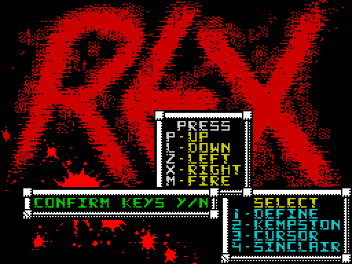

*Figure 5.5: `p1-define` frame 620 (T 0), after FIRE: the five keys P, L, Z, X, M beside their prompts, and the
confirm box. Command: `python3 ../../kit/screen_shot.py --work work/docs/rxB/p1-define --out-dir docs/img/controls
--scale 2 define-confirm=620`.*

How to read: the prompts are printed by PrintTextHL; each key's character is drawn by DrawChar beside its prompt.
The box at the bottom is ConfirmKeysText.

Witness: ScanKey L1 35 over c1, p1-define and c2; DefineKeys (c1, p1-define).

Known only from the code:

- CAPS SHIFT and 0 both have the name `-` in KeyNames. Once one is chosen, the other is refused as "taken".
- ENTER can be defined. It then also restarts the game at every pass, because MainKeys tests ENTER first (5.7).
- ScanKey compares the whole byte, bits 5-7 included. If the EAR bit (bit 6) changes while a key is held, ScanKey
  takes the key at once. An emulator that feeds tape noise into bit 6 can do this.

The point: a key is taken when it is let go, so the held key never reaches the next prompt. ScanKey only waits for
the half-row's byte to change, so pressing a second key of the same half-row also ends the wait.

## 5.6 What an emulator must decode

| Device | The game's read | What the emulator must answer |
| --- | --- | --- |
| Keyboard | `IN A,(C)`, one address line A8-A15 low, C = `$FE` | the five key bits of that half-row, 0 = pressed; bits 5-7 steady |
| Kempston | `IN A,(C)` with BC = `$001F` (B = 0) | bits 0-4: right, left, down, up, fire, 1 = pressed; the readers ignore bits 5-7 |
| SINCLAIR (Interface 2, stick 1) | keys 6-0 on `$EFFE` | the stick as those keys: left 6, right 7, down 8, up 9, fire 0 |
| CURSOR (Protek, AGF) | keys 5-8 and 0 | the stick as cursor keys: left 5 on `$F7FE`, down 6, up 7, right 8, fire 0 |

Notes for an emulator:

- The game never reads more than one half-row at a time. An emulator that ANDs several rows still works.
- With KEMPSTON chosen and no interface, port `$1F` answers whatever floats on the bus. If that is `$FF`, then
  `$FF XOR $FF` = 0, and every control reads "pressed": Rex walks, jumps, fires and toggles the shield each pass. Known
  only from the code.
- The Kempston read has B = 0, so an interface that decodes only A5 answers, and so does one that needs A5-A7 low.

The point: SINCLAIR and CURSOR are keyboard choices. Only KEMPSTON needs a port beyond the ULA.

## 5.7 From the readers to Rex

The keys are read once a pass, after the drawing and the HUD (MainPass `$9586`, [doc 4](04-game-loop.md)). The order
is fixed:

1. Down: ReadDown, then ShieldToggle `$967F`. A second ReadDown clears ShieldKeyLatch `$A04C` when down is up.
2. The fixed keys (MainKeys `$95D2`), read straight from the keyboard whatever the choice:
   - ENTER (`$BFFE` bit 0): `JP NewGame`, a restart with no confirm.
   - H (`$BFFE` bit 4): `CALL Pause`.
   - SPACE (`$7FFE` bit 0): `CALL SmartBomb`.
3. Rex's position is copied to SpriteX and SpriteY, and RexCellPtr is found.
4. If Dying `$A055` is set, the rest is skipped (MainAnimate).
5. Fire: ReadFire, then FireWeapon `$B372`. A second ReadFire clears FireLatch `$A012` when fire is up. With
   RapidShotsOn, the latch is cleared first, so a held fire fires every pass.
6. Right: WalkRightKey `$CFDA`. Left: WalkLeftKey `$CFF6`. Up: StartJump `$D0C2`.
7. RexJump `$D0E4`, RexFall `$D14D`, RexWalk `$D013` and CellsUnderRex `$9F5F` move Rex.

What each key sets:

| Key | Routine | Effect |
| --- | --- | --- |
| down | ShieldToggle | ShieldOn `$A049` flips (CPL), once a press (ShieldKeyLatch); not while SparkleMode, not with ShieldEnergy 0 |
| fire | FireWeapon | a shot, once a press (FireLatch), only while RexPresent |
| right | WalkRightKey | RexSpeed `$A091` = 2 (4 with SpeedUp), RexFacing = 0 |
| left | WalkLeftKey | RexSpeed = `$FE` (-2; `$FC` with SpeedUp), RexFacing = 1 |
| up | StartJump | Jumping = 1, JumpPtr = JumpSteps `$D0D8`; refused while falling or jumping |

RexWalk moves Rex by RexSpeed, then sets it back to 0 when he is not in the air. So the walk lasts while the key is
held, 2 pixels a pass. With right and left in the same pass, right is read first and left overwrites it: left wins.

```text
MainPass, the keys:
    if ReadDown(): ShieldToggle()          # latched: one toggle a press
    if not ReadDown(): ShieldKeyLatch = 0
    if key ENTER: goto NewGame
    if key H: Pause()
    if key SPACE: SmartBomb()
    SpriteX, SpriteY = RexX, RexY
    if Dying: goto animate
    if RapidShotsOn: FireLatch = 0
    if ReadFire(): FireWeapon()            # latched by FireLatch
    if not ReadFire(): FireLatch = 0
    if ReadRight(): RexSpeed = 2 (4 with SpeedUp); RexFacing = right
    if ReadLeft():  RexSpeed = -2 (-4);           RexFacing = left
    if ReadUp():    StartJump()
    RexJump(); RexFall(); RexWalk(); CellsUnderRex()
```

```text
95C2  CD DB A4                  CALL ReadDown
95C5  CC 7F 96                  CALL Z,ShieldToggle
95C8  CD DB A4                  CALL ReadDown
95CB  CA D2 95                  JP Z,MainKeys
95CE  AF                        XOR A
95CF  32 4C A0                  LD (ShieldKeyLatch),A  ; down up: re-arm
95D2  01 FE BF     MainKeys:    LD BC,$BFFE            ; the fixed keys
95D5  ED 78                     IN A,(C)
95D7  CB 47                     BIT 0,A
95D9  CA 98 94                  JP Z,NewGame           ; ENTER
95DC  01 FE BF                  LD BC,$BFFE
95DF  ED 78                     IN A,(C)
95E1  CB 67                     BIT 4,A
95E3  CC E7 A4                  CALL Z,Pause           ; H
95E6  01 FE 7F                  LD BC,$7FFE
95E9  ED 78                     IN A,(C)
95EB  CB 47                     BIT 0,A
95ED  CC 51 97                  CALL Z,SmartBomb       ; SPACE
; ...
9605  3A 55 A0                  LD A,(Dying)
9608  B7                        OR A
9609  C2 45 96                  JP NZ,MainAnimate
; ...
9617  CD 77 A4     MainRexKeys: CALL ReadFire
961A  CC 72 B3                  CALL Z,FireWeapon
; ...
9627  CD A9 A4     MainRight:   CALL ReadRight
962A  CC DA CF                  CALL Z,WalkRightKey
962D  CD 90 A4                  CALL ReadLeft
9630  CC F6 CF                  CALL Z,WalkLeftKey
9633  CD C2 A4                  CALL ReadUp
9636  CC C2 D0                  CALL Z,StartJump
9639  CD E4 D0                  CALL RexJump
```

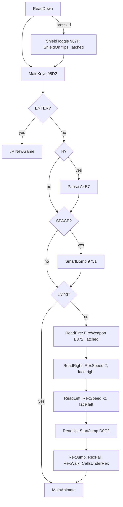

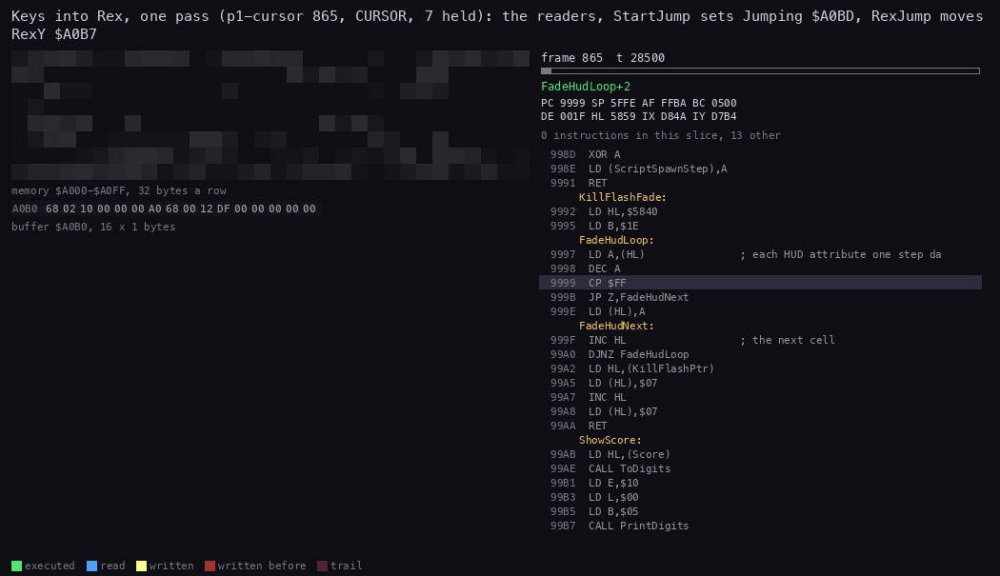

*Animation 5.6: one pass's key handling in `p1-cursor` (CURSOR), frame 865 T 28400 to T 33000 (46 pictures of 100 T,
415 instructions), with 7 (up) held from frame 865. Command: `python3 ../../kit/routine_anim.py --work
work/docs/rxB/p1-cursor --window 865:28400-865:33000 --listing build/game.lst --view buffer:A0B0:16x1:hex --range
A000-A0FF --pc 95BA-967E,A477-A4E6,CFDA-D1B8,967F-9696 --pictures 46 --title "..." --out
docs/img/routines/MainKeys.gif`.*

How to read:

- The code panel walks MainKeys, the five readers and the Rex movers.
- The view is `$A0B0-$A0BF`: RexX `$A0B6`, RexY `$A0B7`, RexFacing `$A0BB`, FallSpeed `$A0BC`, Jumping `$A0BD`.
- At T 29150 MainKeys starts. At T 30172 StartJump writes Jumping = 1. At T 30289 RexJump takes the first step.

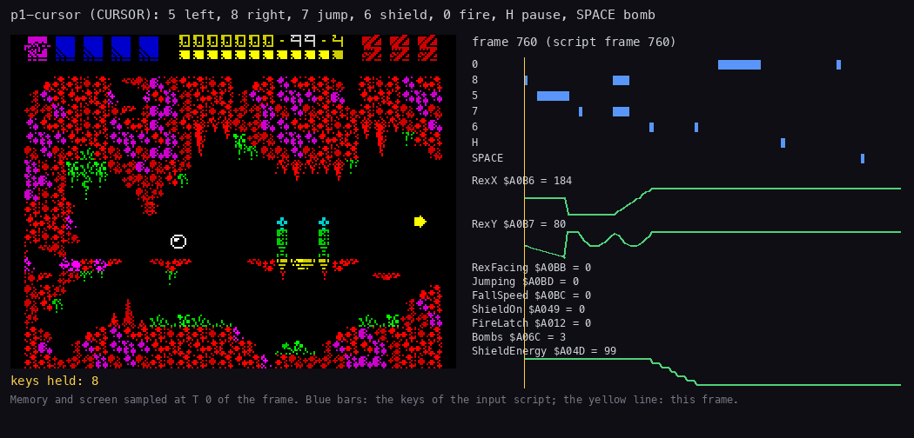

*Animation 5.7: Rex answering the keys in `p1-cursor`, frames 760-1480 every 6 frames (121 pictures, each at T 0).
Command: `python3 tools/fig_controls.py play --work work/docs/rxB/p1-cursor --from 760 --to 1480 --step 6 --keys
tests/inputs/p1-cursor.txt --delay 140 --title "..." --out docs/img/play/keys.gif`.*

How to read:

- Left: the screen. Right: the keys of the input script as bars, and the variables they drive.
- The yellow line is the current frame. The curves are RexX `$A0B6`, RexY `$A0B7` and ShieldEnergy `$A04D`.
- At the start Rex is dying (hit at frame 664; Dying `$A055` = 1 until 842): RexY climbs as the death animation
  lifts him. 5 (left) at 785-844 does nothing, because the Rex keys are skipped while Dying is set.
- At 842 Rex restarts at X 160, Y 104 with one life less. 7 (up) at 865: RexY dips and returns (the jump). 8 and 7 at
  931: a jump to the right, RexX +2 a pass.
- 6 (down) at 1001: ShieldOn becomes 255 and ShieldEnergy drains. 6 again at 1087: ShieldOn 0.
- H at 1253: the screen and the curves freeze until 0 (fire) at 1359. SPACE at 1405: Bombs 3 to 2.

Worked example (`p1-cursor`, samples at T 0):

| Frame | Keys | RexX | RexY | ShieldOn | Bombs | What happened |
| --- | --- | --- | --- | --- | --- | --- |
| 619-651 | 8 | 162, 164 ... 178 | 104 | 0 | 3 | +2 every 4 frames: one pass, RexSpeed 2 |
| 786-842 | 5 | 184 | 73 ... 61 | 0 | 3 | Dying = 1: the left key is ignored |
| 1002 | 6 (from 1001) | 196 | 100 | 255 | 3 | the shield on in the first pass after the press |
| 1090 | 6 again (1087) | 198 | 104 | 0 | 3 | the shield off |
| 1253-1358 | H, then none | frozen | frozen | 0 | 3 | Pause loops on ReadFire |
| 1360 | 0 at 1359 | | | | | FireLatch = 1: the fire that ends the pause also fires |
| 1408 | SPACE at 1405 | | | | 2 | SmartBombOn until 1468 (60 frames) |
| 1854 | ENTER at 1851 | 160 | 96 | 0 | 3 | NewGame: lives 4, bombs 3 |

Witness: MainPass L1 73 (c1, p1-cursor, p1-define, p1-kempston, p1-room x5, rzx-p1- x30); WalkRightKey and
WalkLeftKey L1 4126; ShieldToggle at p1-cursor 1001 and 1087.

The point: the keys are sampled once a pass, about every 4.4 frames, so a tap under 5 frames can be missed. The
shield and the fire are latched (one action a press); the walk is not (it lasts while held). The fixed keys are read
before Dying is tested, so H, SPACE and ENTER work even while Rex dies.

## 5.8 Pause, smart bomb, restart

**Pause** `$A4E7` (H) silences the sound and loops until fire is pressed:

```text
A4E7  CD D7 D5     Pause: CALL SoundSilence
A4EA  CD 77 A4            CALL ReadFire
A4ED  C2 E7 A4            JP NZ,Pause         ; until fire is down
A4F0  CD AE D5            CALL SoundReset
A4F3  C9                  RET
```

```text
Pause:
    repeat: SoundSilence()
    until ReadFire()          # fire down ends it; H again does not
    SoundReset()
```

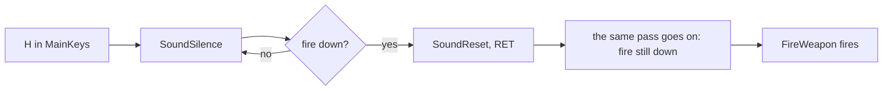

Only fire ends the pause; H does not. The pause returns in the middle of MainKeys. Fire is still down when ReadFire
runs a few hundred T later, so the press that ends the pause also fires a shot. Witness: `p1-cursor` H at
1253-1258, 0 at 1359, FireLatch = 1 at frame 1360.

**Smart bomb** `$9751` (SPACE) does nothing while SmartBombOn `$A030` is set or Bombs `$A06C` is 0. Otherwise it
takes a bomb, redraws the bomb icons (ShowBombs, [doc 8](08-hud-and-text.md)), sets SmartBombOn = 1 and
SmartBombSteps = 16, and marks every object ([doc 10](10-gameplay-logic.md)). It has no key latch: SPACE held past
the 16 steps fires the next bomb. Witness: `p1-cursor` SPACE at 1405, Bombs 3 to 2 at frame 1408, SmartBombOn 1
until 1468.

**Restart**: ENTER is `JP Z,NewGame`, read every pass. A new game starts at once: 4 lives, 3 bombs, the shield at 99,
the score 0, room 0, and PHASE ONE. Witness: `p1-cursor` ENTER at 1851, new game at 1854.

The point: all three fixed keys are tested before the Dying check and need no menu choice. Pause and fire share the
fire key, which is why a resume always shoots.

## 5.9 The waits for fire and the attract mode

NewGame `$9498` prints PHASE ONE and calls WaitFireOrAttract `$97C3`. Then it prints PRESS FIRE TO BEGIN and calls
it again. WaitFireOrAttract polls fire 50 000 times, with a short delay (DJNZ from 30) between polls:

- fire pressed: it waits for fire to be let go, sets Temp1 `$A093` = 1, and returns;
- 50 000 polls with no fire: it returns with Temp1 = 0.

After the second wait, NewGame tests Temp1. 0 goes to Attract `$A915`; 1 materialises Rex and starts play. The first
wait's timeout only moves on to PRESS FIRE.

```text
WaitFireOrAttract:
    Temp1 = 0; SoundSilence()
    for count in 50000 down to 1:
        delay(30 DJNZ)
        if ReadFire():
            while ReadFire(): wait        # until fire is let go
            SoundReset(); Temp1 = 1
            return
    return                                # Temp1 = 0: NewGame goes to Attract
```

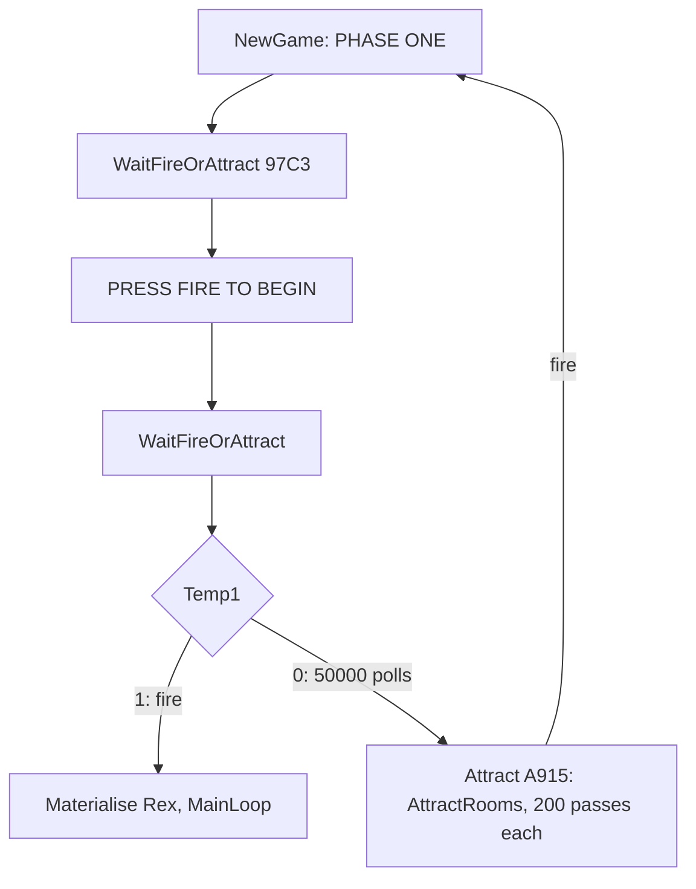

A poll costs about 495 T: 385 T of delay, 74 T of ReadFire, and the count. 50 000 polls are about 24.7 million T,
about 350 frames or 7 s. The timing is known only from the code. The attract mode itself runs once in `c1`
(Attract L1 1).

WaitFire `$97EA` (after GAME OVER and after the CODE panel) has no timeout. It waits for fire down, then for fire up:
WaitFireDown is the loop that waits for the press, WaitFireUp the one that waits for the release.

The point: a game starts on the release of fire, not on its press, so the held fire does not also shoot in the first
pass. WaitFireOrAttract itself is a plain return with Temp1; NewGame does the jump.

## 5.10 REX 2: the code entry

REX 2 has the same menu, readers and ScanKey (`src/rex2/menu.asm`). Before the menu, MenuCode asks for the code that
part 1 printed on its CODE panel ([doc 8](08-hud-and-text.md) shows how part 1 makes it). EnterCode `$DB27` calls
ReadCode `$DD1F`:

- up to 16 keys, read by ScanKey, each echoed with a `?` cursor after it (CodeTexts `$DCA7` + `$4E`);
- CAPS (`-`) deletes one character (CodeDelete);
- ENTER (`+`) ends.

ScanKey's refusals apply: SPACE and H are never taken. Any other key is stored, letters too. Only the checks below
reject them.

Then EnterCode decodes. Call the typed characters t0-t15. It builds out0-out15 by a fixed permutation:

| out | from | means | out | from | means |
| --- | --- | --- | --- | --- | --- |
| 0 | t12 | score 10 000s | 8 | t6 | multiple |
| 1 | t1 | score 1000s | 9 | t2 | spray |
| 2 | t5 | score 100s | 10 | t11 | shield tens |
| 3 | t9 | score tens | 11 | t8 | shield units |
| 4 | t7 | score units | 12 | t10 | bombs |
| 5 | t3 | lives | 13 | t14 | checksum hundreds |
| 6 | t0 | double fire | 14 | t15 | checksum tens |
| 7 | t4 | laser | 15 | t13 | checksum units |

- out0-out12 become `9 - digit`.
- CodeSum is the sum of the typed t0-t12 (before the `9 -`). A sum of 0 is refused.
- out13-out15 (not inverted) must equal CodeSum, read as a 3-digit number.
- The score, in hundreds, is out0-out4. Lives are out5. The four weapons are out6-out9 (each 0 or 1). The shield is
  out10-out11. Bombs are out12, which must be under 4.

Any failure goes to CodeBad: INVALID CODE / TRY AGAIN, ScanKey eats one key (the next key only clears the box),
back to MenuCode.

```text
EnterCode:
    t = ReadCode()                         # 16 characters
    out = [t[12], t[1], t[5], t[9], t[7], t[3], t[0], t[4], t[6], t[2], t[11], t[8], t[10], t[14], t[15], t[13]]
    for i in 0..12: out[i] = 9 - out[i]
    CodeSum = t[0] + ... + t[12]
    if CodeSum == 0: CodeBad
    if number(out[13..15]) != CodeSum: CodeBad
    CodeScore = number(out[0..4])
    CodeLives = out[5]
    HasDoubleFire, HasLaser, HasMultiple, HasSpray = out[6..9]
    CodeShield = number(out[10..11])
    CodeBombs = out[12]; if CodeBombs >= 4: CodeBad
```

```text
DB27  CD 1F DD     EnterCode:      CALL ReadCode
DB2A  3A 01 DD                     LD A,(CodeTexts+$005A)   ; t12
DB2D  32 0E DD                     LD (CodeTexts+$0067),A   ; out0; 15 more moves
; ...
DB94  4E           CodeDigitsLoop: LD C,(HL)
DB95  3E 39                        LD A,$39
DB97  91                           SUB C                    ; '9' - digit
DB98  C6 30                        ADD A,$30
DB9A  77                           LD (HL),A
; ...
DBAA  7E           CodeSumLoop:    LD A,(HL)                ; the typed t0-t12
DBAB  D6 30                        SUB $30
DBAD  83                           ADD A,E
; ...
DBDD  ED 52                        SBC HL,DE                ; out13-15 against CodeSum
DBDF  C2 59 DC                     JP NZ,CodeBad
; ...
DC53  FE 04                        CP $04                   ; bombs 0-3
DC55  D2 59 DC                     JP NC,CodeBad
DC58  C9                           RET
```

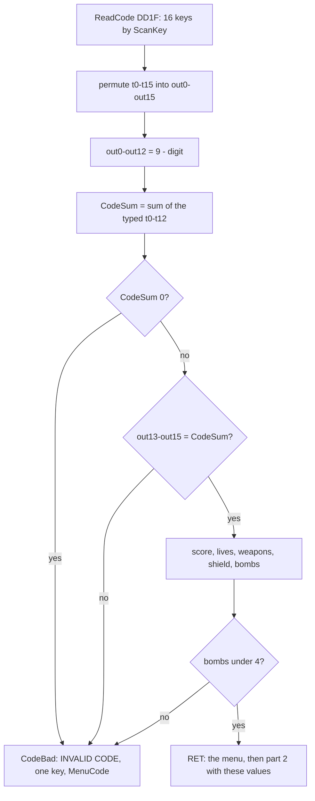

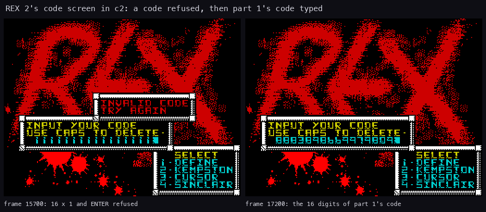

*Figure 5.8: REX 2's code screen in `c2`, TTD frames 15700 (a refused code: sixteen 1s, ENTER at script frame 1560)
and 17200 (part 1's code typed, before ENTER at script frame 3220), at T 0. Command: `python3 tools/fig_controls.py
shots --work work/docs/rxB/c2 --shot "15700=..." --shot "17200=..." --title "..." --out
docs/img/controls/code-entry.png`.*

How to read: the INPUT YOUR CODE box holds the typed characters, with the `?` cursor after the last one. The INVALID
CODE box is printed over the title; the next key clears it.

Worked example (`c2`): the code from the RZX run is `8883898669979809`.

| Step | Values |
| --- | --- |
| t0-t15 | 8 8 8 3 8 9 8 6 6 9 9 7 9 8 0 9 |
| out0-out4 (t12 t1 t5 t9 t7) | 9 8 9 9 6, inverted 0 1 0 0 3: score 01003 hundreds (HUD 0100300) |
| out5 (t3) | 3, inverted 6: six lives |
| out6-out9 (t0 t4 t6 t2) | 8 8 8 8, inverted 1 1 1 1: all four weapons |
| out10-out11 (t11 t8) | 7 6, inverted 2 3: shield 23 |
| out12 (t10) | 9, inverted 0: no bombs |
| CodeSum | 8+8+8+3+8+9+8+6+6+9+9+7+9 = 98 |
| out13-out15 (t14 t15 t13) | 0 9 8 = 98: accepted |

The refused code, sixteen 1s: CodeSum = 13, but out13-out15 read `111`. 13 is not 111: INVALID CODE.

Witness: EnterCode L1 2 and ReadCode L1 2 (c2); CodeBad at script frame 1560 (c2). Known only from the code: the
CAPS deletion (no recording deleted); letters typed in a code; the bombs limit.

The usual POKEs that skip the check: `$DBDF` from `C2` to `3A` (the `JP NZ,CodeBad` becomes `LD A,($DC59)`), and
`C9` (RET) at `$DC55`.

The point: the code is a checksummed permutation. The checksum is the sum of the raw digits, so it does not see the
order of t0-t12: swapping two of them keeps the code valid while changing the values.

Known only from the code: REX 2's NewGame copies CodeScore into GrowthsKilled as well as into the score. So BIO
GROWTHS KILLED starts at the score value. It looks like a bug.

## 5.11 DEMO: the input script

DEMO reads no control keys. Its readers TutorKeyFire `$9F50`, TutorKeyLeft, TutorKeyRight, TutorKeyUp and
TutorKeyShield test the bits of TutorInput `$6079`, copied into Temp1. The bits are 0 fire, 1 up, 2 down (shield),
3 right, 4 left, and 0 means pressed.

TutorStep `$9F82` runs once a pass:

```text
TutorStep:
    TutorCount -= 1
    if TutorCount == 0:
        TutorInput = script[ptr + 1]       # [input][count]
        TutorCount = script[ptr + 2]
        ptr += 2
    else:
        TutorInput = $FF                   # nothing pressed
```

So an input is held for exactly one pass, then nothing for count - 1 passes. A held key is a run of `[input][1]`
pairs. The script's first byte is the first count (TutorReset).

```text
9F82  3A 82 60     TutorStep: LD A,(TutorCount)
9F85  3D                      DEC A
9F86  32 82 60                LD (TutorCount),A
9F89  B7                      OR A
9F8A  C2 A7 9F                JP NZ,l_9FA7        ; not yet: nothing pressed
9F8D  2A 80 60                LD HL,(TutorScriptPtr)
9F90  23                      INC HL
9F91  7E                      LD A,(HL)
9F92  32 79 60                LD (TutorInput),A   ; the input
; ...                                             ; the count, the pointer + 2
9FA7  3E FF        l_9FA7:    LD A,$FF
9FA9  32 79 60                LD (TutorInput),A
9FAC  C9                      RET
```

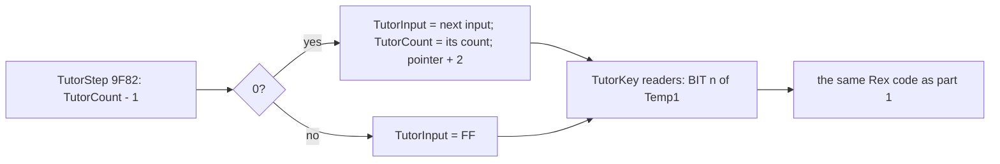

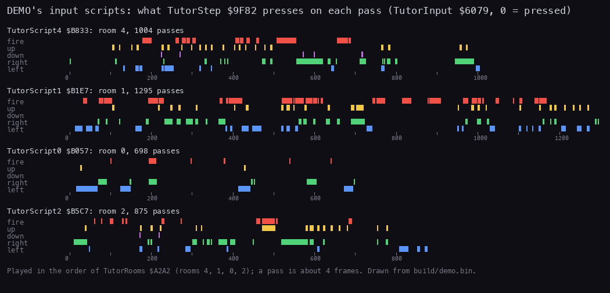

*Figure 5.9: DEMO's four input scripts, one lane a control, one column a pass, in the order they play. Drawn from
`build/demo.bin`: `python3 tools/fig_controls.py tutor --out docs/img/controls/tutor-scripts.png`. No recording.*

How to read:

- A block is a script. Its title gives the label, the room and the passes up to its end padding.
- A coloured tick is a pass in which that control is pressed.
- Long green or blue bars are walks, yellow ticks jumps, red bursts fire, purple the shield.

| Script | Address | Room | Pairs | Passes |
| --- | --- | --- | --- | --- |
| TutorScript4 | `$B833` | 4 (first) | 327 | 1004 |
| TutorScript1 | `$B1E7` | 1 | 495 | 1295 |
| TutorScript0 | `$B057` | 0 | 199 | 698 |
| TutorScript2 | `$B5C7` | 2 | 309 | 875 |

Worked example: TutorScript0 starts `11 EF 01 EF 01 ...`. The first count is `$11` = 17: 16 passes with nothing.
Then `$EF` (bit 4 low: left) for one pass with count 1, many times: Rex walks left for 10 passes. Then `ED 01` (left
and up, bit 1 low too) three times: a jump to the left.

A script plays until its room's end (TutorNextRoom) or a death. It ends with zero counts as padding: a count of 0
would hold nothing for 255 passes.

**SPACE** is DEMO's only key (`$7FFE` bit 0, read at `$8C47`). DemoPause `$9FAD` silences the sound, waits for SPACE
up, then for SPACE down, then goes on. Witness: `demo-cycle` SPACE at 30000 and 30106; DemoPause L1 1. Its two
loops are DemoPauseUp `$9FB0` and DemoPauseDown `$9FBA`.

Known only from the code: a press held past the next pass's SPACE read pauses again at once.

The point: the tutor is a recording of a player, stored as run lengths of one-pass inputs. The random seed is reset
in each room, so the same script replays the same demo every time. DEMO reads no key but SPACE.

## 5.12 Known only from the code

- CAPS and 0 share the name `-`: whichever is defined first blocks the other (5.5).
- ENTER can be defined as a control; it then restarts the game every pass (5.5).
- A change of the EAR bit ends ScanKey's wait early (5.5).
- KEMPSTON with no interface: every control reads pressed if the bus floats `$FF` (5.6).
- N at the confirm (MenuAgain `$DEEC`) and the roll call's restart after ten enemies (5.2, 5.4).
- The attract timeout's length, about 7 s (5.9).
- REX 2: the CAPS deletion, letters in a code, the bombs limit, GrowthsKilled set from the score (5.10).
- DEMO: a long SPACE press pauses again (5.11).
