# 6. Rendering

What this covers:

- the screen: the HUD band, the 30 x 21 play area, the two blank side columns, and the memory the renderer uses;
- one pass of drawing against the beam: the back buffer, the order of the writers, the tear;
- the room drawn from its map: blocks of 3 x 3 characters, the attribute shadow, the cell list;
- DrawAnimCells: the scenery redrawn over the sprites every pass;
- the animated scenery: characters rotated, rolled and swapped in place;
- ClearBuffer: the back buffer cleared by `PUSH`;
- DrawSprite `$B258` with its self-written operands, the pre-shifted copies and the frame lists;
- DrawMirrored and the mirror table;
- the sprite sheets: every picture the recordings drew;
- the other buffer writers: shots, drones, the sparkle, the shards;
- BufferToScreen and the attributes.

The recordings it rests on (WALKTHROUGH 6.0; all on the 128K):

| Recording | Load | Used for |
| --- | --- | --- |
| `p1-cursor` | `work/stage1/probe/128K/loaded.szx` (the menu), CURSOR | room 0 built (frames 400-421), one pass traced (1009:50000-1013:40000), the shield on |
| `c1` | power-on, REX 1 from the tape | room 0 on screen (`screens/001500.scr`) |
| `rzx-p1-00000` ... `rzx-p1-64000` | another player's RZX run, 17 segments | the sprite calls (frames 600-605 and 1600-1605 of each); DrawMirrored and the shards (`rzx-p1-00000` 603, 1604), the shots (`rzx-p1-08000` 1603), the drones (`rzx-p1-20000` 603), the sparkle (`rzx-p1-36000` 1602) |
| `p1-room14/24/26/27/30`, `p1-code` | stage 2 room probes | the sprite calls (frames 400-405 and 900-905) |

Conventions:

- **A frame** is 1/50 s of the 128K, 70 908 T. **A pass** is one turn of the main loop `MainPass $9586`
  ([doc 4](04-game-loop.md)). It takes about 4.4 frames: the game runs with interrupts off and never waits.
- "1009:54877" is frame 1009, T 54877 in that frame, as an access trace places an instruction.
- A value read with `time_travel memory_at` is the memory at the start (T 0) of the frame named.
- **X and Y** are the game's sprite coordinates (SpriteX `$A0AF`, SpriteY `$A0B0`): pixels across, lines down, with
  the play area's top at Y = 16 (6.1).
- **The buffer** is BackBuffer `$EB00-$FFFF`, 168 lines of 32 bytes. "Buffer column c" is byte c of a buffer line.

## 6.1 The screen and the memory behind it

The screen has three parts:

- the HUD band, lines 0-23 (character rows 0-2), drawn straight on the screen by the HUD code ([doc 8](08-hud-and-text.md));
- the play area, lines 24-191, columns 1-30: 168 lines of 30 bytes, copied from the buffer every pass;
- columns 0 and 31 of the play lines, which nothing draws. Their attribute is `$47` (white ink on black), set by
  CopyAttrs `$C8BF`.

The play area has 21 character rows of 30 characters. A room is 7 rows of 10 blocks, and a block is 3 x 3 characters
(6.3). So a room fills the play area exactly: 7 x 3 = 21 rows, 10 x 3 = 30 columns.

Everything below the HUD is built in RAM and copied. The memory behind it sits at the top of RAM, where the title
screen was loaded (TitleScreen `$E4FF-$FFF9`). GameEntry clears `$E4FF-$E7FE` after the menu; the rest is overwritten
by the first room.

| Address | Size | Name | What it holds |
| --- | --- | --- | --- |
| `$D962` | 4 a cell + 1 | SceneryCellList | every visible scenery cell of the room: buffer address, picture address; `$FF` ends it |
| `$DE9F` | 32 x 24 | CellIndexMap | a cell's 1-based index in SceneryCellList (the bullets use it, 6.4) |
| `$E19F` | 32 x 24 | RoomGrid | each cell's type from CharFlags `$62E0` ([doc 7](07-objects.md)); the play rows from RoomGridPlay `$E1FF` |
| `$E4FF` | 32 x 24 | the attribute shadow | the room's attributes as `$5800` will hold them; the play rows from AttrShadowPlay `$E55F` |
| `$E7FF`-`$EAFF` | | the origins | ShotBufferOrigin `$E7FF`, SparkleBufferOrigin `$E89F`, SpriteBufferOrigin `$E8FF`, ObjectBufferOrigin `$E9FF`, BufferPlayOrigin `$EAFF` |
| `$EB00` | 168 x 32 | BackBuffer | the play area's pixels, a line of 32 bytes per screen line |

The origins are not buffers. Each is the address a writer adds `32 x Y + X / 8` to, so that its own coordinates land
in the buffer. They differ because the writers' Y origins differ: the sprites' origin `$E8FF` is 16 lines above the
buffer and 1 byte to the left. So a sprite at (X, Y) is written at buffer line Y - 16, buffer column X / 8 - 1. On
the screen that is line Y + 8, column X / 8.

```text
SpriteBufferOrigin + 32 * Y + X / 8
    = $E8FF + 32 * Y + X / 8
    = $EB00 + 32 * (Y - 16) + (X / 8 - 1)          buffer line Y - 16, buffer column X / 8 - 1
BufferToScreen: buffer line n, column c  ->  screen line 24 + n, column c + 1
so: screen line = Y + 8, screen column = X / 8
```

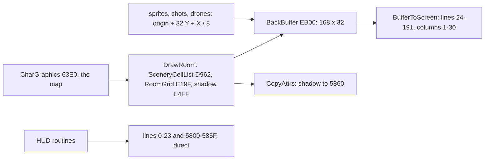

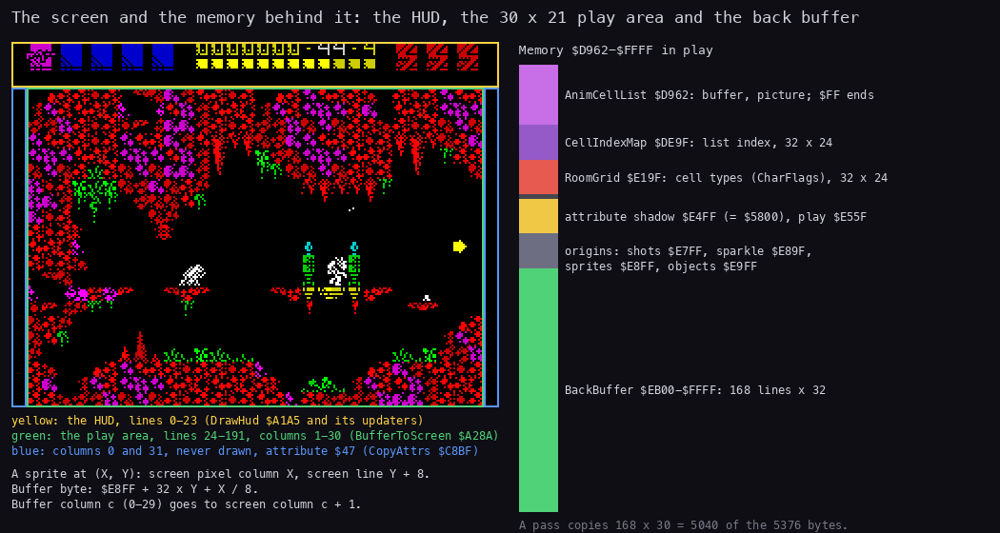

*Figure 6.1: the screen's three parts on a frame of room 0, and the memory map `$D962-$FFFF` in play. Recording `c1`,
`screens/001500.scr` (TTD frame 1500). Command: `python3 tools/fig_render.py layout --scr
work/stage1/c1/screens/001500.scr --out docs/img/render/layout.png`.*

How to read:

- Left: the screen at 2x. The yellow box is the HUD band, the green box the play area, the blue strips the side
  columns.
- Right: the memory, to scale from `$D962` (top) to `$FFFF` (bottom). The buffer is the green block, more than half of
  it.

The point: the play area is a 30-byte-wide window, and the buffer is 32 bytes wide. Bytes 30 and 31 of every buffer
line are never copied. They are a margin: a sprite that runs off the right edge writes there and is not seen.

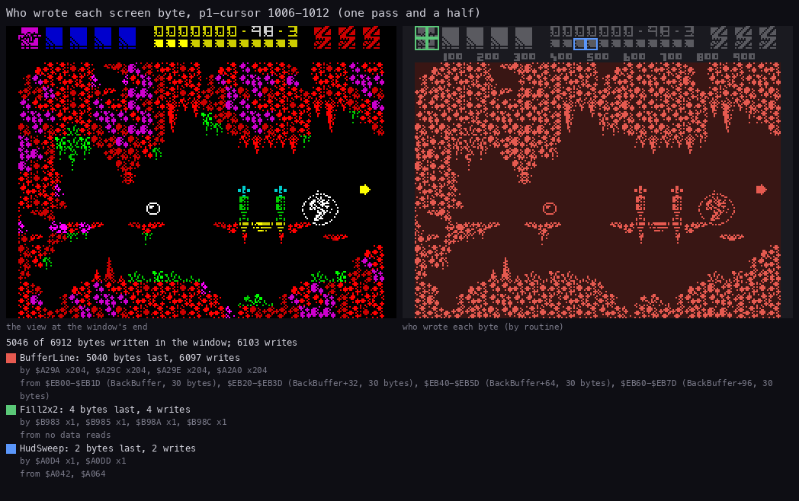

*Figure 6.2: code against the screen over a pass and a half. Recording `p1-cursor`, frames 1006:0-1012:0 (room 0, Rex
in his shield). Command: `python3 ../../kit/writers_map.py --work work/docs/rxB/p1-cursor --window 1006:0-1012:0
--listing build/game.lst --view screen --sources --out docs/img/render/writers-screen.png`.*

How to read:

- Left: the screen at the window's end. Right: each byte coloured by the routine that wrote it last.
- Red is BufferLine, the loop of BufferToScreen `$A28A`: 5040 bytes, every byte of the play area.
- The HUD's two writers are small: Fill2x2 (4 bytes of a panel icon) and HudSweep (2 bytes of the sweep bar,
  [doc 8](08-hud-and-text.md)).
- No routine wrote an attribute of the play area in the window. Its colours were set when the room was built (6.11).

The point: in play, exactly one routine writes the play area. Everything that moves is drawn into the buffer first.

## 6.2 One pass against the beam

A pass draws in this order (MainPass `$9586`, [doc 4](04-game-loop.md)):

1. MoveBullets `$B64E` and MoveEnemyBullets `$B645`: the shots are drawn into the buffer and move (6.10).
2. UpdateDrones `$A639`: the drones that circle Rex (6.10).
3. RexState `$969B`: Rex (DrawRex `$96A7`) and his shield, or the death animation.
4. SparkleUpdate `$9D71`, SparkleDraw `$9E02`: the sparkle when Rex appears or vanishes.
5. UpdateObjects `$BA5C`: every object, drawn by DrawObject `$BAD0`.
6. DrawAnimCells `$B33E`: every scenery cell, written over all of the above.
7. BufferToScreen `$A28A`: the buffer to the screen.
8. ClearBuffer `$B205`: the buffer to zero, ready for the next pass.
9. The HUD, the keys and the rest of the pass ([doc 4](04-game-loop.md), [doc 5](05-controls.md)).

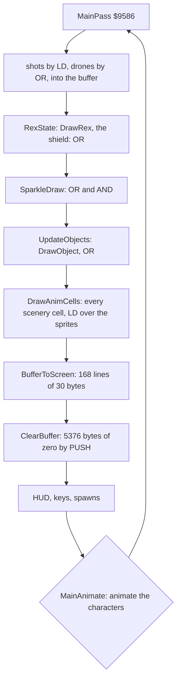

```text
MainPass, the drawing part:
    MoveBullets(); MoveEnemyBullets(); UpdateDrones()
    RexState()                       # DrawRex: Rex, then the shield
    SparkleUpdate(); SparkleDraw()
    UpdateObjects()                  # DrawObject for each live object
    SoundStep()
    DrawAnimCells()                  # the scenery, over the sprites
    BufferToScreen()
    ClearBuffer()
    SoundStep()
    ...                              # the HUD, the keys
    MainAnimate()                    # rotate the animated characters (6.5)
```

```text
9586  CD 4E B6     MainPass:    CALL MoveBullets
9589  CD 45 B6                  CALL MoveEnemyBullets
958C  CD 39 A6                  CALL UpdateDrones
958F  CD 9B 96                  CALL RexState
9592  CD 71 9D                  CALL SparkleUpdate
9595  CD 02 9E                  CALL SparkleDraw
9598  CD 5C BA                  CALL UpdateObjects
959B  CD 8C D6                  CALL SoundStep
959E  CD 3E B3                  CALL DrawAnimCells
95A1  CD 8A A2                  CALL BufferToScreen
95A4  CD 05 B2                  CALL ClearBuffer
95A7  CD 8C D6                  CALL SoundStep
```

The three big writers cost most of the pass. Their costs, from the instructions and checked on the trace of
`p1-cursor` (one pass, 1009:50000-1013:40000):

| Routine | Work | T | Frames | Trace |
| --- | --- | --- | --- | --- |
| DrawAnimCells | 364 cells x 306 T | 111 400 | 1.57 | 1010:8613 to 1011:51063 |
| BufferToScreen | 168 lines x 518 T | 87 000 | 1.23 | 1011:51063 to 1013:5065 |
| ClearBuffer | 42 x (64 x 11 + 13) T | 30 100 | 0.42 | 1013:5512 to 1013:35688 |
| all three | | 228 500 | 3.22 | of a pass of about 4.4 frames |

There is no wait for the beam anywhere. The copy starts wherever the pass has got to, and runs for 1.23 frames. So
the beam overtakes it, and one frame in each pass shows a tear: the lines above the crossing come from the new
pass, the lines below from the old.

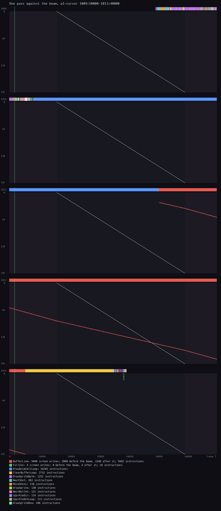

*Figure 6.3: one pass of `p1-cursor` against the raster, frames 1009-1013. Command: `python3 ../../kit/beam_timeline.py
--work work/docs/rxB/p1-cursor --window 1009:50000-1013:40000 --frames 5 --listing build/game.lst --out
docs/img/render/beam-pass.png`.*

How to read:

- One panel a frame. The bar on top is what ran, coloured by routine, along the frame's T (bottom axis).
- The white diagonal is the beam: the screen line being displayed at that T (left axis, 0-191).
- The red steps are BufferToScreen's writes: the screen line it wrote at that T.
- Frame 1010 and most of 1011 are blue: DrawAnimCells. ClearBuffer is the yellow at the start of 1013.

Worked example, the tear line. BufferToScreen ends line 167 (screen line 191) at 1013:5065, and a line takes 518 T.
In frame 1012's terms that is T 70 908 + 5065 = 75 973. So screen line S (24 + n) is finished at
`75 973 - 518 x (191 - S)`. The beam shows line S at `16 212 + 228 x S` (the paper starts at T 16 212 on the 128K, 228
T a line). The two meet where `75 973 - 518 x (191 - S) = 16 212 + 228 x S`, which gives S = 135. So frame 1012 shows
the new pass on lines 24-134 and the old pass on lines 136-191. In the figure, the red steps cross the diagonal at
line 135, T 47 000. Frame 1011 shows only old lines: the copy began (1011:51063) after the beam had passed line 153.
Frame 1013 shows only new lines.

The point: Rex has no frame sync and no double buffer on screen. Each pass gives one torn frame, at a line that
drifts with the pass's length. Sprites do not flicker, because the screen is never cleared: each line changes once,
from the old picture to the new.

## 6.3 The room drawn from its map

BuildRoom `$A89D` draws a room when Rex enters it ([doc 4](04-game-loop.md)). The work is DrawRoom `$C745`:

1. Clear CellIndexMap and RoomGrid (`$DE9F`, `$0660` bytes).
2. Set RoomCellPtr `$A01D` to 1, IX to BackBuffer `$EB00` and RoomColumn `$A0B9` to SceneryCellList `$D962`.
3. Point IY at the room's map: RoomMaps `$75E0` + 70 x Room (Multiply `$C8E8`, repeated `ADD`).
4. For each of 7 block rows, for each of 10 blocks: the block's 9 characters at BlockDefs `$6CE0` + 9 x block,
   drawn by DrawBlockRow `$C7C5` at IX; then IX += 3 (the next block), and IX += `$0300` after a row (24 lines).
5. DrawBlockRow draws 3 rows of 3 characters. After each row, IX += `$FD`: back 3 bytes and down 8 lines.
6. DrawRoomCell `$C7E2` draws one character c at IX:
   - the attribute CharAttrs `$6BE0` + c into the shadow (DrawRoomChar `$C893` turns the buffer address into the
     shadow address);
   - the type CharFlags `$62E0` + c into RoomGrid, at the same offset;
   - unless c is 0, 1, `$10`, `$71`, `$81` or `$91`: a cell entry in SceneryCellList (buffer address, picture address
     CharGraphics `$63E0` + 8c) and its index into CellIndexMap;
   - the 8 bytes of the picture into the buffer, 32 bytes apart (NextCellPtr `$C87F`).
7. Back in BuildRoom: the play attributes `$5860` are zeroed, the buffer cleared (ClearBuffer), the listed cells drawn
   (DrawAnimCells), the buffer copied (BufferToScreen) and the shadow copied to the screen (CopyAttrs).

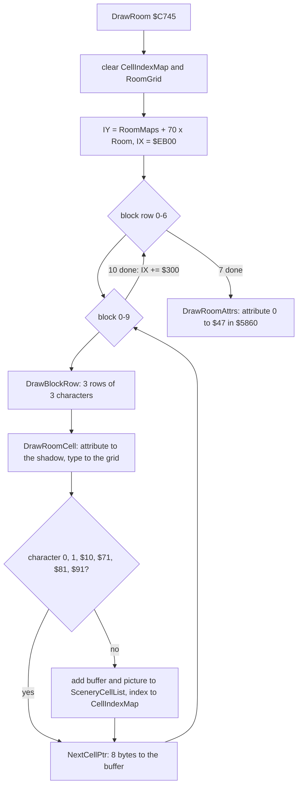

```text
DrawRoom:
    clear CellIndexMap .. RoomGrid ($0660 bytes)
    RoomCellPtr = 1; IX = $EB00; RoomColumn = SceneryCellList
    IY = RoomMaps + 70 * Room
    for row in 0..6:
        for block in 0..9:
            HL = BlockDefs + 9 * [IY]
            DrawBlockRow(HL, IX)             # 3 x 3 characters
            IX += 3; IY += 1
        IX = the row's first IX + $300       # POP IX, then 24 lines down
    for each byte of $5860..$5AFF: if 0 then $47 # on the screen, not on the shadow
DrawRoomCell(c, IX):
    shadow = AttrShadowPlay + 32 * charrow(IX) + column(IX)
    [shadow] = CharAttrs[c]
    [shadow - AttrShadowPlay + RoomGridPlay] = CharFlags[c]
    if c not in (0, 1, $10, $71, $81, $91):
        append (IX, CharGraphics + 8c) to SceneryCellList; write $FF after it
        CellIndexMap[cell] = RoomCellPtr; RoomCellPtr += 1   # one byte: wraps after 255
    copy the 8 bytes of CharGraphics + 8c to IX, IX + 32, ... IX + 224
```

```text
C77A  06 07                     LD B,$07
C77C  C5           DrawRoomRow: PUSH BC                 ; each block row
C77D  DD E5                     PUSH IX
C77F  06 0A                     LD B,$0A
C781  C5         DrawRoomBlock: PUSH BC                 ; each block
C782  FD 7E 00                  LD A,(IY+$00)
C785  5F                        LD E,A
C786  16 00                     LD D,$00
C788  06 09                     LD B,$09
C78A  CD E8 C8                  CALL Multiply
C78D  11 E0 6C                  LD DE,BlockDefs
C790  19                        ADD HL,DE
C791  CD C5 C7                  CALL DrawBlockRow
C794  11 03 00                  LD DE,$0003
C797  DD 19                     ADD IX,DE
C799  FD 23                     INC IY
C79B  C1                        POP BC
C79C  10 E3                     DJNZ DrawRoomBlock
C79E  DD E1                     POP IX
C7A0  11 00 03                  LD DE,$0300
C7A3  DD 19                     ADD IX,DE
C7A5  C1                        POP BC
C7A6  10 D4                     DJNZ DrawRoomRow
; ...
C822  3A 95 A0                  LD A,(Temp2)
C825  B7                        OR A
C826  CA 7F C8                  JP Z,NextCellPtr
C829  FE 01                     CP $01
C82B  CA 7F C8                  JP Z,NextCellPtr
; ... the same for $10, $71, $81, $91
C842  FD E5                     PUSH IY
C844  FD 2A B9 A0               LD IY,(RoomColumn)
C848  FD 75 00                  LD (IY+$00),L
C84B  FD 74 01                  LD (IY+$01),H
C84E  FD 73 02                  LD (IY+$02),E
C851  FD 72 03                  LD (IY+$03),D
C854  FD 36 04 FF               LD (IY+$04),$FF
; ...
C87F  1A           NextCellPtr: LD A,(DE)
C880  77                        LD (HL),A
C881  13                        INC DE
C882  D5                        PUSH DE
C883  11 20 00                  LD DE,$0020
C886  19                        ADD HL,DE
C887  D1                        POP DE
C888  10 F5                     DJNZ NextCellPtr
```

Worked example: room 0, block row 3, block 6. The map byte is at `$75E0 + 70 x 0 + 10 x 3 + 6 = $7604`: block `$08`.
Its 9 characters are at `$6CE0 + 9 x 8 = $6D28`: `00 00 00 / F9 00 00 / 9C 00 00`. IX for the block is
`$EB00 + 3 x $300 + 3 x 6 = $F412`. The middle row's first character `$F9` goes to `$F412 + $100 = $F512`:

- attribute `$05` (cyan on black) to the shadow at `$E6B2` (= `$59B2` on the screen: row 13, column 19);
- type 0 to the grid at `$E352`;
- entry 219 of SceneryCellList: buffer `$F512`, picture `$6BA8` (= `$63E0 + 8 x $F9`); CellIndexMap holds 219 for the
  cell;
- on the screen: line 104 (= 24 + (`$F512` - `$EB00`) / 32), column 19.

Character `$9C` (attribute `$04`, green) is entry 220, buffer `$F612`, picture `$68C0`, line 112. The six zeros are not
listed; their shadow bytes hold CharAttrs + 0 = `$47`. Memory of `p1-cursor` at frame 1006 confirms every value:
entries 219 and 220 hold `12 F5 A8 6B` and `12 F6 C0 68`, the shadow `05 47 47` at `$E6B2`, the screen's attributes the
same at `$59B2`.

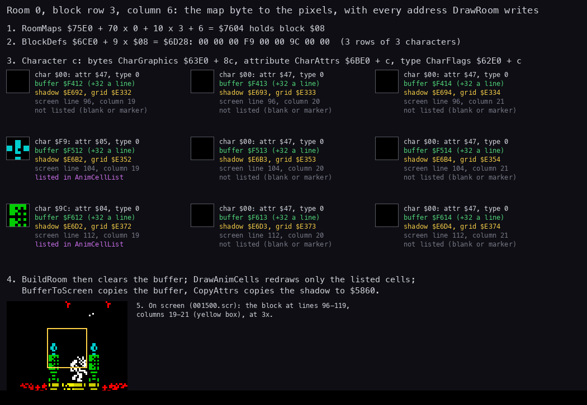

*Figure 6.4: one block of room 0 traced from its map byte to the screen, with every address DrawRoom writes. Data from
`build/game.bin`; the screen crop from `c1`, `screens/001500.scr`. Command: `python3 tools/fig_render.py build --room 0
--row 3 --col 6 --scr work/stage1/c1/screens/001500.scr --out docs/img/render/build-block.png`.*

How to read:

- Steps 1 and 2: the map byte and the block's 9 character codes.
- Step 3: the 9 characters in the block's 3 x 3 layout, each drawn in its own colours, with the addresses written
  for it. Purple marks the cells that enter SceneryCellList.
- Step 5: the screen around the block at 3x; the yellow box is the block (lines 96-119, columns 19-21). The cyan
  marker and the green stem are `$F9` and `$9C`.

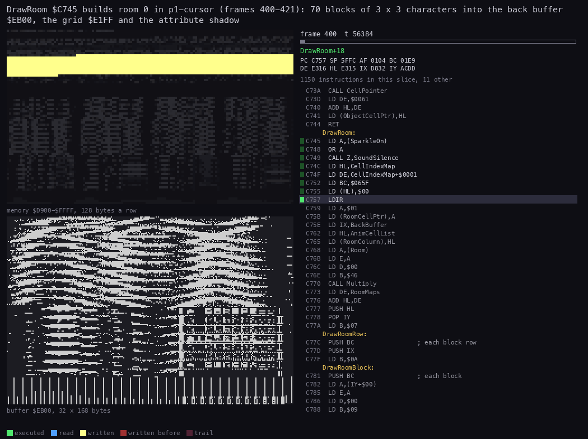

*Animation 6.1: DrawRoom building room 0 in the buffer, 60 pictures. Recording `p1-cursor`, frames
400:32000-421:6000 (the first room after the menu). Command: `python3 ../../kit/routine_anim.py --work
work/docs/rxB/p1-cursor --window 400:32000-421:6000 --listing build/game.lst --view buffer:EB00:32x168:rows --range
D900-FFFF --pc C745-C8BE,8000-8000 --pictures 60 --title "..." --out docs/img/routines/DrawRoom.gif`.*

How to read: the left pane is the buffer, filling block by block, left to right and top to bottom. The right pane is
the listing, with the instruction that ran; the memory strip shows SceneryCellList and the maps filling at the same time.

Witness: DrawRoom ran from 400:32348 to about 421:0 in `p1-cursor`: about 20 frames, 0.4 s, for 630 characters (about
2200 T a character, most of it in Multiply and the address conversion). BuildRoom began at 400:10600, CopyAttrs ran at
421:4367.

The point: DrawRoom draws every pixel of the room into the buffer, and then BuildRoom throws them away. The buffer is
cleared before DrawAnimCells redraws the listed cells. So the screen shows only the cells of SceneryCellList. Two
consequences:

- the six skipped characters never appear in play. Characters 1, `$10`, `$71`, `$81` and `$91` are visible glyphs
  (attribute `$47`, types 2, 17, 14, 15 and 16): they are markers for the game logic, drawn only into the buffer
  that is cleared ([doc 7](07-objects.md));
- DrawRoom's last loop (`$C7A8-$C7B9`, attribute 0 to `$47` on the screen's `$5860-$5AFF`) is undone at once:
  BuildRoom zeroes `$5860` and CopyAttrs writes the shadow over it.

## 6.4 The cell list and DrawAnimCells

SceneryCellList `$D962` is the room's scenery as a list. It holds every visible cell, not only the animated ones: 364
entries in room 0. DrawAnimCells `$B33E` walks it with the stack pointer:

1. Save SP in Temp2 `$A095`; SP = SceneryCellList.
2. `POP HL` (the buffer address), `POP DE` (the picture address).
3. If L is `$FF`, it is the end mark: restore SP (ReturnToStack `$B339`) and return.
4. Copy the 8 picture bytes to HL, HL + 32, ... with `LD A,(DE)` / `LD (HL),A`. It is a load, not an `OR`.
5. Go to 2.

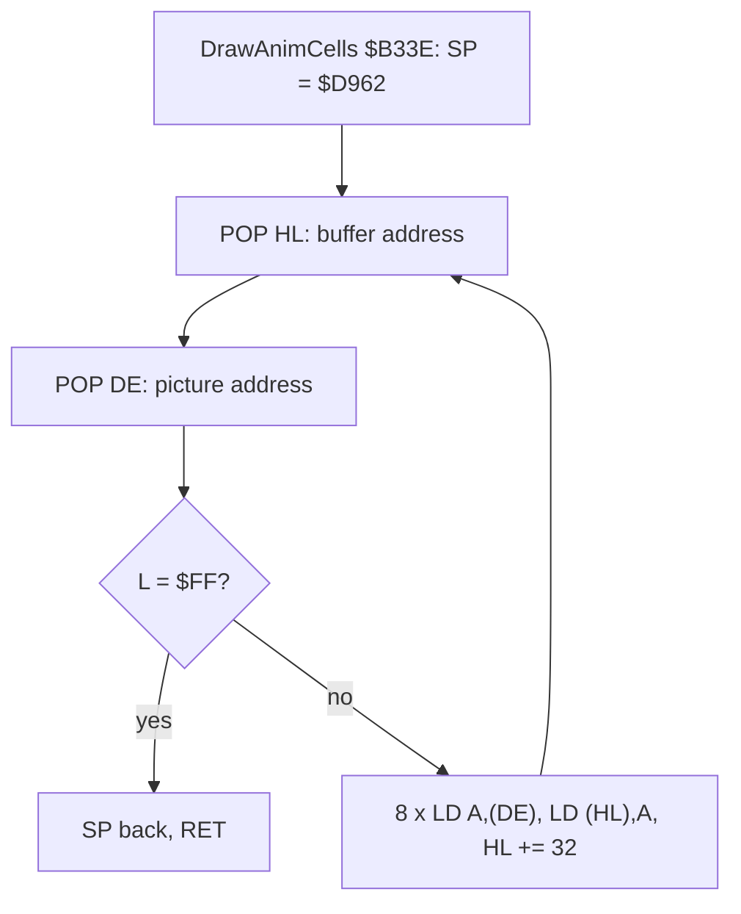

```text
DrawAnimCells:
    save SP; SP = SceneryCellList
    loop:
        HL = pop(); DE = pop()
        if L == $FF: restore SP; return      # the end mark: LD (IY+4),$FF after each new entry
        repeat 8: [HL] = [DE]; DE += 1; HL += 32
```

```text
B33E  ED 73 95 A0 DrawAnimCells:    LD (Temp2),SP
B342  31 62 D9                      LD SP,SceneryCellList
B345  E1          DrawAnimCellLoop: POP HL                  ; each listed cell
B346  D1                            POP DE
B347  7D                            LD A,L
B348  3C                            INC A
B349  CA 39 B3                      JP Z,ReturnToStack
B34C  01 20 00                      LD BC,$0020
B34F  1A                            LD A,(DE)
B350  77                            LD (HL),A
B351  13                            INC DE
B352  09                            ADD HL,BC
; ... six more lines
B36B  1A                            LD A,(DE)
B36C  77                            LD (HL),A
B36D  13                            INC DE
B36E  09                            ADD HL,BC
B36F  C3 45 B3                      JP DrawAnimCellLoop
```

Worked example: entry 219 of room 0 is the 4 bytes `12 F5 A8 6B` at `$D962 + 4 x 218 = $DCCA`. `POP HL` gives `$F512`,
`POP DE` gives `$6BA8`. The loop copies `$6BA8-$6BAF` (character 249, the restart marker, whose bytes AnimateRestart
changes, 6.5) to `$F512`, `$F532`, ... `$F5F2`. The end test reads L = `$12`, not `$FF`. A buffer address never has
a low byte of `$FF` in a used column, because column 31 is never drawn into by DrawRoom: `$FF` = line n, column 31.

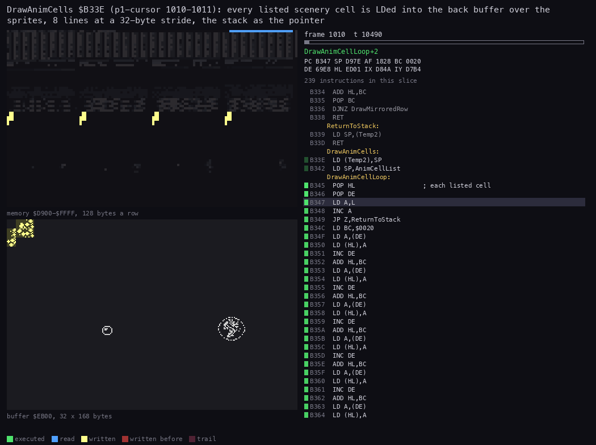

*Animation 6.2: DrawAnimCells drawing room 0's 364 cells over the sprites, 60 pictures. Recording `p1-cursor`, frames
1010:8600-1011:51100. Command: `python3 ../../kit/routine_anim.py --work work/docs/rxB/p1-cursor --window
1010:8600-1011:51100 --listing build/game.lst --view buffer:EB00:32x168:rows --range D900-FFFF --pc B33E-B371
--out docs/img/routines/DrawAnimCells.gif`.*

How to read: the buffer starts with only the sprites in it (Rex, the shield, a pod). The cells appear in list order,
which is DrawRoom's order: block by block, three characters across and three down in each block.

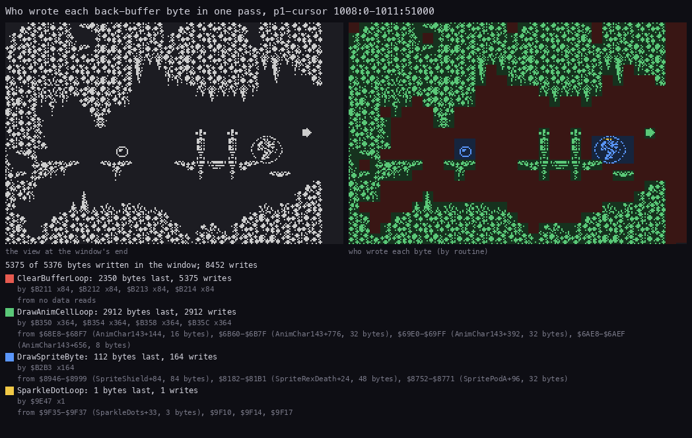

*Figure 6.5: code against the buffer over one pass. Recording `p1-cursor`, frames 1008:0-1011:51000 (from the
previous ClearBuffer to the start of BufferToScreen). Command: `python3 ../../kit/writers_map.py --work
work/docs/rxB/p1-cursor --window 1008:0-1011:51000 --listing build/game.lst --view buffer:EB00:32x168:rows --sources
--out docs/img/render/writers-buffer.png`.*

How to read:

- Green, DrawAnimCellLoop: 2912 bytes, 364 cells of 8.
- Blue, DrawSpriteByte: 112 bytes, 164 writes: Rex (`$8182`, the copy for X & 7 = 6 or 7, 6.7), the shield
  (`$8946`) and a pod (`$8752`). Rex's box keeps blue only where no cell is listed.
- Yellow, SparkleDotLoop: one dot.
- Red, ClearBufferLoop: the rest, zero.

The point: the scenery is redrawn every pass, by load, after the sprites. Where a sprite and a scenery cell meet,
the cell wins: the sprite disappears behind it. That is the game's only masking. Rex walks behind plants and rocks
because they are drawn last, not because of a mask. Blank cells (character 0) are not listed, so the sprites show on
them.

The list costs 364 x 306 T = 1.57 frames a pass in room 0: the biggest single cost of a pass (6.2). It also makes the
animated characters work for free: DrawAnimCells copies from CharGraphics each time, so a character changed in place
changes on screen in every cell that uses it (6.5).

Two limits, known only from the code:

- **The list overruns CellIndexMap.** SceneryCellList has `$DE9F - $D962` = 1341 bytes before CellIndexMap, room for 335
  entries. Room 0 lists 364, so the list ends at `$DF12`: memory of `p1-cursor` at frame 1006 shows `$FF` at `$DF12`.
  Entries 336-364 overwrite CellIndexMap's first 116 bytes: HUD rows 0-2 (unused) and the first play row from column
  0 to 18 (`$DEFF-$DF12`). DrawRoom writes those indexes early (row 0) and the list later, so the indexes are lost.
- **The index is one byte.** RoomCellPtr `$A01D` counts in A and wraps after 255: cells 256-364 get indexes 1-109.

CellIndexMap is read by BulletHitsCell (weapons.asm), which steps a hit cell of types 4, 5 and 6 to the next
character in its SceneryCellList entry (picture + 8, [doc 10](10-gameplay-logic.md)). In a room with more than 255 cells
or more than 335, a hit on such a cell can step the wrong entry. No recording shows it.

## 6.5 The animated scenery

The scenery moves without any extra drawing. MainAnimate `$9645`, at the end of every pass, changes ten characters in
CharGraphics in place. DrawAnimCells shows them in the next pass.

| Character | Address | How it changes | Code |
| --- | --- | --- | --- |
| 111 | `$6758` | each line rotated right one bit (`RRC (HL)`) | MainRrcLoop `$964A` |
| 143 | `$6858` | each line rotated left two bits (`RLC (HL)` twice) | MainRlcLoop `$9654` |
| 28 | `$64C0` | the 8 lines rolled down one line (the last line comes first) | RollCharDown `$A7BA` |
| 11 | `$6438` | the 8 lines rolled up one line (the first line goes last) | RollCharUp `$A7A9` |
| 26 | `$64B0` | rolled down, as 28 | RollCharDown |
| 252-255 | `$6BC0` | 32 bytes from AnimFramesA `$AE8D` or AnimFramesB `$AEAD`, by PassToggle `$A017` | AnimateCells `$A55E` |
| 250-251 | `$6BB0` | 16 bytes, the next frame of FramesList2 `$A602` | AnimateCells2 `$A5A7` |
| 68 | `$6600` | 8 bytes, the next frame of FramesList1 `$A60C` | CopyFrame `$A5C4` |
| 127 | `$67D8` | 8 bytes, the next frame of FramesList4 `$A61A` | CopyFrame |
| 249 | `$6BA8` | 8 bytes, the next frame of FramesList3 `$A5F4` (the restart marker) | AnimateRestart `$A5B7` (from the restart code) |

A frame list is a list of picture addresses ending in `$FF $FF`. CopyFrame keeps a counter (AnimCount1-4 `$A069`,
`$A06A`, `$A06B`, `$A07C`). It adds 2, reads the address at the list + counter, and on `$FF` sets the counter to 0 and
reads again.

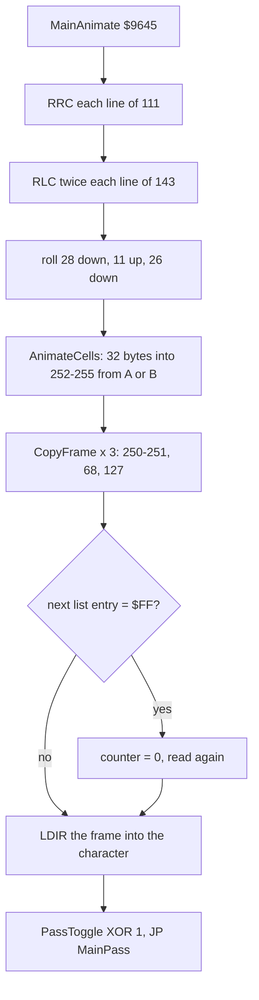

```text
MainAnimate:
    for line in char111: line = rrc(line)
    for line in char143: line = rlc(rlc(line))
    roll_down(char28); roll_up(char11); roll_down(char26)
    copy 32 bytes from (AnimFramesB if PassToggle else AnimFramesA) to chars 252..255
    CopyFrame(AnimCount2, FramesList2, char250, 16)
    CopyFrame(AnimCount3, FramesList1, char68, 8)
    CopyFrame(AnimCount4, FramesList4, char127, 8)
    PassToggle ^= 1
CopyFrame(counter, list, char, n):
    counter += 2
    while word(list + counter) low byte == $FF: counter = 0
    copy n bytes from word(list + counter) to char
```

```text
9645  21 58 67     MainAnimate: LD HL,AnimChar111
9648  06 08                     LD B,$08
964A  CB 0E        MainRrcLoop: RRC (HL)                ; rotate each line of character 111 right
964C  23                        INC HL
964D  10 FB                     DJNZ MainRrcLoop
964F  21 58 68                  LD HL,AnimChar143
9652  06 08                     LD B,$08
9654  CB 06        MainRlcLoop: RLC (HL)                ; rotate each line of character 143 left
9656  CB 06                     RLC (HL)
9658  23                        INC HL
9659  10 F9                     DJNZ MainRlcLoop
965B  21 C0 64                  LD HL,AnimChar28
965E  CD BA A7                  CALL RollCharDown
9661  21 38 64                  LD HL,AnimChar11
9664  CD A9 A7                  CALL RollCharUp
9667  21 B0 64                  LD HL,AnimChar26
966A  CD BA A7                  CALL RollCharDown
966D  CD 5E A5                  CALL AnimateCells
9670  3A 17 A0                  LD A,(PassToggle)
9673  EE 01                     XOR $01
9675  32 17 A0                  LD (PassToggle),A
9678  C3 86 95                  JP MainPass
; ...
A5C4  ED 53 93 A0  CopyFrame:   LD (Temp1),DE
A5C8  22 95 A0                  LD (Temp2),HL
A5CB  FD 34 00                  INC (IY+$00)
A5CE  FD 34 00                  INC (IY+$00)
A5D1  FD 6E 00   CopyFrameNext: LD L,(IY+$00)           ; the list's next frame
A5D4  26 00                     LD H,$00
A5D6  ED 5B 93 A0               LD DE,(Temp1)
A5DA  19                        ADD HL,DE
A5DB  EB                        EX DE,HL
A5DC  1A                        LD A,(DE)
A5DD  FE FF                     CP $FF
A5DF  C2 E9 A5                  JP NZ,CopyFrameDo
A5E2  FD 36 00 00               LD (IY+$00),$00
A5E6  C3 D1 A5                  JP CopyFrameNext
```

Worked example: FramesList1 `$A60C` is `12 94 1A 94 22 94 2A 94 32 94 3A 94 FF FF`: six frames at `$9412`, `$941A`,
... `$943A`. With AnimCount3 at 0, the first pass adds 2 and copies `$941A`; the sixth pass reads `$FF` at offset 12,
sets the counter to 0 and copies `$9412`. So character 68 cycles through six frames, one a pass: a cycle of about 26
frames, half a second.

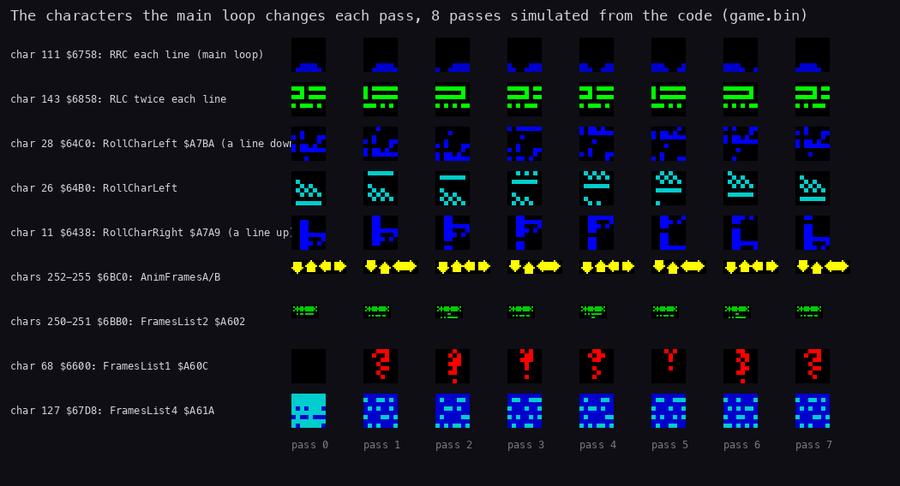

*Figure 6.6: the ten animated characters over 8 passes, simulated from the code on `build/game.bin` (the counters
starting at 0). Command: `python3 tools/fig_render.py animchars --out docs/img/render/anim-chars.png`.*

How to read: one row a character, one column a pass, each in its CharAttrs colours. Rows 1-5 are the rotations and
rolls; row 6 is characters 252-255 side by side (the yellow arrows, two frames swapped by PassToggle); rows 7-9 are the
frame lists.

The point: a character animated in place costs the same in every cell that uses it: nothing. Every arrow, plant or light
of that kind in the room moves because one character changed. The cost is that the animation runs at the pass
rate, about 11 steps a second, and slows with a busy room.

## 6.6 ClearBuffer: the buffer cleared by PUSH

ClearBuffer `$B205` zeroes the buffer with the stack:

1. Save SP in Temp1 `$A093`; SP = `$FFFF`; HL = 0.
2. 42 times: 64 `PUSH HL` (a loop body of 64 instructions unrolled).
3. Restore SP.

Each `PUSH` writes 2 bytes below SP. The first writes `$FFFE` and `$FFFD`; the last, after 42 x 64 x 2 = 5376 bytes,
writes `$EB00` and `$EAFF`. So the buffer is cleared from the bottom line up, and the two ends are off by one: byte
`$FFFF` (line 167, column 31, never seen) is not cleared, and byte `$EAFF` (BufferPlayOrigin, below the buffer) is.

```text
ClearBuffer:
    save SP; SP = $FFFF; HL = 0
    repeat 42:
        repeat 64: push(HL)       # [SP-1], [SP-2] = 0; SP -= 2
    restore SP
```

```text
B205  ED 73 93 A0  ClearBuffer:     LD (Temp1),SP
B209  31 FF FF                      LD SP,$FFFF
B20C  06 2A                         LD B,$2A
B20E  21 00 00                      LD HL,$0000
B211  E5           ClearBufferLoop: PUSH HL                 ; PUSH HL x 16 a line
B212  E5                            PUSH HL
; ... 62 more PUSH HL
B251  10 BE                         DJNZ ClearBufferLoop
B253  ED 7B 93 A0                   LD SP,(Temp1)
B257  C9                            RET
```

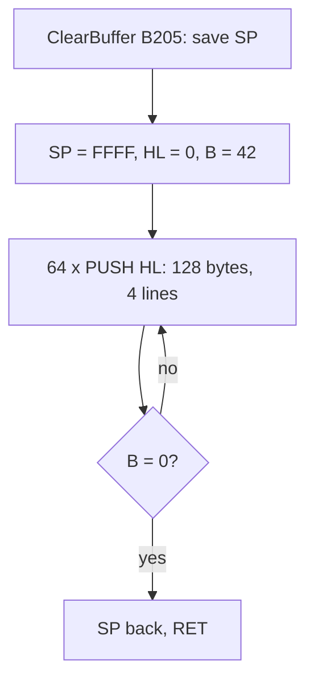

Worked example: a `PUSH HL` is 11 T for 2 bytes, 5.5 T a byte. An `LDIR` would be 21 T a byte. The loop costs 42 x
(64 x 11 + 13) = 30 114 T. The trace of `p1-cursor` puts ClearBuffer at 1013:5512 to 1013:35688: 30 176 T with the
call and the stack moves.

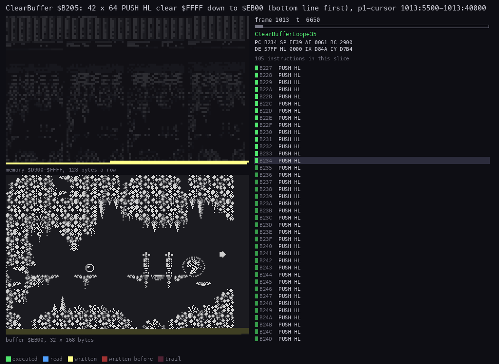

*Animation 6.3: ClearBuffer zeroing the buffer from the bottom, 30 pictures of 1150 T. Recording `p1-cursor`, frames
1013:5500-1013:40000. Command: `python3 ../../kit/routine_anim.py --work work/docs/rxB/p1-cursor --window
1013:5500-1013:40000 --listing build/game.lst --view buffer:EB00:32x168:rows --range D900-FFFF --pc B205-B257
--out docs/img/routines/ClearBuffer.gif`.*

How to read: the room in the buffer is erased upwards, 32 bytes every 16 `PUSH`es. The listing pane stays on the
unrolled `PUSH HL` block.

The point: the erase strategy is "clear everything, redraw everything". There is no per-sprite erase and no dirty
list. It is the simplest correct scheme, and with `PUSH` its clear costs only 0.42 frames. The redraw of the scenery
(6.4) is what costs.

## 6.7 DrawSprite: self-written operands and pre-shifted copies

DrawSprite `$B258` draws a sprite into the buffer by `OR`. The caller sets:

| Input | Where | Meaning |
| --- | --- | --- |
| SpriteX `$A0AF`, SpriteY `$A0B0` | memory | the position (6.1) |
| SpriteWidth `$A0B1`, SpriteHeight `$A0B2` | memory | bytes across, lines down |
| SpriteMirror `$A033` | memory | bit 7 set: draw SpritePicture `$A034` as it is (a fixed frame) |
| SpritePicture `$A034` | memory | the fixed frame's address |
| DE | register | the sprite's first copy |
| HL | register | its frame list: 8 offsets, one for each X & 7 |
| A | register | 0: draw plain; not 0: draw mirrored (DrawMirrored, 6.8) |

The routine:

1. If A is not 0, go to DrawMirrored `$B2C1`.
2. DE += list[X & 7]: the copy for this pixel phase.
3. X /= 8, written back to SpriteX.
4. The buffer address: SpriteBufferOrigin `$E8FF` + 32 x Y + X.
5. Write the width into the operand of `LD B,n` at DrawSpriteBytes `$B2AF` (address `$B2B0`), and the height into
   DrawSpriteRows `$B2AB` (address `$B2AC`). The code changes itself.
6. If SpriteMirror bit 7 is set, DE = SpritePicture: the list's offset is dropped.
7. For each row, for each byte: `LD A,(DE)`, `OR (HL)`, `LD (HL),A`; the next row is 32 bytes on.

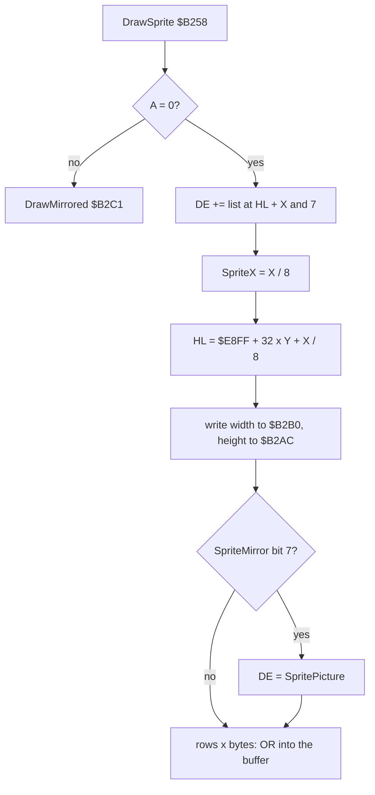

```text
DrawSprite(DE picture, HL list, A mirror):
    if A != 0: return DrawMirrored(DE, HL)
    DE += byte(HL + (SpriteX & 7))
    SpriteX = SpriteX / 8
    dest = $E8FF + 32 * SpriteY + SpriteX
    code[$B2B0] = SpriteWidth; code[$B2AC] = SpriteHeight   # the LD B,n operands
    if SpriteMirror & $80: DE = SpritePicture
    repeat height:
        repeat width: [dest] |= [DE]; DE += 1; dest += 1
        dest += 32 - width
```

```text
B258  D5           DrawSprite:      PUSH DE
B259  B7                            OR A
B25A  C2 C1 B2                      JP NZ,DrawMirrored
B25D  3A AF A0                      LD A,(SpriteX)
B260  E6 07                         AND $07
B262  5F                            LD E,A
B263  16 00                         LD D,$00
B265  19                            ADD HL,DE
B266  5E                            LD E,(HL)
B267  16 00                         LD D,$00
B269  E1                            POP HL
B26A  19                            ADD HL,DE
; ... X / 8, the buffer address
B291  3A B1 A0                      LD A,(SpriteWidth)
B294  32 B0 B2                      LD (DrawSpriteBytes+$0001),A
B297  3A B2 A0                      LD A,(SpriteHeight)
B29A  32 AC B2                      LD (DrawSpriteRows+$0001),A
B29D  EB                            EX DE,HL
B29E  3A 33 A0                      LD A,(SpriteMirror)
B2A1  CB 7F                         BIT 7,A
B2A3  CA AA B2                      JP Z,DrawSpritePlain
B2A6  ED 5B 34 A0                   LD DE,(SpritePicture)
B2AA  E1           DrawSpritePlain: POP HL                  ; not mirrored
B2AB  06 00        DrawSpriteRows:  LD B,$00                ; LD B,rows: the height written by DrawSprite
B2AD  C5           DrawSpriteRow:   PUSH BC                 ; each line
B2AE  E5                            PUSH HL
B2AF  06 00        DrawSpriteBytes: LD B,$00                ; LD B,bytes: the width written by DrawSprite
B2B1  1A           DrawSpriteByte:  LD A,(DE)               ; each byte: OR into the buffer
B2B2  B6                            OR (HL)
B2B3  77                            LD (HL),A
B2B4  13                            INC DE
B2B5  23                            INC HL
B2B6  10 F9                         DJNZ DrawSpriteByte
B2B8  E1                            POP HL
B2B9  01 20 00                      LD BC,$0020
B2BC  09                            ADD HL,BC
B2BD  C1                            POP BC
B2BE  10 ED                         DJNZ DrawSpriteRow
B2C0  C9                            RET
```

The sprites are pre-shifted: each picture is stored several times, shifted right by a few pixels, and the frame list
picks the copy for X & 7. The sprite never shifts at run time. A copy need not be a pure shift: Rex's four copies are
also four walk poses, so his legs move as X changes. The lists in the game (all at `$AE5D-$AE8C`):

| List | Offsets for X & 7 = 0 ... 7 | Copies | Used by |
| --- | --- | --- | --- |
| ShiftFrames `$AE5D` | 0 0 48 48 96 96 144 144 | 4 of 48 bytes (3 x 16), 2-pixel steps | Rex, most 3 x 16 objects |
| ShiftFrames2 `$AE65` | 0 0 84 84 168 168 252 252 | 4 of 84 bytes (4 x 21) | the shield |
| ShiftFrames3 `$AE6D` | 0 0 36 36 72 72 108 108 | 4 of 36 bytes (3 x 12) | SpriteKind13 |
| ShiftFrames4 `$AE75` | 0 16 32 48 64 80 96 112 | 8 of 16 bytes (2 x 8), every pixel | SpriteKind14, SpriteKind15 |
| ShiftFrames5 `$AE7D` | 0 22 44 66 88 110 132 154 | 8 of 22 bytes (2 x 11), every pixel | SpriteScanner2 |
| ShiftFrames6 `$AE85` | 0 0 0 0 48 48 48 48 | 2 of 48 bytes, 4-pixel steps | SpriteHitFlash |

So most sprites move in 2-pixel steps: an odd X is drawn as the even X below it. The small 2-byte sprites have one
copy for every pixel.

Worked example: Rex in `p1-cursor` at 1009:54877. DrawRex `$96A7` calls DrawSprite with HL = `$AE5D`, DE = `$80F2`
(SpriteRex), A = 0 (facing right), width 3, height 16. The writes of figure 6.5 come from `$8182-$81B1`, which is
`$80F2 + 144`: X & 7 was 6 or 7. The shield follows at 1009:59324 with HL = `$AE65`, DE = `$88F2`, width 4, height
21, X = RexX - 4, Y = RexY - 2; its bytes came from `$8946` = `$88F2 + 84`.

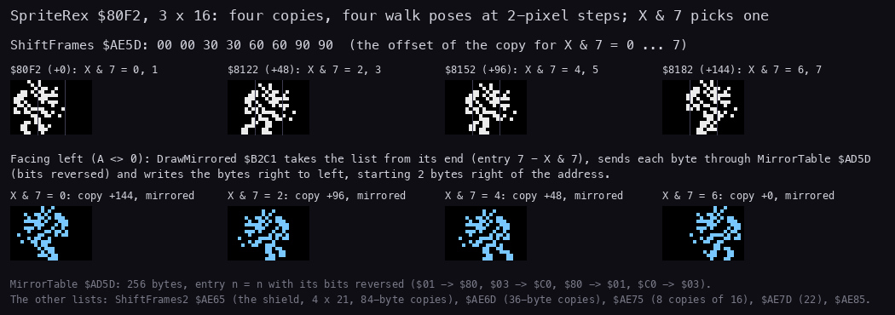

*Figure 6.7: SpriteRex `$80F2` and its frame list ShiftFrames `$AE5D`, with the four copies, and the same copies drawn
through MirrorTable as DrawMirrored draws them. Data from `build/game.bin`. Command: `python3 tools/fig_render.py
shifts --out docs/img/render/shifts.png`.*

How to read:

- Top row: the four copies, each 3 bytes wide. Rex is 2 bytes of picture inside a 3-byte box, so the shift has room.
  The legs differ from copy to copy: the copies are the walk's four poses.
- The label above each copy gives the X & 7 values that select it.
- Bottom row: the mirrored copies (6.8). X & 7 = 0 takes the last copy (+144) and reverses it.

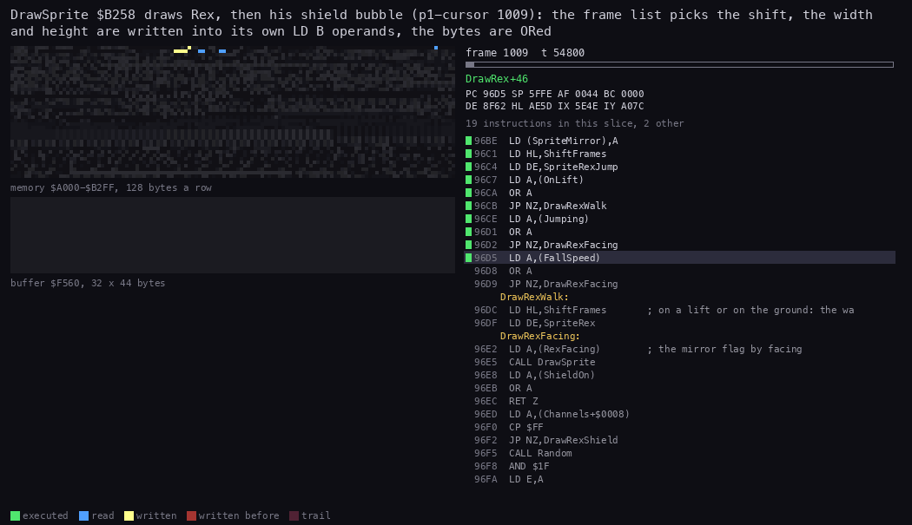

*Animation 6.4: DrawSprite drawing Rex, then the shield, then an object, into the buffer, 54 pictures. Recording
`p1-cursor`, frames 1009:54600-1009:65400. Command: `python3 ../../kit/routine_anim.py --work work/docs/rxB/p1-cursor
--window 1009:54600-1009:65400 --listing build/game.lst --view buffer:F560:32x44:rows --range A000-B2FF --pc
B258-B33D,96A7-9771 --out docs/img/routines/DrawSprite.gif`.*

How to read: the left pane is 44 buffer lines around Rex. Rex appears line by line, then the shield's ring is ORed
around him. The memory strip shows the operands at `$B2AC` and `$B2B0` change from 16 and 3 to 21 and 4.

The cost: 46 T a byte and 83 T a line, so Rex (3 x 16) costs about 3500 T and the shield (4 x 21) about 5600 T.

The point: DrawSprite has one inner loop for every size, and gets its size by writing the loop counts into its own
code. The `OR` draws without a mask: the sprite's 1 bits are added to whatever is in the buffer, and only the scenery
drawn afterwards (6.4) hides anything. A fixed frame (SpriteMirror bit 7) bypasses the frame list, so those sprites
are drawn at the byte column X / 8: they move 8 pixels at a time.

## 6.8 DrawMirrored and the mirror table

Facing left is drawn from the right-facing copies, reversed at run time. DrawMirrored `$B2C1` differs from DrawSprite
in four places:

1. The copy is list[7 - (X & 7)]: the copies are taken in reverse order, so the picture's shift is reversed too.
2. Each byte goes through MirrorTable `$AD5D`: 256 bytes, entry n = n with its 8 bits reversed (`$01` to `$80`, `$03` to
   `$C0`).
3. The bytes of a row are written right to left (`DEC HL`).
4. The first byte of a row goes to the address + 2 (`INC HL` twice), the right end of a 3-byte sprite.

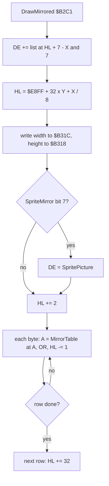

```text
DrawMirrored(DE picture, HL list):
    DE += byte(HL + 7 - (SpriteX & 7))
    SpriteX = SpriteX / 8
    dest = $E8FF + 32 * SpriteY + SpriteX + 2          # + 2: the right end of a 3-byte row
    code[$B31C] = SpriteWidth; code[$B318] = SpriteHeight
    if SpriteMirror & $80: DE = SpritePicture
    repeat height:
        repeat width: [dest] |= MirrorTable[[DE]]; DE += 1; dest -= 1
        dest += 32 + width
```

```text
B2C1  3A AF A0     DrawMirrored:      LD A,(SpriteX)
B2C4  11 07 00                        LD DE,$0007
B2C7  19                              ADD HL,DE
B2C8  E6 07                           AND $07
B2CA  5F                              LD E,A
B2CB  16 00                           LD D,$00
B2CD  A7                              AND A
B2CE  ED 52                           SBC HL,DE
B2D0  5E                              LD E,(HL)
; ... as DrawSprite, the operands at $B31C and $B318
B314  E1           DrawMirroredStart: POP HL
B315  23                              INC HL
B316  23                              INC HL
B317  06 00        DrawMirroredRows:  LD B,$00                ; LD B,rows: written by DrawMirrored
B319  C5           DrawMirroredRow:   PUSH BC                 ; each line
B31A  E5                              PUSH HL
B31B  06 00        DrawMirroredBytes: LD B,$00                ; LD B,bytes: written by DrawMirrored
B31D  1A           DrawMirroredByte:  LD A,(DE)               ; each byte through MirrorTable
B31E  D5                              PUSH DE
B31F  E5                              PUSH HL
B320  5F                              LD E,A
B321  16 00                           LD D,$00
B323  21 5D AD                        LD HL,MirrorTable
B326  19                              ADD HL,DE
B327  7E                              LD A,(HL)
B328  E1                              POP HL
B329  D1                              POP DE
B32A  B6                              OR (HL)
B32B  77                              LD (HL),A
B32C  13                              INC DE
B32D  2B                              DEC HL
B32E  10 ED                           DJNZ DrawMirroredByte
```

Worked example: X & 7 = 2, facing left. DrawMirrored reads list[7 - 2] = list[5] = 96 from ShiftFrames: copy 2 of
the walk, `$80F2 + 96 = $8152`. With X & 7 = 6 it would read list[1] = 0, the first copy. So the left-facing copies
run in the opposite order to the right-facing ones, and the walk still steps the right way. Each byte is mirrored on
the way: a byte `$03` becomes `$C0`, `$60` becomes `$06`.

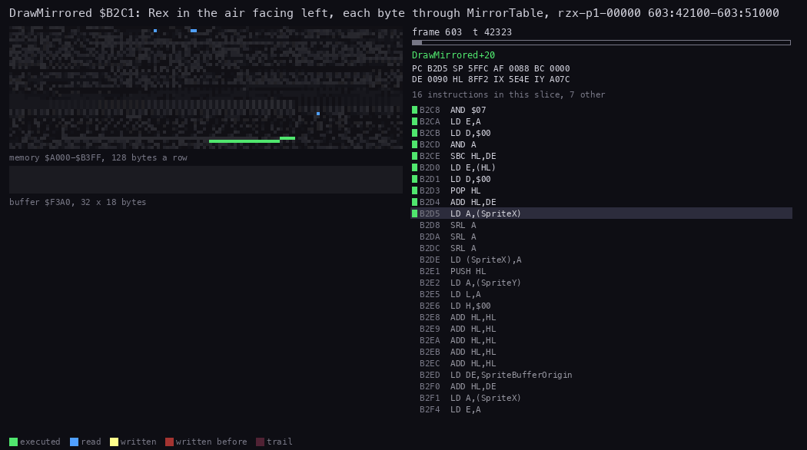

*Animation 6.5: DrawMirrored drawing Rex in the air facing left, 40 pictures. Recording `rzx-p1-00000`, frames
603:42100-603:51000. Command: `python3 ../../kit/routine_anim.py --work work/docs/rxB/r00 --window
603:42100-603:51000 --listing build/game.lst --view buffer:F3A0:32x18:rows --range A000-B33D --pc B258-B338
--pictures 40 --title "..." --out docs/img/routines/DrawMirrored.gif`.*

How to read: the view is 18 buffer lines around Rex. Each row is written from its right end to the left. The memory
strip shows MirrorTable `$AD5D` read once for every byte (blue).

The cost: 127 T a byte against 46: a mirrored Rex costs about 7000 T, twice the plain one.

The `+ 2` is fixed, so the box is right only for 3-byte sprites:

- the 4-byte shield would be drawn from address + 2 down to address - 1, one byte left of the plain shield. DrawRex
  adds 8 to the shield's X when Rex faces left (`$971E`), which puts it back;
- a 2-byte sprite is drawn at address + 2 and + 1, one byte right of the plain one. DrawObject mirrors 2-byte
  pictures (the pods, SpriteKind11, SpriteKind6, SpriteBonusPod: "mirrored" in figure 6.8) with no correction.

The point: a mirror table halves the sprite memory (no left-facing copies), at the price of a slower draw. The
routine was written for Rex's 3-byte width, and the other widths inherit its offset.

## 6.9 The sprite sheets

Every picture DrawSprite drew in the recordings, gathered from 46 traces of 5 frames (DrawSprite's entry registers
and memory, the caller from the stack). A call names its picture in one of two ways:

```text
picture(call) = SpritePicture                 if SpriteMirror bit 7      # a fixed frame: the object's code picks it
              = DE + list[X & 7]              otherwise                  # a pre-shifted copy
sheet(call)   = the label at or below DE in build/game.lst               # one row of figure 6.8
```

```text
B29E  3A 33 A0                      LD A,(SpriteMirror)
B2A1  CB 7F                         BIT 7,A
B2A3  CA AA B2                      JP Z,DrawSpritePlain
B2A6  ED 5B 34 A0                   LD DE,(SpritePicture)
```

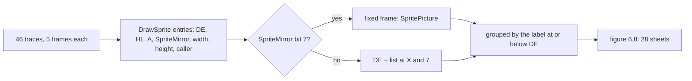

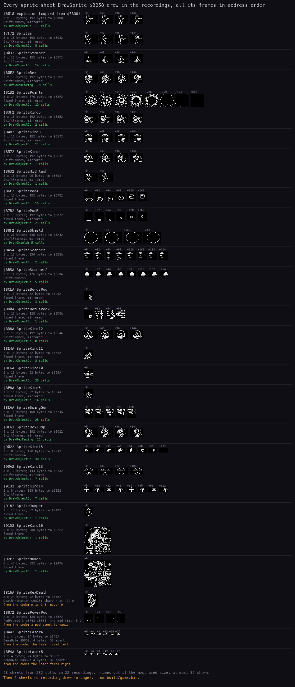

*Figure 6.8: the 28 sprite sheets DrawSprite `$B258` drew in 22 recordings, each with its size, its frame list or
"fixed frame", whether it was drawn mirrored, its caller and its call count. Recordings `rzx-p1-00000` to
`rzx-p1-64000` (17 segments, frames 600-605 and 1600-1605), `p1-room14/24/26/27/30`, `p1-code` and `p1-cursor`
(frames 400-405 and 900-905). Commands: `python3 work/docs/rxB/collect_sprites.py` (the calls, into
`work/docs/rxB/sprites-calls.json`), then `python3 tools/fig_render.py sheet --calls work/docs/rxB/sprites-calls.json
--out docs/img/render/sprites.png`.*

How to read:

- One row a sheet, by address. The label is the source's label; the frames are cut at the size most used and shown in
  address order with their byte offsets.
- "ShiftFrames ..." means the frames of a row are the pre-shifted copies of one picture. "fixed frame" means the
  object's code picks the frame (SpriteMirror bit 7), so the frames are animation steps.
- The callers: DrawRexFacing (Rex), DrawShield (the shield), DrawObjectDo (DrawObject, every object).

What the sheets show:

- Rex has two pictures, SpriteRex `$80F2` (standing and walking) and SpriteRexJump `$8F62` (in the air and falling,
  DrawRex `$96C4`). SpriteRex's four copies are four walk poses, picked by X & 7: Rex walks because he moves.
  SpriteRexJump's four copies are pure shifts.
- The explosion that objects show when killed is drawn from `$6018`, a copy the menu makes of ExplosionPicture `$E336`
  over the development-link stub ([doc 2](02-architecture.md)).
- SpritePoints `$81B2` (3 x 24, 8 frames) is an 8-frame ring that grows and fades.
- SpriteKind16 `$91D2` and SpriteHuman `$92F2` are the two 6 x 48 pictures; each was drawn once, in `rzx-p1-24000`.
- The pods (SpritePodA `$86F2`, SpritePodB `$87B2`) and the swing gun (`$8EAA`) are fixed-frame animations of 6 and 5
  frames.

Labels in `build/game.lst` whose pictures no recording drew are in [the notes](#612-known-only-from-the-code).

The point: the sprites are stored once per pixel phase, not once per frame, and only right-facing. Rex costs 2 x 192
bytes; the shield 336. The animation of the enemies is in their own code, which swaps the fixed frame each pass.

## 6.10 The other buffer writers


DrawSprite and DrawAnimCells are not the only writers of the buffer. A trace of every buffer write in the 46 traces
of 6.9 (`work/docs/rxB/writers-all.json`) finds four more families. Each has its own origin (6.1) and its own small
loop:

| Writer | Routine | What it draws | How | Origin |
| --- | --- | --- | --- | --- |
| the shots | MoveShots `$B654` | Rex's 30 bullets (`$5B60`), the enemies' 20 (`$5D22`), 15 bytes a record | `LD`: one byte, a 4-line dot, a beam | ShotBufferOrigin `$E7FF` |
| the drones | UpdateDrones `$A639` | the multiple's drones (Weapon 3), PowerLevel + 3 of them | `OR`: 2 bytes x 4 lines | ShotBufferOrigin `$E7FF` |
| the sparkle | SparkleUpdate `$9D71`, SparkleDraw `$9E02` | Rex appearing or vanishing | `LD 0`, `AND` random; then `OR` 20 dots | SparkleBufferOrigin `$E89F`, BufferPlayOrigin `$EAFF` |
| the shards | DrawShard `$BF66`, OrChar `$A4F4` | the six shards of an exploding object | `OR`: 8 bytes, one character | BufferPlayOrigin `$EAFF` |

With ShotBufferOrigin, a shot at (X, Y) lands on screen line Y, column X / 8:
`$E7FF + 32 x Y + X / 8 = $EB00 + 32 x (Y - 24) + (X / 8 - 1)`. The shots keep the address in their record (IX+2,
IX+3) and draw at the old place before they step. So a shot is drawn where it was, and moved for the next pass.

MoveShots picks the drawing by the record's type, IX+`$0B` & `$7F`:

| Type | Writer | Bytes |
| --- | --- | --- |
| 0, 1, 3 (gun) | DrawShotByte `$B893` | one byte: Rex's `$B7` right, `$ED` left; an enemy's `$97` right, `$E9` left |
| 4 (spray dot) | DrawShotDot `$B867` | 4 lines from 2 lines up: Rex's `10 1C 38 08`, an enemy's `00 10 28 10` |
| 6 (spark) | MoveSparkShot `$B920` | random masks |
| 7 (beam, the laser) | BeamByte `$B852` | the beam's bytes, 32 apart |
| state 2, 3 | ShotFlash1 `$B7BD`, ShotFlash2 `$B7D8` | the hit flash |
| stopped by a wall | ShotStopped `$B794` | `$10` |

```text
MoveShots(IX, B):                       # MoveBullets: IX = $5B60, B = 30; MoveEnemyBullets: $5D22, 20
    for each record:
        if state == 0: continue
        if state == 2 or 3: ShotFlash; continue
        HL = record.address             # IX+2, IX+3: computed by the last step
        by type: [HL] = byte, or the dot's 4 lines, or the beam
        StepShot: X += dX, Y += dY; off the play area or into a wall: end
        record.address = $E7FF + 32 * Y + X / 8
UpdateDrones:
    if Dying or Weapon != 3 or SparkleMode: return
    for each of PowerLevel + 3 drones (IY = $5E4E, 3 bytes each):
        (dx, dy) = DroneOrbit[step]; x = RexX - 1 + dx; y = RexY + 2 + dy
        HL = $E7FF + 32 * y + x / 8; DE = DronePicture + 8 * (x & 7)
        repeat 4: [HL] |= [DE]; [HL + 1] |= [DE + 1]; HL += 32
        step = (step + 1) mod 64
SparkleUpdate:                          # after DrawRex, on Rex's 3-byte box
    HL = $E89F + 32 * RexY + RexX / 8
    SparkleCount lines of 3 bytes = 0   # FillCells3
    3 lines of 3 bytes &= Random()
    vanishing: SparkleCount += 1 (to 18); appearing: SparkleCount -= 1 (to 0)
```

```text
B893  DD CB 0B 7E  DrawShotByte:   BIT 7,(IX+$0B)
B897  C2 AB B8                     JP NZ,ByteEnemy
B89A  DD 7E 04                     LD A,(IX+$04)
B89D  3D                           DEC A
B89E  FA A6 B8                     JP M,ByteRightUp
B8A1  36 B7                        LD (HL),$B7
B8A3  C3 92 B6                     JP StepShot
; ...
A6A1  C5           DroneDraw:      PUSH BC                 ; draw the drones
A6A2  1A                           LD A,(DE)
A6A3  B6                           OR (HL)
A6A4  77                           LD (HL),A
A6A5  13                           INC DE
A6A6  23                           INC HL
A6A7  1A                           LD A,(DE)
A6A8  B6                           OR (HL)
A6A9  77                           LD (HL),A
A6AA  13                           INC DE
A6AB  01 1F 00                     LD BC,$001F
A6AE  09                           ADD HL,BC
A6AF  C1                           POP BC
A6B0  10 EF                        DJNZ DroneDraw
; ...
9DA5  C5           SparkleRow:     PUSH BC                 ; each row of the 3 x 3 patch
9DA6  06 03                        LD B,$03
9DA8  C5           SparkleCell:    PUSH BC                 ; each cell: a random mask
9DA9  CD 75 A3                     CALL Random
9DAC  A6                           AND (HL)
9DAD  77                           LD (HL),A
; ...
A4F6  1A           OrCharLoop:     LD A,(DE)               ; each line
A4F7  B6                           OR (HL)
A4F8  77                           LD (HL),A
A4F9  13                           INC DE
A4FA  D5                           PUSH DE
A4FB  11 20 00                     LD DE,$0020
A4FE  19                           ADD HL,DE
A4FF  D1                           POP DE
A500  10 F4                        DJNZ OrCharLoop
```

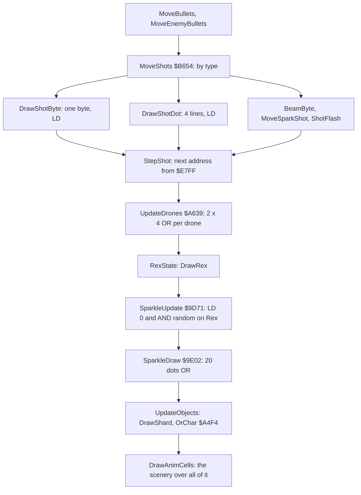

Worked example, a gun bullet. Rex fires right from X = 100, Y = 120. StepShot stores
`$E7FF + 32 x 120 + 100 / 8 = $E7FF + $F00 + 12 = $F70B` in the record. That is buffer line
(`$F70B` - `$EB00`) / 32 = 96, column 11. On the next pass DrawShotByte writes `$B7` there: bits `10110111`, a dash
with a gap. BufferToScreen puts it on screen line 24 + 96 = 120, column 12, as the formula says.

Worked example, the drones. DronePicture `$A74B` holds 8 pictures of 2 bytes x 4 lines, one for each X & 7. The
first is `60 00 / C0 00 / 10 00 / 20 00`, the second `20 00 / 68 00 / 48 00 / 20 00`. They are not shifts of one
shape: the drone turns as it moves. DroneOrbit `$A6CB` is 64 (dx, dy) pairs; it starts `05 00 06 00 07 00 ...`. A
drone steps once a pass, so an orbit takes 64 passes, about 5.6 s.

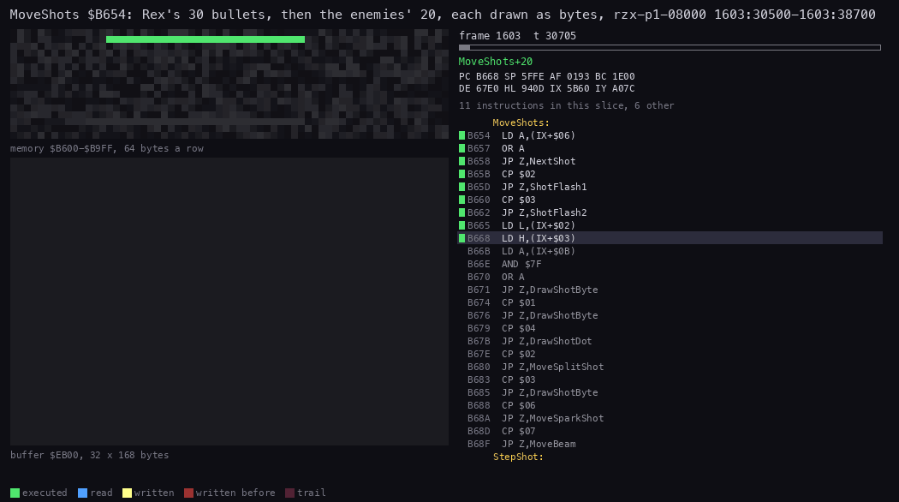

*Animation 6.6: MoveShots drawing Rex's bullets and the enemies', 40 pictures. Recording `rzx-p1-08000`, frames
1603:30500-1603:38700. Command: `python3 ../../kit/routine_anim.py --work work/docs/rxB/r08 --window
1603:30500-1603:38700 --listing build/game.lst --view buffer:EB00:32x168:rows --range B600-B9FF --pc B645-B95F
--pictures 40 --title "..." --out docs/img/routines/MoveShots.gif`.*

How to read: the buffer is empty but for the shots, because MoveShots runs first in the pass. Each bullet appears as
one dashed byte or a small dot. The listing steps through MoveShots, StepShot and NextShot for each of the 50
records; most are free (state 0) and cost a few instructions.

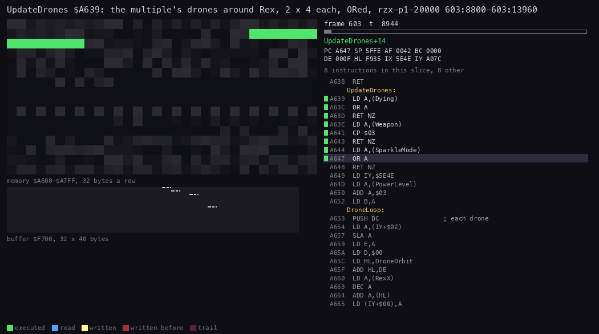

*Animation 6.7: UpdateDrones drawing the multiple's drones around Rex, 36 pictures. Recording `rzx-p1-20000`, frames
603:8800-603:13960. Command: `python3 ../../kit/routine_anim.py --work work/docs/rxB/r20 --window 603:8800-603:13960
--listing build/game.lst --view buffer:F700:32x40:rows --range A600-A7FF --pc A639-A6CA --pictures 36 --title "..."
--out docs/img/routines/UpdateDrones.gif`.*

How to read: the buffer view is 40 lines around Rex. The drones appear one by one, small 2 x 4 shapes on a curve.
The memory strip shows DroneOrbit and DronePicture being read (blue).

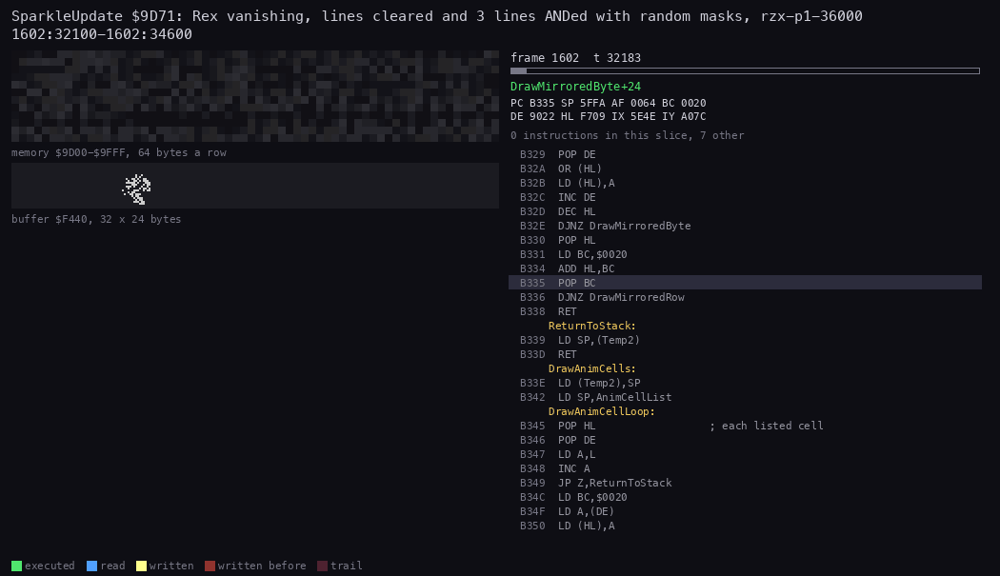

*Animation 6.8: SparkleUpdate on Rex vanishing, 30 pictures. Recording `rzx-p1-36000`, frames
1602:32100-1602:34600. Command: `python3 ../../kit/routine_anim.py --work work/docs/rxB/r36 --window
1602:32100-1602:34600 --listing build/game.lst --view buffer:F440:32x24:rows --range 9D00-9FFF --pc
9D71-9E01,9DF6-9E01 --pictures 30 --title "..." --out docs/img/routines/SparkleUpdate.gif`.*

How to read: the view is 24 buffer lines with Rex in them. FillCells3 blanks the top lines of his box. The three
lines below are ANDed with random bytes, so they break up into noise. The next pass blanks one line more.

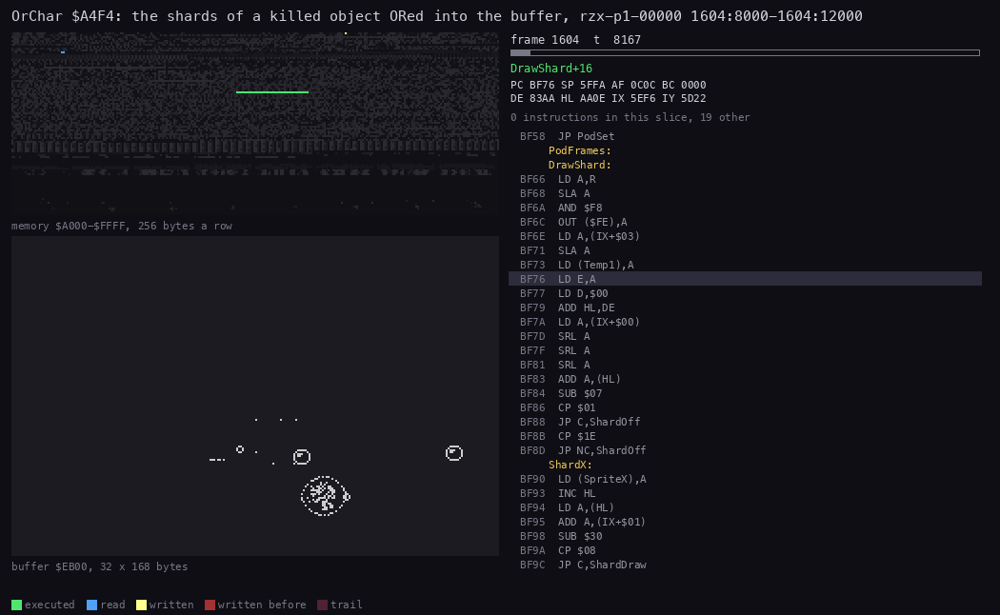

*Animation 6.9: DrawShard and OrChar drawing the shards of a killed object, 24 pictures. Recording `rzx-p1-00000`,
frames 1604:8000-1604:12000. Command: `python3 ../../kit/routine_anim.py --work work/docs/rxB/r00 --window
1604:8000-1604:12000 --listing build/game.lst --view buffer:EB00:32x168:rows --range A000-FFFF --pc A4F4-A502
--pictures 24 --title "..." --out docs/img/routines/OrChar.gif`.*

How to read: the whole buffer; the explosion is the ring in the lower middle. The six shards (small rings and dots)
fly out from it, each one character drawn by OrChar at a byte column. DrawShard also writes a random bit to port
`$FE` each time: that is the explosion's crackle ([doc 9](09-sound.md)).

Witness: DrawShotDot L1 46274 and DrawShotByte L1 23803 (c1, p1-*, rzx-p1-*); UpdateDrones L1 16841;
SparkleUpdate L1 16839; OrChar L1 22962. The buffer writers of `writers-all.json` are these, DrawSpriteByte,
DrawMirroredByte, DrawAnimCellLoop, ClearBufferLoop and NextCellPtr (DrawRoom), and nothing else. One more routine
writes into the origins: FadeHudNext writes `$E9FF` and `$EA00` when the combo row's pointer is at its rest value
(KillFlashPtr = `$E9FF`, [doc 8](08-hud-and-text.md)). Those two bytes are below the buffer, so the write is harmless.

The point: everything that is not scenery is drawn before the scenery. Shots are written with `LD`, which wipes the
byte under them, but they come first, so they wipe only an empty buffer. Rex, the objects, the drones, the sparkle
dots and the shards all use `OR`. The sparkle is the only writer that clears pixels, and it clears Rex's own.

## 6.11 BufferToScreen and the attributes

BufferToScreen `$A28A` copies the buffer to the screen with the stack as a pointer to a table of screen lines:

1. Save SP; SP = ScreenLines `$AC0D`, a table of 168 screen addresses (`$4060`, `$4160`, ... `$57E0`: the left end of
   screen lines 24-191).
2. HL = BufferPlayOrigin `$EAFF`; BC = `$13B0` = 5040, the byte count.
3. For each line: `POP DE` (the line's screen address), `INC DE` (column 1), `INC HL` (the buffer line's column 0),
   30 `LDI`, `INC HL` (skip byte 30; the next `INC HL` skips byte 31).
4. `LDI` decrements BC; `JP PE` loops while BC is not 0. After 168 x 30 = 5040 bytes, BC is 0 and the loop ends.

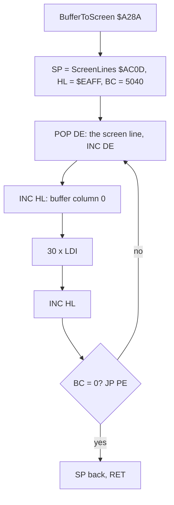

```text
BufferToScreen:
    save SP; SP = ScreenLines; HL = $EAFF; BC = 5040
    do:
        DE = pop() + 1                 # screen column 1
        HL += 1                        # buffer column 0
        repeat 30: [DE] = [HL]; DE += 1; HL += 1; BC -= 1
        HL += 1                        # past column 30 (column 31 by the next HL += 1)
    while BC != 0
    restore SP
```

```text
A28A  ED 73 93 A0  BufferToScreen: LD (Temp1),SP
A28E  31 0D AC                     LD SP,ScreenLines
A291  21 FF EA                     LD HL,BufferPlayOrigin
A294  01 B0 13                     LD BC,$13B0
A297  D1           BufferLine:     POP DE                  ; each line: 16 words through the stack
A298  13                           INC DE
A299  23                           INC HL
A29A  ED A0                        LDI
; ... 28 more LDI
A2D4  ED A0                        LDI
A2D6  23                           INC HL
A2D7  EA 97 A2                     JP PE,BufferLine
A2DA  ED 7B 93 A0                  LD SP,(Temp1)
A2DE  C9                           RET
```

Worked example: the first line. `POP DE` gives `$4060` (line 24, the first line of character row 3), `INC DE` gives
`$4061`. HL goes from `$EAFF` to `$EB00`. The 30 `LDI` copy `$EB00-$EB1D` to `$4061-$407E`. HL ends at `$EB1E`; the
`INC HL` makes it `$EB1F`, and the next line's `INC HL` `$EB20`. A line costs 10 + 6 + 6 + 30 x 16 + 6 + 10 = 518 T,
as the trace's steps of 518 T at `$A2D7` show (1013:4547, 1013:5065).

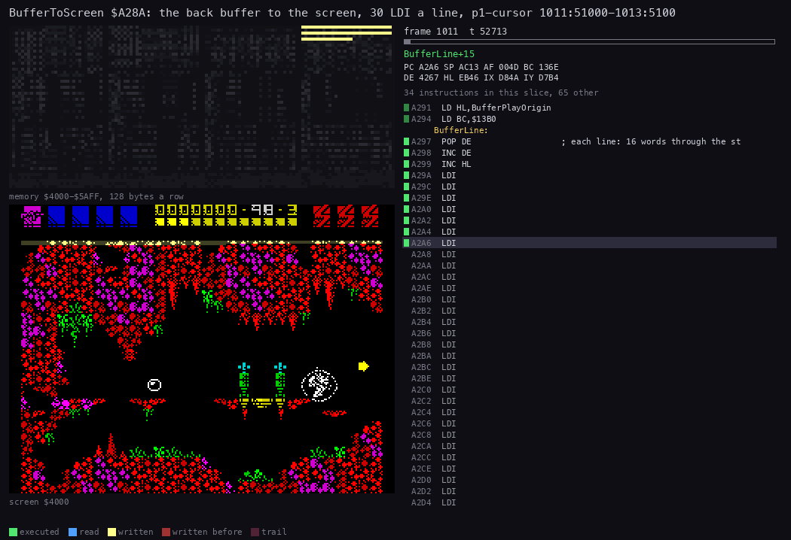

*Animation 6.10: BufferToScreen copying the buffer to the screen, 56 pictures of 1713 T. Recording `p1-cursor`, frames
1011:51000-1013:5100. Command: `python3 ../../kit/routine_anim.py --work work/docs/rxB/p1-cursor --window
1011:51000-1013:5100 --listing build/game.lst --view screen --range 4000-5AFF --pc A28A-A2A6 --pictures 56 --title
"..." --out docs/img/routines/BufferToScreen.gif`.*

How to read: the screen changes from the previous pass to this one line by line, top to bottom, about 3 lines a
picture. The memory strip shows the screen's lines filling in the Spectrum's interleaved order: one line in each
character row, then the next.

The attributes are not copied each pass. The room's colours go to the screen once, when the room is built:

- DrawRoom writes the attribute of each cell into the shadow (6.3);
- CopyAttrs `$C8BF` copies the 21 rows of the shadow (`$E55F`, `$02A0` bytes) to `$5860`, then sets columns 0 and 31 of
  each row to `$47`.

```text
C8BF  11 60 58     CopyAttrs:      LD DE,$5860
C8C2  21 5F E5                     LD HL,AttrShadowPlay
C8C5  01 A0 02                     LD BC,$02A0
C8C8  ED B0                        LDIR
C8CA  21 60 58                     LD HL,$5860
C8CD  06 15                        LD B,$15
C8CF  36 47        CopyAttrsSides: LD (HL),$47             ; the side columns white
C8D1  11 1F 00                     LD DE,$001F
C8D4  19                           ADD HL,DE
C8D5  36 47                        LD (HL),$47
C8D7  23                           INC HL
C8D8  10 F5                        DJNZ CopyAttrsSides
C8DA  C9                           RET
```

So the sprites have no colour of their own. A sprite takes the colours of the cells it is in. On a blank cell (`$47`)
that is white on black; over a coloured cell's ink, the sprite's pixels take that ink: the attribute clash. The game
designs around it: the play area is mostly black paper, and Rex, the shield and the enemies are drawn white on it.
Two kinds of attribute write happen in play:

- the HUD's: the power bar, the sweep, the shield's colour, the combo row and the power pod's flash, all in rows 0-2
  ([doc 8](08-hud-and-text.md));
- the explosion's flash: FlashCells `$CF9B` colours the blank cells (`$47` in the shadow) of a dying object's 3 x 3
  cells from FlashAttrs `$BFE7` at random, through FillShadowCells `$CF47`; CopyCells3 `$CF6E` copies the shadow back
  over them afterwards. Witness: FlashCells L1 4771.

The point: the screen is written in one place, in one order, by a copy that costs 1.23 frames. The 32-byte buffer
line keeps the address arithmetic of every writer to a shift and an add; the 2 bytes of margin per line are the price.

## 6.12 Known only from the code

- **The skipped characters.** DrawRoomCell does not list characters 0, 1, `$10`, `$71`, `$81` and `$91`. Five of them
  are visible glyphs, drawn by DrawRoom into the buffer and then cleared by BuildRoom (6.3). They are never seen in
  play.
- **SceneryCellList's overrun and the one-byte index** (6.4). A room of more than 335 listed cells writes the list into
  CellIndexMap's first play row; more than 255 cells wrap the index. Room 0 has 364. BulletHitsCell may step the wrong
  cell after a hit on a cell of type 4, 5 or 6 in such a room. No recording shows the wrong step.
- **DrawMirrored's fixed + 2** (6.8). Mirrored 2-byte sprites are drawn 8 pixels right of their plain position.
- **The combo row's rest pointer** (6.10). KillFlashPtr rests at `$E9FF`, below the buffer, and FadeHudNext writes
  two bytes there every pass. No recording shows harm: nothing reads them.
- **The power pod's flash covers only the HUD.** FadeStep `$9A4C` is started only by TakePowerPod (`$D47D`). It
  steps the 64 attributes `$5800-$583F`, rows 0-1, not the play area ([doc 8](08-hud-and-text.md)); neither the smart bomb
  nor the bonus starts it.
- **ClearBuffer's off-by-one** (6.6): `$FFFF` is never cleared and `$EAFF` is. Neither byte is on the screen.
- **DrawRoom's attribute loop** (6.3) is dead in effect: BuildRoom zeroes its result before CopyAttrs.
- **Unseen sprite labels.** The sprite area `$7F72-$947A` has labels no recording drew: the sheets of figure 6.8 are
  those seen.
