# 7. Objects

What this covers: every record Rex keeps about a room and the things in it.

- The room is three tables: the exits record (RoomExits `$B133`), the block map (RoomMaps) and the object list
  (RoomObjectLists).
- The things in a room are up to 16 object records of 24 bytes at `$5E66-$5FE5` (ObjectTable).
- Rex's bullets are 30 records of 15 bytes at `$5B60`; the enemies' bullets are 20 records at `$5D22`.
- The game variables are one block at `$A012-$A0C3` (Variables).
- The cells of the room grid have types (CharFlags), which the movers and the collisions read.

This document gives each record byte by byte. It also covers:

- how a room's objects are made (MakeObjects) and how more arrive (SpawnRandom, SpawnScripted);
- the state machine of each object kind;
- the collision tests, Rex against an object and a bullet against an object;
- the kill, the explosion and the pods it leaves;
- the two random number generators.

How Rex himself moves, fights and dies, and what the pods and the stations give him, are in doc 10. The AY sound of
each event is in doc 9.

The recordings it rests on (WALKTHROUGH 4.0):

- `c1`: our own play of part 1 from power-on (stage 1). It was opened on an own instance after `. work/env.sh`:
  `python3 ../../kit/rs.py open --work work/docs/rxC/c1 --ttd work/stage1/c1/session.ttd --model 128K --port-base 37790`.
  It was sampled with `work/docs/rxC/sample.py` (TTD `memory_at`): `$A012-$A0C3`, Channels `$D832-$D856` and the
  object table `$5E66-$614D` at every TTD frame 15 000-20 470, in `work/docs/rxC/c1/vars.jsonl`. TTD frame N is
  input frame N - 15 000 of `tests/inputs/c1.txt` (the screenshot `c1-001500` is TTD frame 16 500). The play holds
  rooms 0 and 1, five deaths, a smart bomb and the game over.
- `rzx-p1-04000`: the RZX run of part 1 from its frame 4000 (someone else's play, stage 1). It was opened the same way
  into `work/docs/rxC/r04` (`--ttd work/stage1/rec/rzx-p1-04000/session.ttd`) and sampled at every second frame
  0-2000 (`work/docs/rxC/r04/vars.jsonl`), the bullet records `$5B60-$5C3D` at frames 1408-1417
  (`work/docs/rxC/r04/bullets.jsonl`). It holds the recharger in room 4, the double fire run dry, a death, a
  launcher killed by its hits and the big power pod it leaves.
- The traces of short windows of both, taken by `kit/routine_anim.py --work W --window F:T-F:T` and kept in
  `W/traces/`. The animations name their windows.
- The L1 counts of the stage-1 builds, quoted from the witness lines of `src/game/*.asm`.

A sample of frame N is the memory at the start of frame N. A trace shows an instruction in the frame in which it ran.

One clock drives every object: the main loop pass (MainLoop `$9583`, doc 4). There is no interrupt and no HALT. A
pass lasts as long as its work takes, about 4.4 frames in part 1 (4.58 over the RZX run). Every speed below ("2
pixels a pass") is per pass, not per frame.

## 7.1 The game variables

All the game's state but the records lives in one block, Variables `$A012-$A0C3`. NewGame sets the start values;
BuildRoom resets the room's part on every room change (doc 4). These are the variables this document and doc 10 use:

| Address | Name | Meaning | Start value |
| --- | --- | --- | --- |
| `$A013` | Weapon | the weapon in use: 0 gun, 1 double fire, 2 laser, 3 multiple, 4 spray | 0 |
| `$A014` | PowerLevel | the weapon's power level, 1-5 | 1 |
| `$A018` | PowerCount | the power towards the next level, 0-119 | 0 |
| `$A02C-$A02E` | SpawnLeft, SpawnRight, SpawnTop | `$FF` when the room spawns from that side | from the list header |
| `$A02F` | SmartBombSteps | the smart bomb's steps left | 16 when it starts |
| `$A03E` | Score | the score in hundreds, a word | 0 |
| `$A043`, `$A044` | SpawnTimer, SpawnPeriod | passes to the next random spawn, and its period | from the list header |
| `$A049` | ShieldOn | the shield is on | 0 |
| `$A04D` | ShieldEnergy | the shield's energy, 0-99 | 99 |
| `$A050-$A053` | HasDoubleFire .. HasSpray | the weapons held | 0 |
| `$A055` | Dying | Rex is dying | 0 |
| `$A059-$A05C` | RestartX, RestartY, RestartRoom, RestartFacing | the restart point | the start |
| `$A063` | Lives | lives left after the one in play | 4 |
| `$A064-$A067` | SweepPos, SweepCount, SweepDir, SweepWidth | the HUD sweep (doc 10.13) | width 12 |
| `$A06C` | Bombs | smart bombs left | 3 |
| `$A06E` | WeaponRank | the best weapon held | 0 |
| `$A076` | ExtraLifeCount | hundreds towards the next life | 0 |
| `$A088` | SpawnKind | the kind the room spawns | from the list header |
| `$A089` | HumansKilled | people killed, a word | 0 |
| `$A08D-$A090` | RoomRight, RoomUp, RoomDown, RoomLeft | the room's exits | from RoomExits |
| `$A092` | ObjectCount | the object records the room uses | from the list header |
| `$A0A1-$A0A3` | RandomSeed, RandomSeed2 | the seeds of Random and Random2 (7.10) | `$13`, `$03`, `$11` |
| `$A0B6`, `$A0B7` | RexX, RexY | Rex in pixels | the start |
| `$A0B8` | Room | the room Rex is in | 0 |
| `$A0BC` | FallSpeed | Rex's fall speed | 0 |
| `$A0BD` | Jumping | Rex is jumping | 0 |

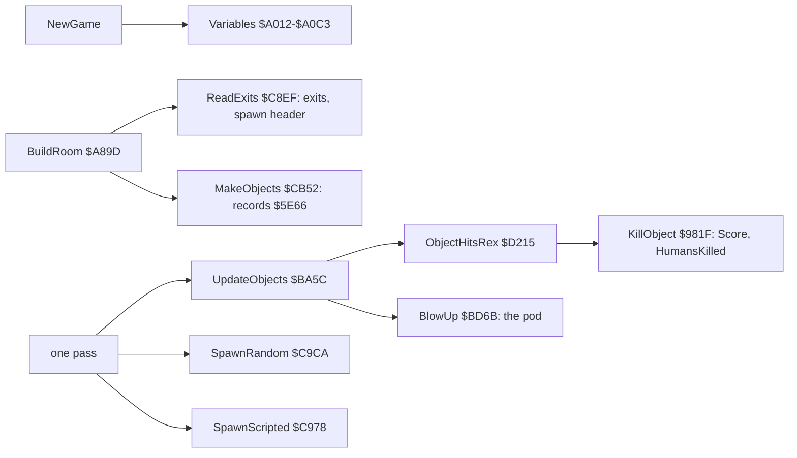

Worked example: `c1` TTD frames 16 300 and 16 342, before and after BuildRoom made room 0.

| Variable | 16 300 | 16 342 | Reading |
| --- | --- | --- | --- |
| Room | 0 | 0 | the game starts in room 0 |
| Lives, Bombs, ShieldEnergy | 4, 3, 99 | 4, 3, 99 | the start values |
| ObjectCount | 0 | 6 | room 0's header says 6 records |
| SpawnTimer, SpawnPeriod | 0, 0 | 50, 50 | its period, 50 passes |
| SpawnKind | 0 | 12 | the ramming pod |
| SpawnLeft, SpawnRight, SpawnTop | 0, 0, 0 | 0, 0, 0 | no side: room 0 never spawns |

**The point**: one block holds the whole live state but the records; the room's spawn settings are copied into it on
every room change.

Witness: the `c1` samples above; NewGame and BuildRoom run in every play recording (L1 counts in
`src/game/rooms.asm`).

## 7.2 The room: exits, map and object list, byte by byte

A room is three tables, all in `src/res/rooms/rex1.txt` (doc 6 draws the maps):

| Table | Address | Bytes a room | Read by | What |
| --- | --- | ---: | --- | --- |
| RoomExits | `$B133 + 6 x Room` | 6 | ReadExits `$C8EF` | up, right, down, left, the list's address |
| RoomMaps | 70 bytes a room | 70 | DrawRoom (doc 6) | 7 rows of 10 block codes; a block is 3 x 3 characters |
| RoomObjectLists | at the address in the exits record | 3 + 3 x n + 1 | ReadExits, MakeObjects `$CB52` | the header, the objects, `$FF` |

The exits record:

| Byte | Field | Values |
| --- | --- | --- |
| +0 | up | the room above; 0 none |
| +1 | right | the room to the right; 0 none; 99 the end of part 1 |
| +2 | down | the room below; 0 none: a fall out of the bottom kills Rex (doc 10.3) |
| +3 | left | the room to the left; 0 none |
| +4, +5 | list | the address of the room's object list |

The object list:

| Byte | Field | Values |
| --- | --- | --- |
| +0 | header | bit 7 spawns from the top, bit 6 from the right, bit 5 from the left; bits 0-4 the record count (ObjectCount) |
| +1 | period | the passes between two random spawns (SpawnTimer and SpawnPeriod) |
| +2 | kind | the kind it spawns (SpawnKind); bit 7: at random that kind or a foot man |
| +3 .. | objects | 3 bytes each: [kind, bit 7 facing left][X in pixels][Y in characters] |
| last | end | `$FF` |

Exit 0 means "no exit", so no exit can lead into room 0. The game starts there, and a restart point can bring Rex
back there, but no door does.

ReadExits copies the record into the variables:

```asm
ReadExits:
  LD A,(Room)
  LD E,A
  LD D,$00
  LD B,$06
  CALL Multiply           ; HL = 6 x Room
  LD DE,RoomExits
  ADD HL,DE
  LD A,(HL)
  LD (RoomUp),A
  ...                     ; RoomRight, RoomDown, RoomLeft the same way
  LD E,(HL)
  INC HL
  LD D,(HL)               ; DE = the object list
  LD A,(DE)
  AND $1F
  LD (ObjectCount),A
  ...                     ; bits 7, 6, 5 set SpawnTop, SpawnRight, SpawnLeft to $FF
  INC DE
  LD A,(DE)
  LD (SpawnTimer),A
  LD (SpawnPeriod),A
  INC DE
  LD A,(DE)
  LD (SpawnKind),A
  INC DE
  LD (ObjectListPtr),DE
  RET
```

In pseudocode:

```text
record = RoomExits + 6 * Room
RoomUp, RoomRight, RoomDown, RoomLeft = record[0..3]
list = word(record[4..5])
ObjectCount = list[0] & 31
SpawnTop, SpawnRight, SpawnLeft = $FF if list[0] bit 7, 6, 5
SpawnTimer = SpawnPeriod = list[1]
SpawnKind = list[2]
ObjectListPtr = list + 3
```

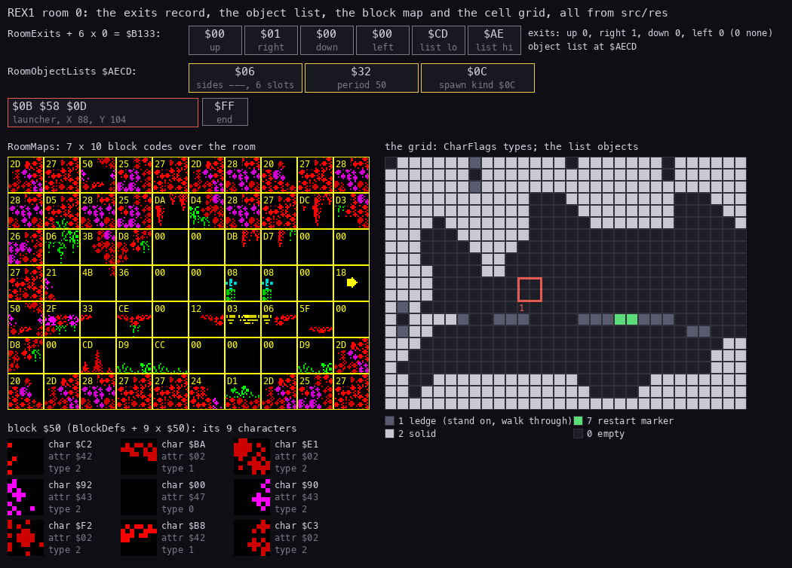

How to read it: the top rows are the bytes of room 0's exits record and object list, each box one byte with its
reading. The left map is the 7 x 10 block codes over the room's picture. The right grid gives each character cell
its CharFlags type (7.3), with the list's object as a numbered box. The bottom left takes block `$50` apart into its
nine characters. Made by `python3 tools/fig_rooms.py decode docs/img/rooms/room-00-decode.png --room 0`, from
`src/res` alone.

Worked example: room 0, the room the game starts in.

| Bytes | Reading |
| --- | --- |
| RoomExits + 0: `$00 $01 $00 $00` | up none, right room 1, down none, left none |
| `$CD $AE` | the list at `$AECD` |
| `$AECD`: `$06` | no spawn side; 6 records |
| `$32` | period 50 passes |
| `$0C` | kind 12, the ramming pod |
| `$0B $58 $0D` | a launcher (kind 11), facing right, X `$58`, Y 13 characters = `$68` |
| `$FF` | the end |

So room 0 holds one launcher. Its spawner names a ramming pod every 50 passes, but no side is enabled. SpawnRandom
picks a side and finds it closed every time: room 0 never spawns.

The `c1` sample of TTD frame 16 400 has the launcher's record at `$5E66`: `58 68 00 .. 8B`. That is X `$58`, Y `$68`,
facing right, kind `$8B`: the launcher's initialiser sets bit 7.

Room 1, the second room, is decoded the same way: exits `0 15 2 0` and the list at `$AED4`,
`$47 $1E $00 | $8B $98 $0F | $13 $78 $04 | $12 $E8 $0B | $14 $08 $08 | $FF`. Its header `$47` spawns from the right only, 7 records, a foot
man every 30 passes. It holds a launcher facing left at (`$98`, `$78`) and three swing guns at three start angles
(list kinds 19, 18 and 20, 7.4).

**The point**: an exit byte of 0 closes a side; a list header with no side bits switches the room's spawner off
while it keeps a period and a kind.

Witness: ReadExits L1 counts in `src/game/rooms.asm` (every room change of every play recording); the `c1` samples of
TTD frames 16 342 (room 0) and 16 940 (room 1: SpawnRight `$FF`, period 30, kind 0).

## 7.3 The cell types

Every character of the room grid has a type, CharFlags `$62E0` + character code (REX 2: `$6506`; `src/res/tables/rex1-char-flags.csv`).
The movers do not look at pixels; they look at the type of the cell they would enter.

| Type | Meaning | Tested by |
| --- | --- | --- |
| 0 | empty | IsPassable |
| 1 | a ledge: Rex and the walkers stand on it and walk through it | neither IsSolid nor IsPassable |
| 2 | solid | IsSolid |
| 4, 5, 6 | solid, and a bullet damages it (4 to 5 to 6 to gone) | IsSolid; BulletHitsCell `$B707` |
| 7 | a restart marker | CellsUnderRex: SaveRestart when RexX AND 7 = 2 |
| 8 | the shield recharger | CellsUnderRex: +1 energy a pass while the shield is off |
| `$0A-$0D` | the laser, multiple, spray and double fire stations | CellsUnderRex: GiveLaser .. GiveDoubleFire |
| `$0E` | a marker: a walker hops here | IsPassable; the walkers |
| `$0F` | a marker: a walker drops here | IsPassable; the walkers |
| `$10`, `$11` | markers: a walker jumps right, left | IsPassable; the walkers |
| `$12` | a ladder or a lift | IsPassable; Rex's moves (OnLift) |

IsSolid accepts 2, 4, 5 and 6. IsPassable accepts 0 and `$0E-$12`. Type 1 is neither. A mover entering sideways only
asks IsSolid, so a ledge never blocks a walk. A faller asks IsPassable, so a ledge stops a fall. The markers `$0E-$11`
are characters drawn blank: the player never sees them, but they steer the walkers.

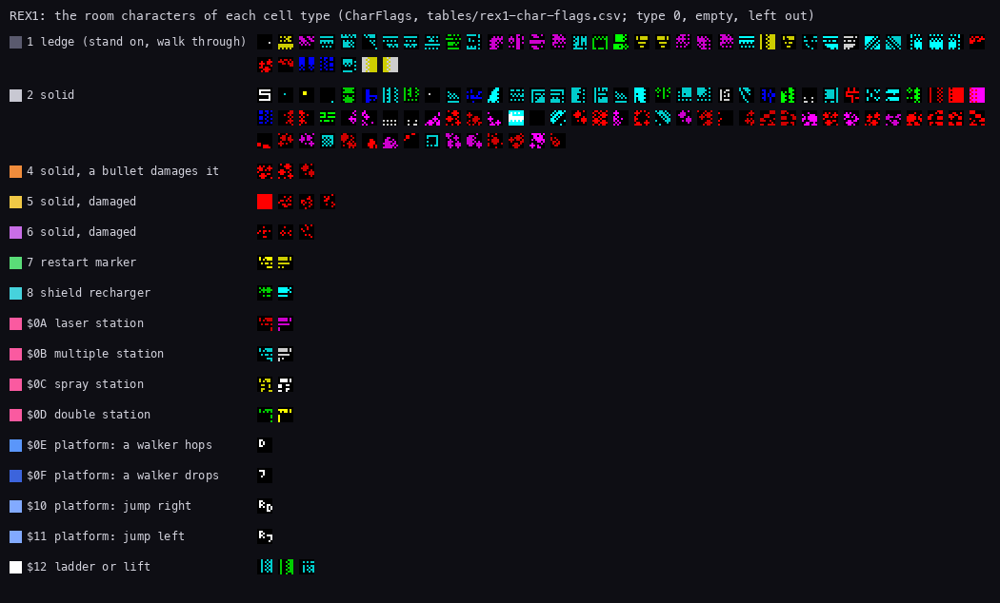

How to read it: one row a type, its colour as in the room grid of 7.2, then every character of REX 1 with that type.
Made by `python3 tools/fig_rooms.py types docs/img/rooms/cell-types-rex1.png`.

Part 2 adds types: 3 kills Rex when he walks, jumps or falls into it, and a falling object (doc 10.16); 4 is the
big squidgy thing (BossHit, doc 10.17); `$15` and `$16` dissolve walkers. DEMO has a type 9 cell.

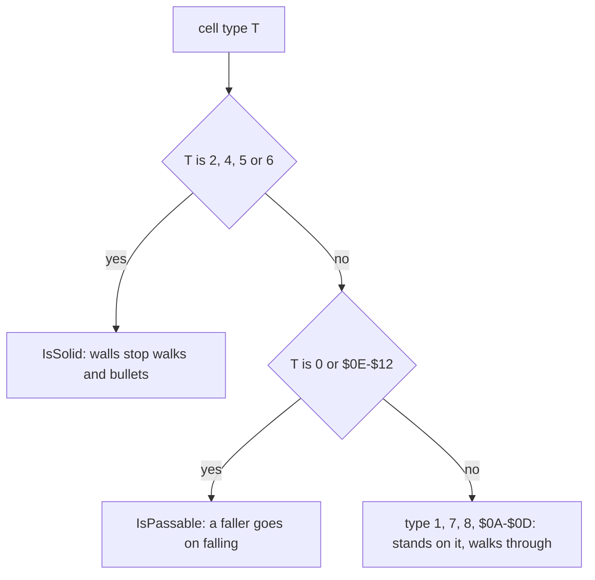

Worked example: room 0's grid in the figure of 7.2. The launcher's two cells under it are type 1 (dark grey), the
ledge it stands on. The two green cells right of it are type 7, a restart marker: Rex standing there with RexX AND 7 =
2 saves the restart point (doc 10.4).

**The point**: walls, floors and the walkers' paths are one byte a character, kept apart from the pictures.

Witness: CharFlags is read by every mover (L1 counts of IsSolid and IsPassable in `src/game/cells.asm`).

## 7.4 The object record, 24 bytes

ObjectTable `$5E66` holds 16 records of 24 bytes (`$5E66-$5FE5`). A room uses ObjectCount of them. MakeObjects clears
the 16 (`$180` bytes) on a room change; a list holds at most 16 objects. ObjectCount is 5 bits (`AND $1F` in
ReadExits), but no room lists more than 16: records 17-31 would be the stack (`$5FDA-$5FFF`) and the code from `$6000`.
The name ObjectTable is a label only in DEMO (`$5EF6`); in REX 1 it names the address in the comments.

| Byte | Field | Values |
| --- | --- | --- |
| +0 | X | pixels from the left |
| +1 | Y | the sprite Y of doc 6.1: screen line Y + 8, the play area from Y 16 |
| +2 | direction | 0 right, else left (a spawn from the top puts R here: any value) |
| +3 | jump or explosion step | a walker's jump flag; BlowUp counts its pictures here |
| +4, +5 | picture, or the jump step pointer, or a flyer's dX and dY | by kind |
| +6 | fall speed | 0 not falling |
| +9 | kind | 0-20, `$FC-$FF` (7.5); bit 7 a foot man's jump state, the big gun's mark |
| +`$0A`, +`$0B` | frame list | the shift frames used by DrawObject |
| +`$0C` | alive | 0 a free record |
| +`$0D` | explosion passes left | 8 when killed |
| +`$0E` | width | bytes |
| +`$0F` | height | lines |
| +`$10` | speed | pixels a step; a pause count for some kinds |
| +`$11`, +`$12` | timers | by kind; a pod's life |
| +`$13` | a counter | by kind |
| +`$14` | hits left | the bullets it takes (7.8) |
| +`$15` | pod | the pod it leaves: `$FF` none, 0 a small power pod, else a big one (7.9) |
| +`$16`, +`$17` | picture base | the sprite of its kind |

A free record is found by its alive byte: SpawnRandom and SpawnScripted scan `$5E72` (+`$0C` of record 0) in steps of
24.

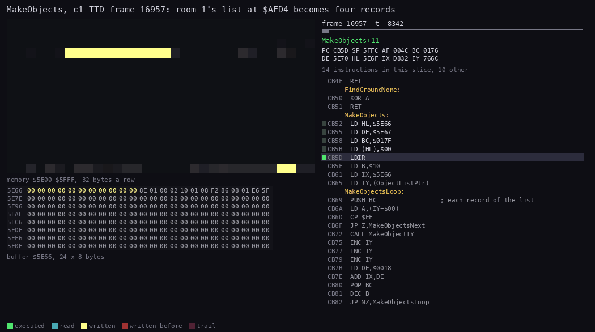

How to read it: the hex view is the object table `$5E66`, 24 bytes a row, one row a record. Yellow bytes are being
written, red ones were written earlier in the window. The code panel shows the instruction running. Recording `c1`,
TTD frame 16 957, T 8000-21 700 (MakeObjects runs from T 8108 to T 21 500), 40 pictures of 342 T. Made by
`python3 ../../kit/routine_anim.py --work work/docs/rxC/c1 --window 16957:8000-16957:21700 --listing build/game.lst
--pc CB52-CE66 --view buffer:5E66:24x8:hex --range 5E00-5FFF --pictures 40 --delay 200 --out
docs/img/routines/MakeObjects.gif`.

MakeObjects clears the table with one LDIR, then turns each list entry into a record:

```asm
MakeObject:
  LD (IX+$0E),$03         ; the common size: 3 bytes x 16 lines
  LD (IX+$0F),$10
  LD (IX+$10),$02         ; speed 2
  LD (IX+$15),$00         ; a small pod
  AND $7F
  LD (IX+$09),A           ; the kind
  OR A
  CALL Z,InitKind0
  CP $01
  CALL Z,InitKind1
  ...                     ; one initialiser a kind, then:
  LD (IX+$16),E           ; the picture base from DE
  LD (IX+$17),D
  LD (IX+$0A),L           ; the frame list from HL
  LD (IX+$0B),H
  LD A,(IY+$01)
  LD (IX+$00),A           ; X
  LD A,(IY+$02)
  SLA A
  SLA A
  SLA A
  LD (IX+$01),A           ; Y = characters x 8
  LD A,(IY+$00)
  AND $80                 ; bit 7 of the list's kind byte
  ...                     ; seven SRL A
  LD (IX+$02),A           ; direction: 1 facing left
  LD (IX+$03),$00
  LD (IX+$06),$00
  LD (IX+$0C),$01         ; alive
  LD (IX+$0D),$00
  RET
```

Worked example: the four records of room 1, `c1` TTD frame 17 000 (bytes +0 to +`$17`):

| Record | Bytes | Reading |
| --- | --- | --- |
| 0 `$5E66` | `98 78 01 00 4A 8E 00 00 00 8B 4A 8E 01 00 02 10 02 06 06 00 08 01 E6 5F` | the launcher: X `$98`, Y `$78`, facing left, kind `$8B`, alive, 2 x 16, 8 hits, a big pod |
| 1 `$5E7E` | `78 20 00 00 2A 8F 00 00 00 89 AA 8E 01 00 02 10 02 04 01 00 0A 01 18 00` | a swing gun (list kind 19): X `$78`, Y `$20`, kind `$89`, angle picture `$8F2A`, 10 hits |
| 2 `$5E96` | `E8 58 00 00 CA 8E 00 00 00 89 AA 8E 01 ..` | a swing gun (list kind 18), angle picture `$8ECA` |
| 3 `$5EAE` | `08 40 00 00 0A 8F 00 00 00 89 AA 8E 01 ..` | a swing gun (list kind 20), angle picture `$8F0A` |

The list kinds 17-20 are not kinds of their own: InitKind17 .. InitKind20 make a swing gun (kind 9 with bit 7) and
differ only in the start angle they put at +4.

**The point**: the list's 3 bytes become 24; X and Y come straight from the list, the rest from the kind's
initialiser.

Witness: MakeObjects in the `c1` trace of TTD frame 16 957; the samples of frame 17 000.

## 7.5 The kinds

| Kind | Name (roll call) | Score | Hits | What it does |
| ---: | --- | ---: | ---: | --- |
| 0 | FOOT MAN | 100 | 2 | walks, turns at walls, hops and drops at the markers, may become a jumper; a person |
| 1 | STOMPER | 200 | | a walker |
| 2, 3 | | 100 | | walkers |
| 4 | | 200 | | a walker; a person |
| 5 | | 300 | | a walker; a person; its death ends the scripted spawn |
| 6 | | 100 | 2 | the hit foot man (7.8): 6 passes (each bullet renews them), bullets take no hits; then kind 7; a person. A list's kind 6 becomes the standing gunman `$80` (InitKind6), not this |
| 7 | | 100 | 2 | the foot man after his hit state: the next bullet kills him; stays at walls, dies off ledges; a person |
| 8 | SCANNER | 600 | 16 | stalks Rex: rises and sinks to his height, walks his way |
| 9 | SWING GUN | 600 | 10 | a turret: eight angle pictures, a shot in its angle at random |
| 10 | SHOOTERS | 500 | | two shots at once, right and left, every few passes |
| 11 | LAUNCHER | 800 | 8 | a shot that climbs (type `$87`) every few passes |
| 12 | RAMMING POD | 300 | | walks the ground, climbs; counts as a person |
| 13 | MINE LAYER | 1000 | | walks the ground, drops mines at random |
| 14 | MINE | none | | drifts by dX, dY; a solid cell turns it, a solid cell above kills it |
| 15 | BLOB | 200 | | flies at random, bounces at the edges |
| 16 | the big gun | 1000 | weapon x 50 + 16 | always `$90`; bobs between Y `$40` and `$78`, fires volleys, drops mines; two lives (7.9) |
| 17-20 | | | | list kinds only: a swing gun at four start angles |
| `$FE` | power pod | | | flashes, gives power when touched (doc 10.8) |
| `$FD` | bomb pod | | | gives a smart bomb |
| `$FC` | bonus pod | | | starts the bonus roulette (doc 10.9) |
| `$FF` | the points sign | | | a killed object while it explodes |

The scores are KillScores `$994E`[kind AND `$0F`] x 100 (`src/res/tables/rex1-kill-scores.csv`), except the big gun:
its kind is always `$90` (InitKind16 `$CE3E` sets bit 7), and KillObject sends `$90` to KillScore `$98AF`, 1000
points (7.9). They agree with the roll call's ten names (`src/res/texts/rex1-roll-call.txt`). The hits are the
+`$14` byte where the samples show it. The six persons (0, 4, 5, 6, 7, 12) add one to HumansKilled `$A089` when
killed; the game over panel prints it.

Bit 7 of a foot man is his SpriteKind6 state, not a variant. SetHop `$C556` sets it for a jump (with +`$12` = 1 and
+`$11` = 16-31) and JumperTimer `$C5B6` clears it (`RES 7` at `$C5D2`). MakeObject masks bit 7 off the list's kind (`AND $7F`),
but a list's kind 6 is not the hit state: InitKind6 `$CC5B` stores `$80` with +`$11` = `$C8`, which JumperTimer
never counts down (`CP $C8 / RET Z`), so this standing gunman keeps bit 7 for good. UpdateObject `$BA97` reads it: while
it is set (`$80`) the foot man fires at Random `$F0` and over (1 pass in 16), else at `$FE` and over (1 in 128), and
neither while +`$12` = 2. KillObject counts people by the whole kind byte (`$985C-$9876`), so a foot man killed while
jumping, or the standing gunman, adds nothing to HumansKilled (he still scores KillScores[0]). A big gun is always
`$90`. Other kinds (the scanner, the ramming pod) set and clear the bit as a state flag of their own.

**The point**: ten names on the menu, seventeen kinds in the code; the unnamed walkers 2-7 are the people and the
helpers of the scripted rooms.

Witness: every object kind's code ran in the RZX run (stage 2 NOTES, Leftover 2; L1 counts in
`src/game/objects.asm`).

## 7.6 UpdateObjects and the state machines

UpdateObjects `$BA5C` walks the ObjectCount records once a pass. For each live record:

1. a kind 0 picks its picture (exploding: the explosion picture `$6018`);
2. DrawObject draws it into the back buffer and dispatches the exploding object to BlowUp;
3. ObjectBehaviour runs the kind's own code (the pods' frames, the guns, the shooters, the launcher, the big gun);
4. ObjectMove runs the walk, fall and jump shared by the walkers, or the kind's own move;
5. ObjectCollide runs ObjectHitsRex `$D215`: Rex against it, then Rex's bullets against it (7.8).

```text
for each record r in ObjectTable[0 .. ObjectCount-1]:
    if r.alive == 0: continue
    if r.kind & $7F == 0: r.picture = exploding ? $6018 : Sprites
    DrawObject(r)                      # BlowUp if exploding
    ObjectBehaviour(r)                 # by kind
    ObjectMove(r)                      # walk, fall, jump, or the kind's own move
    ObjectHitsRex(r)                   # Rex, then the 30 bullets
```

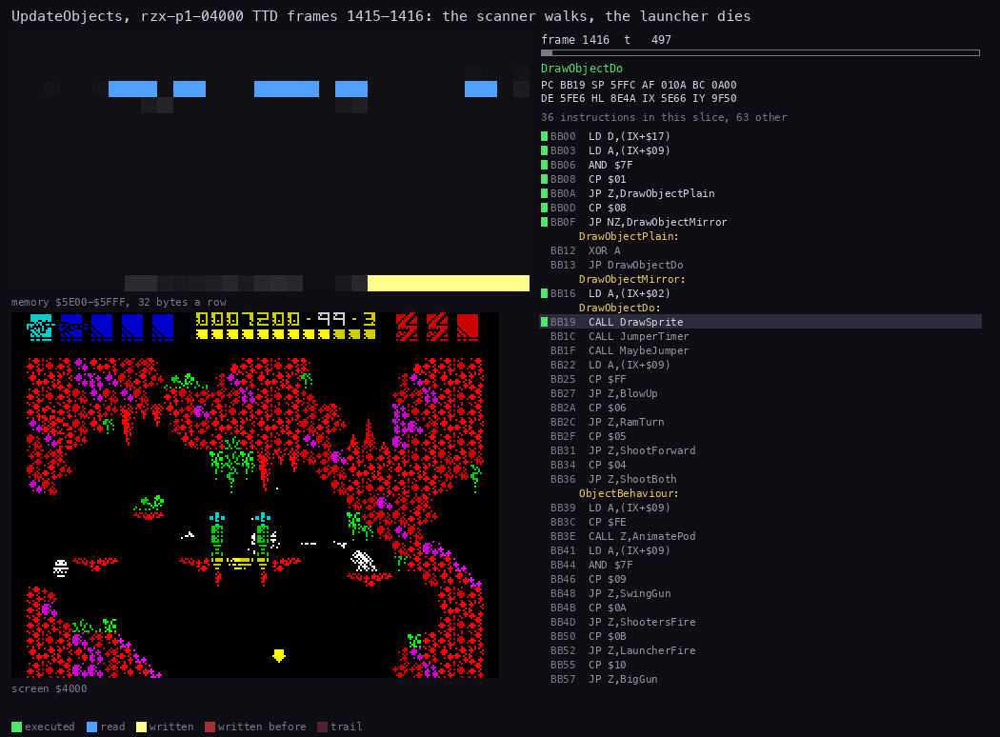

How to read it: the memory map is `$5E00-$5FFF` (the object table), the view under it the Spectrum screen, the code
panel the instruction running. The screen only changes when BufferToScreen copies the buffer (doc 6), so the drawing
itself is not seen here; the writes to the records are. Recording `rzx-p1-04000`, TTD frames 1415 T 70 300 to 1416 T
43 600, 40 pictures of 1105 T: the scanners step and KillObject (`$981F`, at 1416 T 9003) turns the launcher into the
points sign. Made by `python3 ../../kit/routine_anim.py --work work/docs/rxC/r04 --window 1415:70300-1416:43600
--listing build/game.lst --pc BA5C-BFFF,981F-98FF --view screen --range 5E00-5FFF --row-bytes 32 --pictures 40 --delay
200 --out docs/img/routines/UpdateObjects.gif`.

### The walkers (kinds 0-7)

A walker moves by its speed each pass. WalkRight and WalkLeft test the cell ahead: a solid cell turns it. Kinds 6 and
7 stay instead of turning. At an edge of the room a kind 0 vanishes (ObjectGone `$C497`: alive 0, no score); the others turn. Walking off a
ledge, kinds 6 and 7 die (KillObject) and kinds 3, 4 and 5 vanish (ObjectGone). The markers steer it: `$0E` makes it hop, `$0F` drop, `$10` and `$11` jump right or
left. At random a walker jumps instead of a step (MaybeJumpRight, MaybeJumpLeft). A kind 0 may become a jumper for a
while (MaybeJumper, SpriteJumper `$91B2`). A walker with no ground starts to fall (StartFall, JumpSteps `$D0D8`).
Below line `$B8` a faller dies; a person counts in HumansKilled.

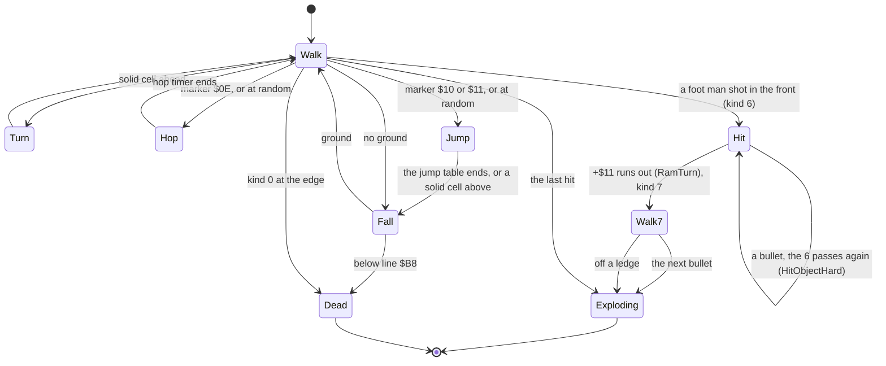

### The scanner (kind 8)

The scanner stalks Rex. It rises or sinks one step at a time towards his height (ScannerUp, ScannerDown). When it is
level with him it walks his way. At a cell edge it picks its next direction from the grid around it (ScannerTurn). A
hit that is not the last makes it pause (HitNotLast sets +`$10` = 4). It takes 16 hits and leaves a big pod
(+`$15` = 1).

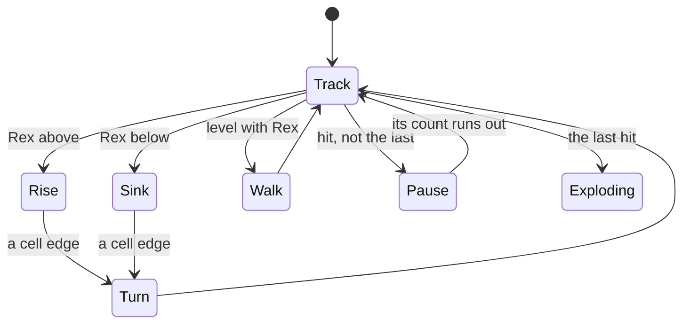

In `rzx-p1-04000` two scanners walk right along Y `$78`, one pixel a pass (X `$10` to `$36` in frames 1388-1540),
each with 16 hits left.

### The guns (kinds 9, 10, 11, 16)

The swing gun (9) shows one of eight angle pictures (SwingGunFrames `$BECB`: offsets
`$00 $20 $40 $60 $80 $60 $40 $20`) and at random fires a shot in its angle's direction (SwingShotUpLeft .. SwingShotUpRight). The shooters (10)
fire two shots every few passes, right and left (ShootersFire). The launcher (11) fires a shot that climbs, type `$87`
(LauncherFire). The big gun (16, BigGun `$BB74`) bobs between Y `$40` and `$78` by +`$12` pixels a pass (2, then 1
after its first kill). One pass in 16 (R AND 15 = 0) it fires a volley: one shot per byte of BigGunShots
(`$10 $20 $22 $19 $1D $31 $34`, `$FF` ends), the byte being the shot's Y offset (Temp4, added to its Y by SetupShot),
so seven shots down its height; four, from the fourth byte, once +`$12` = 1. Above Y `$90`, with +`$11` and +`$13` both
0, Random `$F0` and over drops a mine (DropMine `$C1F4`). Walkers fire too: ShootForward (1 in 16) and ShootBoth (a pair,
one each way).

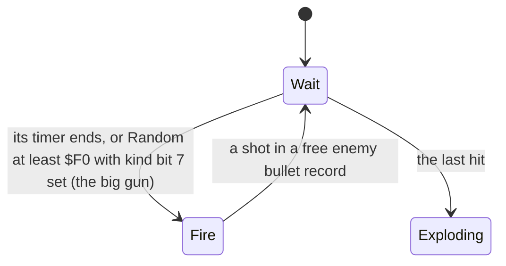

A shot goes into one of the 20 enemy bullet records at `$5D22` (ShootFromObject: the object's X, its Y plus 15). A
full table drops the shot.

The big gun has a state machine of its own: two lives (7.9).

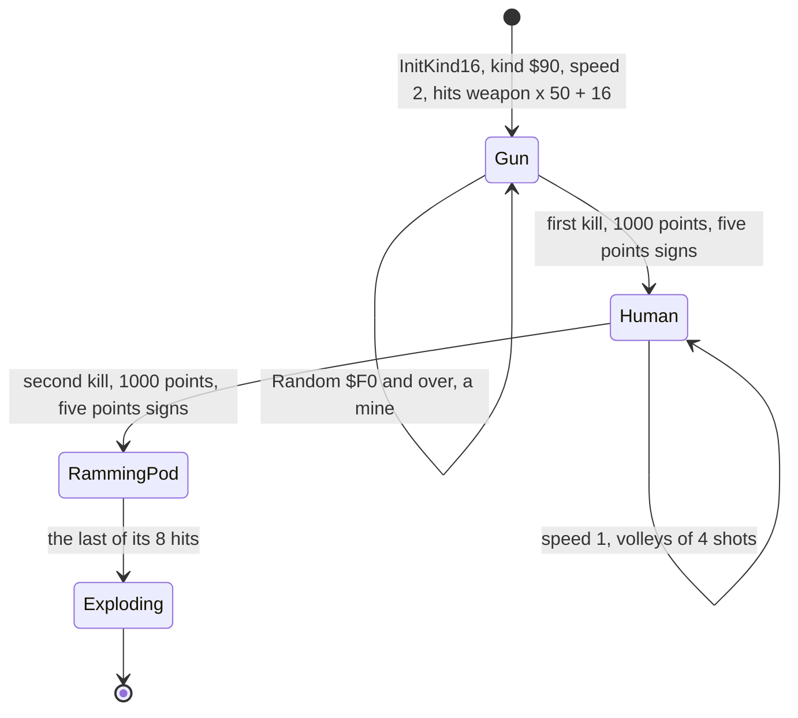

In `rzx-p1-24000` the big gun is record 0: it moves 2 lines a step before (Y 80, 78, 76, 74 at frames 598-613), the
first kill runs KillScore at 668:55693 (+`$13` 0 to 1 at 668:60892, five ShowPoints passes, back at 668:66563; the
1000 points in doc 08, 8.4), and the record goes on as the human picture at 1 line a step (Y 72, 71, 70, 69 at
frames 1596-1607). The second kill is known only from the code.

### The ground walkers (kinds 12, 13)

The ramming pod (12) and the mine layer (13) walk right or left on the ground (GroundWalker) and climb by their speed
until a solid cell above (Climb). The mine layer drops a mine (kind 14) into a free record at random (DropMine).

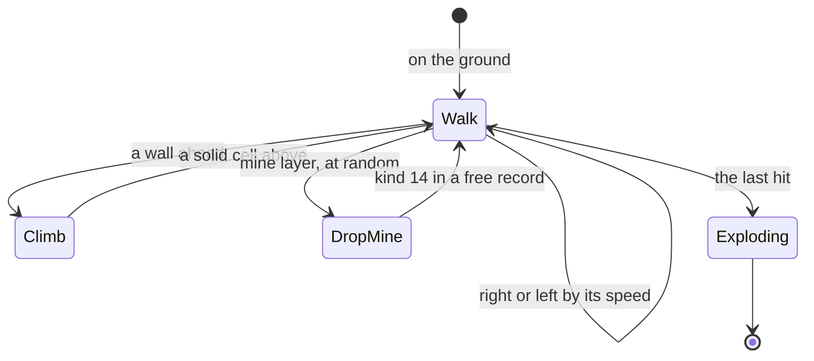

### The mine and the blob (kinds 14, 15)

Both drift by dX and dY, kept in +4 and +5. A solid cell turns them; a solid cell above kills a mine. A blob picks a
random direction (RandomFlight: dX and dY each +1 or -1, RandomSign) and bounces at the edges of the play area
(FlyBounce). BlobStart `$C14D` is kind 15's first step; DriftObject `$C150` runs both kinds (kind 14 enters there).

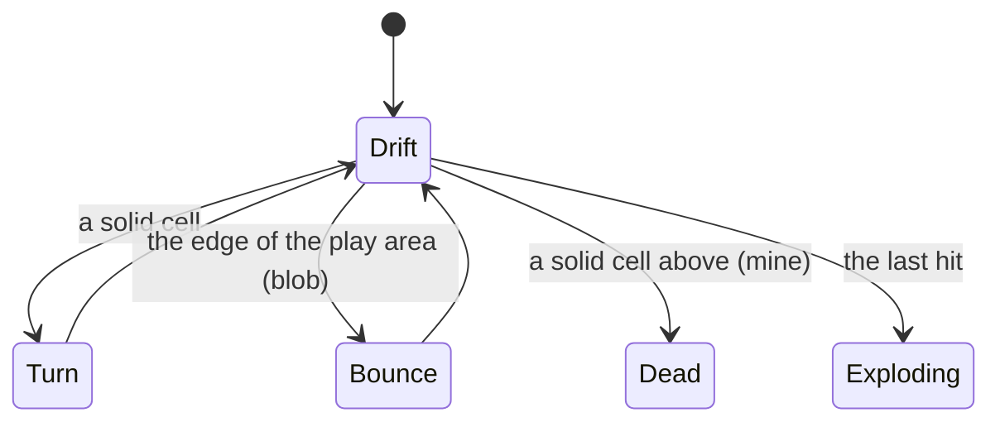

### The pods and the points sign (kinds `$FC-$FF`)

A killed object becomes the points sign (`$FF`) for its explosion, then a pod or nothing (7.9). A power pod flashes
through PodFrames `$BF5B` (`$00-$A0` and back) and goes when its timer (+`$11`) runs out: 100 passes for a big pod,
140 for a small one. Bullets pass through pods; touching Rex takes them (7.8).

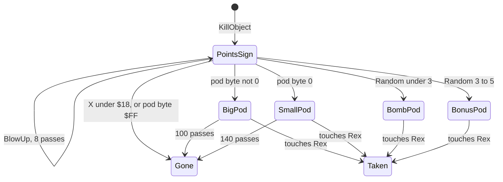

**The point**: one loop updates every object; the kind byte picks its behaviour, the cell types steer its moves.

Witness: UpdateObjects L1 16 932 (stage 1 builds); the `rzx-p1-04000` samples of frames 1380-1540 for the scanners,
the launcher's kill and its pod.

## 7.7 Spawning: SpawnRandom and SpawnScripted

Every pass SpawnRandom `$C9CA` counts SpawnTimer down. At 0 it reloads the period, finds a free record and picks a side
with Random: under `$55` the left, under `$AA` the right, else the top. A side that is not enabled, or a Rex too close
to it, cancels the spawn for this period.

| Side | Allowed when | X | Y | Direction |
| --- | --- | --- | --- | --- |
| left | SpawnLeft and RexX at least `$30` | `$0F` | a random line `$20-$A7` (AND `$F8`) with ground (FindGround) | 0, right |
| right | SpawnRight and RexX under `$C8` | `$E8` | the same | 1, left |
| top | SpawnTop and RexY at least `$38` | a random column `$20-$DF` (AND `$F8`) + `$10`, with five empty cells | 0 | R, any |

The kind is SpawnKind. With bit 7, Random2's bit 0 picks between SpawnKind AND `$7F` and the foot man.

```asm
SpawnRandom:
  LD A,(ScriptSpawnStep)
  OR A
  RET NZ                  ; no random spawn during a scripted one
  LD A,(SpawnTimer)
  DEC A
  LD (SpawnTimer),A
  OR A
  RET NZ
  LD A,(SpawnPeriod)
  LD (SpawnTimer),A
  LD HL,$5E72             ; the alive byte of record 0
  LD A,(ObjectCount)
  LD B,A
SpawnFindFree:
  LD A,(HL)
  OR A
  JP Z,SpawnNextRecord
  LD DE,$0018
  ADD HL,DE
  DJNZ SpawnFindFree
  RET                     ; no free record
SpawnNextRecord:
  LD DE,$000C
  AND A
  SBC HL,DE
  PUSH HL
  POP IX
  CALL Random
  CP $55
  JP C,SpawnPickLeft
  CP $AA
  JP C,SpawnPickRight
  CALL SpawnFromTop
  RET
```

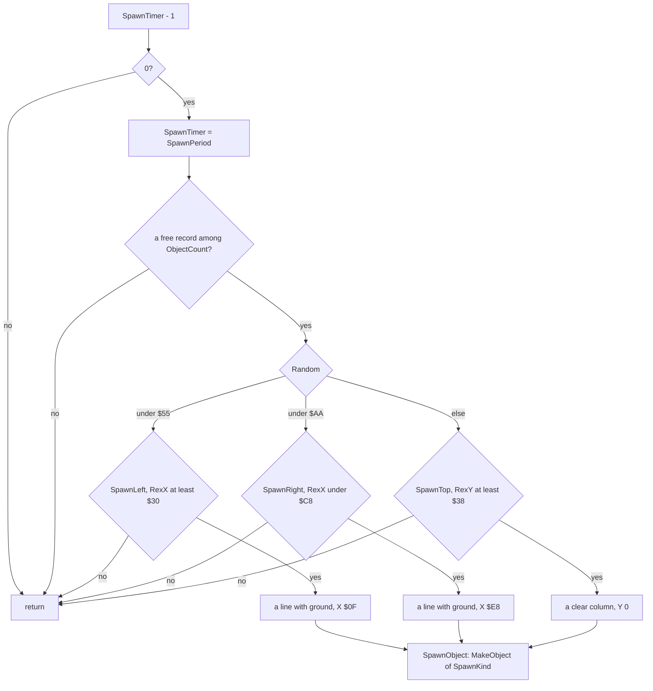

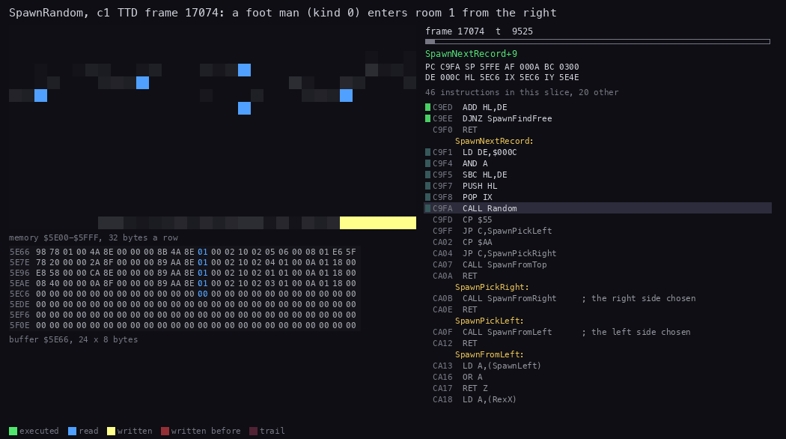

How to read it: the hex view is the first eight records of `$5E66`; record 4 (`$5EC6`) fills in. The code panel shows
SpawnRandom, FindGround probing the cells, then MakeObject. Recording `c1`, TTD frame 17 074, T 8900-31 400, 36
pictures of 625 T. Made by `python3 ../../kit/routine_anim.py --work work/docs/rxC/c1 --window
17074:8900-17074:31400 --listing build/game.lst --pc C9CA-CE66 --view buffer:5E66:24x8:hex --range 5E00-5FFF
--pictures 36 --delay 220 --out docs/img/routines/SpawnRandom.gif`.

Worked example: room 1 in `c1`. Its header enables the right side only, period 30, kind 0. The spawn of TTD frame
17 074 found record 4 free and drew the right side; RexX was under `$C8`. The record of frame 17 075 is
`E8 78 01 00 .. 00 .. 5D AE 01 00 03 10 02 .. 02 00 72 7F`: X `$E8`, Y `$78`, facing left, kind 0, 2 hits. It then walks left two
pixels a pass (X `$E6`, `$E4`, `$E2` .. in the samples of frames 17 076-17 092). With one side in three enabled, room 1
gets a foot man in about one period in three.

The scripted spawn replaces the random one in rooms 2, 3, 4, 6 and 20: ScriptSpawn `$A9F4` holds 4-byte records
[kind][X][Y][passes to the next], `$FF` ends. SpawnScripted `$C978` makes one record a step into a free object. The
death of a kind 5 ends it early (KillObject calls EndScriptSpawn).

**The point**: the room's header is the whole spawn script of most rooms: three side bits, a period and a kind; the
player's position closes the near side.

Witness: SpawnRandom runs every pass (L1 in `src/game/rooms.asm`); the `c1` trace of TTD frame 17 074 and the
samples of frames 17 075-17 092.

## 7.8 Collisions

ObjectHitsRex `$D215` runs for every live object every pass. It has two parts: the object's box against Rex, then
each of Rex's 30 bullets against the object.

### Rex against an object

The box depends on the kind and the direction. Its Y range runs from object Y - 16 to object Y - 16 + H. Its X range
runs from object X - L to object X - L + W. Both are compared with RexX and RexY:

| Kind | H | W | L facing right | L facing left |
| --- | ---: | ---: | ---: | ---: |
| most | `$1E` | `$16` | `$10` | `$08` |
| 14, 15 (mine, blob) | `$16` | `$0E` | `$10` | `$08` |
| 16 (the big gun) | `$3E` | `$36` | `$10` | `$08` |

The code patches the constants into the compare instructions (BoxHeightAdd+1, BoxWidthAdd+1, BoxLeftSub+1) before the
test. The test is skipped while Rex materialises (SparkleMode).

```asm
ObjectBoxTest:
  LD A,(SparkleMode)
  OR A
  JP NZ,BulletsHitObject
  LD HL,RexY
  LD A,(IX+$01)
  SUB $10
  CP (HL)
  JR NC,BulletsHitObject  ; object Y - 16 at or below Rex: no
BoxHeightAdd:
  ADD A,$1E
  CP (HL)
  JR C,BulletsHitObject   ; the box ends above Rex: no
  LD HL,RexX
  LD A,(IX+$00)
BoxLeftSub:
  SUB $10
  CP (HL)
  JR NC,BulletsHitObject
BoxWidthAdd:
  ADD A,$16
  CP (HL)
  JR C,BulletsHitObject
  LD A,(ShieldOn)         ; a touch
  OR A
  JP Z,ObjectHitsUnshielded
  ...                     ; a pod is taken; else KillObject, ShieldDrainFast(hits x 4)
```

On a touch:

- a pod (`$FE`, `$FD`, `$FC`) is taken (doc 10.8, 10.9);
- with the shield on, the object is killed and the shield loses its hits left x 4 units (ShieldDrainFast);
- without the shield, Rex dies (RexDies, doc 10.12).

### A bullet against an object

A bullet record (`$5B60`, 15 bytes: X, Y, grid pointer, flags, dX, dY, live, speed, ..) hits when it is live (+6 =
1), its Y is over object Y + 5 and at most object Y + 5 + h, and its X is over object X and at most object X + w. h
and w are `$10` (8 for kinds 14 and 15, `$30` for kind 16). Pods are skipped.

```text
for each of the 30 bullets b:
    if b.live != 1: continue
    if not (obj.y + 5 < b.y <= obj.y + 5 + h): continue
    if not (obj.x < b.x <= obj.x + w): continue
    if obj.kind is a pod: continue
    b.live = 0 if Weapon == laser else 2           # the laser shot ends; other shots stop (SfxHitWall if channel C is free)
    if obj.kind == 6: HitObjectHard(); continue  # the flash renewed, hits back to 2: no hit taken
    if obj.hits == 0: continue
    obj.hits -= 1
    if obj.hits == 1:
        if obj.kind & $7F != 0: KillObject
        elif shot in the back: KillObject           # foot man: the bullet flies the way he faces
        else: HitObject                              # foot man shot in the front: kind 6, the flash, 2 hits
    elif obj.kind & $7F == 8: obj.speed = 4          # the scanner pauses
```

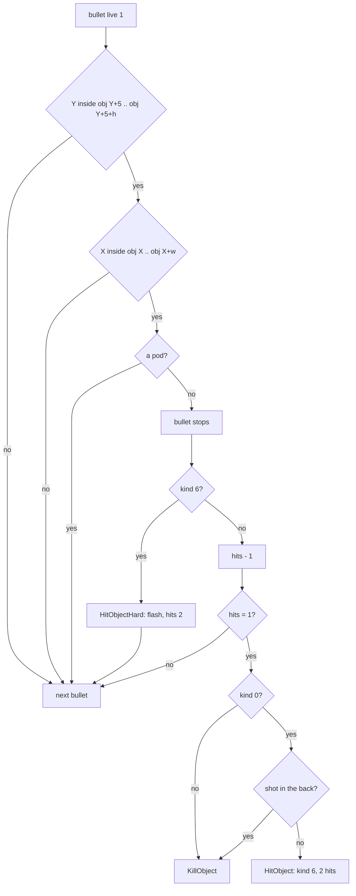

HitObject also reads the weapon: the laser kills at once, and the spray starts the hit man falling (StartFall).

Worked example: the launcher's last hit in `rzx-p1-04000`. The samples:

| Frame | Launcher (record 0) | A bullet of Rex |
| --- | --- | --- |
| 1406 | X `$A8`, Y `$70`, hits 3 | |
| 1409 | hits 3 | X `$AC`, Y `$79`, dX 8, live 2: it hit and stops |
| 1410 | hits 2 | |
| 1416 | hits 2; KillObject runs at T 9003 | X `$AC`, Y `$79`, live 1: the next shot |
| 1417 | | live 2: it stops |
| 1418 | kind `$FF`, Y `$68`, explosion 8 | |

The test with the bullet at (`$AC`, `$79`): `$70` + 5 = `$75` is under `$79`, and `$75` + `$10` = `$85` is not under
it; `$A8` is under `$AC`, and `$A8` + `$10` = `$B8` is not under it. The bullet is inside. Hits go from 2 to 1, and
the kind `$8B` AND `$7F` is not 0: KillObject. The launcher started with 8 hits (7.4). The samples show 6 at frame
1380, then 5, 4, 3 and 2 at frames 1384, 1392, 1400 and 1410: seven bullets in all.

**The point**: a hit counter, not an energy bar: the object dies when the counter reaches 1, so a launcher "with 8
hits" dies to its seventh bullet.

Witness: ObjectHitsRex L1 counts (`src/game/collisions.asm`); the `rzx-p1-04000` samples of frames 1380-1418 and its
trace of frames 1408-1422.

## 7.9 The kill, the explosion and the pods

KillObject `$981F` runs for a bullet's last hit, a touch with the shield on, the smart bomb (doc 10.11) and a fall.
It refuses an object above line `$10` or at line `$B0` and below. Otherwise:

1. a kind 5 ends the scripted spawn;
2. the picture becomes SpritePoints, 8 explosion passes (+`$0D`), the size 3 x `$18`;
3. a person adds one to HumansKilled;
4. KillScores[kind AND `$0F`] hundreds go to the score (AddScore, doc 10.10);
5. SfxExplosion starts on channel C (doc 9);
6. the kind becomes `$FF`, the direction 0, Y = (Y - 8) AND `$F8`.

The big gun (`$90`) takes another path, KillScore `$98AF`, and has two lives:

```text
KillScore(gun):                        # kind $90, every kill
    AddScore(10)                       # 1000 points
    gun.hits = Weapon * 50 + 16        # KillHumanPicture $CE67: the hits depend on the weapon held
    gun.speed12 = 1; ObjectCount = 15; gun.picture = SpriteHuman ($92F2)
    first = (gun[+$13] == 0); gun[+$13] += 1
    if gun[+$13] == 2:                 # the second kill
        InitKind12(); gun.kind = $0C; gun.hits = 8   # a ramming pod
    repeat 5:                          # five points signs around it
        r = FindFreeObject(); ShowPoints(r)
        r.pod = $FF if first else Random & 1
        r.x = gun.x + Random & 31; r.y = (gun.y + Random & 31) & $F8
```

Smart bombs skip it (SmartBombStep tests `$90`, doc 10.11). Witness: the first kill in `rzx-p1-24000` (7.6, the guns).

For the next 8 passes BlowUp `$BD6B` draws six shards along ShardPaths, flashes the cells' attributes (FlashCells:
`$02 $03 $06 $42 $43 $46 $06 $02`) and steps the picture. Each shard also writes the border port (doc 9.6). At the end:

```asm
  DEC (IX+$0D)
  JP NZ,NextObject        ; more passes
  ...                     ; the cells restored (CopyCells3)
  LD A,(IX+$00)
  CP $18
  JP C,BlowUpEnd          ; at the left edge: nothing
  LD (IX+$09),$FE         ; a power pod
  ...                     ; SpritePodA, timer +$11 = $64 (100 passes)
  LD A,(IX+$15)
  CP $FF
  JP Z,BlowUpEnd          ; this object leaves nothing
  CALL Random
  CP $03
  JP C,BlowUpBombPod      ; 3 in 256: a bomb pod
  CP $06
  JP C,BlowUpBonusPod     ; 3 in 256: the bonus pod
  LD A,(IX+$15)
  OR A
  JP NZ,NextObject        ; a big pod
  LD HL,SpritePodB        ; a small pod, 140 passes
  ...
  LD (IX+$11),$8C
```

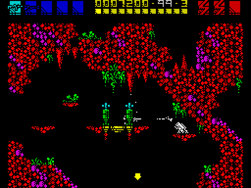

How to read it: the play screen, one picture every 2 frames. Recording `rzx-p1-04000`, TTD frames 1376-1456 (RZX
frames 5376-5456). Rex (right) fires at the launcher; it turns into the points sign with the shards around it, the
score goes from 7200 to 8000, and the big pod appears in its place. Made by `python3 ../../kit/screen_anim.py --work
work/docs/rxC/r04 --from 1376 --to 1456 --step 2 --delay 80 docs/img/play/rzx-p1-05376-launcher-killed.gif`.

Worked example: the launcher of `rzx-p1-04000`. Its record at frame 1418 is kind `$FF`, Y `$68` (`$70` - 8), +`$0D`
= 8. The samples show +`$0D` 7, 6, .. 1 at frames 1422-1446, one a pass. At frame 1450 it is kind `$FE`, Y `$70` (+8
again), pod byte 1: a big pod. The score went from 72 to 80 hundreds (KillScores[11] = 8). Rex took the pod at frame
1528 (doc 10.8).

**The point**: an explosion is the object itself in another kind; the pod it leaves is chosen by one random byte and
the object's pod byte.

Witness: KillObject and BlowUp L1 counts (`src/game/score.asm`, `src/game/objects.asm`); the `rzx-p1-04000` samples
of frames 1418-1530.

## 7.10 Random numbers

Two generators share the seed RandomSeed `$A0A1`.

Random `$A375` is a linear congruential step, seed x 5 + `$15` modulo 256:

```asm
Random:
  PUSH HL
  LD A,(RandomSeed)
  SLA A
  SLA A                   ; x 4
  LD HL,RandomSeed
  ADD A,(HL)              ; x 5
  ADD A,$15
  LD (RandomSeed),A
  POP HL
  RET
```

Its period is the full 256: 5 - 1 is a multiple of 4 and `$15` is odd. So each value comes once in 256 calls.

Random2 `$A388` shifts the 24 bits `$A0A1-$A0A3` left eight times. Each shift feeds in bit 6 of (seed AND `$48`) +
`$38` + carry, a feedback of bits 3 and 6. It returns the new RandomSeed. SpawnObject uses its bit 0 to pick between a
room's kind and a foot man.

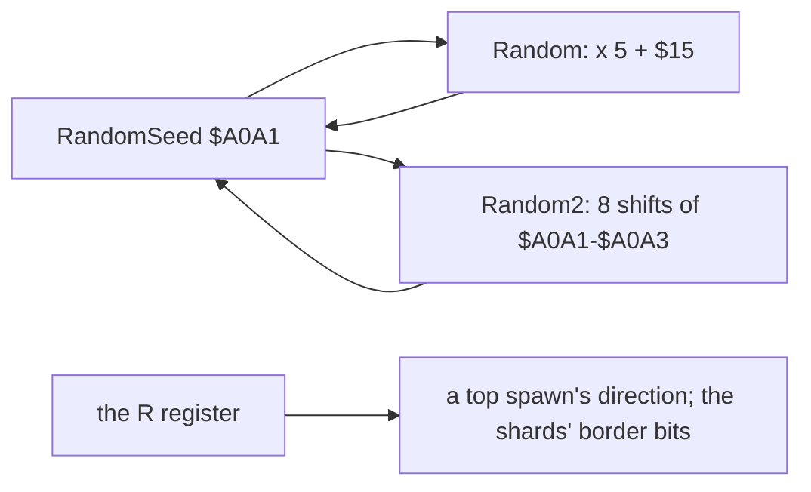

Some code takes R instead (LD A,R): the spawn from the top for its direction, DrawShard for the border bits.

NewGame sets `$A0A1-$A0A2` to `$0313` (RandomSeed `$13`) and RandomSeed2 `$A0A3` to `$11`. With no interrupt and no
clock read, the numbers depend only on the calls made since. R is the only outside input, and it counts instructions,
so the same keys from a new game give the same play.

Worked example: from the seed `$13` the first values are `$13` x 5 + `$15` = `$74`, then `$74` x 5 + `$15` = `$259`,
kept as `$59`, then `$D2`. The first spawn side test of a new game compares `$74` or a later value with `$55` and
`$AA`.

**The point**: one byte of state for most choices; R only for the noise and the facing of a top spawn.

Witness: Random runs in every pass that spawns, fires or blows up (L1 in `src/game/hud.asm`).

## 7.11 Notes, quirks and what no recording reached

- KillObject ends the scripted spawn on kind 5 (EndScriptSpawn), which then stops the timers of kinds 3 and 4.
- SmartBombMark marks no objects: it sets the live byte (+6) of the 20 enemy bullet records at `$5D22` to 2,
  which stops every enemy shot. The objects are killed one a pass by
  SmartBombStep from `$5E66` (doc 10.11).
- SmartBombStep calls KillObject for 16 records and tests neither the alive byte nor kind `$FF` (only `$FE`, `$FD`,
  `$FC`, `$90`). A record cleared by MakeObjects has Y 0, which KillObject refuses. But a record that died in this
  room keeps its Y and kind: a spent explosion (BlowUpEnd `$BE2E`: kind `$FF`, alive 0) scores KillScores[15] = 200
  again; a walker that vanished (ObjectGone `$C497`: kind 0 at the left edge, 3, 4, 5 off a ledge) scores again, and
  kinds 0, 4 and 5 add a HumansKilled (KillHuman does not test Dying, so the free bomb of a death counts people too).
  An object still exploding is killed again: 200 points, its explosion restarted at 8. Known only from the code: no
  recording shows a smart bomb in a room with such a record.
- SetSpawnTop .. SetSpawnLeft set the spawn sides to `$FF`.
- Rooms 14, 24, 26 and 27 are on the map, but no route of the RZX runs enters them; only the POKE recordings
  `p1-room14`, `p1-room24`, `p1-room26` and `p1-room27` reach them (WALKTHROUGH, stage 2 NOTES).
