# 8. HUD and text

What this covers:

- the HUD: three character rows at the top of the screen, each field with its address, format and update routine;
- the font: 64 characters, 8 bytes each, and the characters the HUD uses as pictures;
- the print routines: PrintText (a record of attribute, column, pixel line and text), PrintBoxed with its frame, and
  PrintDigits for numbers;
- the score: kept in hundreds, turned into digits by repeated subtraction, printed units first;
- the shield, the lives, the weapon icons and the power bar, the bombs, the sweep, the combo row, the power pod's flash;
- every string of the three programs with its address;
- the panels in play, the game over panel and the high score;
- the CODE panel at the end of part 1: how the 16 digits encode the game.

The recordings it rests on (WALKTHROUGH 6.0; all on the 128K):

| Recording | Load | Used for |
| --- | --- | --- |
| `p1-cursor` | `work/stage1/probe/128K/loaded.szx` (the menu), CURSOR | the HUD at frame 1006; the start panels (frames 335-336) |
| `rzx-p1-24000` | another player's RZX run, one segment | a kill: +1000 points (frame 668), the HUD's writers |
| `p1-gameover` | `at012000.szx`, Lives 0, HumansKilled 37, SweepWidth 2 (stage 2) | the game over panel (frame 500) |
| `p1-code` | stage 2, room 31 with the exit to room 99 | the CODE panel (CodePanel at frame 707, the screen at 800) |
| `c1` | power-on, REX 1 from the tape | the menu and the roll call ([doc 5](05-controls.md)) |

Conventions:

- **A frame** is 1/50 s of the 128K, 70 908 T. **A pass** is one turn of the main loop `MainPass $9586`
  ([doc 4](04-game-loop.md)), about 4.4 frames.
- "668:55881" is frame 668, T 55881, as an access trace places an instruction.
- A value read with `time_travel memory_at` is the memory at the start (T 0) of the frame named.
- **A column** is a character column 0-31. **A line** is a pixel line 0-191. The text records give the line in
  pixels, not in character rows.
- **Points.** The game keeps the score in hundreds: Score 10 is shown as 1000 points.

## 8.1 The HUD: three rows, eight fields

The HUD is character rows 0-2 (lines 0-23). It is drawn straight on the screen, never through the back buffer
([doc 6](06-rendering.md)). DrawHud `$A1A5` draws it once a game, from NewGame:

1. It prints the three records of HudTexts `$A24C` with PrintTextHL (8.3).
2. It fills the attributes of the weapon icons: 2 rows of 10 columns from `$5801`, attribute 1 (blue ink). FillAttrs
   `$D909` does it.
3. It fills the bombs' attributes: 2 rows of 6 columns from `$5819`, attribute 2 (red ink).
4. It draws the five weapon icons (ShowWeaponIcons `$A212`), then falls into ShowBombs `$A1C9`.

NewGame then calls ShowLives and SaveAttrs `$CF8F`, which copies the first 96 attributes into the shadow at `$E4FF`.
After that, each field has its own routine, called only when its value changes:

| Field | Screen | Variable | Format | Updated by |
| --- | --- | --- | --- | --- |
| weapon icons | cols 1-10, rows 0-1 | WeaponIcon `$A04F` (5 flags) | 5 pictures of 2 x 16 lines | ShowWeaponIcons `$A212` |
| power bar | 2 x 2 attributes at PowerBarPtr `$A015` | PowerLevel `$A014` | attribute PowerLevel + 2 | PowerBar `$B96B`, every pass |
| score | cols 12-18, row 0 | Score `$A03E` (2 bytes, hundreds) | 5 digits, then the text's "00" | ShowScore `$99AB` |
| shield | cols 20-21, row 0 | ShieldEnergy `$A04D` | 2 digits; attribute E / 16 + 1 | ShowShield `$99FA` |
| lives | col 23, row 0 | Lives `$A063` | 1 digit | ShowLives `$99BB` |
| the sweep | cols 11-23, row 1 | SweepPos `$A064`, SweepWidth `$A067` | attributes only, over a row of `#` | HudSweep `$A0C4`, every pass |
| bombs | cols 25-30, rows 0-1 | Bombs `$A06C` | 3 pictures of 2 x 16 lines | ShowBombs `$A1C9` |
| the combo row | cols 3-29, row 2 | KillFlashPtr `$A039` | attributes over "100 200 ... 900" | KillFlashFade `$9992`, every pass |

```text
DrawHud:                                   # once a game, from NewGame
    PrintTextHL(HudTexts, 3)               # "############", "0000000:99:3", the combo row
    FillAttrs($5801, rows 2, cols 10, 1)   # the weapon icons blue
    FillAttrs($5819, rows 2, cols 6, 2)    # the bombs red
    ShowWeaponIcons()
    ShowBombs()
every pass (MainPass):
    PowerBar()                             # unless FadeStepIndex != $FF
    KillFlashFade()
    FadeStep()                             # only after a power pod
    HudSweep()                             # unless FadeStepIndex != $FF
on a change:
    ShowScore(), ShowShield(), ShowLives(), ShowBombs(), ShowWeaponIcons()
```

```text
A1A5  06 03        DrawHud:        LD B,$03
A1A7  DD 21 4C A2                  LD IX,HudTexts
A1AB  CD DF A2                     CALL PrintTextHL
A1AE  21 01 58                     LD HL,$5801
A1B1  06 02                        LD B,$02
A1B3  1E 0A                        LD E,$0A
A1B5  3E 01                        LD A,$01
A1B7  CD 09 D9                     CALL FillAttrs
A1BA  21 19 58                     LD HL,$5819
A1BD  06 02                        LD B,$02
A1BF  1E 06                        LD E,$06
A1C1  3E 02                        LD A,$02
A1C3  CD 09 D9                     CALL FillAttrs
A1C6  CD 12 A2                     CALL ShowWeaponIcons
```

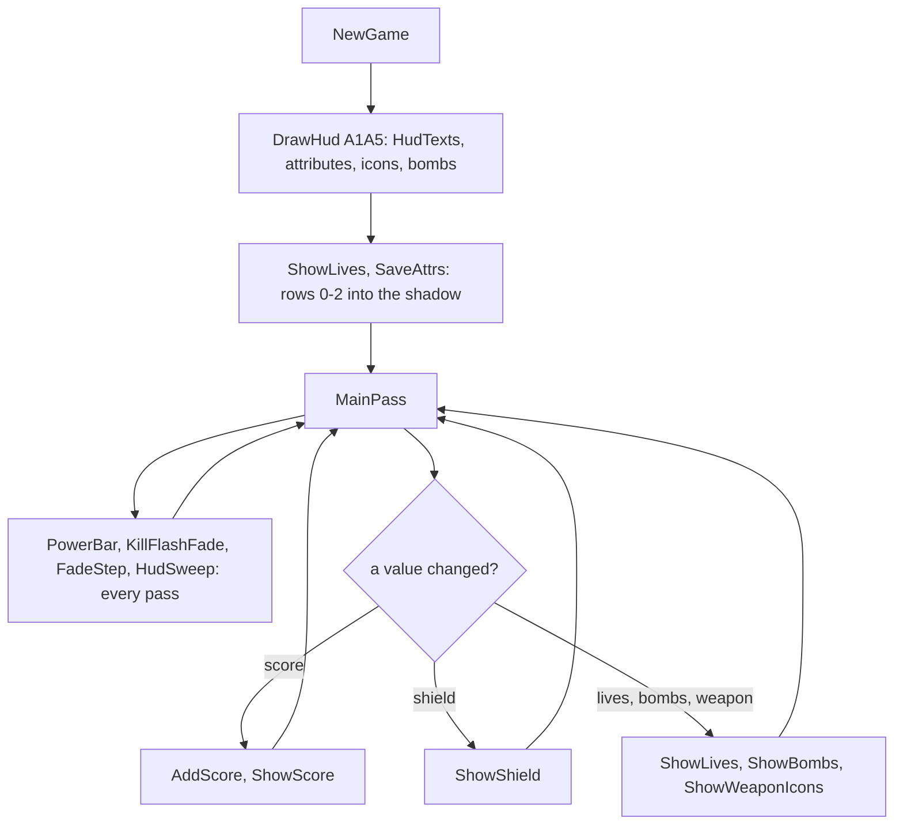

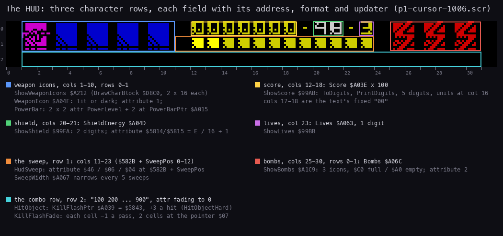

*Figure 8.1: the HUD of `p1-cursor` at frame 1006 (T 0), at 4x, with every field boxed. Command: `python3
work/docs/rxB/dumpscr.py work/docs/rxB/p1-cursor 1006 work/docs/rxB/p1-cursor-1006.scr`, then `python3
tools/fig_hud.py panel --scr work/docs/rxB/p1-cursor-1006.scr --out docs/img/hud/panel.png`.*

How to read:

- The numbers on the left are the character rows, the numbers under the HUD the columns.
- Each coloured box is one field; its legend below gives the screen place, the variable, the format and the routine.
- The first weapon icon is magenta: the power bar's colour (PowerLevel 1 + 2 = 3) on the active weapon.
- Row 1, columns 12-23, is a row of `#` characters. Its colour is the sweep; the pixels never change.

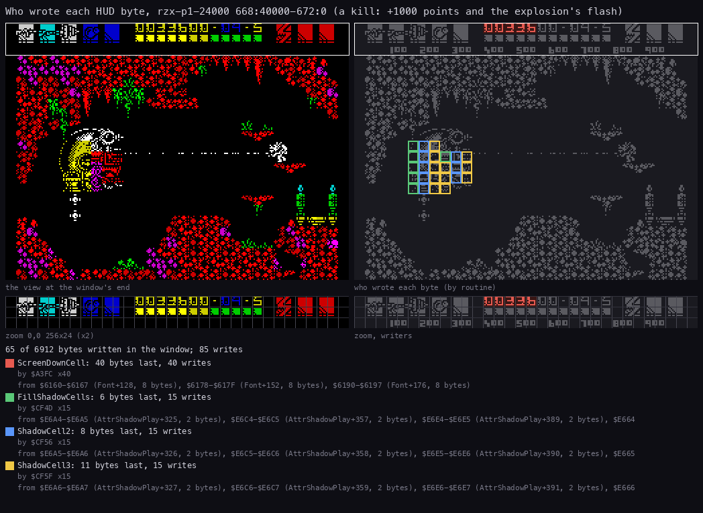

*Figure 8.2: code against the screen over a kill. Recording `rzx-p1-24000`, frames 668:40000-672:0. Command: `python3
../../kit/writers_map.py --work work/docs/rxB/r24 --window 668:40000-672:0 --listing build/game.lst --view screen
--sources --zoom 0,0,256,24 --title "..." --out docs/img/hud/writers-hud.png`.*

How to read:

- The zoom strip at the bottom is the HUD. Red is ScreenDownCell, the loop of PrintDigits: 40 bytes, five digits
  of 8 lines at columns 12-16. The score went from 32 600 to 33 600 points.
- The legend names the font bytes the digits came from: `$6160` (`0`), `$6178` (`3`), `$6190` (`6`).
- The coloured cells in the play area are the explosion's attribute flash ([doc 6](06-rendering.md), 6.11), not
  the HUD.

Witness: DrawHud L1 9 (one a game: c1, p1-code, p1-cursor, p1-define, p1-kempston, rzx-p1-00000, rzx-p1-64000);
PowerBar L1 16927 and HudSweep L1 16927, one a pass.

The point: the HUD costs almost nothing per pass. Its pixels are printed once and changed only when a value changes.
The per-pass work is attributes only: the power bar, the sweep and the combo row are colours over fixed pictures.

## 8.2 The font

Font `$60E0` holds 64 characters, codes 32-95: space, punctuation, digits and capitals. Each is 8 bytes, top line
first. The print routines address it as `$5FE0 + 8 x code`, so code 32 lands on `$60E0`. CharFlags `$62E0` follows
it directly.

Several codes are not what their ASCII name says:

| Code | ASCII | What the font draws | Used in |
| --- | --- | --- | --- |
| `$3A` | `:` | a short dash at line 3 (`00 00 00 18 00 00 00 00`) | "PHASE ONE:PROCEED", "HI:SCORE", the HUD's "0000000:99:3" |
| `$2D` | `-` | nothing: 8 zero bytes | not used |
| `$23` | `#` | the HUD bar's cell | HudTexts, row 1 |
| `$28-$2C`, `$2F`, `$3B`, `$3C` | `( ) * + , / ; <` | pieces of a panel frame and of the HUD's pictures | PanelBox `$CE7B` |
| `$3D`, `$3E` | `= >` | nothing: 8 zero bytes | not used |
| `$5D ^ _ @ " $ % & '` | | "1" to "9", each with a "0" | the combo row |
| `$5C` | `\` | "00" | the combo row: `]\` reads 100 |

So the text says `:` where the screen shows a dash. The source keeps the text as it is in memory.

```text
glyph(code) = bytes $5FE0 + 8 * code ... + 7        # code 32-95
PrintChar:   DE = $5FE0 + 8 * code; IY = ScreenLineTable + 2 * line
```

```text
A2F5  DD 6E 00                     LD L,(IX+$00)
A2F8  26 00                        LD H,$00
A2FA  29                           ADD HL,HL
A2FB  29                           ADD HL,HL
A2FC  29                           ADD HL,HL
A2FD  11 E0 5F                     LD DE,$5FE0
A300  19                           ADD HL,DE
```

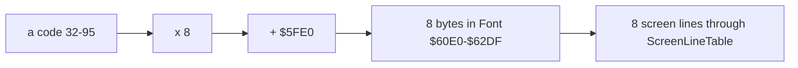

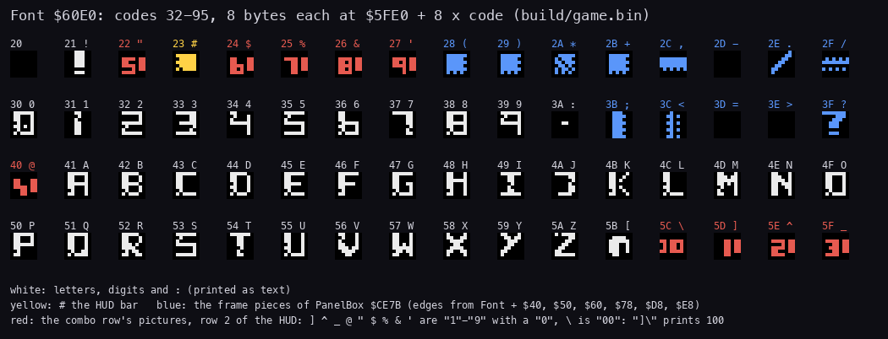

*Figure 8.3: the 64 characters of Font `$60E0`, each with its code. Data from `build/game.bin`. Command: `python3
tools/fig_hud.py font --out docs/img/hud/font.png`.*

How to read: white are the letters, digits and `:` as text. Yellow is `#`, the HUD bar. Blue are the frame pieces
PanelBox uses. Red are the combo row's pictures.

Worked example: the digit `3` is code `$33`. `$5FE0 + 8 x $33 = $5FE0 + $198 = $6178`. Figure 8.2 names `$6178` as
the source of the score's `3` in `rzx-p1-24000`.

The point: one 512-byte font serves the text, the panel frames and the HUD's pictures. The game has no lower case,
and the colon is drawn as a dash.

## 8.3 PrintText, PrintChar and PrintBoxed

A text record is:

| Byte | Meaning |
| --- | --- |
| +0 | the attribute |
| +1 | the column, 0-31 |
| +2 | the line, in pixels, 0-191 |
| +3 ... | the characters, a 0 at the end |

PrintText `$A307` prints one record:

1. It copies the attribute, the column and the line into Temp1 `$A093`, Temp2 `$A095` and Temp3 `$A097`.
2. For each character, PrintChar `$A2E9` sets DE to the glyph and IY to ScreenLineTable `$ABDD` + 2 x line.
3. The 8-line loop (labelled PrintTextAttr `$A321`) takes the screen address of each line from the table, adds the
   column, and copies one glyph byte. So the line can be any pixel line; the text need not sit on a character row.
4. If the character is not a space, it writes the attribute at `$5800 + (line & $F8) x 4 + column`: the cell of the
   character row that holds the text's top line.
5. The column goes up by 1. A 0 ends the record.

PrintTextHL `$A2DF` prints B records one after another. PrintBoxed `$A13E` first draws a frame with PanelBox `$CE7B`
(attribute `$47`, frame colour 7): 3 columns left of the first record, one character row above it, as wide as the
longest record and as tall as B records. Then it calls PrintTextHL.

```text
PrintText(IX):
    attr, col, line = IX[0], IX[1], IX[2]; IX += 3
    while IX[0] != 0:
        glyph = $5FE0 + 8 * IX[0]
        for r in 0..7:
            screen[ScreenLineTable[line + r] + col] = glyph[r]
        if IX[0] != ' ':
            attrs[$5800 + (line & $F8) * 4 + col] = attr
        col += 1; IX += 1
PrintTextHL(IX, B):  repeat B: PrintText(IX); IX += 1     # past the 0
PrintBoxed(IX, B):   PanelBox(frame around the records); PrintTextHL(IX, B)
```

```text
A307  DD 7E 00     PrintText:      LD A,(IX+$00)
A30A  32 93 A0                     LD (Temp1),A
A30D  DD 7E 01                     LD A,(IX+$01)
A310  32 95 A0                     LD (Temp2),A
A313  DD 7E 02                     LD A,(IX+$02)
A316  32 97 A0                     LD (Temp3),A
A319  11 03 00                     LD DE,$0003
A31C  DD 19                        ADD IX,DE
A31E  CD E9 A2     PrintTextChar:  CALL PrintChar          ; each character
A321  FD 6E 00     PrintTextAttr:  LD L,(IY+$00)           ; the attributes
A324  FD 66 01                     LD H,(IY+$01)
A327  D5                           PUSH DE
A328  3A 95 A0                     LD A,(Temp2)
A32B  5F                           LD E,A
A32C  16 00                        LD D,$00
A32E  19                           ADD HL,DE
A32F  D1                           POP DE
A330  1A                           LD A,(DE)
A331  77                           LD (HL),A
A332  13                           INC DE
A333  FD 23                        INC IY
A335  FD 23                        INC IY
A337  10 E8                        DJNZ PrintTextAttr
A339  DD 7E 00                     LD A,(IX+$00)
A33C  FE 20                        CP $20
A33E  28 19                        JR Z,PrintTextNext
A340  3A 97 A0                     LD A,(Temp3)
A343  E6 F8                        AND $F8
; ... x 4 + column + $5800
A355  3A 93 A0                     LD A,(Temp1)
A358  77                           LD (HL),A
A359  DD 23        PrintTextNext:  INC IX                  ; the next character
```

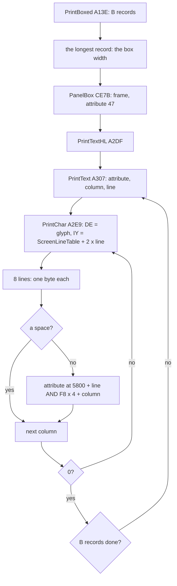

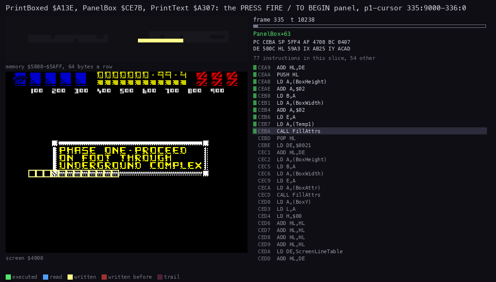

*Animation 8.1: PrintBoxed, PanelBox and PrintText drawing the PRESS FIRE / TO BEGIN panel under the PHASE ONE panel,
50 pictures. Recording `p1-cursor`, frames 335:9000-336:0. Command: `python3 ../../kit/routine_anim.py --work
work/docs/rxB/p1-cursor --window 335:9000-336:0 --listing build/game.lst --view screen --range 5800-5AFF --pc
A13E-A1A4,A2DF-A33A,CE7B-CF00 --pictures 50 --title "..." --out docs/img/routines/PrintText.gif`.*

How to read: the frame is drawn first, then the letters appear one by one, left to right. Each letter turns green
when its attribute is written, after its 8 lines. The memory strip is the attributes `$5800-$5AFF`.

Worked example: PressFireText `$AB25` is `44 04 70` then "PRESS FIRE" and 0. The attribute `$44` is bright green ink
on black. The column is 4 and the line `$70` = 112, the top of character row 14. The `P` is code `$50`: glyph
`$5FE0 + $280 = $6260`. Its lines go to ScreenLineTable[112..119] + 4, the first at `$4884`. Its attribute goes to
`$5800 + ($70 & $F8) x 4 + 4 = $5800 + $1C0 + 4 = $59C4`. The space after PRESS gets no attribute.

Witness: PrintText L1 128, PrintChar L1 1674, PrintTextHL L1 121, PrintBoxed L1 41 (c1, p1-code, p1-cursor,
p1-define, p1-gameover, p1-kempston, rzx-p1- x7).

Known only from the code: a record whose line is not a multiple of 8 spans two character rows, but only the upper
row gets the attribute. No record of REX 1 does this: every line is a multiple of 8.

The point: a text is data with its own place and colour, so a panel is a list of records and one call. The pixel
line and the line table let a text sit anywhere, and the space's skipped attribute lets a text pass over coloured
cells without staining them.

## 8.4 Numbers: ToDigits, PrintDigits and the score

All numbers in the HUD and the panels go through two routines:

- ToDigits `$A402` turns HL into five ASCII digits at Digits `$A0A6`, units first. Each digit is DigitOf `$A447`:
  how many times 10 000, 1000, 100, 10 or 1 goes into HL, by repeated subtraction.
- PrintDigits `$A3C8` prints B of them at line L, column E, right to left: the units at E, the tens at E - 1. It
  finds the screen address from ScreenLineTable, then copies 8 glyph lines with `INC D` (ScreenDown `$A3F9`). So L
  must be a multiple of 8.

| Caller | Value | Digits | Line, column of the units |
| --- | --- | --- | --- |
| ShowScore `$99AB` | Score `$A03E` | 5 | 0, 16 |
| ShowShield `$99FA` | ShieldEnergy `$A04D` | 2 | 0, 21 |
| ShowLives `$99BB` | Lives `$A063` | 1 | 0, 23 |
| GameOver `$9CBF` | HumansKilled `$A089` | 5 | 128, 27 |
| GameOver | HiScore `$A08B` | 5 | 96, 20 |

The score has seven figures on screen. The five of PrintDigits are columns 12-16. Columns 17 and 18 are the
"00" of the HUD text, never rewritten. So the score is Score x 100.

AddScore `$9A27` adds DE to Score (not while Rex is dying). It adds DE to ExtraLifeCount `$A076` too; at 100 it takes
100 off and calls ExtraLife `$D5A0` ([doc 10](10-gameplay-logic.md)): a life every 10 000 points. Then it jumps to
ShowScore.

```text
AddScore(DE):
    if Dying: return
    Score += DE; ExtraLifeCount += DE
    if ExtraLifeCount >= 100: ExtraLifeCount -= 100; ExtraLife()
    ShowScore()
ShowScore:  ToDigits(Score); PrintDigits(line 0, column 16, 5)
ToDigits(HL):
    for (place, unit) in (4, 10000), (3, 1000), (2, 100), (1, 10), (0, 1):
        Digits[place] = '0' + HL / unit; HL %= unit        # by subtraction
PrintDigits(L, E, B):
    DE = ScreenLineTable[L] + E
    for i in 0..B-1: copy glyph(Digits[i]) down 8 lines at DE; DE -= 1
```

```text
99AB  2A 3E A0     ShowScore:      LD HL,(Score)
99AE  CD 02 A4                     CALL ToDigits
99B1  1E 10                        LD E,$10
99B3  2E 00                        LD L,$00
99B5  06 05                        LD B,$05
99B7  CD C8 A3                     CALL PrintDigits
99BA  C9                           RET
; ...
A3DE  C5           DigitLoop:      PUSH BC                 ; each digit
A3DF  D5                           PUSH DE
A3E0  DD 6E 00                     LD L,(IX+$00)
A3E3  26 00                        LD H,$00
A3E5  29                           ADD HL,HL
A3E6  29                           ADD HL,HL
A3E7  29                           ADD HL,HL
A3E8  01 E0 5F                     LD BC,$5FE0
A3EB  09                           ADD HL,BC
A3EC  CD F9 A3                     CALL ScreenDown
A3EF  DD 23                        INC IX
A3F1  D1                           POP DE
A3F2  1B                           DEC DE
A3F3  C1                           POP BC
A3F4  10 E8                        DJNZ DigitLoop
; ...
A3FB  7E           ScreenDownCell: LD A,(HL)               ; the next character row or third
A3FC  12                           LD (DE),A
A3FD  23                           INC HL
A3FE  14                           INC D
A3FF  10 FA                        DJNZ ScreenDownCell
```

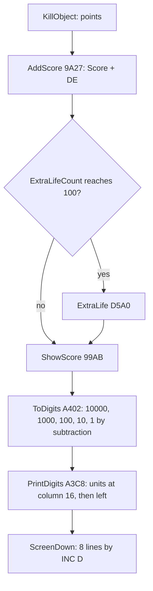

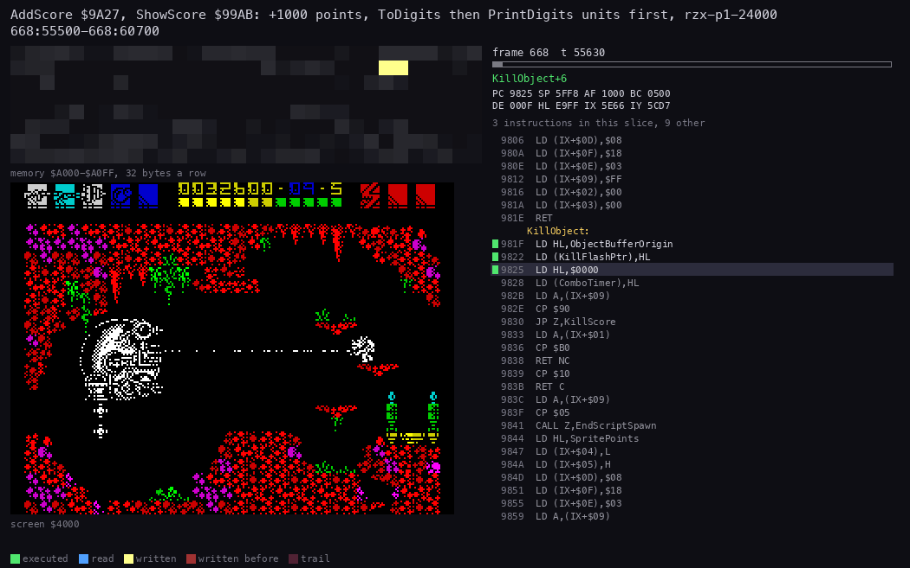

*Animation 8.2: a kill worth 1000 points: AddScore, ShowScore, ToDigits and PrintDigits, 40 pictures. Recording
`rzx-p1-24000`, frames 668:55500-668:60700. Command: `python3 ../../kit/routine_anim.py --work work/docs/rxB/r24
--window 668:55500-668:60700 --listing build/game.lst --view screen --range A000-A0FF --pc 981F-9A4B,A3C8-A43F
--pictures 40 --title "..." --out docs/img/routines/ShowScore.gif`.*

How to read: the memory strip is `$A000-$A0FF`; Score `$A03E` and Digits `$A0A6` light up as they are written. Most
of the time goes into ToDigits' subtraction loops. At the end the score's digits change on screen from the right.

Worked example (`rzx-p1-24000`, read at T 0 and on the trace):

| Step | Where | Value |
| --- | --- | --- |
| before | frame 668 | Score `$0146` = 326 (32 600 points); ExtraLifeCount 26 |
| KillObject | 668:55602 | DE = 10 (1000 points) |
| AddScore | 668:55724 | Score 336, ExtraLifeCount 36: no life |
| ToDigits | 668:55920 | Digits = `36 33 33 30 30`: "6", "3", "3", "0", "0", units first |
| PrintDigits | 668:57880 | `6` at `$4010` (column 16), `3` at `$400F`, `3` at `$400E`, `0` at `$400D` and `$400C` |
| after | frame 669 | Score `$0150`; the HUD reads 0033600 |

ToDigits took 1960 T (55920 to 57880). The five digits are 40 screen bytes, the ScreenDownCell bytes of figure 8.2.

Witness: ShowScore L1 299, AddScore L1 442, ToDigits L1 1803, PrintDigits L1 1798 (c1, p1-*, rzx-p1-*).

Known only from the code: Score is 16 bits with no limit check. Past 65 535 (6 553 500 points) it wraps to 0. Five
digits are enough for 65 535, so the HUD never shows a wrong character.

The point: keeping the score in hundreds saves two digits of arithmetic and two of printing, and the fixed "00" of the
text does the rest. Every number on screen is drawn by the same 2 routines.

## 8.5 Shield, lives, weapons, power and bombs

**The shield.** ShowShield `$99FA` prints ShieldEnergy as 2 digits at columns 20-21. Then it colours them:
attribute `(ShieldEnergy >> 4 & 7) + 1` at `$5814` and `$5815`, and the same in the shadow at ShieldAttrs `$E513`,
`$E514`. So the figure is blue below 16, red from 16, magenta from 32, and so on: energy 23 shows red, 45 magenta,
98 white.

**The lives.** ShowLives `$99BB` prints Lives as one digit at column 23.

**The weapon icons.** ShowWeaponIcons `$A212` draws five pictures of 2 columns x 16 lines at columns 1, 3, 5, 7 and
9 with DrawCharBlock `$D8C0`. DrawCharBlock takes its six parameters from the bytes after the `CALL`: picture word,
column, line, width, height. ShowWeaponIcons writes the picture and the column into those bytes (WeaponIconParams
`$A233`) before each call. Picture i is SpriteHudIcons `$8C0A + 32 x i` if WeaponIcon[i] is set, else the dark
SpriteHudIcons2 `$8CAA`.

**The power bar.** PowerBar `$B96B` writes attribute PowerLevel + 2 into a 2 x 2 patch at PowerBarPtr `$A015`, on the
screen and in the shadow (PowerBarPtr + `$8CFF`). PowerBarPtr starts at `$5801` and moves 2 columns a weapon rank.
So the active weapon's icon takes the power colour: level 1 gives magenta (3), level 5 white (7). The DEMO's tutor
says the same: "PINK:LOW UP TO WHITE: HIGH". It runs every pass unless FadeStepIndex is not `$FF`.

**The bombs.** ShowBombs `$A1C9` picks a row of BombIcons `$A202` by Bombs (0-3). Each row holds three offsets from
SpriteHudIcons: `$C0` a full bomb (`$8CCA`), `$A0` an empty one (`$8CAA`, the same picture as a dark weapon).
DrawBombIcons writes column 25, 27 and 29 into HudIconParams `$A1F3` before each DrawCharBlock.

```text
ShowShield: ToDigits(E); PrintDigits(line 0, column 21, 2)
            a = (E >> 4 & 7) + 1; [$5814] = [$5815] = [$E513] = [$E514] = a
ShowWeaponIcons:
    for i in 0..4: DrawCharBlock(WeaponIcon[i] ? $8C0A + 32 i : $8CAA, column 1 + 2 i, line 0, 2, 16)
PowerBar:   if FadeStepIndex != $FF: return
            Fill2x2(PowerBarPtr, PowerLevel + 2); Fill2x2(PowerBarPtr + $8CFF, PowerLevel + 2)
ShowBombs:  for k in 0..2: DrawCharBlock($8C0A + BombIcons[4 Bombs + k], column 25 + 2 k, line 0, 2, 16)
```

```text
9A0C  3A 4D A0                     LD A,(ShieldEnergy)
9A0F  CB 3F                        SRL A
9A11  CB 3F                        SRL A
9A13  CB 3F                        SRL A
9A15  CB 3F                        SRL A
9A17  E6 07                        AND $07
9A19  3C                           INC A
9A1A  32 15 58                     LD ($5815),A
9A1D  32 14 58                     LD ($5814),A
9A20  32 14 E5                     LD (ShieldAttrs+$0001),A
9A23  32 13 E5                     LD (ShieldAttrs),A
; ...
A1E2  C5           DrawHudIcon:    PUSH BC
A1E3  5E                           LD E,(HL)
A1E4  E5                           PUSH HL
A1E5  16 00                        LD D,$00
A1E7  21 0A 8C                     LD HL,SpriteHudIcons
A1EA  19                           ADD HL,DE
A1EB  22 F1 A1                     LD (HudIconParams),HL
A1EE  CD C0 D8                     CALL DrawCharBlock
A1F1  CA 8C 19 00  HudIconParams:  DEFB $CA,$8C,$19,$00,$02,$10
; ...
B96B  3A 42 A0     PowerBar:       LD A,(FadeStepIndex)
B96E  FE FF                        CP $FF
B970  C0                           RET NZ
B971  2A 15 A0                     LD HL,(PowerBarPtr)
B974  CD 7E B9                     CALL PowerBarColour
B977  2A 15 A0                     LD HL,(PowerBarPtr)
B97A  11 FF 8C                     LD DE,SpritePowerBar
B97D  19                           ADD HL,DE
```

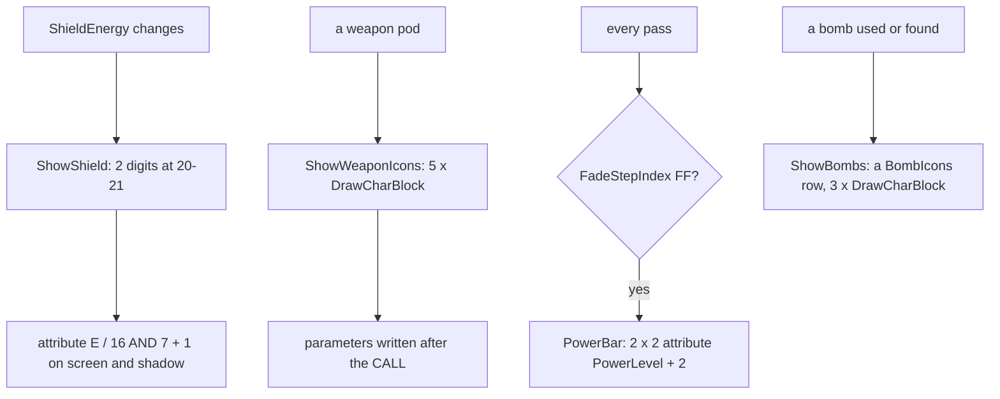

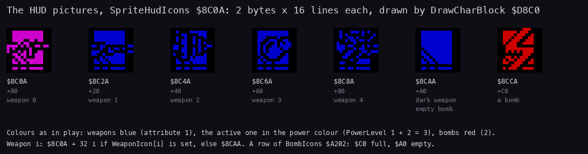

*Figure 8.4: the seven pictures of SpriteHudIcons `$8C0A`, 2 x 16 each, at 5x in their play colours. Data from
`build/game.bin`. Command: `python3 tools/fig_hud.py icons --out docs/img/hud/icons.png`.*

How to read: the address and the offset from `$8C0A` are under each picture. The dark weapon at `$8CAA` is also the
empty bomb.

The panel figure (8.1) shows all of them in place: four dark weapon icons and one magenta, the shield `98` in white
(`(98 >> 4 & 7) + 1 = 7`), three full bombs.

Worked example: the shield in `p1-code` at frame 707 is `$17` = 23. ToDigits gives "3", "2". PrintDigits puts `3`
at column 21 and `2` at column 20. The attribute is `(23 >> 4 & 7) + 1 = 2`: red ink. The bomb row for Bombs 0 is
`A0 A0 A0`: three empty pictures from `$8CAA`.

Witness: ShowShield L1 1442, ShowLives L1 53, ShowWeaponIcons L1 104, ShowBombs L1 20, PowerBar L1 16927, Fill2x2
L1 29648 (c1, p1-*, rzx-p1-*).

Known only from the code:

- The "picture" SpritePowerBar `$8CFF` that PowerBar adds is not a picture. `$8CFF` is `$E4FF - $5800`, the
  distance from the screen's attributes to the shadow. The label should be an `EQU`.
- PowerGain stops PowerLevel at 6, which gives attribute 8: black ink on blue paper, a dark icon. No recording
  reaches level 6.

The point: the icons are drawn by one block routine whose parameters live in the code after the call. The power
level needs no picture at all: it is the attribute of the active weapon's icon.

## 8.6 The sweep

Row 1, columns 12-23, holds twelve `#` characters. HudSweep `$A0C4` colours them, one cell a pass, as a timer:

1. If a power pod flash runs (FadeStepIndex not `$FF`), it does nothing.
2. It writes `$46` (bright yellow) at `$582B + SweepPos`, and `$06` (yellow) at the next cell unless that cell is
   `$04` (green, a cell already lost).
3. SweepDir 0: SweepPos + 1 up to SweepWidth; then SweepDir = 1. SweepDir 1: SweepPos - 1 down to 0; then SweepDir =
   0 and one sweep is done.
4. Every 5 sweeps (SweepCount `$A065`), SweepWidth `$A067` goes down by 1 and the cell at `$582C + SweepWidth` turns
   green, in the shadow too (SweepAttrs `$E52B`).
5. When SweepWidth would reach 0, RexDies `$9BDA`.

ResetSweep `$A133` sets the width back to 12 and the count to 5. BuildRoom calls it, so the sweep runs per room.

```text
HudSweep:
    if FadeStepIndex != $FF: return
    attr[$582B + SweepPos] = $46
    if attr[$582C + SweepPos] != $04: attr[$582C + SweepPos] = $06
    if SweepDir == 0:
        SweepPos += 1; if SweepPos == SweepWidth: SweepDir = 1
    else:
        SweepPos -= 1
        if SweepPos == 0:
            SweepDir = 0; SweepCount -= 1
            if SweepCount == 0:
                SweepCount = 5; SweepWidth -= 1
                if SweepWidth == 0: RexDies()
                attr[$582C + SweepWidth] = $04; shadow[$E52C + SweepWidth] = $04
```

```text
A0CA  3A 64 A0                     LD A,(SweepPos)
A0CD  5F                           LD E,A
A0CE  16 00                        LD D,$00
A0D0  21 2B 58                     LD HL,$582B
A0D3  19                           ADD HL,DE
A0D4  36 46                        LD (HL),$46
A0D6  23                           INC HL
A0D7  7E                           LD A,(HL)
A0D8  FE 04                        CP $04
A0DA  CA DF A0                     JP Z,SweepMove
A0DD  36 06                        LD (HL),$06
; ...
A116  3A 67 A0                     LD A,(SweepWidth)
A119  3D                           DEC A
A11A  B7                           OR A
A11B  CA DA 9B                     JP Z,RexDies
```

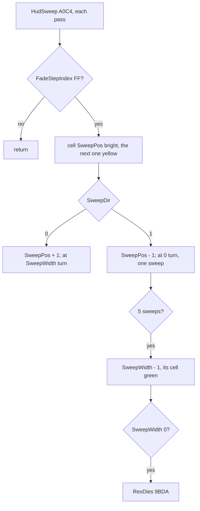

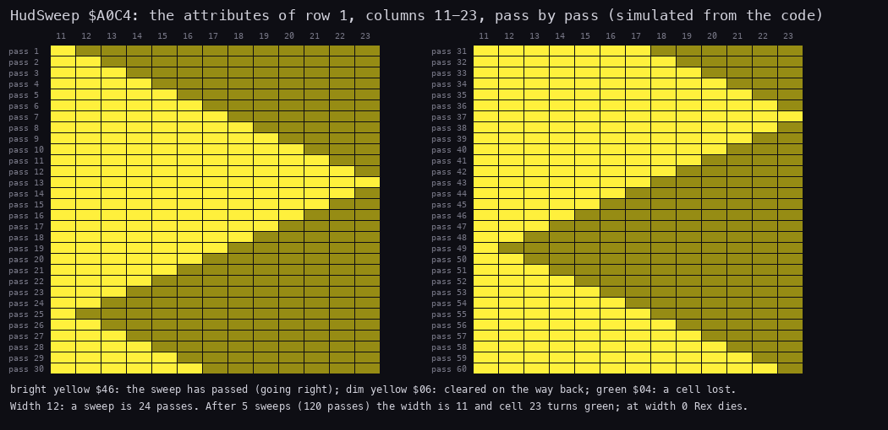

*Figure 8.5: HudSweep's attributes of row 1 over the first 60 passes after ResetSweep, simulated from the code above
(SweepPos 0, SweepDir 0, width 12). Command: `python3 tools/fig_hud.py sweep --out docs/img/hud/sweep.png`.*

How to read: one row a pass, one cell a column 11-23. The bright cells grow to the right for 12 passes, then the dim
ones come back from the right for 12. Every 24 passes is one sweep.

Worked example, from the code: a sweep at width w takes 2w passes. Five sweeps at each width from 12 down to 1 take
`10 x (12 + 11 + ... + 1) = 780` passes. At about 4.4 frames a pass that is about 3400 frames, 69 s. So Rex has about
a minute in one room before the sweep kills him. `p1-gameover` starts with SweepWidth poked to 2: the sweep killed
Rex before frame 500 (figure 8.9).

Witness: HudSweep L1 16927 (every pass of every recording); ResetSweep L1 116; RexDies through the sweep in
`p1-gameover` only.

The point: the sweep is a room timer drawn with attributes alone. Its pixels (`#`) are printed once.

## 8.7 The combo row and the power pod's flash

Row 2 of the HUD shows "100 200 300 ... 900" (the red pictures of the font, 8.2), on black ink: invisible until lit.

- HitObject `$D3C2` handles a hit. With the laser (Weapon 2) it kills at once; with the spray (Weapon 4) it scores
  nothing here. With the other weapons it sets ComboCount `$A03B` to 9, ComboTimer `$A03C` to 2, KillFlashPtr
  `$A039` to `$5843` (row 2, column 3: the "100") and adds 1 (100 points).
- HitObjectHard `$D41F` (each further hit on an armoured object) adds ComboTimer points (2, 3, ...), adds 1 to
  ComboTimer, and moves KillFlashPtr 3 columns on: "200", "300", ... ComboCount stops it after 8.
- KillFlashFade `$9992`, every pass, takes 1 off each of the 30 attributes `$5840-$585D` that are not 0, then writes
  `$07` (white) into the two cells at KillFlashPtr.
- KillObject and BuildRoom set KillFlashPtr to ObjectBufferOrigin `$E9FF`, a rest value below the back buffer.

So the value just scored shows white, and the ones before it fade through the colours to black in 7 passes.

FadeStep `$9A4C` is a short flash of HUD rows 0-1 (`$5800-$583F`, 64 cells). TakePowerPod `$D47D` starts it with
FadeStepIndex 0. FadeSteps `$9AB3` is `01 x 6, 00 x 5, 02 x 6, FF`: six passes of ink + 1 (to 7 at most), five of
ink - 1 (to 0 at least), six of "step toward the shadow" (ink + 1 until it equals SaveAttrs' copy). While it runs,
HudSweep and PowerBar wait.

```text
HitObject:      ComboCount = 9; ComboTimer = 2; KillFlashPtr = $5843; AddScore(1)
HitObjectHard:  if --ComboCount == 0: return
                AddScore(ComboTimer); ComboTimer += 1; KillFlashPtr += 3
KillFlashFade:  for a in $5840..$585D: if [a] != 0: [a] -= 1
                [KillFlashPtr] = [KillFlashPtr + 1] = $07
FadeStep:       if FadeStepIndex == $FF: return
                step = FadeSteps[FadeStepIndex]; if step == $FF: FadeStepIndex = $FF; return
                for 64 cells from $5800: up (1), down (0) or toward the shadow (2)
                FadeStepIndex += 1
```

```text
9992  21 40 58     KillFlashFade:  LD HL,$5840
9995  06 1E                        LD B,$1E
9997  7E           FadeHudLoop:    LD A,(HL)               ; each HUD attribute one step darker
9998  3D                           DEC A
9999  FE FF                        CP $FF
999B  CA 9F 99                     JP Z,FadeHudNext
999E  77                           LD (HL),A
999F  23           FadeHudNext:    INC HL                  ; the next cell
99A0  10 F5                        DJNZ FadeHudLoop
99A2  2A 39 A0                     LD HL,(KillFlashPtr)
99A5  36 07                        LD (HL),$07
99A7  23                           INC HL
99A8  36 07                        LD (HL),$07
99AA  C9                           RET
```

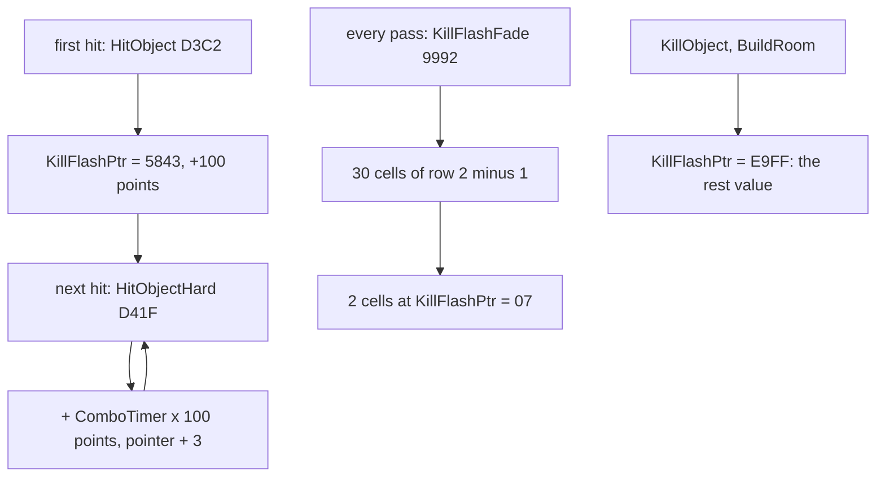

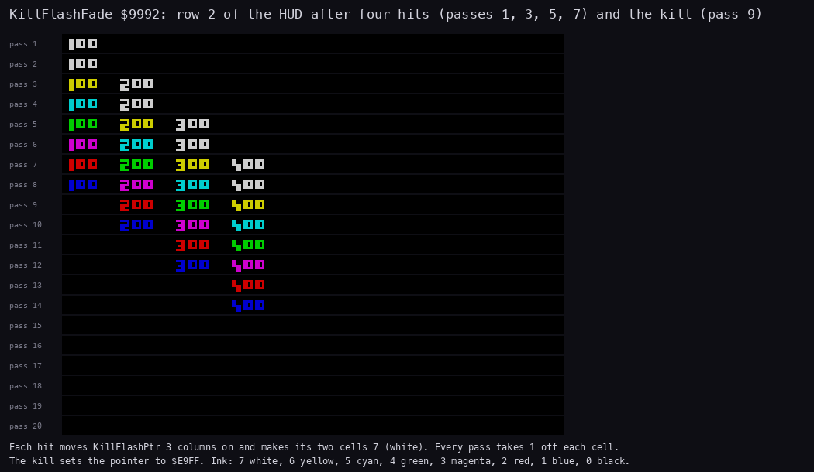

*Figure 8.6: row 2 of the HUD, columns 3-29, over 20 passes: hits on passes 1, 3, 5 and 7, the kill on pass 9.
Simulated from KillFlashFade's code and the font of `build/game.bin`. Command: `python3 tools/fig_hud.py combo --out
docs/img/hud/combo.png`.*

How to read: one row a pass. Each value is white when lit, then steps down the colours to black, one a pass. After
the kill the pointer rests off screen and the last value fades too.

Worked example: an armoured object takes four hits with the gun. The first scores 100 and lights "100"
(`$5843-$5844`). The second scores 200 and lights "200" (`$5846-$5847`). The third and fourth score 300 and 400. In
all, 1000 points. The latest value stays white; each earlier one loses one step of ink a pass, down to black.

Witness: HitObject L1 74 and HitObjectHard L1 89 (p1-room30, rzx-p1- x13-x20); KillFlashFade L1 16926 and FadeStep
L1 16926 (every pass); TakePowerPod L1 135.

Known only from the code:

- With KillFlashPtr at rest, KillFlashFade writes `$07` into `$E9FF` and `$EA00` every pass, outside the screen. The
  two bytes are below the back buffer and nothing reads them ([doc 6](06-rendering.md), 6.10).
- The source calls FadeStep "the screen flash of a smart bomb or a bonus". Only TakePowerPod starts it, and it covers
  only HUD rows 0-1.

The point: the combo row is a score display without digits: the pictures are fixed, and a pointer into the attribute
row says which one is lit.

## 8.8 Every string

Every text of the three programs is a PrintText record. The source keeps them as text files in `src/res/texts/`;
`work/docs/rxB/texts.py` lists them with their addresses. The tables give the address, attribute, column, line and
text; `:` prints as a dash.

REX 1 (`build/game.bin`):

| Address | Label | Attr | Col | Line | Text |
| --- | --- | --- | --- | --- | --- |
| `$AAAE` | GameTexts | `$46` | 7 | 80 | PHASE ONE:PROCEED |
| `$AAC3` | | `$46` | 7 | 88 | ON FOOT THROUGH |
| `$AAD6` | | `$46` | 7 | 96 | UNDERGROUND COMPLEX |
| `$AAED` | GameOverText | `$43` | 5 | 64 | GAME OVER |
| `$AAFA` | HiScoreText | `$45` | 7 | 96 | HI:SCORE 0000000 |
| `$AB0E` | HumansKilledText | `$45` | 9 | 128 | HUMANS KILLED:00000 |
| `$AB25` | PressFireText | `$44` | 4 | 112 | PRESS FIRE |
| `$AB33` | | `$44` | 4 | 120 | TO BEGIN |
| `$AB41` | BonusTexts | `$46` | 3 | 40 | SPEED UP |
| `$AB54` | | `$42` | 3 | 40 | SHIELD LOSS |
| `$AB67` | | `$46` | 3 | 40 | 1000 BONUS |
| `$AB7A` | | `$42` | 3 | 40 | ENERGY LOSS |
| `$AB8D` | | `$46` | 3 | 40 | 100 RAPID SHOTS |
| `$ABA2` | DoubleFire `$ABA0` + 2 | `$45` | 18 | 40 | DOUBLE FIRE |
| `$ABB3` | Laser `$ABB1` + 2 | `$45` | 3 | 40 | LASER |
| `$ABBE` | Multiple `$ABBC` + 2 | `$45` | 20 | 40 | MULTIPLE |
| `$ABCC` | Spray `$ABCA` + 2 | `$45` | 18 | 40 | SPRAY |
| `$A24C` | HudTexts | `$06` | 12 | 8 | ############ |
| `$A25C` | | `$06` | 12 | 0 | 0000000:99:3 |
| `$A26C` | | `$07` | 3 | 16 | the combo row: `]\ ^\ _\ @\ "\ $\ %\ &\ '\` |
| `$A884` | CodeText | `$06` | 6 | 80 | CODE: and 16 places (8.11) |
| `$DF05` | MenuTexts | `$06` | 21 | 144 | SELECT |
| `$DF11` | | `$05` | 21 | 152 | 1:DEFINE |
| `$DF1D` | | `$05` | 21 | 160 | 2:KEMPSTON |
| `$DF2B` | | `$05` | 21 | 168 | 3:CURSOR |
| `$DF37` | | `$05` | 21 | 176 | 4:SINCLAIR |
| `$DF45` | | `$04` | 9 | 128 | CONFIRM SINCLAIR Y.N |
| `$DF5D` | | `$04` | 9 | 128 | CONFIRM CURSOR Y.N |
| `$DF73` | | `$04` | 9 | 128 | CONFIRM KEMPSTON Y.N |
| `$DF8B` | | `$04` | 3 | 144 | CONFIRM KEYS Y.N |
| `$DF9F` | DefineTexts | `$07` | 15 | 88 | PRESS |
| `$DFA9-$DFD0` | | `$01` | 15 | 96-128 | :UP, :DOWN, :LEFT, :RIGHT, :FIRE (blue) |
| `$DFDA-$E001` | | `$06` | 15 | 96-128 | the same five in yellow, the prompt that waits |
| `$DC26-$DD3F` | RollCallTexts | `$44` / `$43` | 3 | 16 / 24 | the ten enemies and their PTS ([doc 5](05-controls.md), 5.2) |

The weapon panels and the bonus messages are drawn at line 40 in a box; the five bonus messages share one place, and
the roulette prints them in turn (BonusRoulette `$D4B6`, [doc 10](10-gameplay-logic.md)).

REX 2 (`build/rex2.bin`) has the same HUD (`$A3F4`), the same bonus and weapon records (`$ABFE-$AC88`) and the same
menu (`$DFC6-$E0B7`). Its own texts:

| Address | Attr | Col | Line | Text |
| --- | --- | --- | --- | --- |
| `$AAF7` | `$46` | 7 | 80 | PHASE TWO:ENTER |
| `$AB0A` | `$46` | 7 | 88 | THE LIVING TOWER |
| `$AB1E` | `$46` | 7 | 96 | TO REACH ZENITH |
| `$AB31` | `$43` | 3 | 64 | GAME OVER |
| `$AB3E` | `$45` | 5 | 96 | HI:SCORE 0000000 |
| `$AB52` | `$45` | 7 | 128 | BIO GROWTHS KILLED:00000 |
| `$AB6E` | `$45` | 6 | 80 | WITH THE BIG SQUIDGY |
| `$AB86` | `$45` | 6 | 88 | THING DESTROYED REX |
| `$AB9E` | `$45` | 6 | 96 | CAN GO HOME AND HAVE |
| `$ABB6` | `$45` | 6 | 104 | A NICE CUP OF TEA |
| `$ABCB` | `$45` | 6 | 112 | AND PUT HIS FEET UP |
| `$DCA7` | `$02` | 13 | 88 | INVALID CODE |
| `$DCB7` | `$02` | 13 | 96 | TRY AGAIN |
| `$DCC7` | `$06` | 3 | 112 | INPUT YOUR CODE |
| `$DCDA` | `$06` | 3 | 120 | USE CAPS TO DELETE: |
| `$DCF1`, `$DD0B` | `$05`, `$07` | 3 | 128, 64 | blank fields for the code ([doc 5](05-controls.md), 5.10) |

DEMO (`build/demo.bin`) has the HUD at `$9D41`, the bonus messages at `$A3D2`, and 107 tutor records at
`$A431-$AC75`: the weapon explanations, the tips and the credits. They are listed in full in
`src/res/texts/demo-tutor.txt`, with their addresses from `python3 work/docs/rxB/texts.py demo-tutor`. Four of them
are weapon panels, [flag][count][records]: APA:150 MKII `$A5E1` (4 records), TUSK LASER MKIV `$A623` (5), REMOTE
DRONE `$A682` (5), MULTI:DIRECTIONAL `$A6E5` (4).

The tutor's records (`build/demo.bin`; line in pixels; the four panels shown with their flag and count):

```text
address  attr col line  text
$A431    $45   14   40   REX MUST FIRST
$A443    $45   14   48   COLLECT WEAPONS
$A456    $45   14   56   FROM THE PODS
$A467    $45   15   40   AN EXTRA BONUS
$A479    $45   15   48   IS AWARDED FOR
$A48B    $45   15   56   RAPID HITS ON
$A49C    $45   15   64   THE SOLDIERS
$A4AC    $45   16   40   THE LASER CAN
$A4BD    $45   16   48   KILL A ROW OF
$A4CE    $45   16   56   THE ENEMY
$A4DB    $45   10  104   REX STARTS WITH
$A4EE    $45   10  112   THE STANDARD ISSUE
$A504    $45   10  120   APA:150 MACHINE GUN
$A51B    $46   10  128   AS WITH THE MKII
$A52F    $46   10  136   VERSION POWER MAKES
$A546    $46   10  144   THE GUN MORE RAPID
$A55C    $45    3   96   EACH WEAPON HAS A
$A571    $45    3  104   POWER STATUS FROM:
$A587    $03    3  112   PINK:LOW UP TO
$A599    $07    3  120   WHITE: HIGH
$A5A8    $45    3  128   THE POWER AFFECTS
$A5BD    $45    3  136   EACH WEAPON IN
$A5CF    $45    3  144   DIFFERENT WAYS
$A5E1    panel: flag 00, 4 records
$A5E3    $45   15   40   APA:150 MKII
$A5F3    $45   15   48   A DUEL SHOT
$A602    $45   15   56   VERSION OF THE
$A614    $45   15   64   OLD APA MKI
$A623    panel: flag 00, 5 records
$A625    $45    3   40   TUSK LASER MKIV
$A638    $45    3   48   USED IN THE GREAT
$A64D    $45    3   56   LIFE WARS
$A65A    $46    3   64   MORE POWER GIVES
$A66E    $46    3   72   GREATER DISTANCE
$A682    panel: flag 00, 5 records
$A684    $45   10   40   REMOTE DRONE
$A694    $45   10   48   OFFENSIVE SYSTEM
$A6A8    $45   10   56   INCORPORATING
$A6B9    $45   10   64   BI:DIRECTIONAL FIRE
$A6D0    $46   10   72   POWER ADDS DRONES
$A6E5    panel: flag 00, 4 records
$A6E7    $45    3   40   MULTI:DIRECTIONAL
$A6FC    $45    3   48   SPRAY PROJECTILE
$A710    $45    3   56   LAUNCHER THE ULTIMATE
$A729    $45    3   64   IN PERSONAL DEFENCE
$A740    $46    3   40   3 WAY SPRAY
$A74F    $46    3   40   5 WAY SPRAY
$A75E    $46    3   40   7 WAY SPRAY
$A76D    $46    3   40   4 DIRECTIONAL SPRAY
$A784    $46    3   40   FULL 8 WAY SPRAY
$A798    $45   11   40   YOUR SHIELD CAN
$A7AB    $45   11   48   BE USED TO DESTROY
$A7C1    $45   11   56   THE ENEMY AND
$A7D2    $45   11   64   DEFLECT BULLETS
$A7E5    $45    9   40   COLLECT THE BUBBLES
$A7FC    $45    9   48   DROPPED BY THE ENEMY
$A814    $45    9   56   TO INCREASE YOUR
$A828    $45    9   64   WEAPONS ENERGY
$A83A    $45    3   40   USE BEAM:PADS TO
$A84E    $45    3   48   RECORD POSITION
$A862    $45    3   40   STAND ON DISC TO
$A876    $45    3   48   CHARGE YOUR SHIELD
$A88C    $45    3   96   PICK UP QUESTION
$A8A0    $45    3  104   MARKS FOR A SKILL
$A8B5    $45    3  112   BONUS:USE FIRE
$A8C7    $45    3  120   TO SELECT
$A8D4    $45    3  112   SOME WALLS CAN
$A8E6    $45    3  120   BE SHOT THROUGH
$A8F9    $45    3   40   ARROWS SUGGEST EXITS
$A911    $45    3   48   FROM SCREEN:BUT LOOK
$A929    $45    3   56   FOR SECRET PASSAGES
$A940    $42   11  144   BEWARE OF SCANNERS
$A956    $45   11  152   THEY DETECT ANY
$A96C    $45   11  160   MOVEMENT IN THE
$A97F    $45   11  168   AREAS SHOWN
$A98E    $45    3   40   IF REX FALLS DOWN
$A9A3    $45    3   48   A SCREEN WITHOUT AN
$A9BA    $45    3   56   EXIT HE IS FORCED
$A9CF    $45    3   64   TO BEAM OUT
$A9DE    $45    3  152   AFTER TELEPORTATION
$A9F5    $45    3  160   REX IS TAKEN TO THE
$AA0C    $45    3  168   LAST BEAM:PAD
$AA1D    $45    3  136   SMART BOMBS CAN
$AA30    $45    3  144   KILL ALL THE ENEMIES
$AA48    $45    3  152   ON THE SCREEN:EXTRA
$AA5F    $45    3  160   ONES ARE SOMETIMES
$AA75    $45    3  168   LEFT BY THE ENEMY
$AA8A    $44    3   40   YOU ARE ABOUT TO
$AA9E    $44    3   48   SEE A DEMO OF REX
$AAB3    $44    3   56   THE DEBUT GAME BY
$AAC8    $07    3   64      THE LIGHT
$AAD8    $43    3   72   SPACE:PAUSES DEMO
$AAED    $44    5   88   FIRST A SHORT
$AAFE    $44    5   96   PROLOGUE OF HOW REX
$AB15    $44    5  104   INFILTRATED THE TOWER
$AB2E    $44    5  112   THROUGH THE HIDDEN
$AB44    $44    5  120   UNDERGROUND RIVER
$AB59    $44    7   88   NEXT AN EXPLANATION
$AB70    $44    7   96   OF THE FIVE WEAPON
$AB87    $44    7  104   SYSTEMS REX CAN USE
$AB9E    $44    5   88   YOU HAVE NOW SEEN THE
$ABB7    $44    5   96   HARDWARE:NOW THE EFFECT
$ABD2    $44    5  104   IT HAS ON THE ENEMY
$ABE9    $44    6   80   AND FINALLY A FEW
$ABFE    $44    6   88   GUIDELINES ON HOW
$AC13    $44    6   96   REX CAN MAKE THE BEST
$AC2C    $44    6  104   OF HIS SUROUNDINGS
$AC42    $44    3   40     ALL SOFTWARE
$AC54    $44    3   48   SOUND AND VISION
$AC68    $44    3   56          BY
$AC75    $07    3   64       THE LIGHT
```

```text
record     = attr, column, line, chars..., 0
panel      = flag, count, record x count        # WeaponPanel $D871: shown while flag is 0, then flag = $FF
```

```text
D871  7E           WeaponPanel:    LD A,(HL)
D872  B7                           OR A
D873  C0                           RET NZ
D874  36 FF                        LD (HL),$FF
D876  23                           INC HL
D877  7E                           LD A,(HL)
D878  23                           INC HL
; ...
D884  CD A3 D8                     CALL SaveScreen
D887  47                           LD B,A
D888  CD 3E A1                     CALL PrintBoxed
```

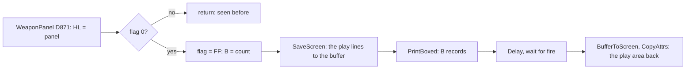

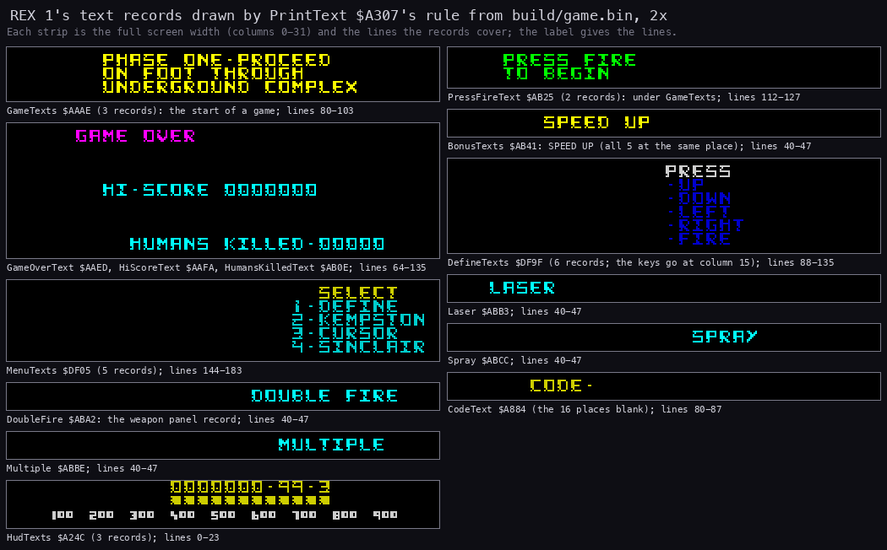

*Figure 8.7: REX 1's text records drawn from `build/game.bin` by PrintText's rule (8.3), each group in its own strip,
2x. Command: `python3 tools/fig_hud.py texts --out docs/img/hud/texts.png`.*

How to read: each strip is the full width of the screen and the lines its records cover. The colours are the
records' attributes on black. The colons show as dashes. The four weapon panels share line 40, as do the five bonus
messages, so they are drawn apart.

Worked example: the weapon panel DoubleFire `$ABA0` is `00 01 45 12 28` "DOUBLE FIRE" 0. The flag is 0 (not yet
shown), the count 1, then one record: attribute `$45` (bright cyan), column 18, line 40. The text file
`src/res/texts/rex1-game.txt` parses it one byte early, as attribute `$01`, column 69, line `$12` and the text
"(DOUBLE FIRE": the `(` is the line byte `$28`.

Witness: WeaponPanel L1 95 (rzx-p1- x8); BonusRoulette L1 2 (rzx-p1-50000, rzx-p1-56000); the menu and DEFINE texts
in c1 and p1-define ([doc 5](05-controls.md)).

The point: all the game's words, over 200 records, are data in one format. A panel is a count and some records,
and the flag in front makes a weapon panel appear once a game.

## 8.9 Menus and panels in play

The menu, the roll call, DEFINE and the confirm boxes are PrintBoxed calls on MenuTexts, RollCallTexts and
DefineTexts; [doc 5](05-controls.md) shows them working (5.2, 5.5). In play, four kinds of panel stop the game:

| Panel | Printed by | When | The play area after it |
| --- | --- | --- | --- |
| PHASE ONE, then PRESS FIRE / TO BEGIN | NewGame `$955E`, `$956A` | a new game | the first room is built |
| a weapon panel | WeaponPanel `$D871` | the first time a weapon is taken | BufferToScreen, CopyAttrs |
| the bonus roulette | BonusRoulette `$D4B6` | a bonus pod | restored the same way |
| GAME OVER | GameOver `$9CBF` | no life left | NewGame |

The panels in play are drawn over the screen. SaveScreen `$D8A3` first copies the 168 play lines into the back
buffer, through ScreenLines `$AC0D`. After the panel, BufferToScreen and CopyAttrs put the room back.

```text
NewGame:   ClearScreen; DrawHud; ShowLives; SaveAttrs
           PrintBoxed(GameTexts, 3); WaitFireOrAttract
           PrintBoxed(PressFireText, 2); WaitFireOrAttract
           if Temp1 == 0: Attract                      # no fire in time: the attract mode
```

```text
955E  DD 21 AE AA                  LD IX,GameTexts
9562  06 03                        LD B,$03
9564  CD 3E A1                     CALL PrintBoxed
9567  CD C3 97                     CALL WaitFireOrAttract
956A  DD 21 25 AB                  LD IX,PressFireText
956E  06 02                        LD B,$02
9570  CD 3E A1                     CALL PrintBoxed
9573  CD C3 97                     CALL WaitFireOrAttract
```

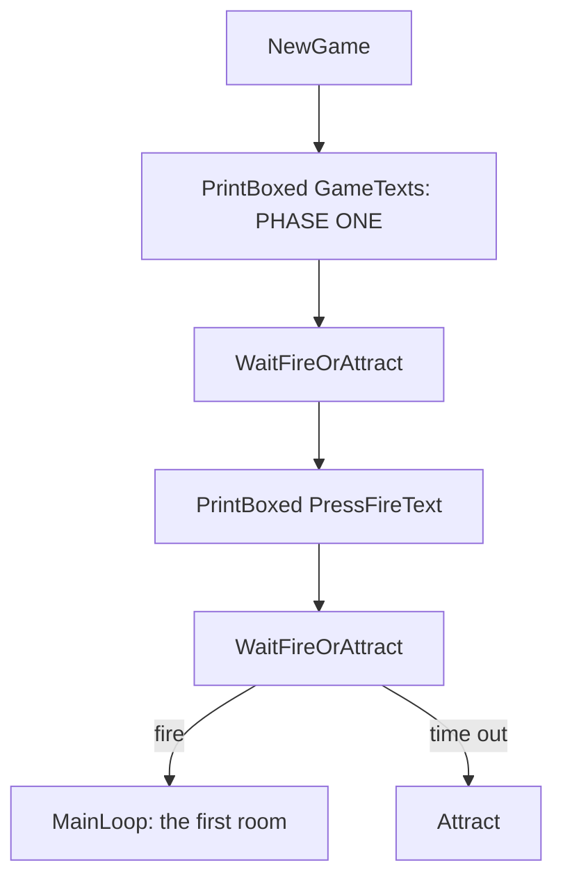

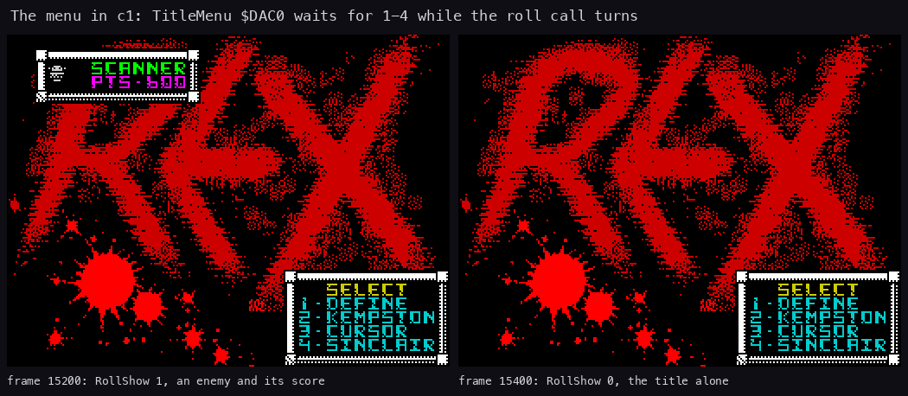

*Figure 8.8: the menu in `c1`, TTD frames 15200 and 15400 (T 0): MenuTexts and a RollCallTexts pair, each printed by
PrintBoxed in its frame. Command: `python3 tools/fig_controls.py shots --work work/docs/rxB/c1 --shot "15200=..."
--shot "15400=..." --title "..." --out docs/img/controls/menu.png` ([doc 5](05-controls.md), figure 5.2).*

How to read: left, the SCANNER box of the roll call at the top left and the menu box at the bottom right; right, the
title alone with the menu box, which is part of the saved title.

The start panels are the frames of animation 8.1: PHASE ONE at line 80, PRESS FIRE under it at line 112, each in its
own box.

Worked example (`p1-cursor`): the PHASE ONE panel is on screen before frame 335; PrintBoxed draws PRESS FIRE in frame
335 from T 9000, the box first and then 20 characters. The game waits for fire: in `p1-cursor` the room is built
from frame 400 ([doc 6](06-rendering.md), 6.3).

Witness: PrintBoxed L1 41 over c1, p1-code, p1-cursor, p1-define, p1-gameover, p1-kempston and seven rzx-p1-
segments.

The point: in play, a panel saves the play area into the back buffer, which is free between passes, so it needs no
memory of its own.

## 8.10 Game over and the high score

GameOver `$9CBF` runs when a life is lost with none left:

1. If Score is greater than HiScore `$A08B`, HiScore = Score.
2. It prints GameOverText, HiScoreText and HumansKilledText, each with PrintBoxed and B = 1.
3. It prints HumansKilled `$A089` (5 digits, units at line 128, column 27) and HiScore (5 digits, units at line 96,
   column 20) over the zeros of the texts. HiScore's two last zeros stay from the text.
4. It waits for fire and starts NewGame.

GameEntry sets HiScore to 10 (1000 points) once, at the load. It lives only in memory: a reload resets it.

```text
GameOver:
    if Score > HiScore: HiScore = Score
    PrintBoxed(GameOverText, 1); PrintBoxed(HiScoreText, 1); PrintBoxed(HumansKilledText, 1)
    ToDigits(HumansKilled); PrintDigits(line 128, column 27, 5)
    ToDigits(HiScore);      PrintDigits(line 96, column 20, 5)
    WaitFire(); NewGame()
```

```text
9CBF  ED 5B 3E A0  GameOver:       LD DE,(Score)
9CC3  2A 8B A0                     LD HL,(HiScore)
9CC6  A7                           AND A
9CC7  ED 52                        SBC HL,DE
9CC9  D2 D0 9C                     JP NC,GameOverTexts
9CCC  ED 53 8B A0                  LD (HiScore),DE
9CD0  DD 21 ED AA  GameOverTexts:  LD IX,GameOverText      ; the game over panel's texts
; ...
9CEB  2A 89 A0                     LD HL,(HumansKilled)
9CEE  CD 02 A4                     CALL ToDigits
9CF1  1E 1B                        LD E,$1B
9CF3  2E 80                        LD L,$80
9CF5  06 05                        LD B,$05
9CF7  CD C8 A3                     CALL PrintDigits
```

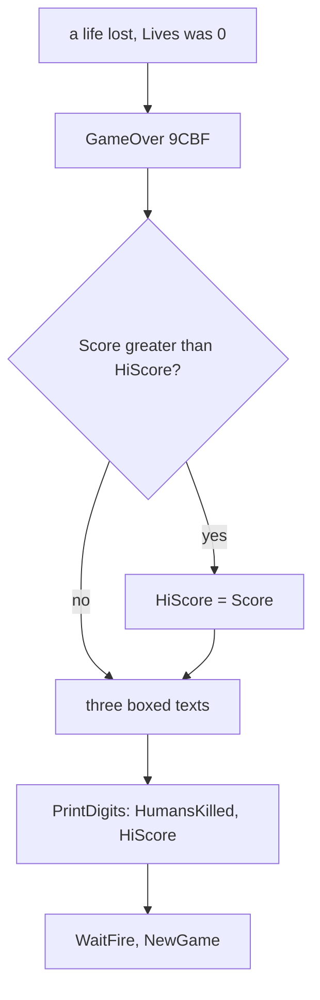

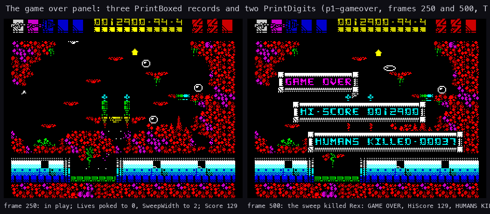

*Figure 8.9: `p1-gameover` at frames 250 and 500 (T 0). Command: `python3 tools/fig_controls.py shots --work
work/docs/rxB/pgo --shot "250=..." --shot "500=..." --title "..." --out docs/img/hud/game-over.png`.*

How to read: left, play with Lives poked to 0; the HUD still shows the old lives digit, because the poke did not call
ShowLives. Right, after the sweep killed Rex: the three boxes, HI:SCORE 0012900 and HUMANS KILLED 00037.

Worked example: at frame 500, Score `$A03E` = `$0081` = 129 and HiScore = 129: the score beat the start value of 10,
so HiScore took it. PrintDigits wrote "00129" at columns 16-20 of line 96; the text's "00" at columns 21-22 make
0012900. HumansKilled = `$0025` = 37, printed at columns 23-27 of line 128.

Witness: `p1-gameover` (the stage 2 recording made for it: GameOver once, frame 500 the panel).

The point: the high score is one word in memory, compared and printed with the score's own routines.

## 8.11 The CODE panel

When Rex leaves part 1 by the exit to room 99, ChangeRoom `$C95A` jumps to CodePanel `$A7CE`. It writes 16 ASCII
digits into the places of CodeText (CodeDigits `$A88C-$A89B`), prints the panel, waits for fire and starts a new
game. The code carries the game into REX 2, which reads it back ([doc 5](05-controls.md), 5.10).

The places, in the order of the panel:

| Place | 0 | 1 | 2 | 3 | 4 | 5 | 6 | 7 | 8 | 9 | 10 | 11 | 12 | 13 | 14 | 15 |
| --- | --- | --- | --- | --- | --- | --- | --- | --- | --- | --- | --- | --- | --- | --- | --- | --- |
| Value | double fire | score 1000s | spray | lives | laser | score 100s | multiple | score 1s | shield 1s | score 10s | bombs | shield 10s | score 10000s | sum 1s | sum 100s | sum 10s |

Places 0-12 hold each value v as the digit `9 - v`. Places 13-15 hold the sum of those 13 written digits, as plain
digits in the order units, hundreds, tens. The score places are the digits of Score, which is in hundreds.

```text
CodePanel:
    s = digits(Score)                      # units first
    place[12], place[1], place[5], place[9], place[7] = s[4], s[3], s[2], s[1], s[0]
    place[3] = digits(Lives)[0]
    place[0], place[4], place[6], place[2] = '0' + HasDoubleFire, HasLaser, HasMultiple, HasSpray
    e = digits(ShieldEnergy); place[11], place[8] = e[1], e[0]
    place[10] = digits(Bombs)[0]
    sum = 0
    for i in 0..12: place[i] = '0' + 9 - (place[i] - '0'); sum += 9 - v
    t = digits(sum); place[14], place[15], place[13] = t[2], t[1], t[0]
    PrintBoxed(CodeText, 1); WaitFire(); NewGame()
```

```text
A845  06 0D                        LD B,$0D
A847  1E 00                        LD E,$00
A849  22 93 A0                     LD (Temp1),HL
A84C  21 8C A8                     LD HL,CodeDigits
A84F  4E           CodeDigitsLoop: LD C,(HL)               ; each digit: 9 - digit, the checksum summed
A850  3E 39                        LD A,$39
A852  91                           SUB C
A853  C6 30                        ADD A,$30
A855  77                           LD (HL),A
A856  D6 30                        SUB $30
A858  83                           ADD A,E
A859  5F                           LD E,A
A85A  23                           INC HL
A85B  10 F2                        DJNZ CodeDigitsLoop
A85D  6B                           LD L,E
A85E  26 00                        LD H,$00
A860  CD 02 A4                     CALL ToDigits
A863  3A A8 A0                     LD A,(Digits+$0002)
A866  32 9A A8                     LD (CodeDigits+$000E),A
A869  3A A7 A0                     LD A,(Digits+$0001)
A86C  32 9B A8                     LD (CodeDigits+$000F),A
A86F  3A A6 A0                     LD A,(Digits)
A872  32 99 A8                     LD (CodeDigits+$000D),A
```

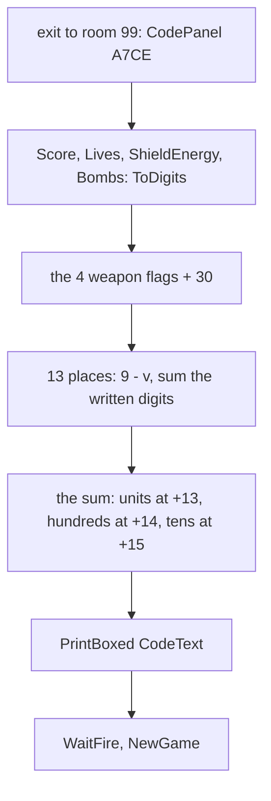

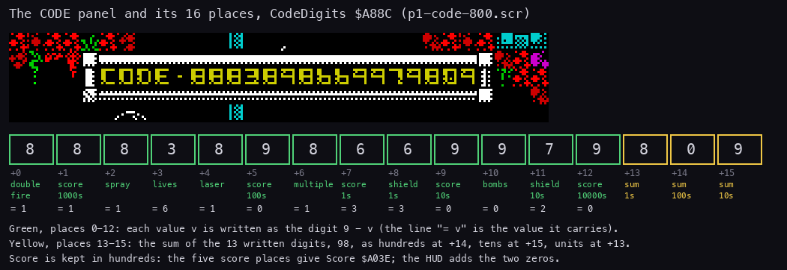

*Figure 8.10: the CODE panel of `p1-code` at frame 800 (T 0) and its 16 places with what each carries. Command: `python3
work/docs/rxB/dumpscr.py work/docs/rxB/pcode 800 work/docs/rxB/p1-code-800.scr`, then `python3 tools/fig_hud.py code
--scr work/docs/rxB/p1-code-800.scr --digits 8883898669979809 --out docs/img/hud/code.png`.*

How to read: the top is the screen at 3x. Below, one box a place: the digit on screen, the place number, what it
carries and, for places 0-12, the value v it encodes.

Worked example (`p1-code`; CodePanel ran between frames 707 and 708). At frame 707 the memory holds Score `$03EB` =
1003 (100 300 points), Lives 6, ShieldEnergy `$17` = 23, Bombs 0, and all four weapons. So:

- score 10000s, 1000s, 100s, 10s, 1s = 0, 1, 0, 0, 3: places 12, 1, 5, 9, 7 = `9`, `8`, `9`, `9`, `6`;
- lives 6: place 3 = `3`; bombs 0: place 10 = `9`; shield 2 and 3: places 11 and 8 = `7`, `6`;
- the four weapons 1: places 0, 2, 4, 6 = `8`;
- the 13 written digits `8 8 8 3 8 9 8 6 6 9 9 7 9` sum to 98: place 13 = `8`, place 14 = `0`, place 15 = `9`.

The panel reads `CODE-8883898669979809`, as figure 8.10 shows.

Witness: CodePanel L1 1 (`p1-code`: room 31's exit to 99, the panel, fire, a new game in room 1).

Known only from the code:

- The source's header comment gives the order "double fire, the score's five digits, the laser, the lives, ...".
  The code writes the order of the table above.
- The checksum is the sum of the written digits, not of the values. Its three digits are not inverted, and their
  order is units, hundreds, tens.

The point: the code is a save game in 16 digits. The inversion and the shuffled order hide the values from a casual
reader; the checksum catches a typing error, not a deliberate change: any edit that keeps the sum passes.

## 8.12 Known only from the code

- **A text off a character row** (8.3) gets the attribute of its upper row only. No record uses it.
- **The score wraps** past 65 535 hundreds (6 553 500 points) to 0 (8.4).
- **SpritePowerBar `$8CFF`** is the shadow-to-screen distance, not a picture (8.5).
- **The sweep's time limit** of about 780 passes in a room (8.6): no recording lets it run out at full width.
- **KillFlashFade's rest writes** to `$E9FF-$EA00` (8.7).
- **FadeStep** is started only by TakePowerPod, not by the smart bomb or a bonus (8.7).
- **The CODE panel's order and checksum** (8.11).
- **The weapon panel records** are [flag][count][records]; the text file reads them one byte early (8.8).
