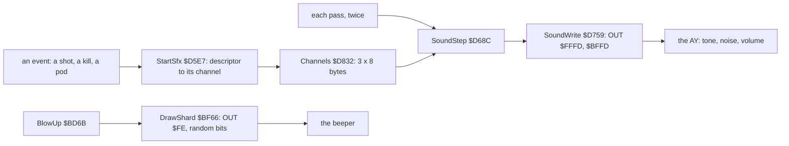
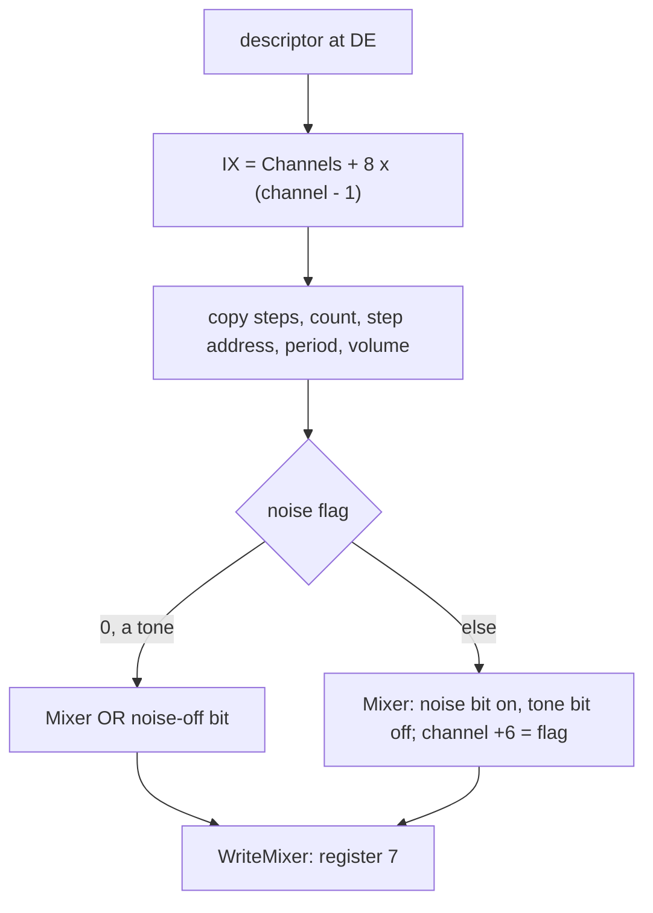
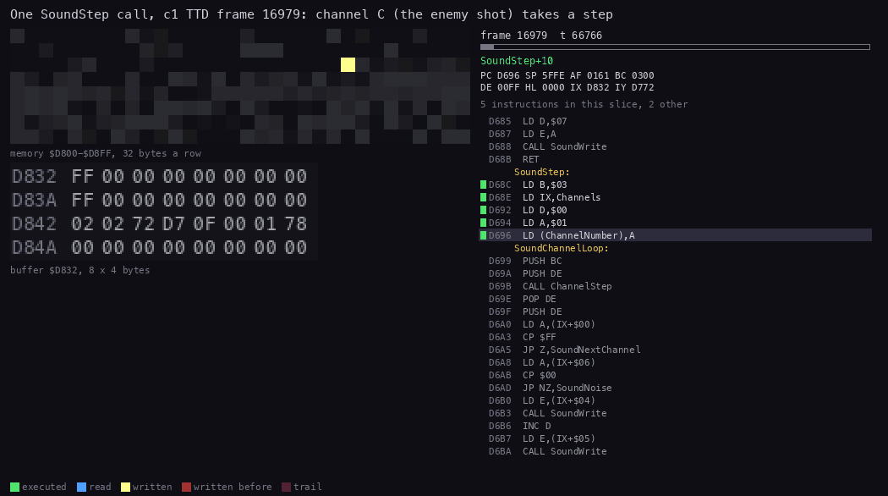
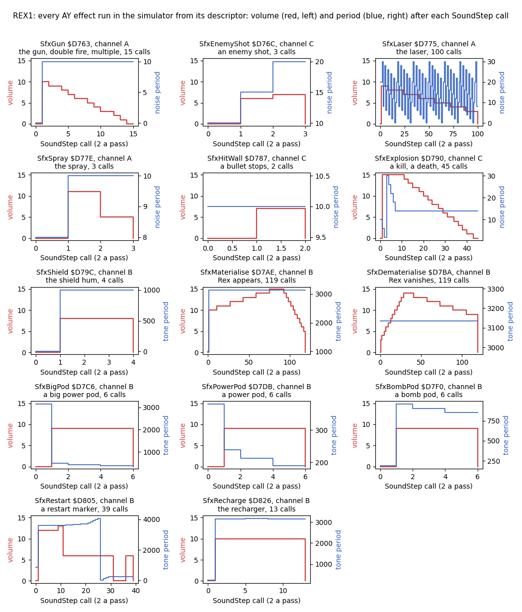
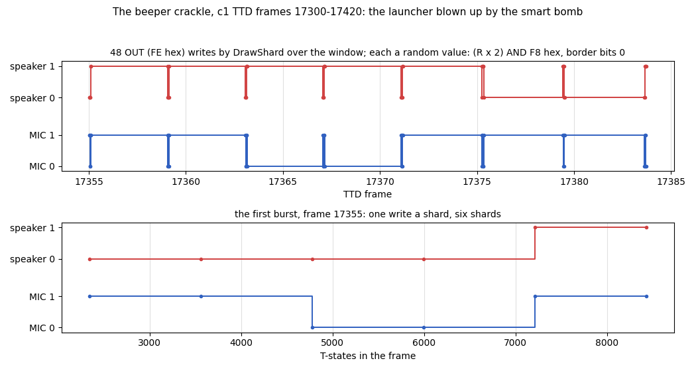
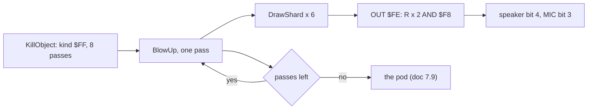
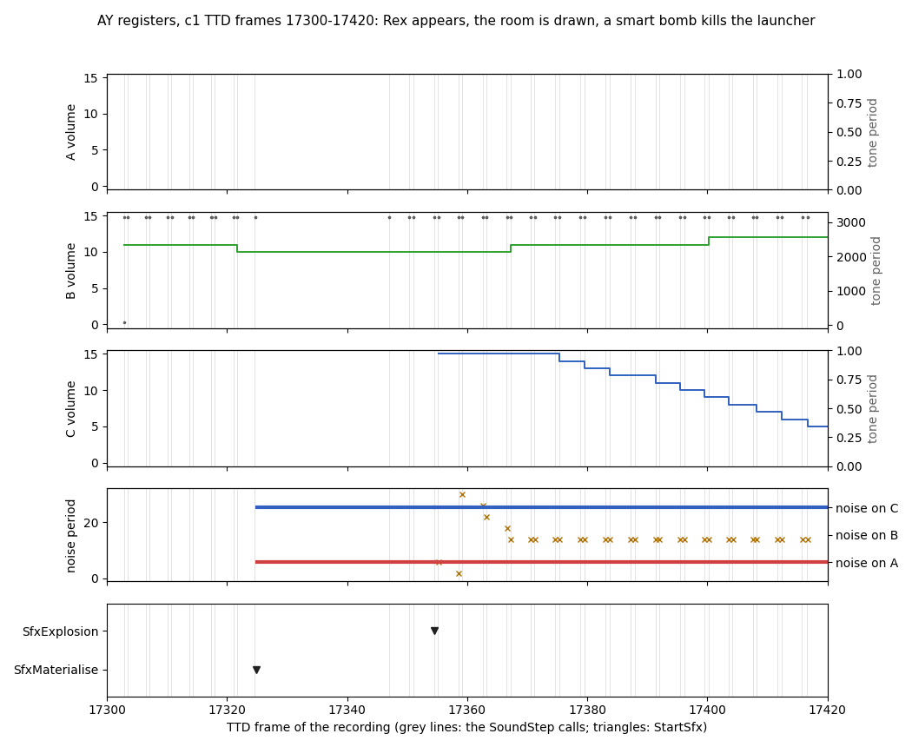

# 9. Sound

What this covers: every sound Rex makes and the code that makes it.

- All the game's sound but one is the AY: 14 effects in REX 1 and REX 2, 15 in DEMO, each a small descriptor.
- One driver plays them: StartSfx puts an effect on its channel, SoundStep moves the three channels one step, twice a
  main loop pass.
- The one sound that is not the AY is the crackle of an explosion: random bits on the border port.
- There is no music player and no tune. No routine tests for an AY.

The recordings it rests on (WALKTHROUGH 4.0):

- `c1`: our own play of part 1 from power-on. It was opened on an own instance after `. work/env.sh`:
  `python3 ../../kit/rs.py open --work work/docs/rxC/c1 --ttd work/stage1/c1/session.ttd --model 128K --port-base 37790`.
  Channels `$D832-$D856` were sampled at every TTD frame 15 000-20 470 by `work/docs/rxC/sample.py`
  (`work/docs/rxC/c1/vars.jsonl`). Two windows were traced with `kit/kitlib.py` (`load_trace`, kept in
  `work/docs/rxC/c1/traces/`): TTD frames 16 976-16 990 (the enemy shots in room 1) and 17 300-17 420 (Rex appears,
  the room is drawn, a smart bomb kills the launcher). TTD frame N is input frame N - 15 000 of `tests/inputs/c1.txt`.
- `rzx-p1-04000`: the RZX run of part 1 from its frame 4000, opened the same way into `work/docs/rxC/r04` (`--ttd
  work/stage1/rec/rzx-p1-04000/session.ttd`). Four windows were traced: frames 0-14 (the recharger), 440-452 (the
  double fire), 1086-1100 (a death) and 1522-1534 (a big pod taken).
- `tools/sound_sim.py`: each descriptor run in SkoolKit's Z80 simulator through the game's own SoundReset, StartSfx and
  SoundStep, from the case's build (`build/game.bin`, `build/demo.bin`). It writes the tables, the figures and the
  WAV renders of this document. The renders are written, never played.

A sample of frame N is the memory at the start of frame N. A trace shows an instruction in the frame in which it ran.

## 9.1 The hardware and what a 48K hears

Every AY write goes through SoundWrite `$D759`: register D, value E.

```asm
SoundWrite:
  LD BC,$FFFD
  OUT (C),D               ; select the register
  LD B,$BF
  OUT (C),E               ; write it at $BFFD
  RET
```

No routine reads the AY back or tests for it. On a 48K Spectrum the two OUTs reach no device. The game runs the same
and plays silent but for the crackle of the explosions (9.6). The menu offers no sound option.

| Effect source | Channel | Port | Who |
| --- | --- | --- | --- |
| the 14 effects (9.4) | A, B, C | `$FFFD`, `$BFFD` | StartSfx, SoundStep |
| the explosion crackle | the beeper (bit 4) and MIC (bit 3) | `$FE` | DrawShard `$BF66` |



Worked example: the first enemy shot of `c1` TTD frame 16 976 writes, in order, register 7 (the mixer) = `$1C`, then
register 10 = 6, register 10 = 6 and register 6 = `$0F` (from the trace). A 48K machine runs the same eight OUTs to
ports that answer nothing.

**The point**: one tiny routine is the game's whole access to the AY, and nothing checks the AY is there.

Witness: SoundWrite L1 counts in `src/game/sound.asm`; the port writes of the `c1` trace of TTD frames 16 976-16 990.

## 9.2 The effect descriptor, byte by byte

An effect is a descriptor of 6 bytes, then its steps, 3 bytes each (`src/res/sound/rex1-effects.txt`):

| Byte | Field | Values |
| --- | --- | --- |
| +0 | channel | 1 A, 2 B, 3 C |
| +1 | noise | 0 a tone, else noise |
| +2 | steps | how many steps follow |
| +3 | volume x 16 | the start volume in 4.4 fixed point: `$AA` is 10 and 10/16 |
| +4, +5 | period | the start tone period (or noise period, its low byte), a word |
| +6 .. | steps | [count][period change, signed][volume change, signed x 16] |

A step lasts `count` SoundStep calls. Each call adds the period change to the period and the volume change to the
volume. When the count runs out, the next step starts. After the last step the channel goes silent and free.

The 14 descriptors of REX 1 (REX 2's are the same bytes):

```text
SfxGun          1 $01 1 $AA $000A | $0F $00 $F4
SfxEnemyShot    3 $01 2 $64 $000A | $03 $05 $14
SfxLaser        1 $01 1 $96 $000A | $64 $0A $FF
SfxSpray        1 $01 1 $B8 $000A | $03 $00 $9C
SfxHitWall      3 $01 1 $78 $000A | $02 $00 $F0
SfxExplosion    3 $01 2 $FF $000A | $08 $3C $00 | $26 $00 $F9
SfxShield       2 $00 1 $82 $03E8 | $04 $00 $00 | (9.7: 9 bytes no effect plays)
SfxMaterialise  2 $00 2 $A6 $9C40 | $5A $00 $01 | $1E $00 $FA
SfxDematerialise 2 $00 2 $3C $9C40 | $1E $00 $06 | $5A $00 $FF
SfxBigPod       2 $00 5 $96 $01DE | $02 $00 $00 | $02 $CC $00 | $02 $00 $00 | $02 $D1 $00 | $02 $00 $00
SfxPowerPod     2 $00 5 $96 $00EF | $02 $00 $00 | $02 $E6 $00 | $02 $00 $00 | $02 $E9 $00 | $02 $00 $00
SfxBombPod      2 $00 5 $96 $03BC | $02 $00 $00 | $02 $CA $00 | $02 $00 $00 | $02 $CD $00 | $02 $00 $00
SfxRestart      2 $00 9 $C8 $4E20 | $0A $00 $01 | $02 $00 $9C | $02 $00 $00 | $0A $0A $FF | $0A $46 $00 | $02 $00 $9C | $05 $00 $00 | $02 $04 $64 | $04 $00 $00
SfxRecharge     2 $00 2 $A0 $9C40 | $07 $05 $01 | $07 $FB $FF
```

Worked example: SfxEnemyShot `$D76C`, `03 01 02 64 0A 00 | 03 05 14`.

| Bytes | Reading |
| --- | --- |
| `03` | channel C |
| `01` | noise |
| `02` | two steps |
| `64` | volume 6 and 4/16 |
| `0A 00` | noise period 10 |
| `03 05 14` | step 1: 3 calls, period + 5, volume + 1 and 4/16 |
| (`01 01 01`) | step 2: the first 3 bytes of the next descriptor, SfxLaser |

The descriptor says two steps but holds one. Its second step is read from SfxLaser's head: 1 call, period + 1, volume
+ 1/16. A step of 1 call ends in the call that starts it, so the borrowed step only writes the volume once more and
the effect ends. The trace of `c1` frames 16 976-16 980 shows the result: register 10 (C's volume) 6, then 7, then 8,
then 0; the noise period `$0F`, then `$14`.

**The point**: an effect is a start value and a few linear ramps; one 3-byte step can last 100 calls.

Witness: the descriptors are read by StartSfxIY in every recording with play; the `c1` trace of TTD frames
16 976-16 990.

## 9.3 StartSfx: an effect onto its channel

StartSfx `$D5E7` takes the descriptor's address in DE and keeps IX, IY and BC. StartSfxIY copies it into the
channel's 8 bytes and sets the mixer:

| Channel byte | Field |
| --- | --- |
| +0 | steps left; `$FF` the channel is free |
| +1 | calls left in this step |
| +2, +3 | the step's address |
| +4, +5 | the period, a word |
| +6 | noise flag |
| +7 | the volume x 16 |

Channels `$D832` holds A, B and C one after the other; Mixer `$D855` keeps register 7's value; ChannelNumber `$D856`
is SoundStep's loop count.

```asm
StartSfxIY:
  LD A,(IY+$00)
  DEC A
  SLA A
  SLA A
  SLA A
  LD C,A
  LD B,$00
  LD IX,Channels
  ADD IX,BC               ; IX = Channels + 8 x (channel - 1)
  LD A,(IY+$02)
  LD (IX+$00),A           ; steps
  LD A,(IY+$06)
  LD (IX+$01),A           ; the first step's count
  ...                     ; +2/+3 = IY + 6, +4/+5 = the period, +7 = the volume
  LD A,(IY+$01)
  CP $00
  JP NZ,SfxMixerBits      ; noise
  LD B,(IY+$00)
  LD C,$04
SfxMixer:
  SLA C
  DJNZ SfxMixer           ; C = 8, 16 or 32: the channel's noise-off bit
  LD A,(Mixer)
  OR C
  LD (Mixer),A
  JP WriteMixer
SfxMixerBits:
  ...                     ; channel 1: RES 3 (noise on A), SET 0 (tone off A); 2: bits 4, 1; 3: bits 5, 2
```

A new effect on a busy channel replaces the old one. There is no priority. A few callers check first: the enemy shot
and a bullet's stop only start when channel C is free, and the shield hum only when B is free.

The mixer starts at `$38` (SoundReset): three tones on, three noises off. A tone effect sets its channel's noise-off
bit. A noise effect clears its noise-off bit and sets its tone-off bit. Nothing turns a tone back on. That is safe
only because each channel keeps one kind: A and C play only noise, B only tones (9.4).



Worked example: the mixer in `c1`. The first enemy shot in room 1 (TTD frame 16 976, channel C, noise) writes
register 7 = `$1C`: bits 2, 3 and 4 set, so tone C off and noise A and B off; noise C and tones A and B on. Rex's gun
(channel A, noise) later clears bit 3 and sets bit 0: `$15`. The explosion of TTD frame 17 354 (channel C, noise)
clears bit 5 and sets bit 2, which are already so: it writes `$15` again. From then on only B plays tones, and A and C
noise.

**The point**: the channel and the tone-or-noise choice are fixed per effect, and the mixer is only ever patched.

Witness: StartSfx L1 14 740 (stage 1 builds); the StartSfx calls in the six traces listed in 9.5.

## 9.4 SoundStep and ChannelStep: the player

The main loop calls SoundStep `$D68C` twice a pass: after UpdateObjects and after BufferToScreen and ClearBuffer (doc
4). There is no interrupt, so the steps follow the pass's own rhythm. In the `c1` trace of TTD frames 16 976-16 990
the 8 calls are spaced 214 143 T (first call to second, over the screen copy) and 57 181 T (second to the next pass's
first) on average. A step therefore lasts 60 ms or 16 ms in turn, 38 ms on average.

SoundStep runs ChannelStep for A, B and C, then writes the channel's tone (registers 0-5) or noise period (6):

```asm
SoundStep:
  LD B,$03
  LD IX,Channels
  LD D,$00                ; D = the tone register, 0, 2, 4
  LD A,$01
  LD (ChannelNumber),A
SoundChannelLoop:
  PUSH BC
  PUSH DE
  CALL ChannelStep
  POP DE
  PUSH DE
  LD A,(IX+$00)
  CP $FF
  JP Z,SoundNextChannel   ; free
  LD A,(IX+$06)
  CP $00
  JP NZ,SoundNoise
  LD E,(IX+$04)
  CALL SoundWrite         ; the tone's fine register
  INC D
  LD E,(IX+$05)
  CALL SoundWrite         ; the coarse register
  JP SoundNextChannel
SoundNoise:
  LD E,(IX+$04)
  LD D,$06
  CALL SoundWrite         ; the noise period
SoundNextChannel:
  ...                     ; IX + 8, D + 2, ChannelNumber + 1
  DJNZ SoundChannelLoop
  RET
```

ChannelStep writes the volume, then moves the step:

```text
ChannelStep(ch):
    if ch.steps == $FF: return
    AY[7 + n] = ch.volume >> 4            # written twice: WriteVolume, then SoundWrite again
    ch.count -= 1
    if ch.count == 0:
        ch.steps -= 1
        if ch.steps == 0: AY[7 + n] = 0; ch.steps = $FF; return
        ch.step += 3; ch.count = step.count
        repeat ChannelStep(ch)            # the new step's first call
    else:
        ch.period += signed(step.period_change)
        ch.volume += step.volume_change
```

The volume register is written twice a call: WriteVolume writes it, and ChannelStep calls SoundWrite again with the
same D and E. The second write changes nothing.



How to read it: the hex view is Channels `$D832`, one row a channel (A, B, C, then the mixer's bytes). Blue bytes
are read, yellow written. Channel C's row (`$D842`) counts its call down, adds to the noise period (+4) and the volume
(+7). The code panel shows ChannelStep. Recording `c1`, TTD frame 16 979, T 66 700-68 700, 30 pictures of 66 T. Made
by `python3 ../../kit/routine_anim.py --work work/docs/rxC/c1 --window 16979:66700-16979:68700 --listing
build/game.lst --pc D5AE-D762 --view buffer:D832:8x4:hex --range D800-D8FF --row-bytes 32 --pictures 30 --delay 250
--out docs/img/routines/SoundStep.gif`.

The cost of one call, measured in the simulator (`python3 tools/sound_sim.py cost`):

| Channels busy | T-states a call | AY writes a call |
| ---: | ---: | ---: |
| 0 | 740 | 0 |
| 1 | 1485 | 4 |
| 2 | 2136 | 7 |
| 3 | 2787 | 10 |

Two calls a pass of about 312 000 T (4.4 frames) make 0.5 % of the time when silent and 1.8 % with all three channels
busy.

Worked example: the SfxEnemyShot of `c1` TTD frame 16 976 call by call (channel C, `$D842`).

| Call | Channel C before | Writes | Channel C after |
| --- | --- | --- | --- |
| 16 976 T 64 646 | `02 03 72 D7 0A 00 01 64` | R10 = 6 twice, R6 = `$0F` | count 2, period `$0F`, volume `$78` |
| 16 979 T 67 438 | `02 02 72 D7 0F 00 01 78` | R10 = 7 twice, R6 = `$14` | count 1, period `$14`, volume `$8C` |
| 16 980 T 53 154 | `02 01 72 D7 14 00 01 8C` | R10 = 8 twice; the borrowed step: R10 = 8 twice; the end: R10 = 0 | `FF`: free |

The second call is the one in the animation: the count goes from 2 to 1, so the step applies its changes, period + 5
and volume + `$14`.

**The point**: a player of linear ramps, clocked by the main loop's two calls: the faster the pass, the faster every
sound.

Witness: SoundStep L1 counts (`src/game/sound.asm`); the `c1` trace of TTD frames 16 976-16 990 (`python3
tools/sound_sim.py gaps --trace work/docs/rxC/c1/traces/16976_0-16990_0.uatr`).

## 9.5 The effects, one by one

`python3 tools/sound_sim.py table` runs each descriptor to its end. The tone and noise periods are what the AY uses:
the coarse register keeps only its low four bits, so the descriptor's `$9C40` (40 000) plays as `$C40` (3136). A tone
of period P sounds at 1 773 400 / (16 x P) Hz.

| Effect | Address | For | Ch | Kind | Start | Calls | Length | T a call | Render | A recording that starts it |
| --- | --- | --- | --- | --- | --- | ---: | ---: | ---: | --- | --- |
| SfxGun | `$D763` | the gun, double fire, multiple | A | noise | 10, period 10 | 15 | 0.61 s | 1391 | [WAV](audio/rex1-SfxGun.wav) | `rzx-p1-04000` frame 445 (twice: double fire) |
| SfxEnemyShot | `$D76C` | an enemy shot | C | noise | 6, period 10 | 3 | 0.15 s | 1775 | [WAV](audio/rex1-SfxEnemyShot.wav) | `c1` TTD 16 976, `rzx-p1-04000` frame 7 |
| SfxLaser | `$D775` | the laser | A | noise | 9, period 10, + 10 a call | 100 | 3.89 s | 1391 | [WAV](audio/rex1-SfxLaser.wav) | the laser shots of 6 RZX segments (LaserSound L1 973) |
| SfxSpray | `$D77E` | the spray | A | noise | 11, period 10 | 3 | 0.15 s | 1391 | [WAV](audio/rex1-SfxSpray.wav) | 17 RZX segments (SpraySound L1 6544) |
| SfxHitWall | `$D787` | a bullet stops | C | noise | 7, period 10 | 2 | 0.14 s | 1391 | [WAV](audio/rex1-SfxHitWall.wav) | `rzx-p1-04000` frames 445, 1091 |
| SfxExplosion | `$D790` | a kill, a death | C | noise | 15, period 10, + 60 a call for 7 calls | 45 | 1.76 s | 1930 | [WAV](audio/rex1-SfxExplosion.wav) | `c1` TTD 17 354, `rzx-p1-04000` frame 1095 |
| SfxShield | `$D79C` | the shield's hum | B | tone | 8, 90-92 Hz | 4 | 0.21 s | 1485 | [WAV](audio/rex1-SfxShield.wav) | the shield in 29 RZX segments (ShieldDrain L1 2693) |
| SfxMaterialise | `$D7AE` | Rex appears | B | tone | 10, 35 Hz | 119 | 4.59 s | 2024 | [WAV](audio/rex1-SfxMaterialise.wav) | `c1` TTD 17 324 |
| SfxDematerialise | `$D7BA` | Rex vanishes | B | tone | 3, 35 Hz | 119 | 4.59 s | 2024 | [WAV](audio/rex1-SfxDematerialise.wav) | `rzx-p1-04000` frame 1092 |
| SfxBigPod | `$D7C6` | a big power pod | B | tone | 9, 232 Hz | 6 | 0.29 s | 2024 | [WAV](audio/rex1-SfxBigPod.wav) | `rzx-p1-04000` frame 1528 |
| SfxPowerPod | `$D7DB` | a power pod | B | tone | 9, 464 Hz | 6 | 0.29 s | 2024 | [WAV](audio/rex1-SfxPowerPod.wav) | `rzx-p1-04000` frame 1528 |
| SfxBombPod | `$D7F0` | a bomb pod | B | tone | 9, 116 Hz | 6 | 0.29 s | 2024 | [WAV](audio/rex1-SfxBombPod.wav) | `rzx-p1-52000`, `rzx-p1-54000` (TakeBombPod L1 3) |
| SfxRestart | `$D805` | a restart marker | B | tone | 12, 31 Hz | 39 | 1.53 s | 2024 | [WAV](audio/rex1-SfxRestart.wav) | SaveRestart in `c1` and 26 RZX segments (L1 1199) |
| SfxRecharge | `$D826` | the recharger | B | tone | 10, 35 Hz | 13 | 0.54 s | 2024 | [WAV](audio/rex1-SfxRecharge.wav) | `rzx-p1-04000` frame 1 |

"Start" is the start volume and the period's reading. "T a call" is SoundStep's cost with that channel alone busy.
The WAV lengths use the measured spacing of 9.4. The shield's descriptor holds `$03E8`, but DrawRex writes
SfxShieldTone `$D7A0` = `$04B0` + Random AND `$1F` before each start: a hum of 1200-1231, 90-92 Hz, a little
different each time. It starts again whenever channel B is free and the shield is on.



How to read it: one panel an effect. The red line is the volume (0-15, left axis), the blue line the period (right
axis, AY units, noise or tone), one value after each SoundStep call. The x axis counts calls (two a pass). Made by
`python3 tools/sound_sim.py fig-effects docs/img/sound/effects-rex1.png`; the WAVs by `python3 tools/sound_sim.py wavs
docs/audio` (and `--part demo` for 9.7).

Worked example: SfxBigPod after SfxPowerPod. TakePowerPod starts SfxPowerPod (464 Hz), then, for a big pod, SfxBigPod
on the same channel B (232 Hz). The trace of `rzx-p1-04000` frame 1528 has StartSfx at T 17 664 (SfxPowerPod) and T
19 330 (SfxBigPod): the second replaces the first before any SoundStep runs. A big pod is heard an octave below a
small one, and the small pod's sound never plays for it.

**The point**: fourteen effects, three on noise channels and eleven tones on one channel; most last a fraction of a
second, the materialise sweeps take four and a half.

Witness: the StartSfx calls in the traces named in the table; the L1 counts quoted for the rest.

## 9.6 The beeper crackle

BlowUp `$BD6B` draws an exploding object's six shards each pass for 8 passes. Each DrawShard `$BF66` starts with:

```asm
DrawShard:
  LD A,R
  SLA A
  AND $F8
  OUT ($FE),A             ; border black, MIC and speaker bits from R
```

The border bits (0-2) are 0, so the border stays black. Bits 3 (MIC) and 4 (speaker) come from R, the refresh
counter. R counts instructions, so the bits are close to random. Six writes 1217 T apart make a burst of clicks once a
pass. This is the only sound a 48K Spectrum makes in the game.



How to read it: the top panel is every OUT (`$FE`) of the window, the speaker bit in red and the MIC bit in blue, over
TTD frames. The bottom panel is the first burst at T-state scale. Recording `c1`, TTD frames 17 300-17 420: the
launcher blown up by the smart bomb. Made by `python3 tools/sound_sim.py beeper docs/img/sound/beeper-c1-17355.png
--trace work/docs/rxC/c1/traces/17300_0-17420_0.uatr`.



Worked example: the first burst, TTD frame 17 355. The six values are `$E8`, `$08`, `$20`, `$40`, `$58` and `$78`, at
T 2342, 3559, 4776, 5993, 7210 and 8427. Their speaker bits are 0, 0, 0, 0, 1, 1 and their MIC bits 1, 1, 0, 0, 1, 1.
Eight bursts follow, at TTD frames 17 355, 17 359 .. 17 383, one a pass: 48 writes in all.

**The point**: the crackle is a side effect of the shard drawing, timed by the drawing's own length, not a sound
routine.

Witness: DrawShard's OUTs in the `c1` trace of TTD frames 17 300-17 420 (48 writes, all at `$BF6C`).

## 9.7 REX 2 and DEMO

REX 2's 14 descriptors are REX 1's bytes (`src/res/sound/rex2-effects.txt`). DEMO differs in one place
(`demo-effects.txt`):

| Part | SfxShield | After it |
| --- | --- | --- |
| REX 1, REX 2 | `2 $00 1 $82 $03E8 | $04 $00 $00` | `$02 $00 $01 $FF $20 $4E $02 $0A $F6`: a full descriptor that no code starts |
| DEMO | `2 $00 1 $92 $03E8 | $04 $00 $00` (volume 9) | SfxShieldHit `$D9A9`: `2 $00 1 $FF $4E20 | $02 $0A $F6` |

DEMO plays SfxShieldHit when an enemy bullet meets the shield (ShieldHitSound, `src/demo/score.asm`): channel B,
volume 15, period `$E20` (31 Hz), 2 calls ([WAV](audio/demo-SfxShieldHit.wav); its louder shield hum:
[WAV](audio/demo-SfxShield.wav)). REX 1 and REX 2 keep the same nine bytes right after their shield descriptor, at
`$D7A3`, and never use them: the shield-hit sound was cut from the two game parts, its descriptor left in place.

Worked example: DEMO `$D9A9` `02 00 01 FF 20 4E | 02 0A F6`. Channel B, tone, one step, volume 15 and 15/16, period
`$4E20` played as `$E20`. Step: 2 calls, period + 10, volume - 10/16. It ran 3 times in `d1` and `demo-cycle` (L1).

**The point**: the three parts share one driver and almost one table; the only sound DEMO adds is in the games'
table already, unused.

Witness: `python3 tools/sound_sim.py table --part demo`; ShieldHitSound L1 3 (`d1`, `demo-cycle`).

## 9.8 The AY over a stretch of play



How to read it: the top three panels are the volumes of A, B and C (lines, left axis) and their tone periods (dots,
right axis). The fourth panel is the noise period (crosses) and which channels the mixer gives noise (bars). The
bottom panel marks each StartSfx. The grey lines are the SoundStep calls. Recording `c1`, TTD frames 17 300-17 420.
Made by `python3 tools/sound_sim.py fig-trace docs/img/sound/ay-c1-17300.png --trace
work/docs/rxC/c1/traces/17300_0-17420_0.uatr --listing game`.

Worked example: what the chart shows.

- Frames 17 300-17 324: channel B still plays SfxDematerialise, started at the death of TTD frame 17 149: volume 11
  and falling by 1/16 a call.
- Frame 17 324: Rex appears after a death; SfxMaterialise starts again on B (volume 10, period `$C40`).
- Frames 17 325-17 346: no SoundStep. BuildRoom draws the room for 22 frames, and the AY holds whatever it was told
  last: B keeps sounding at volume 10.
- Frame 17 354: the smart bomb kills the launcher; SfxExplosion on C: volume 15 for 8 calls, the noise period stepping
  up by 60 a call from 10: 70, 130, 190, 250, 54 .. The AY keeps the low five bits: 6, 2, 30, 26, 22, 18, 14. Then
  volume down by 7/16 a call at period 14.
- A's noise stays enabled from earlier gunfire, at volume 0: harmless.

**The point**: the sound freezes, not stops, while a room is drawn; nothing silences the AY around BuildRoom.

Witness: the `c1` trace of TTD frames 17 300-17 420: 289 AY writes, 2 StartSfx, 48 SoundStep calls.

## 9.9 Notes, quirks and what is known only from the code

- No music player: no routine of the three parts writes a tune; the menu is silent (stage 2 NOTES).
- The period words `$9C40` (40 000) and `$4E20` (20 000) are larger than the AY's 12 bits. The AY plays `$C40` and
  `$E20`: 35 Hz and 31 Hz, not the 2.8 Hz and 5.5 Hz the decimal numbers would give.
- ChannelStep writes each volume twice a call (9.4).
- The mixer never turns a tone back on (9.3). No effect needs it: A and C play only noise, B only tones.
- SfxEnemyShot declares two steps and borrows its second from SfxLaser's first bytes (9.2).
- EnemyShotSound tests Channels + `$10`, channel 3 (C): the enemy shot sounds only while C is free.
- The shield's hit sound exists only in DEMO; REX 1 and REX 2 keep its bytes unused (9.7).
- Known only from the code: the laser's and the spray's starts (LaserSound, SpraySound) were not in the windows traced
  for this document; their witness is the L1 count of the stage-1 builds.
