# 10. Gameplay logic

What this covers: the rules of Rex as code. It follows Rex through one main loop pass: his walk, jump and fall, the
room changes, the shield and the recharger, the restart markers, the five weapons and their power, the stations, the
pods and the bonus roulette, the smart bomb, the score and the extra life, the HUD sweep, the death and the game
over. It then gives the access code that carries part 1 into part 2, the boss and both ends, what REX 2 and the DEMO
change, and the features that make the game what it is.

The records, the object kinds and their state machines are in doc 7. The sound of each event is in doc 9. The keys
are in doc 5.

The recordings it rests on (WALKTHROUGH 4.0):

- `c1`: our own play of part 1 from power-on (stage 1), opened on an own instance after `. work/env.sh` with
  `python3 ../../kit/rs.py open --work work/docs/rxC/c1 --ttd work/stage1/c1/session.ttd --model 128K`
  `--port-base 37790`. The variables `$A012-$A0C3`, Channels `$D832` and the object table `$5E66` were sampled at every TTD
  frame 15 000-20 470 by `work/docs/rxC/sample.py` (TTD `memory_at`), into `work/docs/rxC/c1/vars.jsonl`. TTD frame N
  is input frame N - 15 000 of `tests/inputs/c1.txt`. The play holds rooms 0 and 1, a jump, five deaths, a smart
  bomb, the game over and the next game.
- `rzx-p1-04000`: the RZX run of part 1 from its frame 4000 (stage 1), opened the same way into
  `work/docs/rxC/r04` (`--ttd work/stage1/rec/rzx-p1-04000/session.ttd`) and sampled at every second frame 0-2000.
  TTD frame N is RZX frame N + 4000. It holds the recharger in room 4, the double fire run dry, a death, a launcher
  killed and the big pod it leaves.
- The traces of short windows of both (`kit/routine_anim.py --work W --window F:T-F:T`, kept in `W/traces/`).
- The L1 counts of the stage-1 builds, quoted from the witness lines of `src/game/*.asm`, `src/rex2/*.asm` and
  `src/demo/*.asm`.

The tables of this document were read from the samples with `python3 work/docs/rxC/vars.py FILE Name1,Name2 lo:hi`.

A sample of frame N is the memory at the start of frame N. Every speed is per main loop pass, not per frame. A pass
lasts as long as its work takes: about 4.4 frames in part 1 (doc 4).

## 10.1 One pass of play

The whole game is one loop, MainLoop `$9583`. It builds the room (BuildRoom), then runs MainPass again and again until
Rex leaves the room or loses a life. There is no interrupt and no frame counter. Every timer in the game counts
passes.

A pass has three parts:

- the world moves: the bullets, the drones, Rex's death or sparkle, the objects, the sound, the drawing;
- the rules run: enemy bullets against Rex, the power bar, the spawns, the smart bomb, the fades, the HUD sweep;
- the keys are read: the shield, ENTER, H, SPACE, then (while Rex lives) fire, right, left, up, then Rex's moves and
  the cells under him.

```text
MainLoop:
    BuildRoom()                       # ResetSweep, exits, map, objects (doc 7.2)
    loop:                             # MainPass
        MoveBullets(); MoveEnemyBullets(); UpdateDrones()
        RexState(); SparkleUpdate(); SparkleDraw()
        UpdateObjects(); SoundStep(); draw; SoundStep()
        EnemyBulletsHitRex(); PowerBar()
        SpawnScripted(); SpawnRandom(); SmartBombStep()
        KillFlashFade(); FadeStep(); HudSweep()
        if down: ShieldToggle()           else: ShieldKeyLatch = 0
        if ENTER: NewGame;  if H: Pause();  if SPACE: SmartBomb()
        RexCellPtr = CellPointer(RexX, RexY)
        if not Dying:
            if RapidShotsOn: FireLatch = 0
            if fire: FireWeapon()         else: FireLatch = 0
            if right: WalkRightKey();  if left: WalkLeftKey();  if up: StartJump()
            RexJump(); RexFall(); RexWalk(); CellsUnderRex()
        animate the room characters
```

```asm
MainPass:
  CALL MoveBullets
  CALL MoveEnemyBullets
  CALL UpdateDrones
  CALL RexState
  ...
  CALL HudSweep
  CALL ReadDown
  CALL Z,ShieldToggle
  ...
  LD A,(Dying)
  OR A
  JP NZ,MainAnimate
  ...
  CALL ReadUp
  CALL Z,StartJump
  CALL RexJump
  CALL RexFall
  CALL RexWalk
  CALL CellsUnderRex
MainAnimate:
  ...
  JP MainPass
```

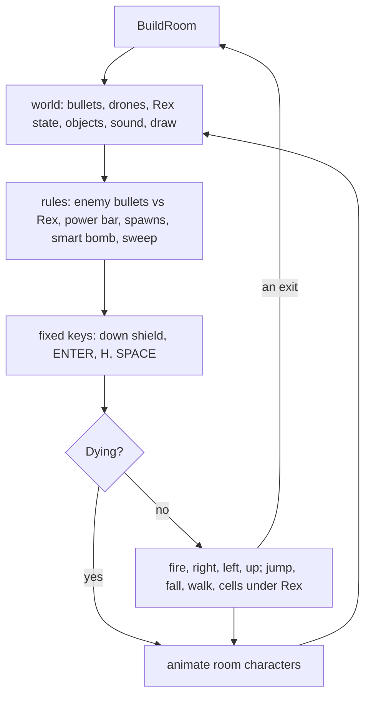

Worked example: room 0 of `c1` after the first death. The HUD sweep moves one cell a pass. Its position went from 1
to 11 and back to 1 between TTD frames 16 746 and 16 843: 24 passes in 97 frames, 4.0 frames a pass in a room with
few objects.

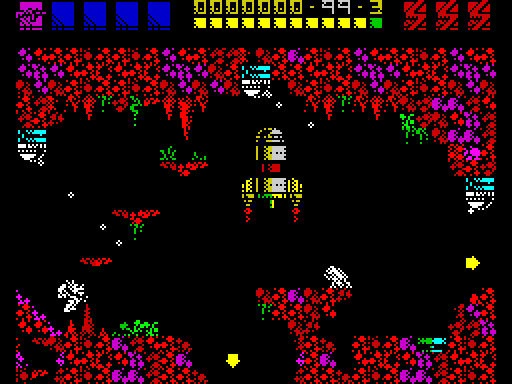

How to read it: the play screen, one picture every 2 frames. Recording `c1`, TTD frames 17 000-17 044. Rex runs
right, jumps and falls to the floor below. Made by `python3 ../../kit/screen_anim.py --work work/docs/rxC/c1 --from
17000 --to 17044 --step 2 --delay 80 docs/img/play/c1-jump.gif`.

**The point**: one loop runs everything; the game's speed is its work, so a busy room plays slower.

Witness: MainLoop L1 73, MainPass every pass (`src/game/mainloop.asm`); the `c1` sweep samples of frames 16 746-16 843.

## 10.2 Walking

The right and left keys only set a speed and a facing. WalkRightKey sets RexSpeed 2 and RexFacing 0. WalkLeftKey sets
RexSpeed 2 and RexFacing 1. With SPEED UP the speed is 4 (10.9). RexWalk then moves Rex.

RexWalk tests the two cells in front of Rex, at his chest and his feet. If either is solid (IsSolid: type 2, 4, 5 or
6), Rex does not move. A ledge (type 1) never blocks a walk. Otherwise RexX grows or shrinks by RexSpeed. When Rex
stands, RexSpeed returns to 0 after the step. In the air RexSpeed is kept, so a jump carries him on.

```text
WalkRightKey: RexSpeed = 4 if SpeedUp else 2; RexFacing = 0     # SpeedUpTick counts the SPEED UP down
RexWalk:
    cells = the two cells ahead (chest, feet)
    if IsSolid(any of them): return
    x = RexX + RexSpeed  (facing left: the speed is subtracted)
    if x >= $F0: ExitRight      if x < 3: ExitLeft
    RexX = x
    if not Jumping and FallSpeed == 0: RexSpeed = 0
```

```asm
RexWalkStep:
  LD A,(RexX)
  LD HL,RexSpeed
  ADD A,(HL)
  CP $F0
  JP NC,ExitRight
  CP $03
  JP C,ExitLeft
  LD (RexX),A
  LD A,(Jumping)
  OR A
  RET NZ
  LD A,(FallSpeed)
  OR A
  RET NZ
  XOR A
  LD (RexSpeed),A
  RET
```

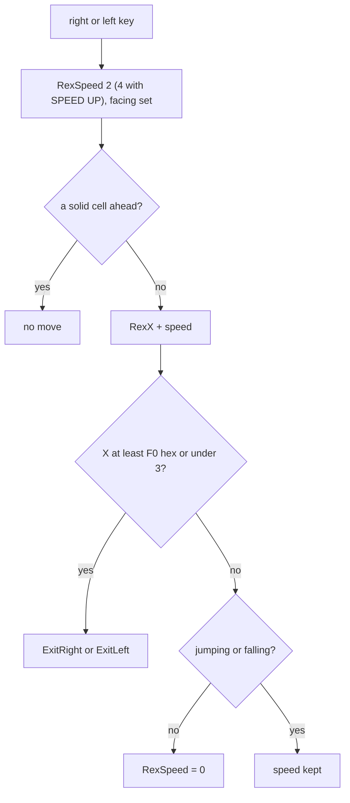

Worked example: the run-up of the jump in `c1`. RexX is 30 at frame 17 000 and 32 at frame 17 004, one pass later:
2 pixels a pass. In the air it goes on: 34, 36, 38 .. 52 at frame 17 043, while RexSpeed stays 2.

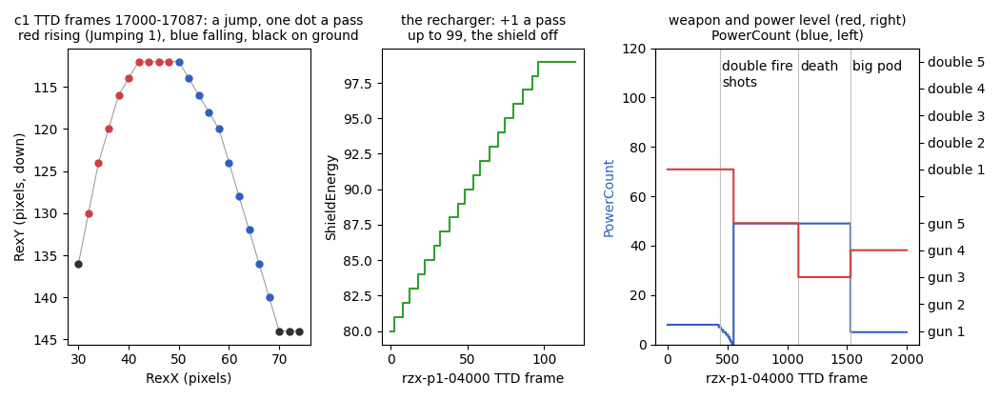

How to read it: three panels. Left: Rex's X and Y in `c1`, TTD frames 17 000-17 080, one dot a sample; Y grows
downwards as on the screen. Middle: ShieldEnergy in `rzx-p1-04000`, frames 0-96, while Rex stands on the recharger.
Right: Weapon, PowerLevel and PowerCount in `rzx-p1-04000`, frames 400-1540. Made by `python3 tools/fig_gameplay.py
docs/img/gameplay/jump-shield-power.png --c1 work/docs/rxC/c1/vars.jsonl --r04 work/docs/rxC/r04/vars.jsonl`.

**The point**: a walk is 2 pixels a pass, decided by the cell types ahead, never by pixels.

Witness: RexWalk in every pass (`src/game/rexmove.asm`); WalkRightKey L1 1507 in part 2 (`src/rex2/rexmove.asm`); the
`c1` samples of frames 17 000-17 043.

## 10.3 Jumps, falls and room changes

The up key starts a jump only when Rex stands: Jumping 0 and FallSpeed 0. RexJump then lifts him each pass by the
next byte of JumpSteps: 6, 6, 4, 4, 2, 2, 0, 0, 0, 0, then `$FF`. That is 24 pixels up in six passes and a glide of
four passes. A solid cell above his head ends the jump at once (Land).

RexFall runs when no jump is on. It adds FallSpeed to RexY. At every cell boundary (RexY AND 7 = 0) it tests the two
cells under his feet. A cell that is not passable (a floor, a ledge, a station) stops the fall. Otherwise the fall
speeds up by 2, but never to 6: the fall runs at 2, then 4 pixels a pass.

The edges of the play area are the exits (doc 7.2):

| Edge | Test | Next room | Rex placed at |
| --- | --- | --- | --- |
| right | X + speed at least `$F0` | RoomRight | X `$08` |
| left | X + speed under 3 | RoomLeft | X `$E8` |
| top | Y - step under 8 in a jump | RoomUp | Y `$A0` |
| bottom | Y + fall at least `$BA` | RoomDown | Y `$08` |

A room number 0 means no exit. Room 0 is the start room, so no exit can lead to it. At the side and top edges a 0
stops Rex. At the bottom a 0 kills him: there is no floor to land on (RexFallStop calls RexDies).

```text
StartJump: if FallSpeed == 0 and not Jumping: Jumping = 1; JumpPtr = JumpSteps
RexJump:
    if solid above: Land()                     # FallSpeed 2 unless on a cell boundary
    y = RexY - *JumpPtr
    if y < 8: ExitTop
    RexY = y; JumpPtr += 1
    if *JumpPtr == $FF: Jumping = 0            # the fall begins
RexFall:
    if Jumping: return
    y = RexY + FallSpeed
    if y >= $BA: ExitBottom                    # RoomDown, or RexDies when it is 0
    RexY = y
    if y & 7 == 0:
        if a cell under the feet is not passable: FallSpeed = 0
        elif FallSpeed + 2 != 6: FallSpeed += 2
```

```asm
RexFall:
  LD A,(Jumping)
  OR A
  RET NZ
  LD A,(RexY)
  LD HL,FallSpeed
  ADD A,(HL)
  CP $BA
  JP NC,ExitBottom
  LD (RexY),A
  AND $07
  OR A
  RET NZ
  ...                       ; the two cells under the feet: IsPassable
  LD A,(FallSpeed)
  ADD A,$02
  CP $06
  RET Z
  LD (FallSpeed),A
  RET
ExitBottom:
  LD A,(RoomDown)
  OR A
  JP Z,RexFallStop          ; no room below: RexDies
```

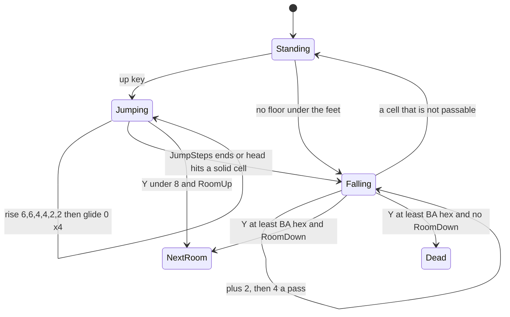

Worked example: the jump of `c1`, one sample a pass.

| TTD frame | RexX | RexY | Jumping | FallSpeed |
| ---: | ---: | ---: | ---: | ---: |
| 17 000 | 30 | 136 | 0 | 0 |
| 17 004 | 32 | 130 | 1 | 0 |
| 17 008 | 34 | 124 | 1 | 0 |
| 17 012 | 36 | 120 | 1 | 0 |
| 17 016 | 38 | 116 | 1 | 0 |
| 17 019 | 40 | 114 | 1 | 0 |
| 17 023-17 035 | 42-48 | 112 | 1 | 0 |
| 17 039 | 50 | 112 | 0 | 2 |
| 17 059 | 60 | 124 | 0 | 4 |
| 17 075 | 68 | 140 | 0 | 4 |

The rise is 6, 6, 4, 4, 2, 2 (24 pixels), the glide four passes at Y 112. The fall starts at 2 and becomes 4 after
the cell boundary at Y 120. The left panel of the figure in 10.2 plots the same path.

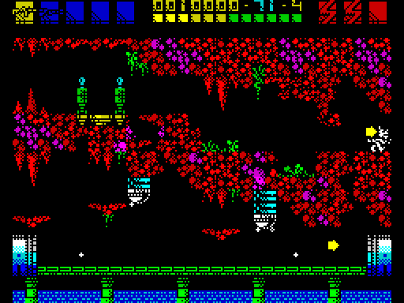

How to read it: the play screen at a room change; the new room is drawn while the old one stays still for 22-26
frames (BuildRoom, doc 4).

**The point**: a jump is a fixed 24-pixel arc with a long glide; the only free choice is when to press up.

Witness: StartJump, RexJump, RexFall (`src/game/rexmove.asm`); in part 2 StartJump L1 1172, RexJump 9003, ExitTop 7,
ExitLeft and ExitRight 3 each (`src/rex2/rexmove.asm`, as REX 1); the `c1` samples of frames 17 000-17 080.

## 10.4 Restart markers

A restart marker is a pair of type 7 cells in the floor (doc 7.3). CellsUnderRex looks at the cells under Rex each
pass. On a marker it plays the chime (SfxRestart, when channel B is free) and animates the marker. It saves the point
only when Rex is centred on it: RexX AND 7 = 2. The saved point is RestartX and RestartY (rounded down to a cell) and
RestartRoom.

After a death Rex comes back at the saved point, in the saved room (10.12). NewGame sets the first point in room 0.

```text
CellsUnderRex:
    c = the cell under Rex's feet
    if c == $12: lift (Rex rises, 10.20)
    if c == 7: SaveRestart()
    if c == 8: Recharge()
    if c in $0A..$0D: the station (10.7)
SaveRestart:
    if the next cell is not 7 too: return
    chime; AnimateRestart()
    if RexX & 7 != 2: return
    RestartX = RexX & $F8; RestartY = RexY & $F8; RestartRoom = Room
```

```asm
SaveRestart:
  ...
  LD DE,SfxRestart
  LD A,(Channels+$0008)
  CP $FF
  CALL Z,StartSfx
  CALL AnimateRestart
  LD A,(RexX)
  AND $07
  CP $02
  RET NZ
  LD A,(RexX)
  AND $F8
  LD (RestartX),A
  LD A,(RexY)
  AND $F8
  LD (RestartY),A
  LD A,(Room)
  LD (RestartRoom),A
  RET
```

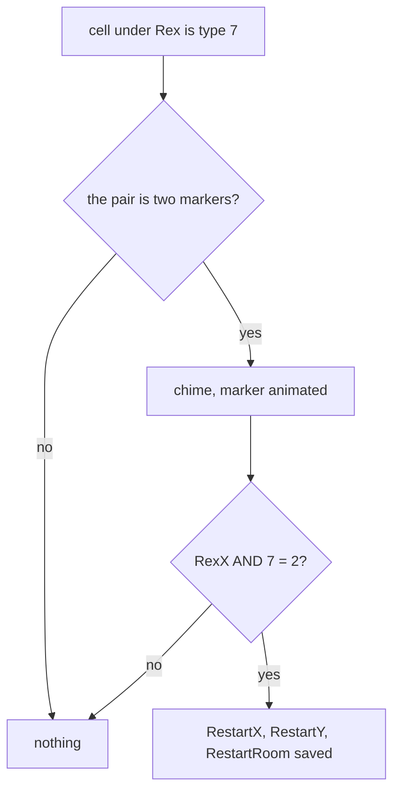

Worked example: the deaths of `c1`. Rex died in room 1 at TTD frames 17 149 and 17 911. Both times Lives dropped and
Room became 0 (frames 17 325 and 18 082): the only marker he had crossed was the green pair in room 0 (doc 7.3). The
death in room 0 at frame 18 217 left Room at 0.

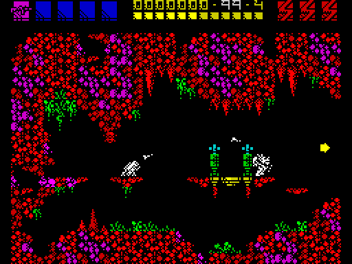

How to read it: one picture every 4 frames. Recording `c1`, TTD frames 16 536-16 724: Rex dies, the bubble rises, the
sparkle brings him back at the marker. Made by `python3 ../../kit/screen_anim.py --work work/docs/rxC/c1 --from
16536 --to 16724 --step 4 --delay 60 docs/img/play/c1-death.gif`.

**The point**: a marker saves only when Rex passes its centre, so a jump over it saves nothing.

Witness: SaveRestart and LifeLost (`src/game/death.asm`); the `c1` samples of Room and Lives at frames 17 149-18 394.

## 10.5 The shield and the recharger

The down key switches the shield (ShieldToggle): once a press (ShieldKeyLatch), never during the sparkle, and only
with energy left. ShieldEnergy runs from 0 to 99 and starts at 99.

While the shield is on, DrawRex draws the bubble and calls ShieldDrain. ShieldDrain counts ShieldDrainRate down from
4: one unit goes every 4 passes. A hit drains faster: ShieldDrainFast sets the rate to 1, so the amount in L goes at
once. An enemy bullet on the shield costs 1. An object that touches the shield dies and costs its hits left x 4
(doc 7.8). With no energy left the shield goes off.

The recharger is a pair of type 8 cells. Standing on it with the shield off gives one unit a pass, up to 99, with
SfxRecharge when channel B is free.

```text
ShieldToggle: if not sparkle and not latch and ShieldEnergy > 0: latch = 1; ShieldOn = not ShieldOn
ShieldDrain(L):                          # each pass with the shield on, L = 1
    ShieldDrainRate -= 1
    if ShieldDrainRate != 0: return
    ShieldDrainRate = 4
    if ShieldEnergy < L: ShieldEnergy = 0; ShieldOn = 0
    else: ShieldEnergy -= L
ShieldDrainFast(L): ShieldDrainRate = 1; ShieldDrain(L)
Recharge: if both cells are 8 and not ShieldOn and ShieldEnergy < 99: ShieldEnergy += 1; sound
```

```asm
Recharge:
  INC HL
  LD A,(HL)
  CP $08
  RET NZ
  LD A,(ShieldOn)
  OR A
  RET NZ
  LD A,(ShieldEnergy)
  INC A
  CP $64
  RET Z
  LD (ShieldEnergy),A
  CALL ShowShield
  ...
ShieldDrain:
  LD A,(ShieldDrainRate)
  DEC A
  LD (ShieldDrainRate),A
  OR A
  RET NZ
  LD A,$04
  LD (ShieldDrainRate),A
  LD A,(ShieldEnergy)
  SUB L
  JP C,ShieldOff
```

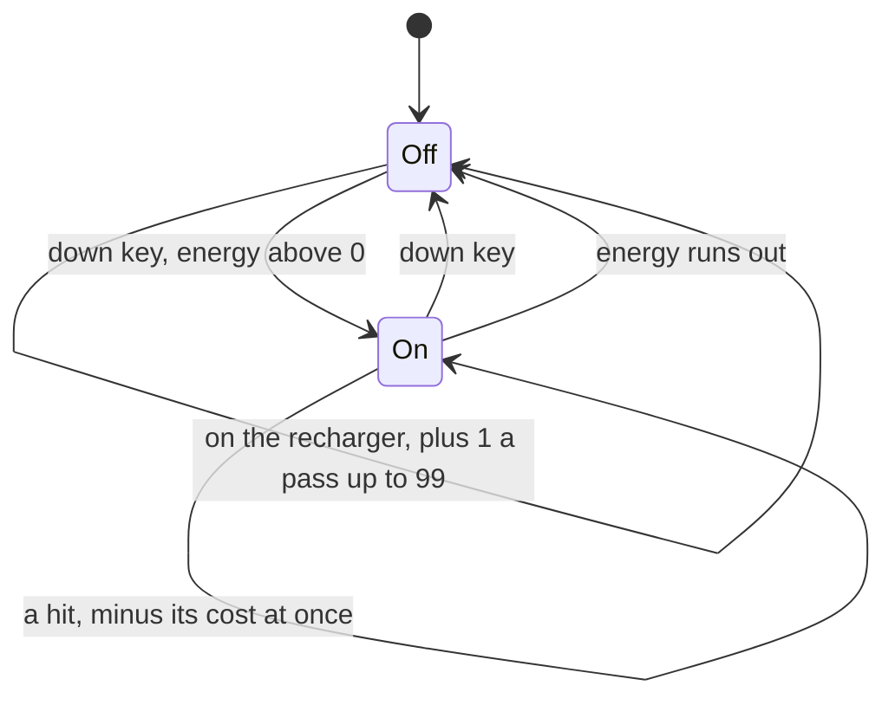

Worked example: the recharger in room 4 of `rzx-p1-04000`. Rex stands at (88, 24) with the shield off.

| TTD frame | 0 | 2 | 8 | 12 | 48 | 92 | 96 |
| --- | ---: | ---: | ---: | ---: | ---: | ---: | ---: |
| ShieldEnergy | 80 | 81 | 82 | 83 | 90 | 98 | 99 |

Nineteen units in 96 frames, one a pass, and it stops at 99. The middle panel of the figure in 10.2 plots it.
In `c1` the shield was never switched on: ShieldOn is 0 and ShieldEnergy 99 in every play sample of frames
16 300-20 470.

**The point**: the shield trades time for safety: it lasts about 400 passes idle, and every hit shortens it.

Witness: Recharge, ShieldToggle, ShieldDrain (`src/game/cells.asm`, `src/game/rex.asm`, `src/game/score.asm`); the
`rzx-p1-04000` samples of frames 0-96 and the `c1` samples.

## 10.6 The weapons

Rex has five weapons. The gun is always held. The other four are taken at their stations (10.7).

| Weapon | Number | A shot | Power cost |
| --- | ---: | --- | --- |
| gun | 0 | one bullet ahead; up to power x 4 + 1 bullets at once | none |
| double fire | 1 | two bullets ahead, 19 lines apart (FireDouble) | 1 a press |
| laser | 2 | a long beam (type 7); it passes through and kills at once | 1 a press |
| multiple | 3 | Rex's shot plus one from each of power + 3 drones circling him | 1 a press |
| spray | 4 | power 1-3: a fan of 3, 5, 7 shots; power 4: four directions; power 5: all eight | 1 a press |

Fire is once a press: FireLatch is set by a shot and cleared when the key is released. The 100 RAPID SHOTS prize
(10.9) clears the latch every pass, so a held key fires every pass for 100 shots.

FireWeapon passes the cost to PowerDrain: 0 for the gun, 1 for the others. The bullets are the 30 records at
`$5B60` (doc 7.1); a full table means no shot.

```text
FireWeapon:
    if FireLatch or not RexPresent: return
    FireLatch = 1; FindShotSlot()
    PowerDrain(0 if Weapon == 0 else 1)
    if RapidShotsOn: RapidShotsLeft -= 1; at 0 RapidShotsOn = 0
    if Weapon == 4: FireSpray
    elif Weapon == 2: FireLaser
    else:
        RexShot()
        if Weapon == 1: FireDouble()
        if Weapon == 3: one shot from each drone (PowerLevel + 3)
```

```asm
FireWeapon:
  LD A,(FireLatch)
  OR A
  RET NZ
  LD A,(RexPresent)
  OR A
  RET Z
  LD A,$01
  LD (FireLatch),A
  CALL FindShotSlot
  LD A,(Weapon)
  OR A
  JP Z,FireGun
  LD A,$01
FireGun:
  CALL PowerDrain
  ...
FireByWeapon:
  LD A,(Weapon)
  CP $04
  JP Z,FireSpray
  CP $02
  JP Z,FireLaser
  CALL RexShot
```

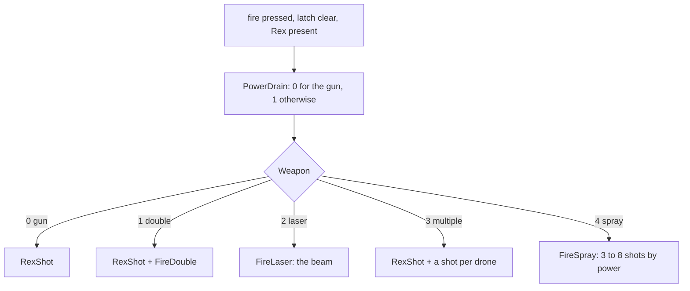

Worked example: the double fire in `rzx-p1-04000`. At frame 400 Rex holds the double fire (Weapon 1, WeaponRank 1)
at PowerLevel 1, PowerCount 8. The trace of frames 440-452 shows SfxGun started twice at frame 445: the two bullets of
one press. PowerCount fell by one a press: 7, 6, 5, 4, 3, 2, 1, 0 at frames 428, 446, 464, 488, 506, 518, 528, 540.

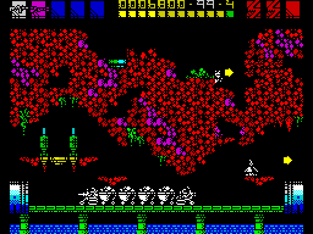

How to read it: one picture every 2 frames. Recording `rzx-p1-04000`, TTD frames 420-476 (RZX frames 4420-4476). Rex
fires pairs of bullets to the right; the power bar's end shrinks. Made by `python3 ../../kit/screen_anim.py --work
work/docs/rxC/r04 --from 420 --to 476 --step 2 --delay 80 docs/img/play/rzx-p1-04420-double-fire.gif`.

**The point**: the gun is free; every other weapon spends power, so a strong weapon is a short-lived one.

Witness: FireWeapon, FireDouble, FireLaser L1 180, FireSpray (`src/game/weapons.asm`); the `rzx-p1-04000` samples and
the trace of frames 440-452.

## 10.7 Power levels, ranks and the stations

The power bar holds two numbers. WeaponRank (0-4) is how far up the five weapons the power reaches. PowerLevel (1-5)
is the step inside the rank, and PowerCount the progress inside the step. The bar's end is drawn in colour
PowerLevel + 2.

The weapon in use is the best held weapon whose number is not above the rank (BestWeapon). A station only gives the
right to a weapon: it sets HasDoubleFire, HasLaser, HasMultiple or HasSpray. The weapon comes into use when the rank
reaches its number.

Power comes from the power pods (10.8): PowerGain adds 38 a pod. Every 120 makes a step. A step past 5 is a rank:
level 1 again, one rank up (at most 4). PowerGain also sets FireDelay = level x 4 + 4 (the laser's beam life and the
split shots' timer) and sets the drones up again.

Power goes with the shots: PowerDrain takes the cost. Below 0 PowerCount gets 50 and the level drops. Below level 1
the rank drops, the level becomes 5 and BestWeapon picks the weaker weapon. A death takes 50 twice (LosePower).

```text
PowerGain(a):                                 # a = $26 (38)
    if PowerLevel == 6: return
    PowerCount += a
    if PowerCount < 120: return
    PowerCount -= 120; PowerLevel += 1
    if PowerLevel == 6:                       # GainRank
        if WeaponRank == 4: return
        WeaponRank += 1; PowerLevel = 1; BestWeapon()
    else: FireDelay = PowerLevel * 4 + 4; InitDrones()
PowerDrain(a):
    if PowerLevel == 0: return
    PowerCount -= a
    if PowerCount >= 0: return
    PowerCount += 50; PowerLevel -= 1
    if PowerLevel == 0:                       # DrainRank
        if WeaponRank == 0: return
        WeaponRank -= 1; PowerLevel = 5; BestWeapon()
BestWeapon: Weapon = the highest w <= WeaponRank with held[w]   # held[0], the gun, is always 1
Station $0D, $0A, $0B, $0C (both cells): Has<weapon> = 1; the icons; BestWeapon(); the weapon's panel
```

```asm
PowerDrain:
  ...
  LD A,(PowerCount)
  SUB (HL)
  LD (PowerCount),A
  RET P
  ADD A,$32
  LD (PowerCount),A
  LD A,(PowerLevel)
  DEC A
  OR A
  JP Z,DrainRank
  LD (PowerLevel),A
  RET
DrainRank:
  LD A,(WeaponRank)
  DEC A
  CP $FF
  RET Z
  LD (WeaponRank),A
  ...
  LD A,$05
  LD (PowerLevel),A
  JP BestWeapon
```

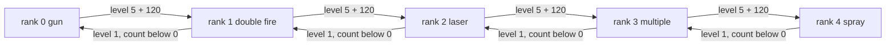

Worked example: the power of `rzx-p1-04000`.

| TTD frame | Event | Weapon | WeaponRank | PowerLevel | PowerCount |
| ---: | --- | ---: | ---: | ---: | ---: |
| 540 | the eighth double shot | 1 | 1 | 1 | 0 |
| 552 | one more shot: 0 - 1 below 0 | 0 | 0 | 5 | 49 |
| 1094 | a death: LosePower, 50 twice | 0 | 0 | 3 | 49 |
| 1530 | a big pod: 38 twice | 0 | 0 | 4 | 5 |

At frame 552 the count went to -1, so it became 49 and the level 0: the rank fell to 0 and the level to 5. The gun
came back. The death took 49 - 50 = -1 (49, level 4), then again (49, level 3). The big pod gave 49 + 38 + 38 = 125:
a step, 5 left. The right panel of the figure in 10.2 plots these values.

**The point**: one bar both powers the weapon and chooses it; spending power can drop Rex back to a weaker gun.

Witness: PowerGain, PowerDrain, BestWeapon, GiveDoubleFire (`src/game/weapons.asm`), StationSpray
(`src/game/cells.asm`); the `rzx-p1-04000` samples of frames 400-1540.

## 10.8 The pods

A killed object becomes the points sign (kind `$FF`) and then, at random, a pod (doc 7.9). Rex takes a pod by
touching it (ObjectHitsRex, doc 7.8). His bullets pass over pods.

- Power pod (`$FE`): TakePowerPod plays SfxPowerPod, gives PowerGain 38 and starts the screen flash (FadeStepIndex 0).
  A big pod (+`$15` not 0) gives a second PowerGain 38 and plays SfxBigPod.
- Bomb pod (`$FD`): TakeBombPod adds a smart bomb, at most 3, and plays SfxBombPod.
- Bonus pod (`$FC`): the bonus roulette (10.9).

Taking a pod ends it: +`$0C` = 0 (not alive).

```text
TakePowerPod(obj):
    StartSfx(SfxPowerPod); obj.alive = 0
    PowerGain(38); FadeStepIndex = 0
    if obj.big: PowerGain(38); StartSfx(SfxBigPod)
TakeBombPod(obj):
    obj.alive = 0
    if Bombs + 1 == 4: return
    Bombs += 1; ShowBombs(); StartSfx(SfxBombPod)
```

```asm
TakePowerPod:
  PUSH AF
  LD DE,SfxPowerPod
  CALL StartSfx
  LD (IX+$0C),$00
  LD A,$26
  CALL PowerGain
  XOR A
  LD (FadeStepIndex),A
  LD A,(IX+$15)
  OR A
  JP Z,TakePowerPodEnd
  LD A,$26
  CALL PowerGain
  LD DE,SfxBigPod
  CALL StartSfx
```

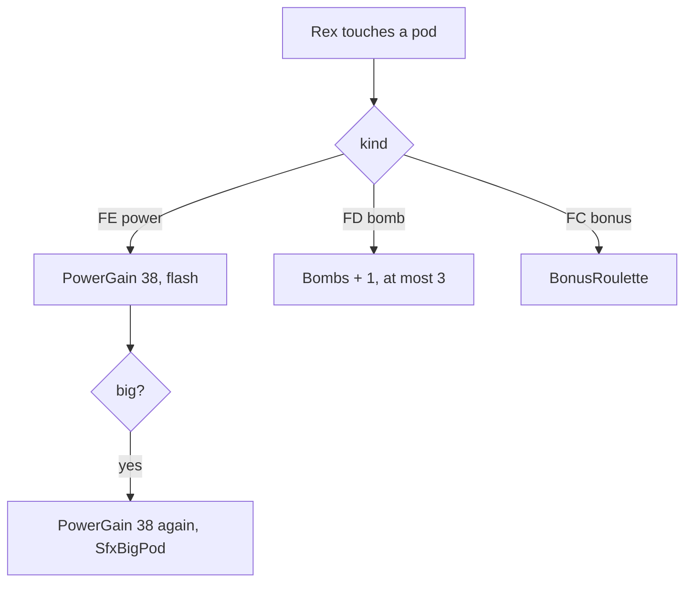

Worked example: the big pod of the launcher in `rzx-p1-04000`. The launcher died at frame 1416 (doc 7.8) and became
a big pod at frame 1450. Rex walked into it at frame 1528. The trace of frames 1522-1534 shows TakePowerPod at T
17 616 and PowerGain at T 18 472 and 18 654. PowerLevel went from 3 to 4 and PowerCount from 49 to 5 (10.7).

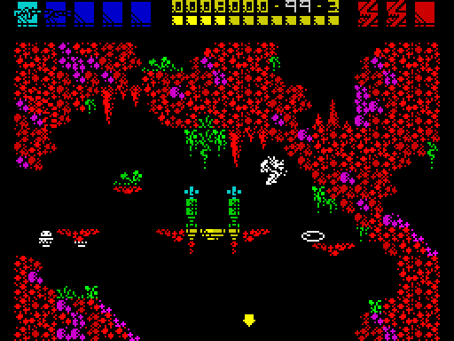

How to read it: one picture every 2 frames. Recording `rzx-p1-04000`, TTD frames 1496-1540 (RZX frames 5496-5540).
The pod flashes; Rex walks into it; the screen flashes and the power bar grows. Made by `python3
../../kit/screen_anim.py --work work/docs/rxC/r04 --from 1496 --to 1540 --step 2 --delay 80
docs/img/play/rzx-p1-05496-pod-taken.gif`.

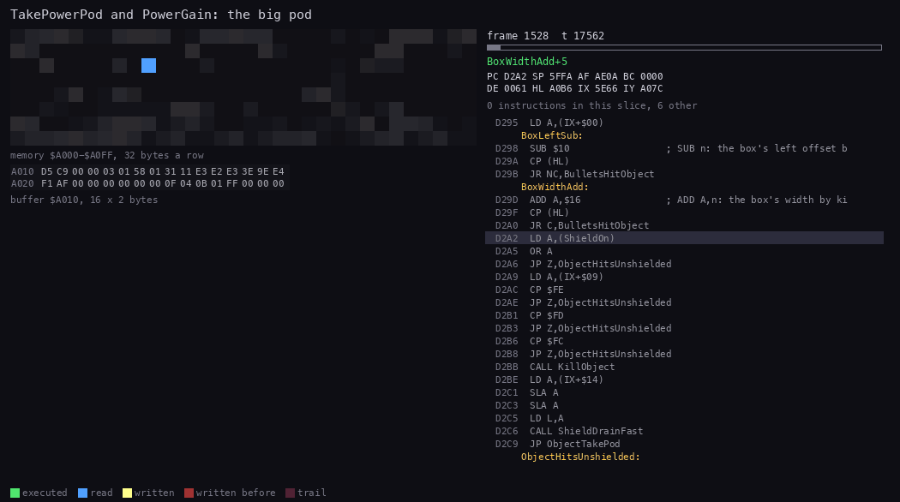

How to read it: the hex view is the variables `$A010-$A02F`; PowerLevel `$A014` turns from 3 to 4 and PowerCount
`$A018` from `$31` to `$57` (87), then 5. The code panel shows TakePowerPod and PowerGain. Recording `rzx-p1-04000`,
TTD frame 1528, T 17 500-19 300, 30 pictures of 60 T. Made by `python3 tools/anim_slice.py --slice
1528:17500-1528:19300 --trace work/docs/rxC/r04/traces/1522_0-1534_0.uatr --listing build/game.lst --pc
D46C-D4B5,B98E-B9EE --view buffer:A010:16x2:hex --range A000-A0FF --pictures 30 --delay 220 --title "TakePowerPod
and PowerGain: the big pod" --out docs/img/routines/TakePowerPod.gif` (`tools/anim_slice.py` runs
`kit/routine_anim.py` on a slice of a kept trace).

**The point**: power is earned by killing and collecting; a tough enemy leaves a big pod worth two.

Witness: TakePowerPod, TakeBombPod (`src/game/collisions.asm`); the `rzx-p1-04000` samples of frames 1418-1530 and the
trace of frames 1522-1534.

## 10.9 The bonus roulette

The bonus pod stops the game. BonusRoulette silences the sound, saves the screen and opens a panel. The panel cycles
through five prizes. The wait between two prizes starts at 7400 polls of the fire key and shrinks by 200 a prize.
Fire gives the prize shown. Without fire the wheel stops when the wait falls under 256: after 35 advances.

| Roll | Prize | What it does |
| ---: | --- | --- |
| 0 | SPEED UP | SpeedUp = 1, SpeedUpPhase 200: the walk is 4 pixels for 200 passes of walking |
| 1 | SHIELD LOSS | ShieldDrainFast with 20: the shield loses 20 units |
| 2 | 1000 BONUS | AddScore 10 (hundreds) |
| 3 | ENERGY LOSS | LosePower: 50 twice, as a death |
| 4 | 100 RAPID SHOTS | RapidShotsOn, RapidShotsLeft 100: auto fire |

The first prize shown is Random AND 3 + 1: 1 to 4, never SPEED UP. 35 advances are seven full turns of five. So a
player who never presses fire gets the first prize shown, and SPEED UP comes only to a player who presses fire in
time.

```text
BonusRoulette:
    pod.alive = 0; SoundSilence(); SaveScreen(); Delay($4E20); the panel
    delay = 7400; roll = (Random() & 3) + 1
    loop:
        show prize[roll]
        wait up to delay polls: if fire: break
        delay -= 200
        if delay < 256: break
        roll = (roll + 1) mod 5
    give prize[roll]; Delay($4E20); SoundReset(); the screen back
```

```asm
RouletteWait:
  PUSH BC
  CALL ReadFire
  POP BC
  JP Z,RouletteGive
  DEC BC
  LD A,B
  OR C
  JP NZ,RouletteWait
  LD HL,(BonusDelay)
  LD DE,$00C8
  AND A
  SBC HL,DE
  LD (BonusDelay),HL
  LD A,H
  OR A
  JP Z,RouletteGive
  LD A,(BonusRoll)
  INC A
```

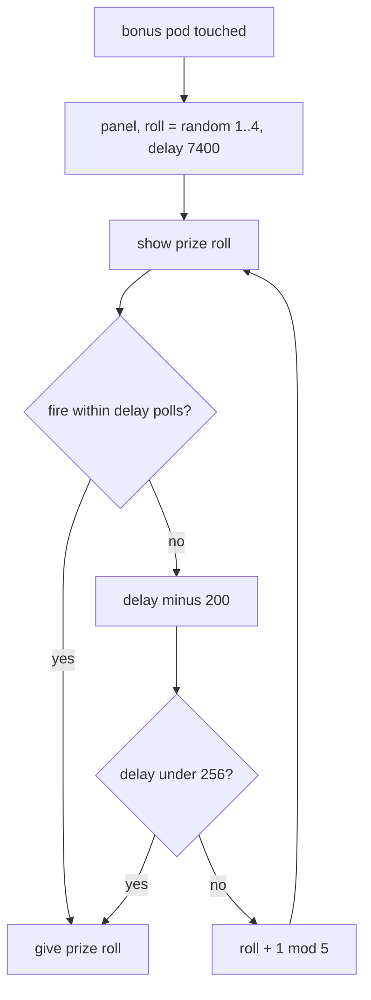

Worked example: the wheel without fire. The delay after k cuts is 7400 - 200 k. It first falls under 256 at k = 36
(7400 - 7200 = 200), and the give comes before the 36th advance: 35 advances. From a start roll of 3 (ENERGY LOSS)
the wheel shows 3, 4, 0, 1, 2, 3 .. and stops on 3 + 35 mod 5 = 3, ENERGY LOSS again. The prize SPEED UP needs a
press while it is shown.

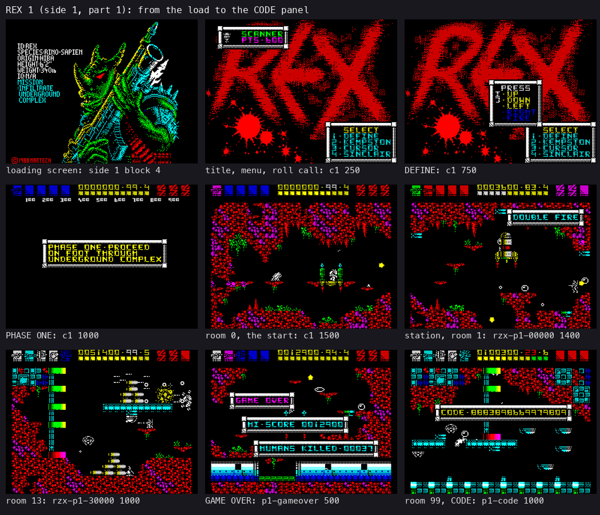

How to read it: a contact sheet of part 1's screens from the walkthrough (doc 1). The roulette's panel is a boxed text
over the play area like the others ([doc 8, figure 8.9](08-hud-and-text.md#89-menus-and-panels-in-play)).

**The point**: a slowing wheel that rewards a timed press; doing nothing never gives the best prize.

Witness: BonusRoulette and the prizes (`src/game/collisions.asm`): `rzx-p1-50000` (start roll 3, the player's fire on
100 RAPID SHOTS) and `rzx-p1-56000`; `p1-speedup` takes the same pod with fire held back until SPEED UP shows (BonusRoll
3 at frame 1701, 4 at 1716, 0 at 1730, fire at 1736): SpeedUp 1 and SpeedUpPhase 200 at 1740, RexSpeed 4 and -4 while
it lasts, the phase 0 at 2740 (SpeedUpTick L1 200), RexSpeed 2 and -2 after.

## 10.10 The score and the extra life

Score `$A03E` is a word in hundreds of points. The HUD prints it with two zeros added. AddScore adds DE to it and to
ExtraLifeCount. Every 100 in ExtraLifeCount (10 000 points) gives an extra life, at most 9 lives. AddScore does
nothing while Rex is dying, so a smart bomb's kills after a death score nothing.

Points come from:

- a kill: KillScores[kind AND `$0F`] (doc 7.5), from 100 for a foot man to 1000 for the mine layer;
- the combo of hits (ComboCount in HitObject);
- the 1000 BONUS prize.

```text
AddScore(de):
    if Dying: return
    Score += de; ExtraLifeCount += de
    if ExtraLifeCount >= 100: ExtraLifeCount -= 100; ExtraLife()
    ShowScore()
ExtraLife: if Lives + 1 != 10: Lives += 1; ShowLives()
```

```asm
AddScore:
  LD A,(Dying)
  OR A
  RET NZ
  LD HL,(Score)
  ADD HL,DE
  LD (Score),HL
  LD HL,(ExtraLifeCount)
  ADD HL,DE
  LD (ExtraLifeCount),HL
  LD DE,$0064
  AND A
  SBC HL,DE
  JP C,AddScoreShow
  LD (ExtraLifeCount),HL
  CALL ExtraLife
AddScoreShow:
  JP ShowScore
```

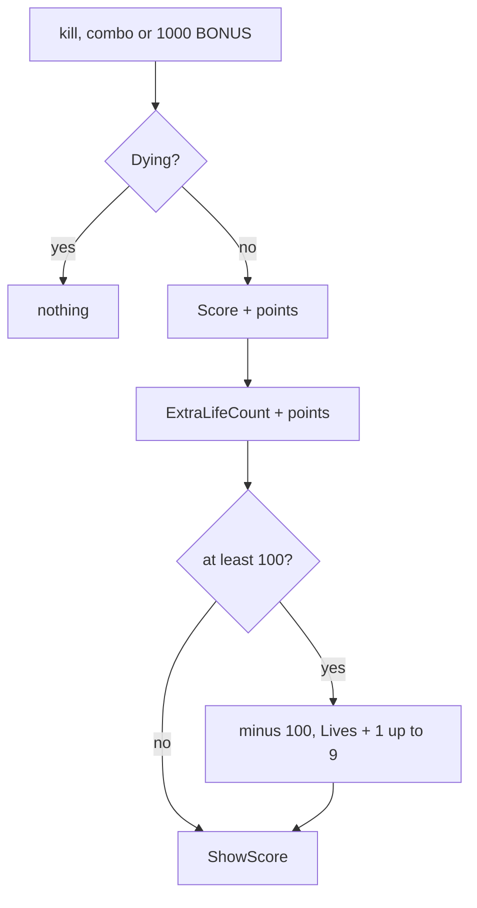

Worked example: the score of `rzx-p1-04000`. It rose 68, 70, 72 at frames 578 and 630 (kills of 200 points), to 80
at frame 1418 (the launcher, KillScores[11] = 8) and 82 at frame 1976. On the screen 8000 is 80 hundreds.

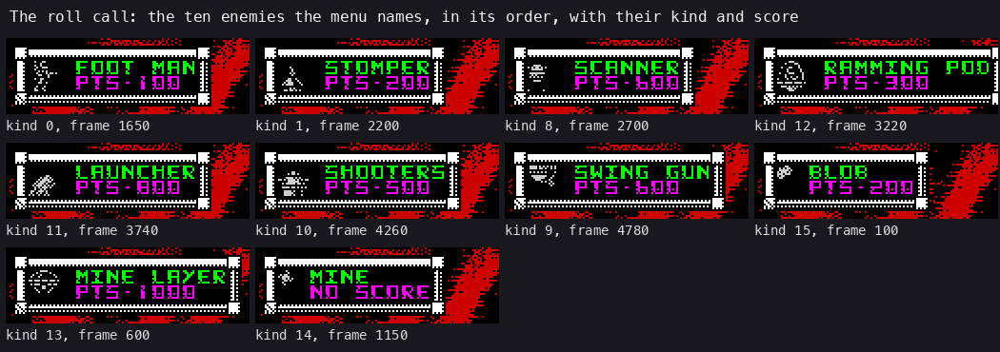

How to read it: the menu's roll call of the ten named kinds with their scores; they agree with KillScores (doc 7.5).

**The point**: an extra life every 10 000 points; kills are the only steady source of points.

Witness: AddScore, KillObject (`src/game/score.asm`); ExtraLife L1 10 (p1-code, rzx-p1- x9); the `rzx-p1-04000`
samples.

## 10.11 The smart bomb

SPACE fires a smart bomb (SmartBomb) when Bombs is above 0 and no bomb is running. SmartBombMark sets SmartBombOn,
SmartBombSteps 16 and the pointer to the first object record. It also ends every enemy bullet: their live byte
becomes 2 (the stopping flash).

SmartBombStep then runs once a pass for 16 passes. Each pass it kills the next object record (KillObject) and moves to
the next one. It skips the pods (`$FE`, `$FD`, `$FC`) and kind `$90`. It does not test whether the record is alive.
At the end it puts the room's colours back (CopyAttrs). The screen flash is FadeStep.

A death fires a free smart bomb (SmartBombFree from RexDies): the room is cleared for the restart. Its kills score
nothing, since Rex is dying (10.10).

```text
SmartBomb: if not SmartBombOn and Bombs > 0: Bombs -= 1; ShowBombs(); SmartBombMark()
SmartBombMark:
    SmartBombOn = 1; SmartBombSteps = 16; SmartBombPtr = $5E66
    for each of the 20 enemy bullets: if live: live = 2
SmartBombStep (each pass):
    if not SmartBombOn: return
    obj = SmartBombPtr
    if obj.kind not in ($FE, $FD, $FC, $90): KillObject(obj)
    SmartBombPtr += 24; SmartBombSteps -= 1
    if SmartBombSteps == 0: SmartBombOn = 0; CopyAttrs()
```

```asm
SmartBombStep:
  LD A,(SmartBombOn)
  OR A
  RET Z
  LD IX,(SmartBombPtr)
  LD A,(IX+$09)
  CP $FE
  JP Z,BombNextObject
  CP $FD
  JP Z,BombNextObject
  CP $FC
  JP Z,BombNextObject
  CP $90
  JP Z,BombNextObject
  CALL KillObject
BombNextObject:
  LD DE,$0018
  ADD IX,DE
  LD (SmartBombPtr),IX
  LD A,(SmartBombSteps)
  DEC A
  LD (SmartBombSteps),A
  OR A
  RET NZ
```

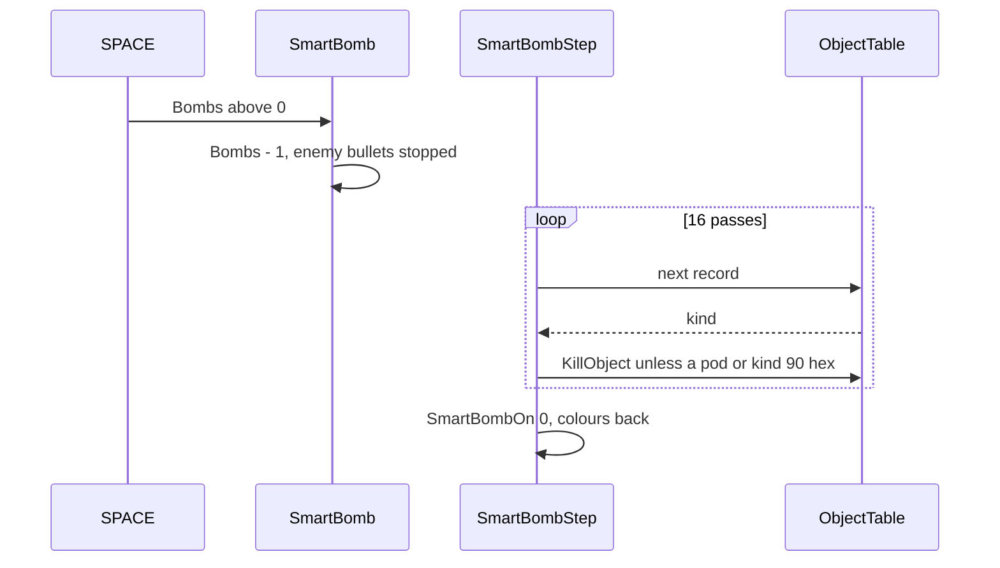

Worked example: the smart bomb of `c1`. SPACE was read at TTD frame 17 351: Bombs went from 3 to 2. The launcher is
record 0 of room 1, so the first step killed it. Score went from 0 to 8 at frame 17 355 (800 points). The beeper
crackle of its explosion is in doc 9.6.

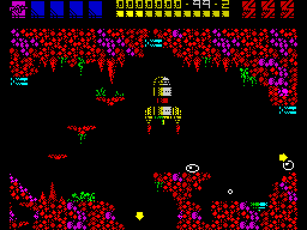

How to read it: one picture every 2 frames. Recording `c1`, TTD frames 17 340-17 400. The screen flashes, the launcher
explodes into the points sign, the walkers die one a pass. Made by `python3 ../../kit/screen_anim.py --work
work/docs/rxC/c1 --from 17340 --to 17400 --step 2 --delay 70 docs/img/play/c1-smart-bomb.gif`.

**The point**: a bomb is not instant: it works through the object table one record a pass for 16 passes.

Witness: SmartBomb, SmartBombMark, SmartBombStep (`src/game/bomb.asm`); the `c1` samples of frames 17 340-17 400.

## 10.12 Death, lives and the game over

Rex dies by:

- an enemy bullet in his box without the shield (EnemyBulletsHitRex);
- an object touching him without the shield (ObjectHitsRex, doc 7.8);
- a fall off the bottom with no room below (RexFall, 10.3);
- the HUD sweep at its end (10.13).

RexDies does nothing while Immune is set or Rex is already dying. It resets the sweep, sets Dying and DeathTimer 50,
fires the free smart bomb, takes power (LosePower) and refills the shield to 99. With lives left it starts the
dematerialise (SfxDematerialise; the shield goes off).

The death runs in RexState: Rex turns into the bubble with the shards, which rises 1 pixel a pass. Then LifeLost takes
a life. Lives is the number of lives after this one: 4 at the start, so Rex has five. At 255 the game is over. Else
Rex is put back at the restart point with the motion cleared and the materialise sparkle. A restart in another room
rebuilds that room (JP MainLoop).

The game over keeps a new high score and prints GAME OVER, HI-SCORE and HUMANS KILLED. Fire starts a new game.

```text
RexDies:
    if Immune or Dying: return
    ResetSweep(); Dying = 1; DeathTimer = 50; DeathShardPtr = DeathShards
    SmartBombFree(); LosePower(); ShieldEnergy = 99
    if Lives != 0: Dematerialise()
LifeLost:                                     # at the end of the death animation
    Lives -= 1
    if Lives == 255: GameOver()
    Rex at RestartX, RestartY; facing, jump, speed, fall, Dying, ShieldOn = 0
    Materialise()
    if RestartRoom != Room: Room = RestartRoom; JP MainLoop
```

```asm
RexDies:
  LD A,(Immune)
  OR A
  RET NZ
  CALL ResetSweep
  LD A,$01
  LD (Dying),A
  LD A,$32
  LD (DeathTimer),A
  LD HL,DeathShards
  LD (DeathShardPtr),HL
  CALL SmartBombFree
  CALL LosePower
  LD A,$63
  LD (ShieldEnergy),A
  LD A,(Lives)
  OR A
  CALL NZ,Dematerialise
  RET
```

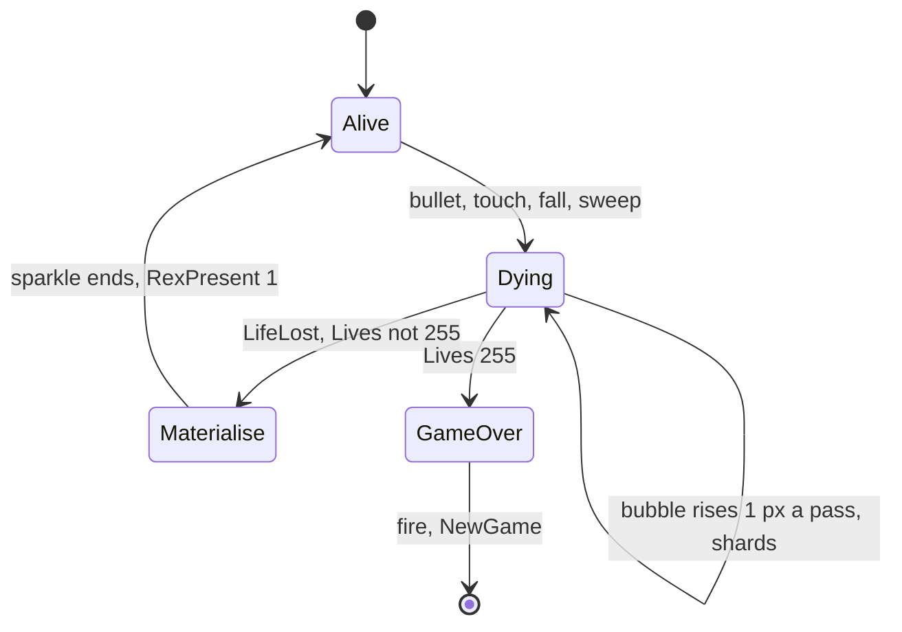

Worked example: the five deaths of `c1`.

| Dying set (TTD frame) | Room | Lives after | Lives dropped at |
| ---: | ---: | ---: | ---: |
| 16 542 | 0 | 3 | 16 718 |
| 17 149 | 1 | 2 | 17 325 |
| 17 911 | 1 | 1 | 18 082 |
| 18 217 | 0 | 0 | 18 394 |
| 18 761 | 1 | 255 | 18 996 |

Each death lasts about 176 frames. In the first one the bubble's Y went from 103 to 59 between frames 16 542 and
16 714: 44 pixels in about 40 passes. The fifth death ended the game at frame 18 996; the next game began at frame
19 231 in room 0 with Lives 4. The death animation is in 10.4.

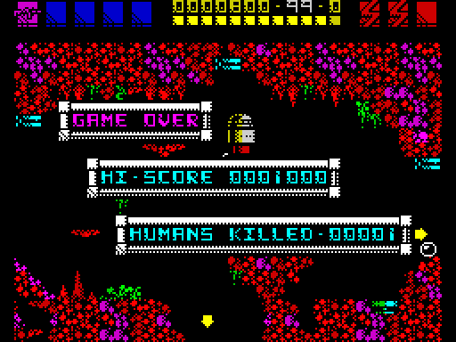

How to read it: the screenshot `c1-004000` of the walkthrough (TTD frame 19 000), just after the fifth death.

**The point**: a death costs a life, two power steps and the room's progress, and gives back a full shield and a
cleared room.

Witness: RexDies, LifeLost, GameOver (`src/game/death.asm`); the `c1` samples of Dying, Lives and Room.

## 10.13 The HUD sweep

The top row of the HUD has a light that runs left and right (HudSweep). It is a timer against camping in a room.
The light moves one cell a pass, from 0 to SweepWidth and back. Every 5 round trips the width shrinks by one; the
cell it loses turns red. When the width would reach 0 (the trips at width 1 done), Rex dies.

ResetSweep (width 12, count 5) runs at every room build and every death. The sweep stops while the screen flash runs
(FadeStepIndex not `$FF`).

```text
HudSweep (each pass):
    if FadeStepIndex != $FF: return
    draw the light at SweepPos
    if moving out: SweepPos += 1; at SweepWidth turn round
    else:
        SweepPos -= 1
        if SweepPos == 0:
            turn round; SweepCount -= 1
            if SweepCount == 0:
                SweepCount = 5; SweepWidth -= 1
                if SweepWidth == 0: RexDies()
                else: the cell at SweepWidth red
ResetSweep: SweepWidth = 12; SweepCount = 5
```

```asm
SweepRight:
  LD A,(SweepPos)
  DEC A
  LD (SweepPos),A
  OR A
  RET NZ
  XOR A
  LD (SweepDir),A
  LD A,(SweepCount)
  DEC A
  LD (SweepCount),A
  OR A
  RET NZ
  LD A,$05
  LD (SweepCount),A
  LD A,(SweepWidth)
  DEC A
  OR A
  JP Z,RexDies
  LD (SweepWidth),A
```

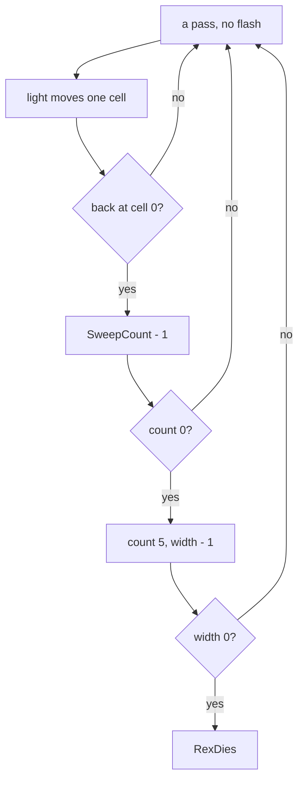

Worked example: room 0 of `c1` after the first death. The samples show SweepCount 3 at frame 16 700, 2 at 16 746, 1
at 16 843 and SweepWidth 11 with the count back at 5 at 16 937: 97 frames a round trip of 24 passes. Rex left the
room at frame 16 938, and room 1 started again at width 12. A full sweep in one room is 5 x 2 x (12 + 11 + .. + 1) =
780 passes, about 69 s at 4.4 frames a pass.

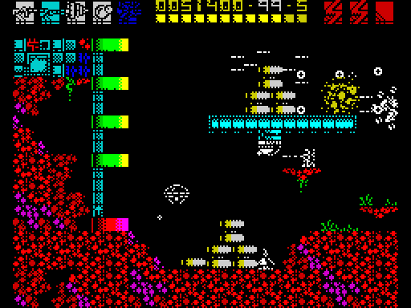

How to read it: RZX frame 31 000 of part 1; the HUD's top row holds the sweep light and, on its right, the cells
already lost.

**The point**: each room has a time limit of about a minute, shown as a shrinking light, reset by any exit or death.

Witness: HudSweep, ResetSweep (`src/game/hud.asm`); the `c1` samples of frames 16 700-16 938. The "infinite time"
POKE 43545 of the magazines misses REX 1: its DEC of SweepWidth is at `$A119`.

## 10.14 Enemies and hazards

Doc 7.5 lists the seventeen kinds and doc 7.6 their state machines. As rules of play they make four groups:

| Group | Kinds | Threat | How it dies |
| --- | --- | --- | --- |
| walkers and people | 0-7, 12 | a touch | 1-2 hits; a foot man shot in the front turns (kind 6) and needs 2 more |
| stalkers | 8 scanner, 15 blob | a touch; the scanner follows Rex's height | 16 hits; a hit pauses the scanner 4 passes |
| guns | 9 swing gun, 10 shooters, 11 launcher, 16 big gun | enemy bullets (20 at `$5D22`), the launcher's climbing shot | 8-10 hits; a big pod |
| mines | 13 mine layer, 14 mine | a touch; the mines drift | the layer 1000 points; a mine scores nothing |

The room is a hazard too. A fall with no exit below kills (10.3). The sweep kills (10.13). Cells of type 4, 5 and 6
are walls that a bullet wears down (doc 7.3); they never hurt. Part 2 adds cells that kill (10.16).

```text
each pass, for each live object (ObjectHitsRex):
    if it touches Rex:
        a pod: take it
        ShieldOn: KillObject; ShieldDrainFast(hits x 4)
        else: RexDies()
    each of Rex's bullets inside its box: hits - 1, KillObject at 1
each pass, EnemyBulletsHitRex:
    each enemy bullet inside Rex's box: ShieldOn: ShieldDrainFast(1), the bullet ends; else RexDies()
```

```asm
ObjectBoxTest:
  ...
  LD A,(ShieldOn)
  OR A
  JP Z,ObjectHitsUnshielded
```

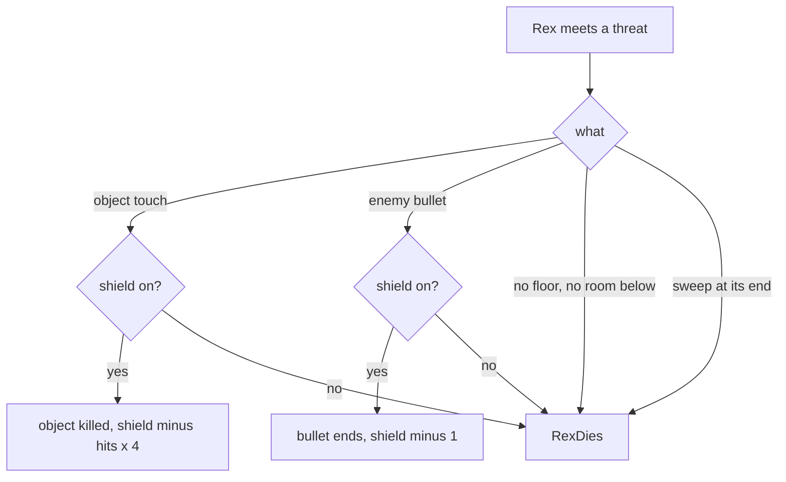

Worked example: the launcher in `rzx-p1-04000` took seven double-fire bullets from 8 hits to the kill (doc 7.8), and
left the big pod of 10.8. Touched with the shield on, the same launcher with 8 hits would have cost 32 units, a third
of a full shield.

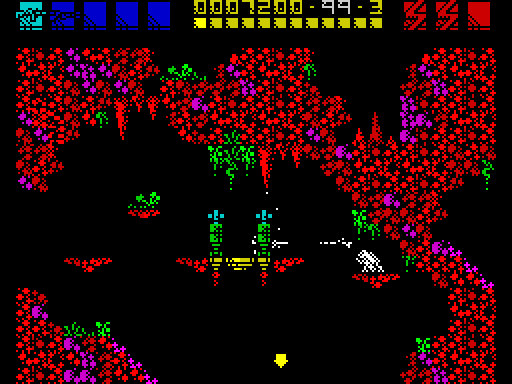

How to read it: one picture every 2 frames. Recording `rzx-p1-04000`, TTD frames 1376-1456 (RZX frames 5376-5456).
Made by `python3 ../../kit/screen_anim.py --work work/docs/rxC/r04 --from 1376 --to 1456 --step 2 --delay 80
docs/img/play/rzx-p1-05376-launcher-killed.gif`.

**The point**: everything kills by touch; the shield turns a touch into a kill paid in energy.

Witness: ObjectHitsRex, EnemyBulletsHitRex (`src/game/collisions.asm`); doc 7.8.

## 10.15 The access code

Part 1 ends at the exit to room 99 (ChangeRoom). CodePanel turns the state into a 16-digit code; part 2 asks for it
(EnterCode) and restores the state. The code holds 13 data digits, each written as 9 - d, then a checksum.

| Place | Holds | Place | Holds |
| ---: | --- | ---: | --- |
| 0 | double fire held | 8 | shield, units |
| 1 | score, thousands (of hundreds) | 9 | score, tens |
| 2 | spray held | 10 | bombs |
| 3 | lives | 11 | shield, tens |
| 4 | laser held | 12 | score, ten-thousands |
| 5 | score, hundreds | 13 | checksum, units |
| 6 | multiple held | 14 | checksum, hundreds |
| 7 | score, units | 15 | checksum, tens |

The checksum is the sum of the 13 shown digits, written as is. The score is in hundreds, as in 10.10. EnterCode
reads the places back in the same order. It rejects a code whose sum does not match, and (REX 2) one with 4 bombs or
more: INVALID CODE.

```text
CodePanel:
    digits(Score)  -> places 12, 1, 5, 9, 7  (ten-thousands .. units)
    Lives          -> place 3
    HasDoubleFire, HasSpray, HasLaser, HasMultiple -> places 0, 2, 4, 6
    ShieldEnergy   -> places 11, 8 (tens, units);  Bombs -> place 10
    for each of the 13: place = 9 - place; sum += place
    digits(sum)    -> places 13, 15, 14 (units, tens, hundreds)
    the CODE panel; WaitFire; NewGame
```

```asm
CodeDigitsLoop:
  LD C,(HL)
  LD A,$39
  SUB C
  ADD A,$30
  LD (HL),A
  SUB $30
  ADD A,E
  LD E,A
  INC HL
  DJNZ CodeDigitsLoop
  LD L,E
  LD H,$00
  CALL ToDigits
  LD A,(Digits+$0002)
  LD (CodeDigits+$000E),A
  LD A,(Digits+$0001)
  LD (CodeDigits+$000F),A
  LD A,(Digits)
  LD (CodeDigits+$000D),A
```

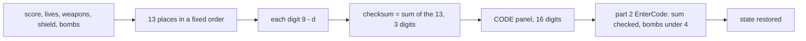

Worked example: the code `8883898669979809` that the RZX run of part 1 ends with (`c2` types it into REX 2).

| Place | 0 | 1 | 2 | 3 | 4 | 5 | 6 | 7 | 8 | 9 | 10 | 11 | 12 |
| --- | ---: | ---: | ---: | ---: | ---: | ---: | ---: | ---: | ---: | ---: | ---: | ---: | ---: |
| shown | 8 | 8 | 8 | 3 | 8 | 9 | 8 | 6 | 6 | 9 | 9 | 7 | 9 |
| 9 - d | 1 | 1 | 1 | 6 | 1 | 0 | 1 | 3 | 3 | 0 | 0 | 2 | 0 |

All four weapons are held (places 0, 2, 4, 6). Lives 6. The score digits (12, 1, 5, 9, 7) are 0, 1, 0, 0, 3: 1003
hundreds, 100 300 points, the HUD's 0100300 in `c2`. The shield is 23 (places 11, 8), the bombs 0. The sum of the
shown digits is 98: places 13, 15, 14 are 8, 9, 0, and the code ends `809`.

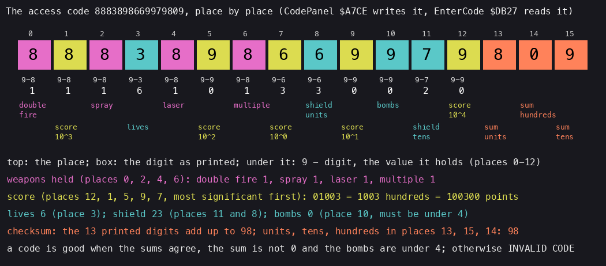

How to read it: the same code, place by place: the printed digit, 9 minus it, and the group (doc 1.7).

**The point**: the two loads are joined by a plain checksummed record of the state; the shown digits are the state
upside down.

Witness: CodePanel (`src/game/codepanel.asm`), EnterCode L1 2 (c2, `src/rex2/menu.asm`); WALKTHROUGH 4.0, `c2`.

## 10.16 REX 2

Part 2 is the same engine with its own rooms and graphics. The rules differ in these places:

- cell type 3 kills Rex when he walks, jumps or falls into it (RexWalkDeadly, RexJumpDeadly), and kills a falling
  object;
- cells `$15` and `$16` make walkers dissolve; a dissolving object cannot touch Rex, only be shot;
- kind `$82` is immune to bullets and kind `$84` can be shot only while open;
- cell type 4 is the boss, the big squidgy thing (10.17);
- the start state comes from the access code (10.15).

The weapon stations, the bomb pod, the bonus roulette and SPEED UP are still in the code. No recording of part 2
reaches them: GiveLaser, GiveSpray, TakeBombPod, BonusRoulette and SpeedUpTick have L1 0.

```text
REX 2 RexWalk / RexJump / RexFall:
    as REX 1, but IsSolid and IsPassable keep the type found (CellFound)
    if CellFound == 3: RexDies()
```

```asm
RexWalkDeadly:
  LD A,(CellFound)
  CP $03
  CALL Z,RexDies
  RET
```

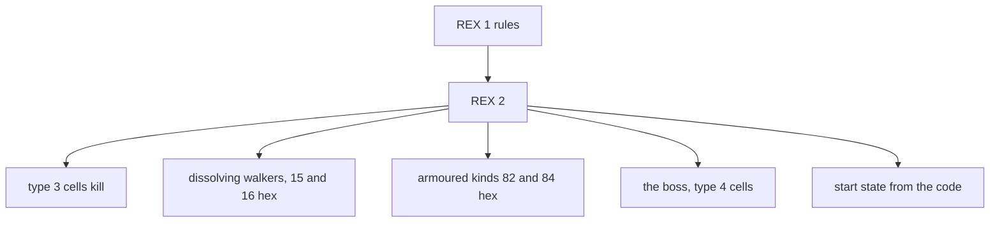

Worked example: the RZX run's part 2 starts from the code of 10.15: four weapons held and the gun at rank 0. As in
part 1 the rank alone chooses among them (10.7); the stations of part 2 have nothing left to give.

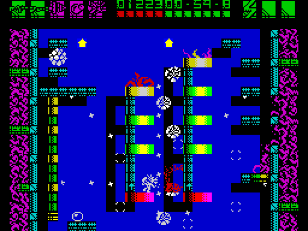

How to read it: RZX frame 21 000 of part 2.

**The point**: part 2 adds deadly scenery and armour; the rest of its rules are those of part 1.

Witness: `src/rex2/rexmove.asm` (RexWalk L1 8996, RexWalkDeadly), `src/rex2/collisions.asm` (BulletsHitObject).

## 10.17 The boss and both ends

Part 1 has no boss. It ends at the exit to room 99: the CODE panel (10.15), then a new game.

Part 2 ends at the big squidgy thing, a mass of type 4 cells. The first bullet that reaches one runs BossHit: BossDying
1, BossTimer 200, and the boss's colours (3, `$43`, 6) are cleared from the play area. The bullet flies on. From then
on BossExplodes runs every pass and Rex cannot walk. It draws 16 pieces of the death picture at random places of the
boss's area, with random explosion sounds. At timer `$82` (130) the area shrinks. At timer `$64` (100) the ending
text appears: "WITH THE BIG SQUIDGY THING DESTROYED REX CAN GO HOME AND HAVE A NICE CUP OF TEA AND PUT HIS FEET UP".
Then the program stops in a JP to itself.

A death while the boss dies gives no free smart bomb.

```text
BossHit (a bullet on a type 4 cell):
    if not BossDying:
        BossTimer = 200; BossAreaPtr = the first area; BossDying = 1
        clear colours 3, $43, 6 from the play area
    the bullet flies on
BossExplodes (each pass while BossDying):
    16 pieces: draw, colour, next frame; past timer $78 a done piece comes back at random
    BossTimer -= 1
    if BossTimer == $82: ShrinkArea()
    if BossTimer == $64: the ending text; loop forever
```

```asm
BossHit:
  LD A,(BossDying)
  OR A
  JP NZ,BossHitDone
  LD A,$C8
  LD (BossTimer),A
  ...
  LD A,$01
  LD (BossDying),A
  ...
TheEnd:
  LD IX,EndingText
  LD B,$05
  CALL PrintBoxed
EndLoop:
  JP EndLoop
```

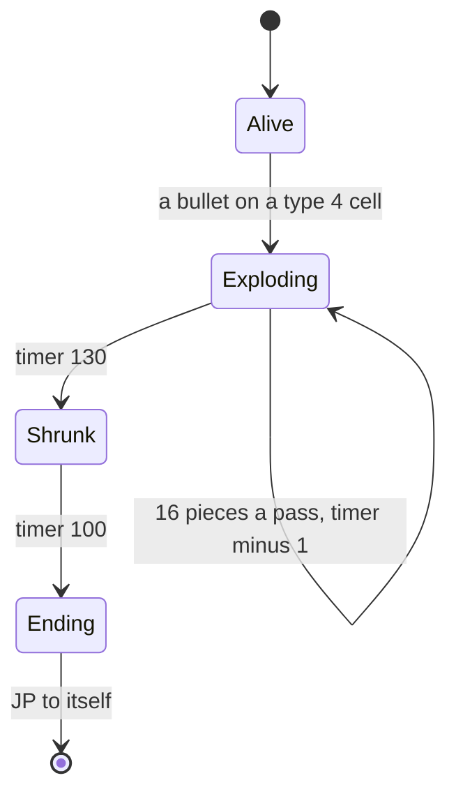

Worked example: the end of the RZX run of part 2. BossHit ran once (L1 1, `rzx-p2-40000`) and BossExplodes 100
times: the timer runs from 200 to 100, one a pass.

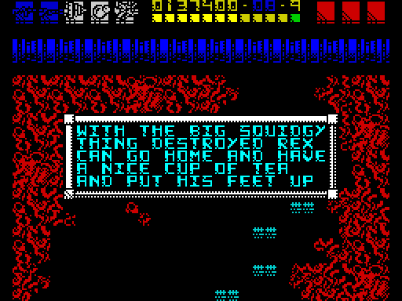

How to read it: RZX frame 41 500 of part 2, the ending box over the remains of the boss.

**The point**: one bullet ends the game; the boss is a wall of cells, not an object with hits.

Witness: BossHit L1 1 (`src/rex2/weapons.asm`), BossExplodes L1 100 (`src/rex2/score.asm`), recording `rzx-p2-40000`.

## 10.18 The DEMO

The DEMO (doc 1) runs REX 1's rules with a script in place of the player:

- the tutor rooms 4, 1, 0, 2 (TutorRooms), each with its own input script, panels and events at fixed tutor frames;
- the events switch the shield, fire a smart bomb, step the power and kill Rex (TutorDie) to show each mechanism;
- SPACE pauses (DemoPause) instead of firing a bomb;
- the spray at power 1-3 fires a fan of 3, 5 or 7 shots ahead, as REX 1;
- an enemy bullet on the shield has its own sound (ShieldHitSound, doc 9.7);
- AddScore gives no extra life: ExtraLifeCount is taken back by 200;
- a heat cell in the HUD (HeatColour, ShowHeat). HeatStep adds 1 every 100 passes up to 7, but the colour starts
  at 7, so it never changes. HeatLeftover, which counts the heat down and kills Rex at 2, is never called.

```text
TutorPanels (each pass):
    TutorFrame += 1
    for the room's events: if AtFrame(event.frame): run it
        (a panel, the shield on or off, a smart bomb, a power change, TutorDie, TutorNextRoom)
the input: TutorInput from the room's script instead of the keys
```

```asm
HeatStep:
  LD HL,(HeatCount)
  DEC HL
  LD (HeatCount),HL
  LD A,L
  OR H
  RET NZ
  LD HL,$0064
  LD (HeatCount),HL
  LD A,(HeatColour)
  INC A
  CP $08
  RET Z
```

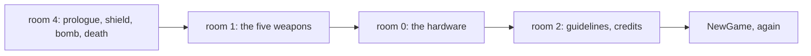

Worked example: room 4's events (TutorEvents4): the shield on and off at tutor frames 150, 172, 455 and 470, a
smart bomb at 930, a death at 1030 and the next room at 1060.

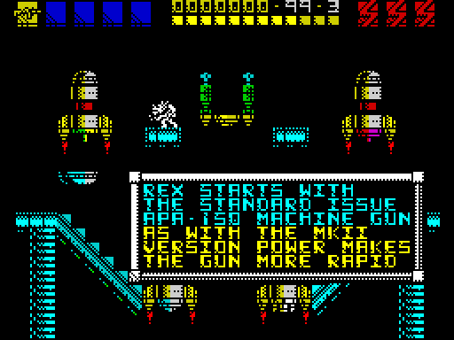

How to read it: recording `d1`, its input frame 5500: a tutor panel over the paused play.

**The point**: the DEMO teaches the rules by staging each one; its heat mechanic is a dead feature.

Witness: TutorEvents4 L1 3114, HeatStep L1 6752, HeatLeftover L1 0 (`src/demo/tutor.asm`, `src/demo/score.asm`).

## 10.19 Notable features

- **The weapon is chosen by the power bar.** The stations only unlock weapons; the rank picks the best one held. A
  player who spends power drops back down the weapons (10.7).
- **Power costs shots, the gun is free.** Fifty shots of a special weapon cost a power step; a pod gives a third of
  a step (10.6, 10.7).
- **A death is half a reset.** It takes a life and two power steps, but refills the shield and clears the room with a
  free smart bomb (10.12).
- **A timer per room.** The HUD sweep gives about a minute in a room before it kills (10.13).
- **A slow smart bomb.** It walks the object table, one kill a pass (10.11).
- **A roulette with a hidden rule.** Without fire it always stops on its first prize, and SPEED UP never comes first
  (10.9).
- **No clock.** All timers count passes; a busy room plays slower (10.1).
- **One bullet ends part 2.** The boss is scenery (10.17).

```text
the core loop of play:
    kill -> points and pods -> power -> rank -> weapon
    shots of a special weapon -> power down -> weapon down
    room time -> sweep -> death -> shield refilled, room cleared, power down
```

```asm
GainRank:
  LD A,(WeaponRank)
  INC A
  CP $05
  RET Z
  LD (WeaponRank),A
```

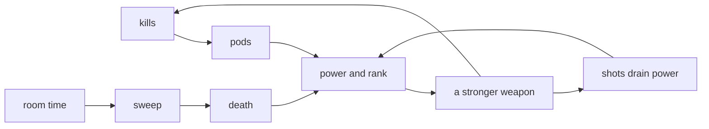

Worked example: the run of `rzx-p1-04000` in one line. The double fire ran dry (frame 552, rank 0), a death took two
more steps (frame 1094), and the launcher's big pod gave one back (frame 1530).


How to read it: the right panel is the run of the worked example (10.2 gives the command).

**The point**: Rex is a game of managing one bar: power buys weapons and is spent by them.

Witness: the sections above.

## 10.20 Notes, quirks and what no recording reached

- The lift (cell `$12`): CellsUnderRex stops Rex and calls Land and StartJump at every cell boundary, so a lift is a
  chain of jumps. No sample was taken on a lift.
- WalkRightKey's labels: the 2-pixel path is the normal walk, the 4-pixel path the SPEED UP one; SpeedUpTick counts
  the 200 passes only while a walk key is held (`p1-speedup`, SpeedUpTick L1 200).
- SmartBombStep does not test the alive byte: it calls KillObject on empty records too. Known only from the code.
- ExitLeft places Rex at X `$E8`, not `$E0`.
- BestWeapon reads WeaponIcon `$A04F` as the gun's "held" flag; it is 1 in every sample.
- The access code checksum is written units, tens, hundreds into places 13, 15, 14.
- The `c1` play never switched the shield on and played rooms 0 and 1.

```text
OnLadder (cell $12 under Rex):
    RexSpeed = 0; OnLift = 1
    if RexY & 7 == 0: FallSpeed = 0; Land(); StartJump()
```

```asm
OnLadder:
  XOR A
  LD (RexSpeed),A
  LD A,$01
  LD (OnLift),A
  LD A,(RexY)
  AND $07
  OR A
  RET NZ
  XOR A
  LD (FallSpeed),A
  CALL Land
  CALL StartJump
  RET
```

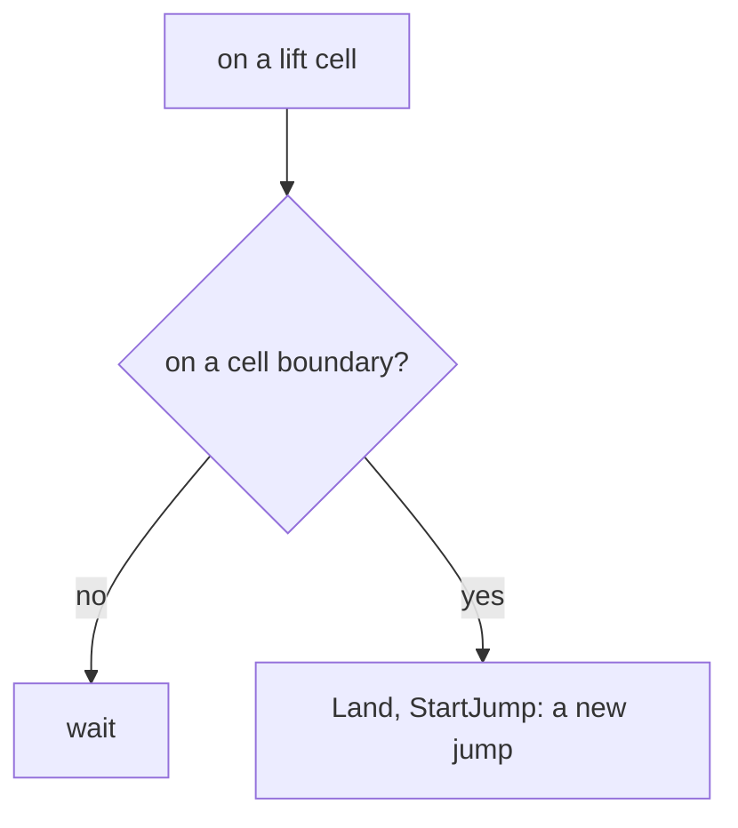

Worked example: the shield in `c1`. ShieldOn is 0 and ShieldEnergy 99 in every play sample of frames 16 300-20 470.
The deaths refilled a shield that was already full.

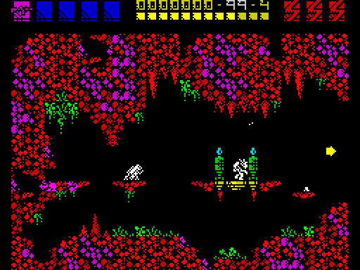

How to read it: the screenshot `c1-001500` (TTD frame 16 500), room 0 with the shield figure 99 in the HUD.

**The point**: what the code can do and what the recordings showed differ: the lift and part 2's pods were read from
the code only.

Witness: `src/game/cells.asm` (OnLadder), `src/game/rexmove.asm`, `src/game/bomb.asm`; the `c1` samples.
