# 1. Game design

What this covers: the game as a player meets it.

- the premise and the goal: Rick against the Fat Guy, five levels to his headquarters;
- every screen: the loading screen, the two menus, the tape messages, play and its HUD, GAME OVER, the
  CONGRATULATIONS end and the true ending;
- the controls, as the player uses them, and the two hidden key chords;
- the rules as the code plays them: lives, the ray gun, the detonators, the punch, the score table, the countdown
  bonus, the level 5 lock and the two endings;
- the cast: Rick, the enemies of each level, the traps, the pickups, the Fat Guy;
- the five levels and their 53 sections, every one drawn from the level data, with each level's section graph;
- a route through the game: the RZX run's, section by section.

The recordings it rests on ([WALKTHROUGH 6.0](../WALKTHROUGH.md#60-the-recordings)):

| Recording | Load | Used for |
| --- | --- | --- |
| `c1` | power-on, side A at ROM speed on a 128K | the load, the menus, level 1, the HUD, GAME OVER by E |
| `load-l2` ... `load-l5` | the control menu after side A, then side B at ROM speed; `load-l5` with the POKE `$8065` = `$FF` | the tape messages, the start of levels 2-5 |
| `rzx-l5-full` | the RZX run's level 5 start state, no POKE | the menus with level 5 open, deaths, GAME OVER |
| `rzx-lL-NNNNN-poke` | the RZX run's states, its key reads as an input script, four immunity POKEs | the levels, the Fat Guy, the ending |
| `end-congrats` | `rzx-l4-20000-poke`'s state with the POKE LevelsDone `$7EF2` = 0 | the CONGRATULATIONS end |
| `cheats`, `long-l4` | the RZX level 5 state; `rzx-l4-20000-poke` with `$8067` = `$FF` | the two key chords, the long levels |
| the RZX logs | the RZX archive's five files played in unreal-ng: the screen every 25 frames (`work/stage1/rzx/lN/screens.bin`), the 64 K every 250 (`mem.bin`) | the key moments, the route |

The RZX run (Jim Waterman, "with rollback") is someone else's play. Its frames are "RZX frames", counted from the
start of each level's file. It never loses a life: the player rolled back each mistake.

## 1.1 The game in one page

Rick Dangerous 2 (Micro Style, 1990; Core Design) is a platform game for one player in five levels.

The story, from the Kixx instructions (`work/candidates/zxdb-info/RickDangerous2.txt`):

- Rick Dangerous, "intrepid Super Hero and part-time stamp collector", is back after the first game.
- The Fat Man (the game says "the Fat Guy") has returned, with aliens, to conquer the Earth.
- Rick starts at the Fat Guy's space ship in Hyde Park, London.
- Then come the Ice Caverns of Freezia, the Forests of Vegetablia and the Atomic Mud Mines.
- At the end he meets the Fat Guy at his headquarters.

How it plays:

- **A level is a set of sections.** Each section is one screen wide and up to 44 cell rows tall.
- **The view scrolls** up and down inside a section, 8 cell rows at a time ([doc 6](06-rendering.md)).
- **Exits** sit at a section's left or right edge on set rows. Rick leaves there and enters the next section.
- **Traps everywhere.** A block falls, a spike shoots out, a door closes. A trap fires when something enters its
  trigger box: Rick, a bolt, a blast, a punch or an enemy ([doc 7](07-objects.md)).
- **Three tools.** A ray gun with six bolts, six detonators, and a punch that stuns an enemy.
- **Five levels, two endings.** Levels 1-4 can be chosen from the menu. Level 5 opens only after four levels
  completed in one game. Only a game that completes all five sees the true ending.

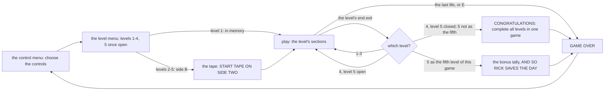

**The point**: the game is a chain of trap rooms. The two endings send a player back to level 1: a game started at
level 2, 3 or 4 can only end with the CONGRATULATIONS text.

## 1.2 The screens

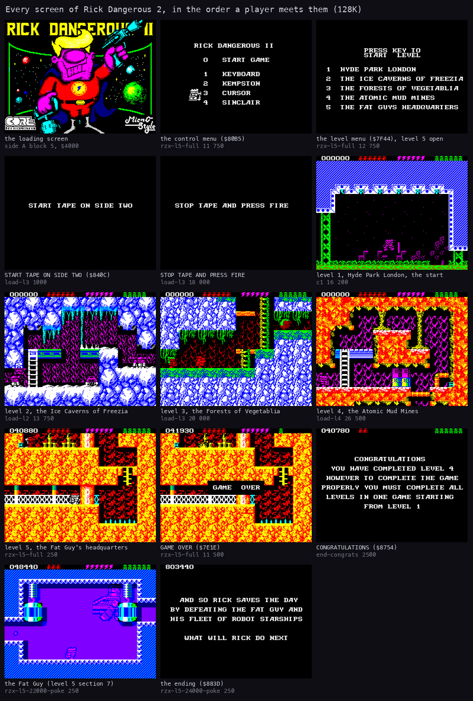

*Fourteen screens of the 128K version, at the frames named under each: the screenshots of `docs/img/play/`
([WALKTHROUGH 6.1](../WALKTHROUGH.md#61-screens-and-levels)) and `end-congrats` frame 2500 from its `screens/`.
Made with `python3 tools/fig_design.py screens docs/img/design/screens.png`.*

How to read it, in the order a player meets them:

- **The loading screen**: side A's picture block, bit-reversed on the tape ([doc 3](03-build-and-load.md)). It shows
  while the code loads.
- **The control menu** (`ControlMenu` `$80B5`): "RICK DANGEROUS II", then 0 START GAME, 1 KEYBOARD, 2 KEMPSTON,
  3 CURSOR, 4 SINCLAIR. The title tune (tune 0) plays.
- **The level menu** (`LevelMenu` `$7F44`): "PRESS KEY TO START LEVEL" and the levels by name. Line 5 is there only
  when level 5 is open (`Level5Open` `$8065`).
- **The tape messages** (`LoadLevel` `$840C`): a level other than the one in memory comes from side B. "START TAPE
  ON SIDE TWO" shows while the blocks pass, "STOP TAPE AND PRESS FIRE" when the level is in.
- **Play**: the view (screen rows 1-23) under the HUD (row 0).
- **GAME OVER** (`GameOver` `$7E1E`): "GAME  OVER" in the middle, tune 2, then 512 frames or fire.
- **CONGRATULATIONS** (`Congratulations` `$8754`): the end of a game that completed level 4 (or 5) without five
  levels done.
- **The Fat Guy** and **the ending** (the text at `$883D`): the true end, after the bonus tally.

The menu texts fall into place letter by letter ([doc 8](08-hud-and-text.md)). A level key pressed during the fall is
taken at once.

| Screen | Where in the code | Recording |
| --- | --- | --- |
| the control menu | `ControlMenu` `$80B5` | `c1`, `rzx-l5-full` |
| the level menu | `LevelMenu` `$7F44` | `c1`, `rzx-l5-full` (with level 5) |
| the tape messages | `LoadLevel` `$840C` | `load-l2` ... `load-l5` |
| play | `MainLoop` `$7D2D` | every play recording |
| GAME OVER | `GameOver` `$7E1E` | `c1` (by E), `rzx-l5-full` (the last life) |
| CONGRATULATIONS | `Congratulations` `$8754` | `end-congrats` |
| the bonus tally and the ending | `BonusTally` `$86E0`, `TallyLives` `$8728` | `rzx-l5-23000`, `rzx-l5-24000-poke` |

The texts of the two ends (`src/res/texts/`):

| End | Text |
| --- | --- |
| CONGRATULATIONS | CONGRATULATIONS / YOU HAVE COMPLETED LEVEL 5 / HOWEVER TO COMPLETE THE GAME / PROPERLY YOU MUST COMPLETE ALL / LEVELS IN ONE GAME STARTING / FROM LEVEL 1 |
| the Fat Guy | AND SO RICK SAVES THE DAY / BY DEFEATING THE FAT GUY AND / HIS FLEET OF ROBOT STARSHIPS / WHAT WILL RICK DO NEXT |

The "5" of the first text is overwritten with the level just completed: `end-congrats` shows "LEVEL 4".

There is no title picture after the load and no intro screen per level. A level starts straight from the level menu
(level 1, in memory) or after "STOP TAPE AND PRESS FIRE" (levels 2-5), with the level's tune.

**The point**: the program has two menus, one message pair for the tape and three end screens. Everything else is
play.

## 1.3 Play and the HUD

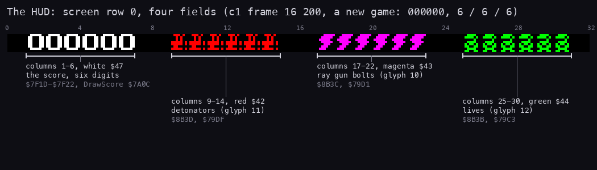

*The top row of `c1` at the start of level 1 (`docs/img/play/level1-start.png`), 4 x. Made with
`python3 tools/fig_design.py hud docs/img/design/hud.png`.*

How to read it, left to right:

- **The score**, six digits. `Score` `$7F1D-$7F22` holds one digit a byte, the most significant first.
- **The detonators**: one icon each, up to six (`Detonators` `$8B3D`).
- **The ray gun's bolts** (`Ammunition` `$8B3C`).
- **The lives**: Rick's head (`Lives` `$8B3B`).

A count of 4 draws four icons and two blanks. The HUD has no level number and no timer: the countdown bonus (1.6)
runs unseen.

The view under it is 256 x 184 pixels in the colours of the level's cells. Sprites take the colours of the cells they
pass ([doc 6](06-rendering.md)).

**The point**: everything a player must count is on one line, as icons. A glance shows six of each at the start.

## 1.4 The controls

The control menu picks one of four methods. `ReadControls` `$7254` reads it in every interrupt into `Controls`
`$7253` ([doc 5](05-controls.md)).

| Method (menu key) | Left | Right | Up | Down | Fire |
| --- | --- | --- | --- | --- | --- |
| keyboard (1) | Z | X | O | K | SPACE or ENTER |
| Kempston (2) | port `$1F` bit 1 | bit 0 | bit 3 | bit 2 | bit 4 |
| cursor (3) | 5 | 8 | 7 | 6 | 0 |
| Sinclair (4) | 6 | 7 | 9 | 8 | 0 |

What the directions do, without and with fire (`RickReadJump` and `RickFireActions` `$9800`,
[doc 10](10-gameplay-logic.md)):

| Direction | Without fire | With fire |
| --- | --- | --- |
| left, right | walk | punch to that side |
| up | jump; on a ladder, climb | shoot the ray gun (one bolt) |
| down | crawl; on a ladder, climb down | drop a detonator |
| down with left or right | crawl that way | throw the detonator that way (2 pixels a pass) |

With fire held, up wins over down, and down over the sides.

The other keys, in every method:

| Key | What | Code |
| --- | --- | --- |
| P | pause | `TestPauseKey` `$7242`, `MainLoopPause` |
| E | quit to GAME OVER | `TestQuitKey` `$724A` |
| C + S + 3 together | the cheat: lives, bolts and detonators no longer go down (a toggle, tune 1) | `TestInfiniteLivesKeys` `$71C0`, `CheatInfinite` `$8066` |
| SPACE + N + ENTER + J + Y together, level 5 open | the long levels: three level ends lead to hidden sections (tune 1) | `TestSectionCheatKeys` `$71DC`, `CheatExits` `$8067` |

The `cheats` recording shows both chords:

- C+S+3 runs `$7D39` three times;
- the five-key chord runs `$7D4C` three times;
- tune 1 plays six times.

`long-l4` shows the long levels. Neither chord is in the instructions.

**The point**: one fire button does three jobs. The direction held with it picks the gun, the detonator or the
punch, so the player never selects a weapon.

## 1.5 The cast

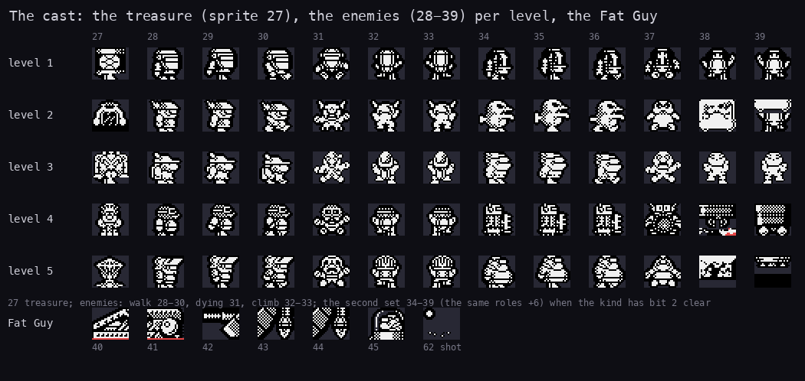

*Sprites 27-39 of each level and level 5's sprites 40-45 and 62, from `src/res/levels/levelN/level/sprites.png`,
2 x. Made with `python3 tools/fig_design.py cast docs/img/design/cast.png`.*

How to read it:

- **Rick** is sprites 0-16 of every level ([doc 6](06-rendering.md)). He is not on this sheet.
- **The treasure** (sprite 27) is a different picture in each level.
- **The enemies** have two sets of sprites: walking (28-30), dying (31) and climbing (32-33), then the same six again
  (34-39). An enemy whose map kind has bit 2 clear uses the second set.
- **The Fat Guy** is five sprites put together (40-44), with 45 and his shot 62 ([doc 10](10-gameplay-logic.md)).

What the player meets, and what the code does with it:

| Thing | What it does | What it gives or takes | Code |
| --- | --- | --- | --- |
| an enemy | wanders, patrols, chases Rick or climbs after him | a bolt or a blast kills it (1.6); a punch stuns it 40 passes; its touch kills Rick | `UpdateEnemy` `$9EAF` |
| a trap | follows a path of steps, plays an animation, waits on a trigger box | most kill on touch; some are shot, blown up or punched to switch them | `UpdateTrap` `$A2F7` |
| a treasure | stands | 500 points (effect 7) | `UpdatePickup` `$A528` |
| a box of bolts | stands | the bolts back to 6 (effect 6) | `UpdatePickup` |
| a box of detonators | stands | the detonators back to 6 (effect 6) | `UpdatePickup` |
| the bike | Rick rides it across some sections, 4 pixels a pass | set by the exits marked "bike" in 1.7 | `UpdateRide` `$945E` |
| the Fat Guy | walks a fixed path, shoots one shot every 50 passes at most | 20 hits in one life; 5000 points | level 5 `$F7E6`, `$F8D0` |

The map entries per level (`src/res/levels/levelN/level/sections.txt`). An entry spawns each time its row comes into
view, unless it is one-shot.

| Level | Enemies | Traps | Treasures | Bolt boxes | Detonator boxes | Bonus marks | Trigger boxes |
| --- | ---: | ---: | ---: | ---: | ---: | ---: | ---: |
| 1 Hyde Park London | 25 | 76 | 9 | 6 | 5 | 10 | 103 |
| 2 the Ice Caverns of Freezia | 44 | 106 | 14 | 7 | 8 | 18 | 153 |
| 3 the Forests of Vegetablia | 47 | 136 | 6 | 9 | 2 | 16 | 181 |
| 4 the Atomic Mud Mines | 45 | 134 | 14 | 7 | 8 | 16 | 175 |
| 5 the Fat Guy's headquarters | 29 | 110 | 3 | 4 | 3 | 8 | 122 |

**The point**: traps outnumber enemies two or three to one in every level. The game is about reading a room's traps;
the enemies make a player hurry.

## 1.6 The rules

### Lives, bolts, detonators

| Counter | At a new game | At a level's start | After a death | Spent by |
| --- | --- | --- | --- | --- |
| lives `$8B3B` | 6 (`ResetGame` `$7CAD`) | + 1 when below 6 (`$7CEE`) | - 1 (`LoseLife` `$8A26`) | a death |
| bolts `$8B3C` | | 6 | 6 | a shot (`FireBullet` `$9593`) |
| detonators `$8B3D` | | 6 | 6 | a drop (`DropDetonator` `$9B27`) |

- A death puts Rick back at the section's restart point (`$9B8C`), with the section's objects rebuilt
  ([doc 10](10-gameplay-logic.md)).
- The last life lost is GAME OVER.
- A level's start adds a life only when Rick has fewer than six. Every recorded level start had six lives, so `$7CEE`
  is known only from the code.
- A box of bolts or detonators fills its counter to 6. Six is also the most the HUD shows.
- With `CheatInfinite` set, none of the three goes down.

### The score

Every award adds a six-digit record to the score (`AddScore` `$7ED3`, [doc 8](08-hud-and-text.md)):

| Event | Points | Record | Where |
| --- | ---: | --- | --- |
| an enemy killed in the shown part of the view (y `$40-$FF`) | 50 | `Points50` `$7EF3` | `KillEnemy` `$9F56` |
| an enemy killed by a blast | 50 more (100 in all) | `Points50` | `TestEnemyHits` (`$8C36`) |
| a treasure taken | 500 | `Points500` `$7EFF` | `UpdatePickup` (`$A595`) |
| the countdown bonus, between a start mark and a stop mark | 2000, less 10 every 25 passes | `TimeBonus` `$7F17` | `SpawnFromMap`, `CountBonus` `$9163` |
| the Fat Guy beaten | 5000 | `Points5000` `$7F05` | level 5 `$F964` |
| the game won: once | 100 000 | `Points100000` `$7F11` | `BonusTally` `$86E0` |
| the game won: each bolt left | 5000 | `Points5000` | `BonusTally` |
| the game won: each detonator left | 10 000 | `Points10000` `$7F0B` | `BonusTally` |
| the game won: each life left | 100 000 | `Points100000` | `TallyLives` `$8728` |

A worked example: the RZX run's end, from the memory samples of `work/stage1/rzx/l5/mem.bin`.

| RZX frame | Score | Lives, bolts, detonators | Fat Guy hits left (`$8A24`) | What happened |
| ---: | ---: | --- | ---: | --- |
| 20 750 | 048 440 | 6, 6, 6 | 20 | Rick enters section 7 |
| 22 500 | 048 440 | 6, 6, 2 | 2 | four detonators thrown at the Fat Guy |
| 22 750 | 053 440 | 6, 6, 2 | 0 | the Fat Guy beaten: + 5000 |
| (between) | 153 440 | | | `BonusTally`: + 100 000 |
| (between) | 183 440 | 6, 0, 2 | | six bolts at 5000 |
| (between) | 203 440 | 6, 0, 0 | | two detonators at 10 000 |
| 23 000 | 303 440 | 5, 0, 0 | | the first life at 100 000 |
| 23 250 | 803 440 | 0, 0, 0 | | the other five lives |

The sampled scores fit these steps exactly. The steps between the samples follow the code: no sample falls inside
the bolt and detonator tally. A life is worth twenty Fat Guys.

There is no extra life for points and no high-score table: the score is shown and forgotten at the next game.

### The countdown bonus

Some sections hold a pair of invisible map entries: a start mark (kind `$78`) and a stop mark (kind `$7C`) further on.

1. Rick brings the start mark into view: tune 1 plays and the bonus is set to 2000 (`StartBonusTimer`).
2. Every 25 passes (one second at 25 passes a second) it loses 10 (`CountBonus` `$9163`).
3. Rick reaches the stop mark: tune 1 again, and what is left goes to the score (`StopBonusTimer`).

A worked example: a player who needs 8 seconds (200 passes) between the marks loses 8 x 10 and scores 1920.
After 200 seconds the bonus reaches 0, and nothing stops the count. `CountBonus` takes 10 off the digits
`$7F18-$7F1B` with a borrow, and a borrow out of all four ends at `BonusRunOut` `$917C`, a lone `RET`. So one step
after 0 the digits wrap: the bonus becomes 099 990. A player who dawdles over 201 seconds between the marks would
collect nearly 100 000 points. No recording let the bonus run out, so this is known only from the code. The recordings started the countdown 18 times and stopped it 19 times.

### The level 5 lock and the two endings

The decision at a level's end, in the main loop (`$7D9E`):

```text
if LevelsDone = 3: Level5Open = $FF           -- the fourth level of this game opens level 5, for good
LevelsDone = LevelsDone + 1                    -- levels completed in this game
if LevelsDone = 5: the bonus tally and the true ending
else if Level = 5: CONGRATULATIONS
else if Level = 4 and Level5Open is clear: CONGRATULATIONS
else: Level = Level + 1, the next level
```

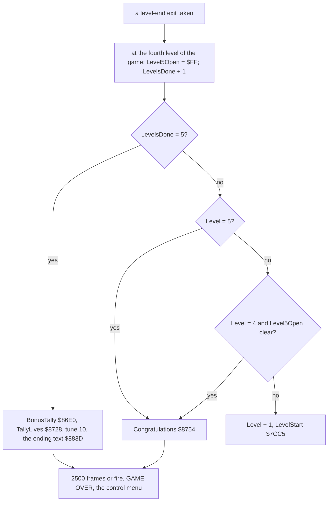

Worked through three games:

| Game | Levels played | LevelsDone at level 4's end | Level5Open | End |
| --- | --- | --- | --- | --- |
| from level 1 | 1, 2, 3, 4, 5 | 3 -> 4 (opens level 5) | set | level 5's end: LevelsDone 5, the true ending |
| from level 2, a fresh machine | 2, 3, 4 | 2 -> 3 | clear | CONGRATULATIONS at level 4 |
| from level 5, opened in an earlier game | 5 | | set | LevelsDone 0 -> 1: CONGRATULATIONS |

`Level5Open` is never cleared. Once opened, level 5 stays in the menu until the machine is reset. `ResetGame` clears
`LevelsDone` at every new game.

The witnesses:

- `rzx-l4-20000-poke`: `$7DA6` opens level 5, then level 5 starts.
- `end-congrats`: the same state with LevelsDone POKEd to 0. Level 4's end goes to `Congratulations`, and the text
  says "LEVEL 4".
- `rzx-l5-23000`: the end of the lives tally and the ending text.

Known only from the code: the bolt and detonator loops of `BonusTally`, and the step after both end texts (`$8794`,
back to GAME OVER). The RZX run passed the tally before its first saved state, and no recording waits the 2500
frames.

**The point**: the score rewards finishing far more than playing. With six lives, the tally of the true ending is
600 000 points, more than ten times everything the five levels give.

### The difficulty

Nothing in the code changes speeds or numbers with the level or the score. The levels differ only in their data: the
sections, the traps and enemies on them, and the level's special floor (cell flag bit 0,
[doc 10](10-gameplay-logic.md)):

| Level | Special floor | Effect on Rick |
| --- | --- | --- |
| 1 | weak jump | a lower jump (known only from the code, `$9799`) |
| 2 | ice | Rick slides on |
| 3 | bounce | a landing bounces back |
| 4 | mud | walking is 1 pixel a pass instead of 2 |
| 5 | launch pad | Rick is thrown up |

## 1.7 The levels

Five levels, each a level block at `$A800` ([doc 7](07-objects.md)). Level 1 is in memory after side A. Levels 2-5
are read from side B when chosen ([doc 3](03-build-and-load.md)).

| Level | Name (the level menu) | Sections (`SectionCounts` `$8374`) | Start (`LevelStarts` `$7C8F`) | Level end | Tune |
| --- | --- | ---: | --- | --- | ---: |
| 1 | HYDE PARK LONDON | 9 (8 and a filler) | section 0, top row 0 | section 1, right | 5 |
| 2 | THE ICE CAVERNS OF FREEZIA | 13 (10 + 3 hidden) | section 0, top row 0 | section 7, right (or 12 with the cheat) | 6 |
| 3 | THE FORESTS OF VEGETABLIA | 10 (7 + 3 hidden) | section 1, top row 144 | section 6, right (or 9) | 7 |
| 4 | THE ATOMIC MUD MINES | 13 (10 + 3 hidden) | section 0, top row 0 | section 7, right (or 10) | 8 |
| 5 | THE FAT GUYS HEADQUARTERS | 8 | section 0, top row 96 | section 7, right, after the Fat Guy | 9 |

"Hidden" sections are reached only with the long-levels chord:

- a level-end exit with bit 4 clear (`$82`) becomes a passage when `CheatExits` is set;
- the level then ends at the far end of the hidden sections ([doc 10](10-gameplay-logic.md)).

Level 1's section 8 is a filler entry inside the count: no exit leads to it (the `sec-l1-s8` recording sets it up by
a POKE).

The contact sheets below draw every section from `src/res/levels/levelN/level/` with `tools/fig_rooms.py` (blocks,
cells, maps, the section table). Each shows the rows the screen can show.

How to read a sheet:

- the map entries: traps and pickups yellow, enemies red, the bonus marks cyan, each with its kind number;
- a dashed box for each trigger box;
- the exits: green at the edge on Rick's feet row, magenta for a level end;
- under each section, its exits as text.
  - `R30>2` leaves at the right with the feet on row 30, into section 2.
  - `END` ends the level.
  - `(cheat: 10)` leads to section 10 under the long-levels chord.
  - `bike` arrives riding.

The sections were compared with the published maps of World of Spectrum and maps.speccy.cz (Pavero, 2009; copies in
`work/candidates/zxdb-maps/`). Those join the sections into one picture per level by their exits. Every section there
matches one of ours. The hidden sections are not on them.

### Level 1: Hyde Park London

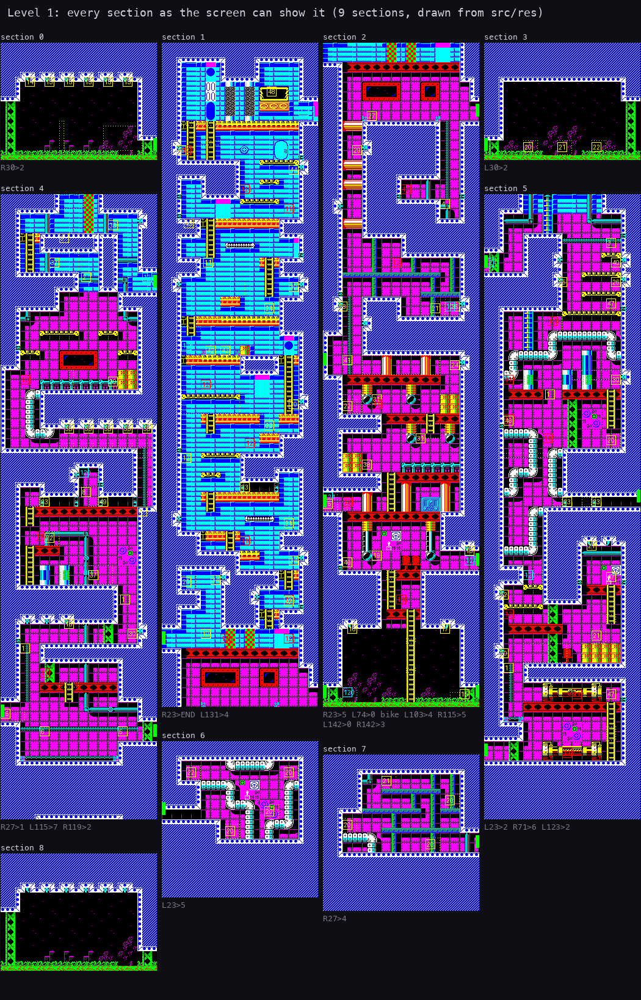

*Level 1's 9 sections. Made with `python3 tools/fig_rooms.py work/docs/wr/rooms1 --scale 1`, then
`python3 tools/fig_design.py sections 1 docs/img/design/level1-sections.png`.*

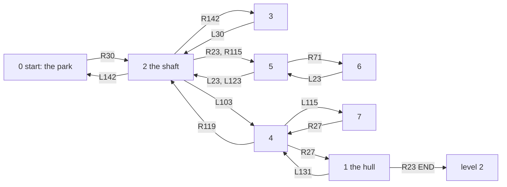

How to read it: an arrow is an exit, labelled with its side and Rick's feet row.

- Section 0 is the park at the bottom.
- Section 2 is the tall shaft in the middle of the ship; sections 4 and 5 are left and right of it.
- Section 1 is the hull above; its right exit ends the level.
- Sections 3, 6 and 7 are side rooms.
- Section 2 has one more exit, `L74` (bike) into section 0 at row 74. Section 0 has 32 rows, so it looks unreachable;
  no recording took it, and the graph leaves it out.

### Level 2: the Ice Caverns of Freezia

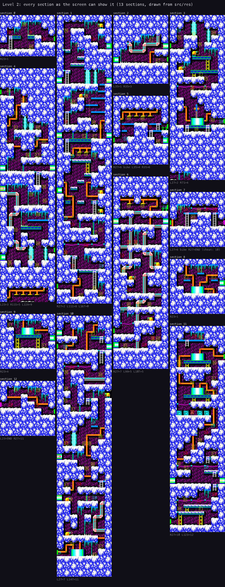

*Level 2's 13 sections. Made with `python3 tools/fig_design.py sections 2 docs/img/design/level2-sections.png`.*

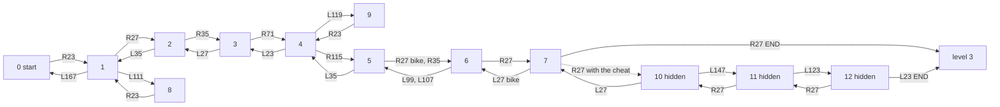

How to read it: the level is a chain 0-1-2-3-4-5-6-7 with two side rooms (8 and 9). The dashed edge exists only under
the long-levels chord.

### Level 3: the Forests of Vegetablia

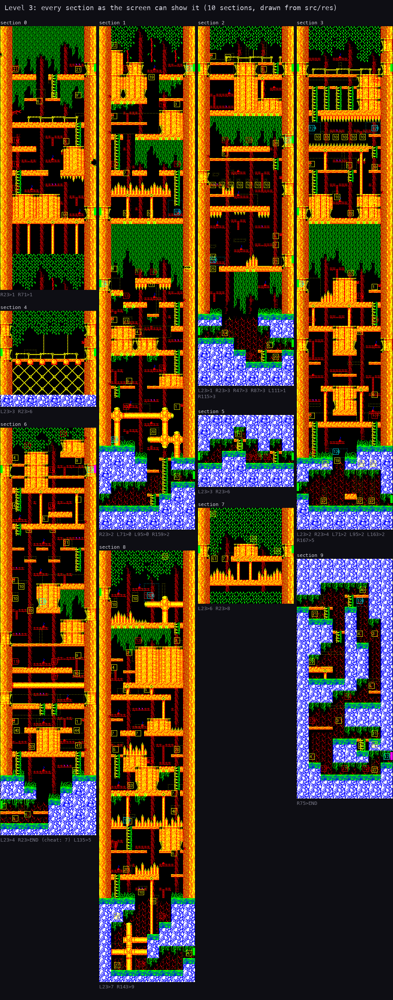

*Level 3's 10 sections. Made with `python3 tools/fig_design.py sections 3 docs/img/design/level3-sections.png`.*

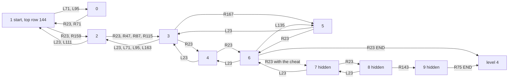

How to read it:

- Level 3 starts in section 1, 144 rows down (`LevelStarts`). Section 0 is a detour to the left.
- Sections 2 and 3 are joined by four exits each way: two tall forests side by side.
- Sections 4 and 5 are two routes to section 6.

### Level 4: the Atomic Mud Mines

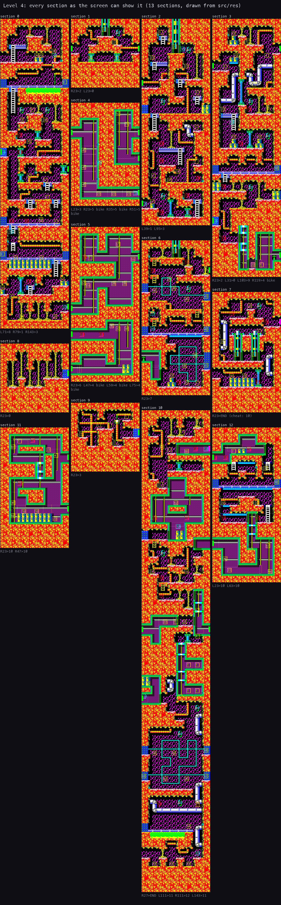

*Level 4's 13 sections. Made with `python3 tools/fig_design.py sections 4 docs/img/design/level4-sections.png`.*

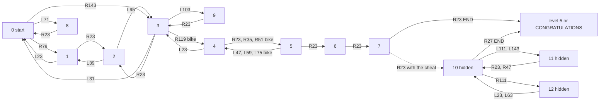

How to read it:

- Sections 4 and 5 are crossed on the bike: the exits marked bike set the ride on arrival.
- Sections 6 and 7 are one-way: no exit leads back.
- The end of section 7 hands level 4 over to level 5, or to CONGRATULATIONS.

### Level 5: the Fat Guy's headquarters

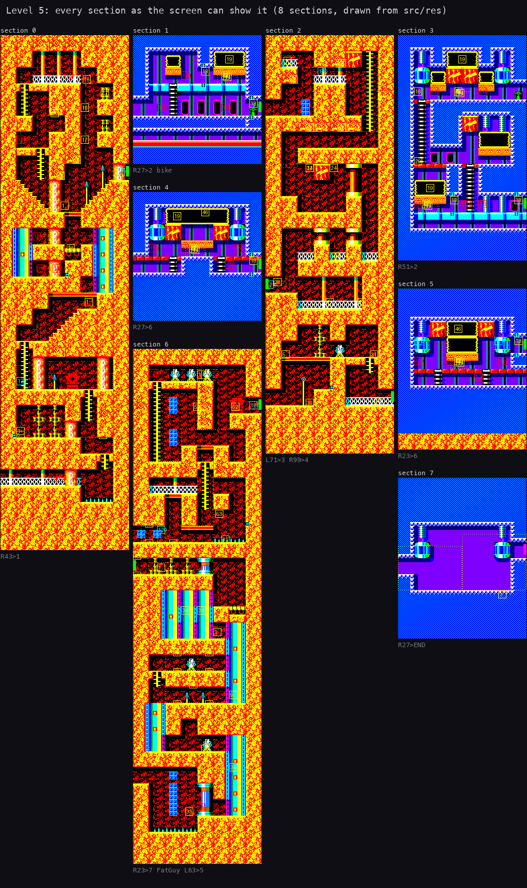

*Level 5's 8 sections. Made with `python3 tools/fig_design.py sections 5 docs/img/design/level5-sections.png`.*

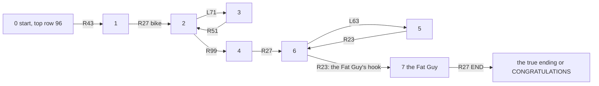

How to read it:

- Level 5 is nearly a straight line. Section 5 is a side room reached from 6.
- The exit from section 6 to 7 has bit 6 (`$42`). It sets `LevelHookOn` `$8A24` = 20, the hits left.
- From then on, level 5's own code runs the Fat Guy ([doc 10](10-gameplay-logic.md)).

**The point** of the five sheets: every level is a short graph of tall shafts. The tall sections are where the
scrolling matters; the small side rooms are rewards.

## 1.8 Key moments

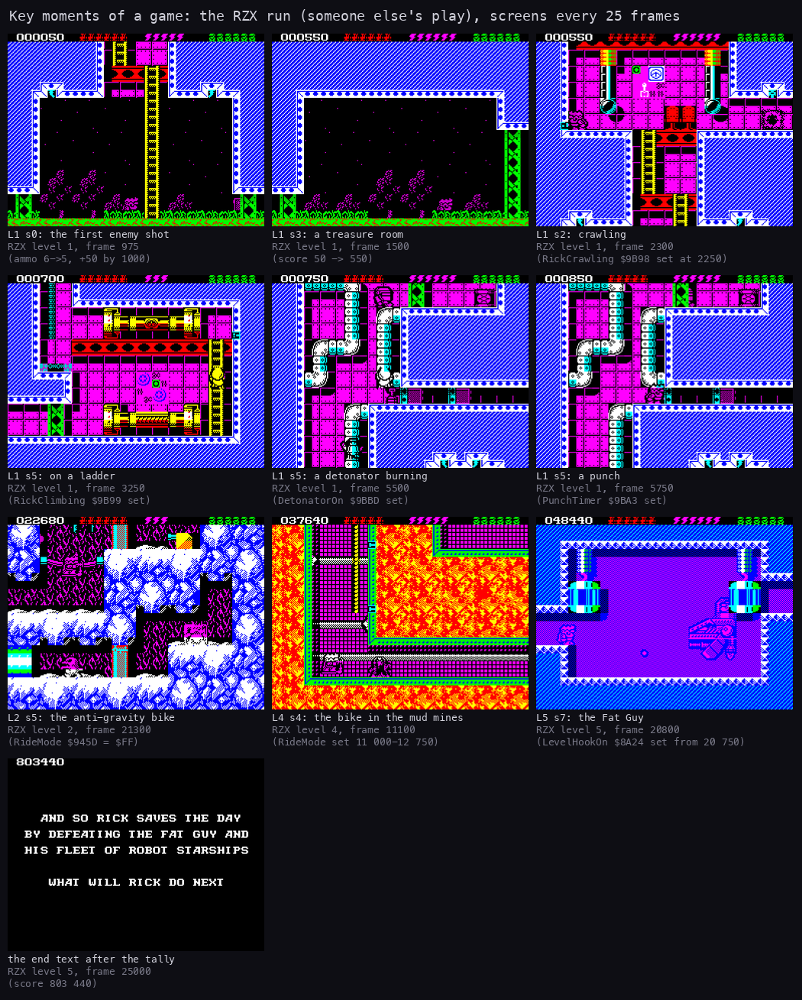

*Ten moments of the RZX run (someone else's play), from its screens (`work/stage1/rzx/lN/screens.bin`, one every 25
frames) at the RZX frames named. The state in each caption comes from the nearest memory sample (`mem.bin`, every 250
frames). Made with `python3 tools/fig_design.py moments docs/img/design/moments.png`.*

How to read it, left to right, top to bottom:

- the first enemy shot in level 1 (a bolt gone and 50 points by frame 1000);
- the first side room with a treasure (section 3, +500);
- crawling (`RickCrawling` `$9B98`), then climbing a ladder (`RickClimbing` `$9B99`);
- a detonator burning, then a punch;
- the anti-gravity bike in levels 2 and 4 (`RideMode` `$945D`);
- the Fat Guy in section 7 of level 5;
- the end text after the tally.

The RZX run has no death. `rzx-l5-full` (the same level 5 start, no POKE, the RZX's keys played without rollback) has
several deaths and ends in GAME OVER:

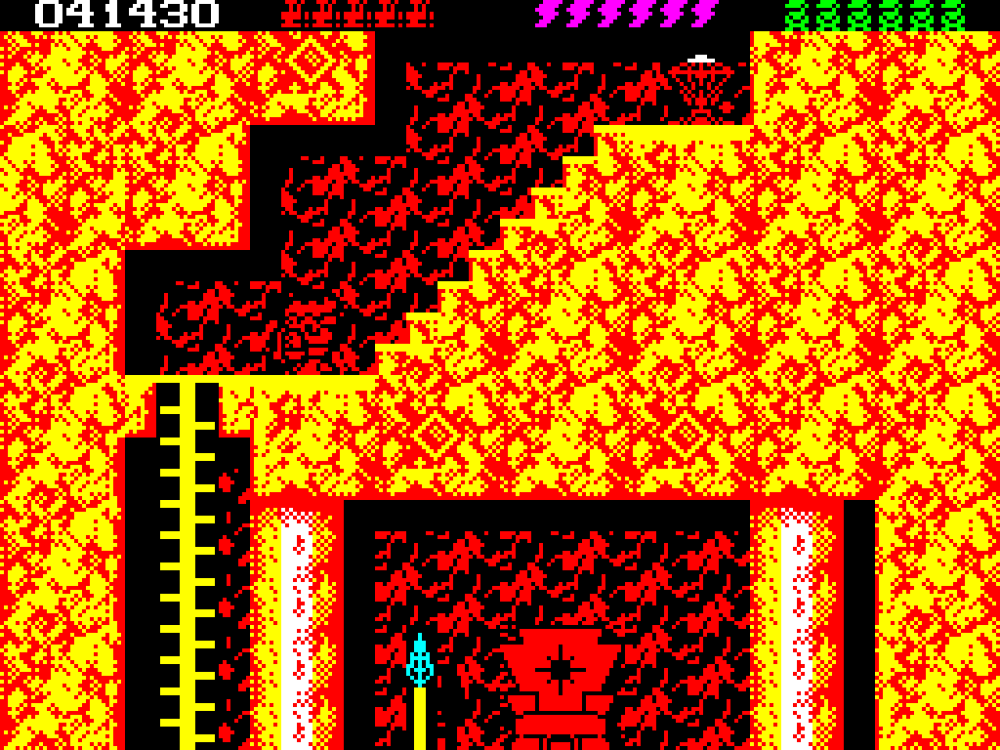

*`rzx-l5-full` frames 2196-2340, every second frame, 4 x. What happens:*

- *Rick is killed at about frame 2218: `RickDying` `$9B9C` is set between the samples of frames 2216 and 2222.*
- *He falls out of the view, and `DeathFallOver` `$9B9B` is set at about frame 2318.*
- *The lives drop from 6 to 5. Rick restarts where he entered the section, with six bolts and detonators again.*

*Made with `python3 ../../kit/screen_anim.py --work work/docs/wr/l5full --from 2196 --to 2340 --step 2 --scale 4
--delay 60 docs/img/play/death-l5-full.gif`.*

Every death goes through the same `KillRick` `$93D0` and `DeathFall` `$9405`, whatever the cause
([doc 10](10-gameplay-logic.md)).

**The point**: a player meets every tool in the first sections of level 1. The bike and the special floors are what
the later levels add.

## 1.9 A route through the game

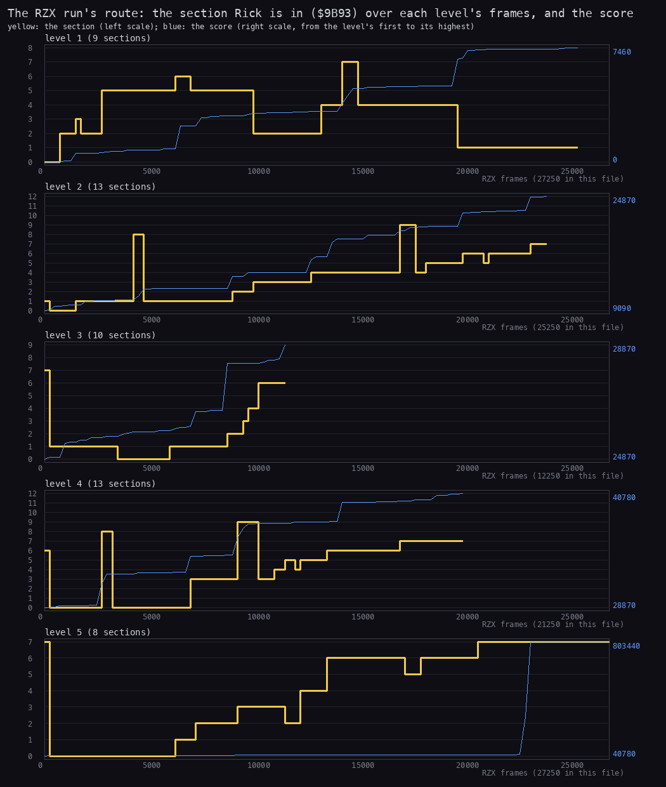

*The section Rick is in (`$9B93`, yellow, left scale) and the score (blue, right scale) over each level's RZX frames,
from the memory samples every 250 frames (`work/stage1/rzx/lN/mem.bin`). The first sample of levels 2-5 still shows
the previous level's last section. Made with `python3 tools/fig_design.py route docs/img/design/route.png`.*

How to read it: a step of the yellow line is a section change. A long flat stretch is a hard section. The RZX player
spent 7500 frames in level 1's hull (section 1) and 6000 in level 5's first section. The blue steps are the treasures
and the bonus stops.

The route, section by section (from the same samples; a section visited between two samples may be missed):

| Level | Sections in order | RZX frames | Score at the next level's start |
| --- | --- | ---: | ---: |
| 1 | 0, 2, 3, 2, 5, 6, 5, 2, 4, 7, 4, 1, end | 25 750 | 9090 |
| 2 | 0, 1, 8, 1, 2, 3, 4, 9, 4, 5, 6, 5, 6, 7, end | 24 250 | 24 870 |
| 3 | 1, 0, 1, 2, 3, 4, 6, end | 11 750 | 28 870 |
| 4 | 0, 8, 0, 3, 9, 3, 4, 5, 4, 5, 6, 7, end | 20 250 | 40 780 |
| 5 | 0, 1, 2, 3, 2, 4, 6, 5, 6, 7, the Fat Guy, the tally | 23 250 | 803 440 at the end |

As a walkthrough:

1. **Hyde Park.** From the park (0) right into the ship's shaft (2). Visit room 3, go down the right side (5) to
   room 6, back through 2 to the left side (4), visit room 7, then climb through 4 into the hull (1). Its right exit
   ends the level.
2. **Freezia.** A chain to the right: 0, the tall cavern 1 (room 8 on its left), 2, 3, 4 (room 9), 5, then the bike
   from 5 into 6, and 7. Section 7's right exit ends the level.
3. **Vegetablia.** Start low in section 1. Section 0 on the left is a detour. Climb right through the two forests 2
   and 3, take section 4 (or 5) to 6, and leave at its right.
4. **The mud mines.** From 0, room 8 on the left, then 3 by section 0's far right exit, room 9, the bike through 4
   and 5, then 6 and 7, both one-way.
5. **The headquarters.** 0, then 1 and the bike into 2, the side trip to 3, then 4, 6 (and 5), into 7 where the Fat
   Guy waits. Twenty hits in one life (the RZX player used four detonators), then the right exit.

The whole run is 105 250 RZX frames: 35 minutes of play at 50 frames a second.

**The point**: the levels are short in sections but slow in time. Most of the time goes to a few sections, where the
traps must be solved in order.

## 1.10 Known only from the code

- A life added at a level start below six lives (`$7CEE`).
- `BonusTally`'s bolt and detonator loops, and the step after both end texts (`$8794`).
- The countdown bonus running out and wrapping to 099 990 (`BonusRunOut` `$917C`).
- Level 1's special floor (the weak jump, `$9799`): no recording ran it.
- Level 1 section 2's exit `L74` into section 0.
