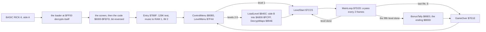
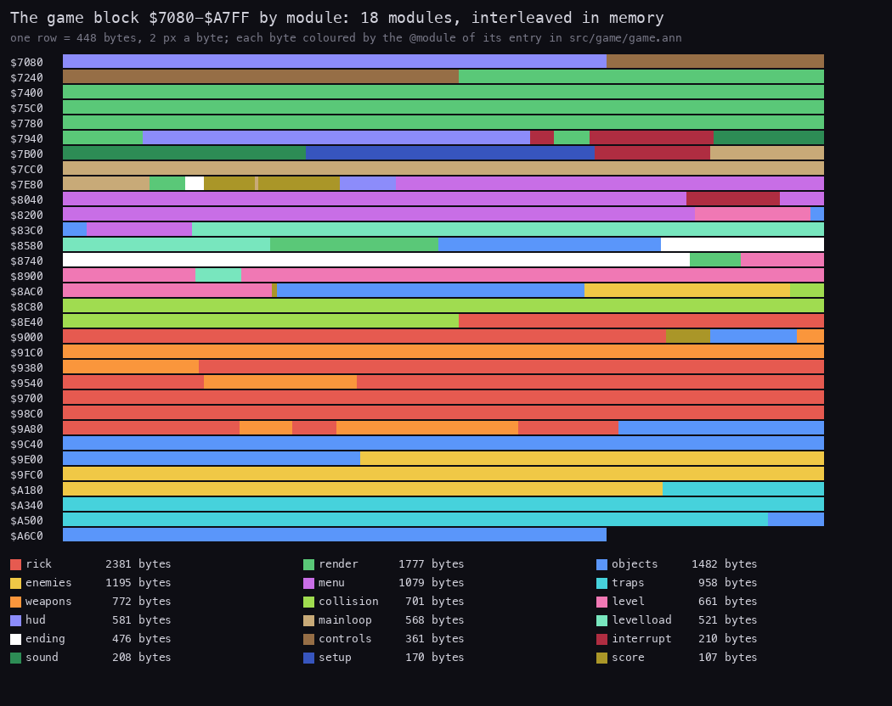
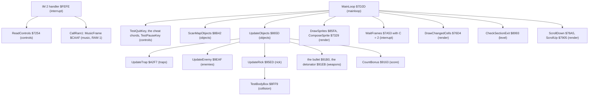
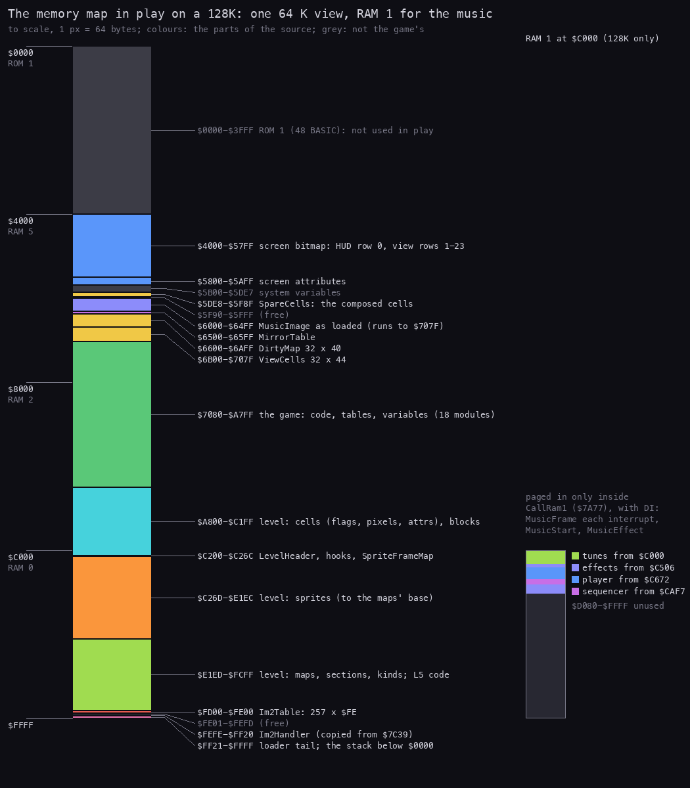
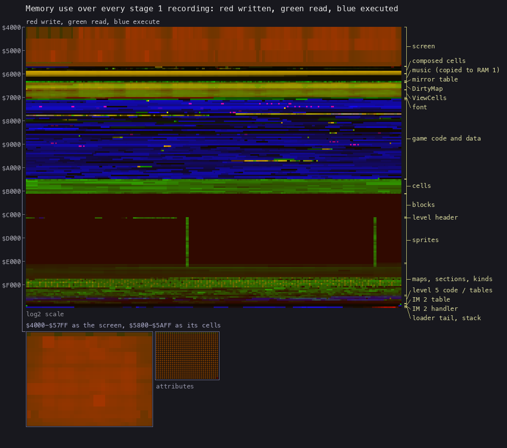
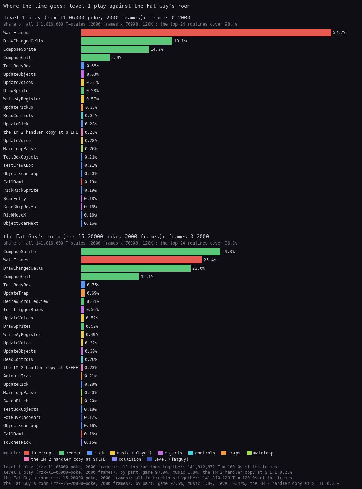

# 2. Architecture

What this covers: how the program is built and where its time goes.

- the stages from the tape to play;
- the module map: the 18 modules of the game block, the music's four, the level blocks;
- the memory map on a 128K and on a 48K: RAM 1 for the music, the level block at `$A800`;
- the heatmap of every recording, and the stack;
- the frame budget: a pass of the main loop every two frames, and what fills it;
- the leftovers: code and data nothing reaches.

The recordings it rests on ([WALKTHROUGH 6.0](../WALKTHROUGH.md#60-the-recordings)):

| Recording | Load | Used for |
| --- | --- | --- |
| `c1` | 128K power-on, side A at ROM speed | the entry, the stack, the menus |
| `c48` | 48K power-on, side A at ROM speed | the 48K path |
| `rzx-l1-06000-poke` | the RZX run's level 1 state at frame 6000, 2000 frames | the budget of ordinary play |
| `rzx-l5-20000-poke` | the RZX run's level 5 state at frame 20 000, 2000 frames | the budget of the Fat Guy's room |
| every stage 1 recording | merged into `work/stage1/l1-all.json` (71 L1 builds, 310 426 frames) | the heatmap |
| the pass timings | `tools/passes.py`, 300 passes from six RZX states (`work/stage1/passes.txt`) | the pass lengths |

## 2.1 The stages

How to read it:

- The tape side A carries the BASIC, the loader, the screen and one block of code. The code block holds the game,
  the music and level 1 ([doc 3](03-build-and-load.md)).
- The entry runs once. After it, the program never returns to BASIC.
- A level other than the one in memory is read from side B into the same `$A800-$FCFF` area. Only one level is ever
  in memory.

The witnesses: `c1` (the loader at frame 1110, the entry at 13 998), the level loads `load-l2` ... `load-l5`, and the
RZX run's level 5 for the ending ([WALKTHROUGH 1](../WALKTHROUGH.md#1-one-recording-from-power-on)).

**The point**: a tape game with one level resident. Everything a level needs (cells, blocks, sprites, maps, objects,
level 5's own code) travels with the level.

## 2.2 The module map

The case's source has six parts. Each is rebuilt byte for byte by `kit/mkgame.py` from its `.ann`.

| Part | Source | Where it runs | Size | Modules |
| --- | --- | --- | ---: | --- |
| the game | `src/game/game.ann` | `$7080-$A7FF` | 14 208 | 18 (below) |
| the music | `src/music/music.ann` | RAM 1 `$C000-$D07F` (loaded at `$6000`) | 4224 | tunes, effects, player, sequencer |
| the levels | `src/levels/levels.ann`, one piece a level | `$A800-$FCFF` | 21 760 each | cells, header, maps, sections, kinds (+ fatguy in level 5) |
| the loader | `src/loader/loader.ann` | `$FF00` | | 1 |
| the screen | `src/screen/screen.ann` | `$4000` | 6912 | 1 |
| the BASIC | `src/tape/basic.ann` | the BASIC area | | 1 |

*Every byte of the game block `$7080-$A7FF` coloured by the module of its entry in `src/game/game.ann` (the
`@module` lines, cut as `kit/mkgame.py` cuts the source). Made with `python3 tools/fig_arch.py modules
docs/img/arch/modules.png`.*

How to read it:

- A row is 448 bytes, from the address at its left. Each colour is one module; the legend gives its size.
- The modules are interleaved. `render` appears in five places, `rick` in five, `objects` in seven.
- The game was not written module by module in memory: routines were added where there was room. The source groups
  them back by purpose.

The 18 modules, by size:

| Module | Bytes | What it does | Doc |
| --- | ---: | --- | --- |
| rick | 2381 | the body box tests, walk, jump, crawl, climb, the ride, the special floors, death | [10](10-gameplay-logic.md) |
| render | 1777 | the sprite composer, the cell drawers, the scroll, the attributes | [6](06-rendering.md) |
| objects | 1482 | the map entry scan, spawning, freeing, the trigger boxes | [7](07-objects.md) |
| enemies | 1195 | the walkers, chasers, patrols and climbers | [10](10-gameplay-logic.md) |
| menu | 1079 | the control and level menus, the cheat flags, the falling letters | [5](05-controls.md) |
| traps | 958 | the traps and pickups: paths, animations, triggers | [10](10-gameplay-logic.md) |
| weapons | 772 | the gun, the detonator and its blast, the punch | [10](10-gameplay-logic.md) |
| collision | 701 | points and boxes against boxes, the probes | [10](10-gameplay-logic.md) |
| level | 661 | the view built from the map, the exits, the section setup | [6](06-rendering.md), [7](07-objects.md) |
| hud | 581 | the font, the score, the icons | [8](08-hud-and-text.md) |
| mainloop | 568 | the new game, the level start, the main loop, GAME OVER | [4](04-game-loop.md) |
| levelload | 521 | the tape level loader, the maps' decipher | [3](03-build-and-load.md) |
| ending | 476 | the bonus tally and the two end texts | [8](08-hud-and-text.md) |
| controls | 361 | the four methods, pause, quit, the cheat keys | [5](05-controls.md) |
| interrupt | 210 | the frame wait, the RAM 1 calls, the IM 2 handler's source | [4](04-game-loop.md) |
| sound | 208 | the 48K beeper effects | [9](09-sound.md) |
| setup | 170 | the entry: the 128K test, the music copy, IM 2 | [4](04-game-loop.md) |
| score | 107 | the points records, the score digits, `AddScore` | [8](08-hud-and-text.md) |

The calls between the main modules, in one pass of the main loop (`MainLoop` `$7D2D`, [doc 4](04-game-loop.md)):

**The point**: the game is one loop over a handful of updaters, and a renderer that composes sprites into cells. The
music is a separate program in RAM 1 that the interrupt calls.

## 2.3 The memory map

*The 64 K the CPU sees in play on a 128K, to scale, and RAM 1 beside it. The regions come from the `@equ` lines and
the parts' `.ann` files; the RAM 1 column is coloured by `src/music/music.ann`'s modules. The level block is drawn
with level 4's layout (sprites to `$E1EC`, the maps from `$E1ED`); the other levels' maps start elsewhere (the table
below). Made with `python3 tools/fig_arch.py memmap docs/img/arch/memmap.png`.*

How to read it:

- **The left scale** is the CPU's address space and the bank behind each 16 K in play: ROM 1, RAM 5, RAM 2, RAM 0.
- **The colours** are the source's parts: the screen blue, the buffers yellow and violet, the game green, the level
  block cyan, orange and light green, the interrupt's table and handler red.
- **RAM 1** is paged in at `$C000` in play only inside `CallRam1` `$7A77`, with the interrupts off. The entry pages
  it in too, once, with the interrupts off: for the 128K test (`$7B9E-$7BA0`) and byte by byte in `CopyMusic`
  (`$7BD3-$7BD5`).

The regions, with what writes and reads them:

| Range | Name | What | Written by | Read by |
| --- | --- | --- | --- | --- |
| `$4000-$5AFF` | `Screen`, `ScreenAttrs` | row 0 the HUD, rows 1-23 the view | the cell drawers, the HUD | the ULA |
| `$5E00-$61BF` | `SpareCells` | the composed cells: a level cell with sprites masked in, 8 bytes each; cell n at `$5DE8` + 8 x (n + 1) from n = 2 (`DrawSprites` `$85FA` sets `SpareCount` to 2), so the first is `$5E00`; the end is the most the recordings reach (`$61BF`, n = 121, `rzx-l3-10000-poke`), over the dead music image | `ComposeCell` `$7755` | `DrawChangedCells` `$76D4` |
| `$6000-$707F` | `MusicImage` | the music as loaded (4224 bytes) | the tape | `CopyMusic` `$7BBF`, once |
| `$6500-$65FF` | `MirrorTable` | the 256 bytes bit-reversed, for mirrored sprites | the entry | the composer `$7329` |
| `$6600-$6AFF` | `DirtyMap` | a byte per view cell, 32 x 40: what to redraw | the composer, the scroll | `DrawChangedCells` |
| `$6B00-$707F` | `ViewCells` | the section's cell numbers, 32 x 44 | `BuildView` `$88D4` | the drawers, the collision tests |
| `$7080-$A7FF` | the game | code, tables, variables | the tape | |
| `$7B8F-$7C1F` | `TrapRecords` | 24-byte trap records, over the entry code, which runs once | `ClearObjectTables` `$83B8`, the object code | the object code |
| `$7C20-$7C7C` | `EnemyRecords` | 23-byte enemy records, over `SetupIm2`, the handler's source and `EntryDebris` | `ClearObjectTables`, the object code | the object code |
| `$A800-$C1FF` | `CellFlags`, `CellGraphics`, `CellAttrs`, `Blocks` | the level's 256 cells and 256 blocks | the tape | the drawers, `BuildView`, the collision tests |
| `$C200-$C26C` | `LevelHeader` | the level's table pointers, the level hooks, the number, the frame map | the tape | |
| `$C26D-` | `Sprites` | 128 bytes a sprite, up to the maps' base: `$E46D` (levels 1-2), `$E2ED` (3), `$E1ED` (4), `$E3ED` (5) | the tape | the composer |
| the base to `$FCFF` | the maps, the sections, the kinds | the level's rooms and objects; level 5's code at `$F7E6-$FAF3`, its path table `FatGuyPath` to `$FB32`, then zeros | the tape; `DecryptMaps` | `BuildView`, the object code |
| `$FD00-$FE00` | `Im2Table` | 257 bytes `$FE`, I = `$FD` | `SetupIm2` `$7C1A` | the CPU |
| `$FEFE-$FF20` | `Im2Handler` | the IM 2 handler, copied from `$7C39` | `SetupIm2` | the CPU |
| `$FF21-$FFFF` | | the loader's tail, then the stack | the loader | |

The music image at `$6000-$707F` is dead once copied. The tables built after it (`MirrorTable`, `DirtyMap`,
`ViewCells`) lie over its last 2944 bytes. Only `$6000-$64FF` is left unused.

### The level block

Every level is one block of 21 760 bytes loaded at `$A800` ([doc 7](07-objects.md)):

| Offset | Address | What |
| --- | --- | --- |
| `+$0000` | `$A800` | `CellFlags`: a flag byte per cell (solid, floor, ladder, deadly, front, the special floor) |
| `+$0100` | `$A900` | `CellGraphics`: 256 cells of 8 bytes |
| `+$0900` | `$B100` | `CellAttrs`: a cell's attribute |
| `+$0A00` | `$B200` | `Blocks`: 256 blocks of 4 x 4 cell numbers |
| `+$1A00` | `$C200` | `LevelHeader`: +0 the kind table, +2 the section table, +4 the maps' base |
| `+$1A06` | `$C206` | `LevelHookA`, `LevelHookB`: level 5's two jumps; text in levels 1-4 (2.7) |
| `+$1A0C` | `$C20C` | `LevelNumber` |
| `+$1A0E` | `$C20E` | `SpriteFrameMap` |
| `+$1A6D` | `$C26D` | `Sprites`, 128 bytes each |
| | the maps' base | the maps, 8 blocks a row; the last 768 bytes enciphered on tape |
| | after the maps | the section table, the exits, the map entries, the kinds, the trap scripts |

Side A carries level 1 inside its code block. Side B carries all five, each with its maps' last 768 bytes enciphered
([doc 3](03-build-and-load.md)).

### 128K against 48K

The entry tells the machines apart through `$C000` (`Entry` `$7B8F`): it reads the byte there with RAM 0 paged in,
pages RAM 1, writes that byte + 1, pages RAM 0 back and compares. On a 128K RAM 0 kept its byte; on a 48K the port
`$7FFD` does nothing, the write changed the one RAM there, and the entry puts the byte back (`Entry48K` `$7BB3`).

| | 128K | 48K (`c48`) |
| --- | --- | --- |
| the bank test | passes | fails (`$7BB3`, 1 run) |
| `Machine48K` `$7A76` | clear | `$FF`: no music; `CallRam1` returns at once |
| the music | copied to RAM 1, played every interrupt | not copied; the tune calls return at once (`StartTune` `$7AAD`, 4 calls) |
| the handler | `CALL $7AB6` written into it at `$FF14` | not written |
| the effects | the AY, from RAM 1 (`MusicEffect` `$CCC8`) | the beeper, one note a pass from the main loop (`$7B66`, 1206 passes in `c48`) |
| `$6000-$64FF` | dead after the copy | never used |
| levels 2-5 | from side B | from side B, the same code |

Everything else is the same code on both: the menus, the levels, the gun, the detonator, the punch, pause and quit
all work in `c48`.

**The point**: the program fills the 48K map from `$5E00` to `$FFFF`. The 128K adds only one thing, the music in RAM
1, which the main program reaches through one routine, `CallRam1` `$7A77`.

## 2.4 The heatmap

*Memory use over every stage 1 recording: 71 L1 builds, 310 426 frames, merged by `tools/l1merge.py` into
`work/stage1/l1-all.json`. One row is 256 bytes from `$4000`; red written, green read, blue executed, log2 of the
count. The brackets are the regions of 2.3 (`work/docs/wr/regions.txt`). Made with `python3 ../../kit/heatmap.py
work/stage1/l1-all.json docs/img/arch/heatmap.png --cell 3 --from 4000 --to FFFF --panels composite --columns 1
--regions work/docs/wr/regions.txt`.*

How to read it:

- **Blue** is code. The game's code band runs from `$71C0` to `$A7EF`. Above it only level 5's code at `$F7E6`, the
  IM 2 handler at `$FEFE` and the loader at `$FF00` are blue.
- **Red and orange** are written: the screen, the composed cells, the buffers `$6500-$707F`, the variables inside the
  code.
- **Green** is read only: the level's cells (`$A800-$B1FF`) and the maps and objects at the top of the level block.
- **The blocks** `$B200-$C1FF` are dark red: written by the loads, read rarely (only when a view is built).
- **Two thin green columns** run down the sprite area. They are the first bytes of each sprite (offsets `$6D` and
  `$ED` of a page): the rows to skip and the rows drawn, which the composer reads every time a sprite is placed.
- The `$C000` window shows RAM 0. The music's instructions in RAM 1 (our recordings) and RAM 6 (the RZX run's TAP
  version keeps its music there) are left out.

**The point**: the program's working set is small and fixed. The screen, two buffers and the variables are written;
the level block is read-only in play.

## 2.5 The stack

`Entry` sets SP = 0, so the stack grows down from `$FFFF` over the loader's tail.

| Recording | The lowest stack byte | Depth |
| --- | --- | ---: |
| `c1` (the menus and the start) | `$FFDC` | 36 bytes |
| every other recording | `$FFE6` | 26 bytes |

Three routines borrow SP to pop data fast, with the interrupts off:

| Routine | What SP points at | SP back from |
| --- | --- | --- |
| `BuildView` `$88D4` | a block's 16 cell numbers | the `LD SP,nn` at `$8946`, its operand written on entry |
| the composer (`ComposeAlignedData`, `ComposeShiftedData`, `render`) | a sprite's mask and data rows | `LD SP,nn` at the routine's end |
| `DrawHud` (`hud`) | the HUD row on the screen: it clears row 0 by pushing zeros | `ClearHudEnd`'s `LD SP,nn` |

Each writes the caller's SP into the operand of its own closing `LD SP,nn` (self-modifying code). With the interrupts
off, the IM 2 handler never pushes into level data or onto the screen.

**The point**: 36 bytes of stack is the deepest the program goes. The 253 free bytes between the IM 2 table and the
handler (`$FE01-$FEFD`) are never touched.

## 2.6 The frame budget

The main loop waits for the second interrupt after the previous pass (`WaitFrames` `$7A53` with C = 2). A pass that
fits in two frames runs at 25 passes a second. A longer pass is caught by the next even count.

*The share of all T-states per routine over 2000 frames of `rzx-l1-06000-poke` (level 1, sections 5 and 6) and of
`rzx-l5-20000-poke` (the Fat Guy's room), coloured by module. Made with `sh work/docs/wr/budget.sh`, which runs
`python3 ../../kit/fig_budget.py work/stage1/rec/rzx-l1-06000-poke/l1.json docs/img/arch/budget.png --ann
src/game/game.ann,page=0/2/5,range=7080-A7FF --ann src/music/music.ann,page=1/6,label=music --ann
src/levels/levels.ann,page=0,range=A800-FCFF,label=level --state "...=work/stage1/rec/rzx-l5-20000-poke/l1.json"
--top 24`.*

How to read it:

- **`WaitFrames`** is the idle time. In level 1 it is 52.7 %: half the CPU is spare.
- **The renderer** is all the rest: `DrawChangedCells` 19.1 %, `ComposeSprite` 14.2 %, `ComposeCell` 5.9 %.
- **The game logic** (Rick, the objects, the collisions) is about 3.3 % in level 1, summing its rows among the top 24
  (Rick's moves and tests 1.7 %, the object scan and update 1.3 %, `UpdatePickup` 0.33 %).
- **The music** player costs 1.8 % of all T-states in both, counted over every frame (lost interrupts and quiet runs
  included); `CallRam1` adds 0.16-0.19 %. Per handler run it is about 2600 T, 3.7 % of that frame
  ([doc 4](04-game-loop.md#46-the-interrupt)).
- **In the Fat Guy's room** the idle time falls to 25.4 %, and `ComposeSprite` rises to 29.3 %: the Fat Guy is five
  sprites, and each composes into up to 16 cells.

The pass lengths measured by `tools/passes.py` (300 passes from each state; the work is the pass without the wait):

| State | Pass, median | Pass, longest | Work, median | Work, longest |
| --- | ---: | ---: | ---: | ---: |
| level 1, RZX frame 6000 | 3.0 frames | 3.0 | 1.34 | 1.50 |
| level 2, RZX frame 10 000 | 2.61 | 3.07 | 2.29 | 2.62 |
| level 3, RZX frame 6000 | 2.0 | 4.0 | 1.37 | 2.36 |
| level 4, RZX frame 10 000 | 2.0 | 2.0 | 0.61 | 0.64 |
| level 5, RZX frame 12 000 | 3.0 | 3.0 | 2.15 | 2.36 |
| level 5, RZX frame 22 000 (the Fat Guy) | 3.0 | 13.47 | 2.19 | 13.47 |

A worked example, level 4 against level 1:

1. Level 4 at RZX frame 10 000: the work takes 0.61 frames (43 071 T of 70 908 a frame). The wait then sits until
   the counter `$7A60` reaches 2. The pass is exactly 2.0 frames: 25 passes a second.
2. Level 1 at RZX frame 6000: the work takes 1.34 frames, still under two. Yet the pass is 3.0 frames, every time.
   An interrupt that arrives while the renderer runs with the interrupts off is not counted, so the counter reaches
   2 a frame late. [Doc 4](04-game-loop.md) times those windows.
3. Level 2 at RZX frame 10 000: the work takes 2.29 frames, more than two, so two interrupts should already be
   counted when the wait starts. Yet the pass is 2.61 frames on the median: the wait still sits 0.32 frames, because
   at least one of the interrupts fell in a window with the interrupts off.

The interrupt signal on a Spectrum lasts about 32 T-states. An interrupt that arrives inside a `DI` window is lost,
and the frame counter `$7A60` misses a tick.

The longest pass, 13.47 frames, is in the Fat Guy's room ([doc 4](04-game-loop.md)).

**The point**: the game is drawn at 25 or 16.7 passes a second, and the CPU is half idle in a quiet room. The cost is
the renderer, not the logic: the number of sprites on screen decides the speed.

## 2.7 The leftovers

Code and data in the image that nothing reaches, or that is reached only in some versions:

| What | Where | Why it is a leftover | Witness |
| --- | --- | --- | --- |
| tune 3 | music `$C2D2`, patterns 11-13 (`$C0D2-$C0E7`) | no `StartTune` with A = 3 in the game | `tunes_per_rec.py`: never started |
| effects 1, 3, 8 | the effect table in RAM 1 | no constant call site, and no level's trap script names them | the kinds' `fx=` fields of all five levels |
| effects 15, 16, 17, 25 (the hardware envelope voices) | the effect table | named only by trap scripts of levels 1, 4, 5 | no recording ran their branch |
| "CORE  " / "DESIGN" | `$C206` in levels 1-4 | the place of level 5's two jumps; the text is the developer's name, Core Design | `LevelHookOn` is never set outside level 5 |
| `Points100` | `$7EF9` | no instruction loads `$7EF9` | no byte pair `F9 7E` in the image |
| a dispatcher | `objects`, `$917D` | a jump table of 15 words (kinds 0-14) at `$9191`, no caller | no word `$917D` in the image |
| an older IM 2 handler | `$7C5C-$7C7C` | after the handler's source, never copied; cleared as `EnemyRecords` at every new game | never run |
| 204 bytes of `$C9` | `$852E-$85F9` | padding after the loader | |
| `OrderSetSlot`, `PatternCommandSkip` | music `$CB49`, `$CC30` | sequencer commands no tune uses | not executed |
| filler sections | past `SectionCounts` | section table entries no exit leads to | level 1 section 8: `sec-l1-s8` by a POKE |
| `BonusRunOut` | `$917C` | a lone `RET` at the countdown's wrap | [doc 1](01-game-design.md) 1.6 |

`LoadError` `$852A` is not a leftover but a live bug: `LdBytesEnd` `$8524` jumps there on a bad level block, and it
pops the return address and jumps to `$8452`, into the text "STOP TAPE AND PRESS FIRE" ([doc 3, 3.4](03-build-and-load.md#34-side-b-and-the-map-cipher)).
No recording loads a bad block, so what the text does as code is not seen.

**The point**: the image is close to tight. The leftovers are a few dozen bytes of an earlier design, one unused tune
and the developer's name in the level blocks.
