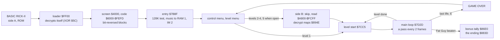
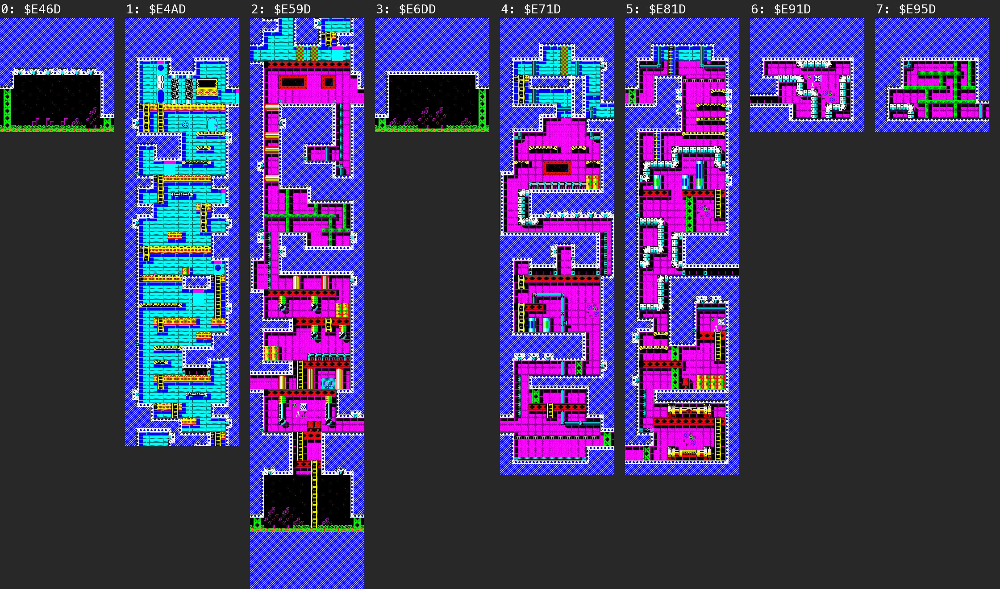
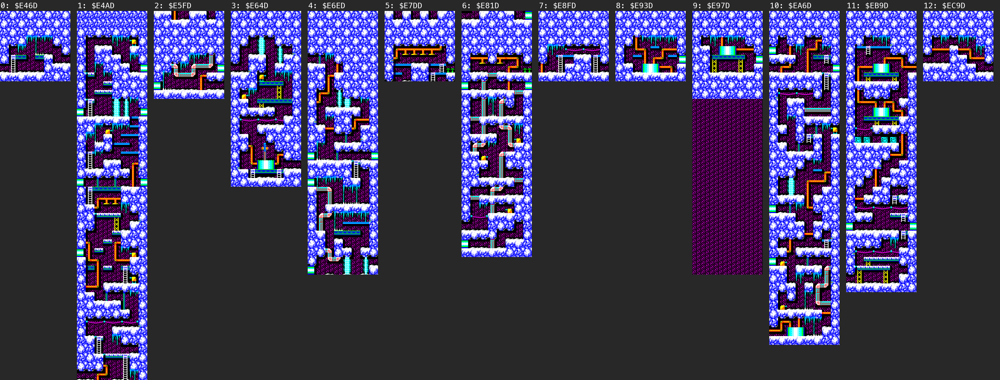
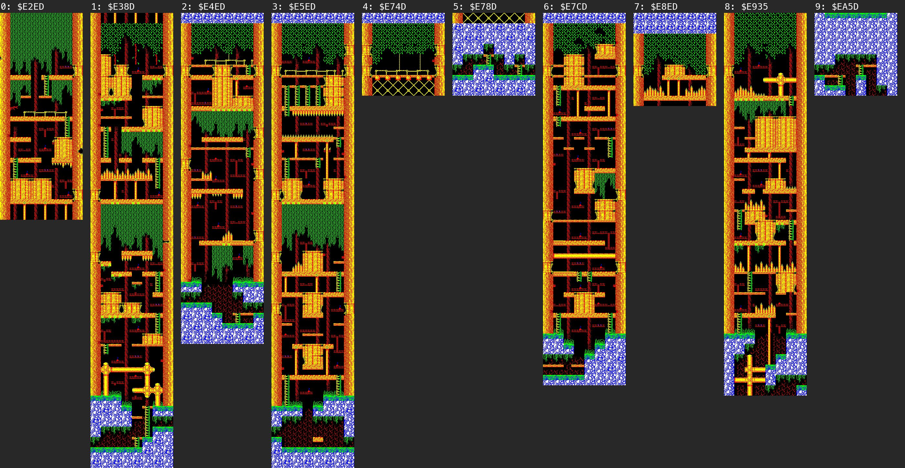
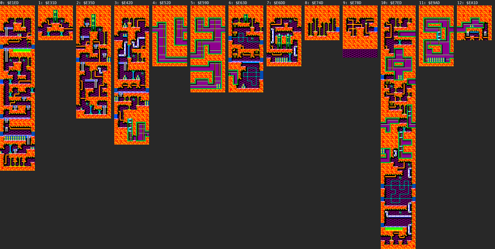
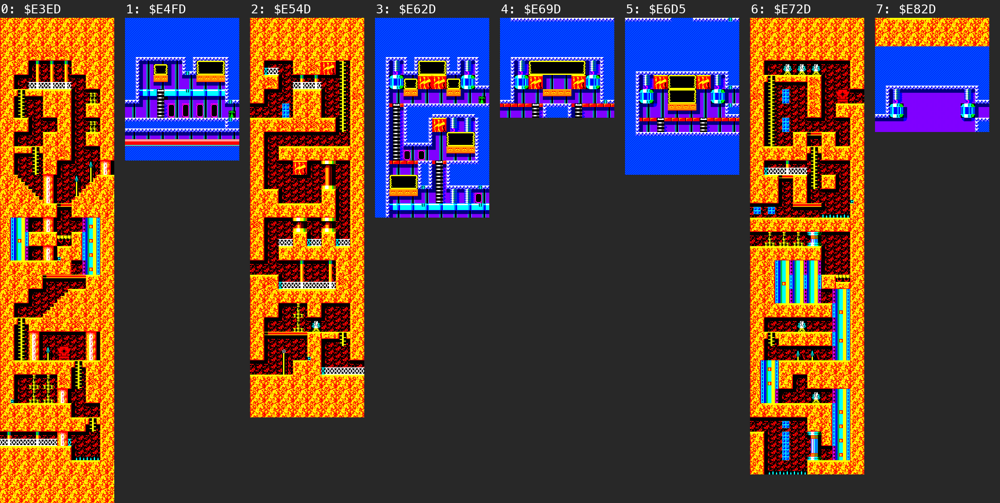
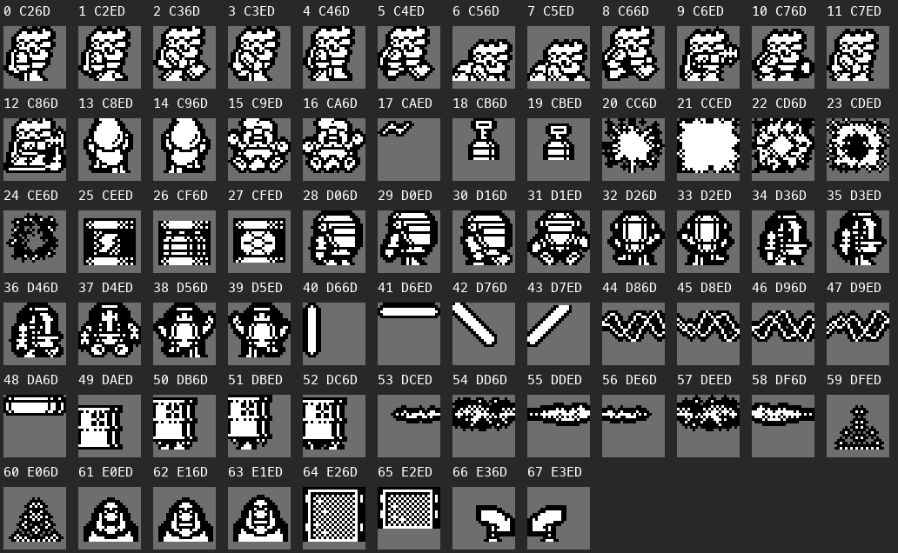
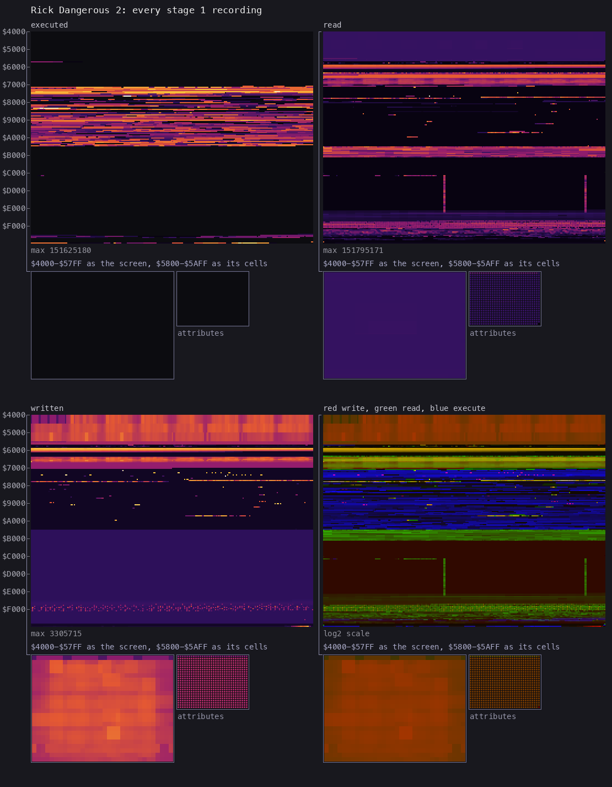

# 2. Architecture

What this covers: the machine budget, the memory map, the stages from the medium to play, the frame, the main loop's
call graph, the module map. The recordings it rests on: `c1` (128K, power-on, side A at ROM speed) and the level
recordings of [WALKTHROUGH 6.0](../WALKTHROUGH.md#60-the-recordings) (from the RZX run's states; no tape).

<!-- Figures this document needs (GUIDE.md 4.2), remove each line when it is in: -->

## 2.0 The stages

The witnesses: `c1` (the loader at frame 1110, the entry at 13 998), the level loads `load-l2` ... `load-l5`, the
RZX run's level 5 for the ending ([WALKTHROUGH 1](../WALKTHROUGH.md#1-one-recording-from-power-on),
[doc 3](03-build-and-load.md)).

## 2.1 The memory map

A stage 1 map: every address below is a witness from the code (`sna2skool` over the play state
`work/stage1/lab/dump-e3-end/z80.bin`) or from the L1 of the recordings (`work/stage1/*/l1.json`, the routines'
read and write ranges); names are first names, to be checked in stage 2. On a 128K the game runs with ROM 1 and
RAM 5, 2 and 0 (`$4000`, `$8000`, `$C000`); RAM 1 is paged in at `$C000` only for the music (`$7A77`).

| Range | What | Witness |
| --- | --- | --- |
| `$4000-$5AFF` | the screen; the HUD in the top row (score, lives, ammunition, detonators) | the drawers `$77B1`, `$783F`, `$7A2C` |
| `$5DE8-$5F8F` | the composed cells: background cells copied here and the sprites masked into them (8 bytes a cell, `$5DE8` + 8 x n, the counter at `$77B0`) | `$7755`, `$76D4`, the blitter `$7329` |
| `$6000-$707F` | on the tape: the AY music, copied to RAM 1 `$C000-$D07F` by the entry code on a 128K (4224 bytes, the loop at `$7BBF`); then free | `$7B8F-$7BEF` |
| `$6500-$65FF` | a table of the 256 bytes bit-reversed: the sprites mirrored (bit 7 of a record's +6) | `$7329` (`LD H,$65`) |
| `$6600-$6AFF`, `$6B00-$707F` | the view's cell buffers: the cells built from the map, 32 x 44 (`$6B00`, by `$88D4`: 11 block rows), and a 32 x 40 buffer at `$6600` compared cell by cell when the view is redrawn | `$88D4`, `$77B1`, `$8969` |
| `$7080-$715F` | the HUD's glyphs (digits, the life, bolt and detonator icons) | `$7A2C` reads `$7080-$715F` |
| `$71C0-$72F8` | the controls: the pause, quit and menu key tests `$71C0-$724A`, the method `$7252` (0 keyboard, 1 Kempston, 2 cursor, 3 Sinclair), the read `$7254` into `$7253` (active low: bit 0 right, 1 left, 2 down, 3 up, 4 fire) | the IM 2 handler calls `$7254` |
| `$7329-$7A52` | the sprite blitter `$7329`, the cell drawers `$76D4`, `$7755`, `$77B1`, the view scroll `$78A8`, the attributes `$783F` | L1 routines |
| `$7A53-$7A60` | the frame wait (EI, until the counter `$7A60` reaches C, then clear it) | `$7A53` |
| `$7A76-$7ABE` | the 48K flag `$7A76` (`$FF`: no music) and the RAM 1 call `$7A77` (`DI`, RAM 1 paged in, `CALL` HL, RAM 0 back; the operands stored into its own code at `$7A8B`, `$7A8D`): the player each frame (`$7AB6`: `$CAAF`), the tune starts (`$7AAD`: `$CA27`), the effects (`$7A97`: `$CCC8`) | `$7B8F` sets the flag when no RAM 1 is found; the code at `$7A77-$7ABE` |
| `$7B8F-$7C9F` | the entry code (`$7B8F`: SP = 0, the 128K test, the music copy), then reused as the object tables (`LD IX,$7B8F`, `$7C20`, `$7C8F`) | `c1`: entry at frame 13 998, the tables zero in play |
| `$7CC5-$7E1B` | a level's start (`$7CC5`: read from tape `$840C` and decrypt `$894E` when `$C20C` is not the level wanted; a life up to 6, ammunition and detonators 6) and the main loop `$7D2D-$7E1B` (two frames a pass: `LD C,$02`, `CALL $7A53`) | [WALKTHROUGH 1](../WALKTHROUGH.md#1-one-recording-from-power-on) |
| `$7EC8-$88AF` | the texts: GAME OVER `$7EC8`, the level menu `$7FC7-$8063`, the control menu `$8159-$81AD`, the tape messages `$843A`, `$8451`, the end texts `$87A2-$88AF` (the digits are stored 4 higher: "5" is shown as 1) | the image's strings |
| `$7EF1-$7EF2` | the level (1-5) and a counter beside it | `$7CC5`, `$7D9E-$7DCD` |
| `$7F1D-$7F22` | the score, six digits 0-9 | the RZX memory at level 5, frame 1000: `00 04 01 03 08 00` with "041380" on the screen |
| `$846A-$8520` | the level loader (reads side B, skips the blocks before the level) | the TAP version patches `$8479-$8485`; the RZX's version differs in `$846A-$8510` |
| `$88CF-$88D3` | the view: the top row in the section (`$88CF`), the section's map (`$88D0`), `$88D2` | `$88D4`, `$8A6D` |
| `$894E` | decrypts the level's last 768 bytes of maps ([2.2](#22-the-level-maps)) | |
| `$8A6D` | a section's setup from the section table | |
| `$8B3B-$8B3D` | lives, ammunition (ray gun), detonators | the POKE file: `$8A30` `DEC A` of lives, `$86ED` and `$959F` of ammunition, `$870E` and `$9B41` of detonators |
| `$93D0` | Rick dies | called by the collision tests at `$8C67`, `$A475`, `$93B4` (the POKE file's immunities) |
| `$9B93` | the section Rick is in | the RZX run: 0-9 |
| `$9BAB-$9BC5` | three 9-byte records: Rick (`$9BAB`: +1 x, +2 y, +4 the sprite, +6 bit 7 mirror), and two more (his shot and detonator, to confirm) | `LD IX,$9BAB`, `$9BB4`, `$9BBD`; the RZX memory |
| `$A800-$FCFF` | the level (side B's block; level 1 is in side A's code block on the 128K) | [doc 3, 3.1](03-build-and-load.md#31-the-tape-block-by-block) |
| `$A800-$A8FF` | a flag byte per cell kind (bit 7 set: the sprite composer leaves the cell as it is) | `$7755` (`LD B,$A8`) |
| `$A900-$B0FF` | 256 cells of 8 x 8 pixels | `$76D4`, `$77B1` (`ADD A,$A9`) |
| `$B100-$B1FF` | the cells' attributes | `$77B1` (`LD H,$B1`) |
| `$B200-$C1FF` | 256 blocks of 4 x 4 cells | `$88D4` (`LD BC,$B200`) |
| `$C200-$C26C` | the level header: `$C200` a pointer, `$C202` the section table, `$C204` the maps' base, "CORE  " or "DESIGN" in levels 1-4 where level 5 has two jumps (`$C206`: `JP $F7E6`, `$C209`: `JP $F8D0`), the level number at `$C20C` | the five level blocks; the main code calls `$C206` (`$8AF8`, `$9261`, `$96A9`, `$A074`, `$A116`) and `$C209` (`$8664`, `$9352`, `$9FD8`), each behind a test of `$8A24` (`$8AF1`, `$865D`) |
| `$C26D-` | the sprites, 128 bytes each, to the maps' base (the first 24, Rick and the explosions, the same in every level) | the blitter `$7329`; [the sprite sheets](#23-the-sprites) |
| maps' base (`$E1ED-$E46D`) to the table | the sections' maps, 8 blocks a row | [the maps](#22-the-level-maps) |
| `$F7E6-$F915` (level 5) | level 5's own code, run through the two jumps: the Fat Guy's part (to name in stage 2) | executed in `rzx-l5-20000-poke` (`$F7E6-$F83B`) and `rzx-l5-22000-poke` (`$F8D0-$F915`), the L1 |
| `$FD00-$FE00` | the IM 2 table (257 bytes `$FE`, I = `$FD`) | built by the entry code |
| `$FEFE-$FF20` | the IM 2 handler: counts `$7A60`, calls `$81D4`, `$7254` (controls), `$7AB6` | `c1` L1: 4706 entries |
| `$FF21-$FFFF` | the tape loader (its tail overwritten), then the stack from `$0000` down: low mark `$FFDC` in `c1` | `c1` L1: the writes above `$FD00` after frame 14 100 |

## 2.2 The level maps

A level is a set of sections, each a shaft one screen wide (8 blocks, 32 cells) and from one to 56 block rows tall;
the view scrolls up and down a section by 8 cells a step and moves to another section (at the side edges, to confirm
in stage 2). The section table (`$C202`) has 8 bytes an entry: the map's offset from `$C204` (big-endian), then
fields the setup `$8A6D` copies to `$88D2`, `$8995` and `$8B3E` (the section's objects and enemies, to decode).
`tools/level_map.py` draws every section from the level block, a column each, its height taken to the next section's
map (the last: one screen). The last 768 bytes of the maps (from the maps' base + `$600`) are encrypted on the tape
and decrypted by `$894E` when the level starts (each byte XOR a key from 0 that becomes (key XOR the address's low
byte) + 1): the decrypted bytes equal the RZX run's memory in play for levels 2-5 and side A's resident level 1, 0
bytes differ (`tools/image.py` decrypt_maps). Those bytes are the 762 that differ between side A's level 1 and side
B's block 1.

- level 1, Hyde Park London, 8 sections: 
- level 2, the Ice Caverns of Freezia, 13 sections: 
- level 3, the Forests of Vegetablia, 10 sections: 
- level 4, the Atomic Mud Mines, 13 sections: 
- level 5, the Fat Guy's headquarters, 8 sections: 

The section Rick is in is `$9B93`: in the RZX run's 453 samples (one every 250 frames) it takes the values 0-9 only,
so sections 10-12 of levels 2 and 4 are reached only in frames between the samples, or not at all (stage 2).

## 2.3 The sprites

`tools/sprite_sheet.py` draws every sprite of a level from `$C26D` in 128-byte steps to the maps' base: the rows to
skip, the rows drawn (at most 24), then 6 bytes a row, three data and three mask bytes for a 24-pixel row. Sprites
0-23 (`$C26D-$CE6C`: Rick standing, walking, crawling, climbing, shooting, the explosions) are the same in all five
levels; the rest are the level's enemies, objects and hazards.

The other levels: [level 2](img/sprites/level2.png), [level 3](img/sprites/level3.png),
[level 4](img/sprites/level4.png), [level 5](img/sprites/level5.png).

## 2.4 The heatmap and the stack

*Memory use over every stage 1 recording: 71 L1 builds, 310 426 frames, merged by `tools/l1merge.py` into
`work/stage1/l1-all.json`, drawn by `python3 ../../kit/heatmap.py work/stage1/l1-all.json docs/img/arch/heatmap.png
--cell 2 --from 4000 --to FFFF`. Four panels: executed, read, written, and a composite (red written, green read, blue
executed), one row a page of 256 bytes from `$4000`. The `$C000` window shows RAM 0 only: the music's instructions in
RAM 1 (4.0 million, our recordings) and RAM 6 (25.3 million, the RZX pieces: the RZX run's TAP version keeps its
music in RAM 6) are left out.*

How to read it:

- Executed: the code band `$71C0-$A7EF`; above it only level 5's code (`$F7E6-$F915`, the RZX pieces at 20 000 and
  22 000), and the loader page (`$FF00`, the tape loads of `c1` and the level loads) and the IM 2 handler `$FEFE`;
  below it the 128 ROM's paging routine in the system variables (`$5B0A`, `c1`'s load).
- Read: the buffers `$6500-$707F`, the code's tables and variables, the level's cells and blocks (`$A800-$C1FF`), the
  maps at the top of the level (`$EE00-$FCFF` the brightest), and two thin columns down `$C800-$E1FF` in the sprite
  area (one byte in 256 read again and again: to explain in stage 2).
- Written: the screen, the composed cells `$5B00-$61FF`, the buffers `$6500-$707F`, the variables in the code
  (`$7000-$A6FF`); the level area `$A800-$FCFF` is written only by the loads and the maps' decryption.
- The inset under each panel is the screen page drawn as the screen.

### The stack

The entry sets SP = 0 (`$7B8F`), so the stack grows down from `$FFFF` over the loader's tail. The lowest byte written
under the loader's code (`$FF21` up) is `$FFDC` in `c1` (36 bytes, the menus and the start) and `$FFE6` (26 bytes)
in every other recording (the 70 L1 builds' writes in `$FF21-$FFFF`). The map builder and the blitters borrow SP to
pop data with the interrupts off and set it back to `$FFFA` (`$88D4`), so the handler never pushes into level data.
