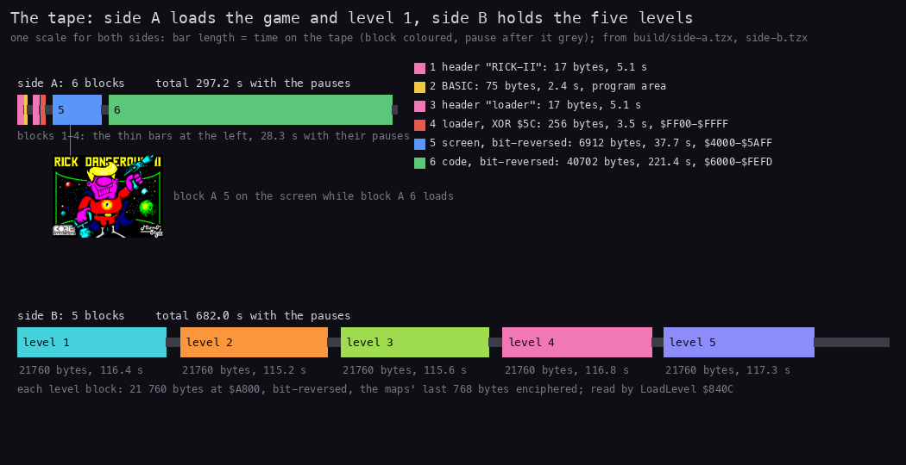
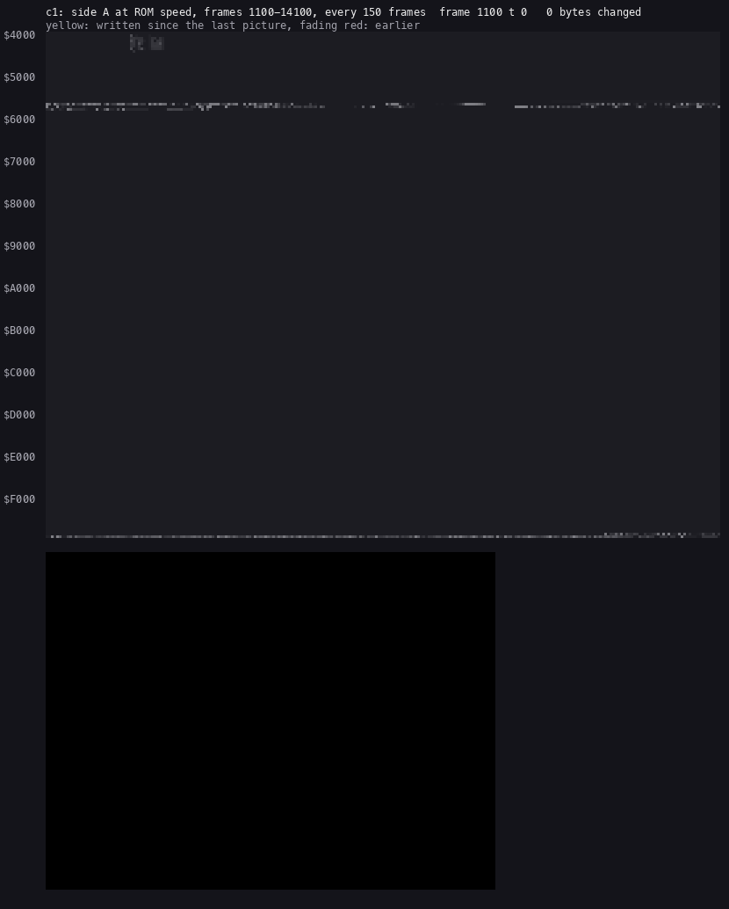
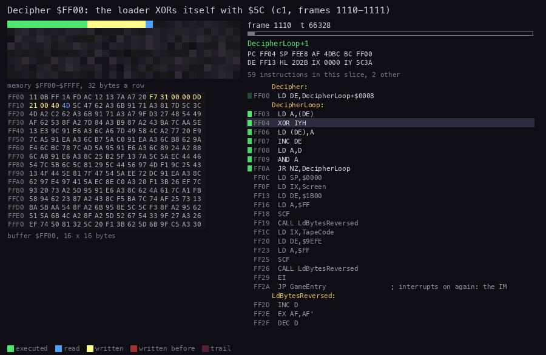
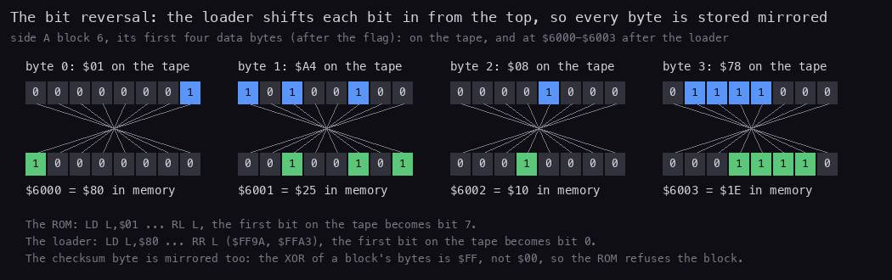
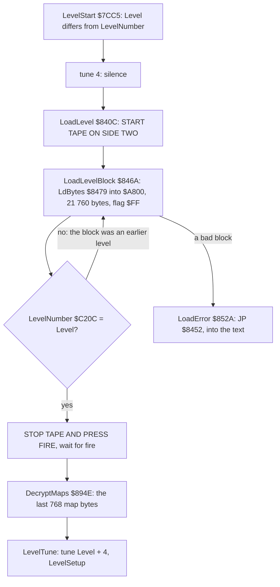
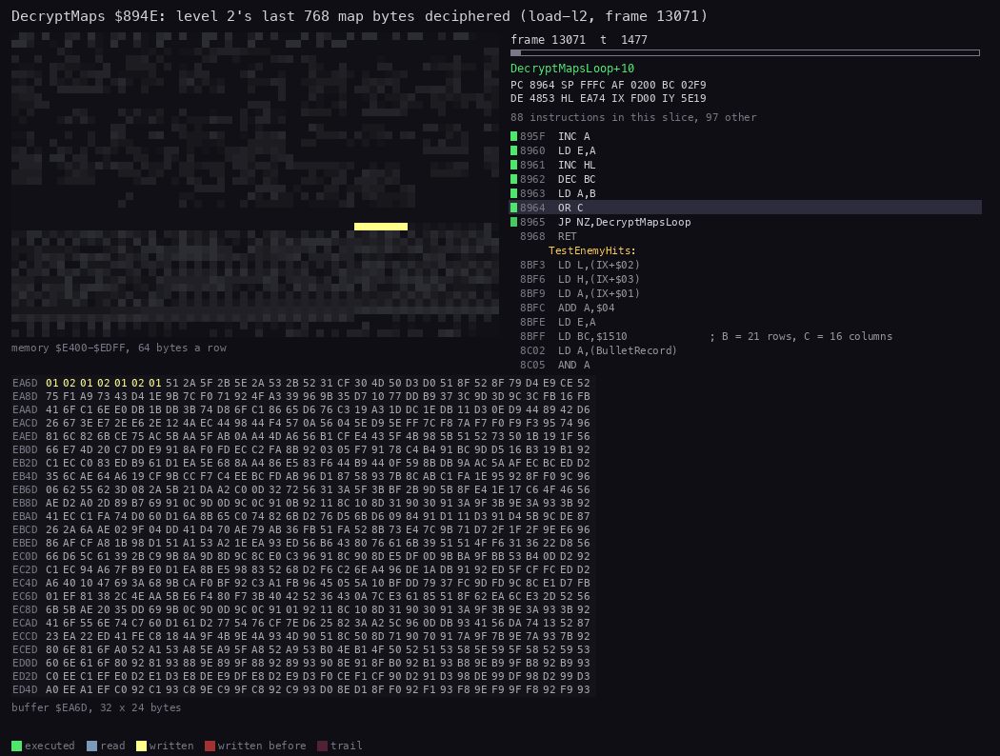
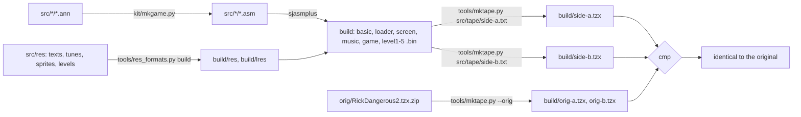

# 3. Build and load

What this covers: the medium, block by block, and how the source rebuilds it.

- the tape as a picture: side A (BASIC, loader, screen, code) and side B (five levels);
- the self-deciphering loader at `$FF00` and its bit-reversed LD-BYTES;
- the bit reversal, worked on real bytes;
- the level loads from side B, and the map cipher `DecryptMaps` `$894E`, worked by hand;
- the 48K path;
- the build: from the `.ann` files to both TZX files, byte for byte;
- the other releases and copies.

The recordings it rests on ([WALKTHROUGH 6.0](../WALKTHROUGH.md#60-the-recordings)):

| Recording | Load | Used for |
| --- | --- | --- |
| `c1` | 128K power-on, side A at ROM speed through the 128's Tape Loader | the loader, the screen and code loads, the entry |
| `load-l2` ... `load-l5` | the control menu after side A (`work/stage1/lab/e1-end.szx`), side B at ROM speed; `load-l5` with the POKE `$8065` = `$FF` | the level loads, `DecryptMaps` |
| `c48` | 48K power-on, side A at ROM speed (`LOAD ""`) | the 48K path |

## 3.1 The tape as a picture



*The two sides of `orig/RickDangerous2.tzx.zip` as the build writes them (`build/side-a.tzx`, `build/side-b.tzx`,
identical to the original). Each bar is as long as its block's time on the tape. Made with `python3
tools/fig_load.py tape docs/img/load/tape.png`, from `tools/tzxblocks.py`'s timings.*

How to read it:

- **Side A** is mostly one block: the code, 40 702 bytes, 221 seconds. Before it come a BASIC, the loader and the
  loading screen.
- **Side B** is five level blocks of the same size, 21 760 bytes each, nearly two minutes apiece.
- **Every block** is a standard-speed TZX block `$10`: pilot 2168, sync 667 and 735, bits 855 and 1710 T-states. No
  turbo.
- **Blocks A 5, A 6 and all of side B** are bit-reversed (3.3). The ROM cannot read them.

The blocks (`python3 tools/tzxblocks.py list` on each side):

| Side, block | Kind | Bytes | Loaded at | Read by | Time | Pause |
| --- | --- | ---: | --- | --- | ---: | ---: |
| A 1 | header, Program "RICK-II" | 17 | | the ROM | 5.09 s | 0.40 s |
| A 2 | BASIC (below) | 75 | the program area | the ROM | 2.39 s | 4.51 s |
| A 3 | header, Bytes "loader", 256 at 65280 | 17 | | the ROM | 5.09 s | 0.98 s |
| A 4 | the loader, enciphered (3.2) | 256 | `$FF00-$FFFF` | the ROM | 3.50 s | 6.32 s |
| A 5 | headerless, bit-reversed: the loading screen | 6912 | `$4000-$5AFF` | the loader | 37.70 s | 6.20 s |
| A 6 | headerless, bit-reversed: the music, the game, level 1, 510 zeros | 40 702 | `$6000-$FEFD` | the loader | 221.39 s | 3.60 s |
| B 1-5 | headerless, bit-reversed: levels 1-5 | 21 760 each | `$A800-$FCFF` | `LoadLevel` `$840C` | 115.2-117.3 s | 9.4-58.6 s |

Side A takes 297.2 s with its pauses (14 859 frames), side B 682.0 s (34 098 frames).

The BASIC is four lines:

```basic
10 PAPER 0: INK 0: BORDER 0
20 CLEAR 65279
30 LOAD ""CODE
40 RANDOMIZE USR 65280
```

Block A 6 is the whole game at once:

| Offset in A 6 | Address | Bytes | What | Source |
| ---: | --- | ---: | --- | --- |
| 0 | `$6000-$707F` | 4224 | the AY music, as it runs in RAM 1 at `$C000` | `src/music/music.asm` |
| 4224 | `$7080-$A7FF` | 14 208 | the game | `src/game/game.asm` |
| 18 432 | `$A800-$FCFF` | 21 760 | level 1, its maps stored plain | `src/levels/level1/level1.asm` |
| 40 192 | `$FD00-$FEFD` | 510 | zeros: the IM 2 table's place | |

The load of side A in memory:



*`c1` frames 1100-14 100, a picture every 150 frames. Each byte is a grey square by its value; a byte written since
the last picture flashes yellow, then fades through red. The screen fills first, then the code grows from `$6000`
upwards. Made with `python3 ../../kit/memanim.py --work work/docs/wr/c1 --from 1100 --to 14100 --step 10636200
docs/img/play/load-side-a.gif --screen --cell 3 --from-address 4000 --delay 120`.*

**The point**: one long block for the code and one block per level. The tape is plain standard speed; only the bit
order keeps the ROM out.

## 3.2 The loader at `$FF00`

The BASIC clears to 65 279, loads 256 bytes at `$FF00` and calls them. The block is enciphered from `$FF0B` up.

```asm
Decipher:                 ; $FF00
  LD DE,DecipherLoop+8    ; $FF0B: the first byte to decipher
DecipherLoop:
  LD A,(DE)
  XOR IYH                 ; $5C: the ROM keeps IY = $5C3A
  LD (DE),A
  INC DE
  LD A,D
  AND A
  JR NZ,DecipherLoop      ; until DE wraps to $0000
```

The trick: the first byte deciphered is `$FF0B`, the operand of the loop's own `JR NZ` at `$FF0A`. On the tape it is `$AB`.
`$AB` XOR `$5C` = `$F7`, the jump back to `$FF03`. The `JR` runs for the first time only after its operand has been
deciphered: the loop deciphers itself before it loops.



*`c1` frames 1110 (T 65 000) to 1111 (T 12 000), 40 pictures of 448 T. Left, the 256 bytes of `$FF00-$FFFF` (yellow:
written now, red: written before); under it the same bytes in hex as they change; right, the loop's lines as they
run. Made with `python3 ../../kit/routine_anim.py --work work/docs/wr/c1 --window 1110:65000-1111:12000 --listing
build/loader.lst --out docs/img/routines/Decipher.gif --view buffer:FF00:16x16:hex --range FF00-FFFF --pc FF00-FF0E
--pictures 40`.*

How to read it: the yellow front moves up from `$FF0B` to `$FFFF`, one byte every 7 instructions. The listing on the
right is the deciphered code: it shows what the bytes become.

Then the loader:

1. sets SP to 0;
2. reads the screen: IX = `$4000`, DE = `$1B00`, flag `$FF`, `CALL LdBytesReversed` (`$FF2D`);
3. reads the code: IX = `$6000`, DE = `$9EFE`, flag `$FF`, the same call;
4. `EI` and `JP GameEntry` (`$7B8F`).

`LdBytesReversed` is the ROM's LD-BYTES (`$0556`) with the same timings (the edge loop's 22, the pilot and sync
limits 156, 198, 201 and 212), changed in three places:

| | ROM LD-BYTES | the loader |
| --- | --- | --- |
| a byte's bits | `LD L,$01` and `RL L`: the first bit read is bit 7 | `LD L,$80` (`$FF9A`) and `RR L` (`$FFA3`): the first bit read is bit 0 |
| the checksum test | `LD A,H; CP 1` (H = 0 when good) | `LD A,H; CPL; CP 1` (`$FFB1`): H = `$FF` when good |
| a failed block | returns with carry clear | returns to `$FFD8`, pushed at `$FF35`: `JP NC,0`, the machine resets |

The tail `$FFDF-$FFFF` holds fragments the stack later overwrites (SP = 0 grows down into it). The Kixx copy differs
only there (3.7).

`c1`: the loader starts at frame 1110 (T 65 924); `$FF0C`, after the deciphering, runs at frame 1111. The entry
`$7B8F` runs at frame 13 998.

**The point**: two light locks. The XOR hides the loader from a disassembler; the bit order hides the blocks from
the ROM and from a copier that uses it.

## 3.3 The bit reversal



*The first four data bytes of block A 6 as stored on the tape, and the same bytes at `$6000-$6003` after the loader.
Made with `python3 tools/fig_load.py reversal docs/img/load/reversal.png`.*

How to read it: each byte's eight bits are mirrored. `$A4` = `10100100` on the tape becomes `00100101` = `$25` in
memory.

The checksum is the reason the ROM refuses a block. A standard block's bytes, flag and checksum included, XOR to
`$00`. The mastering chose each block's last byte so that the bytes as stored XOR to `$FF`. The ROM's test fails; the
loader's `CPL` accepts it.

The witnesses:

- `tools/image.py` turns the blocks back with a table of the 256 reversed bytes.
- The result equals the memory of `c1` at the entry (`$7B8F`, frame 13 998, T 9477): `$6000-$FEFD` and the screen,
  0 bytes differ (`tools/ttd_dump.py`, `work/stage1/images/entry.cpu.bin`).
- Side B's block 2 equals `$A800-$FCFF` after the level 2 load (`work/stage1/lab/dump-e6-end`, 0 bytes differ).

The same table, built at run time, is `MirrorTable` `$6500`: the game uses it to mirror sprites
([doc 6](06-rendering.md)).

## 3.4 Side B and the map cipher

A level other than the one in memory is read from side B. `LevelStart` `$7CC5` compares `Level` `$7EF1` with
`LevelNumber` `$C20C`. When they differ:



How to read it:

- `LoadLevel` reads every block from the start of side B, each over the last, until the block's own level number
  matches. In `load-l2` it read two blocks, in `load-l5` five.
- A player must rewind side B before every level change.
- Level 1 is on side B too. A new game after a game that reached level 3 finds level 3 in memory, and must read
  level 1 back from side B.
- `LdBytes` `$8479` is a second copy of the bit-reversed LD-BYTES, inside the game. Its error path is dead
  ([doc 2](02-architecture.md) 2.7).

### The map cipher

Each side B block carries the last 768 bytes of its maps enciphered (from the maps' base + `$600`). `DecryptMaps`
`$894E` restores them once the block is in:

```asm
DecryptMaps:
  LD HL,(LevelHeader+4)   ; the maps' base
  LD BC,$0600
  ADD HL,BC               ; + $600
  LD BC,$0300             ; 768 bytes
  LD E,$00                ; the key starts at 0
DecryptMapsLoop:
  LD A,(HL)
  XOR E                   ; the byte XOR the key
  LD (HL),A
  LD A,E
  XOR L                   ; the next key: (key XOR the address's low byte) + 1
  INC A
  LD E,A
  INC HL
  DEC BC
  LD A,B
  OR C
  JP NZ,DecryptMapsLoop
  RET
```

A worked example: level 2 in `load-l2`. The maps' base is `$E46D`, so the cipher covers `$EA6D-$ED6C`. The memory at
frame 13 071 (before) and 13 072 (after), read through TTD:

| Address | On tape | Key | Byte XOR key | After `DecryptMaps` | The next key |
| --- | --- | --- | --- | --- | --- |
| `$EA6D` | `$01` | `$00` | `$01` | `$01` | (`$00` XOR `$6D`) + 1 = `$6E` |
| `$EA6E` | `$6C` | `$6E` | `$02` | `$02` | (`$6E` XOR `$6E`) + 1 = `$01` |
| `$EA6F` | `$00` | `$01` | `$01` | `$01` | (`$01` XOR `$6F`) + 1 = `$6F` |
| `$EA70` | `$6D` | `$6F` | `$02` | `$02` | (`$6F` XOR `$70`) + 1 = `$20` |
| `$EA71` | `$21` | `$20` | `$01` | `$01` | (`$20` XOR `$71`) + 1 = `$52` |
| `$EA72` | `$50` | `$52` | `$02` | `$02` | |

The plain bytes `01 02 01 02 01 02` are block numbers of a map row: the cipher turns a regular pattern into noise.



*`load-l2` frame 13 071, the whole frame in 48 pictures of 1477 T. Top left, `$E400-$EDFF` (the end of level 2's
maps): the yellow front moves up through the 768 bytes. Below, the 768 bytes in hex, 32 a row, as they change.
Right, the loop's lines and the registers: HL the address, E the key, BC the count. Made with `python3
../../kit/routine_anim.py --work work/docs/wr/l2 --window 13071:0-13072:0 --listing build/game.lst --out
docs/img/routines/DecryptMaps.gif --view buffer:EA6D:32x24:hex --range E400-EDFF --pc 894E-8968 --pictures 48`.*

Why the last 768 bytes: side A's code block holds level 1 with its maps plain. A copier that took side A's code and
side B's level 1 would find 762 bytes that differ. Those bytes (`$EA6E-$ED6C`) are exactly the cipher's. The
deciphered bytes equal the RZX run's memory for levels 2-5 (`tools/image.py` `decrypt_maps`).

**The point**: the cipher protects the one place where the two sides overlap. Level 1 travels twice, and only side
B's copy is enciphered.

## 3.5 The 48K path

`c48` loads side A on a 48K with `LOAD ""`. The same blocks load at the same places: the loader does not depend on
the model.

| Step | 128K (`c1`) | 48K (`c48`) |
| --- | --- | --- |
| the bank test at `$7B8F` | RAM 1 found | fails (`$7BB3`, 1 run) |
| `CopyMusic` `$7BBF` | 4224 bytes from `$6000` to RAM 1 `$C000` | skipped |
| the handler's `CALL $7AB6` at `$FF14` | written | left as `NOP`s |
| `Machine48K` `$7A76` | clear | `$FF` |
| tunes | the AY in RAM 1 | none: `StartTune` `$7AAD` returns (4 calls in `c48`) |
| effects | the AY | the beeper, one note a pass (`$7B66`, 1206 passes in `c48`) |
| levels 2-5 | side B | side B, the same `LoadLevel` |

Every part of play works on a 48K: the menus, level 1 from memory, the gun, the detonator, the punch, pause and quit
(`c48`). The 48K loses the music and the AY effects, nothing else.

## 3.6 The build

The source rebuilds both tape sides byte for byte. `tools/build.sh` runs it:



How to read it:

- **The `.ann` files** are the source. `kit/mkgame.py` writes the `.asm` modules from them; the `.asm` are not edited
  by hand.
- **The resources** (texts, tunes, sprites, cells, maps, sections) are editable files under `src/res`.
  `tools/res_formats.py build` turns them into the bytes the `.asm` include.
- **`tools/mktape.py`** writes the TZX from a block list (`src/tape/side-a.txt`, `side-b.txt`). It applies the
  protections: the loader's XOR (`loader:`), the bit reversal (`reversed`), and the map cipher on side B (`maps:`).

The block list of side A:

```text
header 403 0 RICK-II @basic.bin 0 75
data 4507 basic.bin
header 977 3 loader 256 65280 32768
data 6323 loader:loader.bin
reversed 6203 screen.bin
reversed 3603 music.bin game.bin level1.bin zeros:510
```

The numbers are the pauses in milliseconds. The last line is block A 6 of 3.1: four parts in one block.

The checks, all from the case folder:

| Command | Result |
| --- | --- |
| `sh tools/build.sh` | "side-a.tzx and side-b.tzx identical to orig/RickDangerous2.tzx.zip's Side A and Side B" |
| `python3 tools/res_formats.py check` | every resource converts back to its bytes (62 files) |
| `python3 ../../kit/mkgame.py --case . --fix-witness --install` | the game: "assembled: identical to the original image" |

**The point**: the whole tape, protections included, comes from the source. Changing a text or a map and running
`tools/build.sh` gives a working tape.

## 3.7 The releases

Every copy the collection index lists was compared block by block with sides A and B (`tools/tape_compare.py`,
`work/stage1/tape-compare.txt`). Only the standard tape releases count here.

| Copy | What it is | How it differs |
| --- | --- | --- |
| Micro Style, `orig/RickDangerous2.tzx.zip` | the original, two sides | the reference |
| Kixx, `Rick Dangerous 2 (Kixx) - Side A.tzx`, `- Side B.tzx` | the budget re-release | side A: 32 bytes of the loader block's tail (from offset 223), which the stack overwrites; side B byte for byte |
| Erbe, `Rick Dangerous 2 - Side 1 (Erbe).tzx`, `- Side 2 (Erbe).tzx` | the Spanish re-release | another build: standard ROM blocks for the code, which is shifted (its POKEs are 24 lower); side 2 keeps the bit-reversed form; level 2 differs in 8 bytes, level 5 in 64 |
| ZXDB `Rick Dangerous 2.tap` | a re-save in plain bit order | a new BASIC patches the loader; 13 bytes of the level loader differ (`$8479-$8485`); the level blocks are Erbe's |
| other TAPs and TZXs | re-saves | new BASICs, one packed |

The Erbe level 5 shows the two builds apart: it addresses a table at `$7B7E`, where side B's level 5 uses `$7B8F`, the
address side A's code uses. So the Micro Style sides belong together.

The RZX run used a TAP version: its memory equals the Micro Style data except a 167-byte block at `$846A` (the level
loader).

**The point**: one build, re-released twice. The Kixx tape is the original; the Erbe tape is a second build.
