# 4. Game loop

What this covers:

- the program's states, from the entry `$7B8F` to the menus, a level, GAME OVER and the two endings, and what moves
  the program from one to the next;
- one pass of the main loop `$7D2D-$7EB2`, step by step, and what each step costs, measured in two rooms;
- the frame wait `$7A53` with its count of two, the windows with the interrupts off, and the interrupts they lose;
- the heaviest pass: a section entry, ten frames of drawing;
- the IM 2 handler `$FEFE`, line by line, and its cost;
- the death and the restart, as seen by the loop;
- every delay and timer, in frames and seconds.

The recordings it rests on ([WALKTHROUGH 6.0](../WALKTHROUGH.md#60-the-recordings); all 128K):

| Recording | Load | Used for |
| --- | --- | --- |
| `rzx-l1-06000-poke` | the RZX run's level 1 state at RZX frame 6000, its key reads as an input script, four immunity POKEs | the typical pass: frames 100-400 traced (`tools/pass_steps.py`), `MainLoop.gif` (frames 103-105), `Im2Handler.gif` (frame 104), the interrupt windows (frames 100-111) |
| `rzx-l5-20000-poke` | the RZX run's level 5 state at RZX frame 20 000, the same POKEs | the heaviest pass: the entry into the Fat Guy's section at frame 774; the Fat Guy's room, frames 1000-1300 |
| `c1` | power-on, side A at ROM speed | the entry, the menus, GAME OVER by the key E |
| `rzx-l5-full` | the RZX run's level 5 start state, no POKE | six deaths, GAME OVER, the menus, a new game |
| `rzx-l4-20000-poke`, `end-congrats`, `rzx-l5-23000` | as in WALKTHROUGH 6.0 | the level's end, the CONGRATULATIONS end, the Fat Guy's end |

Conventions:

- **A frame** is 1/50 s of the 128K: 70 908 T-states. The INT comes at frame T 1846 (the handler's first
  instruction ran at T 1865-1874 in all 238 interrupts measured).
- **A pass** is one turn of the main loop. Here a pass is counted from one return of the frame wait (`$7A5B`) to the
  next, so the frame wait closes it ([terms](README.md#terms)).
- **The work** of a pass is its T-states without the frame wait and the interrupts.
- A trace puts an instruction in the frame where it ran. A value read with `time_travel memory_at` is the memory at
  the start of the frame named. The snapshots of a recording (one every 250 frames) are memory too.
- The RZX pieces run the RZX archive's own version of the game. It is the Micro Style code with three changes: the
  level loader `$846A-$8510`, the bytes `$840D-$840E`, and the page byte of the RAM 1 calls (`$7A81` and `$7AC6`
  hold `$16`, so its music runs in RAM 6). The loop, the renderer and the handler are the same bytes (the memory of
  `rzx-l1-06000-poke` frame 0 against build/game.bin, `work/docs/wr-NOTES.md`).

## 4.1 The shape of the program

The game is locked to the frame, but loosely. The main loop does a pass of work and then waits until the interrupt
has come twice since the last wait.

- **A pass** moves everything one step: the map entries that come into view, the traps, the enemies, Rick, the
  bullet, the detonator, the countdown bonus. Then it composes the sprites and redraws the cells that changed.
- **The interrupt** (IM 2, 50 times a second) counts the frame, counts a 32-bit tick, reads the controls, and on a
  128K plays one frame of the AY music in RAM 1.
- **The game's clock is the pass.** Speeds are in pixels a pass, the fuse of a detonator in passes, the countdown
  bonus in passes. A pass is at least two frames, so the game runs at 25 passes a second at best.

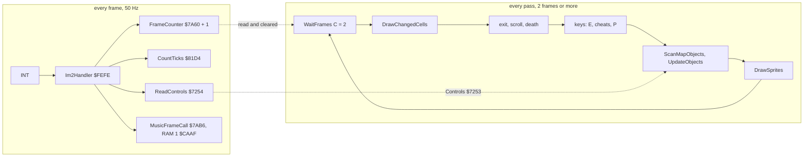

**The point**: the interrupt only keeps time, music and input; everything the player sees moves at the pace of the
pass. When a pass does more work, or loses an interrupt, the game slows down and the music does not.

## 4.2 The states of the program

The program has no state variable and no dispatcher. Its states are routines joined by calls, falls and jumps. The
stack is set once, at the entry.

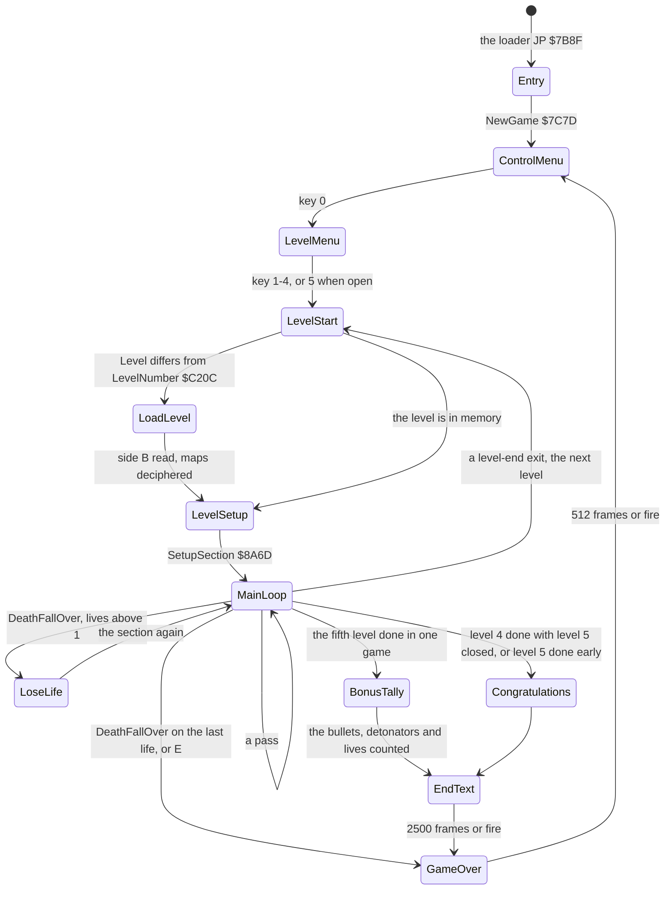

| Transition | Code | Trigger | Witness |
| --- | --- | --- | --- |
| the loader to the entry | `JP $7B8F` at `$FF2A` | side A's code block loaded | `c1` frame 13 998 |
| the entry to the control menu | `JP NewGame` at the end of `BuildMirrorTable` | | `c1` |
| the control menu to the level menu | `ControlMenu` returns, `ChooseLevel` `$7C80` calls `LevelMenu` | key 0 | `c1`, `controls-*`, `rzx-l5-full` (2) |
| the level menu to the level | `StartGame` `$7C83`: `ClearObjectTables`, `ResetSectionObjects`, `ResetGame` | a level key | 12 runs in 11 builds |
| the level start to the tape | `LevelStart` `$7CC5`: tune 4, `FreeAllObjects`, `LoadLevel` `$840C` | `Level` `$7EF1` is not `LevelNumber` `$C20C` | `load-l2` ... `load-l5` |
| the level start to play | `LevelTune` `$7CDE`, `LevelSetup` `$7CF2`, falls into `MainLoop` | | 17 runs in 15 builds |
| a death to the restart | `CALL LoseLife` at `$7E18` | `DeathFallOver` `$9B9B` set, lives not 1 | 29 runs in 13 builds |
| a death to GAME OVER | `JP Z,GameOver` at `$7E13` | `DeathFallOver` set, lives = 1 | `rzx-l5-full`: lives 1 in the snapshot of frame 11 000, GAME OVER at about 11 500, a new game (`LevelsDone` 0) by frame 13 000 |
| the key E to GAME OVER | `JP Z,GameOver` at `$7D30` | `TestQuitKey` `$724A` | `c1`, `controls-keyboard` |
| a level's end to the next level | `NextLevel` `$7DCC`: `Level` + 1, `JP LevelStart` | `CheckSectionExit` returns negative | `rzx-l3-10000-poke`, `rzx-l4-20000-poke` |
| a level's end to CONGRATULATIONS | `JP Z,Congratulations` at `$7DBB`, `$7DC7` | level 5 done before five levels, or level 4 done with `Level5Open` `$8065` clear | `end-congrats` (POKE `LevelsDone` = 0) |
| a level's end to the Fat Guy's end | `JP Z,BonusTally` at `$7DB3` | `LevelsDone` `$7EF2` reaches 5 | the RZX run (the tally's end in `rzx-l5-23000`) |
| an end text to GAME OVER | `EndTextExit` `$8794`: `JP GameOver` | 2500 frames or fire | known only from the code: no recording waits 2500 frames |
| GAME OVER to the control menu | `JP NewGame` at `$7EB0` | 512 frames or fire | `c1`, `rzx-l5-full` (2) |

**The point**: the whole game cycle is one chain of calls that never returns. `ResetGame` falls into the levels and
leaves them only through GAME OVER, which jumps to `NewGame`. Even the two endings finish in the GAME OVER box.

### The entry and the IM 2 set-up

The loader jumps to `Entry` `$7B8F` with the interrupts off. The entry runs once:

1. `LD SP,0`: the stack grows down from `$FFFF`, over the loader's tail ([doc 2, 2.5](02-architecture.md#25-the-stack)).
2. `SetupIm2` `$7C1A` copies the 35-byte handler from `$7C39` to `$FEFE`, fills the 257 bytes `$FD00-$FE00` with
   `$FE`, and sets I = `$FD`, IM 2.
3. The 128K test, the music copy to RAM 1, the handler patch, the mirror table ([doc 2, 2.3](02-architecture.md#128k-against-48k)).
4. Border black, `EI`, `JP NewGame`.

```asm
SetupIm2:                  ; $7C1A
  DI
  LD HL,Im2HandlerSource   ; $7C39: the handler as stored
  LD DE,Im2Handler         ; $FEFE
  LD BC,35
  LDIR
  LD HL,Im2Table           ; $FD00
  LD B,$00
FillIm2TableLoop:
  LD (HL),$FE              ; 256 bytes $FE ...
  INC HL
  DJNZ FillIm2TableLoop
  LD (HL),$FE              ; ... and the 257th, $FE00
  LD A,$FD
  LD I,A
  IM 2
  RET
```

Why 257 bytes of `$FE`: in IM 2 the CPU reads the vector at I x 256 + the byte on the data bus. The Spectrum's bus
holds an undefined byte (often `$FF`), so the vector can be at any of `$FD00-$FDFF`, and the word read can straddle
into `$FE00`. With every byte `$FE`, every word read is `$FEFE`.

A worked example: the bus holds `$FF`. The CPU reads the word at `$FDFF`: the low byte `$FE` from `$FDFF`, the high
byte `$FE` from `$FE00`. The handler is at `$FEFE`. With `$37` on the bus it reads `$FD37` and `$FD38`: `$FEFE` again.

**The point**: the usual table of one repeated byte, with the handler placed at the address the trick produces. The
handler's copy `$FEFE-$FF20` lies over the loader's first 33 bytes, which are dead once the game runs.

### The level start

`LevelStart` `$7CC5` decides whether the tape is needed, and `LevelSetup` `$7CF2` places Rick.

```text
LevelStart:
    if Level != LevelNumber:            # the level in memory, $C20C of the level block
        StartTune(4)                     # silence
        FreeAllObjects()
        LoadLevel()                      # "START TAPE ON SIDE TWO" ... "STOP TAPE AND PRESS FIRE"
        DecryptMaps()
    StartTune(Level + 4)                 # tunes 5-9
    if Lives != 6: Lives += 1            # AddLife $7CEE
LevelSetup:
    Ammunition = Detonators = 6
    RideMode = RickClimbing = RickCrawling = 0
    start = LevelStarts[Level - 1]       # 6 bytes
    RickFacing = start.flag
    SetupSection(section = start.section, top = start.row, x = start.x, y = start.y)
    fall into MainLoop
```

The table `LevelStarts` `$7C8F` (src/res/tables/level-starts.csv), 6 bytes a level:

| Level | Bytes | Section | View top row | x | y | Facing |
| ---: | --- | ---: | ---: | ---: | ---: | --- |
| 1 | `00 00 00 CB 00 00` | 0 | 0 | 0 | `$00CB` | 0 |
| 2 | `00 00 00 CB 00 00` | 0 | 0 | 0 | `$00CB` | 0 |
| 3 | `01 90 00 AB 00 00` | 1 | `$90` | 0 | `$00AB` | 0 |
| 4 | `00 00 00 CB 00 00` | 0 | 0 | 0 | `$00CB` | 0 |
| 5 | `00 60 00 AB 00 00` | 0 | `$60` | 0 | `$00AB` | 0 |

A worked example, level 3: `IX` = `$7C8F` + 6 x 2 = `$7C9B`. `A` = 1 (section 1), `C` = `$90` (the view starts 144
cell rows down the section), `E` = 0 (the left edge), `HL` = `$00AB` (pixel row 171 of the view, near its bottom).
Rick starts at the bottom left of a view that is already scrolled far down section 1.

`AddLife` is the only extra life of the game: a level started with fewer than six lives gets one back. Every level
start of the recordings had six lives, so it is not executed in any recording. Known only from the code (`$7CE6-$7CF1`).

**The point**: one table places Rick in every level, and the same `SetupSection` that a section exit uses builds the
first view.

### The level's end

A section exit with bit 7 makes `CheckSectionExit` `$8993` return a negative A ([doc 7](07-objects.md)). The main
loop then counts the level and picks what comes next.

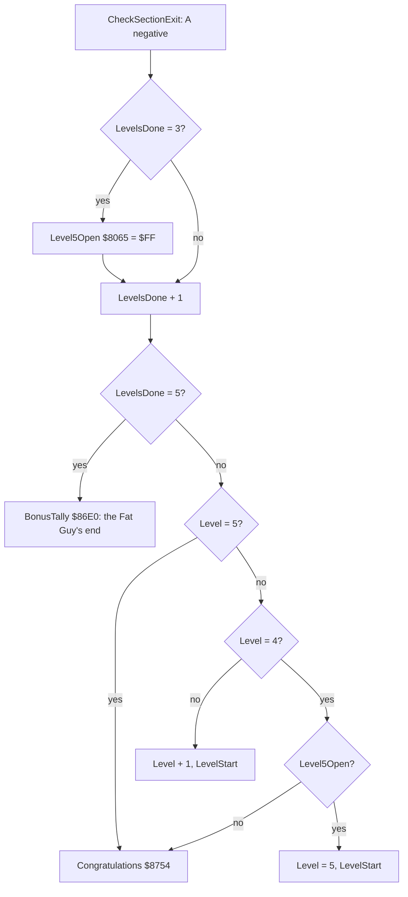

```asm
  LD A,(LevelsDone)        ; $7D9E
  CP $03
  JP NZ,CountLevelDone
  XOR A                    ; the fourth level done in this game: level 5 opens
  DEC A
  LD (Level5Open),A
  LD A,$03
CountLevelDone:
  INC A                    ; $7DAA
  LD (LevelsDone),A
  CP $05
  JP Z,BonusTally          ; five levels in one game: the Fat Guy is beaten
  LD A,(Level)
  CP $05
  JP Z,Congratulations     ; level 5 ended in a game that had not done four levels
  CP $04
  JP NZ,NextLevel
  LD A,(Level5Open)
  AND A
  JP Z,Congratulations     ; level 4 ended with level 5 closed
  LD A,$04
NextLevel:
  INC A                    ; $7DCC
  LD (Level),A
  JP LevelStart
```

Two worked examples:

1. **The RZX run** started at level 1. At the end of level 4 `LevelsDone` was 3: `Level5Open` = `$FF`,
   `LevelsDone` = 4, `Level` is 4 and level 5 is open, so `Level` = 5 (`rzx-l4-20000-poke`, `$7DA6` once). At the
   Fat Guy's end `LevelsDone` = 5: `BonusTally`.
2. **`end-congrats`** is the same state with the POKE `LevelsDone` = 0. At the end of level 4: `LevelsDone` = 1,
   `Level` = 4, `Level5Open` clear: `Congratulations`, "YOU HAVE COMPLETED LEVEL 4" (its snapshot at frame 250 holds
   `Level` 4, `LevelsDone` 1).

`Level5Open` is never cleared. Once a game has opened it, the level menu offers level 5 in every later game until the
machine is reset; `rzx-l5-full` shows the five-level menu after its GAME OVER. A game started at level 5 then ends at
the Fat Guy with `LevelsDone` = 1, which goes to `Congratulations`, not to the true ending.

**The point**: the true ending is "five levels in one game", counted, not "level 5 completed". The lock on level 5
and the two endings are the same counter seen from two sides.

### GAME OVER

`GameOver` `$7E1E` is reached from the last death and from the key E:

1. tune 2;
2. three `NOP`s over the `JP M` at `$775A`: the cell composer no longer keeps sprites behind front cells;
3. `ClearRedraw`, 129 bytes of the view buffer from `$6D60` cleared;
4. a box of 12 x 3 cells at column 10, rows 11-13: attributes `$47`, pixels 0;
5. "GAME  OVER" falls into place (`DropText`, [doc 8](08-hud-and-text.md)) and is printed on the screen at `$488B`;
6. 512 frames, or fire, SPACE or ENTER (`TestFireKeys` `$7229`);
7. `LevelCellsMode`, `JP NewGame`.

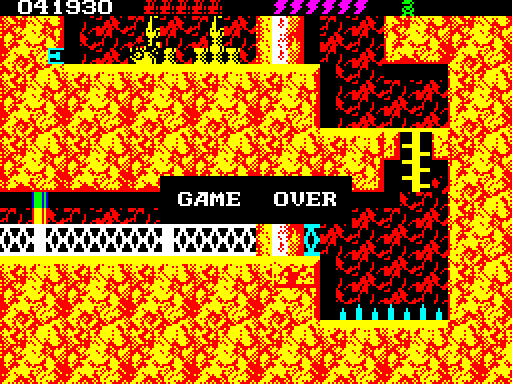

*The GAME OVER box over the frozen play area: `rzx-l5-full` frame 11 500, the last life lost (the screenshot of
[WALKTHROUGH 6.1](../WALKTHROUGH.md#61-screens-and-levels)).*

**The point**: GAME OVER is drawn over the last frame of play, which stays on the screen. The loop that holds it is a
plain frame-by-frame count, so the music goes on under it.

### The endings

Both endings show a text that falls letter by letter and then wait 2500 frames (50 s) or fire. The Fat Guy's end
first counts what is left into the score:

```text
BonusTally:                              # $86E0
    AddScore(100000)
    while Ammunition: Ammunition -= 1; AddScore(5000);  effect 4; DrawAmmo();       wait 10 frames
    while Detonators: Detonators -= 1; AddScore(10000); DrawDetonators(); effect 5; wait 15 frames
    while Lives:      Lives -= 1;      AddScore(100000); DrawLives();     effect 10; wait 20 frames
    StartTune(10); ShowEndText(FatGuyEndText)
Congratulations:                         # $8754
    CompletedLevelDigit = Level + $34; StartTune(0); ShowEndText(CongratulationsText)
ShowEndText:
    FontCellsMode(); DrawHud(); each line: DropText(...)
    wait 2500 frames or fire
    FontCellsMode(); LevelCellsMode(); DrawHud(); GameOver()
```

The RZX run reached the Fat Guy's end with six bullets, two detonators and five lives
([doc 1, 1.6](01-game-design.md#16-the-rules)): 100 000 + 6 x 5000 + 2 x 10 000 + 5 x 100 000 = 650 000 points
added, and 6 x 10 + 2 x 15 + 5 x 20 = 190 frames of tally (3.8 s). `rzx-l5-23000` starts inside `TallyLives` and
shows its six runs (five lives and the pass to `TallyDone`).

**The point**: the endings have no state of their own. They are two short programs that reuse the menu's falling
text and close in GAME OVER, so a finished game and a lost one both return to the control menu the same way.

## 4.3 One pass of the main loop

`MainLoop` `$7D2D` runs from the level start until GAME OVER, a level's end or an ending.

```text
MainLoop:
    if key E:            GameOver()
    if C+S+3 held:       StartTune(1); CheatInfinite ^= $FF
    if SPACE+N+ENTER+J+Y held and Level5Open: StartTune(1); CheatExits = $FF
    if key P:            wait for P released, pressed, released     # the pause
    ScanMapObjects()                    # map entries entering the view, trigger boxes
    ExitDirection = 0
    UpdateObjects()                     # traps, enemies (or level 5's code), Rick, bullet, detonator, bonus
    DrawSprites()                       # compose every sprite into spare cells
    if Machine48K: PlayBeeperStep()     # one note of a beeper effect
    WaitFrames(2)                       # until two interrupts since the last wait
    DrawChangedCells()                  # the cells that changed, to the screen
    if ExitDirection and CheckSectionExit() is negative: the level's end (4.2)
    if not RickDying:
        if RickY < $60 and ViewTopRow > 0:              ScrollUp()
        elif RickY >= $CC and ViewTopRow < ViewLastRow: ScrollDown()
    if DeathFallOver:
        if Lives == 1: GameOver()
        LoseLife()
```

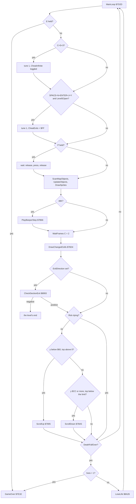

The work around the frame wait, as written:

```asm
PassWork:                  ; $7D73
  CALL ScanMapObjects      ; $8B42: the map entries
  XOR A
  LD (ExitDirection),A     ; $88D3: no exit asked yet
  CALL UpdateObjects       ; $865D
  CALL DrawSprites         ; $85FA: the composer, into spare cells
  LD A,(Machine48K)        ; $7A76
  AND A
  CALL NZ,PlayBeeperStep   ; $7B66, 48K only
  LD C,$02                 ; two frame counts a pass
  CALL WaitFrames          ; $7A53
  CALL DrawChangedCells    ; $76D4: the composed cells to the screen
  LD A,(ExitDirection)
  AND A
  JP Z,ScrollTest
  CALL CheckSectionExit    ; M: the level's end
```

The order is the point of the design. Everything that changes the picture is built off screen first: `DrawSprites`
composes each sprite into copies of the cells under it, in spare cells from `$5DF0`, and only marks the view buffer.
The wait comes next. `DrawChangedCells` then copies the changed cells to the screen right after the interrupt, while
the beam is still in the top border, so the screen changes at one moment of the frame ([doc 6](06-rendering.md)).

The animation runs one pass of level 1:

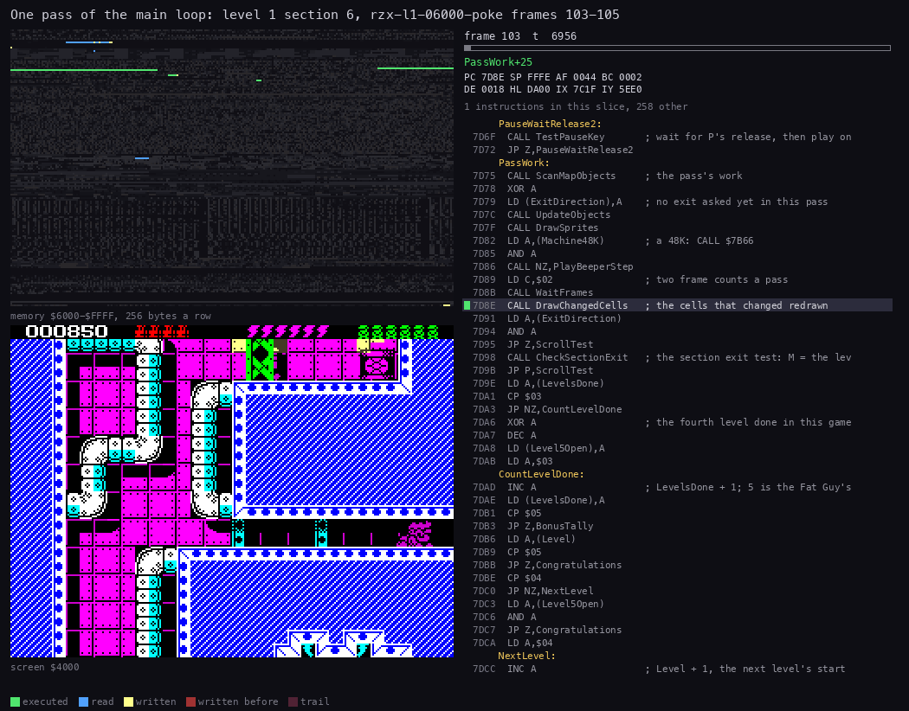

*`rzx-l1-06000-poke` frames 103 T 4930 to 105 T 4940, the pass that starts after the frame wait at frame 103, 70
pictures of 2026 T. Top left, `$6000-$FFFF` lit by age (green executed, blue read, yellow written); under it the
screen; right, the listing at the PC. Made with `python3 ../../kit/routine_anim.py --work work/docs/wr/l1p --window
103:4930-105:4940 --listing build/game.lst --pc 7D2D-7EB3 --range 6000-FFFF --pictures 70 --delay 120 --out
docs/img/routines/MainLoop.gif`.*

How to read it:

- The first pictures are `DrawChangedCells`: writes into the screen where Rick and the enemy are.
- Then the long middle: the map entry scan, the objects, and `DrawSprites` writing the dirty map at `$6600` (the
  spare cells at `$5DF0-$5F00` lie under the grid's `$6000`).
- The last third is the frame wait: the PC sits in `WaitFrames` while nothing in memory changes.

### The steps and their cost

`tools/pass_steps.py` reads an access trace and gives each instruction's T-states to the step of the main loop it
belongs to: the routine the loop called last, the loop's own lines, or the interrupt. Two windows of 300 frames:

| Step | Level 1 section 6, median | max | The Fat Guy's room, median | max |
| --- | ---: | ---: | ---: | ---: |
| `DrawSprites` (the composer) | 45 326 | 62 527 | 126 714 | 188 335 |
| `DrawChangedCells` | 42 172 | 46 288 | 54 778 | 67 559 |
| `UpdateObjects` (everything that moves) | 7161 | 14 587 | 8588 | 12 812 |
| `ScanMapObjects` | 655 | 3012 | 28 | 28 |
| the loop's own lines | 560 | 673 | 534 | 683 |
| **the work** | **96 411** (1.36 frames) | 116 531 | **185 621** (2.62 frames) | 262 114 |
| the interrupts (two or more a pass) | 6517 | 7799 | 6651 | 11 042 |
| the frame wait | 89 993 | 138 674 | 44 140 | 133 429 |

*T-states. Level 1: `rzx-l1-06000-poke` frames 100-400, 113 passes (the section entry at frame 116 left out).
The Fat Guy's room: `rzx-l5-20000-poke` frames 1000-1300, 86 passes. Made with `python3 tools/pass_steps.py --work
work/docs/wr/l1p --window 100:0-400:0 --csv work/docs/wr/passes-l1.csv` and the same with `--work work/docs/wr/l5p
--window 1000:0-1300:0`.*

- **Drawing is 90 % of the work.** In level 1 the two drawing steps take 87 498 of 96 411 T; the logic of every
  object, Rick included, takes 7161.
- **The Fat Guy's room** is no heavier in logic (his own code at `$F8D0` runs inside `UpdateObjects`, 8588 T for
  everything). It is three times heavier in `DrawSprites`: the Fat Guy is five records of up to 24 x 21 pixels.
- **`ScanMapObjects`** returns at once in the Fat Guy's room: `LevelHookOn` `$8A24` is set, and level 5's own code
  stands in for the map entries ([doc 7](07-objects.md)).

The same passes as a timeline:

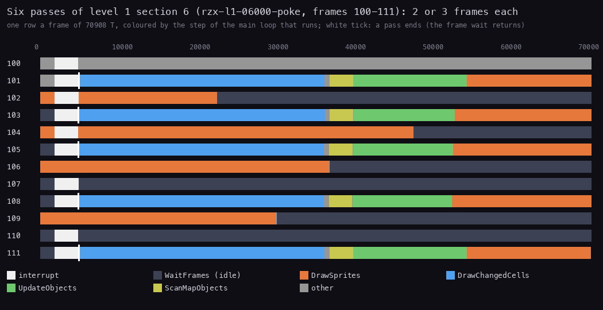

*`rzx-l1-06000-poke` frames 100-111. One row a frame; each step of the pass in its colour; the white tick is the
frame wait returning. Made with `python3 tools/fig_loop.py steps --work work/docs/wr/l1p --window 100:0-112:0
docs/img/loop/steps-level1.png`.*

How to read it:

- **White** at T 1865-4900 of each frame is the interrupt: the handler and the music.
- **Blue** right after a tick is `DrawChangedCells`. **Green** (`UpdateObjects`) and **orange** (`DrawSprites`)
  follow; **slate** is the wait.
- The passes from frames 101 and 103 take 2 frames. The pass from 105 takes 3: the wait sits through frames 106 and
  107, because the interrupt of frame 106 was lost (4.4).

**The point**: in a quiet room the CPU finishes the pass in 1.4 frames and then idles. The game is not short of time;
it loses it to the interrupts it misses.

## 4.4 The frame wait and the lost interrupts

```asm
WaitFrames:                ; $7A53, C = the frames
  EI
WaitFramesLoop:
  LD A,(FrameCounter)      ; $7A60, + 1 in every interrupt
WaitFramesCompare:
  CP C
WaitFramesUntil:
  JP C,WaitFramesLoop      ; fewer than C interrupts since the last wait
  XOR A                    ; $7A5B: the pass ends here
  LD (FrameCounter),A
  RET
```

`WaitFrames` does not wait for two frames. It waits until the counter has reached two, and the counter counts the
interrupts since it was last cleared. The pass's own interrupts count: if the work took 1.4 frames, one interrupt has
already come, and the wait needs only the next.

The catch is that the counter counts only the interrupts the CPU takes. On the Spectrum the INT signal lasts about 32
T-states at the start of the frame. Code that runs with the interrupts off at that moment never sees it. The game
has four such windows:

| Window | Where | Why the interrupts are off | Length |
| --- | --- | --- | --- |
| the sprite blitters | `ComposeShiftedBlit`, `ComposeAlignedBlit` (inside `ComposeSprite` `$7329`) | `LD SP,HL` and `POP` read a sprite's mask and data two bytes at a time | 5000-20 000 T a sprite |
| the map builder | `BuildView` `$88D4` | `POP DE` takes two cell numbers of a block at a time | about 40 000 T a call |
| the RAM 1 calls | `CallRam1` `$7A77` | RAM 1 is paged in at `$C000`, over the level's data | until the next `EI`: often the rest of the pass |
| the handler itself | `$FEFE-$FF1F` | `DI` first, `EI` last | about 3100 T |

`CallRam1` deserves a note. It leaves the interrupts off when it returns ("the IM 2 handler's EI or the next
WaitFrames puts them back", `$7A77`). A sound effect started in the middle of a pass therefore keeps the interrupts
off until the frame wait's `EI`. The red bars labelled `CallRam1` in frames 101 and 111 below are such effects.

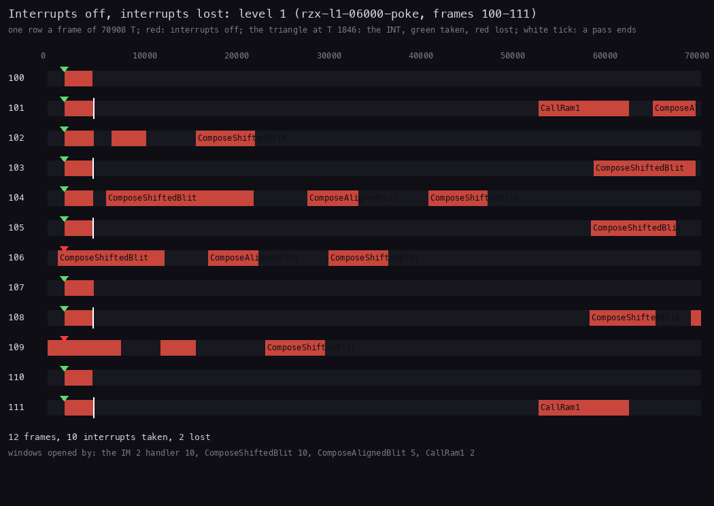

*`rzx-l1-06000-poke` frames 100-111. One row a frame of 70 908 T; red where the interrupts are off, labelled by the
routine that ran the `DI`; the triangle at T 1846 is the INT, green when the handler ran in that frame and red when
it was lost; a white tick where a pass ends. Made with `python3 tools/fig_loop.py di --work work/docs/wr/l1p --window
100:0-112:0 docs/img/loop/di-windows.png`.*

How to read it:

- **Frame 106**: `ComposeShiftedBlit` ran with the interrupts off from T 1100 to 12 800. The INT at T 1846 fell
  inside it: red triangle, no handler, the counter missed a tick.
- **Frame 109**: the same, from a window that began in frame 108.
- Every pass that loses an interrupt is a 3-frame pass.

A worked example, the pass from frame 105 (`work/docs/wr/passes-l1.txt`):

1. Frame 105 T 4940: the wait returns, `FrameCounter` = 0. `DrawChangedCells`, the objects and `DrawSprites` start.
2. Frame 106 T 1846: the INT falls in a sprite blit with the interrupts off. Lost. The counter stays 0.
3. Frame 106, later: the work ends (103 241 T after the pass started, 1.46 frames). `WaitFrames` waits for 2.
4. Frame 107 T 1865: the handler runs. The counter is 1.
5. Frame 108 T 1865: the handler runs. The counter is 2. The wait returns at frame 108 T 4930: the pass took 3.0
   frames.

Without the loss, the counter would have been 2 at frame 107 and the pass 2.0 frames.

The pass lengths in the two windows of 4.3:

| Window | Passes | 2 frames | 3 frames | 4 frames | 5 frames | Interrupts lost |
| --- | ---: | ---: | ---: | ---: | ---: | ---: |
| level 1 section 6, frames 100-400 | 113 | 55 | 58 | | | 61 of 296 (21 %) |
| the Fat Guy's room, frames 1000-1300 | 86 | 2 | 47 | 35 | 2 | 117 of 295 (40 %) |

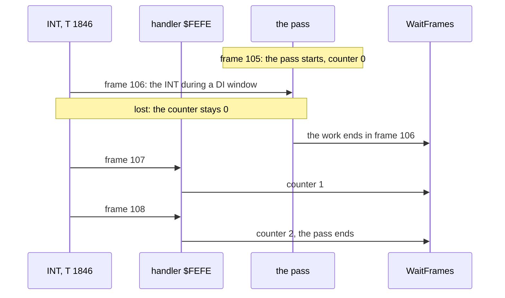

**The point**: the frame lock counts interrupts, and the renderer loses about one interrupt in five in a quiet room
and two in five in the Fat Guy's room. The music, called from the handler, loses the same frames: a lost interrupt is
a frame of music not played, so the tunes play slower while there are many sprites on the screen.

## 4.5 The heaviest pass: entering a section

When Rick walks out of the view at a side, `CheckSectionExit` calls `SetupSection` `$8A6D` inside the pass. It
rebuilds everything: the view buffer from the map (`BuildView`), every map entry in the view, the objects, the HUD,
and a full redraw of 32 x 23 cells with their attributes (`RedrawView` `$7965`).

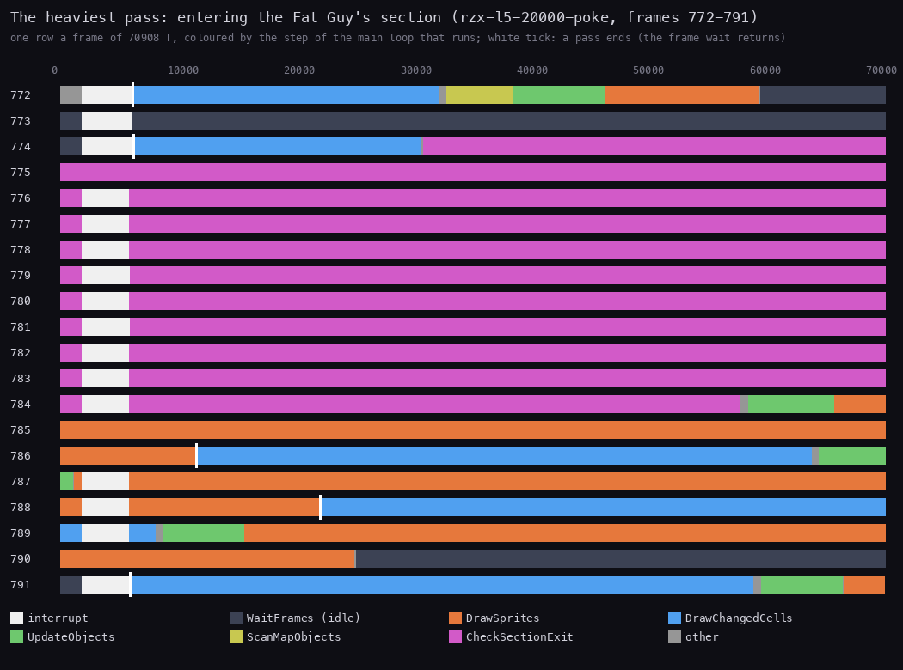

*`rzx-l5-20000-poke` frames 772-791: the pass in which Rick leaves section 6 by the exit `$42` (the section byte
`$9B93` is 7 from frame 775). Made with `python3 tools/fig_loop.py steps --work work/docs/wr/l5p --window 772:0-792:0
docs/img/loop/steps-section-entry.png`.*

How to read it:

- **Frames 772-774**: ordinary 2-frame passes of section 6.
- **Frames 774-784, magenta**: `CheckSectionExit` and everything `SetupSection` calls. The pass runs 12.08 frames
  (774 T 6334 to 786 T 11 705). The interrupts of frames 775, 785 and 786 are lost; nine are taken.
- **Frames 785-791**: the first passes in the Fat Guy's room, 2 to 3 frames, mostly orange: his five sprites.

Where the 699 343 T of `CheckSectionExit` go (flat, by label; `python3 work/docs/wr/flat.py work/docs/wr/l5p
760:0-800:0` over the pass):

| Routine | T | Share of the pass |
| --- | ---: | ---: |
| `DrawLevelCellBase` (a cell drawn on the screen) | 219 998 | 25.7 % |
| `DrawChangedIfClear` (the redraw's scan) | 102 419 | 12.0 % |
| `DrawLevelCell` | 74 831 | 8.7 % |
| `SetAttrsLoop1-3` (the attributes) | 47 177 | 5.5 % |
| `BuildViewBlock` (the map builder) | 39 112 | 4.6 % |
| `ClearRedraw` (1280 bytes cleared, several times) | 32 998 | 3.9 % |
| `RedrawAll` (1280 bytes set) | 30 399 | 3.6 % |

**The point**: a section entry costs ten frames, a fifth of a second during which the picture holds. The game hides
it by changing the whole screen at once; the player sees the new section appear, not the pause. The level 1 window
has the same kind of pass at frame 116 (11.68 frames). `tools/passes.py`'s 13.47 frames from the RZX state at frame
22 000 ([doc 2, 2.6](02-architecture.md#26-the-frame-budget)) is a section rebuild too: that state, played without
keys, loses Rick, and the restart rebuilds the section.

### The pass against the beam

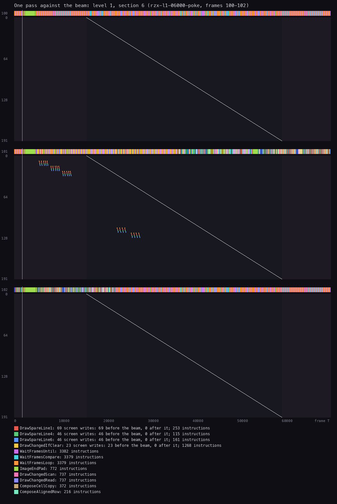

*`rzx-l1-06000-poke` frames 100-102, every screen write against the raster (the diagonal is the beam on the 192 paper
lines). Made with `python3 ../../kit/beam_timeline.py --work work/docs/wr/l1p --window 100:0-103:0 --listing
build/game.lst --machine 128k --title "One pass against the beam: level 1, section 6 (rzx-l1-06000-poke, frames
100-102)" --out docs/img/loop/beam-pass.png`.*

How to read it:

- The only screen writes of the pass are the short dashes in frame 101 T 5000-27 000: `DrawChangedCells` copying
  spare cells to the screen at the lines of Rick and the enemy.
- They all lie left of the diagonal: the screen bytes are written before the beam reaches their line.

**The point**: no tearing in an ordinary pass. The screen is written in one burst right after the interrupt, ahead of
the beam. A pass with many changed cells (a scroll, a section entry) does reach the beam, but those redraw the whole
view anyway.

## 4.6 The interrupt

The handler at `$FEFE` is 35 bytes, copied from `$7C39`:

```asm
Im2Handler:                ; $FEFE (the copy of $7C39)
  DI
  PUSH AF
  PUSH BC
  PUSH DE
  PUSH HL
  PUSH IX
  PUSH IY
  LD A,($7A60)             ; FrameCounter + 1
  INC A
  LD ($7A60),A
  CALL $81D4               ; CountTicks: the 32-bit tick count
  CALL $7254               ; ReadControls: the chosen method into Controls $7253
  CALL $7AB6               ; $FF14: three NOPs in the image; CopyMusic writes this CALL on a 128K
  POP IY
  POP IX
  POP HL
  POP DE
  POP BC
  POP AF
  EI
  RET
```

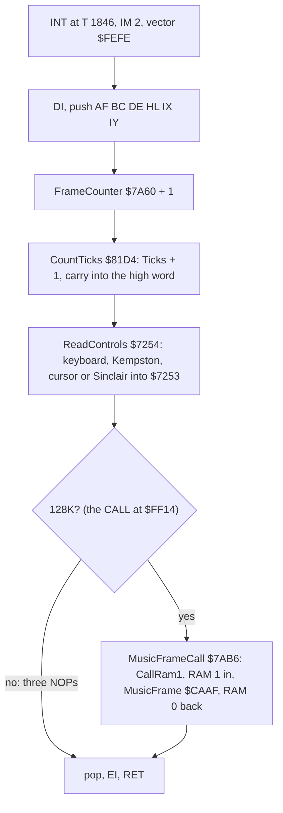

The handler saves the main registers, `IX` and `IY`, but not the alternate set. Neither `ReadControls` nor the music
in RAM 1 uses `EXX` or `EX AF,AF'` (none in src/game/controls.asm or src/music/*.asm), so the main loop's users of
the alternate set (the map builder `$88D4`, the scrolls) are safe.

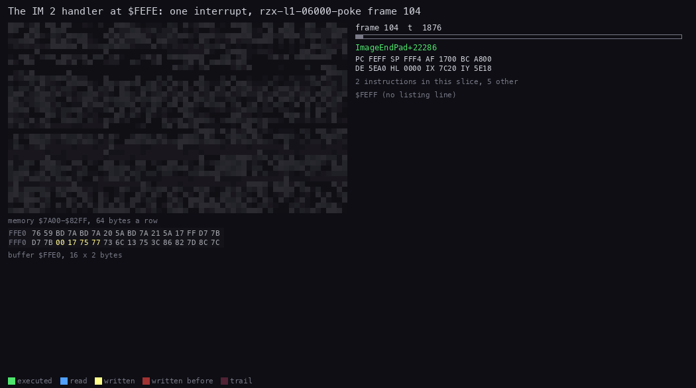

*`rzx-l1-06000-poke` frame 104, T 1800-5200, 45 pictures of 76 T. Top, `$7A00-$82FF` lit by age: `FrameCounter`
`$7A60`, `Controls` `$7253` and `Ticks` `$81D0`; under it the stack `$FFE0-$FFFF` in hex as the handler pushes and
pops; right, the listing (the music in RAM 6 here, the RZX version's page, is shown as one name). Made with `python3
../../kit/routine_anim.py --work work/docs/wr/l1p --window 104:1800-104:5200 --listing build/game.lst --page-name
"6=the music player (RAM 6, the RZX version)" --pc FEFE-FF20,7A77-7ABF,81D4-81E6,7254-7329 --range 7A00-82FF --view
buffer:FFE0:16x2:hex --pictures 45 --delay 150 --out docs/img/routines/Im2Handler.gif`.*

The cost, measured over 238 interrupts of `rzx-l1-06000-poke` frames 100-400 (`python3 work/docs/wr/handler.py
work/docs/wr/l1p 100:0-400:0`):

| Part | Median T | Max T |
| --- | ---: | ---: |
| the whole handler, `$FEFE` to its `RET` | 3126 | 3953 |
| the music (`CallRam1` and the player) | 2585 | 3380 |
| `ReadControls` (the cursor method in this recording) | 243 | 275 |
| `CountTicks` | 57 | 57 |

The shortest handler, 829 T, ran while the player had nothing to play. Two interrupts a pass cost 6200-6500 T, about
6.5 % of a level 1 pass's work.

### The tick count and the random numbers

`CountTicks` adds 1 to the 32-bit `Ticks` `$81D0-$81D3` every interrupt. `Random` `$81AF` folds it into its last
value:

```text
Random(A):
    HL = RandomValue + Ticks.low + 13 + Ticks.high + carry
    L  = A xor L xor D xor E xor H          # D, E: the high word's bytes
    RandomValue = HL
    return L
```

Its callers are the enemies' turns (`$A010`, `$A016`, `$A048`, `$A05F`: 1018 runs in 21 builds). The random numbers
depend on when the interrupts fell, so a lost interrupt changes the enemies' choices: one reason a replay with keys
held per frame drifts from the RZX run ([WALKTHROUGH 6.0](../WALKTHROUGH.md#60-the-recordings)).

**The point**: the handler is short and always the same work. Its one variable cost is the music, about 2600 T a
frame, 3.7 % of the CPU.

## 4.7 The death and the restart

A death is two flags of Rick's that the main loop watches ([doc 10](10-gameplay-logic.md) has the causes):

1. `KillRick` `$93D0` sets `RickDying` `$9B9C`: the cry (effect 10), a jump up. The scroll test is skipped from now.
2. `DeathFall` `$9405`, every pass: gravity, a drift, two death sprites, until Rick is below the view; then
   `DeathFallOver` `$9B9B` = `$FF`.
3. The main loop's death test: lives 1 is GAME OVER; else `LoseLife` `$8A26`.
4. `LoseLife`: a life off (not with `CheatInfinite`), the HUD's lives, ammunition and detonators 6, and the restart
   point `$9B8C-$9B94` put back. It falls into `SetupSection`, which rebuilds the section as at its entry.

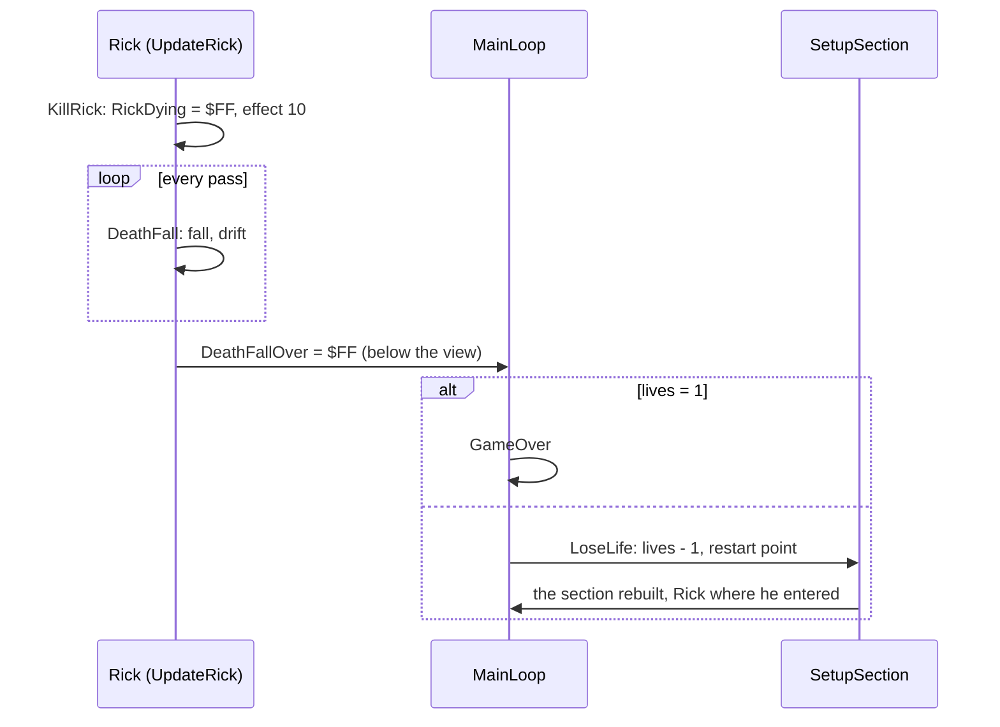

The witness: `rzx-l5-full` (no POKE). `RickDying` is set between frames 2216 and 2222, `DeathFallOver` at about
frame 2318, and the lives go from 6 to 5 ([doc 1, 1.8](01-game-design.md#18-key-moments) has the animation). The fall
takes about 100 frames, 2 s. The restart pass then costs a section entry, ten frames.

**The point**: a life is restarted by the same code that enters a section, from a copy of Rick's state saved at the
entry. Nothing that happened in the section survives a death: the objects are spawned again from the map.

## 4.8 Delays and timers

| What | Where | Count | Time |
| --- | --- | --- | --- |
| a pass | `MainLoopPause` `$7D85`, `WaitFrames` C = 2 | 2 interrupts | 2 frames at best, 0.04 s; 3-5 in play |
| a scroll | `ScrollDown` `$78A5`, `ScrollUp` `$7905` | three waits of C = 1 | 3 frames for 8 cell rows ([doc 6](06-rendering.md)) |
| the menus' falling letters | `DropTextWait` `$82E2` | C = 1 a frame, letters 6 frames apart | until all stop or a key |
| the control menu's pointer | `ControlMenuLoop` `$8127` | C = 1 | a frame a step |
| GAME OVER | `GameOverWait` `$7E9D` | 512 x C = 1 | 10.24 s, or fire |
| an end text | `EndTextWait` `$8781` | 2500 x C = 1 | 50 s, or fire |
| the bonus tally | `BonusTally` `$86E0` | C = 10 a bullet, 15 a detonator, 20 a life | 0.2, 0.3, 0.4 s each |
| the countdown bonus | `CountBonus` `$9163` | 10 points every 25 passes | 1 s or more ([doc 10](10-gameplay-logic.md)) |
| a detonator's fuse | `BurnFuse` `$9351` | `$40` passes | 64 passes, 2.6 s or more |
| the punch's stick | `PunchTimer` `$9BA3` | 10 passes | 0.4 s or more |
| the pause | `MainLoopPause` `$7D5D` | P released, pressed, released | until the player |

Every timer of play counts passes, not frames. A detonator lit in the Fat Guy's room, at 3.2 frames a pass, burns
for 4.1 s instead of 2.6 s.

**The point**: only the screens outside play (menus, GAME OVER, the endings) count frames. Play counts passes, so the
whole game slows down together when the screen is busy, and nothing in play depends on the real time.

## 4.9 Known only from the code

- `AddLife` `$7CEE`: no level start with fewer than six lives in any recording.
- `EndTextExit` `$8794`: no recording waits the 2500 frames of an end text or presses fire there.
- The 48K pass: `PlayBeeperStep` `$7B66` runs in `c48` (1206 passes), but no trace of a 48K pass was taken. On a 48K
  the handler keeps its three `NOP`s ([doc 9](09-sound.md)).
- `EntryDebris` `$7C5C-$7C7C`: the tail of an earlier build's handler, eight bytes higher (`CALL $81DC`,
  `CALL $725C`); never run.
- `RestartJump` `$7C8C`: `JP NewGame` after a `CALL ResetGame` that never returns.
