# 5. Controls

What this covers:

- the keys and ports the game reads, and the one byte, `Controls` `$7253`, that the rest of the game sees;
- `ReadControls` `$7254`, run in every interrupt, and its four methods: keyboard, Kempston, cursor, Sinclair;
- how that byte becomes Rick's walk, jump, crawl, climb, shot, detonator and punch (`UpdateRick` `$95ED`);
- the menus: the number keys taken once a press, the control menu's pointer, the level menu;
- the keys the main loop polls itself: pause P, quit E, and the two cheat chords.

The recordings it rests on ([WALKTHROUGH 6.0](../WALKTHROUGH.md#60-the-recordings); all 128K):

| Recording | Load | Used for |
| --- | --- | --- |
| `controls-keyboard` | the menu after side A (`work/stage1/lab/e1-end.szx`), `tests/inputs/controls-keyboard.txt` | the keyboard method in play: X, O, Z, SPACE with O, X and K, P twice, E (frames 630-1440); `ReadControls.gif`, `UpdateRick.gif`, `rick-keys.gif` |
| `controls-kempston`, `controls-cursor`, `controls-sinclair` | the same menu, the method chosen by 2, 3 or 4 | the three other methods in play |
| `c1` | power-on, side A at ROM speed (14 700 frames), `tests/inputs/c1.txt` | the control menu: 2, 3, 4, 1 and 0 picked in turn (frames 15 100-15 480); `control-menu-pointer.gif` |
| `cheats` | the RZX run's level 5 state at RZX frame 2000 (`$8065` set by its fourth level) | the two cheat chords, at frames 50 and 200 |
| `long-l4` | level 4 with `CheatExits` `$8067` = `$FF` by POKE | what the second chord does |

A frame is 1/50 s; a pass of the main loop is two frames or more ([doc 04](04-game-loop.md#44-the-frame-wait-and-the-lost-interrupts)).
Frame numbers are the recording's own, read with TTD `memory_at` at T 0 of the frame unless a T is given.

## 5.1 The keys and the ports

The Spectrum's keyboard is 8 half rows of 5 keys.
An `IN` from port `$xxFE` reads the half rows whose bit is 0 in the port's high byte.
The low 5 bits of the result are the keys, bit 0 the outermost key, and a bit at 0 is a key held.
A Kempston joystick is a port of its own, `$1F`, active high.

Rick Dangerous 2 reads 22 keys of the 40, in four places:

| Who reads | When | Keys |
| --- | --- | --- |
| `ReadControls` `$7254` | every interrupt, from the IM 2 handler `$FEFE` | the chosen method's five controls |
| the main loop `$7D2D` | once a pass | E (quit), P (pause), C+S+3, SPACE+N+ENTER+J+Y |
| `ScanNumberKeys` `$8087`, through `ReadMenuKey` `$8068` | every pass of a menu | 0-4, and 5 when level 5 is open |
| `TestFireKeys` `$7229` | in the waits: the tape message, GAME OVER, the end texts | ENTER, SPACE, the method's fire |

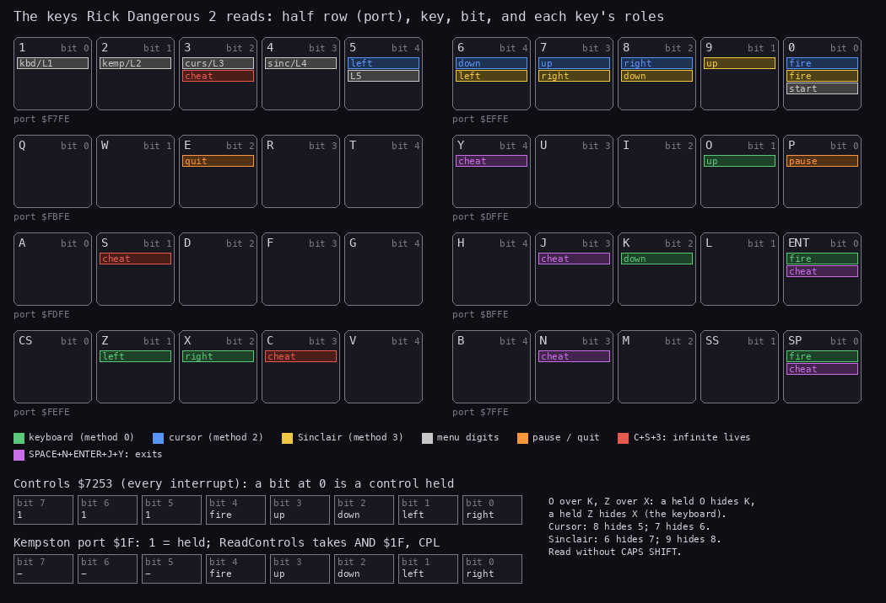

*Drawn by `python3 tools/fig_controls.py layout docs/img/controls/keys.png` from the port and bit of each `IN` in
`src/game/controls.asm`. Each key shows its half row's port and its bit. The coloured tags name its roles: green the
keyboard method, blue the cursor keys, yellow Sinclair, grey the menu digits, orange pause and quit, red and violet
the two cheat chords. Under the keys are the byte `Controls` and the Kempston port, bit by bit.*

How to read it: find a key, read its port under its half row, and its bit at its top right.
The `IN` the code does for that key is `LD BC,port` / `IN A,(C)` / `BIT bit,A`.

The point: every method ends in the same five bits of `Controls`.
The keys 0, 6, 7 and 8 mean different things in the cursor and Sinclair methods.
That is why `ReadControls` keeps one branch a method and never mixes them.

## 5.2 ReadControls: one byte, every interrupt

`ReadControls` `$7254` sets `Controls` `$7253` to `$FF`.
It then clears one bit for each control held: bit 0 right, 1 left, 2 down, 3 up, 4 fire.
Bits 5-7 stay 1, except after the Kempston branch (below).
`ControlMethod` `$7252` picks the branch: 0 keyboard, 1 Kempston, 2 cursor, 3 Sinclair.

Why every interrupt and not once a pass: a pass is two to twelve frames long ([doc 04](04-game-loop.md#44-the-frame-wait-and-the-lost-interrupts)).
The interrupt reads the keys at a steady 50 Hz.
The pass then takes the state of the last interrupt before it.
A key held for less than one frame between two interrupts is missed.
A key pressed and released between two passes is also missed, if no interrupt fell inside the press.

The keyboard method gives each axis a priority.
O (up) is tested first, and K (down) only when O is up.
Z (left) is tested first, and X (right) only when Z is up.
So a held O hides K and a held Z hides X.
`Controls` can never hold up and down, or left and right, together.

```text
ReadControls:                          // runs in every interrupt
    controls = $FF
    if method == 1:                    // Kempston, active high
        controls = NOT (IN($1F) AND $1F)
        return
    if method == 2: read_cursor(); return
    if method == 3: read_sinclair(); return
    // method 0: the keyboard
    if key(O):      clear bit 3        // up
    else if key(K): clear bit 2        // down
    if key(Z):      clear bit 1        // left
    else if key(X): clear bit 0        // right
    if key(ENTER):  clear bit 4        // fire
    if key(SPACE):  clear bit 4        // fire
```

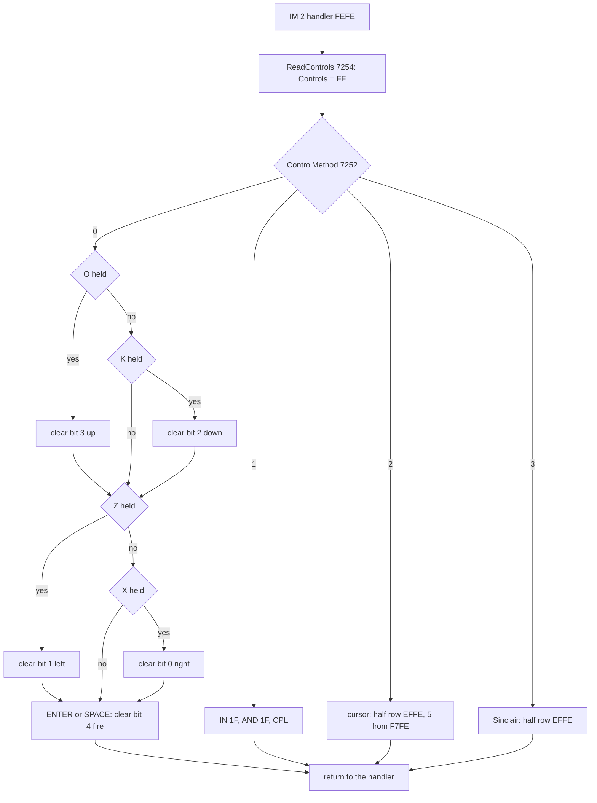

The keyboard branch, cut to its tests (each `JP NZ` skips the `RES` when the key is up):

```text
7254  PUSH HL
7255  LD HL,Controls        ; HL = $7253
7258  LD (HL),$FF           ; nothing held
725A  LD A,(ControlMethod)
725D  AND A
725E  JP NZ,ReadKempston    ; methods 1-3
7261  LD BC,$DFFE           ; half row P O I U Y
7264  IN A,(C)
7266  BIT 1,A               ; O
7268  JP NZ,ReadKeyDown
726B  RES 3,(HL)            ; up; K is not read
726D  JP ReadKeyLeft
7270  LD BC,$BFFE           ; ReadKeyDown: half row ENTER L K J H
7273  IN A,(C)
7275  BIT 2,A               ; K
7277  JP NZ,ReadKeyLeft
727A  RES 2,(HL)            ; down
727C  LD BC,$FEFE           ; ReadKeyLeft: half row CS Z X C V
727F  IN A,(C)
7281  BIT 1,A               ; Z
7283  JP NZ,ReadKeyRight
7286  RES 1,(HL)            ; left; X is not read
...
72A3  LD BC,$7FFE           ; ReadKeySpace: half row SPACE SS M N B
72A6  IN A,(C)
72A8  BIT 0,A               ; SPACE
72AA  JP NZ,ReadControlsDone
72AD  RES 4,(HL)            ; fire
72AF  POP HL
72B0  RET
```

**A worked example.** `controls-keyboard` holds four chords in turn. `Controls` after the interrupt of each frame
(read at T 3000, after `ReadControls` ran at T 2073):

| Frame | Keys | Bits cleared | `Controls` |
| --- | --- | --- | --- |
| 630 | X | 0 right | `$FE` = `1111 1110` |
| 711 | O | 3 up | `$F7` = `1111 0111` |
| 870 | SPACE + O | 4 fire, 3 up | `$E7` = `1110 0111` |
| 940 | SPACE + X | 4 fire, 0 right | `$EE` = `1110 1110` |
| 1010 | SPACE + K | 4 fire, 2 down | `$EB` = `1110 1011` |

Take frame 630.
`IN A,(C)` from `$DFFE` gives O up (bit 1 = 1), so the code goes on to K, also up.
`$FEFE` gives Z up (bit 1 = 1), then X down (bit 2 = 0): `RES 0,(HL)`, `Controls` = `$FE`.
ENTER and SPACE are up, and the routine returns after 34 instructions.

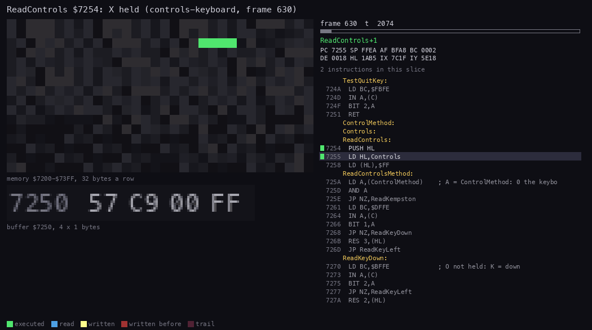

*`controls-keyboard` frame 630, T 2060-2420, 24 pictures of 15 T: X has just gone down. Top, `$7200-$73FF` lit by
age; under it the bytes `$7250-$7253` in hex, `ControlMethod` 0 and `Controls` going from `$FF` to `$FE`; right, the
listing. Made with `python3 ../../kit/routine_anim.py --work work/docs/wr/ckb --window 630:2060-630:2420 --listing
build/game.lst --out docs/img/routines/ReadControls.gif --pc 7254-7329 --range 7200-73FF --view buffer:7250:4x1:hex
--pictures 24`.*

How to read it: watch the code panel take the `JP NZ` past each key that is up, and the hex line change once.
The point: the keyboard method costs 34 instructions and five `IN`s in every interrupt, about 243 T
([doc 04](04-game-loop.md#46-the-interrupt)).

Witness: `ReadControls` ran 1 211 807 times in 68 recordings (L1). The table's frames are `controls-keyboard`.

## 5.3 The four methods

| Method | `ControlMethod` | Port | Up | Down | Left | Right | Fire | Priority |
| --- | --- | --- | --- | --- | --- | --- | --- | --- |
| keyboard | 0 | `$DFFE`, `$BFFE`, `$FEFE`, `$7FFE` | O | K | Z | X | SPACE, ENTER | O over K, Z over X |
| Kempston | 1 | `$1F` | bit 3 | bit 2 | bit 1 | bit 0 | bit 4 | none: the joystick's own bits |
| cursor | 2 | `$EFFE`, `$F7FE` | 7 | 6 | 5 | 8 | 0 | 7 over 6, 8 over 5 |
| Sinclair | 3 | `$EFFE` | 9 | 8 | 6 | 7 | 0 | 6 over 7, 9 over 8 |

The point: the Kempston joystick's bits are already in the game's order.
So that branch is three instructions: `IN A,($1F)`, `AND $1F`, `CPL`.
The two digit methods use the half row `$EFFE` (0 9 8 7 6).
Only the cursor's left key, 5, lies in the other half row, `$F7FE`.
That costs the cursor branch one more `IN`, and it is read only when 8 (right) is up.

```text
72B6  IN A,($1F)            ; Kempston: bit 0 right, 1 left, 2 down, 3 up, 4 fire, 1 = held
72B8  AND $1F               ; the five controls
72BA  CPL                   ; active low, as the keyboard; bits 5-7 become 1
72BB  LD (HL),A

72C3  LD BC,$EFFE           ; cursor: half row 0 9 8 7 6
72C6  IN A,(C)
72C8  BIT 0,A               ; 0 = fire
...
72E7  BIT 0,(HL)            ; ReadCursorLeft: right already cleared?
72E9  JP Z,ReadCursorDone   ; then 5 is not read
72EC  LD BC,$F7FE           ; half row 1 2 3 4 5
72EF  IN A,(C)
72F1  BIT 4,A               ; 5 = left
```

**A worked example (Kempston).** A joystick pushed up and right gives `IN A,($1F)` = `$09` (bits 3 and 0).
`AND $1F` keeps `$09`, and `CPL` gives `$F6` = `1111 0110`.
That is bits 0 and 3 at 0: right and up, the same byte the keyboard would give for X with O.
A Kempston interface that floats bits 5-7 high (`$E9`) gives the same `$F6`, because of the `AND`.

The cursor keys are read without CAPS SHIFT.
On a 128K's own cursor keys (CAPS SHIFT with 5-8) the digit is down and the shift does not matter.
The RZX run (the `rzx-*` pieces) played with CAPS SHIFT + 5-8, and the game read only the digits.

Witness: the Kempston branch `$72B1` ran 1255 times in `controls-kempston`, the cursor branch `$72BE` in
`controls-cursor` and every `rzx-*` piece, the Sinclair branch `$72FA` 1255 times in `controls-sinclair` and 85 times
in `c1` (its menu tour passes through method 3). ENTER as fire (`$72A1`) was pressed in no recording.

## 5.4 From Controls to Rick

The main loop's object step calls `UpdateRick` `$95ED` once a pass, with IX = `RickRecord` `$9BAB`.
It reads `Controls`; it never reads a port itself.
It first picks one of four modes:

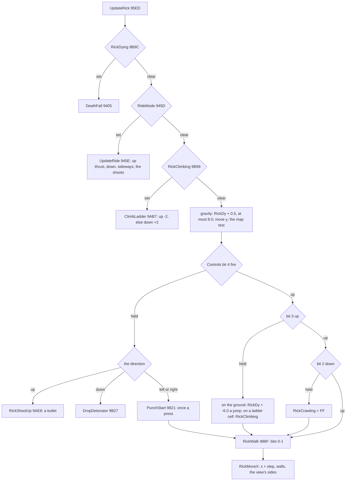

The keys are read in this order: fire first, then up, then down, then left or right.
With fire held, the direction keys choose a weapon instead of moving Rick, except that left or right still walk.

```text
RickReadJump:                               // on the ground, not crawling under a ceiling
    if fire held:
        if up held:   RickShootUp()         // one bullet at a time
        elif down held: DropDetonator()     // one detonator at a time
        elif left or right held:
            if keys != PunchKeys:           // a new press only
                PunchKeys = keys; PunchTimer = 10
                PunchX = x + 24 (right) or x (left); PunchY = y + 8
        else: PunchKeys = 0; PunchTimer = 0
    else:
        PunchKeys = 0; PunchTimer = 0
        if up held:
            RickDy = jump speed             // HL: -6.0 on the ground
            if on a ladder cell: RickClimbing = $FF
        elif down held: RickCrawling = $FF
    RickWalk()                              // left: step -2, right: +2, none: stand (or slide on ice)
```

The jump and fire tests, from the listing:

```text
97C5  LD A,(Controls)       ; RickReadJump
97C8  BIT 4,A               ; fire?
97CA  JP Z,RickFireActions
97CD  LD C,A
97CE  XOR A
97CF  LD (PunchKeys),A      ; no fire: no punch
97D2  LD (PunchTimer),A
97D5  LD A,C
97D6  BIT 3,A               ; up?
97D8  JP NZ,RickCrouchKey
97DB  LD (RickDy),HL        ; the jump: HL = the speed the caller chose
...
9800  BIT 3,A               ; RickFireActions: fire + up
9802  JP Z,RickShootUp
...
980B  BIT 2,A               ; fire + down
980D  JP Z,DropDetonator
9810  AND $03               ; fire + left or right?
9812  CP $03
9814  JP NZ,PunchStart
...
98AF  LD A,(Controls)       ; RickWalkKeys
98B2  AND $03               ; bits 0 right, 1 left
98B4  CP $01                ; left alone (bit 1 at 0)
98B6  JP NZ,WalkRightKey
98B9  LD A,$80
98BB  LD (RickFacing),A     ; face left
98BE  LD C,$FE              ; step -2
```

The walk step depends on the surface (doc 10 has the physics):
2 pixels a pass on a plain floor, 1 pixel on level 4's mud, and on level 2's ice a slide that goes on with no key.

**A worked example: one press, start to screen.** `controls-keyboard`, X goes down at frame 630:

| Moment | What happens | Value |
| --- | --- | --- |
| 630, T 2073 | the interrupt's `ReadControls` sees X | `Controls` `$FF` to `$FE` |
| 630, T 7189 | the frame wait returns: a pass starts | |
| 630, T 37 704 | `UpdateRick`: no fire, no up, no down; `RickWalk`: right | `RickFacing` 0, step +2 |
| 631, T 0 | after `RickMoveX` | `RickX` 0 to 2 |
| 631-632 | `DrawSprites`, the frame wait, `DrawChangedCells`: Rick drawn 2 pixels right | |
| 640, 650, ..., 690 | 2 pixels a pass, a pass every 2 frames | `RickX` 10, 20, ..., 60 |

So a key reaches Rick in the same frame it goes down, about 35 600 T after the interrupt read it.
The picture changes in the next frame.

The jump, O from frame 711 (`RickDy` and `RickY` at T 0 of each frame):

| Frame | 711 | 713 | 715 | 719 | 725 | 731 | 735 | 739 | 745 | 751 | 757 | 759 |
| --- | --- | --- | --- | --- | --- | --- | --- | --- | --- | --- | --- | --- |
| `RickDy` | -6.0 | -5.5 | -5.0 | -4.0 | -2.5 | -1.0 | 0.0 | +1.0 | +2.5 | +4.0 | +5.5 | +1.0 |
| `RickY` | 227 | 221 | 216 | 208 | 199 | 194 | 194 | 195 | 201 | 212 | 227 | 227 |

`RickDy` is 8.8 fixed point, pixels a pass, down positive.
Gravity adds 0.5 a pass, and the jump peaks 33 pixels up after 12 passes.
Rick lands 24 passes (48 frames) after the key, while O is still held.
On landing `RickDy` is reset to +1.0 (`$0100`), the resting value.
Holding O does not jump again until Rick is on the ground; the jump test at `$97DB` runs only on the ground.

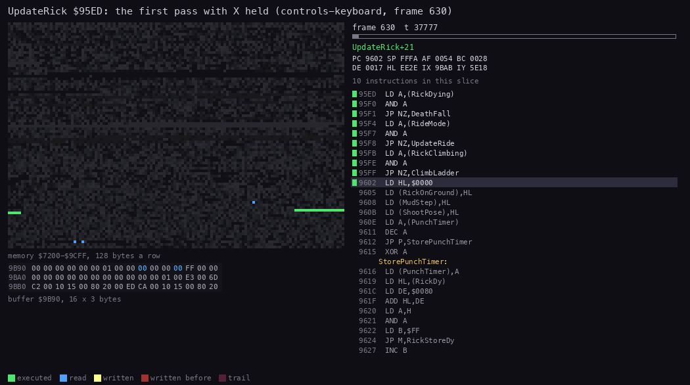

*`controls-keyboard` frame 630, T 37 690-42 010, 50 pictures of 87 T: the first pass with X held. Top, `$7200-$9CFF`
lit by age (`Controls` `$7253` read near the top; Rick's variables at `$9B90-$9BBF`, the bottom rows); under it
`$9B90-$9BBF` in hex: `RickDy`, `RickOnGround` and the others written, `RickX` `$9BAC` from 0 to 2; right, the
listing. Made with `python3 ../../kit/routine_anim.py --work work/docs/wr/ckb --window 630:37690-630:42010 --listing
build/game.lst --out docs/img/routines/UpdateRick.gif --pc 945E-9B8B --range 7200-9CFF --view buffer:9B90:16x3:hex
--pictures 50`.*

How to read it: the code panel walks `UpdateRick`, the map test, `RickReadJump`, `RickWalk` and the sprite choice.
The point: one byte in, a dozen variables out; nothing in Rick's code touches a port.

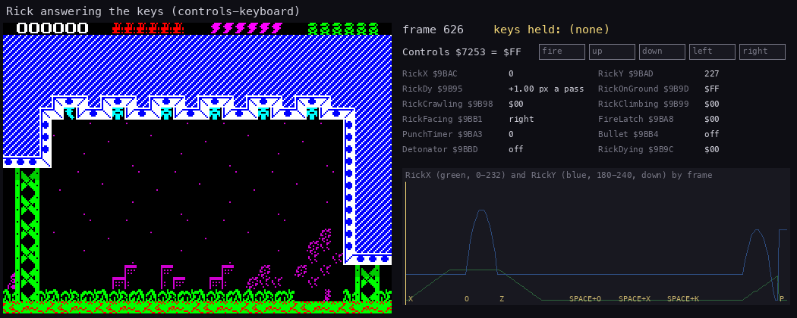

*`controls-keyboard` frames 626-1170, one picture every 2 frames (one a pass), at real speed. Left, the screen.
Right, the keys the input script holds, `Controls` `$7253` (a lit box is a bit at 0), Rick's variables, and a strip
chart of `RickX` and `RickY` over the whole stretch. X walks right, O jumps, Z walks left, SPACE+O fires the ray gun
up, SPACE+X punches, SPACE+K drops a detonator at Rick's feet; 64 passes later its blast kills Rick (frame 1110), and he
starts again at frame 1160. Made with `python3 tools/fig_controls.py keys --work work/docs/wr/ckb --inputs
tests/inputs/controls-keyboard.txt --from 626 --to 1170 --step 2 docs/img/play/rick-keys.gif`.*

How to read it: match the yellow keys line with the lit boxes, then with the variables that change.
`FireLatch` goes to `$FF` at the shot (frame 870) and stays until fire is released with up.
`PunchTimer` counts down from 10 after SPACE+X (6 at frame 940).
The point: each control is one bit, and each bit has one effect, chosen by the mode Rick is in.

### Once a press: the shot and the punch

Two of the actions fire once a press, not every pass a key is held:

- **The shot.** `FireLatch` `$9BA8` is set when a bullet leaves (`$95E7`), and cleared at `$9807` when fire is held
  without up. Holding SPACE+O gives one bullet; the next needs O or SPACE released.
- **The punch.** `PunchKeys` `$9BA4` keeps the last fire-and-direction byte. `PunchStart` starts a punch only when
  the byte differs (`$9825`). A held SPACE+X punches once, for `PunchTimer` = 10 passes.

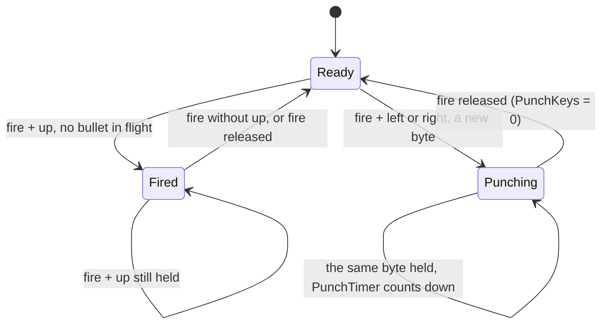

Witness: `controls-keyboard` frames 870 (`FireLatch` `$FF`, one bullet) and 940 (`PunchTimer` 6, `PunchX` = `RickX` + 24).

## 5.5 The menus

The menus read the number keys themselves, through `ReadMenuKey` `$8068`.
The menus do not use `Controls`.
`ScanNumberKeys` `$8087` tests 0, 1, 2, 3, 4 in that order, and 5 only when `Level5Open` `$8065` is set.
The first key held wins.
`ReadMenuKey` then makes it a press: it returns the key once, and `$FF` while the key is still held.

```text
ReadMenuKey:
    key = ScanNumberKeys()          // 0-5, or $FF for none
    if key == $FF:
        MenuKeyHeld = 0
        return $FF
    if MenuKeyHeld != 0: return $FF // still the old press
    MenuKeyHeld = $FF
    return key
```

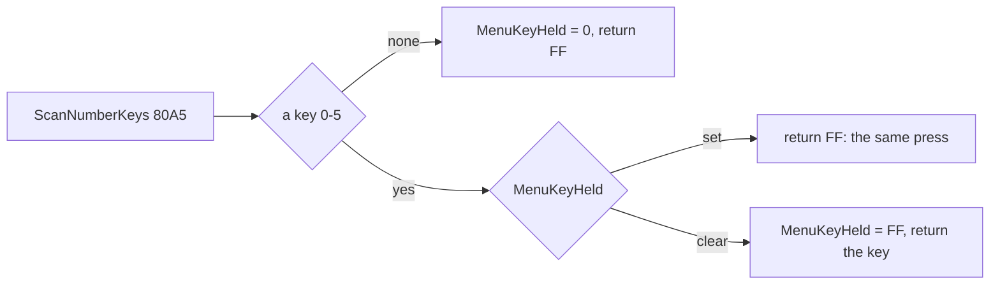

```text
8068  CALL ScanNumberKeys
806B  CP $FF
806D  JP NZ,MenuKeyWasHeld
8070  XOR A
8071  LD (MenuKeyHeld),A    ; no key: the next one counts
8074  DEC A                 ; A = $FF
8075  RET
8076  EX AF,AF'             ; MenuKeyWasHeld: keep the key in A'
8077  LD A,(MenuKeyHeld)
807A  AND A
807B  JP Z,MenuKeyNew
807E  LD A,$FF              ; still held
8080  RET
8081  DEC A                 ; MenuKeyNew: A = $FF
8082  LD (MenuKeyHeld),A
8085  EX AF,AF'             ; the key back
8086  RET
```

`ControlMenu` sets `MenuKeyHeld` to `$FF` before its first read.
So a key still held from the game before (E, or a fire key) cannot pick an item at once.

### The control menu

The texts fall into place letter by letter ([doc 08](08-hud-and-text.md)).
A 0 pressed during the fall starts the game at once.
Then `ControlMenuLoop` runs once a frame (`WaitFrames` with C = 1):

1. `ReadMenuKey`: 0 returns (start the game); 1-4 set `ControlMethod` = key - 1.
2. `MoveMenuRick` `$83CE` moves the small Rick toward the row of the method: `RickY` 2 pixels a frame toward
   `$94` + 16 x method.
3. The same routine sways him sideways: `RickDy` serves as an x speed, + or - `$30` (3/16 pixel) a frame toward x 24.
4. `ComposeSprite` `$7329` draws Rick's record, the frame wait, `DrawChangedCells`.

```text
83CE  LD A,(RickY)          ; MoveMenuRick: C = the target row
83D1  CP C
83D2  LD BC,$0000
83D5  JP Z,MenuRickMoveY
83D8  LD BC,-2              ; below the target: up
83DB  JP NC,MenuRickMoveY
83DE  LD BC,$0002           ; above it: down
83E1  LD HL,(RickY)
83E4  ADD HL,BC
83E5  LD (RickY),HL
83E8  LD HL,(RickDy)        ; the sway: RickDy is an x speed here
83EB  LD A,(RickX)
83EE  CP $18
83F0  LD BC,-$30            ; right of x 24: accelerate left
83F3  JP NC,MenuRickMoveX
83F6  LD BC,$0030           ; left of it: accelerate right
83F9  ADD HL,BC
```

**A worked example.** `c1` presses 2 at frame 15 100.
`ControlMethod` becomes 1 (Kempston) and the target row is `$94` + 16 = `$A4`.
`RickY` reads `$94` at frame 15 100 and `$A4` by 15 110: 8 steps of 2 pixels, one a frame.
Meanwhile `RickX` swings between 0 and `$30`: `$30` at 15 100, `$25` at 15 110, `$0C` at 15 120, `$00` at 15 130.
3 picks Cursor at 15 185 (`RickY` `$AE` at 15 190, `$B4` by 15 200), 4 Sinclair at 15 270 (`$C4`), and 1 the
keyboard at 15 355 (`$94` by 15 380).

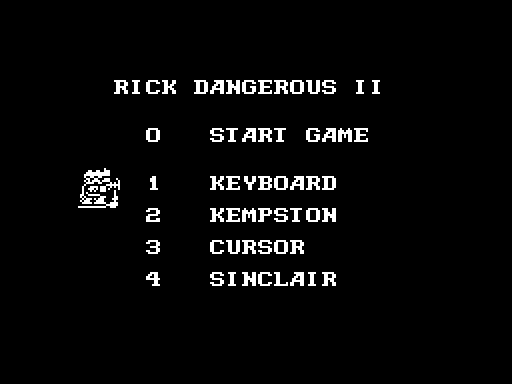

*`c1` frames 15 090-15 400, one picture every 2 frames, at real speed: the keys 2, 3, 4 and 1 move the small Rick to
KEMPSTON, CURSOR, SINCLAIR and back to KEYBOARD; he sways all the time. Made with `python3
../../kit/screen_anim.py --work work/docs/wr/c1 --from 15090 --to 15400 --step 2 --delay 40
docs/img/play/control-menu-pointer.gif`.*

The point: the pointer is Rick's own record and Rick's own sprite routine.
The menu borrows `RickY` and `RickDy` and gives them other meanings.
`ControlMenu` sets them again before play (`$80B5`), so nothing carries over.

### The level menu

`LevelMenu` `$7F44` lists levels 1-4, and the fifth level when `Level5Open` is set.
It loops on `ReadMenuKey` until it gets 1-5 (0 and none go round again).
`Level` `$7EF1` takes the key.
The 5 key is not even scanned while the fifth level is closed.

Witness: `c1` picks 1 at frame 15 705, 200 frames after the 0; `load-l5` (POKE `$8065` = `$FF`) shows and picks the
fifth level. `ReadMenuKey` ran 89 436 times in 13 recordings.

### Waiting for fire

`TestFireKeys` `$7229` is the one key test for "press a key to go on".
It returns Z when ENTER, SPACE or the chosen method's fire is held.
For the method's fire it calls `ReadControls` itself, so the wait does not depend on the interrupt's last read.

```text
7229  LD BC,$BFFE
722C  IN A,(C)
722E  BIT 0,A               ; ENTER
7230  RET Z
7231  LD BC,$7FFE
7234  IN A,(C)
7236  BIT 0,A               ; SPACE
7238  RET Z
7239  CALL ReadControls     ; the method's fire too
723C  LD A,(Controls)
723F  BIT 4,A
7241  RET
```

It runs in the tape message `$8433` (over a million times in `load-l2` to `load-l5`), the GAME OVER wait `$7EA0`
and the end text `$8787`.

## 5.6 Pause and quit

The main loop tests two keys at the top of every pass, before any work.

- **E** (`$FBFE` bit 2, `TestQuitKey` `$724A`) jumps to `GameOver` `$7E1E`: the GAME OVER screen, then the control
  menu. The game is lost at once, with no question.
- **P** (`$DFFE` bit 0, `TestPauseKey` `$7242`) pauses: the loop waits for P to be released, then pressed, then
  released again.

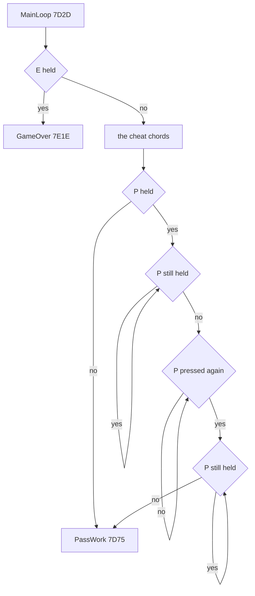

```text
7D2D  CALL TestQuitKey
7D30  JP Z,GameOver         ; E
...
7D5D  CALL TestPauseKey     ; MainLoopPause
7D60  JP NZ,PassWork        ; P up: play
7D63  CALL TestPauseKey     ; PauseWaitRelease
7D66  JP Z,PauseWaitRelease
7D69  CALL TestPauseKey     ; PauseWaitPress
7D6C  JP NZ,PauseWaitPress
7D6F  CALL TestPauseKey     ; PauseWaitRelease2
7D72  JP Z,PauseWaitRelease2
```

The pause loops spin on `IN` with the interrupts on.
So the interrupt goes on running: the frame counter counts, `ReadControls` reads, and on a 128K the music player
runs.
Nothing in the game moves, because nothing of the pass runs.
After the pause the frame wait finds the counter far past 2 and returns at once ([doc 04](04-game-loop.md#44-the-frame-wait-and-the-lost-interrupts)).

**A worked example.** `controls-keyboard` presses P at frame 1160 and again at 1320, each for 10 frames.
Rick had just restarted after his death (`RickY` 204, falling in).
`RickY` stays 204 and `RickDy` stays +1.5 from 1160 to 1330.
At 1340 `RickY` is 224, and at 1350 he stands at 227.
E at frame 1430: the GAME OVER letters are already falling at frame 1440.

Witness: the pause loops ran 129 946 times in `controls-keyboard` and 95 582 in `c1`.

## 5.7 The cheat chords

Two chords are tested at the top of every pass, after E.
Each test reads three half rows and compares the five key bits with one exact value.
So the chord must be held alone: any other key of those half rows spoils the compare.

| Chord | Half row | Keys held | `AND $1F` must be |
| --- | --- | --- | --- |
| C + S + 3 | `$FEFE` (CS Z X C V) | C (bit 3) | `$17` = `10111` |
| | `$FDFE` (A S D F G) | S (bit 1) | `$1D` = `11101` |
| | `$F7FE` (1 2 3 4 5) | 3 (bit 2) | `$1B` = `11011` |
| SPACE + N + ENTER + J + Y | `$7FFE` (SPACE SS M N B) | SPACE (bit 0), N (bit 3) | `$16` = `10110` |
| | `$BFFE` (ENTER L K J H) | ENTER (bit 0), J (bit 3) | `$16` = `10110` |
| | `$DFFE` (P O I U Y) | Y (bit 4) | `$0F` = `01111` |

```text
71C0  LD BC,$FEFE           ; TestInfiniteLivesKeys
71C3  IN A,(C)
71C5  AND $1F
71C7  CP $17                ; C alone in its half row
71C9  RET NZ
71CA  LD B,$FD
71CC  IN A,(C)
71CE  AND $1F
71D0  CP $1D                ; S alone
71D2  RET NZ
71D3  LD B,$F7
71D5  IN A,(C)
71D7  AND $1F
71D9  CP $1B                ; 3 alone
71DB  RET                   ; Z: the chord
...
7D33  CALL TestInfiniteLivesKeys
7D36  JP NZ,MainLoopCheatB
7D39  LD A,$01
7D3B  CALL StartTune        ; tune 1: the signal
7D3E  LD A,(CheatInfinite)
7D41  XOR $FF               ; toggle
7D43  LD (CheatInfinite),A
```

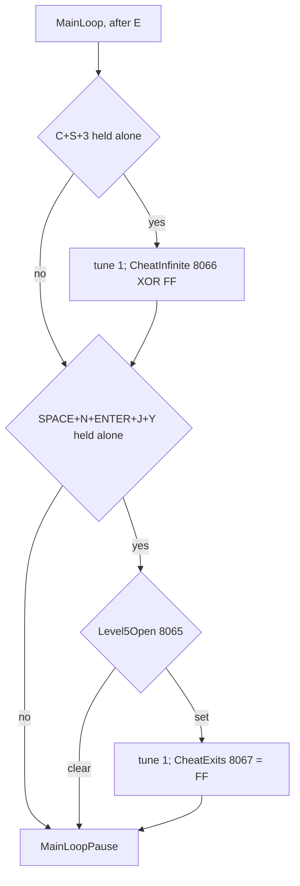

**C+S+3: infinite lives.** `CheatInfinite` `$8066` stops the loss of lives (`$8A26`), bullets (`$9593`) and
detonators (`$9B27`).
It is a toggle, and it toggles once a pass while the chord is held.
`cheats` holds C, S and 3 from frame 50 to 60.
`CheatInfinite` reads `$FF` at frame 54, 0 at 56, and `$FF` again at 60: three passes, three toggles.
The chord left it on because it was held for an odd number of passes; a longer or shorter hold may leave it off.
The tune on each toggle is the only feedback.

**SPACE+N+ENTER+J+Y: long levels.** The second chord works only once `Level5Open` is set, that is after the four
levels of a game have been completed.
It sets `CheatExits` `$8067` to `$FF`, and nothing ever clears it.
`CheckSectionExit` then reads it at `$89D9`: an exit marked as a level end (bit 7) ends the level only if it also has
bit 4.
Other level-end exits lead on into sections the plain game never shows.
`cheats` holds the chord at frame 200, and `CheatExits` is `$FF` from frame 204.
`long-l4` (the flag set by POKE) shows the effect: the exit `$82` at the end of level 4 section 7 did not end the level,
and Rick went on into section 10 ([doc 07](07-objects.md)).

Witness: `cheats` frames 50-60 and 200-210; `TestInfiniteLivesKeys` and `TestSectionCheatKeys` ran in full there.

The point: the cheats are not hidden behind a secret address but behind exact port values.
The second one is the authors' gift to a player who has finished the game.

## 5.8 Known only from the code

- ENTER as a fire key in play (`$72A1`): no recording pressed ENTER during a level.
- The Kempston worked example's values: `controls-kempston` played with the joystick bits from its input script,
  and the `$E9` case (bits 5-7 high) is computed, not seen.
- What `CheatInfinite` does when Rick dies with it on: no recording died with the flag set; the three reads
  (`$8A26`, `$9593`, `$9B27`) are known from the code.
