# 6. Rendering

What this covers:

- the cells and blocks the levels are made of, and how `BuildView` `$88D4` turns a section's map into the view;
- the four buffers of the renderer: `ViewCells`, `DirtyMap`, the spare cells, the screen;
- the sprites: their format, how `ComposeSprite` `$7329` masks them into copies of the cells, aligned and shifted;
- `DrawChangedCells` `$76D4`, the only routine that puts a pass's changes on the screen;
- the scroll: the view moved by 8 cell rows in three steps, and why it takes 16 frames;
- the HUD row; code against the screen on two real stretches.

The recordings it rests on ([WALKTHROUGH 6.0](../WALKTHROUGH.md#60-the-recordings); all 128K):

| Recording | Load | Used for |
| --- | --- | --- |
| `rzx-l1-06000-poke` | the RZX run's level 1 state at RZX frame 6000, its key reads as an input script, four immunity POKEs | a typical pass, frames 103-105: `ComposeSprite.gif`, `DrawChangedCells.gif`, `view.png`, `writers-pass.png` |
| `rzx-l1-04000-poke` | the same at RZX frame 4000 | the scroll up in level 1 section 5, frames 111-127: `scroll-up.gif`, `ScrollUp.gif`, `writers-scroll.png` |

The level data (cells, blocks, maps, sprites) is read from `src/res/levels` ([the formats](../src/res/levels/README.md)).
The beam timeline of a pass is in [doc 04](04-game-loop.md#the-pass-against-the-beam).

## 6.1 The idea: cells only

Nothing reaches the screen but whole 8 x 8 cells.
A level is 256 cells of 8 bytes, each with one attribute.
A sprite is never drawn on the screen.
It is masked into copies of the cells under it, and the copies are then copied to the screen like any other cell.

Why: a cell copy is eight `LDI`s and needs no read of the screen.
The game never has to erase a sprite: the next pass copies the level cell back.
The attributes never change during play, so no colour clash can come from a sprite.
A sprite takes the colours of the cells it covers.

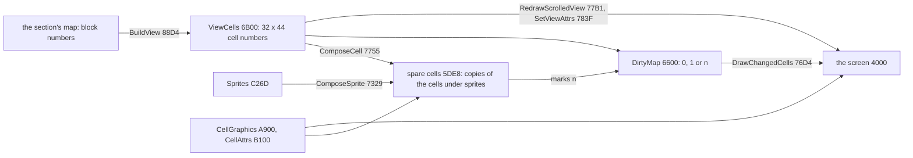

| Buffer | Address | Size | What a byte is |
| --- | --- | --- | --- |
| `ViewCells` | `$6B00-$707F` | 32 x 44 | a cell number; view row 8 lies under the HUD, rows 9-31 are screen rows 1-23 |
| `DirtyMap` | `$6600-$6AFF` | 32 x 40 | what a screen cell needs: 0 nothing, 1 the level cell again, n >= 2 spare cell n; `DrawChangedCells` puts its `$FF` sentinel at `$6A00` (row 32) |
| spare cells | `$5DE8` + 8 x (n + 1) | 8 bytes each | a cell copy with sprites masked in; `SpareCount` `$77B0` is the next n |
| the screen | `$4000-$5AFF` | 32 x 24 cells | row 0 the HUD, rows 1-23 the view |

`DirtyMap` + `$500` = `ViewCells`: the same index in both is the same cell.

## 6.2 Cells and blocks

`CellGraphics` `$A900` holds 256 cells of 8 bytes, the top line first.
`CellAttrs` `$B100` holds a cell's attribute.
`CellFlags` `$A800` holds its flags for the collision code ([doc 07](07-objects.md)) and bit 7, "drawn in front of
the sprites".
`Blocks` `$B200` holds 256 blocks of 16 cell numbers: four rows of four.
A section's map is 8 block numbers a row, one screen wide.
So a map byte is a 32 x 32 pixel square, and a map row is 4 cell rows of the view.

The sheets of every level's cells and blocks are in [`src/res/levels`](../src/res/levels/README.md); the maps of every
section are in [doc 01](01-game-design.md).

### BuildView: the map into ViewCells

`BuildView` `$88D4` fills `ViewCells` with 11 rows of 8 blocks: 44 cell rows from the view's top.
The map row is `ViewTopRow` `$88CF` / 4, rounded down to an even row.
For each map byte it points SP at the block's 16 cell numbers.
`POP DE` then takes two cell numbers at a time, and four `LD (HL)` put a row of four into place.

```text
BuildView:
    src = ViewMap + ((ViewTopRow * 2) AND $FFF0)      // 8 bytes a map row
    dst = ViewCells
    repeat 11 block rows:
        repeat 8 blocks:
            block = Blocks + 16 * map[src]; src += 1
            for row in 0..3: dst[32 * row .. 32 * row + 3] = block[4 * row .. 4 * row + 3]
            dst += 4                                   // the next block's column
        dst += 3 * 32                                  // the next block row
    FindFirstMapEntry()                                // the objects of the new view, doc 07
```

```text
88F3  DI
88F4  LD (BuildViewSP+1),SP ; keep the caller's SP in the LD SP,n at $8946
88F8  LD B,$08              ; BuildViewRow: 8 blocks
88FA  LD A,(HL)             ; BuildViewBlock: the map byte
88FB  INC HL
88FC  EXX
88FD  EX DE,HL
88FE  LD L,A
88FF  LD H,$00
8901  ADD HL,HL             ; x 16
...
8905  LD BC,Blocks
8908  ADD HL,BC
8909  LD SP,HL              ; SP = the block's 16 cell numbers
890A  EX DE,HL
890B  POP DE                ; two cells
890C  LD (HL),E
890D  INC L
890E  LD (HL),D
...
8914  LD BC,32-3            ; down one cell row, 3 columns back
...
8935  LD BC,-3*32+1         ; up 3 rows: the next block's column
893A  DJNZ BuildViewBlock
...
8946  LD SP,$0000           ; the caller's SP
8949  EI
```

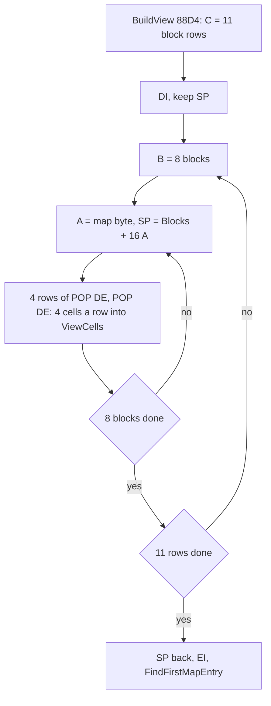

**A worked example.** Level 1, section 5: its map starts at maps + `$03B0` (the section table's entry
`03 B0 00 68 ...`). Map row 24 is the 8 bytes at maps + `$0470`: `$60 $31 $2F $52 $25 $05 $EF $62`.
The third, `$2F` = 47, points at `Blocks` + 16 x 47 = `$B4F0`.
Its 16 cell numbers are `94 95 94 95 / 96 97 96 97 / 44 47 44 47 / 41 43 41 43`: the top half of the red girder over
two cells of magenta wall.
They land in `ViewCells` at columns 8-11 of four cell rows.
The whole map row gives the 128 cell numbers listed under the figure.

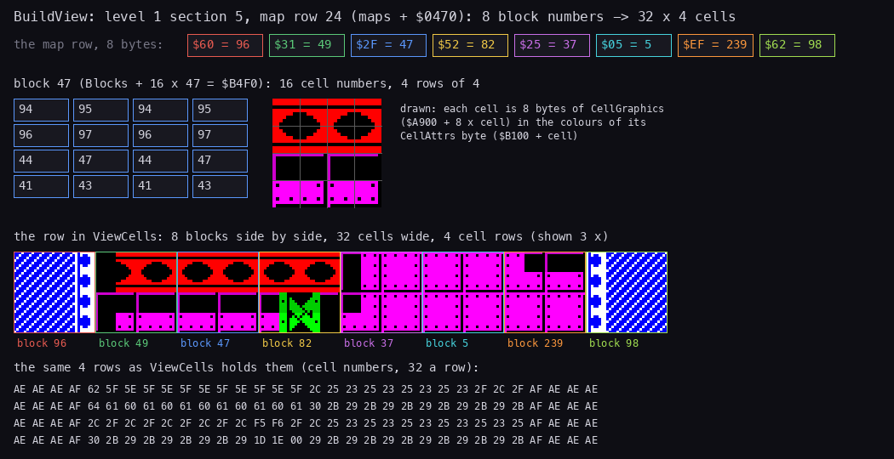

*Drawn by `python3 tools/fig_render.py build --level 1 --section 5 --row 24 --block-index 2
docs/img/render/build.png` from `src/res/levels/level1`. Top, the map row's 8 bytes. Middle, block 47's cell numbers
and the block drawn 4 x. Bottom, the row as `ViewCells` holds it: 8 blocks of 4 x 4 cells, and the 4 rows of 32 cell
numbers in hex.*

How to read it: follow the third box's colour from the byte to the block and to its place in the strip.
The point: a section's map is tiny, 8 bytes a 32-pixel row, because the blocks do the work.
Level 1's 8 maps take 1344 bytes: 168 map rows.
`SectionCounts` `$8374` counts 9 sections for level 1: the ninth is a filler record (map `$0000`, no exits) that
no exit leads to; only the POKEd `sec-l1-s8` enters it.

Witness: `BuildView` ran 269 times in 62 recordings.
It writes only `$6B00-$707F`, and reads only the maps (`$E1ED-$E9D4` over all recordings) and `Blocks`.
In `rzx-l1-04000-poke` it runs at frame 125 T 48 716, during the scroll.
Its window with the interrupts off runs from 125 T 48 856 to 126 T 16 949: 39 001 T.
The INT of frame 126 falls inside it and is lost ([doc 04](04-game-loop.md#44-the-frame-wait-and-the-lost-interrupts)).

## 6.3 The buffers at one moment

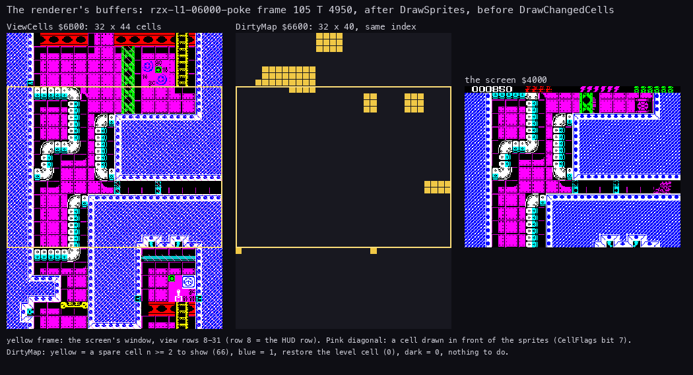

*`rzx-l1-06000-poke` frame 105 T 4950: the pass has composed its sprites and waited; `DrawChangedCells` is next.
Left, `ViewCells` drawn with the level's cells as they are in memory; the yellow frame is the screen's window. Middle,
`DirtyMap`: 66 spare cells to show, none to restore. Right, the screen, still with the last pass's picture. Drawn by
`python3 tools/fig_render.py view --work work/docs/wr/l1p --at 105:4950 docs/img/render/view.png`.*

How to read it: the yellow marks in `DirtyMap` sit where a sprite covers a cell.
Marks above the window are objects above the screen: they are composed but never drawn.
`DrawChangedCells` starts its scan at screen row 1 and never reads them.
No byte is 1 here: every sprite covers again the cells it covered in the pass before.
The point: the 44-row view holds 8 rows above the screen (0-7) and 12 below it (32-43); row 8 is the screen's top row,
under the HUD, so 9 rows (0-8) above the play area are never shown.
So the scroll and the objects just off the screen need no second build.

## 6.4 The sprites

A sprite is 128 bytes in `Sprites` `$C26D` + 128 x n:

| Offset | What |
| --- | --- |
| +0 | added to the strip offset: the sprite's first row below the record's y |
| +1 | the rows drawn (21 at most) |
| +2 ... | 6 bytes a row: data 2, data 1, data 0, mask 0, mask 2, mask 1 |

Column 0 is the left byte.
A screen byte under the sprite becomes `(byte AND mask) OR data`.
So a pixel is paper where mask and data are 0, ink where data is 1, and the cell's own pixel where the mask is 1.
The order of the six bytes fits the blitter: it pops a row as HL, BC, DE, with SP walking the sprite.

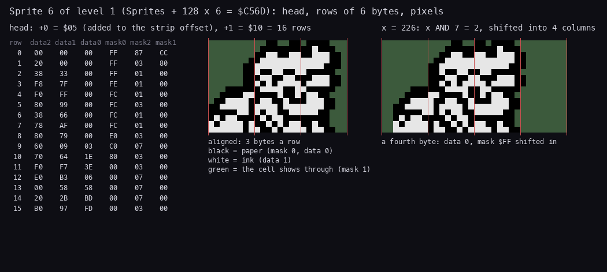

*Rick standing, sprite 6 of level 1, from `src/res/levels/level1`: its head bytes, the rows' 6 bytes, the pixels
(black paper, white ink, green where the cell shows through), and the same rows shifted right by 2 pixels into 4
columns, as at Rick's x = 226 in `rzx-l1-06000-poke` frame 103. Drawn by `python3 tools/fig_render.py sprite --level 1
--sprite 6 --x 226 docs/img/render/sprite.png`.*

How to read it: row 1 is `20 00 00 FF 03 80`.
Data 0 = `$00` with mask 0 = `$FF` leaves the left byte's cell alone.
Data 1 = `$00` with mask 1 = `$80` keeps the middle byte's first pixel and makes the other seven paper.
Data 2 = `$20` with mask 2 = `$03` sets one ink pixel, keeps the last two pixels and makes the rest paper.
The point: Rick's sprite carries a paper outline in its mask, so he reads on any cell.
The sheets of every level's sprites, drawn from `src/res/levels`: [level 1](img/sprites/level1.png),
[level 2](img/sprites/level2.png), [level 3](img/sprites/level3.png), [level 4](img/sprites/level4.png),
[level 5](img/sprites/level5.png).

### ComposeSprite: a sprite into spare cells

`ComposeSprite` `$7329` takes an object record at IX: +1 x, +2/+3 y in pixels from the view buffer's top, +4/+5 the
sprite's address, +6 bit 7 mirrored.

1. The cell under the top left is `ViewCells` + (y AND `$F8`) x 4 + x / 8.
2. For each cell of a 3 x 3 or 3 x 4 block (x AND 7 = 0), or 4 x 3 or 4 x 4 (shifted), `ComposeCell` `$7755`
   copies the cell into the next spare cell and marks `DirtyMap` with its number.
3. The sprite's rows are masked into the strip of spare cells. The strip is laid out column by column, 24 or 32
   bytes a column.
4. A shifted sprite runs each row through a chain of shifts entered at `$7637` + 14 x (x AND 7). A fourth byte of
   data 0 and mask `$FF` is shifted in.
5. A mirrored sprite swaps its outer bytes and reverses each byte through `MirrorTable` `$6500`.

`ComposeCell` decides what the copy is made of:

```text
ComposeCell(view_cell at HL, spare cell at DE):
    cell = ViewCells[HL]
    if CellFlags[cell] bit 7:            // the cell is in front of sprites
        SpareCount += 1; DE += 8         // a dummy spare cell: masked, never shown
        return
    mark = DirtyMap[HL]
    DirtyMap[HL] = SpareCount; SpareCount += 1
    if mark >= 2: copy spare cell 'mark' to DE   // another sprite is already there: stack on it
    else:         copy CellGraphics + 8 * cell to DE
```

```text
7755  LD B,CellFlags/256
7757  LD C,(HL)             ; the cell number
7758  LD A,(BC)             ; its flags
7759  AND A
775A  JP M,ComposeCellSkip  ; bit 7: in front of sprites
775D  PUSH HL
775E  LD A,H
775F  SUB $05               ; HL - $500: the DirtyMap byte
7761  LD H,A
7762  LD A,(HL)
7763  CP $02
7765  JP NC,ComposeCellStack ; a spare cell already: copy it instead
7768  LD A,(SpareCount)
776B  LD (HL),A             ; DirtyMap = this spare cell
776C  INC A
776D  LD (SpareCount),A
7770  LD L,C
...
7776  LD BC,CellGraphics    ; patched to the font in the menus
7779  ADD HL,BC
777A  LDI                   ; 8 x LDI: the cell's 8 bytes
```

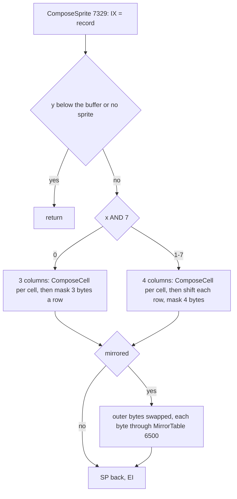

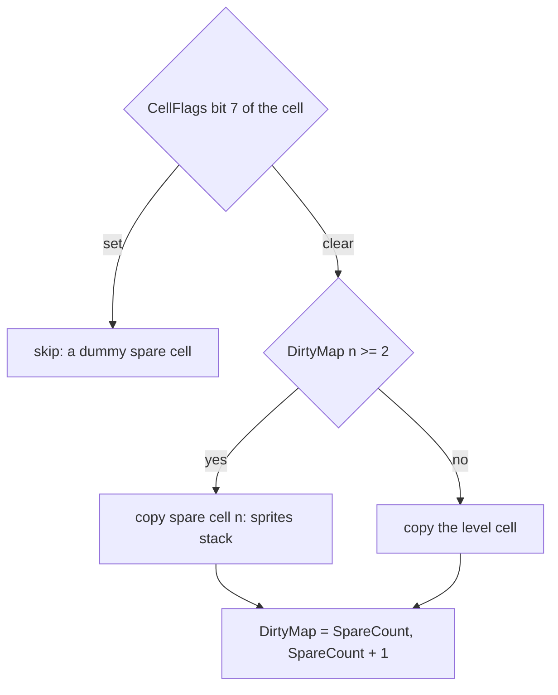

**A worked example.** `rzx-l1-06000-poke` frame 103 T 53 482: Rick's record is `01 E2 AB 00 6D C5 00 10 15`.
x = `$E2` = 226, so x AND 7 = 2: shifted, 4 columns.
y = `$00AB` = 171, and 171 AND 4 = 0: 3 cell rows.
The top left cell is `ViewCells` + (171 AND `$F8`) x 4 + 226 / 8 = `$6B00` + 672 + 28 = `$6DBC`.
`SpareCount` is 2 at the start and 14 at the end: 4 x 3 = 12 spare cells, from `$5E00`.
The sprite is `$C56D` = `Sprites` + 6 x 128, Rick standing, not mirrored.
The whole call costs 16 885 T.

The four sprites of that pass, from the trace:

| Record | x (x AND 7) | Columns x rows | T-states |
| --- | --- | --- | --- |
| Rick `$9BAB` | 226 (2) | 4 x 3, shifted | 16 885 |
| an enemy `$7C20` | 138 (2) | 4 x 3, shifted | 22 836, with the interrupt (about 3100) |
| an object `$7BBF` | 200 (0) | 3 x 3, aligned | 10 794 |
| an object `$7BD7` | 100 (4) | 4 x 3, shifted | 13 984 |

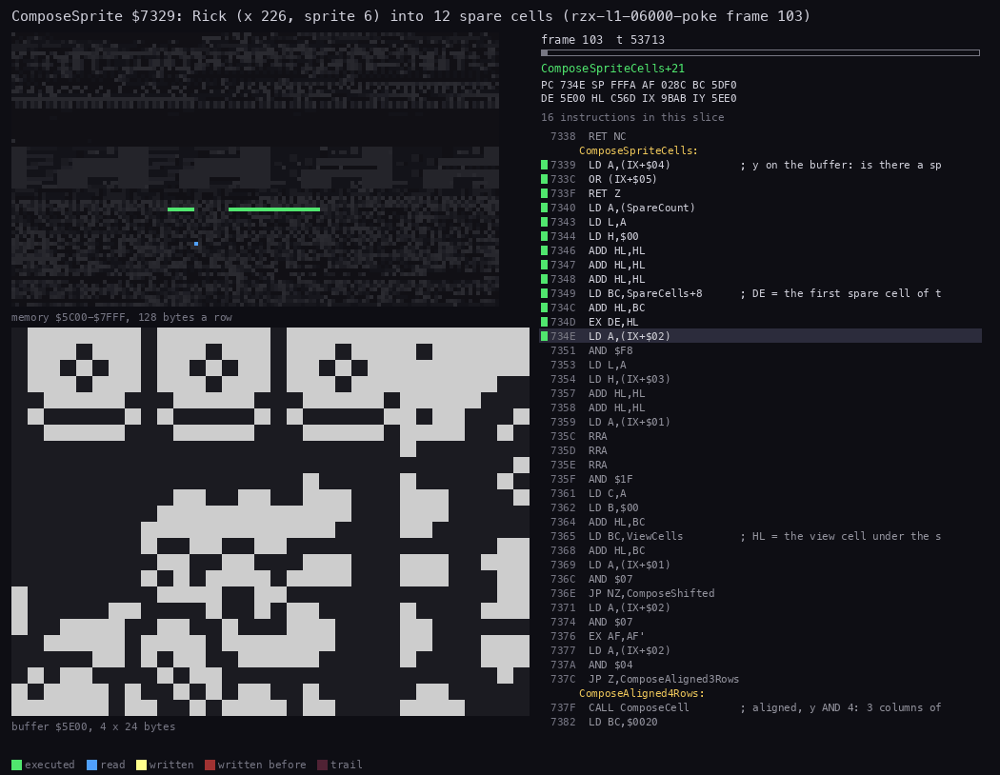

*`rzx-l1-06000-poke` frame 103, T 53 470-70 480, 70 pictures of 243 T: Rick into 12 spare cells. Top, `$5C00-$7FFF` lit
by age (the spare cells at `$5E00`, `DirtyMap` at `$6600`, `ViewCells` at `$6B00`, the code at `$7329-$77B0`); under
it the spare cells from `$5E00` as the strip, 4 columns of 24 bytes: first the copied level cells, then Rick's rows
masked in; right, the listing. Made with `python3 ../../kit/routine_anim.py --work work/docs/wr/l1p --window
103:53470-103:70480 --listing build/game.lst --out docs/img/routines/ComposeSprite.gif --pc 7329-77B0 --range 5C00-7FFF
--view buffer:5E00:4x24:columns --pictures 70`.*

How to read it: the strip fills with cell copies first (the skull wall, the floor), then Rick's rows land over them.
The point: a shifted sprite costs about half again an aligned one.
Each of its rows goes through the shift chain and has a fourth byte.

### The draw order

`DrawSprites` `$85FA` sets `SpareCount` to 2 and composes, in this order: the bullet `$9BB4`, Rick `$9BAB`, the
detonator `$9BBD`, the enemies (table B, `$7C20`, 23 bytes a record) and the traps and objects (table A, `$7B8F`,
24 bytes a record).
A later sprite stacks on an earlier one's spare cell, so it is drawn over it.
Enemies and traps are drawn over Rick, and Rick over his bullet.
A cell with `CellFlags` bit 7 hides every sprite.

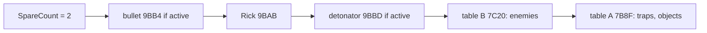

Witness: `ComposeSprite` ran 250 504 times in 65 recordings: 118 841 aligned, 108 333 shifted, and 23 330 returned at
once (y negative or 299 or more, below the buffer, or no sprite: `$7332`, `$7338`, `$733F`).
`ComposeCell` ran 2 497 317 times: 272 993 front cells skipped, 551 496 stacked on another sprite.

The sprite routines keep the interrupts off while SP walks the sprite (`$7442-$74B5`, `$75DC-$76D2`).
An INT there is lost ([doc 04](04-game-loop.md#44-the-frame-wait-and-the-lost-interrupts)).

## 6.5 DrawChangedCells: the pass onto the screen

After the frame wait, `DrawChangedCells` `$76D4` scans `DirtyMap` from screen row 1 to a sentinel `$FF` it puts at
`$6A00`:

- 0: nothing;
- 1: the level cell again (`ViewCells` at the same index, its 8 bytes from `CellGraphics`), then 0;
- n >= 2: spare cell n, then 1.

So a cell a sprite covers is drawn from its spare cell in this pass, and set to 1.
If no sprite covers it in the next pass, the 1 restores the level cell, and then it is 0.
The attributes are never touched.

```text
DrawChangedCells:
    DirtyMap[$400] = $FF                      // the sentinel at $6A00
    for each byte d of DirtyMap from screen row 1:
        if d == 0: continue
        if d == $FF: return
        screen = cell address of this index
        if d == 1: copy CellGraphics + 8 * ViewCells[index] to screen; d = 0
        else:      copy SpareCells + 8 * (d + 1) to screen;        d = 1
```

```text
76D4  LD A,$FF
76D6  LD (DirtyMap+1024),A  ; the sentinel
76D9  LD HL,DirtyMap+287    ; one before screen row 1
76DC  XOR A                 ; DrawChangedNext
76DD  INC HL                ; DrawChangedScan
76DE  OR (HL)
76DF  JP Z,DrawChangedScan  ; 0: the next byte
76E2  INC A
76E3  RET Z                 ; $FF: the sentinel
76E4  EX AF,AF'
76E5  LD A,H                ; the screen address from the DirtyMap address
76E6  ADD A,A
76E7  ADD A,A
76E8  ADD A,A
76E9  ADD A,$08
...
76EE  CP $02
76F0  JP Z,DrawLevelCell    ; was 1
76F3  LD (HL),$01           ; n: restore next pass
...
76FC  LD BC,SpareCells
76FF  ADD HL,BC
7700  LDI                   ; 8 lines, DEC DE / INC D between
```

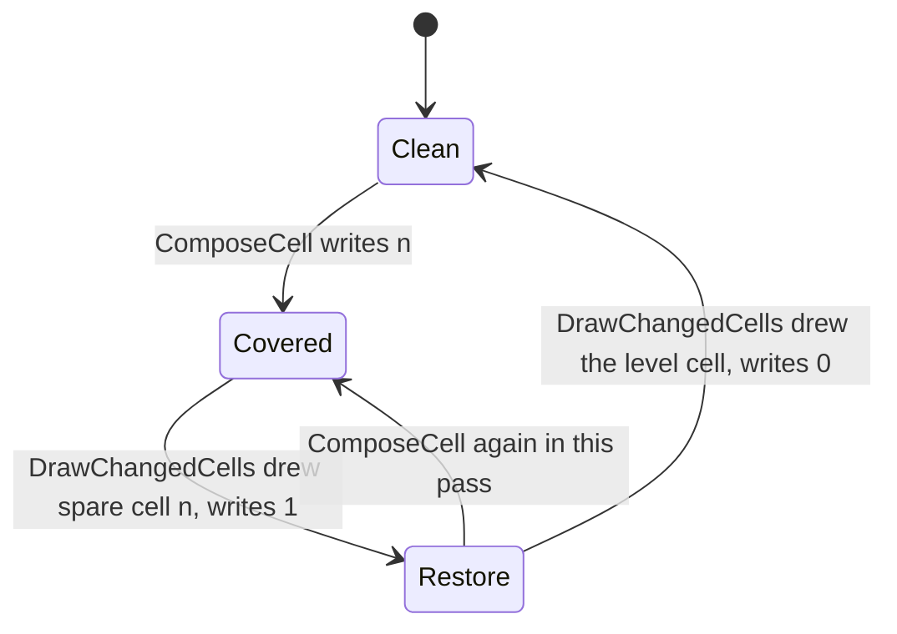

The screen address comes straight from the `DirtyMap` address.
`DirtyMap` row r, column c is `$6600` + 32 r + c.
The cell's screen address has the high byte (H x 8 + 8) AND `$FF` and the low byte L.
For `$6720` (row 9, column 0): H = `$67`, `$67` x 8 + 8 = `$340`, so `$40`: the screen address `$4020`, row 1, column 0.
That works because `DirtyMap` sits at a page whose low bits line up with the screen's thirds.

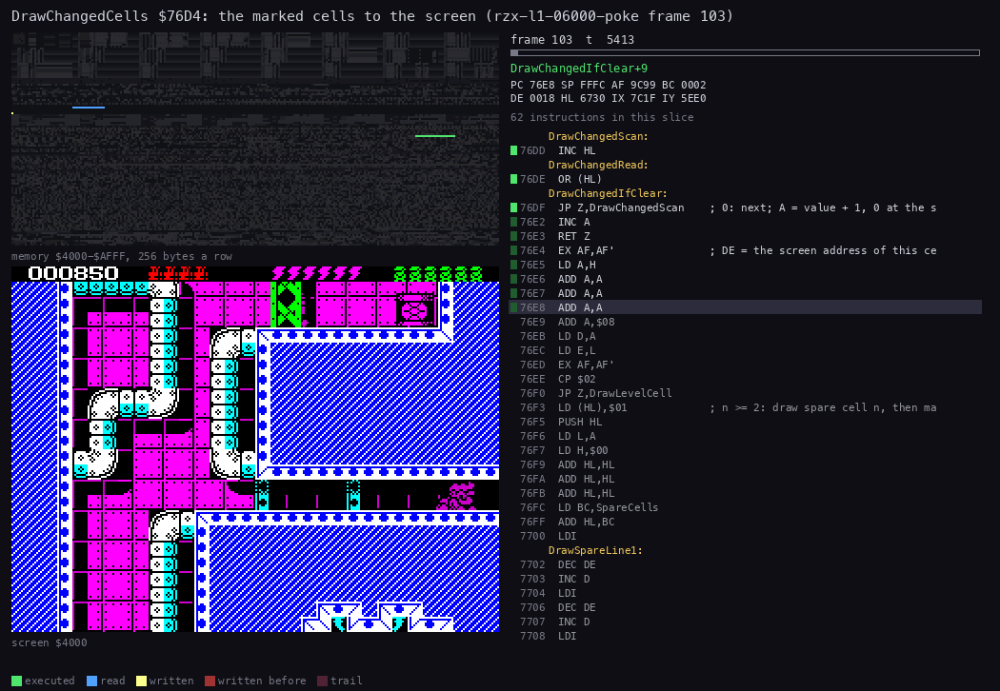

*`rzx-l1-06000-poke` frame 103, T 4960-36 650, 70 pictures of 453 T: the pass's changed cells to the screen. Top,
`$4000-$AFFF` lit by age; under it the screen; right, the listing. Made with `python3 ../../kit/routine_anim.py --work
work/docs/wr/l1p --window 103:4960-103:36650 --listing build/game.lst --out docs/img/routines/DrawChangedCells.gif --pc
76D4-7754 --range 4000-AFFF --view screen --pictures 70`.*

How to read it: the scan runs down the screen; each flash is one cell of 8 bytes.
The point: the call takes 31 669 T for 23 cells.
The scan of 736 bytes costs far more than the copies, but a pass draws only the cells that changed.

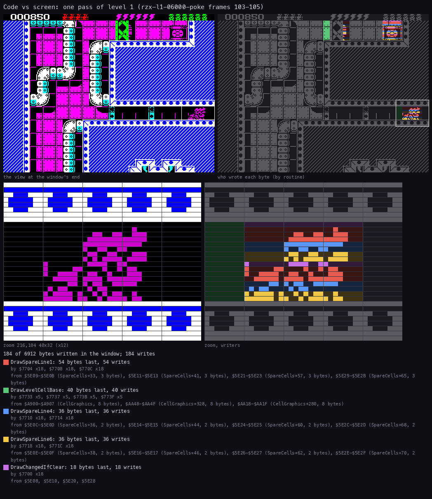

*`rzx-l1-06000-poke` frames 103-105, one pass: who wrote each screen byte. 184 bytes, 23 cells, all by
`DrawChangedCells`: the spare cells by `DrawSpareLine1/4/6` and `DrawChangedIfClear` (its unrolled `LDI`s), the restored
level cells by `DrawLevelCellBase`. The pass shown is the `DrawChangedCells` of frame 103 (T 4960-36 650): it puts on
the screen what the pass before composed, 18 spare cells (Rick, zoomed, and an object at the top right) and 5 level
cells restored where a sprite stood two passes before (green, the column left of Rick among them). The composition of
the table above (frame 103 from T 53 470) is drawn in the pass after this window; `view.png` shows its `DirtyMap`.
Made with `python3 ../../kit/writers_map.py --work work/docs/wr/l1p --window 103:4930-105:4940 --listing build/game.lst
--out docs/img/render/writers-pass.png --sources --zoom 216,104,40,32 --title "Code vs screen: one pass of level 1
(rzx-l1-06000-poke frames 103-105)"`.*

The point: in a typical pass 2.7 % of the screen is written, and nothing else writes it.

Witness: `DrawChangedCells` ran 57 658 times in 67 recordings: 1 689 139 spare cells drawn, 196 595 level cells restored.

## 6.6 The scroll

The view scrolls by 8 cell rows (64 pixels).
The main loop calls `ScrollUp` `$7905` when Rick's y is below 96 and `ViewTopRow` > 0.
It calls `ScrollDown` `$78A5` when Rick's y is 204 or more and `ViewTopRow` < its limit `$88D2`.
The screen moves in three steps of 2, 4 and 2 rows, with a frame wait before each.
The new picture of each step is drawn straight from `ViewCells`, which already holds the 8 rows above and the 12 below.

```text
ScrollUp:
    ClearRedraw(); DrawSprites()                    // the sprites composed where they are now
    MarkScrollCells(-32)                            // scans DirtyMap from $6600 (the caller's HL is dead):
                                                    // their cells, 2, 6 and 8 rows up, marked 1 where 0
    for first_row in (7, 3, 1):                     // the screen shows view rows from 9: 2, 6, 8 rows up
        WaitFrames(1)
        RedrawScrolledView(new = ViewCells + 32 * first_row, old = what the screen shows)
    ViewTopRow -= 8
    BuildView()                                     // view row 9 again = the screen's row 1
    ShiftObjects(+64)                               // every object 64 pixels down in the view
    ClearRedraw(); DrawSprites(); DrawChangedCells()
```

`ScrollDown` is the same with the rows 11, 15 and 17, `ViewTopRow` + 8 and the objects moved 64 pixels up.

`ScrollUp` loads HL = `DirtyMap` + 256 before the call, but `MarkScrollCells` `$786B` begins with `LD HL,DirtyMap`:
both directions scan the same 1024 bytes from `$6600` (view rows 0-31).
Going up (DE = -32), a spare cell in view rows 0-7 marks below `$6600`, into `MirrorTable` `$6500-$65FF`.
A mark is written only over a 0, and the only 0 in `MirrorTable` is its first byte, so the one byte it can change is
`$6500`, from a spare cell at view row 0, column 0 (8 rows up); no recording shows that write.

The main loop's scroll test (`ScrollTest` `$7DD3`) is skipped while Rick is dying (`RickDying` `$9B9C` not 0): a
falling dead Rick never scrolls the view.

```text
MarkScrollCells(DE):                                // DE = +32 (down) or -32 (up)
    for i in 0..1023:                               // DirtyMap $6600-$69FF
        if DirtyMap[i] >= 2:                        // a spare cell on the screen now
            for k in (2, 6, 8):
                if DirtyMap[i + k * DE / 32 * 32] == 0: set it to 1

RedrawScrolledView(HL = new view row 9, HL' = old view row 9, DE = DirtyMap at HL - $500):
    screen = $4020; attrs = $5820
    for third, rows in ((0, 7), (1, 8), (2, 8)):    // screen rows 1-7, 8-15, 16-23
        repeat rows: repeat 32:
            d = *DE
            if d >= 2:                 attrs = CellAttrs[new]; copy spare cell d to screen
            elif d == 1 or new != old: attrs = CellAttrs[new]; copy CellGraphics + 8 * new to screen
            next cell (HL, HL', DE, screen, attrs + 1)
        screen += $800                 // the cells step with INC E, which wraps: the next third

ShiftObjects(BC):                                   // BC = +64 (up) or -64 (down)
    for each live record of table A ($7B8F, 24 bytes) and table B ($7C20, 23 bytes):
        y += BC; if IsOffView(): FreeObject()
    RickY += BC                                     // never tested
    BulletY += BC; if off the view: bullet off ($9BB4 = 0)
    DetonatorY += BC; if off the view: detonator off ($9BBD = 0)
```

`FontCellsMode` `$88B1` and `LevelCellsMode` `$7EB3` switch the same drawers between the font and the level's cells.
The menus and the endings call `FontCellsMode`: it writes the font's address `$7080` into the base of
`DrawLevelCell` (`$7730`) and of `ComposeCell` (`$7777`), and three zeros (`NOP`s) over the `JP M` at `$775A` (no
front cells), then clears the screen and both maps.
`LevelCellsMode` puts back `CellGraphics` `$A900` and the `JP M,ComposeCellSkip`.

```text
FontCellsMode:  base($7730) = base($7777) = $7080; ($775A..$775C) = 00 00 00; ClearScreen(); ClearRedraw(); $8977()
LevelCellsMode: base($7730) = base($7777) = $A900; ($775A..$775C) = JP M,$77A2
```

```text
7905  CALL ClearRedraw
7908  CALL DrawSprites
790B  LD DE,-32
790E  LD HL,DirtyMap+256
7911  CALL MarkScrollCells
7914  LD HL,ViewCells+288   ; the old view: row 9
7917  EXX
7918  LD HL,ViewCells+224   ; the new: row 7, 2 rows up
791B  LD DE,DirtyMap+224
791E  LD C,$01
7920  CALL WaitFrames
7923  CALL RedrawScrolledView
...                          ; rows 3, then 1
794A  LD A,(ViewTopRow)
794D  SUB $08
794F  LD (ViewTopRow),A
7952  CALL BuildView
7955  LD BC,64
7958  CALL ShiftObjects
795B  CALL ClearRedraw
795E  CALL DrawSprites
7961  CALL DrawChangedCells
```

`RedrawScrolledView` `$77B1` walks 736 cells (screen rows 1-23).
It compares each new cell number with the one the screen shows, and draws it only when they differ, or when
`DirtyMap` says so.
Each cell it draws gets its attribute too: in a scroll the colours move with the cells.

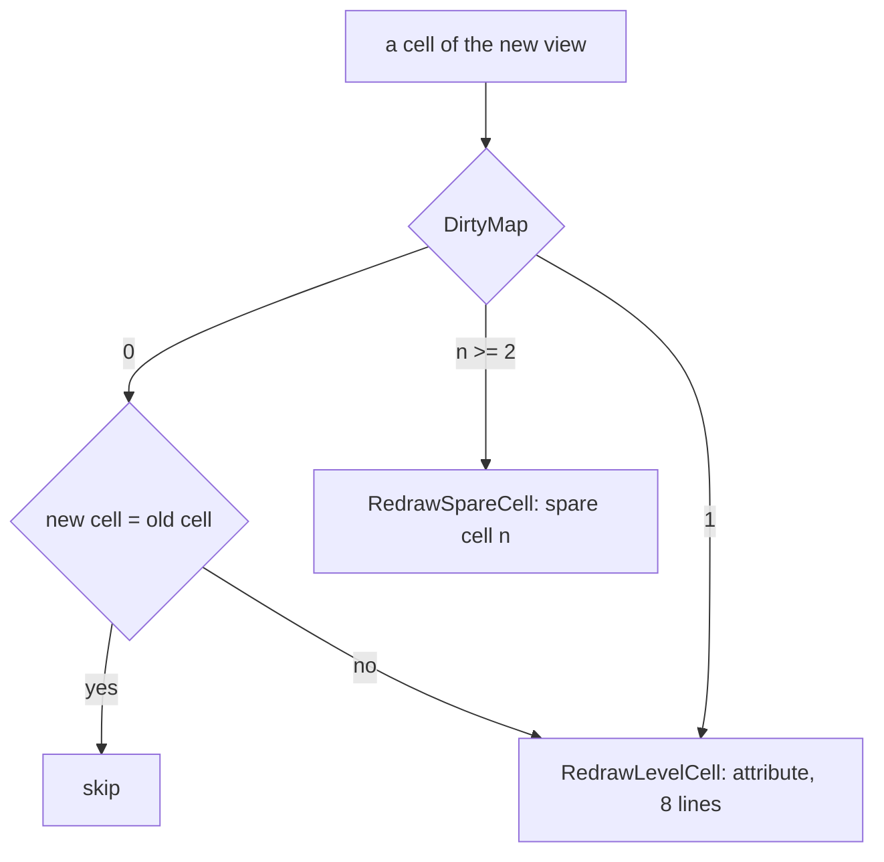

**A worked example.** `rzx-l1-04000-poke`, level 1 section 5: Rick climbs, and `ViewTopRow` goes from `$50` to `$48`.

| Frame, T | Step | Level cells drawn | Spare cells drawn |
| --- | --- | --- | --- |
| 111, 45 696 | `ScrollUp` called; `DrawSprites`, `MarkScrollCells` | | |
| 113, 54 286 | 2 rows up | 389 of 736 | 34 |
| 117, 53 364 | 6 rows up | 427 | 31 |
| 121, 66 652 | 8 rows up | 358 | 25 |
| 125, 48 716 | `BuildView`, then `ShiftObjects`, `DrawSprites`, `DrawChangedCells` | | |
| 127, 61 717 | the main loop again | | |

The scroll takes 16 frames, not 3.
The step marks are 282 710 T, 296 920 T and 265 696 T apart (a frame is 70 908 T): each `RedrawScrolledView` takes
about four frames, more or less with the cells it draws.
So the frame wait of one count before the next step finds the counter already past 1 and returns at once.
Half the cells or more change at each step, so the compare saves less than it would on a plain wall.

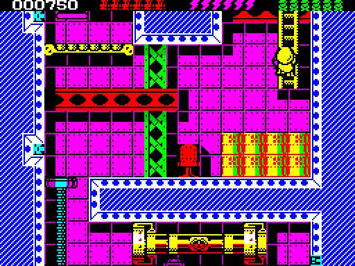

*`rzx-l1-04000-poke` frames 108-131, one picture a frame (24 frames; `screen_anim.py` merges identical neighbours into
one longer picture, so the GIF holds 18): the three steps of the scroll. Made with `python3
../../kit/screen_anim.py --work work/docs/wr/l14 --from 108 --to 131 --step 1 --delay 60 docs/img/play/scroll-up.gif`.*

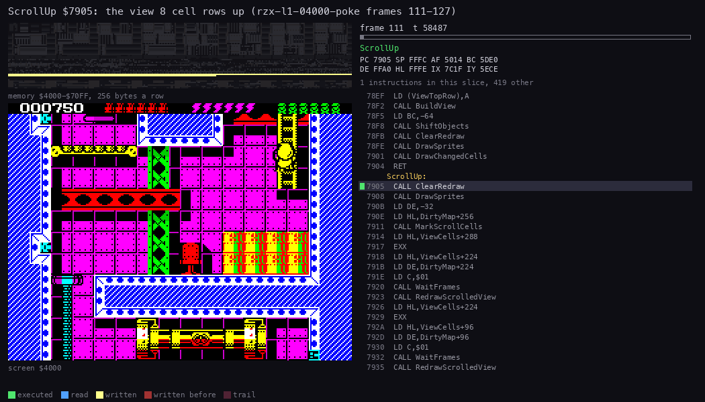

*`rzx-l1-04000-poke` frames 111-127 (111:45 600-128:0), 90 pictures of 12 887 T: the redraws going down the screen,
`BuildView` filling `$6B00`, the sprites again. Top, `$4000-$707F` lit by age; under it the screen; right, the
listing. Made with `python3 ../../kit/routine_anim.py --work work/docs/wr/l14 --window 111:45600-128:0 --listing
build/game.lst --out docs/img/routines/ScrollUp.gif --pc 7905-7964,77B1-783E,786B-78A4,88D4-894D,9E31-9E60,85FA-865C,7329-7754,7755-77B0,76D4-7754
--range 4000-707F --view screen --pictures 90`.*

How to read it: each step is a sweep from the top of the screen to the bottom, over about four frames.
For those frames the screen shows the new rows at the top and the old ones at the bottom.
The point: the scroll is a burst of redraws, not a smooth scroll.
The game stops for a third of a second while it runs.

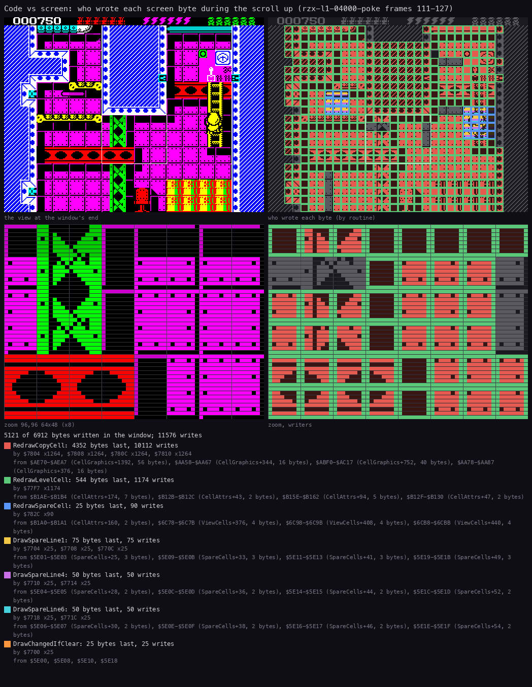

*`rzx-l1-04000-poke` frames 111-127: who wrote each screen byte during the scroll. 5121 of 6912 bytes:
`RedrawCopyCell` the bitmap of 544 level cells (4352 bytes), `RedrawLevelCell` their 544 attributes, the spare cells
by `RedrawSpareCell` and `DrawChangedCells`' copies at the end. Made with `python3 ../../kit/writers_map.py --work
work/docs/wr/l14 --window 111:45600-128:0 --listing build/game.lst --out docs/img/render/writers-scroll.png --sources
--zoom 96,96,64,48`.*

How to read it: the "last writer" of a byte counts once, so 544 is the number of cells that changed at least once in
the three steps.
The point: besides a section's first drawing, the scroll is the only time the game writes attributes in play.
The cells nobody wrote (grey) were the same before and after.

Witness (one index, `python3 tools/l1q.py 7905 78A5 786B 77B1`): `ScrollUp` 88 runs in 34 recordings, `ScrollDown` 95 in
34 (81 in the `rzx-*` pieces, 14 in the `sec-l4-*` ones), `MarkScrollCells` 183 = 88 + 95, `RedrawScrolledView` 557:
`ScrollDown`'s three call sites ran 96, 97 and 98 times (291), `ScrollUp`'s 88, 89 and 89 (266).
The later steps count more than the entries because a few scrolls straddle the cut between two `rzx-*` pieces: a piece
that starts inside a scroll counts its later steps but not its entry. `c1` never scrolls.

## 6.7 The HUD

The top character row is the HUD: the score at columns 1-6, the detonators at 9-14, the bullets at 17-22, the lives at
25-30.
`DrawHud` `$796F` clears its 8 lines with `PUSH` (interrupts off), colours the row in four bands, then calls
`DrawDetonators`, `DrawAmmo`, `DrawLives` and `DrawScore`.
The colours: `$47` white for columns 0-6, `$42` red for 7-14, `$43` magenta for 15-22, `$44` green for 23-31, all bright.

```text
796F  DI
7970  LD (ClearHudEnd+1),SP
7974  LD HL,Screen+32       ; the row's end: PUSH writes downwards
7977  LD B,$08              ; 8 pixel lines
7979  LD DE,$0000
797C  LD SP,HL
797D  PUSH DE               ; x 16: 32 bytes
...
798D  INC H                 ; the next pixel line
798E  DJNZ ClearHudLoop
7990  LD SP,$0000           ; the caller's SP
7993  EI
7994  LD HL,ScreenAttrs
...
799A  LD (HL),$47           ; white, then $42, $43, $44 by LDIR
```

The HUD row is view row 8, which no `DirtyMap` scan reaches.
The play area under it is 23 rows, not 24.
How the digits and icons are drawn and updated is in [doc 08](08-hud-and-text.md).

Witness: `DrawHud` 98 runs in 44 recordings: the section start `$8B16` (97) and `$8767` (once).

## 6.8 Known only from the code

- A mirrored sprite through `MirrorTable`: the counts show both mirrored paths ran, but no figure here shows one.
- The `MirrorTable` byte `$6500` that `MarkScrollCells` can mark going up (6.6): from the code; no recording writes it.
- `ScrollDown`'s steps (view rows 11, 15, 17): seen in the recordings' counts, not measured frame by frame here.
- A cell with `CellFlags` bit 7 in front of Rick: seen in `view.png` (pink), but no frame here shows Rick behind one.
