# 7. Objects

What this covers:

- the level block's object part: the section table, the exit lists, the map entry lists with their trigger boxes,
  the kind table, the trap records, paths and animation scripts, byte by byte, with level 1 section 6 decoded;
- the two object tables in memory: six trap records of 24 bytes, four enemy records of 23 bytes;
- the spawner: how a map entry becomes a record when it comes into view or when a box fires;
- the traps: path, animation, the deadly touch, the eight trigger behaviours, the switch to a second path;
- the enemies: four behaviours, gravity, ladders, being shot, blown up or punched;
- the hit tests, the random numbers, the game variables, and the long levels.

The recordings it rests on ([WALKTHROUGH 6.0](../WALKTHROUGH.md#60-the-recordings); all 128K):

| Recording | Load | Used for |
| --- | --- | --- |
| `rzx-l1-06000-poke` | the RZX run's level 1 state at RZX frame 6000, its key reads as an input script, four immunity POKEs | the tables at frame 105 (`records.png`), one trap and one enemy pass (`UpdateTrap.gif`, `UpdateEnemy.gif`), the entry into section 6 at frame 118 (`ScanMapObjects.gif`), frames 0-118 (`objects-l1.gif`), the patrol measured |
| all 67 recordings | as listed in WALKTHROUGH 6.0 | the run counts in the witness lines (`src/game/*.asm`) |

The level data is read from `src/res/levels` ([the formats](../src/res/levels/README.md)).
How a pass calls the object code is in [doc 04](04-game-loop.md); how the records are drawn is in
[doc 06](06-rendering.md#the-draw-order); what Rick does to them is in [doc 10](10-gameplay-logic.md).

## 7.1 The level block's object part

Every level loads into the same 21 760 bytes at `$A800`.
The first half is graphics: cell flags, cells, blocks, sprites ([doc 06](06-rendering.md#62-cells-and-blocks)).
The rest describes the sections and what lives in them.

`LevelHeader` `$C200` holds three words: the kind table, the section table, the maps' base.
The game finds every list through them, so the five levels may put their tables at different addresses.

| Level | Sections used | SectionTable | KindTable (kinds) | TrapAnims (scripts) | TrapPaths (paths) | KindRecords |
| --- | --- | --- | --- | --- | --- | --- |
| 1 | 9 | `$ED6D` | `$F205` (50) | `$F269` (36) | `$F4BA` (46) | `$F668` (49) |
| 2 | 13 | `$ED6D` | `$F3DB` (46) | `$F437` (30) | `$F575` (40) | `$F7BB` (45) |
| 3 | 10 | `$EBED` | `$F323` (52) | `$F38B` (30) | `$F4EA` (44) | `$F7F4` (51) |
| 4 | 13 | `$EAED` | `$F22D` (69) | `$F2B7` (50) | `$F64D` (63) | `$FACC` (65) |
| 5 | 8 | `$ECED` | `$F1CB` (55) | `$F239` (39) | `$F3A3` (49) | `$F630` (54) |

The section count is not in the level.
It is `SectionCounts` `$8374` in the game: 9, 13, 10, 13, 8.

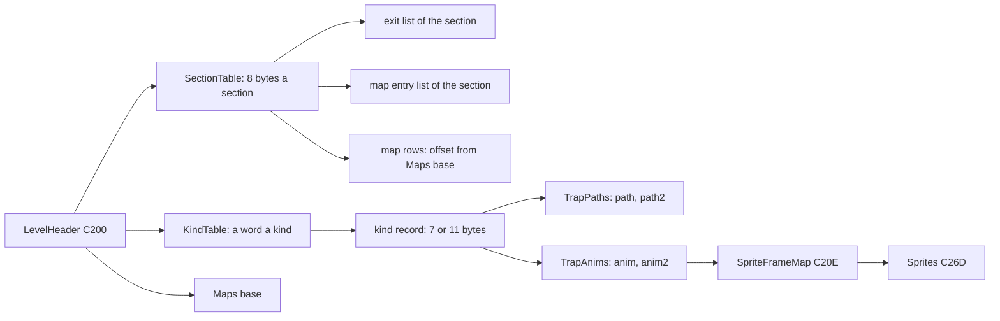

The point: one section table entry leads to everything the section holds.
The maps of all five levels, with every map entry and box marked, are drawn by `tools/fig_rooms.py`:

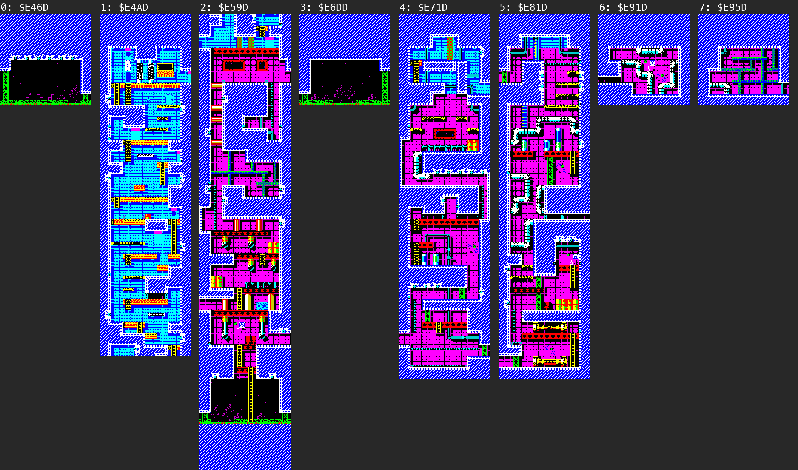

*Level 1's nine sections side by side, drawn by `python3 tools/fig_rooms.py docs/img/maps --levels 1` from
`src/res/levels/level1`. Yellow squares are traps and pickups, red squares enemies, cyan the bonus marks, each numbered
by its kind; dotted rectangles are trigger boxes. Under each section its exits ("R30>2": the right edge, feet row 30,
to section 2).*

The other four levels: [level 2](img/maps/level2.png), [level 3](img/maps/level3.png),
[level 4](img/maps/level4.png), [level 5](img/maps/level5.png).

## 7.2 The section table and the exits

A section entry is 8 bytes.
Its offsets are big-endian, unlike every word the Z80 itself reads.

| Byte | What |
| --- | --- |
| +0/+1 | the map: an offset from the maps' base |
| +2 | 0 in every level, read by no code |
| +3 | the scroll limit: the last view top row, in cells, a multiple of 8 |
| +4/+5 | the exit list: an offset from the section table |
| +6/+7 | the map entry list: an offset from the section table |

An exit is 4 bytes, and the list ends at a byte whose `AND $0B` is 0.

| Byte | What |
| --- | --- |
| +0 | flags: bits 0-1 the side (1 left, 2 right); bit 4 keeps a level end under the long-levels cheat; bit 5 Rick arrives riding (`RideMode` `$945D`); bit 6 starts the Fat Guy (`LevelHookOn` `$8A24` = 20); bit 7 the level ends |
| +1 | the section row of Rick's feet at which the exit is taken (an exact match) |
| +2 | the section entered |
| +3 | the row Rick's feet arrive at in that section |

`CheckSectionExit` `$8993` runs when Rick walks off the view's left or right edge.
It computes his feet row as `ViewTopRow` + (RickY + 20) / 8 and looks for an exit on that side with that row.
The new view top is +3 less the rows Rick's feet were below the old top.
Rick comes in at x `$E8` when he left at the left, at x 0 when he left at the right.

```text
CheckSectionExit(side):
    feet = ViewTopRow + (RickY + 20) / 8
    for exit in the section's exit list (until a byte with AND 0B = 0):
        if exit.side != side or exit.row != feet: continue
        RideMode = 0
        if exit.flags AND F0:
            if CheatExits:                      // the long levels
                if bit 4 and bit 7: return level end
                // bit 7 without bit 4: go on into exit.to
            else if bit 7: return level end
            if bit 5: RideMode = FF
            if bit 6: LevelHookOn = 20           // level 5: the Fat Guy
        top = exit.arrive - (feet - ViewTopRow)
        SetupSection(exit.to, x = E8 if side is left else 0, top)
```

```text
89C5  LD A,(IX+$01)     ; +1: the row the exit is taken at
89C8  CP L
89C9  JP NZ,ExitScanNext
89CC  XOR A
89CD  LD (RideMode),A
89D0  LD A,(IX+$00)
89D3  AND $F0           ; the flag bits 4-7
89D5  JP Z,TakeExit
89D8  LD C,A
89D9  LD A,(CheatExits) ; $8067 bit 7: the long-levels switch
89DC  AND A
89DD  JP P,CheckExitFlags
89E0  BIT 4,C
89E2  JP Z,CheckExitRide
89E5  LD A,C
89E6  AND A
89E7  RET M             ; bit 7 and bit 4: the level ends even so
```

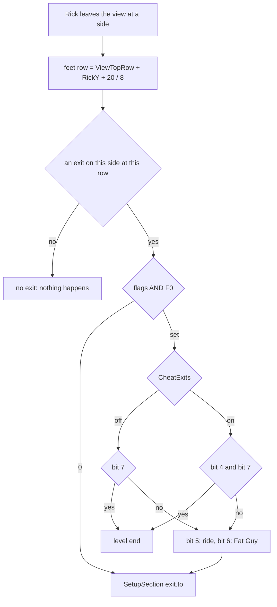

### A worked decode: level 1 section 6

Level 1's section table is at `$ED6D`, so section 6's entry is at `$ED6D` + 48 = `$ED9D`.
Its 8 bytes are `04 B0 00 08 04 3C 04 41`.

- `04 B0`: the map starts at the maps' base + `$04B0` = `$E46D` + 1200 = `$E91D`.
- `00`: the pad.
- `08`: the limit. The view top may scroll from row 0 to row 8, one step of 8 rows.
- `04 3C`: the exits at `$ED6D` + `$043C` = `$F1A9`.
- `04 41`: the map entries at `$ED6D` + `$0441` = `$F1AE`, right after the exits.

The exit list at `$F1A9` is `01 17 05 47 00`.
One exit: left side (`$01`), feet row 23 (`$17`), into section 5 (`$05`), arriving at row 71 (`$47`).
The `00` ends the list.
Section 5's exit list holds the way back: right side, row 71, into section 6, arriving at row 23.

The map entry list at `$F1AE` holds four entries, each with one box:

| Entry | Kind | Row | Column byte | Param | Box (x, row, size, who) | Meaning |
| --- | --- | --- | --- | --- | --- | --- |
| `14 0D D9 61` | 20 | 13 | `$D9`: column 25, y + 3, on view | `$61`: 1 box, treasure, one-shot | `C8 0D 22 01` | a treasure at x 200; Rick takes it |
| `16 0D C5 6D` | 22 | 13 | `$C5`: column 5, y + 3, on view | `$6D`: 1 box, detonators, one-shot | `28 0D 22 01` | a box of detonators at x 40 |
| `14 15 D5 61` | 20 | 21 | `$D5`: column 21, y + 3, on view | `$61` | `A8 15 22 01` | a treasure at x 168 |
| `14 19 CD 61` | 20 | 25 | `$CD`: column 13, y + 3, on view | `$61` | `68 19 22 01` | a treasure at x 104 |

A `00` ends the list.
A box's size `$22` means 3 rows and 3 columns of cells; who `$01` is Rick.

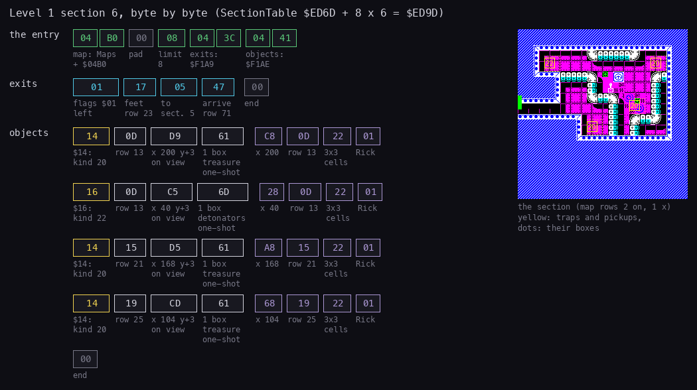

*Drawn by `python3 tools/fig_objects.py section --level 1 --section 6 docs/img/objects/section.png` from
`src/res/levels/level1`. Left, every byte of the entry, the exit list and the map entry list in a box, its meaning
under it (green the table entry, cyan the exit, yellow an entry's kind, violet its trigger box). Right, the section as
`fig_rooms` draws it, the four entries numbered by kind.*

How to read it: the `$C5` of the detonators says column 5 (x 40), bit 6 (3 pixels lower), bit 7 (spawn on view).
The point: section 6 is a treasure room; its four entries all spawn as soon as it is entered.

Witness: `CheckSectionExit` `$8993` 1 225 runs in 34 recordings, a matching exit 51 times, a level end twice
(`rzx-l3-10000-poke`, `rzx-l4-20000-poke`). The entry into section 6 is `rzx-l1-06000-poke` frame 116 (`SetupSection`
`$8A6D` at T 37 641).

## 7.3 Map entries and trigger boxes

A map entry is 4 bytes, followed by 0 to 3 trigger boxes of 4 bytes.
The list is sorted by row; a kind of 0 ends it.

| Byte | Bits | What |
| --- | --- | --- |
| +0 | 0-6 | the kind: below `$74` a trap or pickup (an index into KindTable), `$78` the bonus countdown start, `$7C` its stop, any other value from `$74` an enemy |
| +0 | 7 | alive: set while a record holds the entry (0 in the data) |
| +1 | all | the cell row in the section |
| +2 | 0-4 | the column: x = 8 x column |
| +2 | 5 | x + 4 |
| +2 | 6 | y + 3 (traps and pickups) |
| +2 | 7 | spawn when the row comes into view; clear: spawn when a box fires |
| +3 | 0-1 | the number of boxes |
| +3 | 2-5 | a trap's behaviour (`$00`-`$1C`), a pickup (`$20` treasure, `$28` ammunition, `$2C` detonators), or an enemy's patrol length |
| +3 | 6 | one-shot: once taken or ended, the entry never comes back |

A trigger box:

| Byte | What |
| --- | --- |
| +0 | x in pixels |
| +1 | the cell row |
| +2 | the size: high nibble rows - 1, low nibble columns - 1 |
| +3 | who sets it off: bit 0 Rick, 1 the bullet, 2 the blast, 3 the punch, 4 an enemy, 5 another trap; bit 6 fires on every pass; bit 7 the run-time latch |

The kind does not say whether an entry is a treasure.
Level 1 uses kind 20 both for its treasures (+3 `$20`) and, in section 5, for a trap (+3 behaviour `$10`).
The pickup code ignores the kind's path and animation, so the same record serves both.

Per level, the map entries (from `src/res/levels/levelN/level/sections.txt`):

| Level | Enemies | Traps | Treasures | Ammunition | Detonators | Bonus marks | Trigger boxes |
| --- | --- | --- | --- | --- | --- | --- | --- |
| 1 | 25 | 76 | 9 | 6 | 5 | 10 | 103 |
| 2 | 44 | 106 | 14 | 7 | 8 | 18 | 153 |
| 3 | 47 | 136 | 6 | 9 | 2 | 16 | 181 |
| 4 | 45 | 134 | 14 | 7 | 8 | 16 | 175 |
| 5 | 29 | 110 | 3 | 4 | 3 | 8 | 122 |

### The kinds and their records

`KindTable` is a little-endian word per kind, the absolute address of the kind's record.
A record is 11 bytes:

| Byte | What |
| --- | --- |
| +0 | width in pixels |
| +1 | height in pixels |
| +2 | bits 6-7 go into the record's +0: bit 6 deadly, bit 7 an object Rick and the enemies stand on (a platform; with bit 6 a solid block, which also sets off a lit detonator it touches); bits 0-5 x 4 are OR-ed into the +0 the trap takes after the switch |
| +3/+4 | the path |
| +5/+6 | the animation script |
| +7/+8 | the second path |
| +9/+10 | the second animation script |

A kind that never switches stores only 7 bytes.
Its +7 to +10 are the next record's first bytes.
Level 1 has 21 records of 11 bytes among its 49.

A path is a list of steps of 2 bytes: a count, then a byte of two signed nibbles (x step high, y step low; 7 means 8).
`$FF n` plays effect n, and `00` with an address jumps there: the loop point.

An animation script is frame bytes.
A byte below `$80` is a frame shown for one pass.
`$80`+n and a frame show it n passes; `$FD n` plays effect n; `$FF` and an address jump.
A frame goes through `SpriteFrameMap` `$C20E` to a sprite number (bit 7 mirrored); frame `$7F` hides the trap.

**A worked example: kind 1 of level 1.**
`KindTable` + 2 holds `$F668`.
The record there is `18 08 A0 BA F4 69 F2 BF F4 69 F2`.

- 24 x 8 pixels; `$A0`: bit 7 without bit 6, a platform, not deadly; after the switch
  +0 = `$20` x 4 = `$80` OR the old bits 0-5 (`$25`) = `$A5`, bit 7 again.
- Path `$F4BA`: `01 00 00 BA F4`, one pass of no move, then the loop: the block stands still.
- Path 2 `$F4BF`: 16 passes of (0, +4), 24 of (0, 0), 16 of (0, -4), 16 of (0, 0), loop: down 64 pixels, a pause, up.
- Both animations `$F269`: `8A 46 FF 69 F2`, frame 70 held 10 passes, again.

In section 5 an entry `01 30 AC 25` with one box `18 36 10 08` places it.
Its behaviour `$24` (`$04` with bit 5) waits for the punch box at x 24, row 54, 1 x 2 cells.
After the punch, at the end of its still path, the platform switches to path 2 and makes one round, down 64 pixels
and back up.
Bit 5 makes the wait a round trip: at the end of path 2 it switches back to the still path, and the punch box is
tested again from then on (7.6).

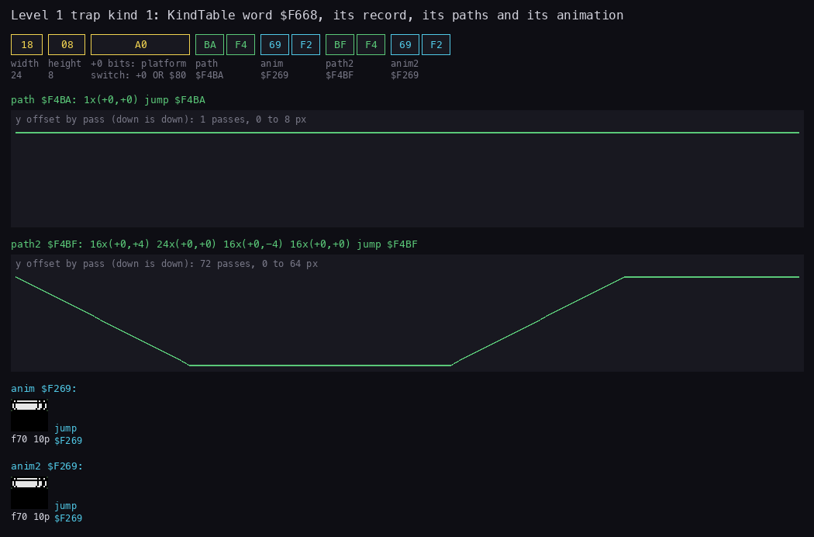

*Drawn by `python3 tools/fig_objects.py kind --level 1 --kind 1 docs/img/objects/kind.png`. The record's 11 bytes,
each path decoded with its y offset over the passes, and each animation's frames as sprites with how long they show.*

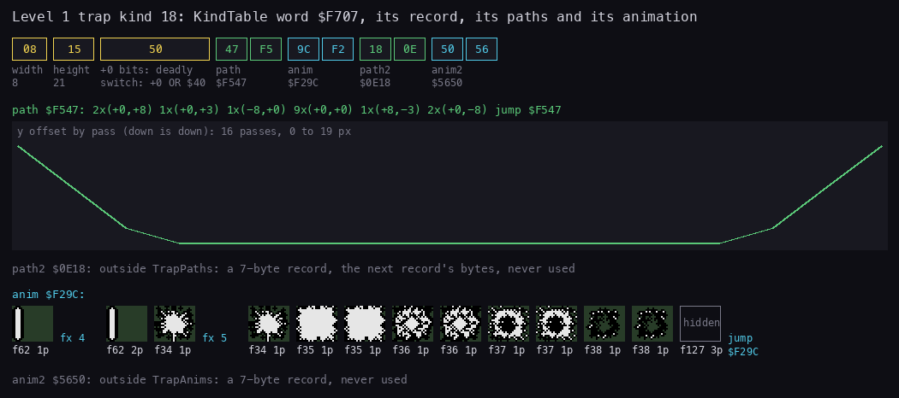

*`python3 tools/fig_objects.py kind --level 1 --kind 18 docs/img/objects/kind-18.png`: a 7-byte record (its second
path and animation are the next record's bytes). The path drops 19 pixels, waits 9 passes and climbs back; the
script shows frame 62, plays effect 4, then the blast frames 34-38 with effect 5, hides 3 passes and loops.*

The point: a trap is data, not code.
The same 300 lines of `UpdateTrap` run a crusher, a dart and a dropping bomb.

## 7.4 The object tables

| Table | Address | Records | Size | Update | End mark |
| --- | --- | --- | --- | --- | --- |
| A: traps and pickups | `$7B8F` | 6 | 24 | `UpdateTrap` `$A2F7` | `$FF` at `$7C1F` |
| B: enemies | `$7C20` | 4 | 23 | `UpdateEnemy` `$9EAF` | `$FF` at `$7C7C` |

Both tables lie over the game's entry code, which runs once.
`ClearObjectTables` `$83B8` clears `$7B8F-$7C7C` at every new game and puts the two end marks.
A record whose +0 is 0 is free; its other bytes keep their last values.

Table A's record:

| Byte | What |
| --- | --- |
| +0 | bit 0 alive, bit 1 path paused, bits 2-4 the trigger behaviour, bit 5 switch there and back (`$21`, `$29`, `$2D` with bits 0-5 are the pickups), bit 6 deadly, bit 7 a platform (with bit 6 a solid block, `ObjectScanTest` `$90C7`; such a block also sets off a lit detonator it touches) |
| +1 | x |
| +2/+3 | y, pixels from the view's top |
| +4/+5 | the sprite's address (0: none) |
| +6 | bit 7 mirrored, 6 no trigger test, 5 freed at the path's end, 4 waiting to switch, 3 switch once more (the return) |
| +7/+8 | width, height |
| +9 | the frame's pass count |
| +`$0A`/+`$0B` | the animation script's place |
| +`$0C`/+`$0D` | the map entry (0 for a one-shot behaviour `$10`) |
| +`$0E` | the passes done of the current path step |
| +`$0F`/+`$10` | the path's place |
| +`$11`/+`$12`, +`$13`/+`$14`, +`$15` | path 2, animation 2, kind 2 |
| +`$16`/+`$17` | the last x and y step |

Table B's record:

| Byte | What |
| --- | --- |
| +0 | the kind: bits 0-1 the behaviour, bit 2 the sprite set |
| +1, +2/+3, +4/+5 | x, y, sprite |
| +6 | the x step, 2 or -2 (`$FE`); bit 7 mirrors the sprite |
| +9 | the walk frame counter |
| +`$0A`/+`$0B` | an animation script nothing reads |
| +`$0C`/+`$0D` | the map entry |
| +`$0E`/+`$0F`, +`$10` | the vertical speed (8.8) and the y fraction |
| +`$11` | climbing (`$FF`) |
| +`$12`, +`$13` | the patrol pass count and length |
| +`$14`, +`$15` | dying (`$FF`), the dying drift |
| +`$16` | the stun timer |

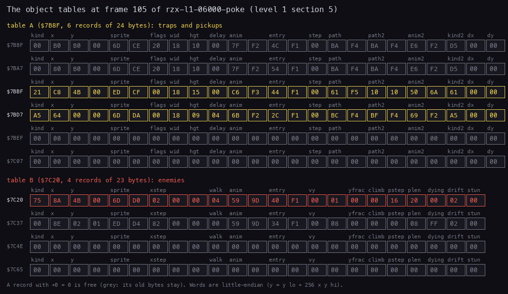

*`rzx-l1-06000-poke` frame 105, read with TTD `memory_at` by `python3 tools/fig_objects.py records --work
work/docs/wr/l1p --at 105 docs/img/objects/records.png`. Live records coloured, free ones grey with their old bytes.*

**A worked example: the records at frame 105.**

- `$7BBF`: `21 C8 4B 00 ED CF ...`. Kind `$21` is a treasure; x 200, y 75, sprite `$CFED` = `Sprites` + 27 x 128.
- `$7BD7`: `A5 64 00 00 6D DA ...`. `$A5` = alive, behaviour `$04`, bit 5 (there and back), bit 7 (a platform):
  level 1's kind 1 block at x 100, y 0, above the screen's window; path `$F4BC`, the still loop.
- `$7C20`: `75 8A 4B 00 6D D0 02 ...`. Kind `$75`: behaviour 1, a patrol; x 138, y 75, stepping +2; patrol pass 22
  of 32.
- `$7C37`: `00 8E 02 01 ...`. Free; its +`$14` still says `$FF`: the last enemy there died.

The point: ten records are all the game ever has.
A full table spawns nothing, and the entry is tried again next pass.

## 7.5 The spawner

Every pass `ScanMapObjects` `$8B42` walks the section's map entry list from `ScanStart`.
`FindFirstMapEntry` `$8BC1` sets `ScanStart` after every `BuildView`: the first entry at or below the view's top row.
The scan stops at the list's end or at the first entry 40 or more rows below the top.

An entry already alive is skipped.
An entry with +2 bit 7 spawns when its row is in the view's first 8 rows, or 32 rows or more below the top.
Those are the rows a scroll brings in, above and below the screen's window.
During `SetupSection`, `SpawnWholeView` `$8BC0` makes every row count.
An entry with +2 bit 7 clear tests its boxes (`TestTriggerBoxes` `$A69F`) and spawns when one fires.

`SpawnFromMap` `$9C97` sorts the kinds:

```text
ScanMapObjects():
    if LevelHookOn or ScanStart == 0: return
    for entry from ScanStart:
        if entry.kind == 0 or entry.row >= ViewTopRow + 40: return
        if entry.kind bit 7: continue                      // alive
        if entry.col bit 7:
            d = entry.row - ViewTopRow (8 bits)
            if SpawnWholeView or d < 8 or d >= 32: SpawnFromMap(entry)
        else if TestTriggerBoxes(entry, none): SpawnFromMap(entry)

SpawnFromMap(entry):
    k = entry.kind
    if k < $74: SpawnMapObject(entry)                  // a trap or pickup into table A
    else if k == $78: StartBonusTimer()                // only when no countdown runs: digits 2-4 = 0 2 0
    else if k == $7C: StopBonusTimer()                 // only while one runs: what is left to the score
    else: SpawnEnemy(entry)                            // into table B
```

```text
8B75  BIT 7,(HL)          ; ScanSpawnRule: +2 bit 7
8B77  JP Z,ScanTriggerTest
8B7A  LD A,(SpawnWholeView)
8B7D  AND A
8B7E  JP NZ,ScanSpawnHere
8B81  LD A,(ViewTopRow)
8B84  LD B,A
8B85  DEC HL              ; ScanEdgeRows
8B86  LD A,(HL)           ; the row
8B87  INC HL
8B88  SUB B
8B89  CP $08
8B8B  JP C,ScanSpawnHere  ; the first 8 rows
8B8E  CP $20
8B90  JP C,ScanSkipEntry  ; rows 8-31: on screen already, skip
...
9C97  LD A,(IX+$00)
9C9A  CP $74
9C9C  JP C,SpawnMapObject
9C9F  CP $78
9CA1  JP Z,StartBonusTimer
9CA4  CP $7C
9CA6  JP Z,StopBonusTimer
9CA9  JP SpawnEnemy
```

`SpawnMapObject` `$9D6C` takes a free table A record and fills it:

- +0 = 1, OR the entry's +3 bits 2-5, OR the kind record's bits 6-7;
- +7/+8 the kind's size, +`$0F`/+`$10` and +`$0A`/+`$0B` its path and animation, the second ones at +`$11`-+`$14`;
- +`$15` = the kind's +2 bits 0-5 x 4, OR the new +0's bits 0-5: the kind after a switch;
- x = 8 x column (+4 with bit 5), y = (row - `ViewTopRow`) x 8 (+3 with bit 6);
- behaviour `$10` starts with +6 = `$60` (no trigger test, freed at the path's end); one-shot, it forgets its entry.

`SpawnEnemy` takes a free table B record: kind AND `$7F`, x = 8 x column, y = (row - top) x 8 + 3, step +2.
Its patrol length +`$13` = (bits 2-5 of +3, plus 1) x 8.
Both set bit 7 of the entry: it is alive.

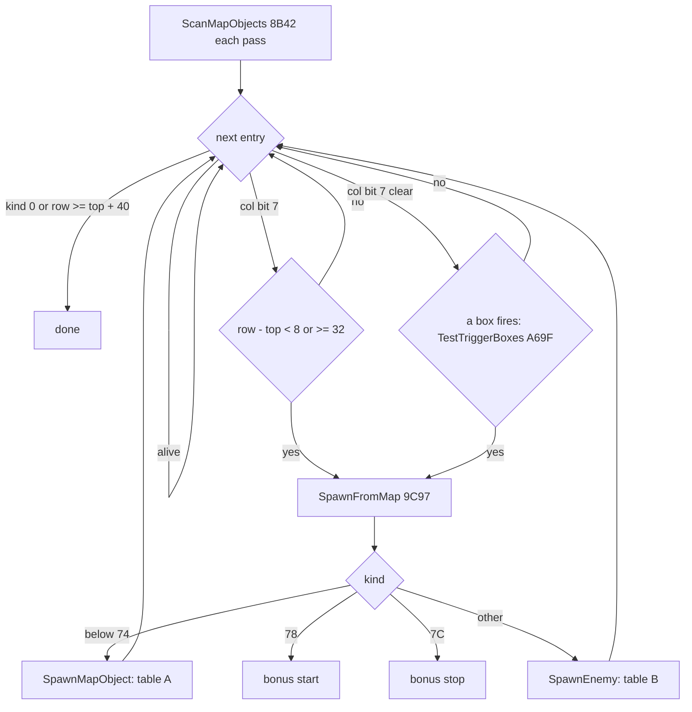

**A worked example: the entry into section 6.**
In `rzx-l1-06000-poke` Rick walks right out of section 5 at frame 116.
`SetupSection` runs at T 37 641 and `BuildView` at frame 117 T 50 708.
`FindFirstMapEntry` sets `ScanStart` = `$F1AE` at frame 118 T 18 954.
`ScanMapObjects` starts at T 19 201 with `SpawnWholeView` set.
It calls `SpawnFromMap` four times, at T 19 466, 20 930, 22 415 and 23 966, with IX = `$F1AE`, `$F1B6`, `$F1BE`,
`$F1C6`: each entry 8 bytes after the last, its box between.
The first treasure lands in `$7B8F` as `61 C8 6B 00 ...`.
Its +0 `$61` is 1, OR `$20` (treasure), OR `$40` (kind 20's record says deadly).
x is `$C8` = 200 = 25 x 8; y is `$006B` = 107 = (13 - 0) x 8 + 3.
Its sprite word still holds the old record's `$CE6D`: `UpdatePickup` writes the treasure's sprite on its first pass.
Its second path reads `$1010`: kind 20 is a 7-byte record, so these are kind 21's width and height.

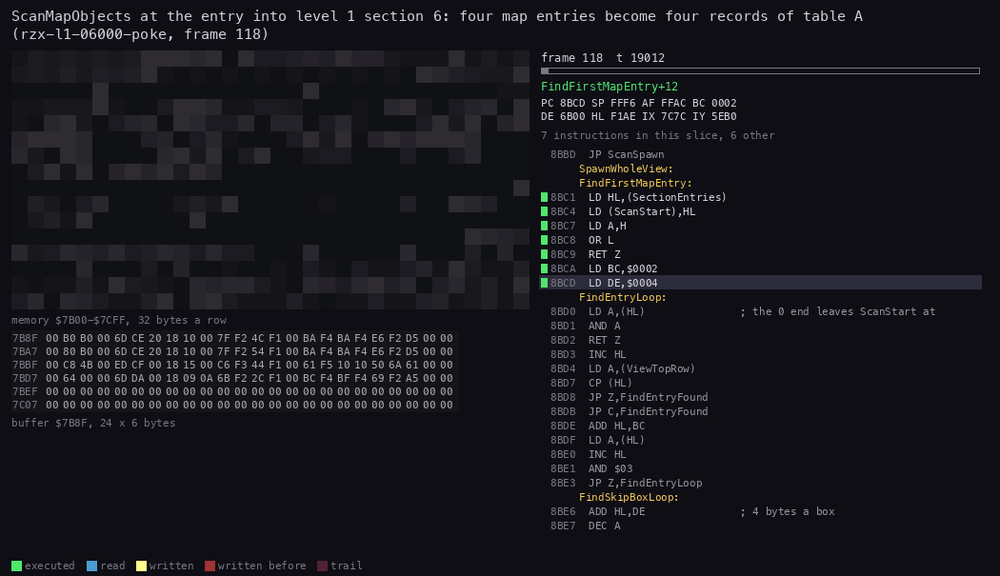

*`rzx-l1-06000-poke` frame 118, T 18 900-25 600, 60 pictures of 112 T. Top, `$7B00-$7CFF` (the object tables and
the code under them); under it table A as numbers, 24 bytes a record; right, the listing. Made with `python3
../../kit/routine_anim.py --work work/docs/wr/l1p --window 118:18900-118:25600 --listing build/game.lst --out
docs/img/routines/ScanMapObjects.gif --pc 8B42-8BFF,9C97-9E30,9BC7-9BFF --range 7B00-7CFF --view
buffer:7B8F:24x6:hex --pictures 60`.*

How to read it: four times the scan reads an entry and its box, then four records of table A fill in a burst.
The point: an entry costs about 1 500 T to spawn, and 685 instructions bring a whole room to life.

Witness: `ScanMapObjects` 50 256 runs in 65 recordings; `SpawnFromMap` 1 982: 1 471 traps and pickups, 474 enemies,
18 bonus starts, 19 bonus stops.
A box fired a spawn 442 times.

### Losing a record

An object leaves its table in three ways.

| Way | Routine | The map entry |
| --- | --- | --- |
| freed: out of the view, out of the x range, or removed | `FreeObject` `$9C57` | bit 7 cleared: it may spawn again |
| retired: a path's end, a pickup taken, an enemy fallen | `RetireObject` `$9C69` | cleared, unless the entry is one-shot |
| the level start or a death | `FreeAllObjects` `$9BEB` | every entry cleared |

`ShiftObjects` `$9E31` moves every record by the scroll's pixels and frees those pushed out of the view.
So a trap left behind a scroll comes back, from its start, when the view returns.

## 7.6 The traps

`UpdateTrap` `$A2F7` runs each live record of table A once a pass.

1. The pickups (+0 AND `$3F` = `$21`, `$29`, `$2D`) go to `UpdatePickup` `$A528`.
2. A paused trap (+0 bit 1) skips to the trigger test.
3. The path: `$FF n` plays effect n; a `00` loop point is followed, and there a waiting trap switches or ends.
4. A step: x += the x step, freed when it leaves 0-`$E8`; y += the y step, freed when it leaves the view.
5. `AnimateTrap` `$A608` moves the script on and sets the sprite.
6. A deadly trap (+0 bit 6) with a sprite: with +0 bit 7 (a solid block), touching a lit detonator (fuse 10 or more)
   sets it off now (effect 5, fuse 9); then it kills every live enemy it overlaps (one already dying, +`$14` not 0,
   is skipped), then Rick when it touches him.
7. The trap's own map entry boxes are tested, and the behaviour decides; a trap waiting to switch with +0 bit 5 skips
   the test.

```text
UpdateTrap(r):
    if r.kind & 3F in (21, 29, 2D): UpdatePickup(r); return
    if not r.paused:
        loop:
            b = path[r.p]
            if b == FF: TrapEffect(path[r.p+1]); r.p += 2; continue
            if b == 0:
                r.p = word(path[r.p+1])                 // the loop point
                if r.flags bit 5: Retire(r); return     // a one-shot path ends
                if r.flags bit 4:                       // waiting to switch
                    if r.flags bit 3: clear bit 3       // switch now, bit 4 kept: switch back at the next end
                    else:             clear bit 4       // the last switch
                    if behaviour == 14: set flags bit 5 // both branches: freed at the next end
                    SwitchTrapPath(r); return
                continue
            break
        r.x += dx(path[r.p+1]); if r.x outside 0..E8: Free(r); return
        r.y += dy(path[r.p+1]); if r.y outside the view: Free(r); return
        r.step += 1; if r.step == path[r.p]: r.step = 0; r.p += 2
        AnimateTrap(r)
        if r.deadly and r.sprite:
            if r.kind bit 7 and DetonatorFuse >= 10 and r touches (DetonatorY, DetonatorX + 8, 16 x 8):
                PlayEffect(5); DetonatorFuse = 9                // the lit detonator goes off now
            for each enemy with +0 not 0 and +14 == 0 touching r: KillEnemy
            if Rick not dying and touches r: KillRick
    if r.flags bit 6: return                                    // TrapTriggers: no more tests
    if r.flags bit 4 and r.kind bit 5: return                   // waiting for a round trip
    TestTriggerBoxes(r) ...                                     // the behaviours below
```

The eight trigger behaviours (+0 bits 2-4, from the entry's +3):

| Behaviour | When a box fires | Without a fire |
| --- | --- | --- |
| `$00` | the path pauses or resumes (+0 bit 1 toggled) | nothing |
| `$04` | wait: switch at the path's end (`ArmTrapWait` `$A51A`); with +0 bit 5 also +6 bit 3: switch back at the next end | nothing |
| `$08` | stop testing, switch now | nothing |
| `$0C` | removed (`RetireObject`) | nothing |
| `$10` | never tested: spawned with +6 = `$60`, it runs its path once and is freed | |
| `$14` | wait, switch at the path's end, freed at the next end | nothing |
| `$18` | stop testing, switch now, freed at the path's end | nothing |
| `$1C` | nothing: it stays | retired: it lives only while its box is held |

```text
A4AA  LD A,(IX+$00)     ; TrapTriggered: behaviour 0: pause or resume the path
A4AD  AND $1C
A4AF  JP NZ,TrapTriggerKind
A4B2  LD A,(IX+$00)
A4B5  XOR $02
A4B7  LD (IX+$00),A
A4BA  RET
A4BB  CP $1C            ; $1C: held, nothing to do
A4BD  RET Z
A4BE  CP $0C
A4C0  JP Z,RetireObject ; $0C: removed
A4C3  BIT 3,A
A4C5  JP Z,ArmTrapWait  ; $04, $10, $14: wait for the path's end
...
A51A  SET 4,(IX+$06)    ; ArmTrapWait: waiting
A51E  BIT 5,(IX+$00)
A522  RET Z
A523  SET 3,(IX+$06)    ; +0 bit 5: switch there and back
A4C8  SET 6,(IX+$06)    ; $08, $18: no more tests
A4CC  BIT 4,A
A4CE  JP Z,SwitchTrapPath
A4D1  SET 5,(IX+$06)    ; $18: and freed at the path's end
```

`SwitchTrapPath` `$A4D5` swaps the path, animation and kind with the second ones and restarts the counters.
A falling block falls; a door opens; a dart flies.

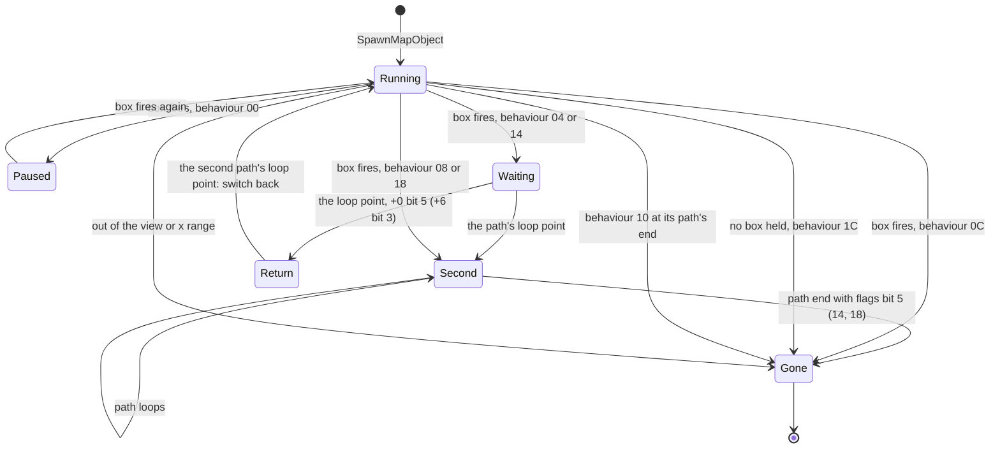

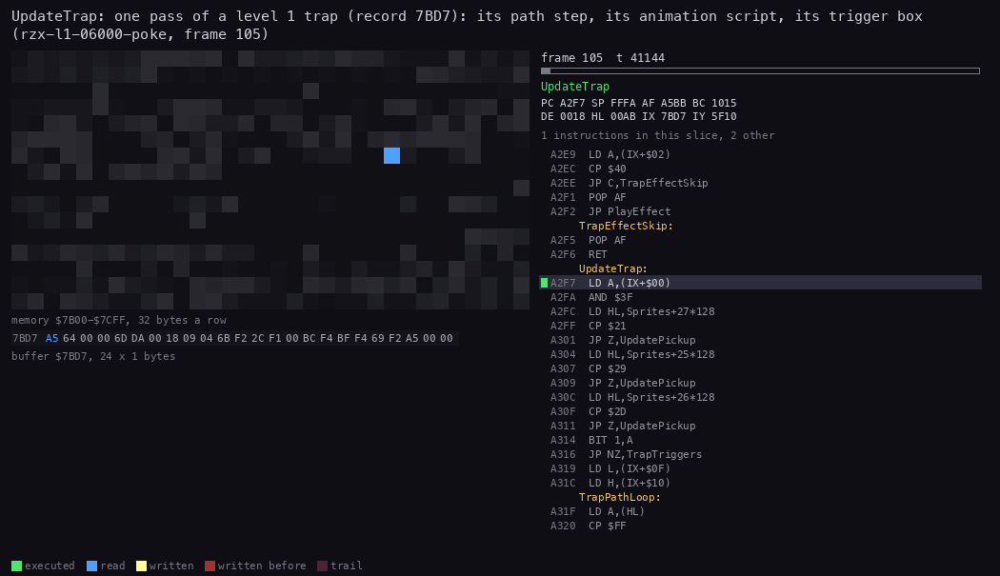

*`rzx-l1-06000-poke` frame 105, T 41 100-43 272, 49 pictures of 44 T: the kind 1 block at `$7BD7` on its still path.
Top, `$7B00-$7CFF`; under it the record as numbers; right, the listing. Made with `python3
../../kit/routine_anim.py --work work/docs/wr/l1p --window 105:41100-105:43272 --listing build/game.lst --out
docs/img/routines/UpdateTrap.gif --pc A2E1-A69E,8C6C-8EA5,93D0-9404 --range 7B00-7CFF --view buffer:7BD7:24x1:hex
--pictures 50`.*

How to read it: the path reads the loop point, the animation counts its delay down (+9), then the trigger test walks
the entry's punch box.
The point: a trap that does not move still costs about 2 100 T a pass: path, animation and box test run anyway.

Witness: `UpdateTrap` 148 725 runs in 61 recordings; the trap-on-Rick test 83 559; `SwitchTrapPath` 184 runs in 42;
behaviour `$0C` removed by its box 432 times, `$1C` released 9 times.
The round trips: `ArmTrapWait` set +6 bit 3 (+0 bit 5) 59 times in 15 recordings (`$A523`), the first switch kept
bit 4 58 times (`$A355`), and the last switch cleared it 77 times (`$A35C`, the plain waits included).
`KillEnemy` from a deadly trap (`$A454`): 220 times, 102 of them in `sec-l5-s5`.

### The pickups

`UpdatePickup` `$A528` makes the record 24 x 21 and sets its sprite: 27 the treasure, 25 the ammunition, 26 the
detonators.
When Rick, alive, overlaps it:

| Pickup | Effect |
| --- | --- |
| treasure `$21` | 500 points, effect 7 |
| ammunition `$29` | `Ammunition` `$8B3C` = 6, effect 6 |
| detonators `$2D` | `Detonators` `$8B3D` = 6, effect 6 |

The pickup is then retired.
An ammunition or detonator box hit by the bullet or the blast bursts (effect 5, ten passes: `UpdatePickup`'s +`$0E`
counts down one a pass).
`box-shot` (POKEs, said so: level 1 starts in section 3 beside the boxes; WALKTHROUGH 6.0) shoots the ammunition box:
`PickupShot` `$A5E4` 1 run, `PickupBurst` `$A53A` 10 runs. The blast's branch (`$A5F7`) runs in no recording.

Witness: a treasure taken 28 times, ammunition 13, detonators 12 (`UpdatePickup` 20 424 runs in 47 recordings).

## 7.7 The enemies

`UpdateEnemy` `$9EAF` runs each live record of table B once a pass.
A dying enemy only falls.
Otherwise +0 bits 0-1 pick the behaviour:

| Bits 0-1 | Behaviour | Routine | What it does |
| --- | --- | --- | --- |
| 0 | wanderer | `EnemyWanderer` `$9FF7` | walks; at x AND 15 = 4, one chance in 4 of a random new direction |
| 1 | patrol | `EnemyPatrol` `$A06E` | walks +`$13` passes one way, turns, again |
| 2 | chaser | `EnemyChaser` `$A025` | walks; on the 16-pixel grid at a floor, half the time turns towards Rick, else at random |
| 3 | climber | `EnemyWanderer` | wanders, and climbs a ladder when Rick is above |

Each behaviour calls the same three parts:

- `EnemyVertical` `$A0A1`: gravity (+0.5 a pass to 8), landing, ceilings, steps, ladders;
- `EnemyWalk` `$A213`: x += the step, turning at a wall and at 0 and `$E8`; a stunned enemy stands;
- `EnemyHitsAndSprite` `$9ECE`: `TestEnemyHits` `$8BF3`, then the sprite: walking 28-30, climbing 32-33 (+6 for
  the other set).

```text
EnemyPatrol(e):
    EnemyVertical(e)
    if CollisionFlags & $06 (solid or floor) or not CollisionFlags bit 6 (not on an object):
        e.pstep += 1
        if e.pstep >= e.plen: e.xstep = -e.xstep; e.pstep = 0
    EnemyWalk(e, e.xstep)
    EnemyHitsAndSprite(e)

EnemyWanderer(e):
    EnemyVertical(e); EnemyWalk(e, e.xstep); EnemyHitsAndSprite(e)
    if not e.climbing and e.x & $0F == 4 and Random() & 3 == 0:
        e.xstep = +2 if Random() >= 0 else -2
```

```text
A06E  CALL EnemyVertical
A071  LD A,(CollisionFlags)
A074  AND $06
A076  JP NZ,EnemyPatrolCount
A079  LD A,(CollisionFlags)
A07C  BIT 6,A
A07E  JP NZ,EnemyPatrolWalk
A081  LD A,(IX+$12)       ; EnemyPatrolCount: a pass more
A084  INC A
A085  CP (IX+$13)
A088  JP C,EnemyPatrolStore
A08B  LD A,(IX+$06)       ; the length reached: turn
A08E  NEG
A090  LD (IX+$06),A
A093  XOR A
A094  LD (IX+$12),A
A097  LD D,(IX+$06)
A09A  CALL EnemyWalk
A09D  CALL EnemyHitsAndSprite
```

`TestEnemyHits` `$8BF3` tests, in order:

1. the bullet inside the enemy's 16 x 21 box (x + 4): the bullet is spent, the enemy dies;
2. the blast (fuse 4-9) over the box widened to 24: 50 points here, and the enemy dies;
3. the punch point inside the box: stunned 40 passes, effect 9;
4. the box touching Rick: Rick dies (`KillRick` `$93D0`).

`KillEnemy` `$9F56` gives 50 points and effect 10 when the enemy is on screen.
The enemy flies up at -5 pixels a pass and drifts 2 pixels a pass towards the screen's middle.
It spins down with gravity until its y passes 255, and is retired.

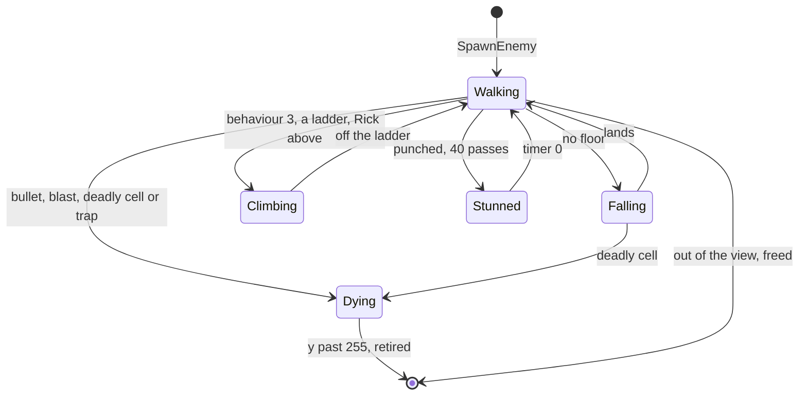

**A worked example: the patrol, measured.**
The enemy at `$7C20` in `rzx-l1-06000-poke` comes from section 5's entry `75 39 8C 8C` (row 57, x 96).
Its +3 `$8C` has bits 2-5 = 3, so +`$13` = (3 + 1) x 8 = 32.
Sampled every 2 frames, its x falls from 130 at frame 0 to 92 at frame 48, where +`$12` reaches 31.
At frame 50 it has turned: x 94, +`$12` = 0.
It then walks right to 146 by frame 116, +`$12` = 26.
One pass is 2 or 3 frames and the step is 2 pixels, so the 32 passes cover 64 pixels.
The patrol length counts passes, not pixels: the pixels are twice +`$13`.

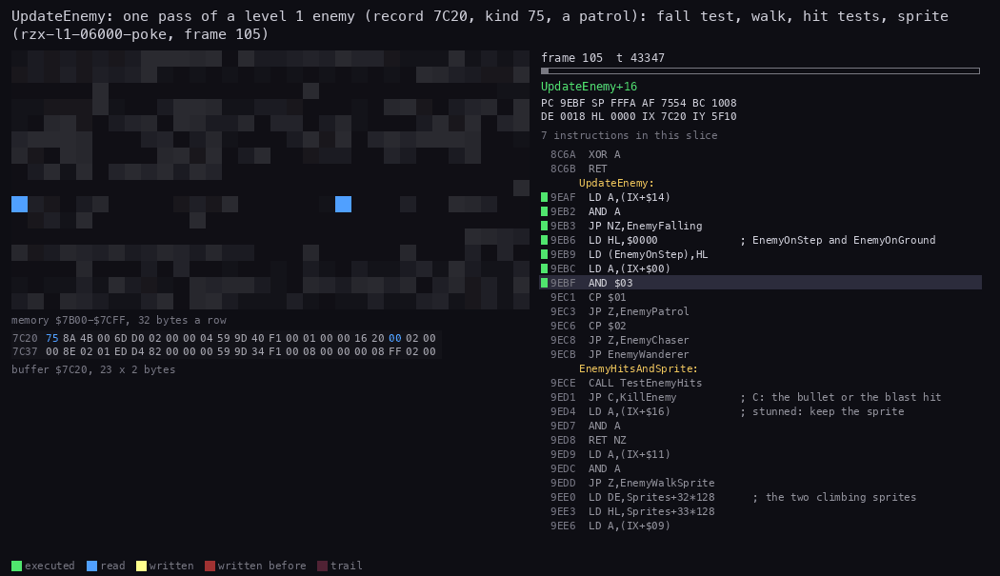

*`rzx-l1-06000-poke` frame 105, T 43 260-48 480, 60 pictures of 87 T: the patrol at `$7C20` for one pass. Top,
`$7B00-$7CFF`; under it the first two records of table B; right, the listing. Made with `python3
../../kit/routine_anim.py --work work/docs/wr/l1p --window 105:43260-105:48480 --listing build/game.lst --out
docs/img/routines/UpdateEnemy.gif --pc 9EAF-A2E0,8BF3-8EA5,8FF9-915F --range 7B00-7CFF --view buffer:7C20:23x2:hex
--pictures 60`.*

How to read it: `EnemyVertical` probes the cells under the feet (`TestBodyBox`), the patrol count goes up by one,
`EnemyWalk` adds the step to x and probes again, then the hit tests and the walk frame.
The point: an enemy pass costs about 5 200 T, with two cell probes in it.

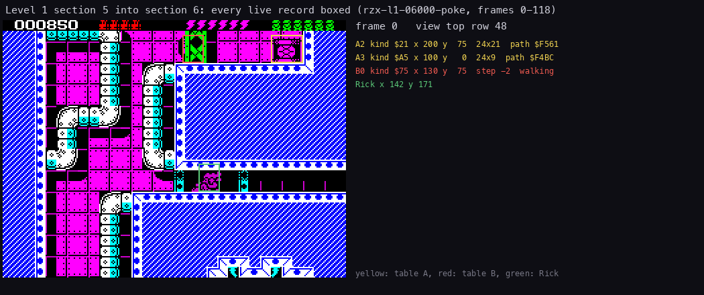

*`rzx-l1-06000-poke` frames 0-118, every 2 frames, read with TTD `memory_at` by `python3 tools/fig_objects.py play
--work work/docs/wr/l1p --from 0 --to 118 --step 2 --title "..." docs/img/play/objects-l1.gif`. Left, the screen with
a box over each live record (yellow table A at its own size, red table B, green Rick, at their 16 x 21 bodies). Right,
the records decoded.*

How to read it: the patrol walks between x 92 and 156 under Rick; at frame 118 Rick enters section 6 and four
treasure-room records replace the old ones.

Witness (the L1 index, `python3 tools/l1q.py`, every recording of case.json and stage 2): `UpdateEnemy` `$9EAF` 52 717
runs in 75 recordings; `EnemyHitsAndSprite` `$9ECE` and so `TestEnemyHits` 49 093 runs in 69 (patrol `$A06E` 27 224,
chaser `$A025` 12 139, wanderer `$9FF7` 9 734; the rest are falling enemies, `$9F8D` 3 620).
Hit by the bullet 43 times (`$8C13`), by the blast 5 (`$8C33`), stunned by a punch 9 (`$8C57`).
An enemy touched Rick 624 times (`$8C67` reached), nearly all in the immunity-POKE recordings, whose POKE replaces that
call; the touch killed him 18 times (`KillRick`'s callers in l1q, [doc 10](10-gameplay-logic.md#107-the-punch)).
A wanderer took a new direction 317 times (`$A021`).

## 7.8 The hit tests

`src/game/collision.asm` holds the tests.
Each returns carry for a hit.
A box is E (x), HL (y, 16 bits), C (width), B (height).

| Test | Address | What against what |
| --- | --- | --- |
| `PunchHits` | `$8C6C` | the punch point in a box |
| `BulletHits` | `$8C8D` | the bullet point in a box |
| `BlastHits` | `$8CAE` | the blast, 24 x 29, overlapping a box |
| `TouchesRick` | `$8D53` | a box overlapping Rick's 16 x 21 body (16 x 16 crawling, 5 lower) |
| `TouchesObject` | `$8DA3` | a box overlapping an enemy's 16 x 21 body |
| `BoxesOverlap` | `$8DDF` | a box overlapping a trap's own box |
| `ProbePoint` | `$8D0C` | a solid trap at a point, else the cell's flags |
| `ProbeGround` | `$8E1C` | what the falling detonator stands on |

The cells' side is `TestBodyBox` `$8FF9`.
It reads `CellFlags` of the 2 or 3 body rows and the feet row under a 16-pixel body at x + 4 into `CollisionFlags`
`$915E`: bit 0 a special surface (the feet row only), 1 solid, 2 floor one can jump up through, 3 ladder, 4 ladder
top, 5 deadly; `TestBoxObjects` adds bit 6, on an object (a platform or block of table A).

```text
TouchesRick(E, HL, C, B):            // carry: overlap
    dx = (RickX + 4) - E
    if dx > 0 and dx >= C: return no
    if dx < 0 and -dx >= 16: return no
    top = RickY + (5 if crawling)
    dy = HL - top
    if dy < 0: return -dy < B and dy > -256    // TouchRickAbove: the box reaches down to his top
    if dy >= 256: return no
    return dy <= (15 if crawling else 20)        // the box's top above his feet
```

```text
8D53  LD A,(RickX)
8D56  ADD A,$04
8D58  SUB E
8D59  JP Z,TouchRickY
8D5C  JP C,TouchRickLeft
8D5F  CP C
8D60  JP C,TouchRickY
8D63  RET
8D64  NEG               ; TouchRickLeft
8D66  CP $10
8D68  RET NC
```

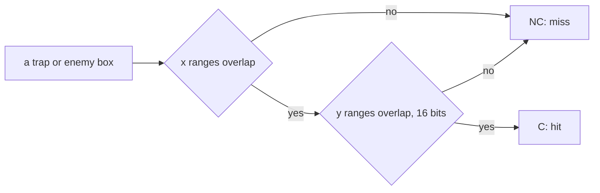

**A worked example.**
At frame 105 the enemy's box is x 138 + 4 = 142, y 75, 16 x 21; Rick stands at x 226 + 4 = 230, y 171 (his record
at frame 103, [doc 06](06-rendering.md#64-the-sprites)).
dx = 230 - 142 = 88, not below 16: no touch, and the y test is not even reached.

The point: every test is two 8-bit compares and one 16-bit subtraction.
The 16-bit y lets the objects live in the 44-row view, above and below the screen.

Witness: `TouchesRick` 37 713 runs from the enemies, 83 559 from the traps, 99 544 from the boxes; `TestBodyBox`
166 811 runs in 65 recordings, the most-run routine in this range.

## 7.9 The random numbers

`Random` `$81AF` mixes `RandomValue` with the 32-bit tick count `Ticks` `$81D0` ([doc 04](04-game-loop.md#46-the-interrupt)).
Only the enemies call it: the wanderer at `$A010` and `$A016`, the chaser at `$A048` and `$A05F`.

```text
Random(A):
    HL = RandomValue + Ticks.low + 13 + Ticks.high + carry
    A = A ^ L ^ D ^ E ^ H; L = A
    RandomValue = HL; return A
```

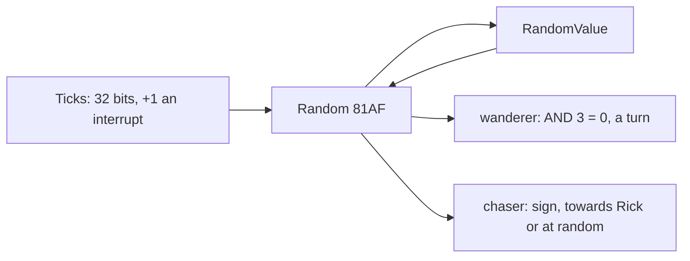

**A worked example.** A wanderer at x 100 (100 AND 15 = 4) asks `Random`.
One time in four the low two bits are 0, and a second call's sign picks +2 or -2.
Since `Ticks` counts interrupts, a replay with the same inputs gets the same turns.

Witness: `Random` 1 569 runs in 27 recordings: 1 233 from the wanderer's turn test (`$A010`), 317 from its direction
(`$A016`: about one in four, as the `AND 3` says), 13 and 6 from the chaser (`$A048`, `$A05F`).

## 7.10 The game variables

| Variable | Address | What |
| --- | --- | --- |
| `Level` | `$7EF1` | 1-5 |
| `Score` | `$7F1D` | six digits, one a byte |
| `TimeBonus` | `$7F17` | the bonus countdown's six digits |
| `Lives` | `$8B3B` | 6 at a new game |
| `Ammunition` | `$8B3C` | bullets, 6 at each level start and death |
| `Detonators` | `$8B3D` | 6 at each level start and death |
| `Level5Open` | `$8065` | set when four levels are done in one game |
| `CheatInfinite`, `CheatExits` | `$8066`, `$8067` | the two cheats ([doc 05](05-controls.md#57-the-cheat-chords)) |
| `ViewTopRow` | `$88CF` | the section row at the view's top |
| `LevelHookOn` | `$8A24` | level 5's Fat Guy: the hits left, 0 off |
| `SectionEntries`, `ScanStart` | `$8B3E`, `$8B40` | the section's map entry list, the scan's start |
| `RickSection` | `$9B93` | the section Rick is in |
| `RestartPoint` | `$9B8C` | where a new life starts |
| `RideMode` | `$945D` | the ride: level 2 section 6, level 4 sections 4-5, level 5 section 2, and the never-recorded exit of level 1 section 2 into section 0 |
| `BonusRunning`, `BonusPrescaler` | `$9BA9`, `$9BAA` | the countdown on, its pass count |
| `RickRecord` | `$9BAB` | Rick's record ([doc 10](10-gameplay-logic.md)) |
| `BulletRecord`, `DetonatorRecord` | `$9BB4`, `$9BBD` | the shots |
| `RandomValue` | `$81CE` | the last random word |

## 7.11 The long levels

The chord (SPACE, N, ENTER, J and Y) sets `CheatExits` only while `Level5Open` is set (`CheatExitsKeys` `$7D4C`):
without level 5 open the chord does nothing ([doc 05](05-controls.md#57-the-cheat-chords)).
With `CheatExits` set, an exit with bit 7 and without bit 4 does not end the level.
Rick walks on into the section in its +2, a hidden part of the map.

| Level | Exit | Without the cheat | With the cheat |
| --- | --- | --- | --- |
| 1 | section 1 right, row 23, `$92` | the end | the end (bit 4) |
| 2 | section 7 right, row 27, `$82` | the end | section 10 (hidden sections 10-12) |
| 2 | section 12, `$91` | | the end of the long level |
| 3 | section 6, `$82` | the end | the hidden sections 7-9 |
| 3 | section 9, `$92` | | the end of the long level |
| 4 | section 7, `$82` | the end | the hidden sections 10-12 |
| 4 | section 10, `$92` | | the end of the long level |
| 5 | section 7, `$92` | the end | the end |

The hidden maps are the enciphered 768 bytes of each level ([doc 03](03-build-and-load.md)): level 2's section 10,
level 3's section 7 and level 4's section 10 all start at the maps' base + `$600`.

The point: the long levels are in every copy of the game, behind a chord on the keyboard.

## 7.12 Known only from the code

- A pickup box burst by the blast (`$A5F7`): no recording runs it (the bullet's branch: `box-shot`, 7.6).
- A deadly solid block (+0 bits 6 and 7) setting off a lit detonator (`$A41C`, fuse 10 or more): not run.
- `DispatchByKind` `$917D` and its handler table: an earlier design; nothing jumps there.
- `EnemyAnimScripts` `$9D59`: written into every enemy, read by nothing.
- `EnemyLandLevel5` `$A1AE` and the enemy animation steps 1 and 4 (`$9F32`, `$9F3B`): not run.
- The sections' exits no recording took: level 1 section 2's exit into section 0 at row `$4A`, below section 0's
  32 rows.
