# 8. HUD and text

What this covers:

- the one font: 40 glyphs of 8 x 8 at `Glyphs` `$7080`, and how a text names them;
- the HUD row: the score, the detonators, the bolts, the lives, and the routines that draw them;
- the score: `AddScore` `$7ED3`, the points records, the bonus countdown;
- the two ways a text reaches the screen: `PrintText` `$7F23` straight on the screen, and the falling letters
  (`DropText` `$82BD`) through the view buffer;
- every string of the game, the menus' and the two endings'.

The recordings it rests on ([WALKTHROUGH 6.0](../WALKTHROUGH.md#60-the-recordings); all 128K):

| Recording | Load | Used for |
| --- | --- | --- |
| `controls-keyboard` | `work/stage1/lab/e1-end.szx` (the control menu after side A), `tests/inputs/controls-keyboard.txt` | the level menu's letters (frames 112-328: `letters.gif`, `MoveLetters.gif`), the level start (frames 324-326: `writers-start.png`), GAME OVER (frames 1430-1600) |
| `rzx-l1-06000-poke` | the RZX run's level 1 state at RZX frame 6000, its key reads as an input script, four immunity POKEs | a treasure's 500 points (frame 259: `AddScore.gif`), the HUD at frame 300 (`hud.png`) |
| `rzx-l5-23000`, `end-congrats` | the RZX run's ending; its level 4 end with `LevelsDone` = 0 | the two endings' texts (stage 1 and 2 screenshots) |

## 8.1 The font

The game has one font.
`Glyphs` `$7080` holds 40 glyphs of 8 bytes: the digits 0-9, the bolt, the detonator, Rick's head, the letters A-Z,
and a blank.
The HUD draws them by number.
The texts name them by byte: glyph + `$34`.

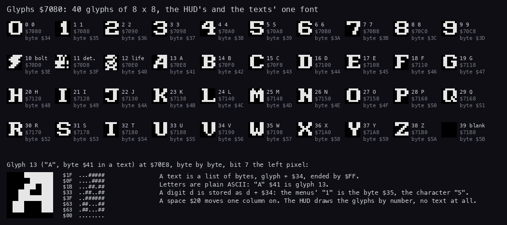

*Drawn by `python3 tools/fig_hud.py font docs/img/hud/font.png` from `build/game.bin` (the image from `$7080`). Each
glyph with its number, its address and the byte a text stores for it; under them glyph 13, "A", bit by bit.*

So a letter is plain ASCII: "A" is `$41`, glyph `$41` - `$34` = 13.
A digit is not: "0" is glyph 0, so a text stores it as `$34`, the character "4".
That is why the menus' bytes read "5   KEYBOARD" for "1   KEYBOARD".
A space `$20` moves one column on, and `$FF` ends a text.

```text
glyph(byte) = byte - 34          // A..Z: 0D..26, digits: 34..3D -> 0..9
address(byte) = 7080 + 8 x glyph(byte)
```

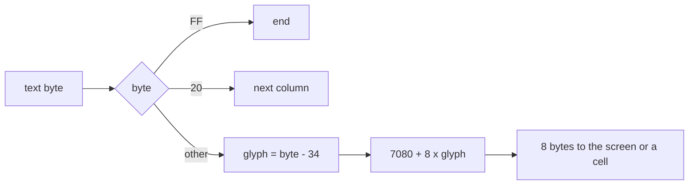

**A worked example.** The level menu's first level line at `$7FD4` + 13 is `35 20 20 48 59 44 45 ...`.
`$35` is glyph 1, the digit "1"; two spaces; `$48` is glyph 20, "H"; `$59` glyph 37, "Y".
On the screen: "1  HYDE PARK LONDON".

The point: one 320-byte font serves the HUD, the menus, the tape messages and the endings.
The game has no separate text renderer for the menus: the letters are cells like the level's (8.5).

## 8.2 The HUD

The HUD is screen row 0: 32 cells, 8 pixel lines.

| Columns | What | Variable | Attribute | Drawn by |
| --- | --- | --- | --- | --- |
| 1-6 | the score, six digits | `Score` `$7F1D` | `$47` white | `DrawScore` `$7A0C` |
| 9-14 | up to six detonators | `Detonators` `$8B3D` | `$42` red | `DrawDetonators` `$79DF` |
| 17-22 | up to six bolts | `Ammunition` `$8B3C` | `$43` magenta | `DrawAmmo` `$79D1` |
| 25-30 | up to six lives | `Lives` `$8B3B` | `$44` green | `DrawLives` `$79C3` |

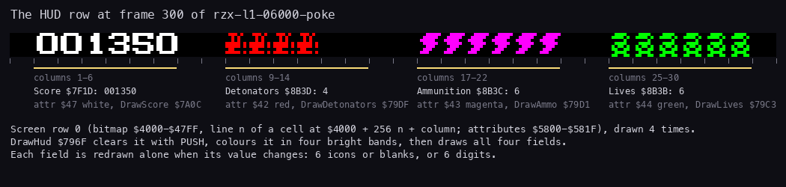

*`rzx-l1-06000-poke` frame 300, read with TTD `memory_at` by `python3 tools/fig_hud.py hud --work work/docs/wr/l1p
--at 300 docs/img/hud/hud.png`. Screen row 0 drawn 4 times, each field's columns and the variable behind it. This run's
POKEs keep the detonators at 4.*

`DrawHud` `$796F` draws the whole row:

1. With the interrupts off, SP set to `$4020`, and 16 `PUSH DE` of zero per pixel line, it clears the row's 8 lines.
2. It fills the 32 attributes in four bands: `$47` to column 6, `$42` to 14, `$43` to 22, `$44` to 31.
3. It calls `DrawDetonators`, `DrawAmmo`, `DrawLives`, `DrawScore`.

The game calls the four field routines alone when one value changes.
A field of icons is `DrawIconRow` `$79ED`: B copies of the icon, then 6 - B blanks.
A score digit is `DrawGlyph` `$7A2C`: 8 `LDI`, each followed by `DEC DE` / `INC D`, one pixel line down.

```text
DrawHud():
    DI; for line in 0..7: 32 bytes of screen row 0, line 'line' = 0 (16 PUSH)   EI
    attrs[0..6] = 47; attrs[7..14] = 42; attrs[15..22] = 43; attrs[23..31] = 44
    DrawIconRow(Detonators, GlyphDetonator, column 9)
    DrawIconRow(Ammunition, GlyphBolt, column 17)
    DrawIconRow(Lives, GlyphLife, column 25)
    DrawScore()

DrawIconRow(B, icon, column):
    draw icon B times from column; draw BlankGlyph 6 - B times
```

```text
796F  DI
7970  LD (ClearHudEnd+$0001),SP
7974  LD HL,Screen+32
7977  LD B,$08
7979  LD DE,$0000
797C  LD SP,HL          ; ClearHudLoop: SP at the end of a line
797D  PUSH DE           ; ... 16 of them: 32 bytes
798D  INC H             ; the next pixel line
798E  DJNZ ClearHudLoop
7990  LD SP,$0000       ; the caller's SP, stored at 7970
7993  EI
7994  LD HL,ScreenAttrs
7997  LD DE,ScreenAttrs+1
799A  LD (HL),$47
799C  LD BC,$0007
799F  LDIR
79A1  LD (HL),$42       ; overwrites column 7, then 8 more
79A3  LD BC,$0008
79A6  LDIR
```

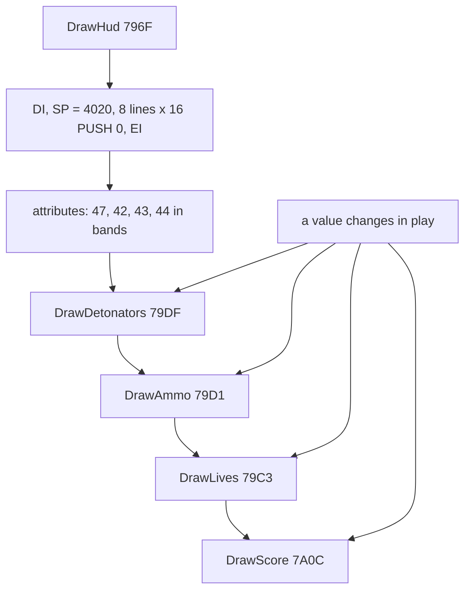

**A worked example: the level start.**
In `controls-keyboard` the key 1 picks level 1 at frame 320.
`DrawHud` runs at frame 324 T 67 127, then the full redraw `$7965` at frame 325 T 11 635.

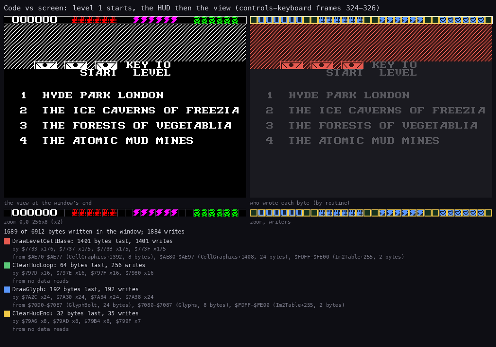

*`controls-keyboard` frames 324-326: who wrote each screen byte. `ClearHudLoop` cleared the HUD row with `PUSH`, `ClearHudEnd` and `DrawGlyph` drew its 24 glyphs
(192 bytes), and `DrawLevelCellBase` drew the level's first rows (1 401 bytes) under the menu text that is still on
the screen. Made with `python3 ../../kit/writers_map.py --work work/docs/wr/ckb --window 324:60000-327:0 --listing
build/game.lst --out docs/img/hud/writers-start.png --sources --zoom 0,0,256,8`.*

How to read it: the HUD row is written in one go, by two writers; the view below it is written over the next frames.
The point: the HUD is the only part of the screen not drawn through `DirtyMap`.
`DrawChangedCells` never touches row 0 ([doc 06](06-rendering.md#67-the-hud)).

Witness: `DrawHud` 98 runs in 44 recordings; `DrawGlyph` 4 852 runs in 65.

A count above 6 would draw 256 - (B - 6) blanks.
The game never lets one pass 6: every pickup sets 6, every use takes one off.

## 8.3 The score

`Score` `$7F1D` is six bytes, one decimal digit each, the most significant first.
Every amount is a record of the same form, and `AddScore` `$7ED3` adds one.

| Record | Address | Value | Added for |
| --- | --- | --- | --- |
| `Points50` | `$7EF3` | 000050 | an enemy killed (`KillEnemy`), and a blast kill once more (`$8C36`) |
| `Points100` | `$7EF9` | 000100 | nothing: no code loads its address |
| `Points500` | `$7EFF` | 000500 | a treasure |
| `Points5000` | `$7F05` | 005000 | the Fat Guy's last hit (`FatGuyHit` `$F964`), and each bullet left at his end (`TallyBullets` `$86F4`) |
| `Points10000` | `$7F0B` | 010000 | each detonator left at the Fat Guy's end |
| `Points100000` | `$7F11` | 100000 | the Fat Guy's end, once (`BonusTally` `$86E3`), and each life left there (`TallyLives` `$8736`) |
| `TimeBonus` | `$7F17` | digits 2-4 set to 2, 0, 0 at its start | the bonus countdown, collected at its stop mark |

```text
AddScore(record at HL):
    carry = 0
    for i = 5 down to 0:
        d = Score[i] + record[i] + carry
        if d >= 10: d -= 10; carry = 1 else carry = 0
        Score[i] = d
    DrawScore()
```

```text
7ED3  LD BC,$0005
7ED6  ADD HL,BC         ; HL at the record's last digit (carry 0)
7ED7  LD DE,Score+$0005
7EDA  LD B,$06
7EDC  LD A,(DE)         ; AddScoreLoop
7EDD  ADC A,(HL)
7EDE  CP $0A
7EE0  JP C,AddScoreDigit
7EE3  SUB $0A
7EE5  SCF
7EE6  CCF               ; carry clear here
7EE7  CCF               ; AddScoreDigit: the carry turned over
7EE8  LD (DE),A
7EE9  DEC DE
7EEA  DEC HL
7EEB  DJNZ AddScoreLoop
7EED  CALL DrawScore
```

The carry dance: `CP $0A` sets carry when the digit is below 10, so `CCF` clears it.
A digit of 10 or more has 10 taken off, carry cleared by `SCF` / `CCF`, then set by the second `CCF`.

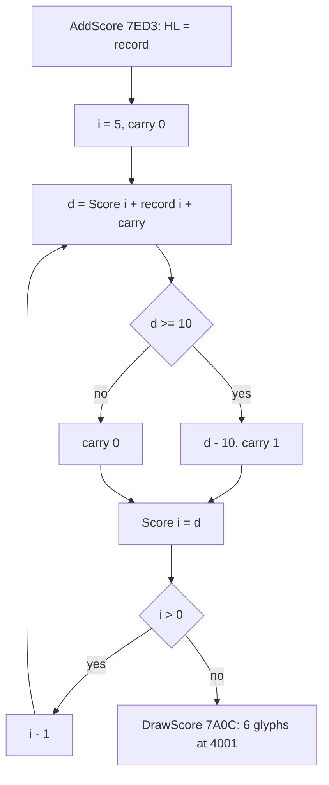

**A worked example: a treasure.**
In `rzx-l1-06000-poke` Rick takes the treasure at `$7BD7` in frame 259 (`UpdatePickup` at T 49 208).
`AddScore` runs at T 50 782 with HL = `Points500`, `00 00 00 05 00 00`.
The score was `00 00 00 08 05 00`, 850.
From the right: 0 + 0 = 0; 5 + 0 = 5; 8 + 5 = 13, so 3 with a carry; 0 + 0 + 1 = 1; then 0, 0.
The score becomes `00 00 01 03 05 00`, 1 350, and `DrawScore` at T 51 455 redraws all six digits.

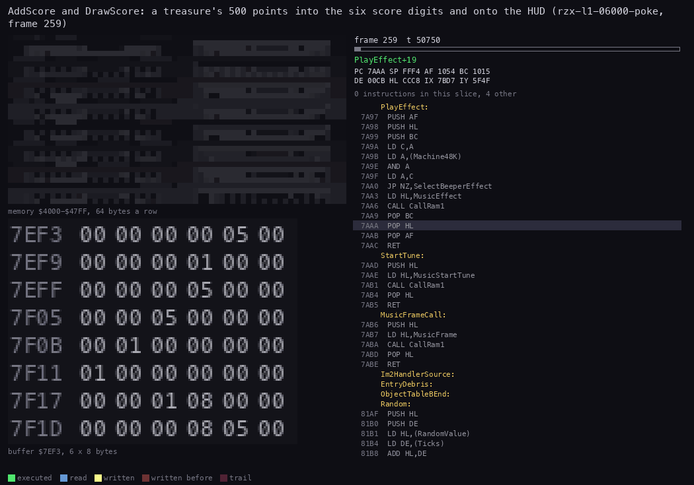

*`rzx-l1-06000-poke` frame 259, T 50 700-53 200, 50 pictures of 50 T. Top, the screen bitmap `$4000-$47FF` (the
HUD's lines are the first 32 bytes of each 256-byte row); under it `$7EF3-$7F22` as numbers, 6 a line: the points
records, `TimeBonus`, `Score`; right, the listing. Made with `python3 ../../kit/routine_anim.py --work
work/docs/wr/l1p --window 259:50700-259:53200 --listing build/game.lst --out docs/img/routines/AddScore.gif --pc
7ED3-7EF2,7A0C-7A40 --range 4000-47FF --view buffer:7EF3:6x8:hex --pictures 50`.*

How to read it: the score line's digits change right to left, then the first byte of eight screen rows lights up
six times, one glyph a column.
The point: `DrawScore` redraws all six digits for any change, 48 screen bytes, even when one digit moved.

Witness: `AddScore` 149 runs in 47 recordings: `KillEnemy` 101, a treasure 28, the bonus 9, a blast 5, the end
tally 5, level 5's Fat Guy once.

### The bonus countdown

A map entry of kind `$78` starts a countdown and one of kind `$7C` stops it ([doc 07](07-objects.md#75-the-spawner)).
The start runs only when no countdown runs (`$9CAF`).
It writes digits 2-4 of `TimeBonus` (`$7F19-$7F1B`) with 2, 0 and 0, sets `BonusPrescaler` `$9BAA` to 25 and
`BonusRunning` `$9BA9` to `$FF`, and plays tune 1.
Digits 0, 1 and 5 keep what they held: 0 from the load, so the bonus reads 002000, unless an earlier countdown wrapped
(below).
Every pass `CountBonus` `$9163` counts the prescaler down; at 0 it takes 1 off the tens digit, borrowing.
So the bonus loses 10 points every 25 passes.
The stop runs only while a countdown runs (`$9CCE`): it clears `BonusRunning`, adds what is left to the score and
plays tune 1 again; the digits stay as they are.

```text
CountBonus():                      // each pass while BonusRunning
    BonusPrescaler -= 1; if not 0: return
    BonusPrescaler = 25
    for digit in TimeBonus[4], [3], [2], [1]:   // tens up to ten-thousands
        digit -= 1; if digit >= 0: return
        digit = 9                               // borrow
    // all four wrapped: BonusRunOut, a lone RET; BonusRunning stays $FF, so the count goes on

StartBonusTimer():                 // a kind $78 entry
    if BonusRunning: return
    BonusRunning = $FF; BonusPrescaler = 25
    TimeBonus[2], [3], [4] = 2, 0, 0            // [0], [1], [5] untouched
    StartTune(1)

StopBonusTimer():                  // a kind $7C entry
    if not BonusRunning: return
    BonusRunning = 0; AddScore(TimeBonus); StartTune(1)
```

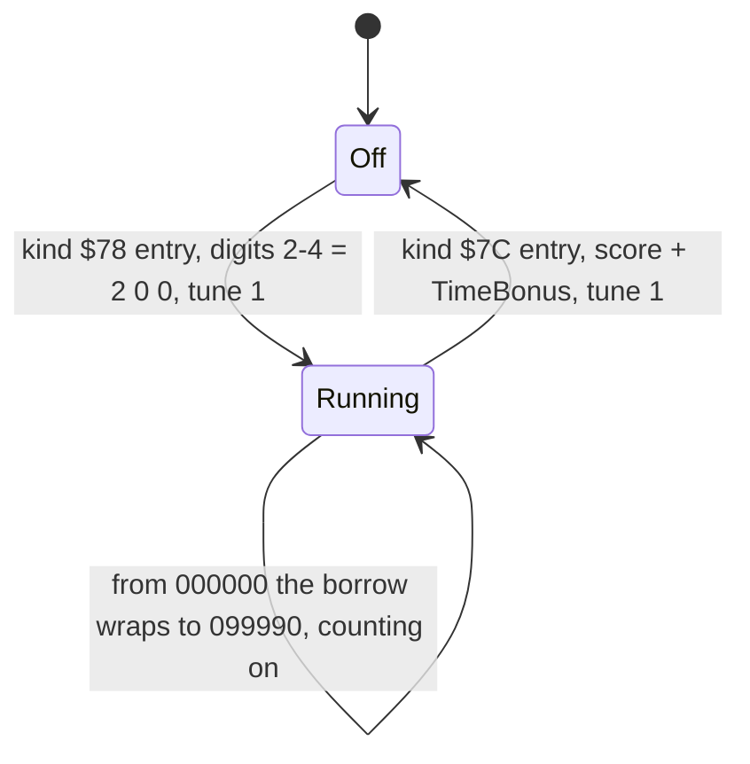

**A worked example.** 2 000 points at 10 a step is 200 steps of 25 passes: 5 000 passes.
A pass takes two frames or more ([doc 04](04-game-loop.md)), so that is at least 10 000 frames, over 3 minutes.
The HUD never shows the countdown; only the final addition is seen.

Witness: `CountBonus` 12 127 runs in 29 recordings; a start 18 times, a stop 19.
The bonus never ran out in any recording.
From the code: from 000000 the borrow wraps to 099990 and the countdown goes on (nothing clears `BonusRunning`), so a
stop reached late pays up to 99 990.
Digit 1 (`$7F18`) then stays 9 for the rest of the game: no code but the loader writes it, so every later start reads
092000.

## 8.4 PrintText: a text straight on the screen

`PrintText` `$7F23` draws a text at a screen address, one glyph a column, with `DrawGlyph`.

```text
PrintText(HL = text, DE = screen address):
    loop:
        c = *HL; if c == FF: return
        HL += 1
        if c != 20: DrawGlyph(7080 + 8 x (c - 34), DE)
        DE += 1
```

```text
7F23  LD A,(HL)
7F24  CP $FF
7F26  RET Z
7F27  INC HL
7F28  CP $20
7F2A  JP Z,PrintTextNext
7F2D  PUSH HL
7F2E  SUB $34
7F30  LD L,A
7F31  LD H,$00
7F33  ADD HL,HL
7F34  ADD HL,HL
7F35  ADD HL,HL
7F36  LD BC,Glyphs
7F39  ADD HL,BC
7F3A  PUSH DE
7F3B  CALL DrawGlyph
7F3E  POP DE
7F3F  POP HL
7F40  INC DE            ; PrintTextNext: the next column
7F41  JP PrintText
```

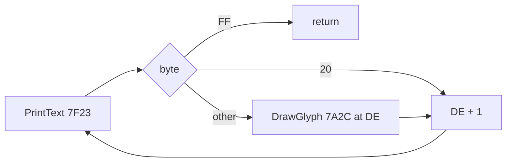

It prints only two kinds of text: the tape messages of the level loader ("START TAPE ON SIDE TWO", "STOP TAPE AND PRESS
FIRE", [doc 03](03-build-and-load.md)) and GAME OVER's second form at `$488B`.
The attributes are whatever is there; the loader clears them first, GAME OVER sets a 12 x 3 box to `$47`.

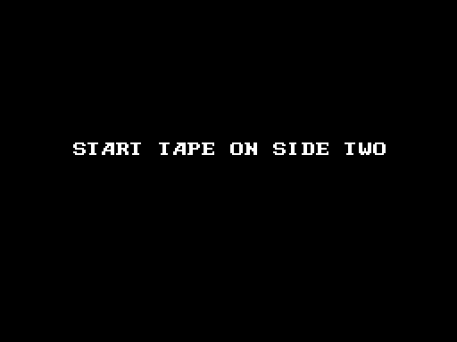

*The level loader's request, printed by `PrintText` (WALKTHROUGH 6.1).*

**A worked example.** GAME OVER prints "GAME  OVER" at `$488B`: screen third 1, line 0, row 12 (`$488B` AND `$E0`
= `$80`, so row 8 + 4), column 11.
The first byte `$47` is glyph 19, "G", drawn at `$488B`, `$498B`, ..., `$4F8B`.

The point: `PrintText` writes the screen directly, so its text stays until something draws the cells again.

Witness: `PrintText` `$7F23` ran for every tape message and for each GAME OVER in the recordings.

## 8.5 The falling letters

Every menu and ending text falls into place, letter by letter, and bounces.
The letters are not sprites drawn on the screen: they are records like the objects', composed into spare cells.

`DropText` `$82BD` takes a text (HL), its pixel row (D), its column (E), and A = `$FF` to animate.

1. `BuildLetters` `$8258` writes one 8-byte record a letter at `$7B8F`, over table A's place, `$FF` after the last.
2. Each frame `MoveLetters` `$81E6` moves every letter and composes it (`ComposeLetter` `$8321`), then
   `DrawChangedCells` puts the frame on the screen.
3. `ReadMenuKey` is read each frame: a number key ends the fall at once.
4. When every letter's delay and speed high byte are 0, `PutTextCells` `$82A1` writes the text's glyph numbers into
   `ViewCells` and the cells are drawn for good.

A letter's record:

| Byte | What |
| --- | --- |
| +0 | the glyph |
| +1 | the column |
| +2/+3 | y: +2 the pixel row, +3 its fraction |
| +4/+5 | the speed, 8.8 pixels a frame (+4 the fraction) |
| +6 | the delay in frames: 1 for the first letter, 6 more for each character after it, spaces too |
| +7 | the row it stops at |

A letter starts at row 64 with speed 9.0 pixels a frame down.
Each frame the speed gains `$60`, 0.375; past its row it is put on the row and its speed becomes minus half.
A bounce too slow to leave the row (the new speed's high byte 0 or `$FF`) stops it.

```text
MoveLetter(r):
    if r.delay: r.delay -= 1; if r.delay: return
    r.speed += 0.375
    y = r.y + r.speed
    if y >= r.stop:                         // the row reached
        y = r.stop
        r.speed = -r.speed / 2
        if high byte of r.speed is 0 or FF: r.speed = 0
    r.y = y
```

```text
8203  LD A,(IX+$06)     ; the delay
8206  AND A
8207  JP Z,LetterFall
820A  DEC (IX+$06)
820D  RET NZ
820E  LD E,(IX+$04)     ; LetterFall: speed + gravity, y + speed
8211  LD D,(IX+$05)
8214  LD HL,$0060
8217  ADD HL,DE
8218  LD (IX+$04),L
821B  LD (IX+$05),H
821E  LD E,(IX+$03)
8221  LD D,(IX+$02)
8224  LD A,(IX+$07)
8227  ADD HL,DE
8228  CP H
8229  JP NC,LetterStoreY ; still above its row
822C  LD H,A            ; on the row
822D  LD L,$00
822F  LD A,(IX+$04)     ; speed = -speed ...
8232  CPL
8233  LD E,A
8234  LD A,(IX+$05)
8237  CPL
8238  LD D,A
8239  INC DE
823A  SRA D             ; ... / 2
823C  RR E
```

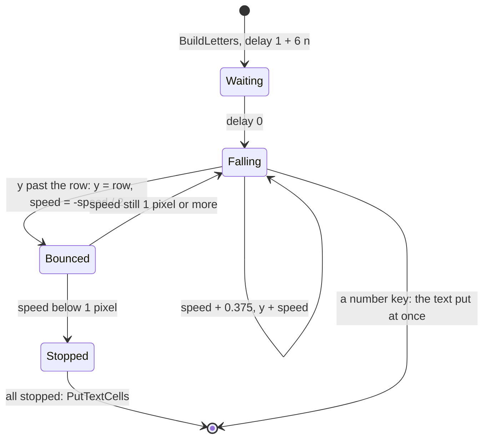

**A worked example: the P of "PRESS KEY TO".**
In `controls-keyboard` the level menu's records appear at frame 118: P is `1C 0A 49 60 60 09 00 70`.
Glyph `$1C` is 28, "P"; column 10; y 73.4; speed 9.375; delay 0; it stops at row `$70`, 112.

| Frame | y | Speed | Moves since the build (y 64.0, speed +9.0) |
| --- | --- | --- | --- |
| 118 | 73.4 | +9.375 | 1 |
| 120 | 103.8 | +10.500 | 4: 9.75 and 10.125 between, so three moves in two frames |
| 121 | 112.0 | -5.438: the bounce, -10.875 / 2 | 5 |
| 135 | 75.3 | -0.188: the top, 37 pixels up | |
| 149 | 112.0 | +5.062: the second landing | |

A move is one pass of `DropTextWait`, not one frame: between frames 118 and 120 three passes ran.
Which pass of those frames found its one-count frame wait already over is not traced here; from frame 120 on the
rows fit one move a frame.

Each bounce is half as fast and a quarter as high: 37 pixels, then about 9, then 2.
The "O" of "TO" is character 11 counted from 0 (the spaces count too), so it starts 1 + 6 x 11 = 67 frames after
BuildLetters.

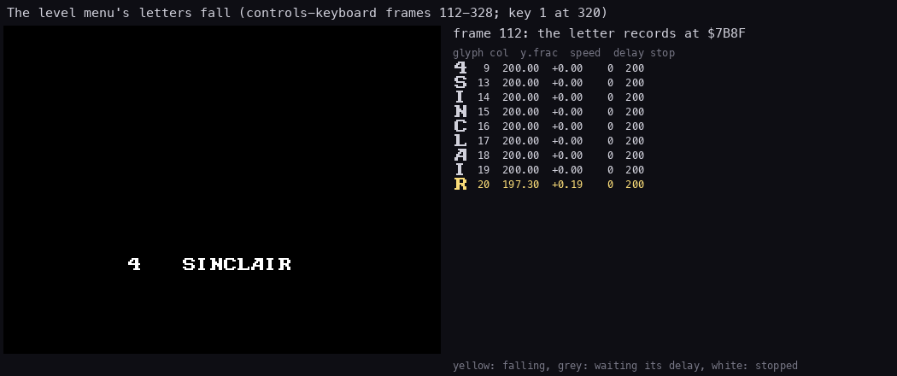

*`controls-keyboard` frames 112-328, every 3 frames, read with TTD `memory_at` by `python3 tools/fig_hud.py letters
--work work/docs/wr/ckb --from 112 --to 328 --step 3 --title "..." docs/img/play/letters.gif`. Left, the screen;
right, the letter records at `$7B8F` (yellow falling, grey waiting, white stopped). At frame 320 the key 1 cuts the
fall short, and the rest of the menu is put at once.*

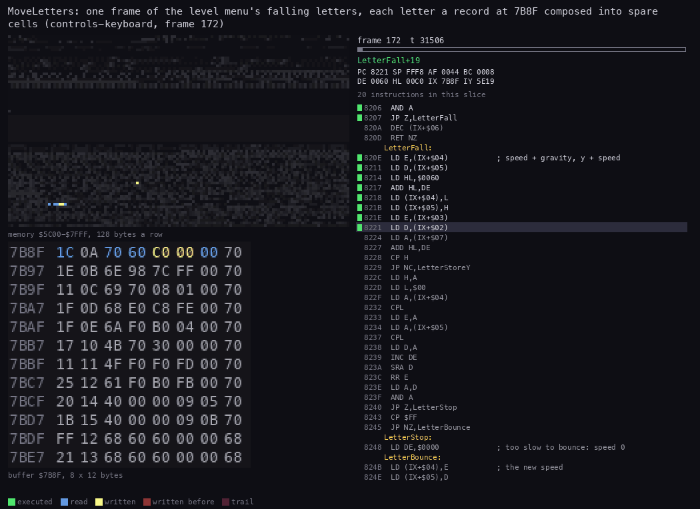

*`controls-keyboard` frame 172, T 31 240-49 800, 70 pictures of 266 T: one call of `MoveLetters`. Top, `$5C00-$7FFF`
(the spare cells at `$5E00`, `DirtyMap`, `ViewCells`, the records at `$7B8F`); under it the first 12 letter records;
right, the listing. Made with `python3 ../../kit/routine_anim.py --work work/docs/wr/ckb --window
172:31240-172:49800 --listing build/game.lst --out docs/img/routines/MoveLetters.gif --pc 81E6-8373 --range
5C00-7FFF --view buffer:7B8F:8x12:hex --pictures 70`.*

How to read it: each record is read, its y and speed rewritten, then its cells copied into spare cells and the glyph
ORed in, one row of 8 at a time.
The point: a frame of falling letters costs about 18 500 T, a quarter of a frame, for 10 letters.

Witness: `MoveLetter` 57 671 runs in 12 recordings; `BuildLetters` 41; `DropText` 97 (the level menu, the control
menu, GAME OVER, the end texts).

## 8.6 Every string

The texts are in `src/res/texts` ([their format](../src/res/texts/README.md)).

| Text | Address | Where it shows | How |
| --- | --- | --- | --- |
| "GAME  OVER" | `$7EC8` | the view at row `$A0`, column 11, then the screen at `$488B` | `DropText`, `PrintText` |
| "PRESS KEY TO", "START  LEVEL" | `$7FC7`, `$7FD4` | the level menu, rows `$70` and `$78`, column 10 | `DropText` |
| the five level names | `$7FE1` on | rows `$90`-`$D0`, column 2; the fifth only with `Level5Open` | `DropText` |
| "0   START GAME", the four methods | `$8159` on | the control menu, rows `$80`-`$C8`, column 9 | `DropText` |
| "RICK DANGEROUS II" | after them | the control menu, row `$68`, column 7 | `DropText` |
| "START TAPE ON SIDE TWO", "STOP TAPE AND PRESS FIRE" | `$843A` | the level loader | `PrintText` |
| the CONGRATULATIONS end | `$87A0` | six lines | `DropText` per line |
| the Fat Guy's end | `$883D` | four lines | `DropText` per line |

The five level names, as the game spells them:

1. HYDE PARK LONDON
2. THE ICE CAVERNS OF FREEZIA
3. THE FORESTS OF VEGETABLIA
4. THE ATOMIC MUD MINES
5. THE FAT GUYS HEADQUARTERS

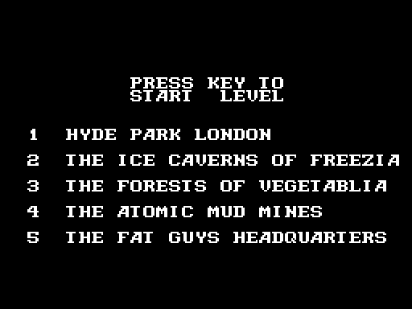

*The level menu with level 5 open (WALKTHROUGH 6.1).*

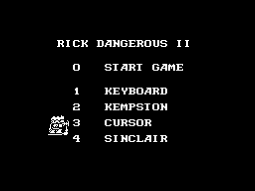

*The control menu (WALKTHROUGH 6.1); its pointer is in [doc 05](05-controls.md#55-the-menus).*

## 8.7 The endings' texts

An end text is a list of records: a column, a pixel row, the text, `$FF`.
A record starting with `$FF` ends the list.
`ShowEndText` `$8763` clears the view, draws the HUD, and drops each line in turn with `DropText`.
Then the screen waits 2 500 frames or fire, and goes through GAME OVER to the control menu.

The CONGRATULATIONS end (`$87A0`), shown when level 4 is done with level 5 closed, or level 5 in a game that did not
start at level 1:

| Column | Row | Text |
| --- | --- | --- |
| 8 | `$70` | CONGRATULATIONS |
| 3 | `$80` | YOU HAVE COMPLETED LEVEL 5 |
| 2 | `$90` | HOWEVER TO COMPLETE THE GAME |
| 1 | `$A0` | PROPERLY YOU MUST COMPLETE ALL |
| 2 | `$B0` | LEVELS IN ONE GAME STARTING |
| 10 | `$C0` | FROM LEVEL 1 |

`Congratulations` `$8754` writes the level + `$34` into the "5" at `$87CD`, so it reads "LEVEL 4" after level 4.

The Fat Guy's end (`$883D`), after `BonusTally` and `TallyLives` ([doc 10](10-gameplay-logic.md)):

| Column | Row | Text |
| --- | --- | --- |
| 4 | `$78` | AND SO RICK SAVES THE DAY |
| 2 | `$88` | BY DEFEATING THE FAT GUY AND |
| 2 | `$98` | HIS FLEET OF ROBOT STARSHIPS |
| 5 | `$B8` | WHAT WILL RICK DO NEXT |

```text
ShowEndText(list):
    FontCellsMode(); DrawHud()
    for record in list until FF:
        DropText(record.text, row = record.row, column = record.column, animate)
    wait 2500 frames or fire
    GameOver()
```

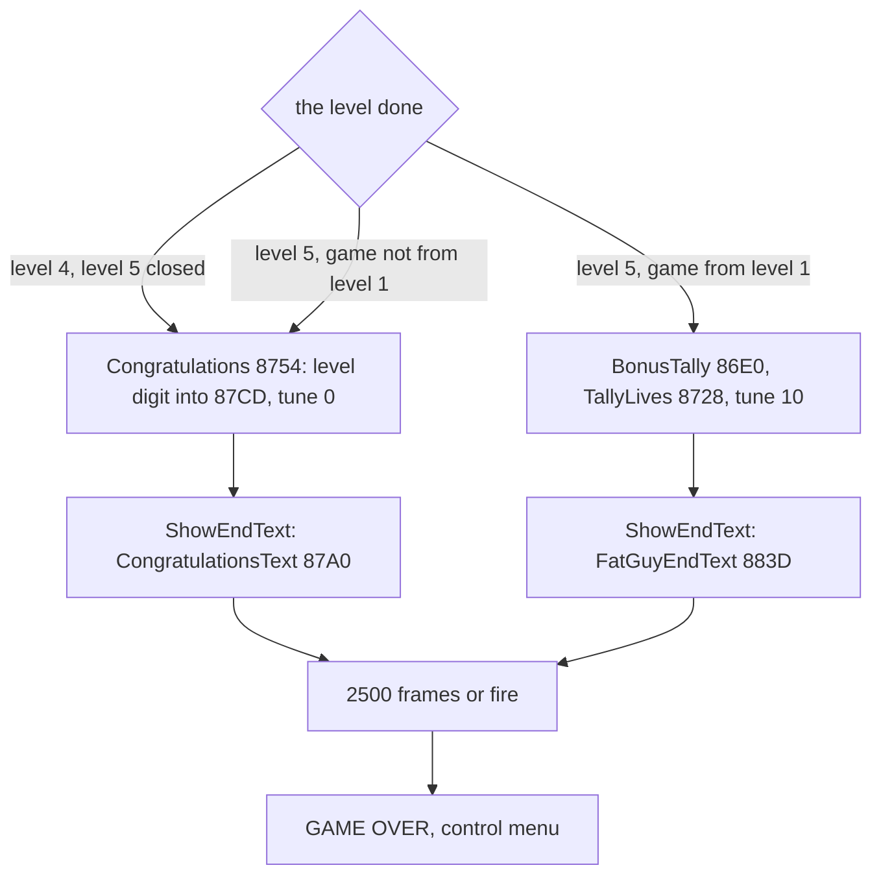

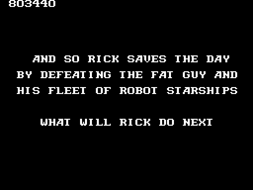

*The end of `rzx-l5-23000`: the four lines in place (WALKTHROUGH 6.1).*

**A worked example: the first line of the Fat Guy's end.**
The list at `$883D` starts `04 78 41 4E 44 20 53 4F ...`.
Column 4, row `$78` (120, cell row 15), then "AND SO ...".
The line has 25 characters, 5 of them spaces.
`DropText` builds 20 letter records (a space gets no record but still moves the column and adds 6 to the delay),
so the last "Y", character 24, starts 1 + 6 x 24 = 145 frames late.

The GAME OVER screen falls the same way:

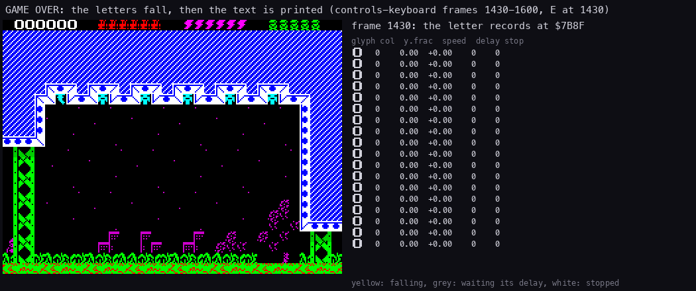

*`controls-keyboard` frames 1430-1600, every 3 frames, by `python3 tools/fig_hud.py letters --work work/docs/wr/ckb
--from 1430 --to 1600 --step 3 --title "..." docs/img/play/game-over-letters.gif`. E at 1430; the eight letters fall
over the level into row `$A0`, take the cells' colours, and when all have stopped the text is put into the cells and
printed at `$488B`.*

How to read it: the letters land one after the other, 6 frames apart; when the last bounce is under a pixel, the
text snaps into place.
The point: the game ends with the same code that draws its menus.

Witness: `ShowEndTextLoop` 6 runs (`rzx-l5-23000` 5, `rzx-l5-24000-poke` 1); `Congratulations` only in `end-congrats`;
GAME OVER 4 runs (`c1`, `controls-keyboard`, `rzx-l5-full` twice).

## 8.8 Known only from the code

- `Points100` `$7EF9`: no code loads its address.
- The bonus running out: the wrap to 099990, the countdown going on, and digit 1 left at 9 for the next start.
- A HUD count above 6 (256 - (B - 6) blanks): no code lets a count pass 6.
- `LoadError` `$852A` into "STOP TAPE AND PRESS FIRE": a load error was never seen.
