# 9. Sound

What this covers:

- the two sound engines behind one interface: the AY player in RAM 1 on a 128K, the beeper on a 48K;
- the RAM 1 player: its data (tunes, order lists, patterns, instruments, ornaments, effects), the sequencer, the
  voices and their software envelopes, the registers it writes each interrupt;
- one tune decoded by hand, byte by byte;
- the 28 AY effects, the game's calls, the traps' calls from the level data, and why no effect is heard while a
  level's tune plays;
- the 11 beeper effects of the 48K, and what the screen's contention does to their pitch;
- the audio renders in [`docs/audio/`](audio/), made from the real code (never played here).

The recordings it rests on ([WALKTHROUGH 6.0](../WALKTHROUGH.md#60-the-recordings)):

| Recording | Load | Used for |
| --- | --- | --- |
| `controls-keyboard` | `work/stage1/lab/e1-end.szx` (the control menu after side A), `tests/inputs/controls-keyboard.txt` | level 1's tune from its start (frame 323, T 8910): the model checked over 58 interrupts |
| `c1` | 128K power-on, side A at ROM speed, `tests/inputs/c1.txt` | effects 0, 4, 5 and 10 on the AY (frames 17 440-17 539): the model checked over 76 interrupts, `MusicFrame.gif`, `UpdateVoices.gif` |
| `c48` | 48K power-on, side A at ROM speed (stage 2, `work/stage2/rec/c48/session.ttd`, 19 571 frames) | the beeper: the note pointer sampled over the whole play, the death effect traced (frames 16 972-17 011), `beeper-contention.png`, `beeper-death-c48.wav` |

The tool is [`tools/fig_sound.py`](../tools/fig_sound.py).
It runs `build/music.bin` at `$C000` and `build/game.bin` at `$7080` in the kit's Z80 simulator (SkoolKit), catches
the `OUT` writes, and renders them.
Its `check` command replays a recording's trace on the model and compares each interrupt's sound.

## 9.1 Two engines, one interface

The game asks for sound in only three ways.

- `StartTune` `$7AAD`: start tune A.
- `PlayEffect` `$7A97`: start effect A.
- `MusicFrameCall` `$7AB6`: one frame of the player, from the IM 2 handler.

All three go through `CallRam1` `$7A77`.
It pages RAM 1 in at `$C000`, calls the routine in HL with A, and pages RAM 0 back.
On a 48K the entry code sets `Machine48K` `$7A76`, and `CallRam1` returns at once.
`PlayEffect` then takes the other branch: `SelectBeeperEffect` `$7ADA` points the beeper's note pointer at effect A.
The main loop calls `PlayBeeperStep` `$7B66` once a pass, and on a 48K that plays one note.

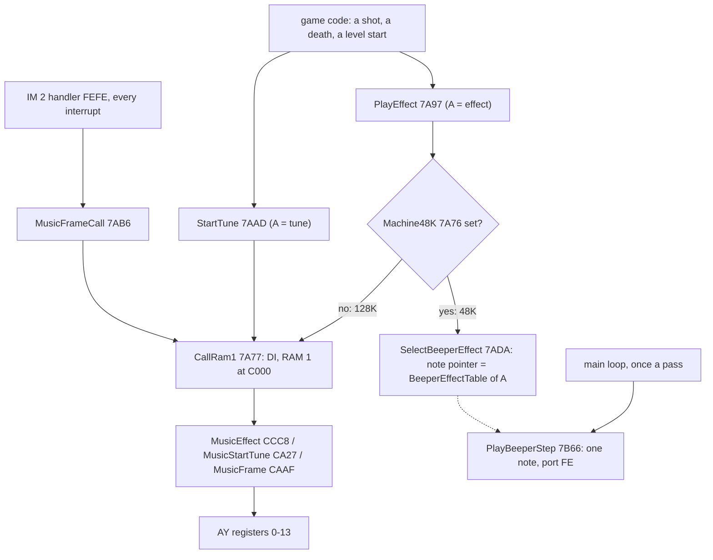

```
; StartTune: the whole game-side glue of a tune
7AAD  PUSH HL
7AAE  LD HL,MusicStartTune   ; $CA27 in RAM 1
7AB1  CALL CallRam1          ; DI, OUT ($7FFD) = $11, CALL (HL) with A, OUT ($7FFD) = $10
7AB4  POP HL
7AB5  RET
```

The pseudocode of the four ways in:

```
StartTune(a):      if not Machine48K: in RAM 1, MusicStartTune(a)
PlayEffect(a):     if Machine48K: if a < 11: beeper_pointer = BeeperEffectTable[a]
                   else:          in RAM 1, MusicEffect(a)
every interrupt:   if not Machine48K: in RAM 1, MusicFrame()
every pass:        if Machine48K: PlayBeeperStep()
```

**A worked example.** In `controls-keyboard` the level starts at frame 323.
At T 8910 `LevelTune` `$7CDE` calls `StartTune` with A = `Level` + 4 = 5.
`MusicStartTune` silences the AY in 7 writes: the mixer `$3F`, the three volumes 0, the envelope period 1, 0, shape 0.
From frame 325 every interrupt calls `MusicFrame`, and the first notes start.

The point: the game never touches the AY or the speaker itself.
Every sound is one of 11 tunes or 28 effects, named by a number; only `CallRam1` knows where the player lives.

Witness: `CallRam1` 133 677 runs in 68 builds, `MusicFrameCall` 127 035 of them, `PlayEffect` 6585, `StartTune` 57
(`src/game/interrupt.asm`).

## 9.2 RAM 1: the player's memory

`CopyMusic` `$7BBF` copies the first 4224 bytes of side A's block 6 to RAM 1 at `$C000`.
The player is data first, then code, then its state.

| Address | Bytes | Label | What |
| --- | ---: | --- | --- |
| `$C000` | 704 | `Patterns` | the 54 patterns (several share tails) |
| `$C2C0` | 66 | `TuneTable` | 11 tunes x 3 words: the order lists of channels A, B, C |
| `$C302` | 322 | `OrderLists` | the order lists, each ended by `$FF` |
| `$C444` / `$C47A` | 54 + 54 | `PatternAddrLow` / `PatternAddrHigh` | the patterns' addresses, low and high bytes apart |
| `$C4B0` | 16 | `Ornaments` | ornaments 1 and 2, 8 bytes each |
| `$C4C0` | 70 | `Instruments` | instruments 0-6, 10 bytes each |
| `$C506` | 364 | `Effects` | the 28 effects, 13 bytes each |
| `$C672` | 170 | `Periods` | 85 AY tone periods, a semitone apart |
| `$C71C` | 1 | `MixerShadow` | register 7 as last written |
| `$C71D` / `$C72F` / `$C741` | 18 each | `VoiceA` / `VoiceB` / `VoiceC` | what each AY channel plays |
| `$C753` | 1 | `NoiseShadow` | the noise period of the last voice with noise (register 6 gets it rotated right 3 times) |
| `$C754-$C9CE` | | `StartVoice` ... `WriteAyRegister` | the voices' code |
| `$C9CF` | 1 | `MusicPlaying` | `$FF` a tune runs, 1 it dies away, 0 none |
| `$C9D0` / `$C9E5` / `$C9FA` | 21 each | `ChannelA` / `ChannelB` / `ChannelC` | the sequencer's state per channel |
| `$CA0F` | 24 | `InstrumentSlots` | 8 instrument offsets per channel |
| `$CA27-$CD68` | | `MusicStartTune` ... `PickEffectVoice` | the tune start, the frame, the sequencer, the effects |
| `$CD69` | 791 | `TailFill` | zeros to the end of the block |

The resources are in [`src/res/tunes/`](../src/res/tunes/README.md): `patterns.txt`, `tunes.txt`,
`instruments.csv`, `ornaments.csv`, `effects.csv`.

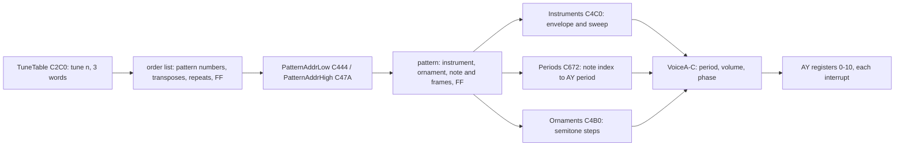

The point: a tune is three lists of pattern numbers; everything below the pattern is shared with the effects.
An effect is an instrument with a period and a length, played on the same voices.

## 9.3 The frame: MusicFrame

`MusicFrame` `$CAAF` runs once an interrupt.
First `UpdateVoices` turns the three voices' state into AY registers.
Then, while a tune runs, `SequenceChannel` reads the next step of each channel.

```
MusicFrame:
    UpdateVoices()                          ; envelopes, sweeps, registers 0-10
    if MusicPlaying == 0: return            ; no tune: only the effects' voices run
    MusicPlaying = ChannelA.running | ChannelB.running | ChannelC.running
    if MusicPlaying == 0:
        MusicPlaying = 1 if a voice still sounds else 0   ; the last notes die away
        return
    SequenceChannel(ChannelA, VoiceA)
    SequenceChannel(ChannelB, VoiceB)
    SequenceChannel(ChannelC, VoiceC)
```

```
CAAF  CALL UpdateVoices
CAB2  LD A,(MusicPlaying)
CAB5  AND A
CAB6  RET Z
CAB7  LD A,(ChannelA+$000D)     ; +$0D: $FF while the order list runs
CABA  LD HL,ChannelB+$000D
CABD  OR (HL)
CABE  LD HL,ChannelC+$000D
CAC1  OR (HL)
CAC2  LD (MusicPlaying),A
CAC5  JR NZ,MusicFrameChannels
...
CAD9  LD IY,ChannelA            ; MusicFrameChannels
CADD  LD IX,VoiceA
CAE1  CALL SequenceChannel      ; then B, then C falls into it
```

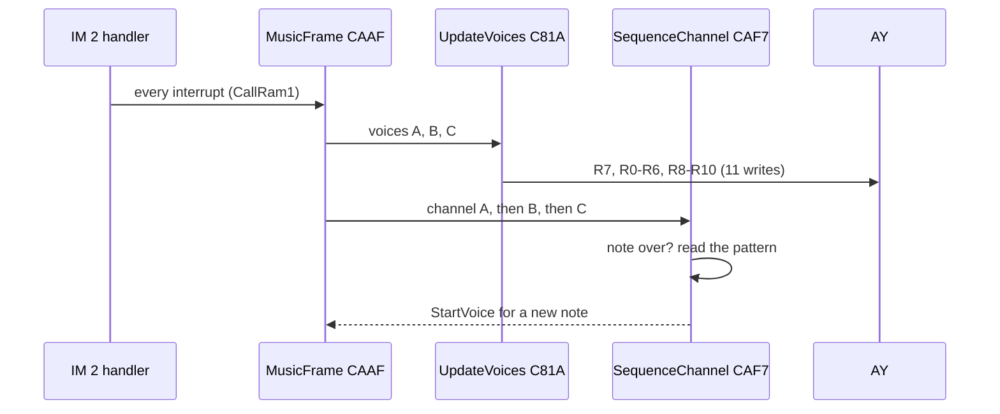

The animation shows the registers after each interrupt of `c1` while the effects of a fight play:

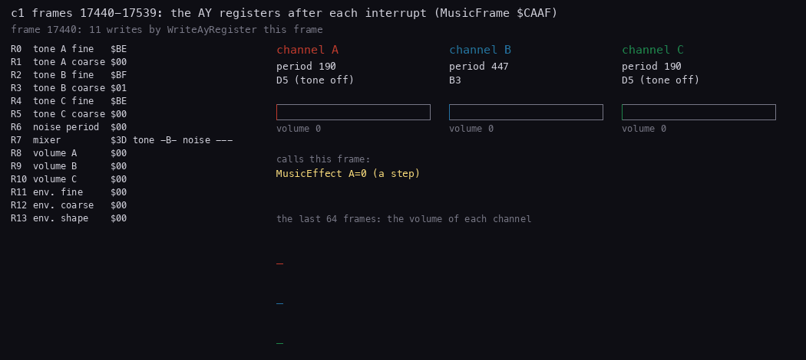

*`c1` frames 17 440-17 539, one picture an interrupt (20 ms each). Left, registers 0-13 as the trace's
`WriteAyRegister` `$C9C2` writes leave them, yellow when changed; right, each channel's period, note and volume, the
calls of the frame (`MusicEffect` with its A), and the last 64 frames' volumes. Made with `python3
tools/fig_sound.py anim-regs docs/img/routines/MusicFrame.gif --work work/docs/wr/c1 --window 17440:0-17540:0
--title "..."`.*

How to read it: a shot (effect 4) lights a channel at volume 15 and fades it; a blast (effect 5) turns a noise on;
the footsteps (effect 0) take whatever voice is free.

**A worked example: the cost.** With no tune, `MusicFrame` is `UpdateVoices` alone.
In `c1` frame 17 456 it starts at T 2562 and returns at T 5372: 2810 T.
In the model a tune frame costs 3600-4700 T on average and 7281 T at most (tune 0).
That is up to a tenth of the 70 908 T frame, inside the handler.

The point: the music is the interrupt's job, so it keeps time when a pass runs long.
A lost interrupt ([doc 04](04-game-loop.md#44-the-frame-wait-and-the-lost-interrupts)) loses one music frame, and the
tune falls 20 ms behind.

Witness: `MusicFrame` 23 034 runs in the 9 builds of the music part; the channels 10 060 (`src/music/player.asm`).
The model against `controls-keyboard` frames 323-382 (`python3 tools/fig_sound.py check --work work/docs/wr/ckb
--window 323:0-383:0 --at 323:8900`): 1 tune start, 58 `MusicFrame` calls, all 58 sound the same (the mixer, and
each audible channel's volume, period and noise).
Against `c1` frames 17 440-17 539 (`... check --work work/docs/wr/c1 --window 17440:0-17540:0 --at 17440:0 --state`,
the model started from the recording's own RAM 1): 15 effect calls, 76 calls of `MusicFrame`, all 76 the same.

## 9.4 The tunes and the order lists

`MusicStartTune` `$CA27` takes the tune's three words from `TuneTable` + 6 A.
Each word is an order list, one for each AY channel.

An order list is a list of bytes:

| Byte | Meaning |
| --- | --- |
| `$00-$7F` | play pattern n |
| `$80-$BF` | play the next pattern (bits 0-4) times |
| `$C0-$FD` | set an instrument slot (no list uses it) |
| `$FE` n | transpose the next patterns by n semitones |
| `$FF` | the channel's end |

```
MusicStartTune(a):
    SilenceAy()                                 ; mixer $3F, volumes 0, voices freed
    for c in A, B, C:
        channel[c].order = TuneTable[6 a + 2 c]
        channel[c].times = 1; transpose = 0; ornament = 0
        channel[c].ended = $FF; frames_left = 1; running = $FF
        channel[c].instrument = Instruments
    InstrumentSlots = 0, 10, ..., 70  (three times)
    MusicPlaying = $FF
```

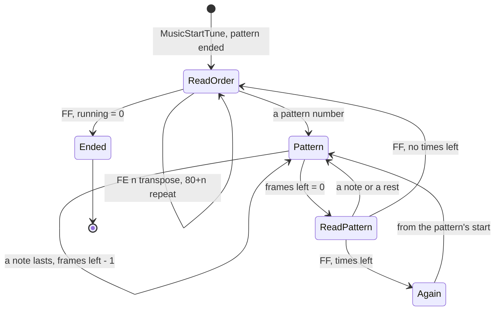

The 11 tunes, measured on the model from `MusicStartTune` until `MusicPlaying` is 0 (`python3 tools/fig_sound.py
tunes`):

| Tune | Started by | Frames | Seconds | Notes A / B / C |
| ---: | --- | ---: | ---: | --- |
| 0 | the control menu (`$80B9`), the CONGRATULATIONS end (`$875D`) | 3088 | 61.8 | 142 / 176 / 178 |
| 1 | the time bonus start and end (`$9CC6`, `$9CDB`), both cheats (`$7D3B`, `$7D55`) | 74 | 1.5 | 3 / 3 / 3 |
| 2 | GAME OVER (`$7E20`) | 184 | 3.7 | 9 / 8 / 3 |
| 3 | nothing | 224 | 4.5 | 8 / 4 / 4 |
| 4 | the level load (`$7CD2`): three empty lists | 2 | 0 | 0 |
| 5 | level 1 (`LevelTune` `$7CDE`, A = `Level` + 4) | 1598 | 32.0 | 168 / 20 / 169 |
| 6 | level 2 | 1554 | 31.1 | 128 / 121 / 26 |
| 7 | level 3 | 926 | 18.5 | 72 / 24 / 12 |
| 8 | level 4 | 534 | 10.7 | 36 / 24 / 64 |
| 9 | level 5 | 1086 | 21.7 | 132 / 16 / 133 |
| 10 | the Fat Guy's end (`$874B`) | 3134 | 62.7 | 52 / 90 / 268 |

No tune loops: when all three lists end, the music stops.
A level's tune plays once, from the level's start, and then the level has only the effects.

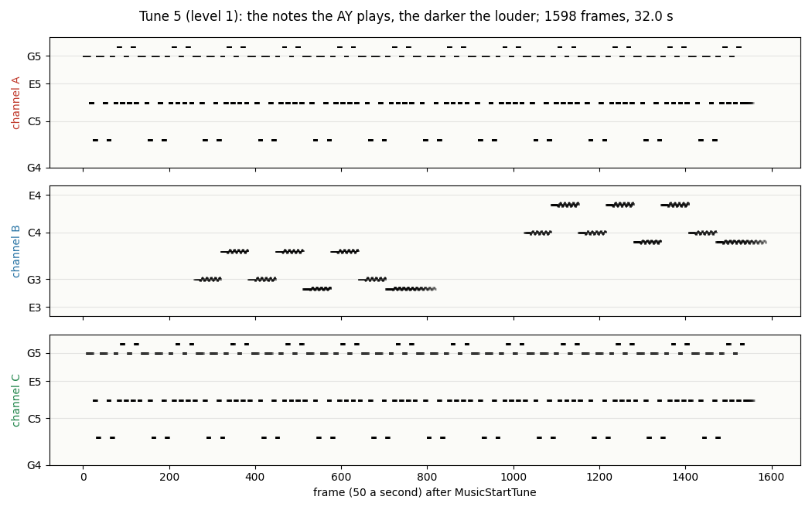

*Tune 5, level 1, on the model: each channel's note frame by frame, from the AY period of its tone, the darker the
louder. Made with `python3 tools/fig_sound.py fig-tune docs/img/sound/tune-05.png --tune 5`.*

How to read it: channels A and C play the same line, C eight frames later and with instrument 5 instead of 4.
Channel B holds long notes with a vibrato, the zigzags.

**A worked example: tune 5's order lists.** `TuneTable` + 30 = `$C2DE` gives `$C372`, `$C375` and `$C37A`.

- Channel A, `$C372`: `8C 15 FF`: the next pattern 12 times, pattern 21, the end.
- Channel B, `$C375`: `18 FE 05 18 FF`: pattern 24, transpose +5, pattern 24 again, the end.
- Channel C, `$C37A`: `17 8C 16 FF`: pattern 23, then pattern 22 12 times, the end.

Pattern 21 is one byte, `84` (instrument 4), and runs on into pattern 22, the shared tail.
Pattern 23 is a rest of 8 frames with instrument 5 and ends there (`$FF`, `$C14D-$C150`).
Channel C's order list then plays pattern 22 twelve times (`17 8C 16`): 168 notes after the rest, 169 events, and
instrument 5 carries on, since pattern 22 sets none.
So the echo is in the data: the same 14 notes, delayed by a rest.

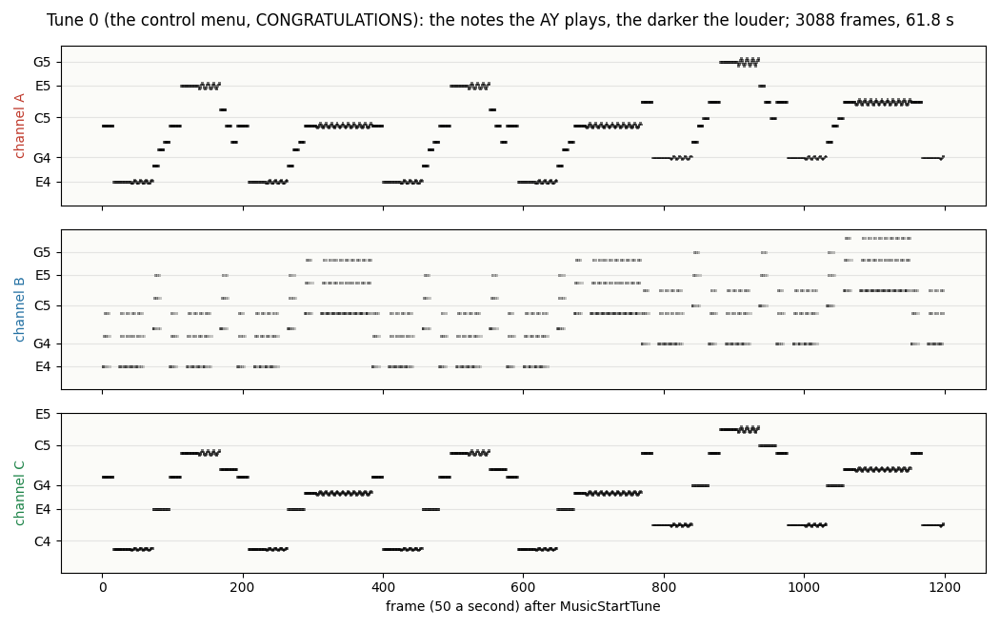

*Tune 0, the first 1200 of its 3088 frames. Made with `python3 tools/fig_sound.py fig-tune docs/img/sound/tune-00.png
--tune 0 --frames 1200`.*

How to read it: channel B's quick notes are pattern 1 with ornament 1, a three-note arpeggio (9.6).

The point: the order lists are the score; the patterns are short phrases used again and again.
Level 1's 32 seconds of music are 56 bytes of patterns (`$C12F-$C166`) and 12 bytes of order lists.

Witness: `MusicStartTune` 17 runs in the 9 builds, tunes 0, 2 and 4-9 (`src/music/player.asm`); tunes 1 and 10 are
started by the code only; tune 3 has no caller.

## 9.5 The patterns, and tune 1 by hand

A pattern is a stream of bytes, read by `SequenceChannel` `$CAF7` when the current note's frames run out.

| Byte | Meaning |
| --- | --- |
| `$00-$7D` n, f | a note: period index n + 12 + the transpose, for f frames |
| `$7E` lo hi f | a note by its period word (no pattern uses it) |
| `$7F` f | a rest of f frames |
| `$80-$87` | instrument slot 0-7 |
| `$88-$BF` | ornament (bits 0-3) |
| `$C0-$FE` | skipped, with 0 or 3 bytes (no pattern uses them) |
| `$FF` | the pattern's end |

The note's index into `Periods` `$C672` is n + 12: index i sounds MIDI note 22 + i, so a note byte n is MIDI n + 34.
Index 0 is period 3822 (A#0, 29 Hz) and index 84 is period 24.

```
SequenceChannel(ch, voice):
    UpdateOrnament(ch, voice)
    if ch.ended:                                   ; the pattern's FF was read
        ch.times -= 1
        if ch.times: restart the pattern
        else: read the order list (FE, 80+n, FF, a pattern number)
    ch.frames_left -= 1
    if ch.frames_left: do any command byte at the pointer; return
    while byte at pointer >= $80: PatternCommand  ; instrument, ornament, FF
    if byte == $7F: ch.frames_left = next byte; return      ; a rest
    index = byte + ch.transpose + 12
    period = Periods[index]
    ch.frames_left = next byte
    StartVoice(voice, ch.instrument, period, sustain = frames)
```

```
CBB6  ADD A,(IY+$0A)     ; PatternPitchedNote: + the transpose
CBB9  ADD A,$0C          ; + 12
CBBB  LD (IY+$0E),A      ; the index, kept for the ornament
CBBE  LD HL,Periods
CBC1  ADD A,A
...
CBCA  LD A,(IY+$0F)      ; PatternNoteStart: the ornament restarts
CBCD  OR $C0
CBCF  LD (IY+$14),A
CBD2  INC DE
CBD3  LD A,(DE)          ; the frames
CBD4  INC DE
CBD5  LD (IY+$0C),A
CBD8  LD C,A             ; C = the sustain for StartVoice
```

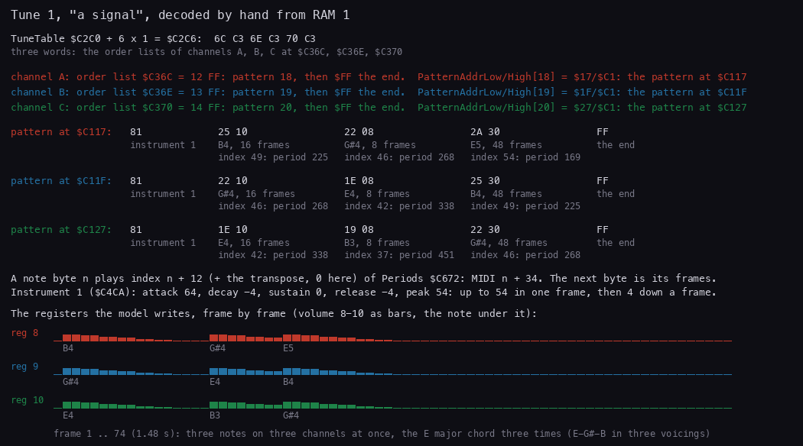

*Tune 1 from `build/music.bin`: the table entry, the three order lists, the three patterns byte by byte, and below the
volumes the model writes to registers 8-10 frame by frame. Made with `python3 tools/fig_sound.py fig-pattern
docs/img/sound/pattern.png`.*

**A worked example: channel B of tune 1, by hand.**

1. `TuneTable` + 6 = `$C2C6` holds `6C C3 6E C3 70 C3`: channel B's list is at `$C36E`.
2. `$C36E` holds `13 FF`: pattern 19, then the end.
3. `PatternAddrLow` + 19 = `$1F` and `PatternAddrHigh` + 19 = `$C1`: the pattern is at `$C11F`.
4. `$C11F` holds `81 22 10 1E 08 25 30 FF`.
5. `81`: instrument slot 1, `Instruments` + 10 = `$C4CA`.
6. `22 10`: note `$22` = 34, index 46, period 268 (G#4, 413 Hz), for 16 frames.
7. `1E 08`: index 42, period 338 (E4), for 8 frames.
8. `25 30`: index 49, period 225 (B4), for 48 frames.
9. `FF`: the end; the list's `FF` ends the channel.

Channels A and C play the other notes of the same chords: the E major chord three times, in three voicings.
Instrument 1 has attack 64, decay -4, sustain 0 and peak 54.
So each note jumps to 54 (register value 6) and loses 4 a frame: volumes 54, 50, 46, ..., 6, 2, then 0; registers 6,
6, 5, 5, 4, 4, 3, 3, 2, 2, 1, 1, then 0 from the 13th frame (volume 6), while the volume itself reaches 0 on the 15th.
The 16-frame note is silent for its last 4 frames; the 48-frame one for its last 36.
The notes take 72 frames, and two more free the voices: the 74 frames of the table.

The point: a note's length in the pattern and its sound's length are separate.
The instrument's envelope decides how long it sounds; the pattern decides when the next one starts.

Witness: the model writes exactly these volumes (the bars in the figure); `SequenceChannel` read a note 2292 times
and a rest 41 times in the builds (`src/music/sequencer.asm`).

## 9.6 Ornaments: the arpeggio

An ornament changes the note's pitch by semitones, frame by frame.
`UpdateOrnament` `$CC38` runs before each channel's step.
Ornament n's record is at `Ornaments` - 8 + 8 n (`$C4B0` for 1, `$C4B8` for 2).

The first byte: bit 7 loop, bits 3-5 the base note's frames, bits 0-2 the steps used.
Each step byte: semitones x 8 + frames.

| Ornament | Bytes | Steps |
| ---: | --- | --- |
| 1 | `8A 21 39` | the note 1 frame, +4 for 1 frame, +7 for 1 frame, again: a major arpeggio |
| 2 | `8A 21 01` | the note 1 frame, +4 for 1 frame, +0 for 1 frame, again |

```
UpdateOrnament(ch, voice):
    if not ch.ornament_running: return
    if ch.ornament_start or the steps ran out:
        rec = Ornaments[ch.ornament]
        ch.step_frames = rec.base_frames; ch.steps = rec.steps + 1
        voice.period = Periods[ch.index]                ; the note itself
    elif --ch.step_frames == 0:
        step = next step byte
        ch.step_frames = step & 7
        voice.period = Periods[ch.index + (step >> 3)]
```

```
CC6F  LD A,(HL)          ; OrnamentStep: the step byte
CC70  AND D              ; D = 7
CC71  LD (IY+$12),A      ; its frames
CC74  LD A,(HL)
CC75  RRCA
CC76  RRCA
CC77  RRCA
CC78  AND $1F            ; its semitones
CC7A  ADD A,(IY+$0E)     ; + the note's index
CC7D  JP SetPitch        ; the voice's period = Periods[A]
```

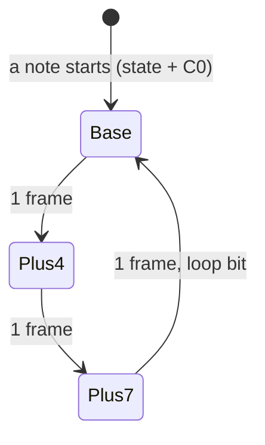

**A worked example.** Tune 0's channel B plays pattern 1 with ornament 1 on E4 (index 42).
Frame by frame the period is 338 (E4), 268 (G#4), 225 (B4), 338, 268, ...
At 50 frames a second the chord E-G#-B cycles 16.7 times a second: one voice sounds like a chord.

The point: the ornament gives a single AY channel a chord, the chip-music trick of the time.

Witness: `UpdateOrnament` 30 180 runs in the builds, a step 2531 times, a start 1312 (`src/music/sequencer.asm`).

## 9.7 The voices: StartVoice and the software envelope

A voice is 18 bytes (`VoiceA` `$C71D`).
`StartVoice` `$C754` copies an instrument into it; `UpdateVoice` `$C8D6` runs its phase each frame.

An instrument is 10 bytes:

| Byte | Field | Instrument 0 |
| ---: | --- | ---: |
| 0 | attack: added a frame until the peak | 114 |
| 1 | decay (signed): added a frame until the sustain level | -32 |
| 2 | the sustain level | 56 |
| 3 | release (signed): added a frame until below 0 | -4 |
| 4 | the peak | 64 |
| 5 | the frames before the pitch sweep (`$FF` none) | 18 |
| 6 | the sweep's frames each way (bit 7: once) | 4 |
| 7-8 | the sweep step, in period units a frame | 2 |
| 9 | flags: bit 0 tone, 1 noise, 2 the AY envelope, 7 notes keep the voice | 1 |

The volume runs from 0 to 127; the AY gets the volume / 8.

```
EnvelopeAttack:   vol += attack;  if vol >= peak: vol = peak; phase = EnvelopeDecay
EnvelopeDecay:    vol += decay;   if vol < sustain or vol < 0: vol = sustain; phase = EnvelopeSustain
EnvelopeSustain:  if sustain_frames_left == 0: phase = EnvelopeRelease
; UpdateVoice counts sustain_frames_left (+6) down every frame, in every phase ($C8F4), unless it is 0 or $FF
EnvelopeRelease:  vol += release; if vol < 0: VoiceOff()   ; volume 0, the voice free in MixerShadow
```

```
C908  LD A,(IX+$05)      ; EnvelopeAttack
C90B  ADD A,(IY+$00)     ; + the attack
C90E  CP (IY+$04)        ; the peak?
C911  JR NC,AttackPeak
C913  LD (IX+$05),A
C916  RET
C917  LD A,(IY+$04)      ; AttackPeak: the peak, then the decay
C91A  LD (IX+$05),A
C91D  LD HL,EnvelopeDecay
C920  LD (IX+$0D),L
C923  LD (IX+$0E),H
C926  RET
```

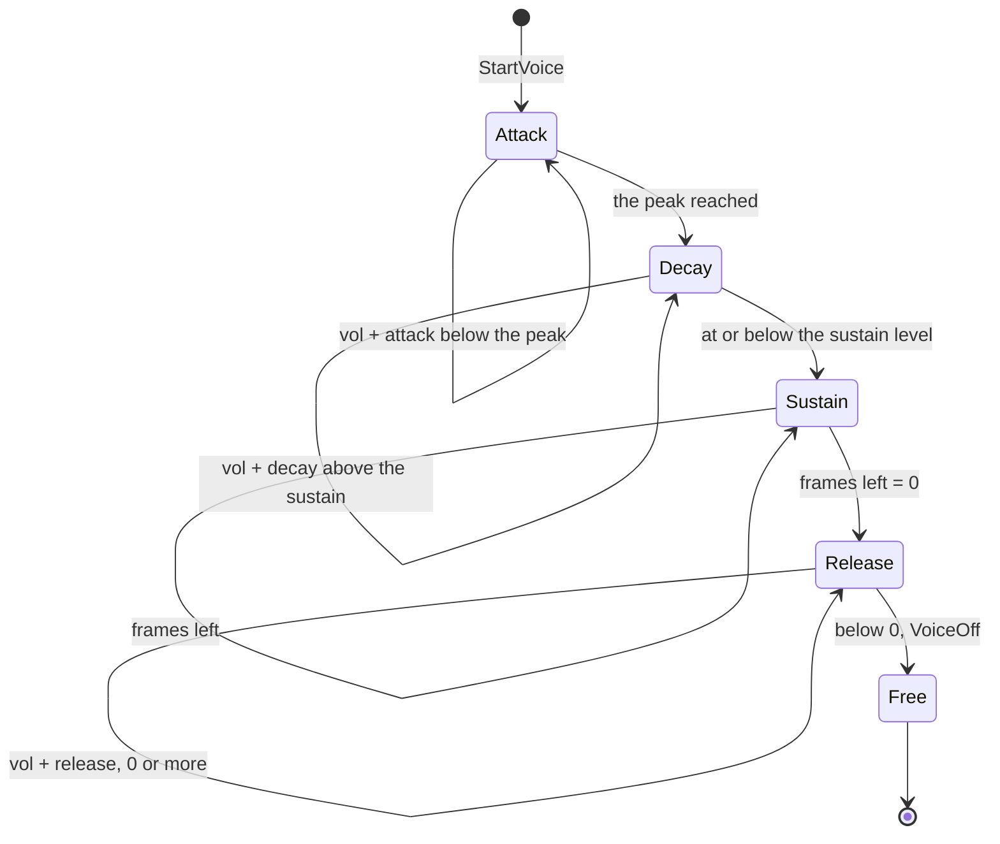

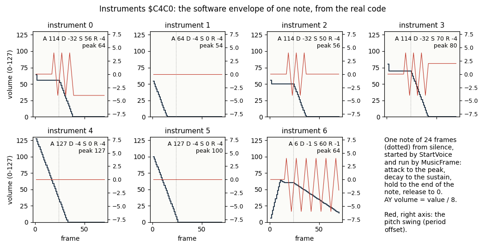

*One note of 24 frames per instrument, started by the real `StartVoice` from silence and run by the real
`MusicFrame`; black the volume (0-127), red the pitch offset of the sweep. Made with `python3 tools/fig_sound.py
fig-instruments docs/img/sound/instruments.png`.*

How to read it: instruments 1, 4 and 5 have sustain 0 and fade like a plucked string; 0, 2 and 3 hold a level until
the note ends; 6 swells slowly (attack 6) with a deep vibrato.

**A worked example: instrument 0, a note of 24 frames.**

1. Frame 1: 0 + 114 is past the peak 64, so 64 (register value 8), and the phase is the decay.
2. Frame 2: 64 - 32 = 32 is below the sustain 56, so 56 (register value 7), and the phase is the sustain.
3. Frames 3-24: 56 while the sustain count runs down.
4. Frame 25 on: 52, 48, ... 4, 0, then below 0: `VoiceOff` at frame 39.
5. The sweep: 18 frames of delay, then +2 a frame for 2 frames (half a swing first), then -2 for 4, +2 for 4: the
   period swings by 4 units around the note, a vibrato of 8 frames (6.25 Hz).

A new note on a sounding voice starts its attack from the voice's current volume, not from 0.
So a fast line on instrument 0 never drops between notes.

The point: the AY's 16 volume steps are driven from a 0-127 software volume, so the envelopes are smooth and the
same code serves the tunes and the effects.

Witness: `EnvelopeAttack` 2237 runs, `EnvelopeDecay` 15 942, `EnvelopeSustain` 9964, `EnvelopeRelease` 561,
`VoiceOff` 46 (`src/music/player.asm`); no instrument uses the AY envelope (flag bit 2).

## 9.8 UpdateVoices: the registers each interrupt

`UpdateVoices` `$C81A` does nothing while all six mixer bits are set (no voice sounds).
Otherwise it runs `UpdateVoice` for A, B and C and then writes 11 registers.

```
UpdateVoices:
    if MixerShadow & $3F == $3F: return
    for v in A, B, C: UpdateVoice(v)           ; sustain count, SweepPitch, the envelope phase
    R7 = MixerShadow
    for v in A, B, C:
        R(2v), R(2v+1) = v.period + v.sweep_offset
        if v has noise: NoiseShadow = low byte of that sum
    R6 = NoiseShadow rotated right 3 times    ; the AY keeps 5 bits
    R8, R9, R10 = vol_A / 8, vol_B / 8, vol_C / 8
```

```
C898  LD A,(VoiceC+$0004)    ; channel C's period high byte
C89B  ADC A,(IX+$2E)         ; + the sweep offset's high byte
C89E  CALL WriteAyRegister   ; register 5
C8A1  INC C
C8A2  LD A,(NoiseShadow)
C8A5  RRCA
C8A6  RRCA
C8A7  RRCA
C8A8  CALL WriteAyRegister   ; register 6: the noise period
C8AB  LD C,$08               ; then registers 8-10, the volumes / 8
```

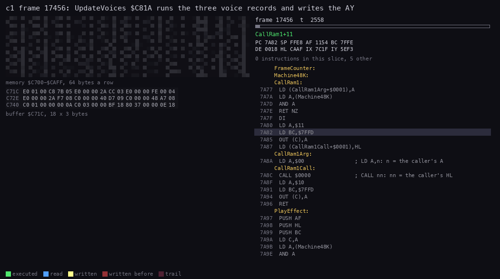

*`c1` frame 17 456, T 2500-5400: `UpdateVoices` from the IM 2 handler, 50 pictures of 58 T. The buffer is the three
voice records from `$C71C` (`MixerShadow` first); the code is RAM 1's, named from `build/music.lst`. Made with `python3
../../kit/routine_anim.py --work work/docs/wr/c1 --window 17456:2500-17456:5400 --listing build/game.lst --page
1=build/music.lst --out docs/img/routines/UpdateVoices.gif --pc 1:C81A-C9CE --range C700-CAFF --view
buffer:C71C:18x3:hex --pictures 50 --title "..."`.*

How to read it: each voice's volume byte (+5) changes as its phase runs, then `WriteAyRegister` runs 11 times, the
`OUT (C),E` / `OUT (C),A` pair each time.

**A worked example: one noise effect.** Effect 5 (a blast) has the period 250 and flags 2 (noise only).
`StartVoice` clears the voice's noise bit in the mixer and leaves its tone bit set (off).
`UpdateVoices` puts 250's low byte, `$FA`, in `NoiseShadow`, and register 6 gets `$FA` rotated right three times:
`$5F`, of which the AY keeps 31, its slowest noise.
The sweep step -256 changes only the high byte, so register 6 stays 31 while registers 0-1 move under a silent tone.

The point: the noise has one period for all three channels; the last voice with noise sets it.

Witness: `UpdateVoices` 23 034 runs, `WriteAyRegister` 117 544 (`src/music/player.asm`).

## 9.9 The effects

An effect is 13 bytes at `Effects` `$C506` + 13 A: an instrument (10 bytes), the AY period (a word) and the sustain
frames (`$FF`: never released).
`MusicEffect` `$CCC8` starts it on a voice.

```
MusicEffect(a):
    if MusicPlaying != 0: return               ; a tune runs: the effect is dropped
    rec = Effects + 13 a
    voice = PickEffectVoice(a)
    if none: return
    StartVoice(voice, instrument = rec, period = rec[10..11], sustain = rec[12])

PickEffectVoice(a):
    for v in A, B, C: if v is free: return v
    if a == 0 or a == 2: return none          ; the footstep and the fuse give way
    StealTurn = (StealTurn + 1) mod 3
    return voice StealTurn
```

```
CCC8  PUSH BC             ; MusicEffect
CCC9  LD C,A
CCCA  PUSH BC
CCCB  LD A,(MusicPlaying)
CCCE  AND A
CCCF  POP BC
CCD0  LD A,C
CCD1  POP BC
CCD2  RET NZ              ; a tune plays: nothing
...                       ; HL = Effects + 13 A, into IY
CCEF  CALL PickEffectVoice
CCF2  JP NC,MusicEffectDone
CCF5  LD L,(IY+$0A)       ; the period
CCF8  LD H,(IY+$0B)
CCFB  LD C,(IY+$0C)       ; the sustain frames
CCFE  CALL StartVoice
```

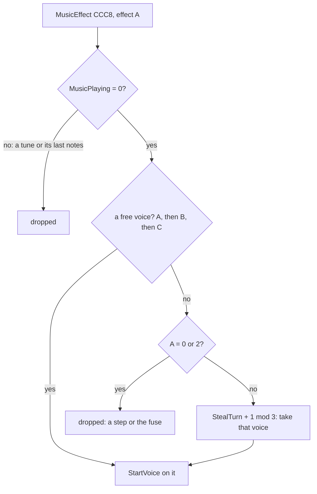

The game's own calls:

| Effect | Called by | What |
| ---: | --- | --- |
| 0 | `$9AA5`, when Rick's walk cycle `RickStep` wraps | a step |
| 2 | `FuseHiss` `$937E` (the call at `$9386`), every 4th pass while a fuse burns | the fuse |
| 4 | `FireBulletLaunch` `$95A6`; each bullet counted in `BonusTally` (`$86F9`) | a shot |
| 5 | a fuse reaching 10, the blast (`$937A`); a deadly trap setting off a lit detonator `$A41E`; a pickup's burst `$A5FD`; each detonator in `BonusTally` (`$871D`); the Fat Guy's death | a blast |
| 6 | a pickup of bullets or detonators (`$A5A2`, `$A5B2`) | ammunition |
| 7 | a treasure (`$A58F`) | a treasure |
| 9 | `EnemyPunchTest` (`$8C59`), when a punch lands and stuns the enemy for 40 passes; each hit on the Fat Guy | an enemy punched |
| 10 | `KillRickCry` (`$93E7`), `KillEnemy` (`$9F67`), each life in the tally (`$873E`), the Fat Guy's death | a death |

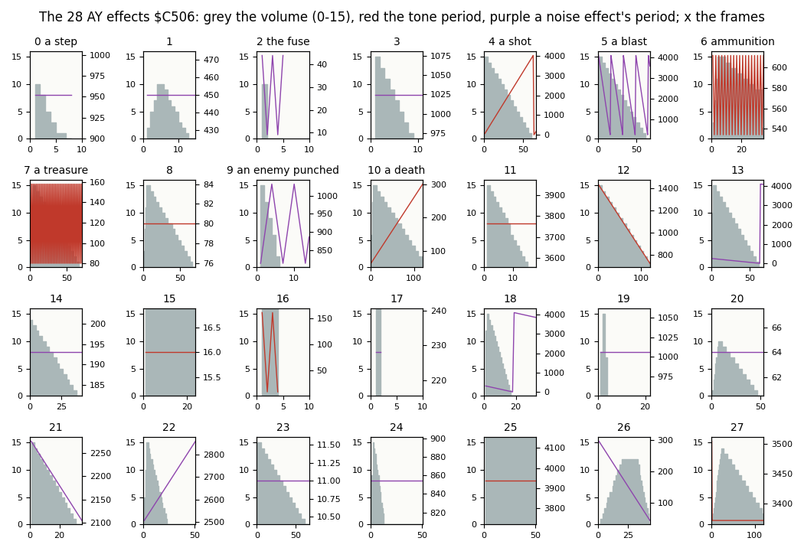

*Every effect on the model from a silent player (tune 4 started and over, as after the load): grey the volume
(registers 8-10, 0-15; 16 marks the AY envelope), red the tone period, purple a noise effect's period. Made with
`python3 tools/fig_sound.py fig-effects docs/img/sound/effects.png`.*

How to read it: the tone effects sweep their period (4 up, 10 down) while the volume decays; 6 and 7 trill (a sweep
that turns every frame); 15, 16, 17 and 25 use the AY's own envelope.

**A worked example: effect 4, a shot.** The record at `$C506` + 52 = `$C53A` is `80 FE 00 FE 7F 00 00 40 00 01 00 00
01`.

1. Attack `$80` = 128 from 0 passes the peak `$7F` = 127: register 8 is 15 at once.
2. Decay -2 a frame toward sustain 0: 127, 125, ... 64 frames to 0.
3. The period starts at 0 and the sweep (delay 0, step `$0040`) adds 64 a frame: 64, 128, 192, ...
4. The sweep count is (0 AND `$7F`) / 2 = 0, raised to 1; when it runs out the instrument's +6 is 0, so the sweep never
   turns.
5. The sustain count (1) runs down in every phase, so it is long spent when the decay reaches 0 (127, 125, ..., 1, then
   -1: `JP M`, 0) after 64 frames; one frame of sustain and one of release (0 - 2 < 0: `VoiceOff`) end the voice:
   1 + 64 + 1 + 1 = 67 frames.

The period rises from 64 (1732 Hz) to 4032 (27 Hz) while the volume falls: a falling whistle.
The model gives 67 frames; `c1` asks for it at frames 17 442, 17 454, 17 488 and 17 523.

The point: an effect needs a free voice, and while a tune plays no voice is free.
A level's first 10.7-32 seconds play only the tune: no shot, no step, no death is heard.

Witness: `MusicEffect` 385 runs in the 9 builds, 44 past the `MusicPlaying` test, 39 started; `PickEffectVoice` 44
(c1 only): a free voice 24, a voice taken 15, dropped 5 (`src/music/effects.asm`).

## 9.10 The traps' effects, from the level data

Traps ask for their own effects from the level's scripts.
A path's `$FF` n and an animation's `$FD` n call `TrapEffect` `$A2E1`.
It plays effect n only when the trap is in the shown part of the view (y `$40-$FF`, the high byte 0).

```
TrapEffect(a, trap):
    if trap.y_high != 0 or trap.y < $40: return     ; off the screen: silent
    PlayEffect(a)
```

```
A2E1  PUSH AF
A2E2  LD A,(IX+$03)      ; y high byte
A2E5  AND A
A2E6  JP NZ,TrapEffectSkip
A2E9  LD A,(IX+$02)      ; y
A2EC  CP $40
A2EE  JP C,TrapEffectSkip
A2F1  POP AF
A2F2  JP PlayEffect
```

The effects named in each level's scripts (`fx=N` in `src/res/levels/levelN/level/kinds.txt`, counted):

| Level | Effects (times named) |
| ---: | --- |
| 1 | 4 (16), 5 (7), 15 (4), 16 (3), 17 (3), 9 (1) |
| 2 | 19 (23), 20 (8), 23 (4), 9 (4) |
| 3 | 11 (19), 19 (15), 9 (12), 24 (8), 21 (1), 23 (1) |
| 4 | 19 (20), 11 (16), 17 (10), 18 (8), 26 (5), 22 (4), 25 (3) |
| 5 | 4 (13), 9 (9), 5 (5), 27 (3), 15 (1) |

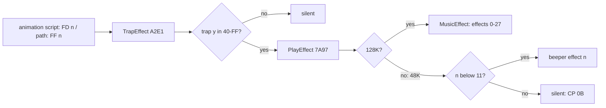

**A worked example.** Level 1's animation at `$F26E` is `62 fx=4 62+13`: frame 62, effect 4, frame 62 for 13 more
passes.
Kind 13 (6 x 21 pixels, flags `$50`: deadly) runs it, so each time the script starts it sounds like Rick's own shot.
On a 48K the same script plays beeper effect 4; level 4's effect 26 plays nothing there.

The point: effects 11-27 exist only for the traps, and only the level data names them; a 48K plays none of them.
Effects 1, 3, 8, 12, 13 and 14 are named nowhere: in the data, never heard.

Witness: `TrapEffect` 1354 runs in 47 builds (c1 53), silent 258 times (`$A2F5`, `src/game/traps.asm`).

## 9.11 The 48K beeper

On a 48K, `PlayEffect` with A below 11 points `PlayBeeperStep`'s operand (`$7B67`) at `BeeperEffectTable` `$7AF2`
entry A.
Each pass, the main loop calls `PlayBeeperStep` `$7B66`: one byte, one note.

```
PlayBeeperStep:
    c = *note_pointer
    if c == $FF: return                 ; the effect is over
    note_pointer += 1
    count = $600
    loop:
        OUT ($FE), 8; wait c turns of the count      ; MIC bit high
        OUT ($FE), 0; wait c turns of the count      ; low
        until the count is 0
```

```
7B66  LD HL,$0000        ; the note pointer (self-modified)
7B69  LD A,(HL)
7B6A  CP $FF
7B6C  RET Z
7B6D  INC HL
7B6E  LD (PlayBeeperStep+$0001),HL
7B71  LD C,A             ; the half period in loop turns
7B72  LD DE,$0600        ; the note's length in loop turns
7B75  LD A,$08           ; BeeperHigh
7B77  OUT ($FE),A
7B79  LD B,C
7B7A  DEC DE             ; BeeperHighWait: 32 T a turn
7B7B  LD A,D
7B7C  OR E
7B7D  RET Z
7B7E  DJNZ BeeperHighWait
7B80  LD A,$00           ; BeeperLow
7B82  OUT ($FE),A
...
7B8B  JP BeeperHigh
```

A turn is `DEC DE` (6), `LD A,D` (4), `OR E` (4), `RET Z` (5) and `DJNZ` (13): 32 T.
The high half takes 32 C + 17 T, the low half 32 C + 27 T: the pitch is 3.5 MHz / (64 C + 44).
Every note is `$600` = 1536 turns, about 49 000 T: the pitch changes, the length does not.

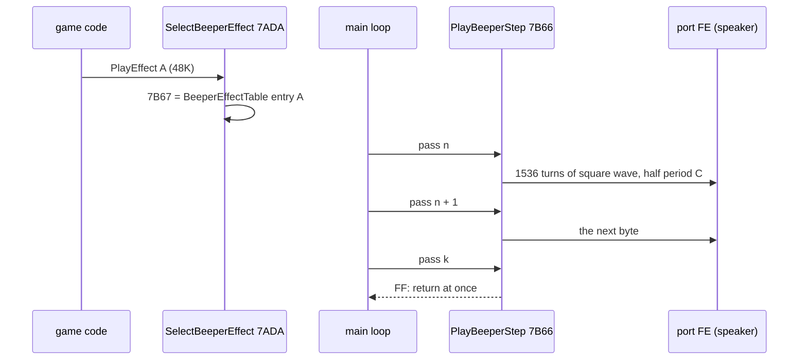

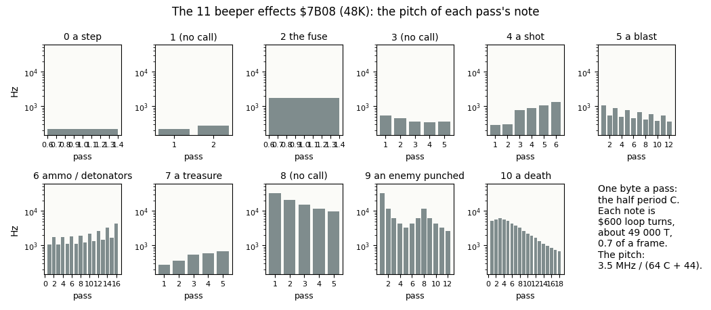

*The bytes at `$7B08-$7B65` as pitches, one bar a pass. Made with `python3 tools/fig_sound.py fig-beeper
docs/img/sound/beeper.png`.*

How to read it: the step and the fuse are one note each; the death falls through 18 notes; effect 8 (1-5) is
ultrasonic.

**A worked example: the death, effect 10.**
`BeeperEffectTable` + 20 = `$7B06` holds `$7B53`: `0A 09 08 09 0A 0C 0E 10 14 18 1C 20 28 30 38 40 48 50 FF`.
The first byte, 10, gives 3 500 000 / (640 + 44) = 5117 Hz; the last, 80, 3 500 000 / 5164 = 678 Hz.
One note a pass and a pass of 2 frames: 18 notes in 36 frames, 0.72 s, a falling wail.

In `c48` the note pointer moves `$7B55`, `$7B57`, ... `$7B65` from frame 16 976 to 17 008, sampled every 4 frames:
one note every 2 frames.
The trace of frames 16 972-17 011 has 20 calls (the last note of a blast, the 18 notes, the `$FF`), a pass of 1.98
frames on average.

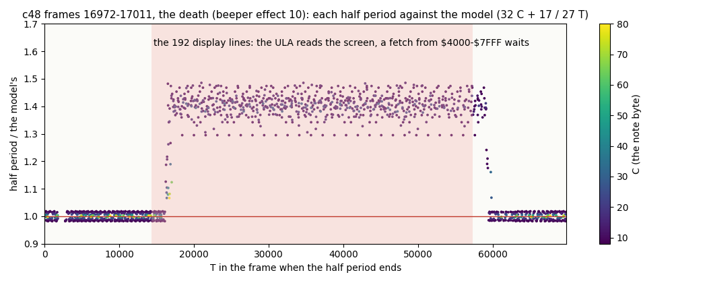

*`c48` frames 16 972-17 011: every half period of the death's notes, divided by the model's 32 C + 17 / 27 T, at the
T of the frame where it ended; the pink band is the 192 display lines. Made with `python3 tools/fig_sound.py
fig-beeper-trace docs/img/sound/beeper-contention.png --work work/docs/wr/c48 --window 16972:0-17012:0 --title
"..."`.*

How to read it: in the border lines the half periods are the model's exactly; in the display lines they are 1.3-1.5
times longer.
`PlayBeeperStep` is at `$7B66`, in contended RAM, so each fetch there waits for the ULA.
The note drops about six semitones for 60 % of each frame: a 50 Hz warble the code never asked for.
The note's 1536 turns take 60 000-66 000 T instead of 49 000 (an interrupt included).

The point: the 48K effects are the AY effects' little brothers, one note a pass, and the hardware colours them.
Their renders from the model (no contention) are higher and steadier than the machine; `beeper-death-c48.wav` is the
recording's own.

Witness: in `c48` the note pointer changed 155 times (sampled every 4 frames over frames 0-19 570); `PlayBeeperStep`
ran 1206 times; the trace has 1608 `OUT ($FE)` writes against the model's 1585 for the 18 notes (`python3
tools/fig_sound.py beeper-check --work work/docs/wr/c48 --window 16972:0-17012:0 --effect 10`).

## 9.12 The audio files

All renders are made by `python3 tools/fig_sound.py audio docs/audio` from the model, at 44.1 kHz.
The AY render uses the tone squares, the 17-bit noise and the AY's volume curve; the envelope effects (15, 16, 17, 25)
use the AY's envelope shapes.
The tunes are MP3 (`lame -V 4`) but for the short tune 1; the effects are WAV.

| File | What |
| --- | --- |
| [`tune-00.mp3`](audio/tune-00.mp3) | the control menu and the CONGRATULATIONS end, 61.8 s |
| [`tune-01.wav`](audio/tune-01.wav) | the signal, 1.5 s |
| [`tune-02.mp3`](audio/tune-02.mp3) | GAME OVER, 3.7 s |
| [`tune-03.mp3`](audio/tune-03.mp3) | tune 3, never started, 4.5 s |
| [`tune-05.mp3`](audio/tune-05.mp3), [`tune-06.mp3`](audio/tune-06.mp3), [`tune-07.mp3`](audio/tune-07.mp3), [`tune-08.mp3`](audio/tune-08.mp3), [`tune-09.mp3`](audio/tune-09.mp3) | levels 1-5 |
| [`tune-10.mp3`](audio/tune-10.mp3) | the Fat Guy's end, 62.7 s |
| `ay-effect-NN.wav`: [`00`](audio/ay-effect-00.wav), [`01`](audio/ay-effect-01.wav), [`02`](audio/ay-effect-02.wav), [`03`](audio/ay-effect-03.wav), [`04`](audio/ay-effect-04.wav), [`05`](audio/ay-effect-05.wav), [`06`](audio/ay-effect-06.wav), [`07`](audio/ay-effect-07.wav), [`08`](audio/ay-effect-08.wav), [`09`](audio/ay-effect-09.wav), [`10`](audio/ay-effect-10.wav), [`11`](audio/ay-effect-11.wav), [`12`](audio/ay-effect-12.wav), [`13`](audio/ay-effect-13.wav), [`14`](audio/ay-effect-14.wav), [`15`](audio/ay-effect-15.wav), [`16`](audio/ay-effect-16.wav), [`17`](audio/ay-effect-17.wav), [`18`](audio/ay-effect-18.wav), [`19`](audio/ay-effect-19.wav), [`20`](audio/ay-effect-20.wav), [`21`](audio/ay-effect-21.wav), [`22`](audio/ay-effect-22.wav), [`23`](audio/ay-effect-23.wav), [`24`](audio/ay-effect-24.wav), [`25`](audio/ay-effect-25.wav), [`26`](audio/ay-effect-26.wav), [`27`](audio/ay-effect-27.wav) | the 28 AY effects, each alone |
| `beeper-effect-NN.wav`: [`00`](audio/beeper-effect-00.wav), [`01`](audio/beeper-effect-01.wav), [`02`](audio/beeper-effect-02.wav), [`03`](audio/beeper-effect-03.wav), [`04`](audio/beeper-effect-04.wav), [`05`](audio/beeper-effect-05.wav), [`06`](audio/beeper-effect-06.wav), [`07`](audio/beeper-effect-07.wav), [`08`](audio/beeper-effect-08.wav), [`09`](audio/beeper-effect-09.wav), [`10`](audio/beeper-effect-10.wav) | the 11 beeper effects, a pass of 2 frames, no contention |
| [`beeper-death-c48.wav`](audio/beeper-death-c48.wav) | the 48K death from `c48`'s own trace (`python3 tools/fig_sound.py beeper-trace docs/audio/beeper-death-c48.wav --work work/docs/wr/c48 --window 16972:0-17012:0`) |

The point: every render comes from the game's own bytes run through its own code, and the model matched the
recordings interrupt for interrupt (9.3).

## 9.13 Known only from the code

- The AY envelope branch of `StartVoice` (`$C7BA`) and `HardwareEnvelopeWait` `$C977`: only effects 15, 16, 17 and 25
  have flag bit 2, and no recording reached a trap that names them while no tune played.
- The order list's instrument slot byte (`$C0-$FD`, `OrderSetSlot` `$CB49`), the pattern's `$7E` period note and the
  skipped commands `$C0-$FE` (`PatternCommandSkip` `$CC30`): no list or pattern holds them.
- Tune 3: complete in the data, started by nothing.
- `ReadMusicByte` `$7ABF`: reads `MusicPlaying`, called from nowhere.
- The 48K beeper's first passes: the note pointer starts at 0, so it would play the ROM's bytes `$F3`, `$AF`, `$11`
  until the `$FF` at `$0003`; in `c48` the pointer is 0 until frame 16, `$0202` at frame 16, 0 again at frame 44.
- `BeeperStepRet` `$7B8E`: a lone `RET` after `PlayBeeperStep`.
