# 10. Gameplay logic

What this covers:

- Rick's states, his gravity and jump, the walk, the crawl, the climb, the special surface of each level, the ride;
- the three weapons: the gun, the detonator with its blast, the punch;
- the traps and their triggers, level by level; the enemies and their behaviours;
- every way to die, the death fall, the restart and GAME OVER;
- the lives, bullets and detonators; every place that awards points; the countdown bonus; `BonusTally`;
- the Fat Guy: five trap records, 20 hits, his shot;
- the level order, the level 5 lock and both endings, with what triggers each;
- how the levels differ, the notable features of the code, and what no recording reached.

The objects' records, the trap scripts and the hit tests are in [doc 07](07-objects.md).
The keys are in [doc 05](05-controls.md); the main loop and the frame are in [doc 04](04-game-loop.md).
This document is the rules those parts make together.

The recordings it rests on ([WALKTHROUGH 6.0](../WALKTHROUGH.md#60-the-recordings)):

| Recording | Load | Used for |
| --- | --- | --- |
| `controls-keyboard` | `work/stage1/lab/e1-end.szx` (the control menu after side A), `tests/inputs/controls-keyboard.txt` | the jump (frames 712-760), a punch (932-942), a detonator dropped standing and its blast killing Rick (1002-1160) |
| `c1` | 128K power-on, side A at ROM speed, `tests/inputs/c1.txt` | a shot (16 586-16 656), a detonator and its blast killing Rick (16 676-16 870), a falling trap killing Rick (17 466-17 580) |
| the `rzx-lL-NNNNN-poke` pieces, `rzx-l5-full`, `rzx-l5-23000` | the RZX run's states (stage 1) | the enemies, the ride, the Fat Guy, the lives tally and the ending |
| `end-congrats` | `rzx-l4-20000-poke`'s state with POKE `LevelsDone` = 0 | the CONGRATULATIONS ending |
| `fatguy-hits`, `box-shot` | the RZX's level 5 state at 21 000, the control menu after side A; POKEs said in WALKTHROUGH 6.0 | the Fat Guy's touch and a bullet hit (10.12), an ammunition box shot (10.15) |

**Frames and passes.**
A frame is 1/50 s of the machine.
A pass is one turn of the main loop.
In play a pass takes 2 or 3 frames ([doc 04](04-game-loop.md#44-the-frame-wait-and-the-lost-interrupts)).
All speeds below are per pass.
A memory sample "at frame N" is the state at T 0 of frame N: what the pass before it left.
A trace puts an instruction in the frame where it ran (frame:T).

The new tool is [`tools/fig_play.py`](../tools/fig_play.py).
It draws the play animations, the jump and fuse charts, the trap sheets and the Fat Guy's figure, and it counts the
levels' objects.

## 10.1 Rick's states

Rick is the 9-byte `RickRecord` `$9BAB`: +1 x, +2/+3 y, +4/+5 the sprite, +6 bit 7 the mirror, +7/+8 the box 16 x 21.
x is in pixels from the view's left edge, 0 to 232.
The 16-pixel body is x + 4 to x + 19.
y is a 16-bit pixel count from the view's top, with an 8-bit fraction in `RickYFrac` `$9B97`.
`RickDy` `$9B95` is the vertical speed: 8.8 fixed point, down positive.

`UpdateRick` `$95ED` runs once a pass, from the main loop's object step (`$86A9`).
Five flag bytes decide what it does:

| Flag | Address | Set by | Effect |
| --- | --- | --- | --- |
| `RickDying` | `$9B9C` | `KillRick` | only the death fall runs |
| `RideMode` | `$945D` | an exit with bit 5 (arrive riding) | `UpdateRide` takes the pass |
| `RickClimbing` | `$9B99` | up or down at a ladder | `ClimbLadder` takes the pass |
| `RickCrawling` | `$9B98` | down on the ground | the crawl box test |
| `RickOnGround` | `$9B9D` | a landing, each pass | the jump and the fire actions are read |

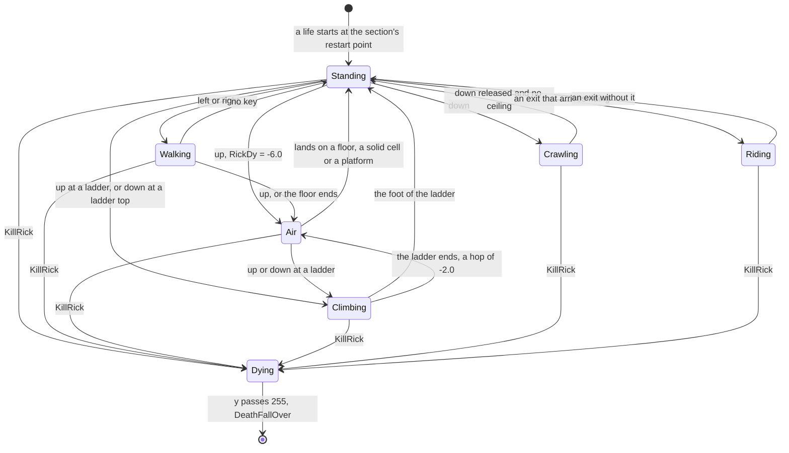

The sprite follows the state (`PickRickSprite`):

| State | Sprite |
| --- | --- |
| climbing | 13 or 14, by (x XOR y) bit 2 |
| in the air | 8 (crawling: the crawl frames) |
| punching | 1, or 10 while `PunchTimer` runs |
| shooting | 9 |
| a detonator out | 0, or 11 while it slides (a throw) |
| sliding on ice | 0 |
| walking | the walk cycle |
| dying | 15 and 16, two passes each |
| riding | 12 |

The point: one record and five flags carry all of Rick.
Each state is a branch of one routine, run once a pass.

Witness: `UpdateRick` L1 119 409 in 74 builds (50 260 passes in 65 builds); `PickRickSprite` 46 336 runs in 62;
`ClimbLadder` 3737 runs in 38; `UpdateRide` 3045 runs in 6 (`src/game/rick.asm`).

## 10.2 Gravity and the jump

Every pass that is not a death, a ride or a climb starts the same way:

1. `RickDy` gains 0.5, up to 8.0.
2. The 24-bit y (`RickY` and `RickYFrac`) moves by `RickDy`.
3. The box test reads the cells and the platforms at the new place.
4. `RickLandOrFall` `$9663` decides what that means.

```
UpdateRick (not dying, riding or climbing):
    PunchTimer = max(PunchTimer - 1, 0)
    RickDy = min(RickDy + 0.5, 8.0)
    y24 += RickDy
    flags = TestCrawlBox(x, y) if crawling else TestBodyBox(x, y)   ; cells, then platforms and blocks
    if flags.deadly:                        KillRick                 ; the call at $9668
    elif flags.on_object:                   y = PlatformTop - 21; stand
    elif flags.floor, or solid and falling: y = ((y + 12) OR 7) - 20; RickDy = 1.0; on the ground
    elif flags.solid and rising:            the head bumps: RickDy = 1.0
    else:                                   in the air
    on the ground, up held: RickDy = the jump speed (-6.0; 10.3 for the special surfaces)
```

```
9619  LD HL,(RickDy)
961C  LD DE,$0080        ; + 0.5
961F  ADD HL,DE
9620  LD A,H
9621  AND A
9622  LD B,$FF
9624  JP M,RickStoreDy   ; rising: no limit to test
9627  INC B
9628  CP $08             ; 8.0 or more?
962A  JP C,RickStoreDy
962D  LD HL,$0800        ; the limit: 8 pixels a pass
...
9736  LD DE,$000C        ; RickOnFloor: the feet onto the cell edge
9739  ADD HL,DE
973A  LD A,L
973B  OR $07
973D  LD L,A
973E  LD DE,-20
9741  ADD HL,DE
9742  LD (RickY),HL
9745  XOR A
9746  LD (RickYFrac),A
9749  LD HL,$0100        ; RickDy = 1.0 while standing
```

Standing is falling at 1.0 and landing again each pass: the box test finds the floor every time.
The jump key sets `RickDy` to the jump speed only from that state (`RickReadJump` `$97C5`).

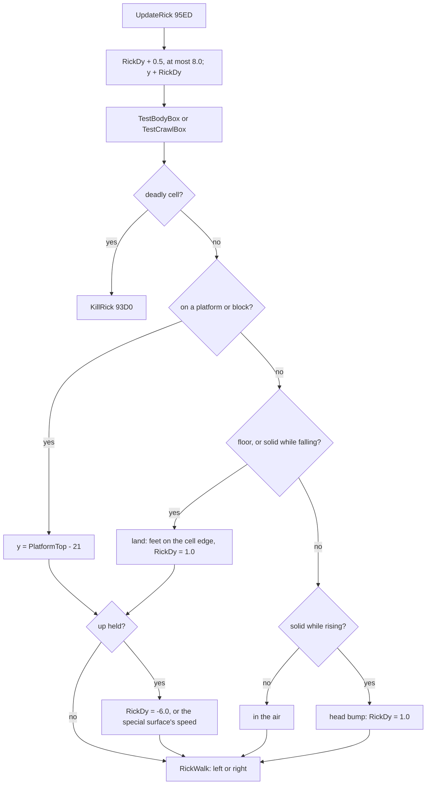

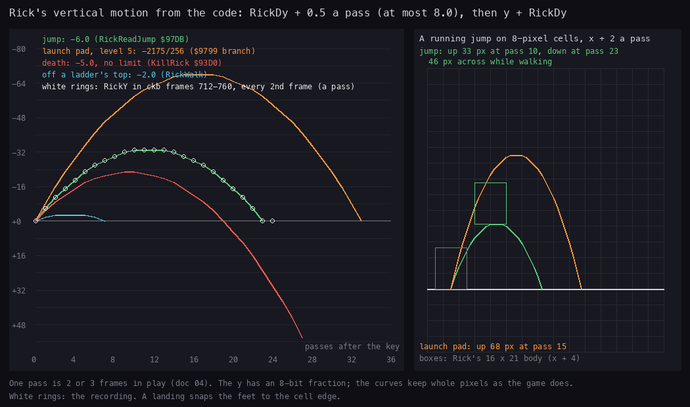

*The curves come from the code: the jump (-6.0), the launch pad of level 5 (-2175/256), the death (-5.0, no limit)
and the hop off a ladder's top (-2.0). The rings are `RickY` in `controls-keyboard` frames 712-760, one a pass.
Right: a running jump on the cells. Made with `python3 tools/fig_play.py jump --work work/docs/wr/ckb --window
712-760 docs/img/play/jump.png`.*

How to read it: the rings sit on the green curve, so the model is the code.
A jump rises 33 pixels, a little over four cells, and takes 23 passes.
Walking, Rick covers 46 pixels in that time.


*`controls-keyboard` frames 706-766, every 2nd frame (one pass), shown at half speed: O jumps from x 60, y 227.
Left: the screen with Rick's box. Right: his variables and the charts of `RickY` and `RickDy`. Made with `python3
tools/fig_play.py anim --work work/docs/wr/ckb --from 706 --to 766 --step 2 --chart rick --title "..."
docs/img/play/jump.gif`.*

**A worked example: the jump in `controls-keyboard`.**

| Frame | `RickDy` | `RickY` | What |
| ---: | ---: | ---: | --- |
| 712 | -6.0 | 227 | the pass before set the jump speed |
| 714 | -5.5 | 221 | 227 - 5.5 = 221.5: y 221, fraction `$80` |
| 716 | -5.0 | 216 | |
| 732 | -1.0 | 194 | |
| 734-738 | -0.5 to 0.5 | 194 | the top, 33 pixels up |
| 758 | 5.5 | 227 | the feet reach the floor again |
| 760 | 1.0 | 227 | landed: the snap, and `RickDy` = 1.0 |

The pass is 2 frames throughout, so the 23 passes take 46 frames: 0.92 s.

The point: the whole arc comes from two numbers, -6.0 and +0.5 a pass; there is no jump table.
The jump has no sideways speed of its own.
The walk keys move Rick 2 pixels a pass in the air, as on the ground.

Witness: the table is read from `controls-keyboard` (TTD `memory_at`, every 2nd frame).
`RickLandOrFall` ran 46 352 times in 62 builds and `RickCellCollision` 43 705 times (`src/game/rick.asm`).

## 10.3 Walking, crawling, climbing and the special surfaces

`RickWalk` `$988F` reads left and right after the vertical part.
The step is 2 pixels a pass.
`RickMoveX` adds the step and `PlatformDx` (a moving platform carries Rick), then tests the box at the new x.

```
RickMoveX(step):
    x += step + PlatformDx
    if x < 0:    x = 0;    ExitDirection = 1      ; to the section on the left
    if x > $E8:  x = $E8;  ExitDirection = 2      ; to the section on the right
    flags = the box test at the new x, as a sideways probe
    if flags.deadly: KillRick                       ; the call at $9988
    if flags.solid:  x = the cell's edge            ; ((x + 12) AND $F8) - 4 going left, ((x + 3) AND $F8) - 4 going right
    if climbing and no ladder cell is left: the climb ends
```

A ladder starts a climb two ways.
In the air or standing, up or down over a ladder cell (bit 3) sets `RickClimbing`.
Standing on a ladder's top (bit 4), down alone starts a climb down, when x is near the ladder's middle:

```
96F0  BIT 4,A            ; RickLanded: a ladder's top under the feet?
96F2  JP Z,RickOnFloor
...
9703  LD A,(Controls)
9706  AND $10            ; fire held: no climb
9708  JP Z,RickOnFloor
970B  LD A,(Controls)
970E  BIT 2,A            ; down held?
9710  JP NZ,RickOnFloor
9713  LD A,(RickX)       ; only near the ladder's middle
9716  LD E,A
9717  AND $1F
9719  CP $0A
971B  JP NC,RickOnFloor
971E  LD A,E
971F  AND $F0
9721  OR $04             ; x onto the ladder
9723  LD (RickX),A
9726  XOR A
9727  DEC A
9728  LD (RickClimbing),A
```

The climb (`ClimbLadder` `$9AB7`) moves y by 2 pixels a pass on an even y: up -2, down +2, no key 0.
When no ladder cell is left, the climb ends.
If Rick was going up, `RickDy` becomes -2.0: a small hop onto the floor (33 times in the builds).

The crawl (down on the ground) uses `TestCrawlBox`.
Its top row does not stop Rick: it only sets `CeilingOverCrawl` when something solid is over him.
He stays down while that is set, and stands up when it clears and down is released.

The cells' flag bit 0 is a "special surface", and it means something else in each level:

| Level | Special surface | Code | What it does |
| ---: | --- | --- | --- |
| 1 | a weak jump | `WeakJumpLevel1` `$9799` | the jump speed is -2.0 (one cell kind only; never run) |
| 2 | ice | `RickWalk`, `RickNoWalk` | the walk animation runs fast (`IceStep` = 2); standing, Rick slides 2 pixels a pass the way he faces |
| 3 | a bounce | `RickOnFloor` `$972E` | landing at 2.0 or more: `RickDy` = NOT `RickDy` + `$60`/256; up then gives -2175/256 |
| 4 | mud | `RickWalk` | the walk step is 1 (`MudStep`) |
| 5 | a launch pad | `LaunchPadLevel5` `$979F` | `RickDy` = -2175/256 with no key: Rick is thrown up |

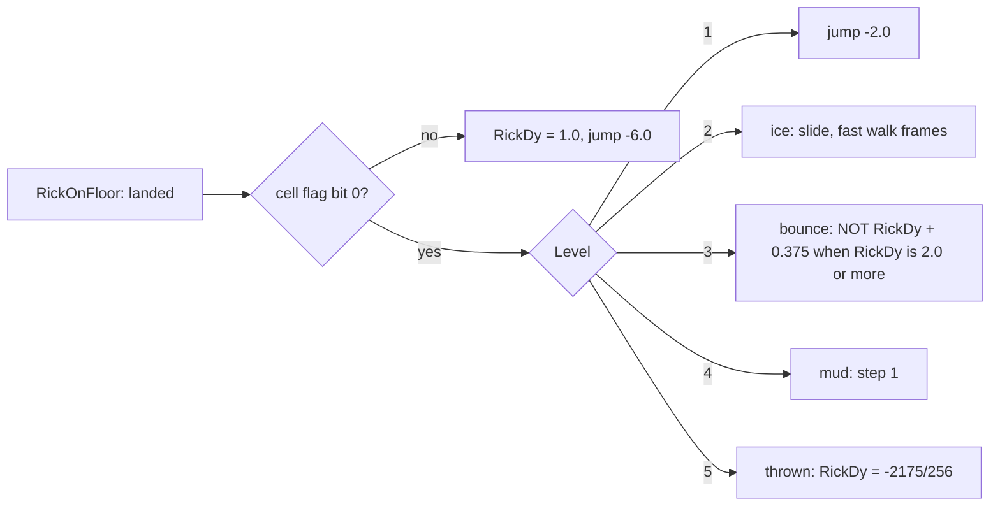

**A worked example: the launch pad.**
-2175/256 is -8.496.
With +0.5 a pass, Rick rises for 16 passes and climbs 68 pixels (the orange curve of the figure): eight and a half
cells.
He leaves the pad with no key, and the walk keys still steer him.
On level 3, a landing at 4.0 bounces back at NOT `$0400` + `$60` = `$FC5F`: -3.63, and a held up key gives -8.5.
Below 2.0 the bounce is lost and Rick rests (`BounceRest` `$9777`).

The point: one flag bit and the level number give five different floors with five short branches of code.

Witness: `LaunchPadLevel5` ran 719 times in 10 builds (levels 2 and 4 pass through it to the normal jump); the launch
5 times (`rzx-l5-16000-poke`).
The mud branch ran 34 + 253 times (level 4) and the ice 133 + 104 (level 2).
The bounce ran 4 times and `BounceRest` 23 (`rzx-l3-04000-poke`).
`WeakJumpLevel1`: not executed in any recording (`src/game/rick.asm`).

## 10.4 The ride

Some sections are crossed in a vehicle.
An exit with bit 5 sets `RideMode` ([doc 07 7.2](07-objects.md#72-the-section-table-and-the-exits)), and Rick arrives
riding.
The recordings ride in level 2 section 6, level 4 sections 4 and 5, and level 5 section 2.
Level 1's section 2 has one more such exit, into section 0; no recording took it.

`UpdateRide` `$945E` replaces the walk and the jump:

```
UpdateRide:
    RickDy = min(RickDy + 0.25, 4.0)            ; gravity
    up alone: RickDy = max(RickDy - 0.75, -4.0)  ; net -0.5 a pass
    down:     RickDy = min(RickDy + 0.5, 4.0)
    y24 += RickDy; a solid cell or a floor stops it (RickDy = 0)
    left or right: x += 4 or -4 (and the facing); the view's sides are exits, walls snap x as in RickMoveX
    the sprite is 12
    fire (released between shots, no bullet flying): FireBullet, no up key needed
```

```
945E  LD HL,(RickDy)        ; UpdateRide: gravity 0.25
9461  LD DE,$0040
9464  ADD HL,DE
...
9572  LD HL,Sprites+12*128  ; RideSprite: sprite 12
9575  LD (RickSprite),HL
9578  LD A,(Controls)
957B  BIT 4,A               ; fire held?
957D  JP Z,RideFire
9580  XOR A                 ; released: the latch clears
9581  LD (FireLatch),A
9584  RET
9585  LD A,(FireLatch)      ; RideFire
9588  AND A
9589  RET NZ
958A  LD A,(BulletRecord)   ; one bullet at a time
958D  AND A
958E  RET NZ
958F  CALL FireBullet
```

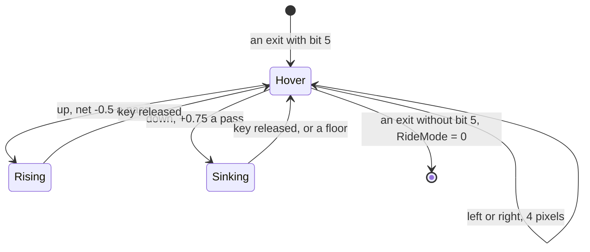

**A worked example.**
From rest, holding up gives `RickDy` -0.5, -1.0, ... down to the limit -4.0 after 8 passes.
Releasing it, gravity of 0.25 a pass takes 16 passes to bring -4.0 back to 0.
So the vehicle drifts on: it flies, it does not jump.

The point: the vehicle is a second movement model in the same record, chosen by one flag that only the exits set.

Witness: `UpdateRide` ran 3045 times in 6 builds (`rzx-l2-20000-poke`, `rzx-l2-22000-poke`, `rzx-l4-10000-poke`,
`rzx-l4-12000-poke`, `rzx-l5-06000-poke`, `rzx-l5-08000-poke`); `FireBullet` from the ride (`$958F`) 15 times
(`src/game/rick.asm`, `src/game/weapons.asm`).

## 10.5 The gun

Fire with up shoots (`RickShootUp` `$9AE8`).
One bullet flies at a time.
The fire key must be released between shots (`FireLatch` `$9BA8`).

```
FireBullet(keys):
    if not CheatInfinite:
        if Ammunition == 0: return
        Ammunition -= 1; DrawAmmo
    PlayEffect(4)
    bullet.on = 1; bullet.y = RickY + 8; bullet.x = RickX
    left key, or no key and facing left: BulletDx = -8, facing left
    else:                                BulletDx = +8, facing right
    FireLatch = $FF

MoveBullet (each pass while on):
    if the point (x + 4, y + 4) is solid: bullet.on = 0
    x += BulletDx; it ends below 0, or at $F8 and over
```

```
959A  LD A,(Ammunition)
959D  AND A
959E  RET Z              ; none left: no shot
959F  DEC A
95A0  LD (Ammunition),A
95A3  CALL DrawAmmo
95A6  LD A,$04           ; FireBulletLaunch: effect 4
95A8  CALL PlayEffect
95AB  LD A,$01
95AD  LD (BulletRecord),A
95B0  LD HL,(RickY)
95B3  LD DE,$0008        ; from Rick's chest
95B6  ADD HL,DE
95B7  LD (BulletY),HL
```

What the bullet hits is tested by its targets, not by `MoveBullet`.
Each enemy tests it (`TestEnemyHits` `$8BF3`), and so do the traps whose trigger boxes take the bullet, the pickups
and the Fat Guy.
A hit spends the bullet (`BulletRecord` = 0).

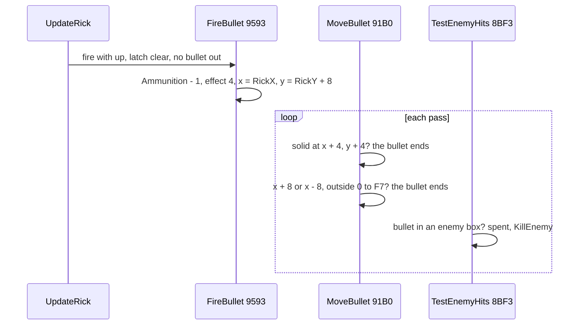

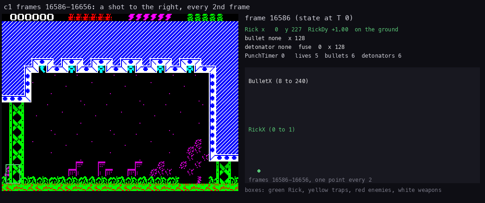

*`c1` frames 16 586-16 656, every 2nd frame, shown at half speed: Rick at x 0 fires right; the white box is the
bullet. Made with `python3 tools/fig_play.py anim --work work/docs/wr/c1 --from 16586 --to 16656 --step 2 --chart
bullet --title "..." docs/img/play/shot.gif`.*

**A worked example: the shot in `c1`.**

1. At frame 16 592 the bullet is on with `BulletX` 8.
   In the pass before, `FireBullet` put it at Rick's x 0, and the same pass's `MoveBullet` moved it 8.
2. It then reads 16, 24, and so on, one step every 2 frames, up to 240 at frame 16 650.
3. At the next pass 240 + 8 = 248 is past `$F7`, and frame 16 652 shows it gone.
4. That is 30 positions: it crossed the view in 0.6 s.
5. The bullets in the HUD fell from 6 to 5.

The point: the bullet is fast (8 pixels a pass, against Rick's 2) but single.
A missed shot holds the gun until it leaves the view.

Witness: the positions come from `c1` (`memory_at`, every 2nd frame).
`FireBullet` made 88 shots in 43 builds; `MoveBullet` ran 755 times; `TestEnemyHits` records 43 kills by the bullet
(`src/game/weapons.asm`, `src/game/enemies.asm`).

## 10.6 The detonator and its blast

Fire with down drops a detonator (`DropDetonator` `$9B27`), one at a time.
The walk keys throw it (`$9B68-$9B86`): no sideways key, `DetonatorDx` 0; left alone, -2.0; right, or both keys
together, +2.0 (the code tests `Controls` AND 3 for 3, then for 1, and takes anything else as right).
It starts at Rick's x and y + 5, falling at +1.0, with the fuse at 64.

Each pass `UpdateDetonator` `$91EB` moves it while the fuse is 11 or more.
It falls like Rick (+0.5 a pass, at most 8), lands on floors and platforms, and slides.
Friction takes 1/32 pixel a pass off its sideways speed.
Then `BurnFuse` `$9351` counts the fuse down.

```
BurnFuse:
    fuse -= 1; if fuse == 0: the detonator ends
    if fuse >= 10:
        if fuse == 10: PlayEffect(5)                  ; the bang
        if fuse AND 3 == 0: PlayEffect(2)             ; the hiss (the call at $9386)
        sprite = 18 if fuse >= 20 else 19
    else:
        sprite = ExplosionFrames[fuse AND $FE]        ; 24, 23, 22, 21, 20
        if 4 <= fuse <= 9 and a 32 x 21 box from x - 4 touches Rick: KillRick
```

```
9398  LD A,(DetonatorFuse)
939B  CP $04
939D  RET C              ; fuse 1-3: the blast does not hurt any more
939E  CP $0A
93A0  RET NC             ; fuse 10 and over: no blast yet
93A1  LD HL,(DetonatorY)
93A4  LD A,(DetonatorX)
93A7  SUB $04
93A9  JP NC,BlastTestRick
93AC  XOR A              ; not below 0
93AD  LD E,A             ; BlastTestRick
93AE  LD BC,$1520        ; 32 wide, 21 high
93B1  CALL TouchesRick
93B4  JP C,KillRick
```

The same six passes (fuse 9 to 4) hurt everything else:

- `TestEnemyHits` tests each enemy with `BlastHits` `$8CAE` (from `$8C1C`), over the enemy's box widened to 24; a hit
  kills the enemy.
- A trap whose trigger box takes the blast reacts to it.
- An ammunition or detonator pickup in the blast bursts (`$A5F7`).
- The Fat Guy counts one hit for each of those passes (10.12).

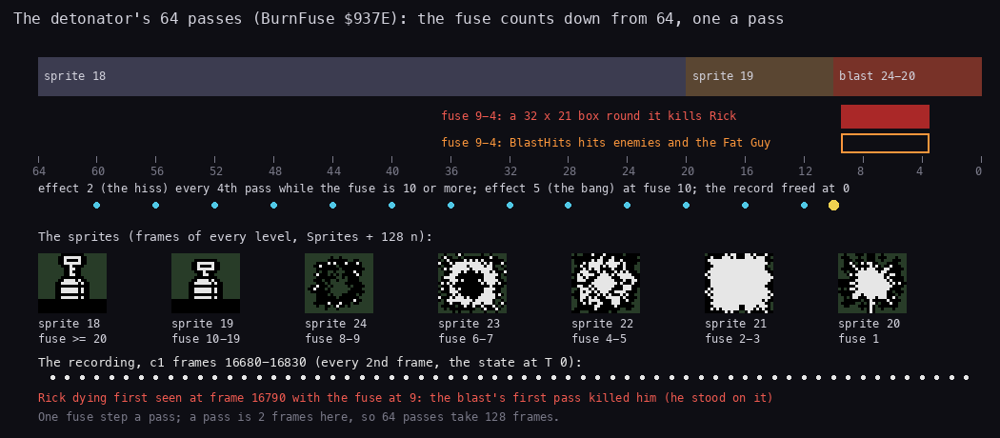

*From `BurnFuse`: the sprite at each fuse value, the hiss every 4th pass, the bang at 10, and the passes that hurt.
The white dots are `DetonatorFuse` in `c1` frames 16 680-16 830. Made with `python3 tools/fig_play.py fuse --work
work/docs/wr/c1 --window 16680-16830 docs/img/play/fuse.png`.*

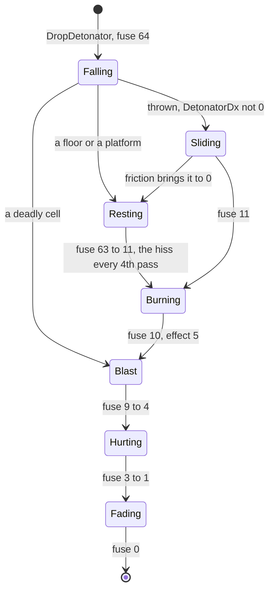

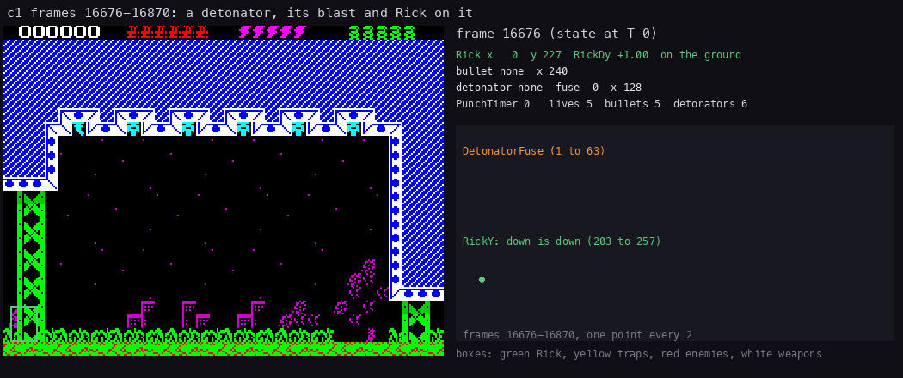

*`c1` frames 16 676-16 870, every 2nd frame, shown at half speed: Rick drops a detonator where he stands, the fuse
burns, the blast catches him and he falls. Made with `python3 tools/fig_play.py anim --work work/docs/wr/c1 --from
16676 --to 16870 --step 2 --chart detonator --title "..." docs/img/play/blast.gif`.*

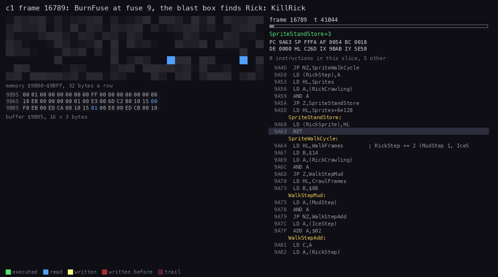

*`c1` frame 16 789, T 41 000-43 200: `BurnFuse` at fuse 9 picks the blast sprite, tests the box against Rick and
jumps to `KillRick`. The buffer is Rick's and the weapons' variables from `$9B95`. Made with `python3
../../kit/routine_anim.py --work work/docs/wr/c1 --window 16789:41000-16789:43200 --listing build/game.lst --out
docs/img/routines/BurnFuse.gif --pc 9351-93BF,93D0-945D --range 9B00-9BFF --view buffer:9B95:16x3:hex --pictures
50 --title "..."`.*

**A worked example: the blast in `c1`.**

1. Frame 16 682: the detonator is out with fuse 63, at x 0 under Rick (x 0, y 227): dropped standing, no throw.
2. One fuse step a pass, 2 frames a pass: fuse 10 at frame 16 788 (effect 5).
3. Frame 16 789, T 41 136: `BurnFuse` takes the fuse to 9.
4. T 41 622: `TouchesRick` finds Rick in the box; T 41 632: `KillRick` (the jump at `$93B4`).
5. Frame 16 790: Rick is dying at x 2, y 222, `RickDy` -4.5.
6. The fuse runs on to 0, and the blast's sprites play out.

`controls-keyboard` shows the same at frames 1002-1110: the drop, fuse 10 at frame 1108, Rick dying at 1110.

The point: the blast is a box with a time window, six passes long.
Standing next to it in those passes is death; standing next to it before fuse 9 is safe.
A detonator thrown left cannot stop before its fuse ends: friction needs 64 passes to stop -2.0, and the fuse moves
it for 53.

Witness: the trace of `c1` 16 788-16 791 (`KillRick` from `$93B4`).
`BurnFuse` ran 3397 times in 34 builds; the bang 56 times; `KillRick` called from the blast 32 times (10.10).
56 detonators were placed: 24 dropped standing, 6 thrown left, 26 right (`src/game/weapons.asm`).

## 10.7 The punch

Fire with left or right punches, once a press (`PunchStart` `$9821`).
The punch has no record: it is a point and a timer.

```
PunchStart(keys):
    if keys == PunchKeys: return              ; still held: no new punch
    PunchKeys = keys; PunchTimer = 10
    left:  facing left;  PunchX = RickX       ; 4 pixels left of the body
    right: facing right; PunchX = RickX + 24  ; 4 pixels right of the body
    PunchY = RickY + 8
fire released, or fire with no sideways key: PunchKeys = 0, PunchTimer = 0

TestEnemyHits, for each enemy, while PunchTimer runs:
    if (PunchX, PunchY) is in the enemy's 16 x 21 box:
        PlayEffect(9); enemy.stun = 40 passes
    if the enemy's box touches Rick: KillRick  ; tested after the punch, stunned or not
```

```
8C3B  LD A,(PunchTimer)  ; EnemyPunchTest
8C3E  AND A
8C3F  JP Z,EnemyTouchTest
8C42  LD A,(IX+$01)
8C45  ADD A,$04          ; the enemy's box from x + 4
8C47  LD E,A
8C48  LD L,(IX+$02)
8C4B  LD H,(IX+$03)
8C4E  LD BC,$1510        ; 16 wide, 21 high
8C51  CALL PunchHits
8C54  JP NC,EnemyTouchTest
8C57  LD A,$09           ; effect 9
8C59  CALL PlayEffect
8C5C  LD (IX+$16),$28    ; stunned for 40 passes
8C60  LD BC,$1510        ; EnemyTouchTest
8C63  CALL TouchesRick
8C66  RET NC
8C67  CALL KillRick
```

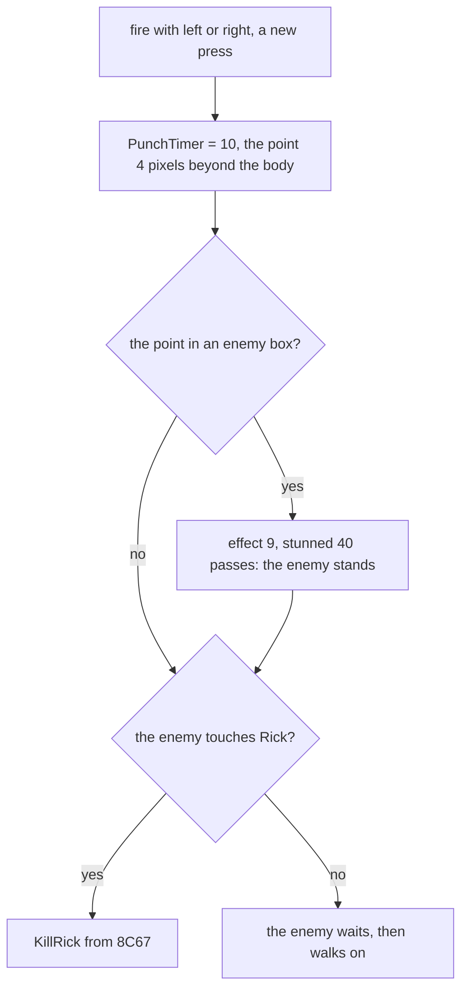

**A worked example: the punch's window.**

1. Rick faces right at x = r, so the point is at r + 24.
2. An enemy's box starts at e (its x + 4) and is 16 wide.
3. The punch lands when r + 24 lies in e to e + 15: e from r + 9 to r + 24.
4. The touch kills Rick when e is from r - 11 to r + 19 (`TouchesRick` `$8D53`: (r + 4) - e below 16 one way, e - (r
   + 4) below 16 the other).
5. So the punch is safe only for e from r + 20 to r + 24: a window of 5 pixels, about two passes of a walking enemy.
6. Facing left, the point is at r: it lands for e from r - 15 to r, and the touch kills from r - 11, so the window is
   e from r - 15 to r - 12: 4 pixels, the mirror one pixel narrower.
7. A stunned enemy still kills on touch: the touch test at `$8C60` runs every pass, after the punch test, stunned or
   not; the stun only stops its walk.

In `controls-keyboard`, frames 932-940, `PunchTimer` reads 10, 9, 8, 7, 6 with no enemy near.
The key is released at frame 942, and the timer is cleared at once.

The point: the punch does not kill.
It buys 40 passes, and only at the right distance.

Witness: the punch stunned an enemy 9 times (`$8C57`: `rzx-l1-24000-poke`, `rzx-l5-12000-poke`); `TestEnemyHits` ran
49 093 times in 69 builds (the L1 index, `python3 tools/l1q.py 8BF3`); an enemy touched Rick 624 times (`$8C67`
reached, nearly all in the immunity-POKE builds, whose POKE replaces that call) and called `KillRick` 18 times
(10.10) (`src/game/enemies.asm`).

## 10.8 The traps and their triggers

A trap is a record of table A (`$7B8F`, 24 bytes), placed by a map entry of kind below `$74`
([doc 07 7.3](07-objects.md#73-map-entries-and-trigger-boxes)).
Its kind gives the size, the deadly flag, a path and an animation, and often a second path and animation.
Its entry gives the trigger behaviour and 0 to 3 trigger boxes.
Each box names who sets it off: Rick, the bullet, the blast, the punch, an enemy, another trap, or (bit 6) each pass.
What a fired box does is the behaviour ([doc 07 7.6](07-objects.md#76-the-traps)):

- pause or resume the path;
- switch to the second path now, or at the path's end;
- remove the trap;
- keep the trap only while the box is held.

A deadly trap (flags bit 6) sets off a lit detonator it touches (with +0 bit 7: a solid block), kills every enemy it
overlaps that is not already dying, then Rick, unless he is already dying:

```
UpdateTrap, each pass, after the path step and the animation:
    if trap.deadly and trap.sprite:
        if trap +0 bit 7 and DetonatorFuse >= 10                         ; a lit detonator, not yet exploding
           and the trap's box overlaps (DetonatorY, DetonatorX + 8, 16 x 8):
            PlayEffect(5); DetonatorFuse = 9                             ; $A41C: it goes off now
        for each enemy, +0 not 0 and +$14 == 0 (not dying, $A447),
            whose box overlaps the trap: KillEnemy                       ; the call at $A454
        if not RickDying and the trap's box touches Rick: KillRick       ; the call at $A475
    TestTriggerBoxes(trap's entry)                                       ; its own boxes, then the behaviour
```

The levels' objects, counted from `src/res/levels/levelN/level/sections.txt` (`python3 tools/fig_play.py stats`):

| Level | Enemies (patrol / chaser / climber) | Trap entries (deadly) | Treasures | Ammunition | Detonators | Bonus start / stop | Trigger boxes: Rick / bullet / blast / punch / enemy / trap / each pass |
| ---: | --- | --- | ---: | ---: | ---: | --- | --- |
| 1 | 25 (10 / 7 / 8) | 76 (50) | 9 | 6 | 5 | 5 / 5 | 64 / 0 / 8 / 19 / 1 / 12 / 11 |
| 2 | 44 (17 / 17 / 10) | 106 (100) | 14 | 7 | 8 | 9 / 9 | 95 / 7 / 27 / 12 / 1 / 12 / 11 |
| 3 | 47 (23 / 5 / 19) | 136 (86) | 6 | 9 | 2 | 8 / 8 | 144 / 0 / 5 / 15 / 1 / 24 / 24 |
| 4 | 45 (29 / 9 / 7) | 134 (111) | 14 | 7 | 8 | 8 / 8 | 107 / 4 / 13 / 20 / 0 / 31 / 42 |
| 5 | 29 (9 / 12 / 8) | 110 (87) | 3 | 4 | 3 | 4 / 4 | 69 / 1 / 43 / 4 / 0 / 5 / 57 |

How to read it:

- Most boxes wait for Rick.
- The punch opens blocks, mostly in levels 1, 3 and 4.
- Level 5 asks for the blast most (43 boxes): its walls fall to detonators.
- A box that waits for a trap makes a chain: one trap's path runs through another's box.

The sheets below show every trap kind each level places, with its first frame:

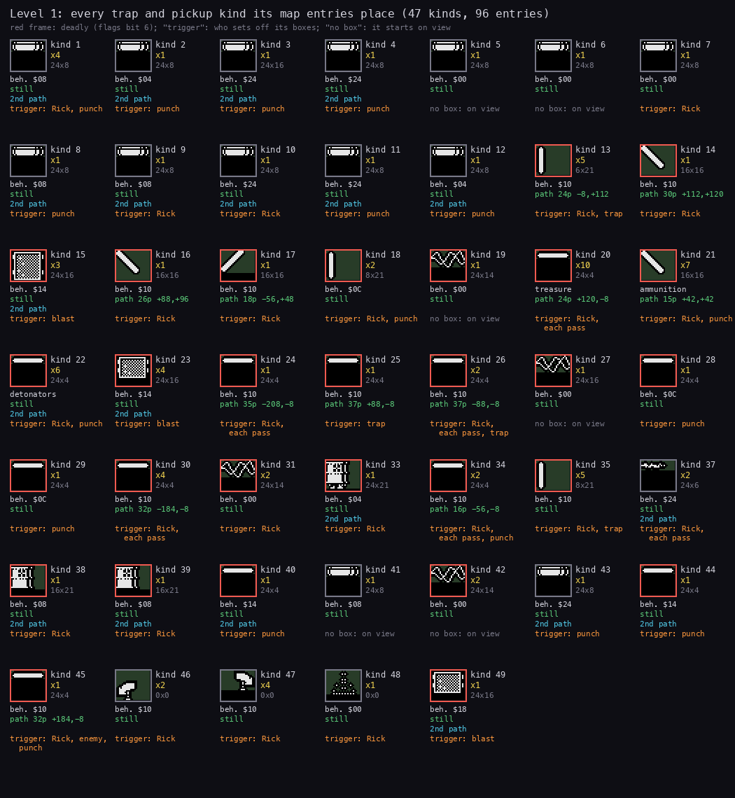

*Level 1: each kind its map entries place, with its first animation frame (a red frame: deadly), its size, its
behaviour, its path in short (passes and the total x, y steps), whether it has a second path, and who sets off its
boxes. Made with `python3 tools/fig_play.py traps --level 1 docs/img/play/traps-level1.png`; the same with
`--level 2` to `--level 5` for the sheets that follow.*

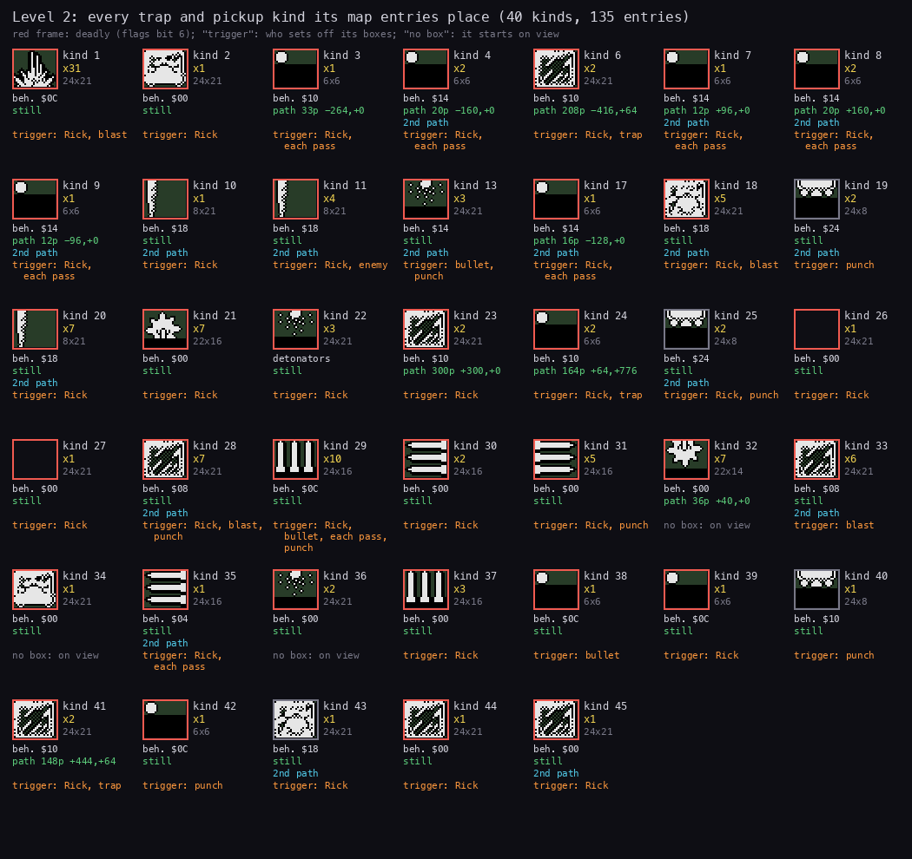

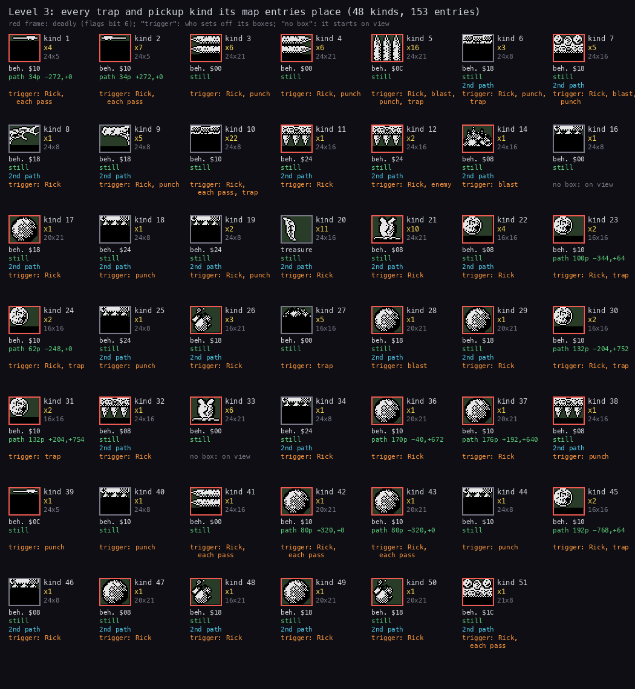

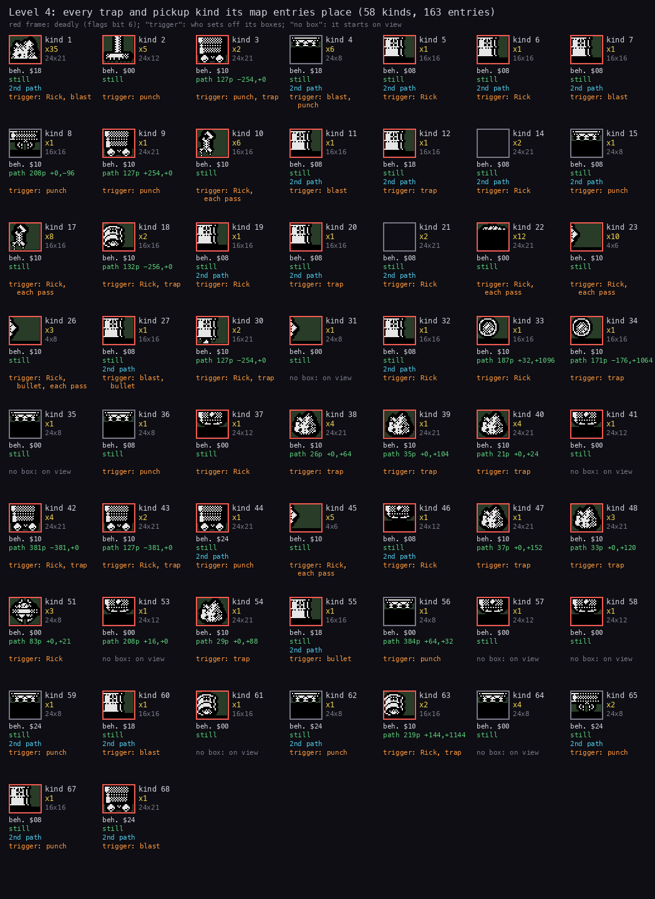

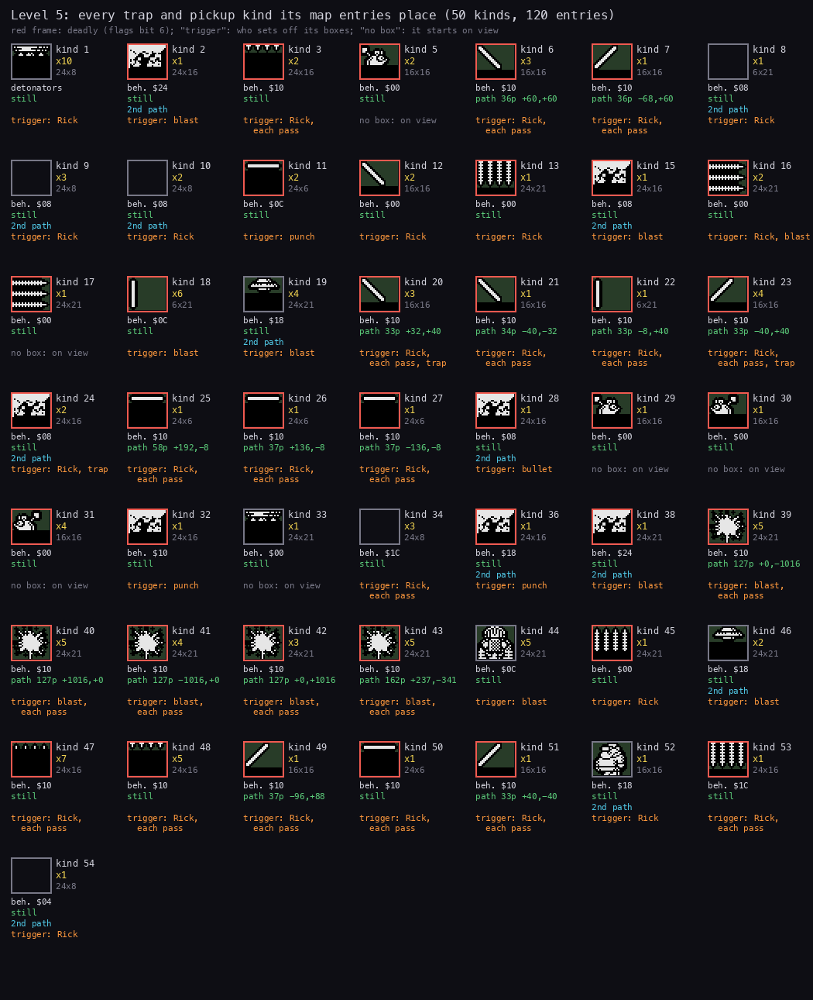

How to read them:

- The grey-framed blocks (24 x 8, 24 x 16) are the platforms and walls that a punch or a blast removes.
- The red 6 x 21 and 8 x 21 shapes are spears and darts that fall or fly.
- The 16 x 16 diagonals are rolling or swinging hazards.
- The 24 x 4 strips are floors that move.

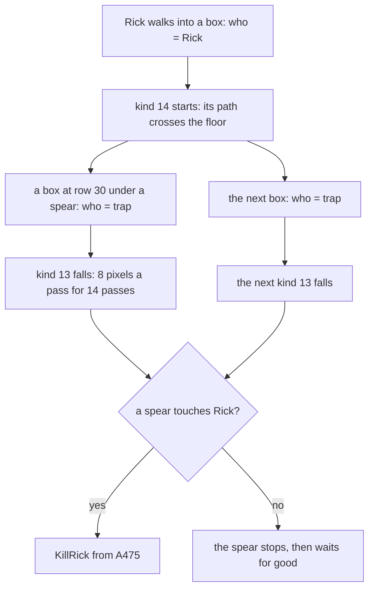

**A worked example: level 1 section 0.**
The section's entry list (`src/res/levels/level1/level/sections.txt`) holds five kind-13 entries and one kind-14 entry,
all with behaviour `$10` (run the path once).

- Kind 13 is 6 x 21 and deadly, with the path `14*(0,7) 1*(-8,0) 9*(0,0)`: down 8 pixels a pass for 14 passes (7
  means 8), a step left, then still.
- Kind 14 is 16 x 16 and deadly, with the path `20*(6,6)`: diagonally down.
- The kind-14 entry waits for Rick in a box of 8 x 6 cells.
- All five kind-13 entries wait for a trap in a box of 3 x 1 cells at row 30; the one at column `$09` also has a Rick
  box (x 96, row 24, 1 x 7 cells).

What `c1` shows:

1. Rick walks right from x 114 at frame 17 400 and jumps at frame 17 482.
2. At frames 17 500, 17 503 and 17 506, trap record 0 (`$7B8F`) is a kind-13 spear at x 200, falling: y 168, 176, 184.
3. Rick is at x 196, y 197, near the top of his jump.
4. The trace puts the deadly test's call at `$A475` at frame 17 505, T 49 963, with IX = `$7B8F`.
5. `KillRick` follows at T 49 980.

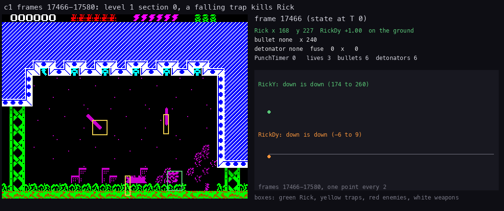

*`c1` frames 17 466-17 580, every 2nd frame, shown at half speed: level 1 section 0. The spears fall (yellow boxes),
Rick jumps into one and dies. Made with `python3 tools/fig_play.py anim --work work/docs/wr/c1 --from 17466 --to
17580 --step 2 --chart rick --title "..." docs/img/play/trap-death.gif`.*

The point: a trap is data: a size, a path, an animation, boxes and a behaviour.
The same code runs all 562 trap entries of the five levels.

Witness: the `c1` trace 17 503-17 506 (`$A475` at 17 505:49 963, IX = `$7B8F`).
`UpdateTrap` ran 148 725 times in 61 builds; deadly traps killed enemies 220 times (l1q's callers of `KillEnemy` at
`$A454`, 102 of them in `sec-l5-s5`) and `KillRick` was called 8 times from `$A475` (10.10); behaviour `$0C` was
removed by its box 432 times (`src/game/traps.asm`).

## 10.9 The enemies

An enemy is a record of table B (`$7C20`, 23 bytes), placed by a map entry of kind `$74` to `$7F`, except `$78` and
`$7C` (the bonus boxes).
The kind's bits 0-1 give the behaviour, and bit 2 the sprite set (clear: the second set, 6 sprites on).
The entry's +3 bits 2-5 give the patrol length.

| Bits 0-1 | Behaviour | Routine | Entries | What it does |
| ---: | --- | --- | ---: | --- |
| 0 | wanderer | `EnemyWanderer` `$9FF7` | 0 | walks; on the 16-pixel grid, one chance in 4 of a random new direction |
| 1 | patrol | `EnemyPatrol` `$A06E` | 88 | walks a fixed count of passes, turns, again |
| 2 | chaser | `EnemyChaser` `$A025` | 50 | on the grid at a floor, half the time turns towards Rick, else at random |
| 3 | climber | `EnemyWanderer` | 52 | wanders, and climbs a ladder after Rick when he is above |

No map entry places a wanderer: behaviour 0 runs only as part of the climber.
All enemies walk 2 pixels a pass and fall under the same gravity as Rick
([doc 07 7.7](07-objects.md#77-the-enemies)).

How an enemy ends:

| Cause | Test | Points in view (off view) | Effect in view |
| --- | --- | --- | ---: |
| the bullet in its box | `BulletHits` from `TestEnemyHits` | 50 (0) | 10 |
| the blast, fuse 9-4 | `BlastHits` from `TestEnemyHits` | 50 + 50 (50: `$8C36` pays before `KillEnemy`) | 10 |
| a deadly trap overlapping it | `UpdateTrap` (`$A454`) | 50 (0) | 10 |
| a deadly cell under it | `EnemyVertical` (`$A0E8`) | 50 (0) | 10 |
| the punch | `PunchHits` | none: stunned 40 passes | 9 |

`KillEnemy` `$9F56` gives the 50 points and effect 10 only when the enemy is in the shown part of the view (y high
byte 0 and y `$40` to `$FF`, `$9F56-$9F62`); off the view an enemy dies silently, for nothing (the blast's own 50
excepted).
Then the enemy jumps (-5.0) and falls off the view, drifting towards the middle, like Rick's death.

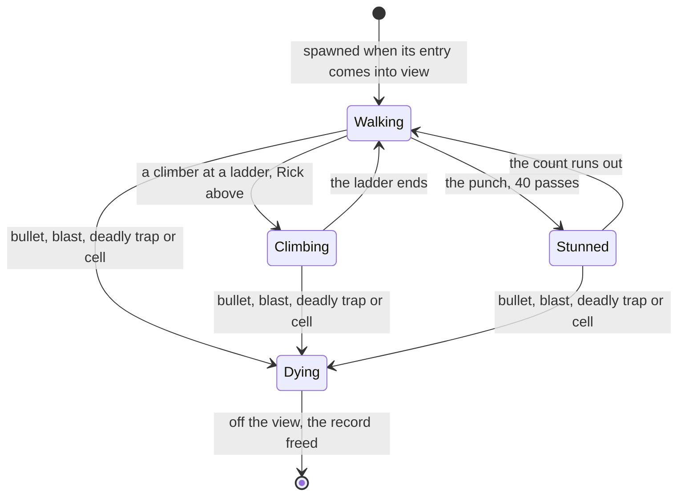

```
9F65  LD A,$0A           ; KillEnemy: effect 10
9F67  CALL PlayEffect
9F6A  LD HL,Points50
9F6D  CALL AddScore
```

**A worked example: who kills the enemies.**
`KillEnemy` ran 302 times in 48 builds: 220 from deadly traps (`$A454`; 102 of them in `sec-l5-s5`), 34 from deadly
cells (`$A0E8`) and 48 from `EnemyHitsAndSprite` (`$9ED1`), which are `TestEnemyHits`' 43 bullet kills (`$8C13`) and
5 blast kills (`$8C33`).
So in the RZX run, most enemies died under the traps and on the spikes, not to Rick's weapons.

The point: three placed behaviours share one walk.
The difficulty comes from where the level designer put them, not from what they think.

Witness (the L1 index, `python3 tools/l1q.py`): `UpdateEnemy` ran 52 717 times in 75 builds; `EnemyPatrol` 27 224,
`EnemyChaser` 12 139, `EnemyWanderer` 9 734 (the rest are dying enemies, `EnemyFalling` 3 620); `KillEnemy` 302 times in
48 builds, 101 of them in view (`AddScore` from `$9F6D`, 10.11) (`src/game/enemies.asm`).
The entry counts come from `sections.txt` (`python3 tools/fig_play.py stats`).

## 10.10 Every death, the restart and GAME OVER

`KillRick` `$93D0` has seven callers:

| Caller | What | Calls (entries) in the builds |
| --- | --- | ---: |
| `$8C67` | an enemy's touch | 18 |
| `$9668` | a deadly cell under Rick | 13 |
| `$93B4` | his own detonator's blast | 32 |
| `$A475` | a deadly trap | 8 |
| `$9988` | a deadly cell met sideways | 3 |
| `$FACB` | the Fat Guy's shot (level 5's code) | 4 (`fatguy-hits` 3, `rzx-l5-20000-poke` 1) |
| `$F946` | the Fat Guy's touch (level 5's code) | 1 (`fatguy-hits`, 10.12) |

The counts are summed over every recording's `l1.json` (16 builds run `KillRick`): the taken branches of the
conditional calls, and for `$8C67`, a plain `CALL`, its 29 executions less the 11 in immunity-POKE builds, whose POKE
replaces that call.
`KillRick` was entered 79 times; 38 of the entries got past the `RET NZ` of the immunity test (`$93D5`): deaths.
The other 41 came while Rick was already dying (a blast or a trap goes on touching him).
Per build, entries / deaths: `c1` 8 / 5; each `controls-*` 4 / 1; `load-l2` 12 / 2; `load-l3` 6 / 1; `load-l4` 1 / 1;
`rzx-l3-02000-poke` 1 / 1; `rzx-l3-04000-poke` 2 / 2; `rzx-l3-06000-poke` 1 / 1; `rzx-l5-18000-poke` 1 / 1;
`rzx-l5-20000-poke` 1 / 1; `rzx-l5-full` 16 / 13; `c48` 10 / 4; `fatguy-hits` 4 / 2.
The listing's witness line for `$93D0` (`Witness: L1 121`) sums the same 16 builds but counts the 11 that are in both
case.json's `read_builds` and `code_builds` twice (42 entries): 79 + 42 = 121.

```
KillRick:
    if RickDying: return                      ; one death at a time
    RickDying = $FF
    if LevelHookOn: LevelHookOn = 20           ; the Fat Guy heals
    PlayEffect(10)
    RickDy = -5.0
    DeathDrift = -2 if RickX >= $74 else +2    ; towards the middle
    DeathFall()

DeathFall (also each pass from UpdateRick while dying):
    RickDy += 0.5                              ; no limit
    y24 += RickDy; x += DeathDrift
    if y >= 256: DeathFallOver = $FF
    sprite 15 or 16, two passes each

the main loop, after the pass ($7E09):
    if DeathFallOver:
        if Lives == 1: GameOver
        else: LoseLife                         ; Lives - 1, 6 bullets, 6 detonators, the restart point
```

```
93D0  LD A,(RickDying)
93D3  AND A
93D4  RET NZ
93D5  DEC A
93D6  LD (RickDying),A
93D9  LD A,(LevelHookOn)
93DC  AND A
93DD  JP Z,KillRickCry
93E0  LD A,$14           ; the Fat Guy back to 20 hits
93E2  LD (LevelHookOn),A
93E5  LD A,$0A           ; KillRickCry: effect 10
93E7  CALL PlayEffect
93EA  LD HL,-5*256
93ED  LD (RickDy),HL
...
7E09  LD A,(DeathFallOver)
7E0C  AND A
7E0D  JP Z,MainLoop
7E10  LD A,(Lives)
7E13  CP $01
7E15  JP Z,GameOver
7E18  CALL LoseLife
7E1B  JP MainLoop
```

`LoseLife` `$8A26` skips the decrement under `CheatInfinite`.
It sets `RickDy` to 1.0, ammunition and detonators to 6, and puts back the section's restart point.
`GameOver` `$7E1E` starts tune 2, drops the GAME OVER letters and returns to the control menu
([doc 08 8.5](08-hud-and-text.md#85-the-falling-letters)).

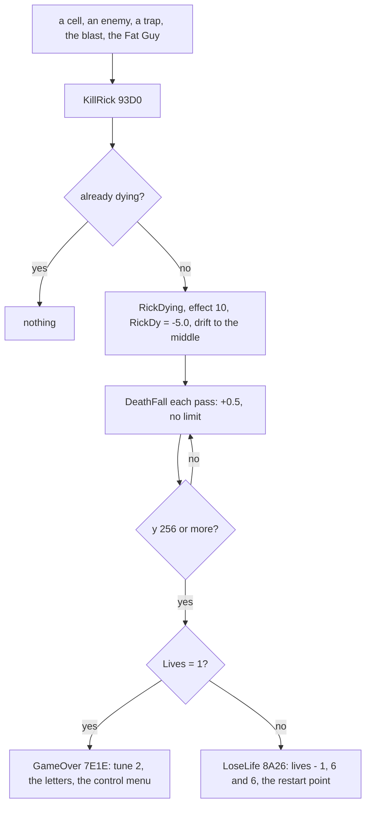

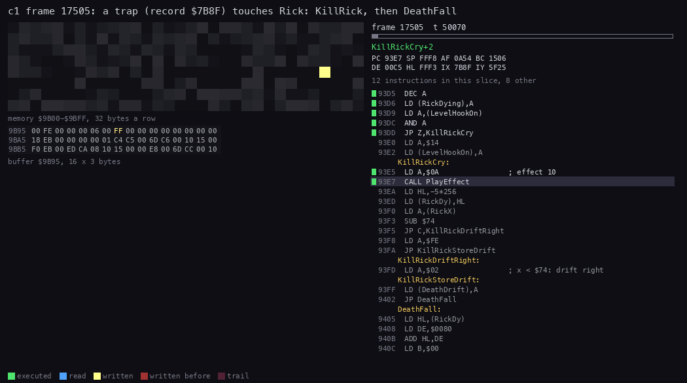

*`c1` frame 17 505, T 49 900-58 400: the trap's deadly test calls `KillRick`; `DeathFall` runs from it, and once more
from `UpdateRick` in the same pass. The buffer is `$9B95` onwards: `RickDy`, the flags, `RickRecord`, the weapons. Made
with `python3 ../../kit/routine_anim.py --work work/docs/wr/c1 --window 17505:49900-17505:58400 --listing
build/game.lst --out docs/img/routines/KillRick.gif --pc 93D0-945D,95ED-9662,A440-A480 --range 9B00-9BFF --view
buffer:9B95:16x3:hex --pictures 50 --title "..."`.*

**A worked example: the blast death in `controls-keyboard`.**

1. Rick stands at x 0, y 227.
2. At frame 1110 he is dying: x 2, y 222, `RickDy` -4.5 (the -5.0 of `KillRick` plus the first 0.5 of `DeathFall`).
3. He rises to y 204 at frame 1128 (`RickDy` 0), then falls, 2 pixels to the right a pass.
4. At frame 1158 y is 257: the high byte is 1, so `DeathFallOver` is set.
5. At frame 1160 Rick stands at the section's restart point, x 0, y 204, with a life less.

The fall took 24 passes: 227 plus the speeds -4.5, -4.0, ..., +7.0 is exactly 257 (25 passes would give 264.5).
From frame 1110 (the first pass done) to frame 1158 (the 24th) is 48 frames for 23 passes, so one pass of those took
four frames (or two took three); the samples, every 2nd frame, do not show which. About 50 frames: one second.

The trap death in `c1` adds a detail.
The traps are updated before Rick, so `DeathFall` runs twice in the dying pass: from `KillRick` at T 52 545 and from
`UpdateRick` at T 57 611.
The first step of that death is twice as long.

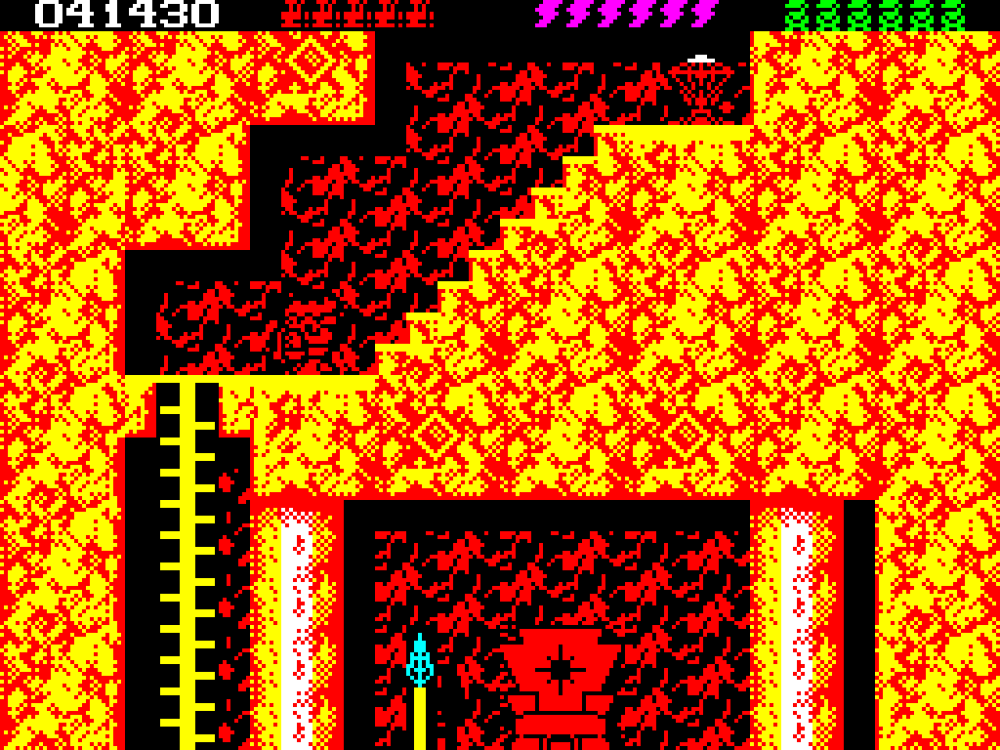

*Doc 01's animation of a death and the restart: `rzx-l5-full` frames 2196-2340
([doc 01](01-game-design.md) gives the command).*

The point: every death is the same: one entry, one fall, one test in the main loop.
Only the restart point and the lives decide what follows.

Witness: the `controls-keyboard` values (`memory_at`, every 2nd frame); the `c1` traces 16 788-16 791 (`$93B4`) and
17 503-17 506 (`$A475`, then `DeathFall` at T 52 545 and 57 611).
The caller counts are `KillRick`'s callers in l1q; `DeathFall` ran 895 times and set `DeathFallOver` 35 times
(`src/game/rick.asm`); `LoseLife` L1 54 in 14 builds (`src/game/level.asm`).

## 10.11 Lives, bullets, detonators and the score

| Counter | Address | Start | Refilled | Spent |
| --- | --- | ---: | --- | --- |
| `Lives` | `$8B3B` | 6 (`ResetGame` `$7CAD`) | +1 at a level start below 6 (`$7CEE`) | one a death (`$8A30`) |
| `Ammunition` | `$8B3C` | 6 | 6 at each level start (`$7CF4`), each death (`$8A41`), each ammunition pickup | one a shot |
| `Detonators` | `$8B3D` | 6 | 6 at each level start (`$7CF7`), each death (`$8A44`), each detonator pickup | one a drop |

With `CheatInfinite` `$8066` set ([doc 05](05-controls.md#57-the-cheat-chords)) none of the three goes down.

The score is six decimal digits, one a byte (`Score` `$7F1D`).
`AddScore` `$7ED3` adds a six-digit record digit by digit with a carry, then redraws the score
([doc 08 8.3](08-hud-and-text.md#83-the-score)).
Every place that adds points:

| Event | Record | Call site | Calls in the builds |
| --- | --- | --- | ---: |
| an enemy killed in view | `Points50` `$7EF3` | `KillEnemy` `$9F6D` | 101 |
| the blast's extra on an enemy | `Points50` | `$8C36` | 5 |
| a treasure | `Points500` `$7EFF` | `UpdatePickup` `$A595` | 28 |
| the countdown bonus, what is left | `TimeBonus` `$7F17` | `StopBonusTimer` `$9CD6` | 9 |
| the Fat Guy's last hit | `Points5000` `$7F05` | `FatGuyHit` `$F964` | 1 |
| the Fat Guy's end | `Points100000` `$7F11` | `BonusTally` `$86E3` | 0 |
| each bullet left | `Points5000` | `TallyBullets` `$86F4` | 0 |
| each detonator left | `Points10000` `$7F0B` | `TallyDetonators` `$8715` | 0 |
| each life left | `Points100000` | `TallyLives` `$8736` | 5 |

`Points100` `$7EF9` is in the table, and nothing reads it.

**The countdown bonus.**

1. A map entry of kind `$78` starts it (`StartBonusTimer`), only when no countdown runs (`$9CAF`): digits 2-4 of the
   bonus (`$7F19-$7F1B`) become 2, 0, 0, `BonusRunning` is set, and tune 1 plays. Digits 0, 1 and 5 keep their
   values: 0 from the load, so the bonus reads 002000 unless a countdown wrapped (10.15).
2. `CountBonus` `$9163` takes 10 off every 25 passes.
3. A kind `$7C` entry stops it (`StopBonusTimer`), only while one runs (`$9CCE`): what is left goes to the score, and
   tune 1 plays again; the digits stay.

Each level has 4 to 9 such pairs (the table in 10.8): a start box where a hard stretch begins, and a stop box where
it ends.

```
StartBonusTimer:  if BonusRunning: return
                  BonusRunning = $FF; BonusPrescaler = 25; TimeBonus[2..4] = 2, 0, 0; StartTune(1)
CountBonus:       each pass while BonusRunning: if --BonusPrescaler == 0: 25 again, TimeBonus -= 10
                  ; digits 1-4 only: from 000000 it wraps to 099990, and BonusRunning stays set
StopBonusTimer:   if not BonusRunning: return
                  BonusRunning = 0; AddScore(TimeBonus); StartTune(1)
```

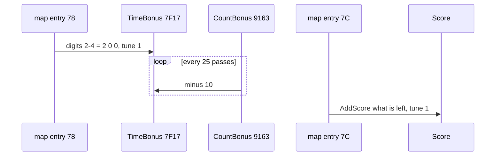

**A worked example.**
At 2 frames a pass, 25 passes are 1 s, so the bonus loses 10 points a second.
A stretch done in 30 s pays 2000 - 300 = 1700.
The bonus reaches 0 after 200 steps: 5000 passes, at least 10 000 frames.

The point: the score rewards speed only inside the marked stretches; outside them, time costs nothing.

Witness: `AddScore` ran 149 times in 47 builds (callers `$8736` x5, `$8C36` x5, `$9CD6` x9, `$9F6D` x101, `$A595`
x28, `$F964` x1); `CountBonus` ran 12 127 times in 29 builds, and the bonus never ran out (`src/game/score.asm`).

## 10.12 The Fat Guy

Level 5 ends in section 7 with the Fat Guy.
The exit `$42` from section 6 sets `LevelHookOn` `$8A24` to 20: the hits he can take.
While it is not 0, the game hands the section to level 5's own code:

- `SetupSection` calls `LevelHookA` `$C206` (`JP FatGuyStart`) in place of the map entry scan;
- `UpdateObjects` calls `LevelHookB` `$C209` (`JP FatGuyUpdate`) in place of the trap and enemy updates.

In levels 1-4 those six bytes hold the text "CORE  " or "DESIGN".

```
FatGuyStart:  five trap records from FatGuyParts: alive, no trigger test, a sprite each
              the body (record 0) at x $B0, y $90, on FatGuyPath (126 passes, looped)
FatGuyUpdate (each pass):
    FatGuyMove(body)                           ; one step of FatGuyPath
    place parts 1-4 at their offsets from the body; part 4's sprite 43 / 44
    box = part 1's x, y, 48 x 42
    if the bullet is in the box: the bullet is spent; FatGuyHit      ; $F922
    if fuse 4-9 and BlastHits(box): FatGuyHit                        ; each such pass, $F940
    if the box touches Rick: KillRick                                ; $F946
    FatGuyShoot; FatGuyShotMove                ; one shot at a time, 50 passes apart
FatGuyHit:
    PlayEffect(9); LevelHookOn -= 1
    if LevelHookOn == 0: 5000 points, effects 5 and 10, the parts fly off as blasts
```

```
F954  LD A,$09           ; FatGuyHit
F956  CALL PlayEffect
F959  LD A,(LevelHookOn)
F95C  DEC A
F95D  LD (LevelHookOn),A
F960  RET NZ
F961  LD HL,Points5000   ; the last hit
F964  CALL AddScore
F967  LD A,$05
F969  CALL PlayEffect
F96C  LD A,$0A
F96E  CALL PlayEffect
```

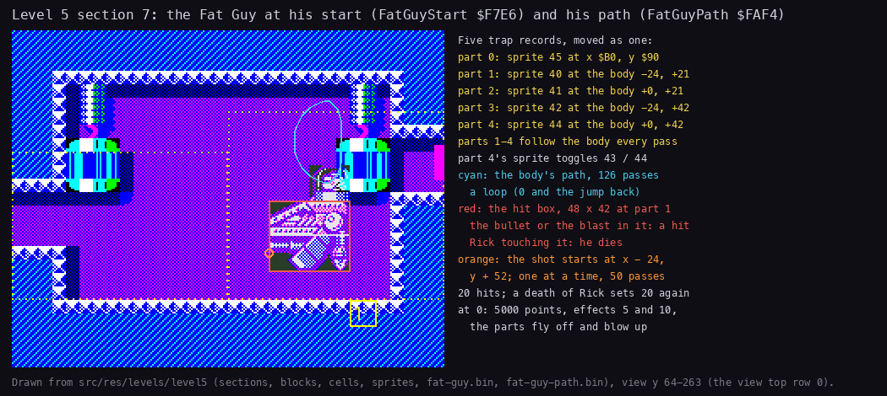

*Level 5 section 7 from the resources, with the Fat Guy's five parts at his start, the body's path (126 passes, then
the loop), the hit box and the shot's start. Made with `python3 tools/fig_play.py fatguy docs/img/play/fat-guy.png`.*

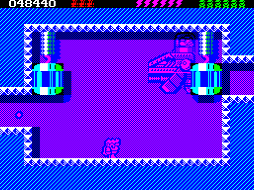

*`rzx-l5-22000-poke` frame 250: the Fat Guy in his room, Rick below (made by `tools/fig_design.py` for doc 01).*

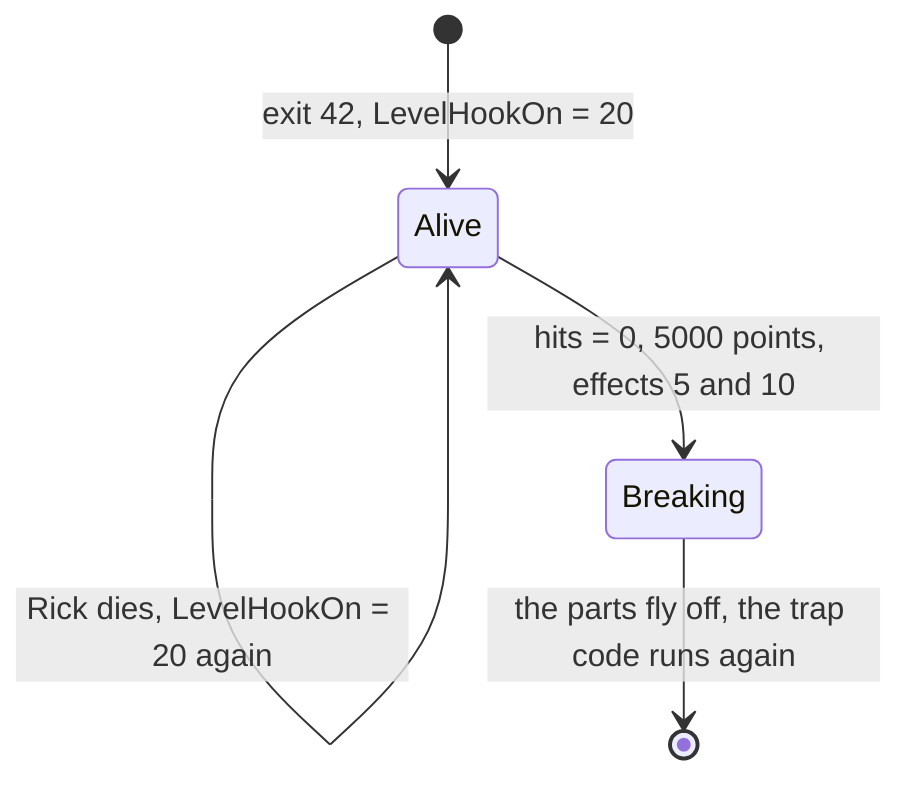

**A worked example: the hits.**
The blast counts once a pass for six passes, so one detonator that covers him takes up to 6 hits.
In the RZX run's level 5 (sampled every 250 frames), `LevelHookOn` read 20, 16, 14, 8, 8, 2, 2, 0.
Meanwhile the detonators went from 6 to 2: four detonators did it, with no bullet.
The kill is in `rzx-l5-22000-poke`, with 5000 points at `$F964`.
A death in between would have put the count back to 20.

The point: the boss is five ordinary trap records, driven by level 5's own code through two hooks.
Other levels fill those hooks with the developer's name.

Witness: `FatGuyUpdate` ran 524 times (`rzx-l5-20000-poke` 377, `rzx-l5-22000-poke` 147); 14 hits, all from the blast
(`$F940`); the shot killed Rick once (`$FACB`) (`src/levels/level5/fatguy.asm`).
`fatguy-hits` (the RZX's state at 21 000 with the pieces' immunity POKEs, which leave the Fat Guy's tests alone;
WALKTHROUGH 6.0) runs the other two branches: Rick walks into him while he hangs low and dies (`$F946` jumps once,
`RickDying` set in frames 196-198), and a bullet fired from the left ledge hits him (`$F922` once, his count 20 -> 19 in
frames 822-824). A bullet fired from the floor flies at y 211, under his box (y 165-207 at his lowest).

## 10.13 The level order and the two endings

The main loop tests the section exits each pass; an exit with bit 7 is the level's end.
`LevelsDone` `$7EF2` counts the levels finished in this game (`ResetGame` clears it).
`Level5Open` `$8065` is not cleared by a new game.

```
at a level's end ($7D9E):
    if LevelsDone == 3: Level5Open = $FF          ; the fourth level done in this game
    LevelsDone += 1
    if LevelsDone == 5: BonusTally                ; the Fat Guy's end
    elif Level == 5: Congratulations              ; level 5 done, but not five levels in this game
    elif Level == 4 and not Level5Open: Congratulations
    else: Level += 1; LevelStart
```

```
7D9E  LD A,(LevelsDone)
7DA1  CP $03
7DA3  JP NZ,CountLevelDone
7DA6  XOR A              ; the fourth level done in this game: level 5 opens
7DA7  DEC A
7DA8  LD (Level5Open),A
7DAB  LD A,$03
7DAD  INC A              ; CountLevelDone
7DAE  LD (LevelsDone),A
7DB1  CP $05
7DB3  JP Z,BonusTally
7DB6  LD A,(Level)
7DB9  CP $05
7DBB  JP Z,Congratulations
7DBE  CP $04
7DC0  JP NZ,NextLevel
7DC3  LD A,(Level5Open)
7DC6  AND A
7DC7  JP Z,Congratulations
```

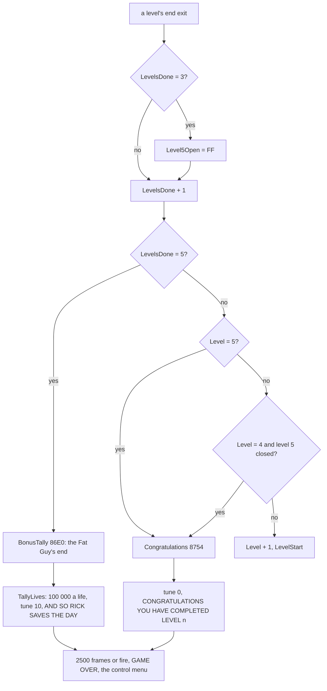

**The Fat Guy's end.**

1. `BonusTally` adds 100 000 for the Fat Guy.
2. It counts the bullets: 5000 each, effect 4, 10 frames.
3. It counts the detonators: 10 000 each, effect 5, 15 frames.
4. `TallyLives` counts every life down to 0: 100 000 each, effect 10, 20 frames. Its head `$8728` runs once more
   than there are lives, the last time finding 0 (`TallyDone`).
5. Tune 10 starts, and the end text falls line by line ([doc 08 8.7](08-hud-and-text.md#87-the-endings-texts)).
6. `EndTextPause` `$877E` waits up to 2500 frames, one `WaitFrames(1)` and a `TestFireKeys` each; fire ends it early.
   `EndTextExit` `$8794` then puts the level's cells back (`FontCellsMode`, `LevelCellsMode`), redraws the HUD and
   jumps to `GameOver` `$7E1E`.

```
BonusTally:                                 ; $86E0, from the level's end when LevelsDone reaches 5
    AddScore(Points100000)
    while Ammunition:  Ammunition -= 1; AddScore(Points5000);  PlayEffect(4);  DrawAmmo();       WaitFrames(10)
    while Detonators:  Detonators -= 1; AddScore(Points10000); DrawDetonators(); PlayEffect(5);  WaitFrames(15)
    while Lives:       Lives -= 1;      AddScore(Points100000); DrawLives();     PlayEffect(10); WaitFrames(20)
    StartTune(10); ShowEndText(FatGuyEndText)
ShowEndText:  FontCellsMode(); DrawHud(); DropText each line
              repeat 2500: WaitFrames(1); if fire: break
              FontCellsMode(); LevelCellsMode(); DrawHud(); GameOver()
```

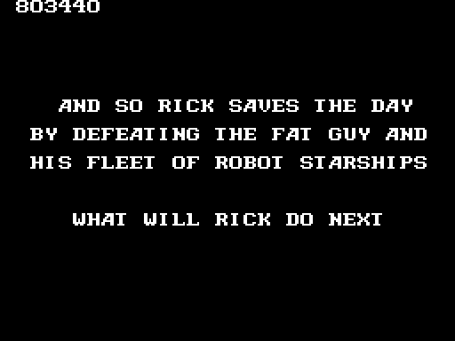

*`rzx-l5-24000-poke` frame 250: the end text (doc 08's screenshot; the same screen as `rzx-l5-23000` from frame 1250
on, WALKTHROUGH 6.1).*

**A worked example: which ending.**

1. A game started at level 1 and played through: levels 1-4 make `LevelsDone` 4 and open level 5; level 5 makes it 5.
   The result is the Fat Guy's end.
2. A game started at level 2 (the level menu), with level 5 never opened: levels 2, 3 and 4 make `LevelsDone` 3.
   Level 4's end finds level 5 closed: CONGRATULATIONS, level 4.
3. The same game after an earlier one opened level 5: level 4 leads to level 5, but level 5's end finds `LevelsDone`
   4. The result is CONGRATULATIONS, level 5.

`end-congrats` takes case 2's branch.
It is the RZX run's level 4 end with `LevelsDone` POKEd to 0, and it shows "CONGRATULATIONS ... YOU HAVE COMPLETED
LEVEL 4".
`rzx-l5-23000` starts in `TallyLives`: five lives counted, then the text.

The point: the true ending needs all five levels in one game.
The level menu lets a player start later, but then only the consolation text can be reached.

Witness: `Congratulations` once (`end-congrats`); `TallyLives`' head 6 runs in `rzx-l5-23000` (five lives and the
final 0); `BonusTally` and `EndTextExit` not executed in any recording (`src/game/ending.asm`, `src/game/mainloop.asm`).

## 10.14 How the levels differ

The code is the same for all five levels; the level block brings everything else.

| Level | Sections | Special surface | Vehicle | Enemies | Trap entries (deadly) | Treasures | Ammunition + detonator pickups |
| ---: | ---: | --- | --- | ---: | --- | ---: | ---: |
| 1 | 9 | weak jump (never used) | none reached | 25 | 76 (50) | 9 | 11 |
| 2 | 13 | ice | section 6 | 44 | 106 (100) | 14 | 15 |
| 3 | 10 | bounce | none | 47 | 136 (86) | 6 | 11 |
| 4 | 13 | mud | sections 4, 5 | 45 | 134 (111) | 14 | 15 |
| 5 | 8 | launch pad | section 2 | 29 | 110 (87) | 3 | 7 |

The section counts are `SectionCounts` `$8374` ([doc 07 7.2](07-objects.md#72-the-section-table-and-the-exits)).

There is no speed-up, no table of difficulty and no loop: the same section always holds the same objects.

- Level 2 has the most deadly traps for its size (100 of 106).
- Level 3 has the most trigger boxes waiting for Rick (144).
- Level 5 has the most boxes that wait for the blast (43), the fewest supplies (7 pickups) and the Fat Guy.

The point: the difficulty is level design; the engine has no knob.

## 10.15 Notable features

Each feature below names its code, and its witness or "known only from the code".

- **Decimal points records.**
  Every award is a six-digit record (`$7EF3-$7F16`), one digit a byte, added digit by digit (`AddScore` `$7ED3`).
  There is no binary-to-decimal conversion anywhere, and the HUD draws the digits as they are.
  Witness: 10.11.
- **Platforms are traps.**
  A record of table A with +0 bit 7 is a platform, with bit 6 a solid block.
  The same box test (`TestBoxObjects`) that finds the floor finds them, and a platform's motion is carried to Rick
  (`PlatformDx`).
  Witness: `RickLandOrFall`'s platform branch, 10.2.
- **The boss in the level block.**
  Level 5's code runs through two jumps at `$C206`/`$C209`.
  Levels 1-4 hold "CORE  " and "DESIGN" there, never run (10.12).
- **8.8 physics, no tables.**
  The jump, the launch pad, the death, an enemy's fling and the detonator's fall are all "speed + 0.5 a pass" from one
  starting speed (10.2).
- **The blast kill pays 100, or 50 off the view.**
  `TestEnemyHits` pays `Points50` for a blast hit itself (`$8C33`), and `KillEnemy` adds its own 50 only for an enemy
  in the shown view (10.9): a blasted enemy pays 100 in view, 50 off it; the other kills pay 50 in view, 0 off it.
  Witness: `$8C36` 5 calls.
- **The punch's 5-pixel window.**
  The touch test runs after the punch, every pass, stunned or not, so closer than 20 pixels the punch stuns the enemy
  and Rick dies anyway; facing left the window is 4 pixels (10.7, known only from the code).
- **The Fat Guy heals.**
  A death puts his count back to 20 (`$93E2`), so the 20 hits must come in one life.
  Witness: `KillRick`'s level 5 branch ran once (`rzx-l5-20000-poke`).
- **The Fat Guy's crossed aim.**
  `FatGuyShoot` (`$FA29-$FA36`) takes the shot's x from Rick's y + 10 for the y step, and the shot's y from Rick's x +
  12 for the x step.
  Both are halved together until they are small, so the shot still flies towards Rick's side, but not at him.
  Where it lands is known only from the code.
- **An older build's leftover.**
  Three bytes `01 F8 00` (`LD BC,$00F8`) at `$FA84` sit between the aim loop's jump and `FatGuyShotAimed`; no jump
  reaches them.
- **DeathFall twice.**
  A trap's kill comes before `UpdateRick` in the pass, so the first death pass moves Rick twice (10.10, the `c1`
  trace).
- **The bonus wrap.**
  `CountBonus` counts the four digits `$7F18-$7F1B` (tens to ten thousands) of the six-digit `TimeBonus`.
  From 000 000, the next step borrows through all four, leaves 099 990 and ends at `BonusRunOut` `$917C`, a lone
  `RET`; nothing clears `BonusRunning`, so the countdown never stops: it counts on from 099 990, 10 every 25 passes.
  A stop box reached after the wrap pays 99 990 less the time since.
  Digit 1 (`$7F18`) is then 9; `CountBonus` decrements it at each borrow out of digit 2, like the others (every 1000
  steps: 099 990, ..., 090 000, 089 990).
  A start writes only digits 2-4 and nothing resets digit 1 at a new game (only the loader sets it), so a later
  countdown starts at 0d2 000, d whatever digit 1 holds: 092 000 while it is still 9 (known only from the code).
- **The left throw.**
  A detonator thrown left (-2.0) cannot stop before its fuse ends; `DetonatorStopLeft` is not executed in any
  recording (10.6).
  Both sideways keys together throw right: `DropDetonator` tests for no key, then for left alone (`$9B68-$9B86`).
- **Supplies can be destroyed.**
  The bullet (`$A5E4`) or the blast (`$A5F7`) bursts an ammunition or detonator pickup before Rick takes it.
  Witness: `box-shot` shoots an ammunition box (`PickupShot` 1 run, `PickupBurst` 10); the blast's branch is known
  only from the code.
- **No wanderers.**
  Behaviour 0 has code and no map entry; only the climbers run it (10.9).

## 10.16 What no recording reached

| What | Where the code shows it |
| --- | --- |
| the countdown bonus running out | `CountBonus` `$9163`, `BonusRunOut` `$917C` |
| `BonusTally`'s 100 000, bullets and detonators | `$86E0`-`$8727` (the RZX run passed it before frame 23 000) |
| the end of either ending's wait (2500 frames or fire) | `EndTextExit` `$8794` |
| level 1's special surface (jump -2.0) | `WeakJumpLevel1` `$9799` |
| a detonator on a special surface, against a ceiling, or a left throw stopping | `DetonatorBounce`, `DetonatorHitCeiling`, `DetonatorStopLeft` |
| a deadly solid block setting off a lit detonator | `UpdateTrap`'s detonator test (`$A41C`) |
| a pickup burst by the blast (the bullet's: `box-shot`) | `$A5F7` |
| an enemy of behaviour 0 placed by the map | `EnemyWanderer` runs only for climbers |
| the Fat Guy's shot aimed right (Rick to the right of the shot, C positive) | `AimRightLoop` `$FA46-$FA64` (level 5's code) |
| a ride into level 1's section 0 | the exit of level 1 section 2 ([doc 07 7.12](07-objects.md#712-known-only-from-the-code)) |
