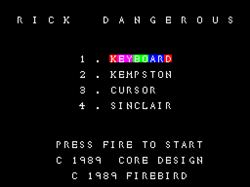
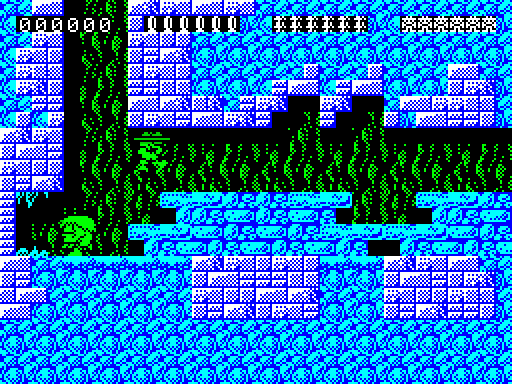
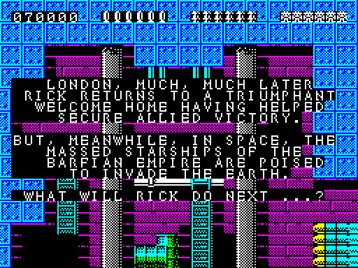

# Rick Dangerous: walkthrough

How the reverse was done, step by step, and which unreal-ng call answered each question. Terms:
[docs/README.md](docs/README.md). Recipes: `../recipes/`.

Every recording is named with its load (ROM speed or the fast LD-BYTES trap) beside every frame number.

## 0. The medium

The original is ZXDB's `RickDangerous.tzx.zip` (release 0, Firebird, scheme "Firebird BleepLoad"). Its hashes, and
the release check against ZXDB entry 4135, are in the [README](README.md). The release data came from the
spectrumcomputing.co.uk entry page (`work/stage1/sc-4135.html`) while the ZXInfo API returned 502. The search for other
copies:
- `tools/fetch_copies.py` fetched every copy in the collection index into `work/candidates/`;
- `tools/copy_blocks.py` compared the tapes block by block;
- a search for the game image's 562 pieces of 64 bytes went through every copy (`work/stage1/copy-image.txt`).

The results are in the README's copies table. The disk release holds 558 of the 562 pieces. The Kixx, MCM, IBSA and
Erbe re-releases are a later build with its code moved: from `$A13B` on, about 10 bytes later, and from `$E2D1` on, 25
bytes later.

`tools/tzxblocks.py list` lists the tape: a BASIC loader, the 512-byte first stage "Rick1" at `$CD00`, then three
groups of Bleepload turbo blocks (48 + 140 + 6). [Doc 3, 3.1](docs/03-build-and-load.md#31-the-tape-block-by-block)
has the table. The turbo payload is enciphered: none of its 37 376 bytes equals the image byte at its destination.
So the game image is not cut from the tape. SkoolKit's `tap2sna.py` instead simulates the whole load on a 128K up to
the entry `$AB4D` (`python3 tools/image.py work/mkgame/original.bin`, `case.json` `image_cmd`). Its image matches the
emulator's at the entry in `c1` except 39 bytes in `$5B89-$5BDD`, which the game overwrites before it uses them
([doc 2, 2.3](docs/02-architecture.md#23-the-images-loaded-at-the-entry-in-play)).

The SAM Coupe port's source disk (zxart, ZXDB 38305): not used (only the standard Spectrum releases).

## 1. One recording from power-on

`c1`: power-on on the 128K, the 128 menu's Tape Loader, the original TZX at ROM speed (`re_session.py capture
--record-load`, `--load-frames 30000`), then the input script `tests/inputs/c1.txt` from frame 30 000. That is
33 400 frames.

| Frame (`c1`, ROM speed) | What |
| --- | --- |
| 0 | power-on |
| 0-19 010 | BASIC, "Rick1", then the turbo groups 1, 2 and 3; the interrupts are disabled through the turbo load |
| 19 010 | the entry `$AB4D` (DI, `LD SP,0`, `CALL $A043`); the RAM 1 copy starts at T-state 70 589 |
| 30 250 | the menu ([menu](docs/img/play/menu.png)) |
| 30 500 | the intro text of level 1 |
| 31 000 | level 1 in play |
| 33 250 | Q quits: GAME OVER |

**Interrupt mode.** IM 2 with `I` = `$83`. The table `$8300-$8400` holds 257 bytes of `$FE`, so whatever the bus
holds, the vector is `$FEFE`. The handler at `$FEFE-$FF1D` does the following:
- DI, then pushes the registers;
- adds 1 to `$A237`;
- calls `$E49B`;
- on the 128K, calls the music tick `CALL $A030` (patched in at `$FF11` at the entry);
- pops the registers, then EI and RET.

The handler runs once per interrupt. In `c1` the L1 counts 14 502 executions of `$FEFE` in 33 400 frames, and the
same count for `$A030`. The turbo load runs with the interrupts off.

**The main loop and the frame.** The main loop at `$E3C9` waits at the HALT at `$E40F`, and `$E410` then clears
`$A237`. So `$A237` counts the interrupts in one pass of the loop. `work/stage1/pass_frames.py` reads `$A237` at the
end of every frame with `time_travel memory_at`. A pass's length is the run of frames from one 0 to the next:

| Recording | Window | Passes | Frames per pass | Mean |
| --- | --- | --- | --- | --- |
| `level1` | frames 100-3 100 | 2 774 | 1: 2 720; 2: 5; 4: 21; 5: 9; 6: 9; 7: 9; 8: 1 | 1.08 |
| `level2` | frames 100-3 100 | 2 847 | 1, with a few of 4-7 | 1.04 |

Almost every pass takes one frame. The long passes are the screen changes: they come in threes as the view scrolls
(`level1` frames 325, 329, 335 and 434, 438, 443; `$EAAE`, Rick's map position, steps from `$8C` to `$8F` across the
second three). The heaviest pass is 8 frames at `level1` frame 2 807. There `$EAAE` jumps from `$FC` to `$8B`, and a
whole new view is drawn.

**The stack** is at `$FFEE-$FFFF` under `SP` = `$0000`
([doc 2, 2.2](docs/02-architecture.md#22-the-memory-map)).

## 2. Static pass over the medium

## 3. The stages and the packers

## 4. The medium from source

## 5. Tool gaps found and fixed in unreal-ng

| Gap | Fix | unreal-ng commit |
| --- | --- | --- |

## 6. The game

### 6.0 The recordings

All are captured on the 128K with `re_session.py capture --model 128K --ranges 4000-FFFF --port-base 37490`, with
input scripts from `tests/inputs/`. `work/stage1/capture_all.sh` makes all but `c1`. Each keeps its `session.ttd`, its
`l1.json` and its screens in `work/stage1/<name>/`. The states they start from:
- `probe/after128.szx`: the menu after the ROM-speed 128K load of the original, keyboard selected, no POKE;
- `probe/menu-cursor.szx`: the same, with cursor keys selected.

**The level warp, a patch on a clone, said so in each recording it starts.** From `menu-cursor.szx`:
- copy the 11-byte record N of the level table `$E4AE` over record 0;
- set `$E3F4` = 0 (ZXDB's infinite-lives POKE 58356);
- ENTER;
- at the intro, set `$E4AD` = N.

The states are in `work/stage1/warp/`. No patched byte goes into the image.

The keys of `level1`-`level4` and part of `c1` come from someone else's run: the RZX archive's `rick1.rzx`, on a
re-release build, turned into input scripts by `tools/rzx_script.py`. That run is a witness only where said. It stays
in step with our original only for a while (bitmap diff of the screens against the RZX's own):
- level 1 from the menu: about 2 250 frames;
- level 2: from the RZX's frame 8 590 to about 11 850;
- level 3: from 25 378 to about 26 100;
- level 4: about 700 frames from 43 107.

| Recording | Starts from | Frames | Inputs | Reached |
| --- | --- | --- | --- | --- |
| `c1` | power-on, the TZX at ROM speed | 33 400 | `c1.txt`: the control menu 2, 4, 1, 3; the RZX's keys of its frames 0-2 400 from frame 400; P, P (pause); Q | the whole load, the entry (frame 19 010), the menu, every control choice, the intro music, level 1's first two zones (score 4 170 at the quit), pause, quit, GAME OVER, the menu |
| `controls` | `after128.szx`, no POKE | 2 500 | `controls.txt` | each control method in turn (keyboard, Sinclair, Kempston, cursor), each game quit with Q; the Kempston bug: Rick walks right on his own |
| `gameover` | `after128.szx`, no POKE | 3 000 | `gameover.txt`: ENTER, ENTER, X held | the boulder of the first screen kills Rick six times; GAME OVER and its tune; back to the menu |
| `level1` | `menu-cursor.szx`, no POKE | 6 000 | `level1.txt`: the RZX's frames 1-6 000 | level 1 zones 1 and 2, deaths, a natural GAME OVER and a new game |
| `level2` | `warp/level2c.szx`, the level warp | 6 000 | `level2.txt`: the RZX's frames 8 581-14 580 | Egypt's intro and first screens; when the RZX falls out of step, Rick stands at the start |
| `level3` | `warp/level3c.szx`, the level warp | 6 000 | `level3.txt`: the RZX's frames 25 371-31 370 | the castle's intro and its first two screens |
| `level4` | `warp/level4c.szx`, the level warp | 6 000 | `level4.txt`: the RZX's frames 43 101-49 100 | the missile base's intro and first screens |
| `ending` | `warp/ending.szx`, a warp | 1 500 | `ending.txt`: ENTER at 300 and 1 200 | the last level's end: the closing text, the closing effect `$AF56`, `$E440` = `$FF`, GAME OVER, the menu |

`warp/ending.szx` is level 4 in play after the level warp, then a second patch at the main loop's HALT: `$E4AD` = 3,
the return address `$E406` pushed (SP = `$FFFE`), PC = `$ABD8`, the path the game takes when Rick leaves a level by
its last exit (`PUT /registers/SP`, `/registers/PC`).

**Sound.** Execution counts from the L1 witness the music and the effects. The music entry `$A016` takes the tune
in A:
- 0, the intro (`$E324`): `c1`, `controls`, `gameover`, `level1`;
- 1-4, a level's end (`$AC20`): `ending`;
- 5, the menu (`$E220`): `c1`, `controls`, `gameover`, `ending`, `level1`;
- 6, GAME OVER (`$E386`): `c1`, `controls`, `gameover`, `ending`, `level1`;
- 7 (`$F531`): `c1`, `level1`.

The effects (`$9FED`, IDs 0-11) are called from 15 sites in `$EC93-$FD44`. All of them run except ID 8 (`$ED76`).
The counts are in `work/stage1/NOTES.md`.

**Not reached, and why:**
- the whole of levels 2-4: the RZX's keys fall out of step with the original after 700-3 300 frames. The maps of
  those levels are drawn from the data instead
  ([doc 2, 2.5](docs/02-architecture.md#25-levels-zones-and-maps));
- level 1's zones 3-6, for the same reason;
- effect ID 8 at `$ED76`: its call site never ran, so it is known only from the code;
- the 48K path (`$A08D` = `$FF`, the beeper `$A08E`): no 48K recording yet, so it is known only from the code.

### 6.1 Screenshots

Taken from the recordings' screens (`screens/NNNNNN.scr`, named by the input script's frame; `c1`'s script starts at
recording frame 30 000) and, for the intros, from the warp recordings' start states.

| Screenshot | Recording, frame |
| --- | --- |
| [menu](docs/img/play/menu.png) | `c1` 30 250 |
| [intro-level1](docs/img/play/intro-level1.png) | `c1` 30 500 |
| [level1-start](docs/img/play/level1-start.png) | `c1` 31 000 |
| [level1-ladders](docs/img/play/level1-ladders.png) | `c1` 31 750 |
| [quit-game-over](docs/img/play/quit-game-over.png) | `c1` 33 250 |
| [menu-sinclair](docs/img/play/menu-sinclair.png) | `controls` 1 250 |
| [menu-kempston](docs/img/play/menu-kempston.png) | `controls` 1 750 |
| [kempston-walks-right](docs/img/play/kempston-walks-right.png) | `controls` 2 000 |
| [game-over](docs/img/play/game-over.png) | `gameover` 2 500 |
| [intro-level2](docs/img/play/intro-level2.png) | `level2` 0 (the warp state) |
| [level2](docs/img/play/level2.png) | `level2` 500 |
| [intro-level3](docs/img/play/intro-level3.png) | `level3` 0 (the warp state) |
| [level3](docs/img/play/level3.png) | `level3` 500 |
| [intro-level4](docs/img/play/intro-level4.png) | `level4` 0 (the warp state) |
| [level4](docs/img/play/level4.png) | `level4` 250 |
| [ending-text](docs/img/play/ending-text.png) | `ending` 250 |
| [ending-game-over](docs/img/play/ending-game-over.png) | `ending` 500 |

## 7. Review
